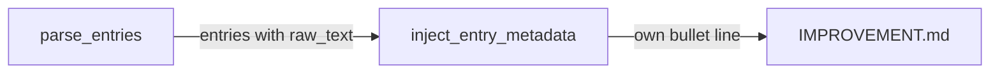
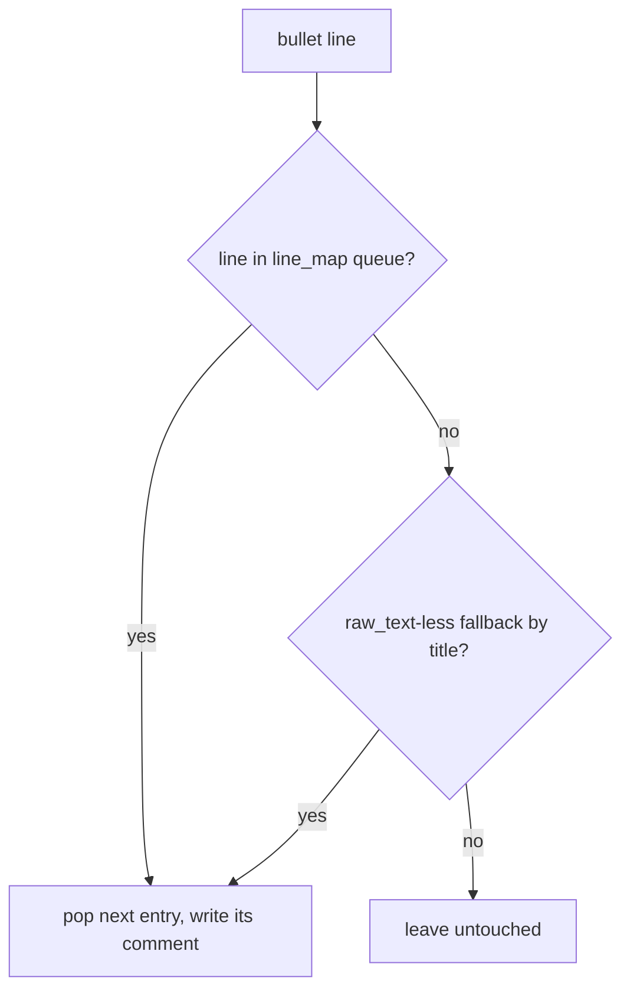

# Design Spec

**Run** `run_1962cc52` · **profile** direct · **project** SwarmAI

> 直接修 修 14 条日期标题反复判定 ⏎ 看 KNOWLEDGE 和 principle 的 diff

_Generated from the run's stage artifacts by the pipeline (not hand-written)._

## Design

### User workflow

1. today: 14 date-titled guidelines re-fire active->dormant every 30-minute pass and their metadata is overwritten by a same-titled sibling's
2. after: each entry keeps its own metadata; a transition is written once

### Architecture

### Flow

### Invariants

| ID | Invariant | Enforced at |
|---|---|---|
| I1 (root) | A parsed entry's metadata is written only to its own bullet line; same-titled siblings never receive it. | backend/core/ddd_entry_lifecycle.py::inject_entry_metadata |

### Failure modes

| ID | Scenario | Expected |
|---|---|---|
| F1 | two entries have an identical bullet line in one section and only one is passed | the first identical bullet in the document receives it; they are exact duplicates, which reclaim_duplicate_entries removes |

## Plan

Index parsed entries (raw_text set) by (section, exact bullet line) as a document-order queue; fall back to (title, section) then title only for entries without raw_text.

### Acceptance criteria

- AC1: inject_entry_metadata writes each parsed entry's metadata to that entry's own bullet when several entries share one title in one section; a change to one same-titled entry lands on that entry only.
- AC2: a bullet that matches no passed entry keeps its metadata unchanged, even when a passed entry shares its title.
- AC3: in the decay pass, a same-titled entry that goes active->dormant is persisted, so the second pass emits no ENTRY_DECAY for it.

### Exit contract

| ID | Kind | Ref | Expect |
|---|---|---|---|
| X1 | test | backend/tests/test_ddd_entry_lifecycle.py | pass |
| X2 | test | backend/tests/test_ddd_orchestrator.py | pass |

## Boundaries

- **Always:** keep every caller's signature unchanged
- **Never:** change parse_entries; rewrite DDD docs by hand

## Success Criteria

- 185+ tests in the two DDD test files pass
- replay on a copy of the live SwarmAI IMPROVEMENT.md: the 14 repeating ENTRY_DECAY findings fire once, then 0

## Contract readers

| ID | Contract | Pattern | Paths | Readers |
|---|---|---|---|---|
| K1 | inject_entry_metadata matches parsed entries by their own bullet line, not by title | `inject_entry_metadata\(` | backend | backend/core/ddd_orchestrator.py::DddCultivationOrchestrator._ch_entry_lifecycle migrated — passes parse_entries output of the same content (minus stripped blocks); backend/hooks/context_health_hook.py::<file> unaffected — three call sites pass parse_entries output of the same content; backend/core/ddd_entry_lifecycle.py::mark_superseded unaffected — passes parsed entries matching a title; each now gets its own bullet |
