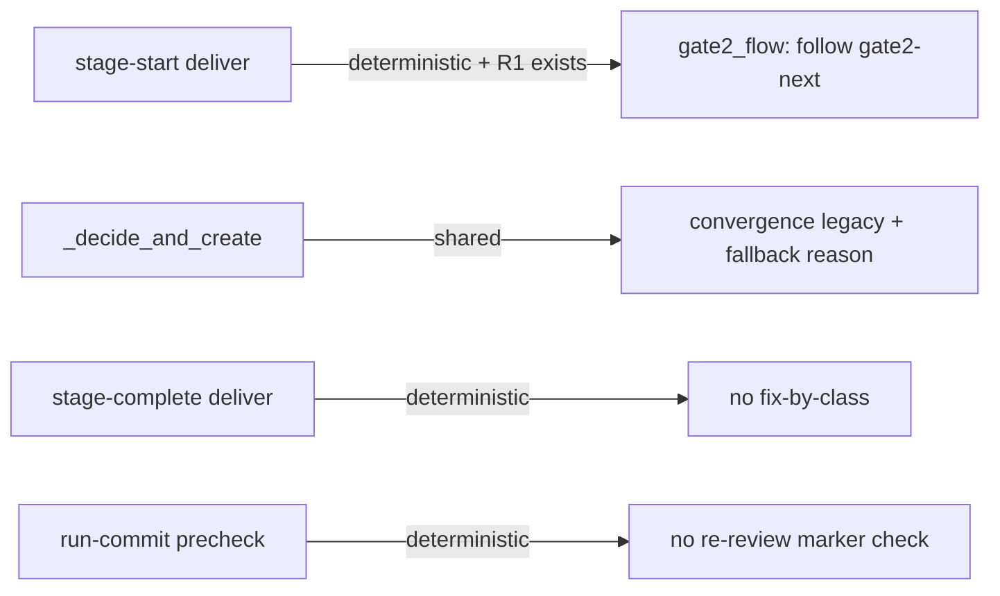
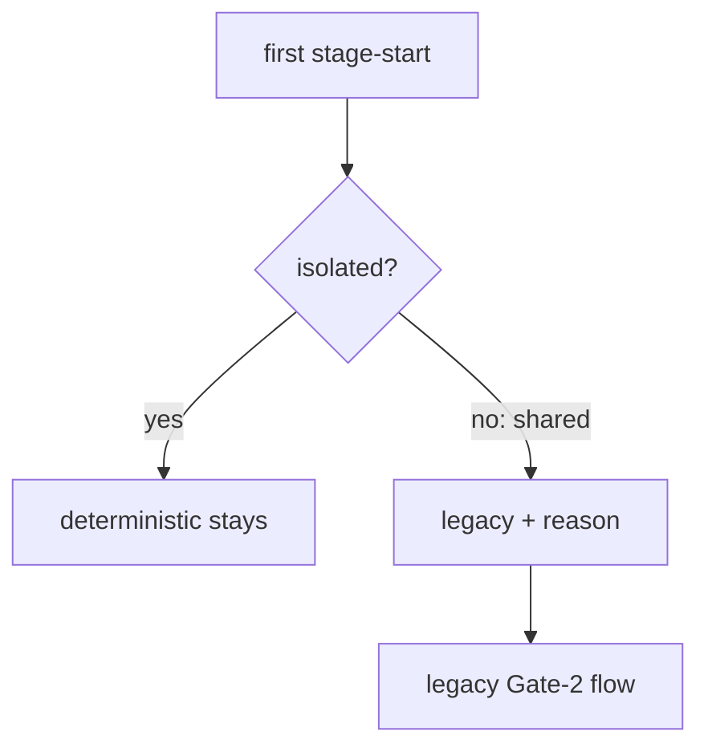

# Design Spec

**Run** `run_1cce404a` · **profile** direct · **project** SwarmAI

> 把上面的P0， P1, P2 都修了啊 direct run

_Generated from the run's stage artifacts by the pipeline (not hand-written)._

## Design

### User workflow

1. Today a deterministic run can still be handed legacy delta prompts on re-entry, can run on a shared checkout where no proof is possible, and gets legacy fix-by-class / re-review errors
2. After: a deterministic run is isolated or it is legacy; its re-entry only follows gate2-next; only the ledger and the tests judge its DELIVER

### Architecture

### Flow

### State lifecycle

| State | Created by | Removed by | Crosses |
|---|---|---|---|
| S1 run.json convergence_fallback | pipeline_worktree._decide_and_create | never: the decision is made once per run | a run created legacy → nothing to downgrade, no fallback recorded |

### Invariants

| ID | Invariant | Enforced at |
|---|---|---|
| I1 (root) | A deterministic run's Gate-2 always reaches done or a named stop, re-entry included | artifact_cli._gate2_round_roster + stage-start deliver re-entry |
| I2 | A deterministic run is isolated; a shared one is legacy | pipeline_worktree._decide_and_create |
| I3 | In a deterministic run only the ledger and the tests judge DELIVER | artifact_cli._validate_stage_candidate, artifact_cli precheck |

### Failure modes

| ID | Scenario | Expected |
|---|---|---|
| F1 | DELIVER re-entry grows the dispatch after fix 1 | the ledger still reaches done |
| F2 | worktree mode off | the run is legacy with convergence_fallback recorded |
| F3 | a projected finding has no invariant/root_cause/class_fix | no fix-by-class error in a deterministic run |

## Plan

Test first (AC1) at the CLI layer, reusing test_gate2_next's env fixture shape. Code: artifact_cli stage-start deliver skips _reentry_delta and strips spawn/prompt_path from experts when deterministic and the R1 snapshot already exists; pipeline_worktree._decide_and_create routes its shared branches through one helper that also downgrades convergence; artifact_cli._validate_stage_candidate skips design_spec.stage_errors for deliver when deterministic; the run-commit precheck skips the re-review marker check when deterministic.

### Acceptance criteria

- AC1: test_gate2_termination_cli.py drives a deterministic run at the CLI layer (real SubagentStop marker files in a temp audit dir, gate2_v2 events in run.json, prove files written by the runner's writer) through R1, fix 1, R2, fix 2, prove; then a DELIVER re-entry that adds red-team to dispatch_plan.deliver and opens a second stage window; _gate2_next_view returns done with every proven finding proven and no 'ignored' warning
- AC2: stage-start --stage deliver of a deterministic run whose R1 snapshot already exists returns no gate2_reentry and no expert 'spawn' / 'prompt_path' entries; the gate2_flow rule says to follow gate2-next only
- AC3: pipeline_worktree._decide_and_create, on every branch that sets worktree_mode shared, also sets convergence legacy for a run that asked for deterministic and records convergence_fallback with the reason; an isolated run keeps deterministic
- AC4: in a deterministic run, stage-complete --stage deliver does not add design_spec 'Fix by class' errors, and run-commit's precheck does not add 'Gate-2 expert(s) have not reviewed the current change'; legacy runs keep both

### Exit contract

| ID | Kind | Ref | Expect |
|---|---|---|---|
| X1 | test | backend/tests/test_gate2_termination_cli.py | pass |
| X2 | test | backend/tests/test_gate2_next.py | pass |
