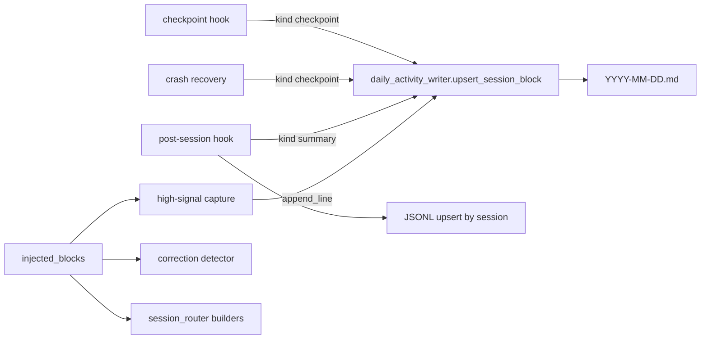
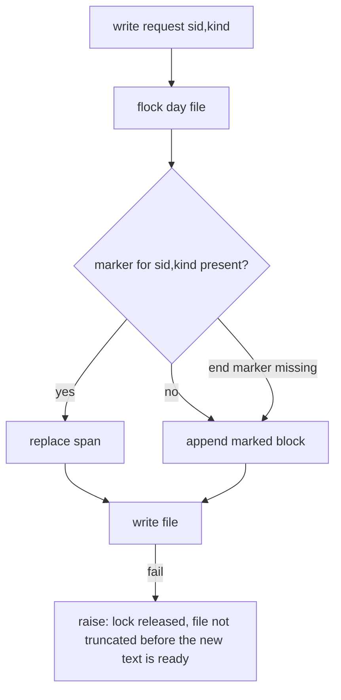

# Design Spec

**Run** `run_1ec5ea9d` · **profile** ? · **project** SwarmAI

> 你为什么stop 你继续啊

_Generated from the run's stage artifacts by the pipeline (not hand-written)._

## Approach (THINK)

**Solution class: SYSTEMIC** · addresses W3 · structural change: refactor
- **Why this is the root:** gives the day file a per-session identity rule enforced by its single writer, so no trigger can add a second block for the same session and kind
- **Structural change:** the identity rule must live in the one writer every DailyActivity producer calls
- **Sibling coverage:** C1 summarization uses parse_bash_write_targets, the same parser the file tracker uses; C2 high-signal capture and the correction detector read user text through one stripper shared with the language classifier, keyed on the builders' own block constants

| | Approach | Effort | Risk | Tradeoff |
|---|---|---|---|---|
| 🎯 QUALITY | One DailyActivity writer owns the day file: upsert_block(session_id, kind, text) under the file's flock replaces the block between this session's own markers (<!-- da:<kind>:<session_id> --> ... <!-- /da -->) or appends it; the JSONL sidecar upserts by session_id. Checkpoint, crash recovery and sum… | M | rewriting the whole day file per checkpoint under lock; a marker typo leaves a duplicate (never a loss) | legacy blocks written before the change stay as they are; marker comments add a few tokens per block |
| 🎯 SIMPLICITY | Identify blocks by their header line (## HH:MM \| sid8 \| title) and replace up to the next '## ' header; no markers. | S | high-signal captures and pasted prompts contain '## ' lines and land inside a block's extent, so a replace would delete them; sid8 can collide | no marker lines, but the extent rule is wrong on today's real files |
| DELETION | Delete the mid-session checkpoint's DailyActivity write entirely and rely on the post-session summary + crash JSON. | S | a session whose post-session hook never fires leaves no DailyActivity trace (the reason the checkpoint exists) | removes the biggest noise source but loses mid-session memory; does not fix summary or crash duplicates |

**Recommendation:** QUALITY: single writer with marker-delimited per-session blocks (upsert by session and kind), JSONL upsert by session, checkpoint without SwarmWS git, SSOT bash parser for file names, and a shared injected-block stripper whose shapes come from the builders' constants.

## Design

### User workflow

1. today: one session leaves dozens of checkpoint blocks, repeated summaries and crash copies in the day file, padded with workspace auto-commit lines, junk file names and captured system preambles
2. after: one checkpoint block and one summary block per session per day, real file names, captures of what the user typed only

### Architecture

### Flow

### State lifecycle

| State | Created by | Removed by | Crosses |
|---|---|---|---|
| S1 marked session block | backend/core/daily_activity_writer.py::upsert_session_block | never: replaced in place by the next write for the same session and kind | legacy unmarked blocks → never matched, never touched; high-signal lines appended after a block → outside the markers, kept byte-identical |

### Invariants

| ID | Invariant | Enforced at |
|---|---|---|
| I1 (root) | A session has exactly one current block per kind in a day file; every producer writes through upsert_session_block. | backend/core/daily_activity_writer.py::upsert_session_block |
| I2 | Text outside the current session's markers is never changed by a DailyActivity write. | backend/core/daily_activity_writer.py::upsert_session_block |
| I3 | Prompt-reading hooks see only user-typed text; the stripped shapes are the strings the builders emit. | backend/core/injected_blocks.py::strip_injected_blocks |

### Failure modes

| ID | Scenario | Expected |
|---|---|---|
| F1 | a start marker exists but its end marker was lost (hand edit) | no replace; a new block is appended so nothing is deleted |
| F2 | two hooks write the same day file at once | the flock serializes them; both writes land |
| F3 | a user types text that starts with '## Current UI State' | only exact builder shapes are stripped; when nothing would remain the user text is kept for the language classifier and nothing is captured |

## Plan

Single DailyActivity writer with marker-delimited per-session blocks; JSONL upsert by session; checkpoint without SwarmWS git; SSOT bash write-target parser for file names; one injected-block stripper whose shapes are the builders' constants.

### Acceptance criteria

- AC1: Within one day file, a session has at most one block per kind (mid-session checkpoint, session summary); a later write for the same session and kind replaces the earlier block instead of appending a new one, in both the .md and the .jsonl sidecar.
- AC2: A crash-recovery write for a session that already has a block in today's file updates that block instead of adding a 'Recovered from crash checkpoint' block.
- AC3: The mid-session checkpoint no longer lists SwarmWS auto-snapshot commits (the workspace's own 'chore: chore (N)...' commits) as git activity.
- AC4: File names written to DailyActivity are real paths: tokens such as 2>/dev/null, /tmp/, sed expressions and shortened 'Running:' summaries never produce entries like null, n, .s, *.py or empty names.
- AC5: The high-signal capture and the user-correction detector see only the text the user typed: system-injected blocks ([RESUMED CONVERSATION HISTORY ... END RESUMED HISTORY], [RECALLED] knowledge, '## Current UI State', task notifications) are removed before matching.
- AC6: Existing DailyActivity files are never rewritten except for upserting the current session's own block; no history is deleted.

### Exit contract

| ID | Kind | Ref | Expect |
|---|---|---|---|
| X1 | test | backend/tests/test_daily_activity_writer_upsert.py | pass |
| X2 | test | backend/tests/test_runtime_hooks.py | pass |
| X3 | test | backend/tests/test_summarization.py | pass |
| X4 | test | backend/tests/test_injected_blocks.py | pass |

## Boundaries

- **Always:** every DailyActivity write takes the day file's flock; legacy text outside this session's markers is byte-identical after a write
- **Never:** rewrite or dedup past DailyActivity files; change the JSONL record fields

## Test Strategy

| AC | How | Mock boundary | Inputs |
|---|---|---|---|
| AC1 | write summary twice and checkpoint twice for one session into a tmp day file; assert one block per kind and one JSONL line |  | two StructuredSummary objects, two checkpoint hook passes with growing files |
| AC2 | checkpoint block exists, then recover_crash_checkpoint for the same session; assert one checkpoint block carrying the recovery text |  | checkpoint JSON |
| AC3 | checkpoint in a git repo workspace with a commit; assert no 'Git activity' in the block and git_commits == [] in the JSON |  | one commit |
| AC4 | _extract_files_modified on summaries with 2>/dev/null, sed, cp to dir, a 200-char cut |  | tool_use blocks |
| AC5 | prompt = resume block + recall block + UI block + user line; high-signal and correction hooks capture only the user line / nothing |  | builder outputs from session_router |
| AC6 | day file with legacy blocks and high-signal lines, upsert a new session block twice; assert every legacy byte survives |  | legacy content |

## Success Criteria

- new and touched tests pass
- replay: a simulated session writing 30 checkpoints and 3 summaries leaves 1 checkpoint block + 1 summary block + 1 JSONL line

## Contract readers

| ID | Contract | Pattern | Paths | Readers |
|---|---|---|---|---|
| K1 | the JSONL sidecar holds one record per session_id (latest wins) | `read_jsonl_sidecar\(` | backend | backend/hooks/distillation_hook.py::<file> unaffected — reads every record; the latest summary per session is what it should distill; backend/core/daily_activity_writer.py::read_jsonl_sidecar unaffected — reads every line; one line per session is still a valid sidecar (declared after PLAN); backend/hooks/context_health_hook.py::ContextHealthHook._auto_cultivate_session_signals unaffected — already cultivates once per session_id via its state file (declared after PLAN) |
| K2 | session_checkpoint.json git_commits is an empty list | `git_commits` | backend | backend/hooks/daily_activity_hook.py::recover_crash_checkpoint migrated — renders git only when present; backend/core/context_injector.py::<file> unaffected — reads tool_count and files_touched only; backend/core/daily_activity_writer.py::_format_session_entry unaffected — summary git_commits from source repos, not the checkpoint JSON (declared after PLAN); backend/core/daily_activity_writer.py::_summary_to_jsonl_record unaffected — summary git_commits, not the checkpoint JSON (declared after PLAN); backend/core/summarization.py::StructuredSummary unaffected — summary field, not the checkpoint JSON (declared after PLAN); backend/hooks/daily_activity_hook.py::DailyActivityExtractionHook._capture_git_activity unaffected — source-repo capture for the summary; unchanged (declared after PLAN); backend/hooks/daily_activity_hook.py::DailyActivityExtractionHook._execute_locked unaffected — sets summary.git_commits from source repos (declared after PLAN); backend/hooks/daily_activity_hook.py::_get_session_git_commits unaffected — source-repo git helper for the summary (declared after PLAN); backend/tests/test_git_crossref.py::TestGitSnapshotCapture.test_format_entry_includes_git_section unaffected — summary rendering test (declared after PLAN); backend/tests/test_git_crossref.py::TestGitSnapshotCapture.test_format_entry_no_git_section_when_empty unaffected — summary rendering test (declared after PLAN); backend/tests/test_git_crossref.py::TestGitSnapshotCapture.test_get_session_git_commits_empty_for_old_window unaffected — source-repo helper test (declared after PLAN); backend/tests/test_git_crossref.py::TestGitSnapshotCapture.test_get_session_git_commits_no_repo_returns_empty unaffected — source-repo helper test (declared after PLAN); backend/tests/test_git_crossref.py::TestGitSnapshotCapture.test_get_session_git_commits_returns_commits unaffected — source-repo helper test (declared after PLAN); backend/tests/test_observation_ring.py::TestEnrichedCheckpoint.test_checkpoint_old_format_backward_compat unaffected — old checkpoint JSON without the key still reads (declared after PLAN); backend/tests/test_pending_commit_paths_only_mode.py::test_differential_pending_contains_what_git_commits unaffected — unrelated name match (auto-commit pending paths) (declared after PLAN); backend/tests/test_runtime_hooks.py::TestCrashCheckpointRecovery.test_recovery_renders_git_commits unaffected — recovery still renders git when a legacy JSON has it (declared after PLAN); backend/tests/test_runtime_hooks.py::TestMidSessionContentCheckpoint.test_checkpoint_json_includes_git_commits unaffected — key still present, as an empty list (declared after PLAN) |
