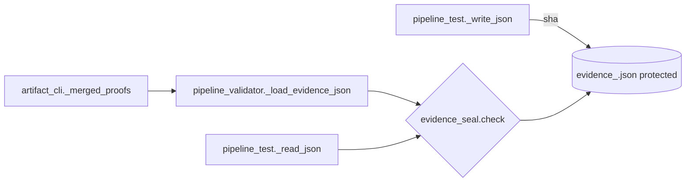
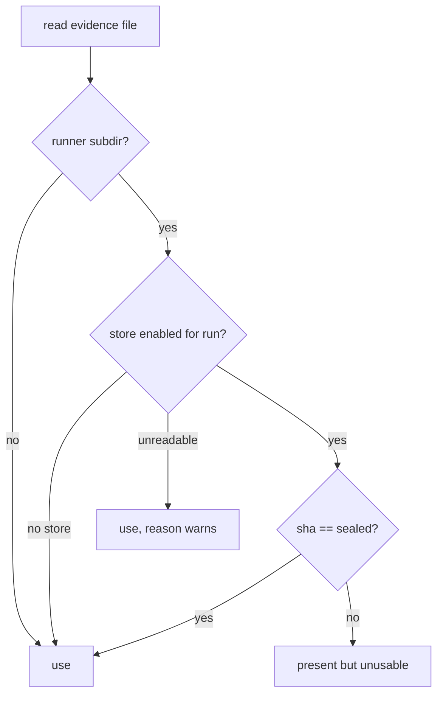

# Design Spec

**Run** `run_2702d56e` · **profile** direct · **project** SwarmAI

> 把上面的P0， P1, P2 都修了啊 direct run

_Generated from the run's stage artifacts by the pipeline (not hand-written)._

## Design

### User workflow

1. Today an agent can write evidence/proofs/prove-R1-x.json or evidence/tests/latest-regression.json by hand and the CLI trusts it
2. After: only files whose bytes match the sha the runner sealed in the protected store count; anything else reads as present-but-unusable

### Architecture

### Flow

### State lifecycle

| State | Created by | Removed by | Crosses |
|---|---|---|---|
| S1 evidence_<rid>.json seal store | core/evidence_seal.py::enable (run-create) | never: a run's store stays with its audit markers | a run created before this change → no store: not checked, today's behaviour; a runner write racing a reader → the reader may see the new bytes before the seal lands and treat the file as unusable once; the next read passes |

### Invariants

| ID | Invariant | Enforced at |
|---|---|---|
| I1 (root) | In a sealed run, runner evidence counts only when its bytes match the sha the runner sealed | core/evidence_seal.py::check, called by pipeline_validator._load_evidence_json and pipeline_test._read_json |
| I2 | A seal store that cannot be read never blocks: check returns ok with a reason | core/evidence_seal.py::check |

### Failure modes

| ID | Scenario | Expected |
|---|---|---|
| F1 | an agent writes a prove file with the right snapshot sha | _merged_proofs ignores it; the finding stays open |
| F2 | an agent edits latest-regression.json to all green | load_test_evidence returns it as unreadable; landing and push_ready treat it as unverified |
| F3 | an agent restores an older copy of latest-regression.json | sha differs from the latest seal: unusable |
| F4 | the store file is unreadable | evidence used, reason recorded (fail open) |

## Plan

New module backend/core/evidence_seal.py: run_of(path), enable(run_id), seal(path), check(path) -> (ok, reason). The store is a protected file next to the hand-out ledger, written under its own flock. pipeline_test._write_json seals after the atomic replace; pipeline_test._read_json and pipeline_validator._load_evidence_json return no data for a file check() rejects; artifact_cli._merged_proofs reads prove files and snapshots.json through pipeline_validator._load_evidence_json; cmd_run_create calls enable().

### Acceptance criteria

- AC1: a JSON file the runner writes under a run's evidence/{tests,proofs,probes,mutations}/ gets its sha recorded in state/pipeline_agent_audit/evidence_<run_id>.json (latest sha per real path)
- AC2: for a run whose seal store is enabled, pipeline_validator._load_evidence_json returns (None, reason) for a file there that is unsealed or whose bytes differ from the sealed sha; a sealed file loads as today
- AC3: pipeline_test._read_json returns None for such a file, so a forged latest-*.json, snapshots.json or old-side cache is never merged into, or re-sealed by, a later runner call
- AC4: artifact_cli._merged_proofs ignores an unsealed prove file and an unsealed snapshots.json, so a hand-written proof cannot close a finding
- AC5: run-create enables the store; a run without a store (made before this) is not checked; an unreadable store fails open with a reason; a file outside those four evidence subdirs is never checked

### Exit contract

| ID | Kind | Ref | Expect |
|---|---|---|---|
| X1 | test | backend/tests/test_evidence_seal.py | pass |
| X2 | test | backend/tests/test_gate2_next.py | pass |
