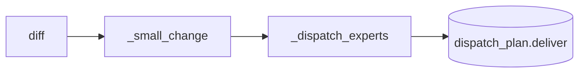
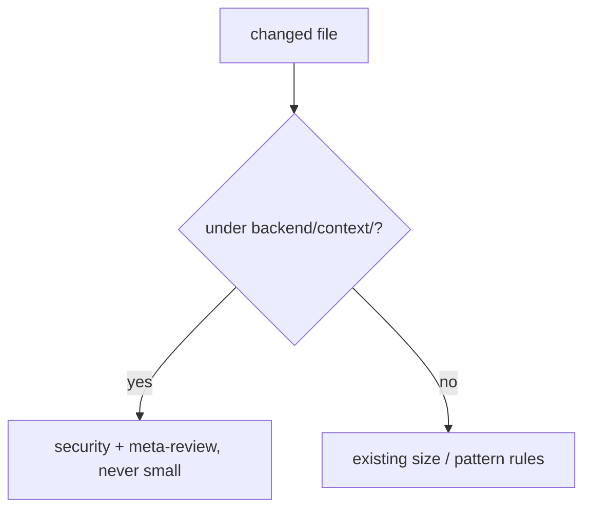

# Design Spec

**Run** `run_303ec2d2` · **profile** direct · **project** SwarmAI

> direct run：context 改动固定派 security

_Generated from the run's stage artifacts by the pipeline (not hand-written)._

## Design

### User workflow

1. today a <=20-line edit to SOUL/AGENT/STEERING gets no reviewer
2. after: any such edit gets security + meta-review

### Architecture

### Flow

**No state:** a dispatch rule; no runtime state

### Invariants

| ID | Invariant | Enforced at |
|---|---|---|
| I1 (root) | Every change to a governed context source is dispatched a security review | backend/scripts/artifact_cli.py::_dispatch_experts |

### Failure modes

| ID | Scenario | Expected |
|---|---|---|
| F1 | a 3-line edit by absolute worktree path | security dispatched |
| F2 | an 80-line docs/ edit | still no reviewer |

## Plan

_GOVERNED_CONTEXT_RE = (^|/)backend/context/: _small_change returns None when it matches; _dispatch_experts adds security for it outside the 50-line branch, on any profile.

### Acceptance criteria

- AC1: A change to any backend/context/ file, of any size and by relative or absolute path, is not a small change and dispatches the security expert; the non-empty plan brings the meta-review.
- AC2: Plain docs and a small non-sensitive code edit keep dispatching nobody.

### Exit contract

| ID | Kind | Ref | Expect |
|---|---|---|---|
| X1 | test | backend/tests/test_pipeline_proportional_review.py::test_governed_context_change_gets_security_and_meta_review_at_any_size | pass |
| X2 | test | mode:verify | pass |
