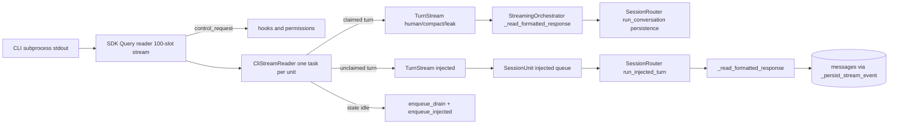
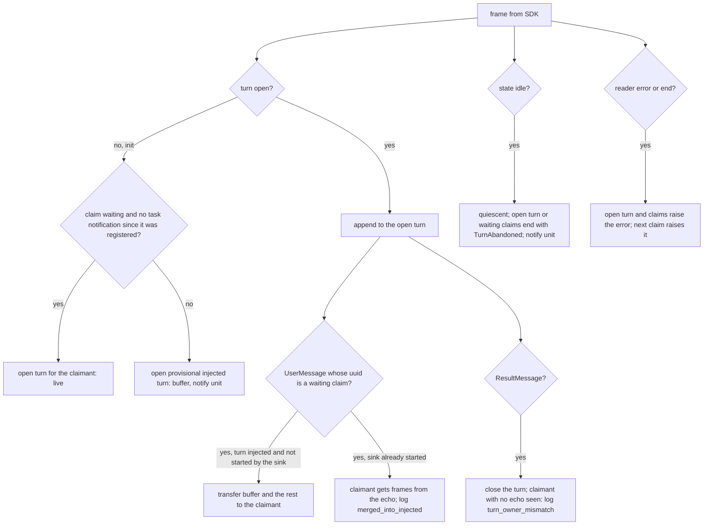

# Design Spec

**Run** `run_333ffbf8` · **profile** ? · **project** SwarmAI

> 为什么关上 我们要解决真实的问题

_Generated from the run's stage artifacts by the pipeline (not hand-written)._

## Approach (THINK)

**Solution class: SYSTEMIC** · addresses W3 · structural change: redesign
- **Why this is the root:** restores the invariant that the CLI owns turn boundaries for every consumer, so the stall (W1) and the unanswered hook (W2) cannot happen on any path
- **Structural change:** turn ownership moves from the daemon's query() to the CLI's stream
- **Sibling coverage:** C1 turns are delimited from the stream and claimed by echo, so a CLI-initiated result never ends a user turn; C2 compact() claims its own turn through the reader; C3 Task* frames outside a turn update the reader's background-task state instead of being dropped; C4 is_protected also holds while the reader reports a live background task

| | Approach | Effort | Risk | Tradeoff |
|---|---|---|---|---|
| 🎯 QUALITY | Continuous reader per unit (CliStreamReader) + TurnStream with the receive_response contract; user turns claimed by replayed uuid, unclaimed turns to a router sink that persists through the existing event handler; send gate on CLI quiescence; eviction guard on live background tasks. | L (one run, ~6-8 files) | touches the session streaming path, the #1 recurring bug area | biggest change, but removes the stall, the invisibility and the stale-result shift at the root and is the base for background work |
| SPEED | Idle drainer: keep per-turn receive_response and add a second reader only while IDLE that hands the channel back at the next send. | M | two readers of one channel with a handoff race, the co-starvation class documented at session_unit.py:570-582 | smaller diff but keeps the turn = our query() assumption and adds a second reader to guard |
| DELETION | Disable background tasks (CLAUDE_CODE_DISABLE_BACKGROUND_TASKS=1). | S | removes background work; a foreground command over its timeout is killed | rejected by the user: disables the capability instead of fixing it |

**Recommendation:** Continuous reader per unit, as specified in the v2 design §4: CliStreamReader + TurnStream replacing the 4 stream consumers, uuid-echo pairing, quiescence send gate, router sink for CLI-initiated turns through the existing persistence, eviction guard. Live per-session SSE and deletion of _interrupt_draining / flush_subprocess_pipe stay for a follow-up run.

## Design

### User workflow

1. Today: the agent starts a background command or subagent and ends its turn; when it finishes, nothing appears in the tab; the agent's first tool call waits until the user types again (measured 103 s to 75 min).
2. After: when it finishes, the tab's spinner lights within the next streaming-state poll, the agent's follow-up turn runs its tools without waiting, and its rows appear in the chat when it ends.
3. After: a message the user sends while that follow-up turn runs is saved as pending and is delivered automatically when the CLI is idle again.

### Architecture

### Flow

### State lifecycle

| State | Created by | Removed by | Crosses |
|---|---|---|---|
| S1 reader running for a live client | backend/core/session_unit.py::SessionUnit._spawn | backend/core/session_unit.py::SessionUnit._cleanup_internal (close: cancel task, fail open streams) | kill / _crash_to_cold_async → the subprocess dies, the SDK reader ends, our reader fails the open turn with the connection error; _cleanup_internal closes it, so no task outlives the client; retry with --resume → a new spawn creates a new reader; the old one was closed with the old client |
| S2 provisional injected turn queued on the unit | backend/core/cli_stream_reader.py::CliStreamReader (init with no eligible claim) | backend/core/session_router.py::SessionRouter.run_injected_turn (consumed) or a transfer to a claimant, or reader close | unit STREAMING (a user turn still finishing) → the sink does not start; it is re-driven on the IDLE edge; compact holding _client_io while IDLE → the sink does not start while _client_io is held; compact's own echo transfers the turn to compact; unit killed → reader close fails the queued stream; the sink sees the error and ends |
| S3 unit STREAMING because of an injected turn | backend/core/session_unit.py::SessionUnit.begin_injected_turn | backend/core/streaming_orchestrator.py::_read_formatted_response (result → IDLE, the same exit as a user turn) | user send → SessionBusyError → pending row → drained at the next quiescent IDLE; AskUserQuestion / permission in the injected turn → STREAMING → WAITING_INPUT exactly as a user turn; streaming-state pendingQuestion re-surfaces it; user Stop → interrupt() as for a user turn |
| S4 CLI not quiescent | backend/core/cli_stream_reader.py::CliStreamReader (state running, TaskNotification, TaskUpdated) | backend/core/cli_stream_reader.py::CliStreamReader (state idle) | send() at IDLE → SessionBusyError → pending; the reader's idle notification re-drives the drain; a notification that opens no turn (task stopped at idle) → the CLI re-emits state idle (spike p6), quiescence returns |

### Invariants

| ID | Invariant | Enforced at |
|---|---|---|
| I1 (root) | every CLI subprocess with a live client has exactly one consumer of its SDK message stream for its whole life, so control requests are always read | backend/core/session_unit.py::SessionUnit._spawn + backend/core/cli_stream_reader.py::CliStreamReader.start |
| I2 | a claimant stream yields only frames of the turn it owns: from its own init or the transfer at its echo through that turn's ResultMessage | backend/core/cli_stream_reader.py::CliStreamReader._route |
| I3 | a user message is written to the CLI only when the CLI is quiescent (last state idle, no task notification since) | backend/core/session_unit.py::SessionUnit.send (after the _client_io barrier) |
| I4 | no claim or open turn outlives a state idle or a reader error | backend/core/cli_stream_reader.py::CliStreamReader._route / _fail_all |
| I5 | an IDLE unit with a live background task is not killed by slot eviction, TTL, the orphan reaper or the RSS proactive restart; memory-pressure survival may still kill it | backend/core/session_unit.py::SessionUnit.has_background_work + its 4 kill sites |

### Failure modes

| ID | Scenario | Expected |
|---|---|---|
| F1 | the reader task raises (CLI crash) while no turn is open | error kept; the next claim raises it at once, the same exception path as today's receive_response at the next send |
| F2 | a task notification arrives between the gate check and the CLI reading our message (race) | init opens a provisional injected turn; our echo transfers it to us (or, if the CLI ran the injected turn first, it stays injected and our turn opens next): no frame reaches the wrong consumer |
| F3 | a claimant's turn ends without its echo | the stream ends at that Result as today and logs turn_owner_mismatch at ERROR |
| F4 | the sink fails while persisting (DB error) | logged; the unit still returns to IDLE through the orchestrator's normal exit or the error path; the drain is re-driven |
| F5 | the CLI reports idle while a claim waits (message never consumed) | claim ends with TurnAbandoned; the orchestrator's error path ends the turn; the user sees an error instead of a hang |

## Plan

Continuous reader per SessionUnit (design v2 §4) with claim-at-init for the normal path and echo transfer only in the notification race; injected turns persisted by a router sink through _persist_stream_event; quiescence gate in send(); background-work guard at 4 reclaim sites. Fallback to receive_response when no reader exists keeps the 19 fake-client test files valid (strangler step; removed in the follow-up run).

### Acceptance criteria

- AC1: with no send() in progress, a hook request that follows 100+ unconsumed SDK frames is answered (a CLI-initiated turn's first tool call runs without waiting for a user message)
- AC2: a CLI-initiated turn is persisted to the session's messages with its own client_id and label injected, and the unit reports streaming while it runs and idle after
- AC3: a user send() receives exactly its own turn: frames from the claim point of its replayed uuid through the next ResultMessage; a preceding CLI-initiated turn's result never ends it
- AC4: while the CLI is not quiescent (not idle, or a task notification arrived since the last idle) a user message is stored as pending and delivered at the next idle
- AC5: a user message folded into a CLI-initiated turn (replay echo mid-turn) is claimed from its echo; both the sink and the user stream end on the same ResultMessage
- AC6: an IDLE unit whose CLI has a live background task is not evicted
- AC7: session_state idle with an open turn or an unechoed uuid ends them with TurnAbandoned instead of hanging; a reader error ends the open turn and the next claim with the same exception
- AC8: the existing streaming, compact, leak-continuation and Stop behaviour of user turns is unchanged (their current tests stay green)

### Exit contract

| ID | Kind | Ref | Expect |
|---|---|---|---|
| X1 | test | backend/tests/test_cli_stream_reader.py | pass |
| X2 | test | backend/tests/test_session_injected_turn.py | pass |
| X3 | test | mode:regression | pass |
| X4 | manual | real-CLI probe (spike harness against SessionUnit): background command completes with no send; first tool call runs without waiting; rows persisted | done |

## Security Boundaries

| Boundary | Trust assumption | Enforced at |
|---|---|---|
| CLI stdout frames → daemon persistence (injected turns) | injected-turn content is model output of the user's own session and is cleaned like any assistant output before persistence | backend/core/session_router.py:2159 |
| user message → CLI stdin | only the session's own router writes; the uuid is generated server-side, never taken from the request | backend/core/streaming_orchestrator.py:508 |

## Boundaries

- **Always:** claim before query; one consumer per SDK stream; frames of a turn go to exactly one stream except the logged merge case
- **Ask first:** restarting the daemon to smoke the change
- **Never:** read client.receive_response() where a reader exists; write a user message while the CLI is not quiescent; drop a pending message

## Test Strategy

| AC | How | Mock boundary | Inputs |
|---|---|---|---|
| AC1 | fake client streaming >100 recorded frames then a hook call; reader started, no send |  | recorded thinking_tokens frames |
| AC2 | SessionRouter with a fake unit/reader: injected turn → rows persisted with label injected, unit STREAMING then IDLE |  | recorded V4 sequence |
| AC3 | replay V5: injected text-only turn then a claimed turn; claimant receives only its own frames |  | recorded frames |
| AC4 | send() while reader not quiescent raises SessionBusyError; reader idle triggers enqueue_drain |  | flags |
| AC5 | replay V12/p5 race: claim registered, notification, init, echo mid-turn → transfer; one Result ends the claimant |  | recorded frames |
| AC6 | has_background_work True → _evict_idle / TTL / orphan / RSS skip it; memory pressure does not |  | fake units |
| AC7 | state idle with open turn/claim → TurnAbandoned; reader error → claim raises; next claim raises |  | scripted frames |
| AC8 | the existing receive_response-based tests (19 files) pass unchanged |  | existing |

## Success Criteria

- test_cli_stream_reader.py and test_session_injected_turn.py pass
- the 19 receive_response test files pass unchanged
- a real-CLI probe: background sleep finishes with no send and the follow-up turn's tool runs within 5 s and its rows are in the DB

## Contract readers

| ID | Contract | Pattern | Paths | Readers |
|---|---|---|---|---|
| K1 | the SDK message stream is read only through CliStreamReader when a reader exists | `\.receive_response\(\|\.receive_messages\(` | backend | backend/core/cli_stream_reader.py::CliStreamReader._run migrated; backend/core/cli_stream_reader.py::<module> unaffected — module docstring describing the reader; backend/core/streaming_orchestrator.py::write_user_message migrated; backend/core/streaming_orchestrator.py::StreamingOrchestrator._turn_iter migrated; backend/core/session_unit.py::SessionUnit.__init__ unaffected — comment describing the no-reader fallback; backend/README.md::<file> unaffected — SDK usage example in the README, not daemon code; backend/tests/test_client_io_serialization.py::<module> unaffected — test module docstring describing the historic co-starvation bug |
| K2 | an IDLE unit with live background work is not killed by routine reclaim (explicit kills and RAM survival are not reclaim) | `await [a-z_]+\.kill\(\)` | backend | backend/core/session_router.py::SessionRouter._evict_idle migrated; backend/core/lifecycle_manager.py::LifecycleManager._check_ttl migrated; backend/core/lifecycle_manager.py::LifecycleManager._check_orphan_sessions migrated; backend/core/lifecycle_manager.py::LifecycleManager._proactive_rss_restart migrated; backend/core/session_unit.py::SessionUnit._check_rss_and_proactive_restart migrated; backend/core/lifecycle_manager.py::LifecycleManager._check_memory_pressure unaffected — RAM survival path: may kill a unit with background work by design (I5); backend/core/lifecycle_manager.py::LifecycleManager._streaming_rss_check unaffected — kills a STREAMING unit over the hard RSS limit, not an IDLE reclaim; backend/core/session_router.py::SessionRouter._try_adopt_desktop_pool unaffected — kills a stale unadopted prewarm unit, which never ran a turn or a task; backend/core/session_router.py::SessionRouter.disconnect_all unaffected — daemon shutdown kills every unit; backend/core/session_router.py::SessionRouter.kill_rotated_channel_session unaffected — an explicit channel-session rotation, not routine reclaim; backend/core/session_router.py::SessionRouter.release_session unaffected — the user closed or released the tab: an explicit kill; backend/core/session_unit.py::SessionUnit.interrupt unaffected — user Stop timeout path, an explicit kill; backend/core/session_unit.py::SessionUnit.reclaim_for_mcp_swap unaffected — user-requested MCP swap, an explicit kill; backend/routers/chat.py::delete_session unaffected — the user deleted the session; backend/tests/test_cross_turn_bleed.py::TestPipeFlushNotCancelled.test_pipe_flush_timeout_kills_subprocess unaffected — test of the pipe-flush kill, not a reclaim site; backend/tests/test_process_resource_management.py::TestP4ExplicitKillPathPreservation.test_kill_calls_force_kill_and_cleans_up unaffected — test of kill() itself, not a reclaim site; backend/tests/test_session_unit_recovery_paths.py::TestT2EmptyResultDetection.test_fast_empty_result_kills_and_raises unaffected — test of the empty-result guard's kill, not a reclaim site |
