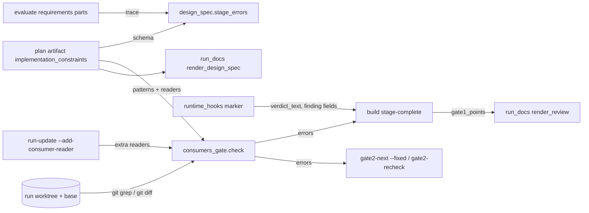
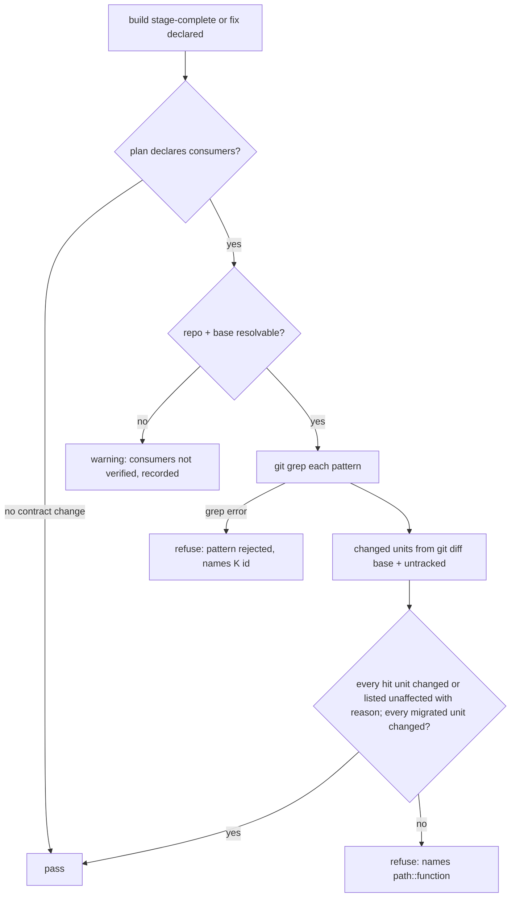

# Design Spec

**Run** `run_5483eca9` · **profile** ? · **project** SwarmAI

> 起 pipeline：V1–V5

_Generated from the run's stage artifacts by the pipeline (not hand-written)._

## Approach (THINK)

**Solution class: SYSTEMIC** · addresses W3 · structural change: refactor
- **Why this is the root:** W3 is that recurring classes are controlled by prose; this moves each recurring class seen in the replay into a deterministic check on the run's own artifacts and repairs the hand-offs that kept the evidence out of the audit documents
- **Structural change:** the controls move from prose (pre-checks.md R-build-014, the loader docstring, unchecked AC derivation) into design_spec / validator checks that every stage-complete and fix pass goes through
- **Sibling coverage:** C1 _write_review_prompts calls the existing _review_requirement, so every REVIEW expert gets the raw requirement; C2 _write_gate1_prompt puts plan.design (invariants, failure_modes, states) into plan_part, fenced; C3 render_design_spec renders security_boundaries, boundaries, test_strategy, success_criteria and implementation_constraints.consumers; C4 _finding_row keeps fix / exploit / evidence (bounded)

| | Approach | Effort | Risk | Tradeoff |
|---|---|---|---|---|
| SIMPLICITY | File-level consumers check at PLAN only (git grep hit files must be listed as readers), plus the audit-chain repairs; no diff binding, no fix-pass hook. | S | the replay shows 4 of 5 missed readers sat inside files the change already touched, so a file-level check passes them | cheapest, but does not close the recurring class it targets |
| 🎯 QUALITY | Deterministic checks bound to the run's artifacts, hosted in design_spec / the validator: function-level, diff-bound consumers gate at BUILD stage-complete, at gate2-next --fixed and gate2-recheck, and at DELIVER; problem-value lint in CI; requirement-part trace at EVALUATE; plus the audit repairs … | L | breadth: hook changes need a daemon rebuild to show; broad patterns could produce long reader lists | most work, but each piece maps to a replay defect and is enforced, not advised |
| DELETION | Only repair the audit chain and reuse _review_requirement in REVIEW; add no new gate or lint and leave recurring classes to reviewers. | M | leaves the recurring classes (I3→L6, I8→I11) prose-guarded, the root W3 untouched | smaller diff, no new checks to maintain, but the next run repeats the same misses |

**Recommendation:** QUALITY: the replay shows only deterministic, diff-bound checks catch the recurring classes, and each audit repair is a verified break in the chain; host the gates in design_spec.stage_errors and the two Gate-2 fix paths, and reuse _review_requirement for REVIEW.

## Design

### User workflow

1. Today: PLAN lists readers only as prose discipline, BUILD finishes with readers left unmigrated in files it already touched, Gate-2 finds them, the fix misses another, round 2 finds that.
2. After: PLAN declares each changed contract with a git-grep pattern; BUILD stage-complete names every hit function the diff did not change and that is not declared unaffected; the builder migrates or declares it before review.
3. After a Gate-2 fix: gate2-next --fixed N / gate2-recheck runs the same check first, so a fix that misses a reader is refused before a re-check round is spent.
4. Auditor: opens DESIGN_SPEC.md and REVIEW.md in .aidlc/deliverables/<run>/ and sees the consumers table, boundaries, test strategy, the Gate-1 points and the requirement parts mapping.

### Architecture

### Flow

### State lifecycle

| State | Created by | Removed by | Crosses |
|---|---|---|---|
| S1 run_state.consumer_readers (readers added during BUILD / fixes) | artifact_cli.py::cmd_run_update --add-consumer-reader | never: append-only record of declared readers, read only by consumers_gate | plan readers for the same unit → union; a later unaffected declaration does not override a migrated one, both are checked; run abandoned / completed → stays in run.json as audit record; nothing reads it after DELIVER |
| S2 build record gate1_points | artifact_cli.py::_derive_stage_fields (build) | replaced on the next build stage-complete (record replace) | a gate1 row from an old daemon without verdict_text → no points recorded; REVIEW.md shows the verdict alone |
| S3 marker row verdict_text for gate1-skeptic | runtime_hooks.py SubagentStop | never: marker store retention as today | existing readers of marker rows → additive key, readers use .get |

### Invariants

| ID | Invariant | Enforced at |
|---|---|---|
| I1 (root) | A declared contract's hit units are each changed by the run's diff or declared unaffected with a reason, checked by code at BUILD and before every Gate-2 re-check. | consumers_gate.py::check via artifact_cli build stage-complete, cmd_gate2_next, cmd_gate2_recheck |
| I2 | A reader declared migrated is changed by the diff (a declaration cannot stand in for the edit). | consumers_gate.py::check |
| I3 | The search runs git grep with an argument list: the pattern follows -e and paths follow --, paths are repo-relative without '..'; no shell. | consumers_gate.py::_grep + design_spec consumers schema |
| I4 | Every numbered part of a 1..n requirement is mapped to a requirement or ruled out before THINK. | design_spec.py::requirement_part_errors via stage_errors(evaluate) |
| I5 | Model-written text placed in a prompt (design, requirement refinement) is fenced as data. | artifact_cli.py::_write_gate1_prompt cap() / _review_requirement _fence |
| I6 | Renderers never raise on odd shapes; a field of the wrong type renders as absent. | run_docs.py::render_design_spec helpers _d/_l/_t |
| I7 | New checks apply only to runs created after CONSTRAINTS_CUTOVER; older runs get warnings. | design_spec.py::_enforced + consumers_gate caller |
| I8 | Every declared path and reader is turned into a repo-relative path (main checkout or worktree prefix stripped, normpath) before it is compared with git output; a path outside the repo is an error, never a silent mismatch. | consumers_gate.py::_rel |

### Failure modes

| ID | Scenario | Expected |
|---|---|---|
| F1 | git grep exits 2 / 128 on an invalid pattern | refuse naming the consumer id and git's message |
| F2 | no worktree and no git repo resolvable for files_touched | warning 'consumers not verified' with the reason, never a silent pass |
| F3 | a hit file is not valid Python (syntax error mid-edit) | the file is treated as one unit '<file>' and must be changed or listed at file level |
| F4 | a reader is added in a fix pass after BUILD | run-update --add-consumer-reader appends it; the next gate2-next --fixed sees it |
| F5 | a requirement contains parenthesised numbers that are not a 1..n sequence (years, (2),(5)) | the trace check does nothing |
| F6 | a pattern contains shell metacharacters or starts with '-' | passed after -e as one argv element; no shell; no option injection |
| F7 | a deleted function was the only reader | no hit remains in the new tree; nothing to list |
| F8 | a reader is written as an absolute path of the main checkout or the worktree | normalized to repo-relative and matched; a path outside both is refused by name |
| F9 | another session commits to main while the run builds | the diff base is the worktree's recorded base commit (run start), so main moving does not change the run's changed units; without a worktree the base is HEAD of the repo plus uncommitted and untracked files_touched |
| F10 | a hit is module-level code, or inside a nested function or a method | module-level → unit path::<module> (listing 'path' or 'path::<module>' covers it); nested → innermost qualname Outer.inner; a newly added function counts as changed |

## Plan

Deterministic, artifact-bound checks for the recurring classes plus repairs of the audit hand-offs. (a) A new pure module backend/scripts/consumers_gate.py computes, in the run's repo, the units (file::function via ast for .py, file for others) that hit each declared git-grep pattern and the units the diff changed; every hit unit not changed must be listed unaffected with a reason, every unit listed migrated must be changed. It runs at BUILD stage-complete and before gate2-next --fixed N / gate2-recheck hand out a re-check. (b) design_spec.py checks the plan's implementation_constraints shape and the EVALUATE requirement-part trace, behind a new CONSTRAINTS_CUTOVER. (c) Audit repairs: Gate-1 plan_part carries plan.design; DESIGN_SPEC.md renders security_boundaries, boundaries, test_strategy, success_criteria and the consumers table; the hook keeps verdict_text for gate1-skeptic and BUILD stage-complete projects its BLOCK/WARN lines into record.gate1_points shown in REVIEW.md; _finding_row keeps fix/exploit/evidence; REVIEW prompts carry _review_requirement. (d) scripts/lint_problem_values.py in CI. (e) delete build_injection_recommendations.

### Change spec

- **backend/scripts/consumers_gate.py** — new: check(consumers, extra_readers, repo, base, new_files) -> (errors, warnings); units via ast; git grep -n -I --null -E --untracked -e P -- paths; git diff -U0 --no-renames base
- **backend/scripts/design_spec.py** — CONSTRAINTS_CUTOVER; constraints_errors(plan, profile); requirement_part_errors(requirement, evaluate); stage_errors gains requirement= and calls both
- **backend/scripts/artifact_cli.py** — stage_errors call passes requirement; build stage-complete calls consumers_gate via _consumers_gate_errors; run-update --add-consumer-reader; gate2-next --fixed and gate2-recheck refuse on its errors
- **backend/scripts/artifact_cli.py** — _write_gate1_prompt plan_part adds design; _write_review_prompts adds _review_requirement; spec-compliance task text
- **backend/core/runtime_hooks.py** — _finding_row keeps fix/exploit/evidence (<=600 chars); verdict_text kept for gate1-skeptic
- **backend/scripts/artifact_cli.py** — _derive_stage_fields(build): record.gate1_points from the latest gate1-skeptic row's verdict_text BLOCK/WARN lines
- **backend/core/run_docs.py** — render_design_spec: four sections + consumers; render_review Gate 1 notes show gate1_points
- **scripts/lint_problem_values.py + .github/workflows/ci.yml** — AST lint with LOADERS registry; CI step
- **backend/scripts/pipeline_analytics.py (key :625, docstring :5), backend/skills/s_autonomous-pipeline/stages/build.md:11…** — delete build_injection_recommendations everywhere
- **skill docs (plan.md, build.md, pre-checks.md, requirements.md, new ref/plan/consumers.md, spec-compliance docs)** — describe the new fields, commands and gates

### Acceptance criteria

- AC1: the Gate-1 prompt written by _write_gate1_prompt contains the PLAN design invariants, failure_modes and states (fenced as data).
- AC2: render_design_spec shows Security Boundaries, Boundaries, Test Strategy and Success Criteria sections when the plan carries them (top level or design_doc); absent fields render nothing; odd shapes never raise.
- AC3: the SubagentStop hook keeps verdict_text for gate1-skeptic; BUILD stage-complete records the BLOCK/WARN lines of the bound gate1 row as record.gate1_points; REVIEW.md shows them in the Gate 1 row.
- AC4: runtime_hooks._finding_row keeps fix, exploit and evidence (bounded); a finding without them is unchanged.
- AC5: build_injection_recommendations has 0 references under backend/.
- AC6: design_spec checks implementation_constraints on runs created after CONSTRAINTS_CUTOVER: consumers [{id K<n>, contract, pattern, paths, readers[{at, status, reason}]}] or no_contract_change_reason; a strict plan with neither is refused; DESIGN_SPEC.md renders the consumers table.
- AC7: consumers_gate refuses at BUILD stage-complete and before gate2-next --fixed / gate2-recheck when a hit unit is neither changed nor listed unaffected with a reason, or a migrated reader is unchanged, naming path::function; a fixture modelled on run_2702d56e (two readers in one touched file, one migrated) names the unmigrated one. Absolute reader paths (main checkout or worktree) are matched after normalization; a path outside the repo is refused.
- AC8: scripts/lint_problem_values.py fails on `<loader>(...)[0] or <x>` and on unpacking the problem into `_` for registered loaders, passes on value-is-None / isinstance reads, passes on the current tree, and runs in CI.
- AC9: design_spec refuses an EVALUATE whose raw requirement numbers parts exactly 1..n (n>=2) when a part is in no requirements[].parts and no ruled_out entry starting '(n)'; a fixture with run_6238b7c3's requirement shape names part (3); every REVIEW expert prompt contains the raw requirement.

### Exit contract

| ID | Kind | Ref | Expect |
|---|---|---|---|
| X1 | test | backend/tests/test_stage_start_gate_prompts.py | pass |
| X2 | test | backend/tests/test_run_docs.py | pass |
| X3 | test | backend/tests/test_runtime_hooks.py | pass |
| X4 | test | backend/tests/test_pipeline_analytics.py | pass |
| X5 | test | backend/tests/test_design_spec.py | pass |
| X6 | test | backend/tests/test_consumers_gate.py | pass |
| X7 | test | backend/tests/test_lint_problem_values.py | pass |
| X8 | test | mode:regression | pass |
