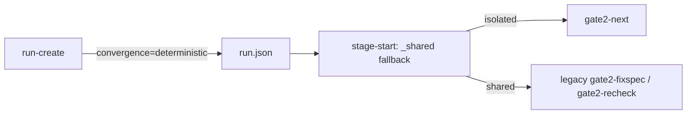
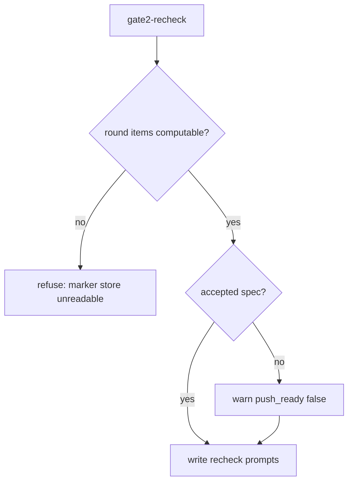

# Design Spec

**Run** `run_578cc64e` · **profile** direct · **project** SwarmAI

> 已执行 restore，status 只剩 cli.json

_Generated from the run's stage artifacts by the pipeline (not hand-written)._

## Design

### User workflow

1. today a full run's Gate-2 loops on fixspec-skeptic BLOCKs because gate2-recheck refuses until the skeptic PASSes
2. after: an isolated full run uses gate2-next (tests decide); a shared run can re-check without a PASS and ends push_ready false

### Architecture

### Flow

### State lifecycle

| State | Created by | Removed by | Crosses |
|---|---|---|---|
| S1 run.json convergence=deterministic on every new run | backend/scripts/artifact_cli.py::cmd_run_create | backend/scripts/pipeline_worktree.py::_shared (rewrites it to legacy for a shared-checkout run) | a run that falls back to the shared checkout → convergence becomes legacy and convergence_fallback says why, as before |

### Invariants

| ID | Invariant | Enforced at |
|---|---|---|
| I1 (root) | no model verdict refuses a Gate-2 command; a missing skeptic PASS only lowers push_ready | backend/scripts/artifact_cli.py::cmd_gate2_recheck |

### Failure modes

| ID | Scenario | Expected |
|---|---|---|
| F1 | the marker store is unreadable during gate2-recheck | refused with the unreadable message (not a verdict), as before |
| F2 | a legacy run re-checks without an accepted spec | re-check prompts are written and DELIVER completes degraded, push_ready false |

## Plan

Two code changes and doc sync. _convergence_for returns the explicit flag or deterministic. A shared-checkout run still falls back to legacy at stage-start (pipeline_worktree._shared), because the deterministic flow needs the run's worktree snapshots and worktree mode is off by default, so the legacy code is kept, not deleted. In cmd_gate2_recheck the unaccepted-spec refusal becomes a warning; DELIVER stage-complete already completes degraded through _fixspec_errors, so push_ready still goes false.

### Acceptance criteria

- AC1: run-create gives every profile convergence=deterministic while worktree mode is on, unless --convergence legacy is passed; with worktree mode off it stays legacy
- AC2: gate2-recheck without an accepted fixing spec goes ahead with a warning that push_ready will be false; it still refuses when the round's items cannot be computed (marker store unreadable)
- AC3: the deliver card and the Gate-2 refs describe the new default and the non-blocking skeptic

### Exit contract

| ID | Kind | Ref | Expect |
|---|---|---|---|
| X1 | test | backend/tests/test_pipeline_worktree.py::test_run_create_defaults_every_profile_to_deterministic_convergence | pass |
| X2 | test | backend/tests/test_gate2_fixspec_cli.py | pass |
| X3 | manual |  | done |
| X4 | test | backend/tests/test_pipeline_run.py::test_a_never_isolated_deterministic_run_publishes_deliver_by_legacy_rules | pass |

## Boundaries

- **Always:** keep the shared-checkout fallback to legacy
- **Ask first:** deleting the legacy Gate-2 code
- **Never:** let a model verdict refuse a stage or command

## Success Criteria

- the X1-X3 tests pass
- pyflakes reports no undefined name in artifact_cli.py

## Contract readers

| ID | Contract | Pattern | Paths | Readers |
|---|---|---|---|---|
| K1 | run.json convergence is now deterministic for every profile while worktree mode is on (was only direct); a published never-isolated deterministic run is switched to legacy on disk | `get\("convergence"\)` | backend | backend/core/run_docs.py::_gate2_view unaffected — renders whichever flow the run used; backend/scripts/artifact_cli.py::cmd_publish migrated; backend/scripts/artifact_cli.py::_validate_stage_candidate unaffected — passes the value through to the validator; backend/scripts/artifact_cli.py::_deterministic unaffected — already treats deterministic as the deterministic flow; backend/scripts/pipeline_validator.py::validate unaffected — passes the value through; backend/scripts/pipeline_validator.py::validate_artifact_data unaffected — reads the DELIVER artifact's convergence block, not run.json; backend/scripts/pipeline_worktree.py::_shared unaffected — the shared fallback keeps rewriting deterministic to legacy; backend/scripts/pipeline_worktree.py::land_deliver unaffected — already handles deterministic runs (review_bound False); backend/scripts/pipeline_preflight.py::<module> unaffected — a comment about the DELIVER artifact's convergence block; backend/tests/test_convergence_default.py::test_validate_passes_the_runs_mode_to_check_depth.spy unaffected — test spy, records what it is passed; backend/tests/test_convergence_default.py::test_publish_deliver_projects_the_ledger_for_a_deterministic_run.spy_project unaffected — test spy, records what it is passed; backend/tests/test_convergence_default.py::test_publish_deliver_projects_the_ledger_for_a_deterministic_run.spy_validate unaffected — test spy, records what it is passed; backend/tests/test_convergence_default.py::test_run_create_defaults_to_deterministic_with_worktree_mode_on migrated; backend/tests/test_convergence_default.py::test_run_create_legacy_on_request migrated; backend/tests/test_convergence_default.py::test_run_create_stays_legacy_with_worktree_mode_off migrated; backend/tests/test_pipeline_worktree.py::test_run_create_defaults_every_profile_to_deterministic_convergence migrated; backend/tests/test_convergence_default.py::test_validate_passes_the_runs_mode_to_check_depth unaffected — test spy records what it is passed (declared after PLAN); backend/tests/test_convergence_default.py::test_publish_deliver_projects_the_ledger_for_a_deterministic_run migrated (declared after PLAN) |
