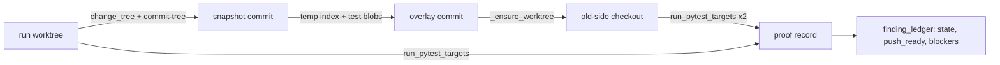
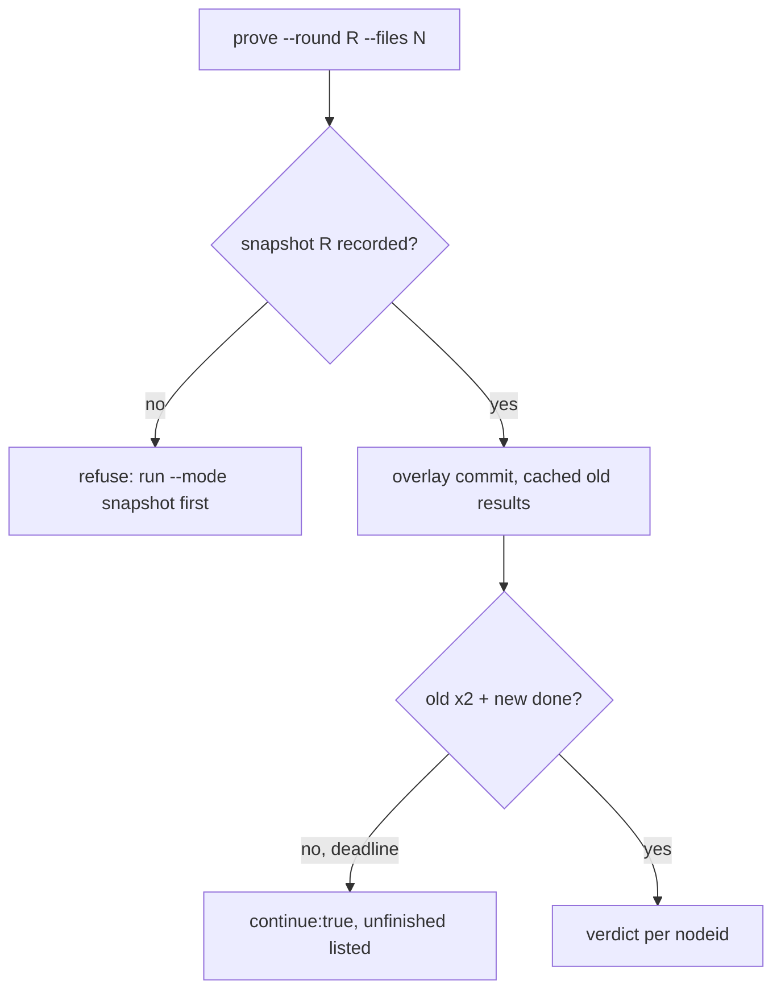

# Design Spec

**Run** `run_600db8ac` · **profile** direct · **project** SwarmAI

> 看一下这个 是不是安这个实现 而且你直接做 不要用pipeline '整体方案写好了： ⏎ description ⏎ Knowledge/Designs/2026-10-19-pipeline-deterministic-convergence.md。目前是我一个人写的草稿，还没有经过对抗审查。 ⏎ 设计哲学：模型负责发现，确定性检查负责判定，不可逆的那一步交给人 ⏎ 这是 SELF 里"model proposes, OS disposes"在质量门上的延伸，落成六条： ⏎ D1 判定权：凡是会阻断的判定，都只依据确定性证据，包括测试结果、退出码、计数和哈希。任何 LLM 的结论都不能阻断，也不能放行。 ⏎ D2 转化：模型的产出只有一个价值，就是能转化成确定性检查，也就是测试或 probe。转化不了的记为 advisory，不阻断，只把 push_ready 设为 false，交给…

_Generated from the run's stage artifacts by the pipeline (not hand-written)._

## Design

### User workflow

1. today a Gate-2 finding closes when a re-check expert answers RESOLVED
2. after this run the runner can prove a finding closed (break test FAILs by assertion on the round snapshot twice and PASSes now); the DELIVER flow adopts it in step 3

### Architecture

### Flow

### State lifecycle

| State | Created by | Removed by | Crosses |
|---|---|---|---|
| S1 snapshot ref refs/swarm/snapshots/<run>/<round> | core/run_worktree.py::snapshot_commit | never in this run: an unreferenced snapshot is harmless; release cleanup lands with step 3 | rebase of the run branch → the snapshot is a separate commit, the rebase never moves it, so old-side results stay valid |

### Invariants

| ID | Invariant | Enforced at |
|---|---|---|
| I1 (root) | a proof is valid only when both old-side runs end in an assertion failure and the new side passes | core/finding_ledger.py::proof_verdict |
| I2 | snapshotting never changes the run worktree, its index or its branch | core/run_worktree.py::snapshot_commit |

### Failure modes

| ID | Scenario | Expected |
|---|---|---|
| F1 | the break test imports a symbol only the fix adds | old side is error (ImportError), verdict invalid, reason names the error |
| F2 | the deadline hits between the two old-side runs | first run's result is cached, continue:true, the next call runs only the second |
| F3 | two prove calls on the same snapshot at once | the per-sha worktree lock serializes the checkout; the overlay commit is content-addressed so both use the same one |

## Plan

Two additive pieces, no DELIVER flow change. (1) Runner: reuse run_worktree.change_tree + commit-tree for snapshots, a temp-index overlay commit for old-side runs, _ensure_worktree for the checkout, run_pytest_targets for execution; the generated pytest plugin also emits whether a call-phase failure is an assertion. (2) A pure core/finding_ledger.py: the deterministic DELIVER decision functions the CLI will call in step 3, and the termination test over them.

### Acceptance criteria

- AC1: pipeline_test.py --mode snapshot --round R1|R2 freezes the run worktree's change tree into a commit (refs/swarm/snapshots/<run>/<round>, parent = worktree base) and records {sha, tree, base, at} in evidence/proofs/snapshots.json; the worktree, its index and its branch are untouched
- AC2: pipeline_test.py --mode prove --round R --files <nodeid...> runs each nodeid twice on the round's snapshot with the run's test files overlaid (a content-addressed overlay commit) and once on the current worktree, and records per nodeid old=[o1,o2], new=o, verdict valid|invalid|pending with a reason
- AC3: an old-side outcome is assert_fail only for a call-phase AssertionError (incl. subclasses) or pytest.fail/DID NOT RAISE; an ImportError/AttributeError/TypeError in the body, a collection or setup error, a skip, a missing nodeid or a per-test timeout make the proof invalid with a named reason
- AC4: old-side results are cached by (overlay tree sha, interpreter, nodeid); a second prove call on the same snapshot and test content re-runs only the new side; a call that hits the deadline reports continue:true and the next call runs only what is unfinished
- AC5: core/finding_ledger.py is a pure module with the five finding states, the budget table, the per-round respawn rule, the landing-blocker list (red-not-pre-existing, unfinished after continuations, budget stop, falsified Gate-0 premise) and push_ready; every stop names an artifact and a reason
- AC6: a termination test drives the ledger through the design's worst case (conflicting rebase, two unparsable expert outputs, R2 finding, untestable finding, import-error break test, old-side-green break test, flaky old side, pre-existing red, unfinished runner call, main moving before landing) and asserts expert spawns stay within budget, none after R2, variant B ends in a landed state with push_ready false and every not-proven row listed, variant A ends in the stop 'test X red after 3 attempts' with no landing

### Exit contract

| ID | Kind | Ref | Expect |
|---|---|---|---|
| X1 | test | backend/tests/test_pipeline_test_prove.py | pass |
| X2 | test | backend/tests/test_finding_ledger.py | pass |
| X3 | test | mode:verify | pass |
