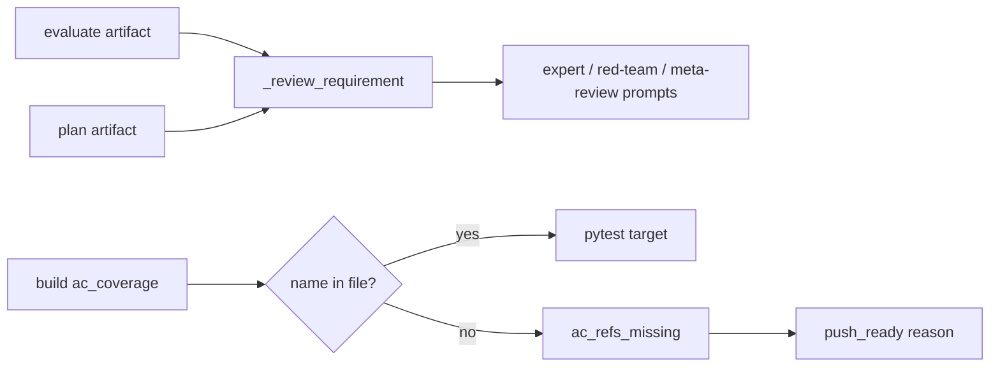
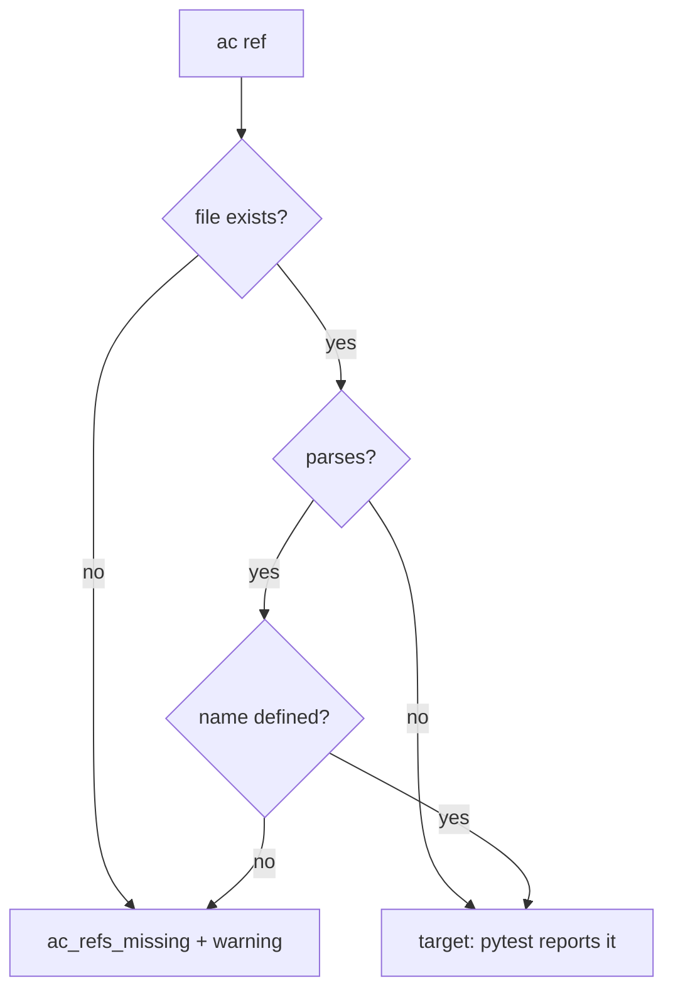

# Design Spec

**Run** `run_6168d67c` · **profile** direct · **project** SwarmAI

> 把上面的P0， P1, P2 都修了啊 direct run

_Generated from the run's stage artifacts by the pipeline (not hand-written)._

## Design

### User workflow

1. Today an expert reviews against the raw request, so it reports what EVALUATE or PLAN already ruled out; a renamed AC test makes the regression a runner error and the run must re-record BUILD
2. After: the expert sees the refined scope; a stale AC ref is a named push_ready reason and the regression still lands

### Architecture

### Flow

### State lifecycle

| State | Created by | Removed by | Crosses |
|---|---|---|---|
| S1 regression evidence ac_refs_missing | pipeline_test regression plan | never: a later report without the stale ref has none | a recheck overlaid on a regression → the base report's list is carried (a recheck does not re-plan AC refs) |

### Invariants

| ID | Invariant | Enforced at |
|---|---|---|
| I1 (root) | A Gate-2 reviewer reviews against the run's refined requirement, not only the raw text | artifact_cli._review_requirement |
| I2 | A stale ac_coverage ref never makes the runner report an error, and never passes silently | pipeline_test regression plan + artifact_cli._deliver_push_ready_bound |

### Failure modes

| ID | Scenario | Expected |
|---|---|---|
| F1 | the evaluate artifact cannot be read | the raw requirement only, no error |
| F2 | an ac ref names a parametrized id test_x[a] | judged by test_x |
| F3 | an ac ref names Class::method | judged by the method inside the class |

## Plan

artifact_cli: one helper composes the refined requirement from the stored evaluate / plan artifacts; the three prompt fills call it. pipeline_test: an AST check of the test name before an ac_coverage nodeid ref becomes a target; missing refs (file or name) are recorded in the regression evidence (ac_refs_missing); artifact_cli's push_ready bound reads it from the full-scope report.

### Acceptance criteria

- AC1: artifact_cli._review_requirement(project, run_state) returns the raw requirement followed by the run's refinement: each EVALUATE requirement (id, status, statement), EVALUATE ruled_out, the PLAN acceptance_criteria and boundaries.never; a run with no EVALUATE / PLAN artifact gets the raw requirement only
- AC2: every writer that fills <requirement from run.json> (the Gate-2 expert prompts at DELIVER stage-start, the Red Team prompt, the meta-review prompt) fills it from _review_requirement, with a cap large enough for the refinement (a cut stays marked)
- AC3: a BUILD ac_coverage ref whose file exists but which names a test function / class / method that is not in the file is not passed to pytest: the regression report records it in ac_refs_missing with a warning, no runner_error, and the run's other tests run
- AC4: _deliver_push_ready_bound lowers push_ready with an 'unverified: test: ac_coverage names test(s) that do not exist' reason when the full-scope report has ac_refs_missing (a missing file ref included); landing is not blocked

### Exit contract

| ID | Kind | Ref | Expect |
|---|---|---|---|
| X1 | test | backend/tests/test_review_inputs.py | pass |
| X2 | test | backend/tests/test_pipeline_test_ac_refs.py | pass |
