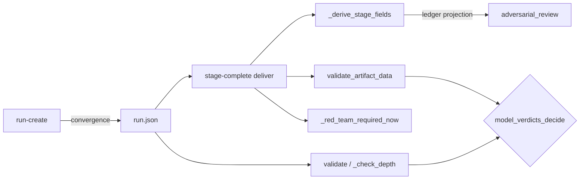
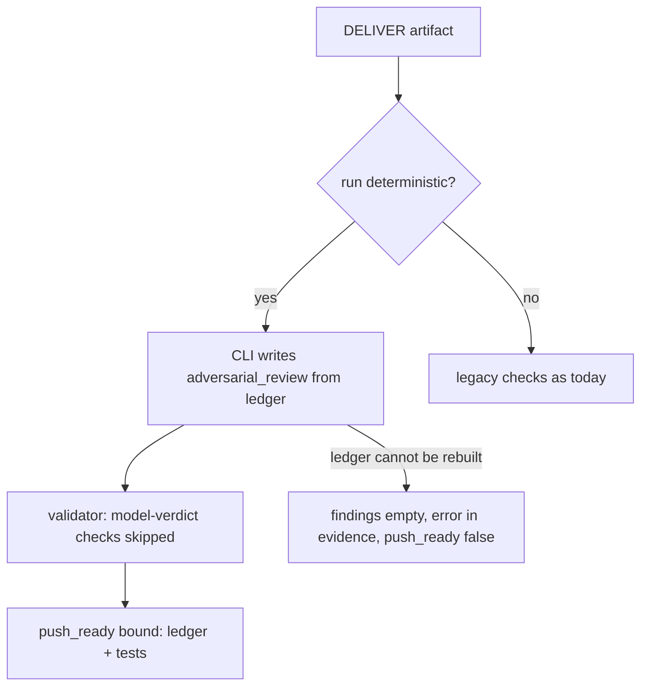

# Design Spec

**Run** `run_6238b7c3` · **profile** full · **project** SwarmAI

> 先落 convergence step 3

_Generated from the run's stage artifacts by the pipeline (not hand-written)._

## Approach (THINK)

**Solution class: SYSTEMIC** · addresses W3 · structural change: refactor
- **Why this is the root:** the opt-in reached one of the doors that judge DELIVER; putting the mode into one validator predicate that every door calls makes every current and future check see it
- **Structural change:** the rule 'only tests and the ledger decide' must live in one predicate both doors call, not in per-check guards
- **Sibling coverage:** C0 validate_artifact_data skips _blocked_findings when model verdicts do not decide; C1 _check_depth skips _blocked_findings the same way; C2 both _red_team_gate calls are skipped under the same predicate; C3 the meta_review and convergence requirements are skipped under the same predicate; C4 _red_team_required_now returns False for a deterministic run, so stage-complete's marker check never fires; C5 the same guard stops the required_experts red-team injection

| | Approach | Effort | Risk | Tradeoff |
|---|---|---|---|---|
| 🎯 QUALITY | One predicate pipeline_validator.model_verdicts_decide(convergence) (true unless deterministic). validate_artifact_data and _check_depth take convergence=; under deterministic they skip the five model-verdict checks (unresolved findings x2, Red Team x2, meta_review + convergence); artifact_cli pass… | M | a missed sixth check keeps lowering push_ready (visible in this run's own DELIVER) | touches two big modules, but every change is a keyword argument and a guard |
| SIMPLICITY | No validator change: in deterministic runs the CLI writes stub meta_review {verdict: CLEAR}, convergence {all_pass: true} and marks not-proven findings deferred_by so the existing checks pass. | S | the artifact claims a meta-review and a convergence pass that never happened | smallest diff, but it writes false records into the stores the human reads |
| 🎯 DELETION | Skip 3b and delete the legacy checks now (step 3c). | L | no real deterministic run has completed; a dead end in the new flow would break every run with nothing to fall back to (R26) | fastest path to one flow, but big-bang |

**Recommendation:** Approach QUALITY. One predicate in pipeline_validator decides whether model verdicts count, both validator doors and the artifact_cli Red Team predicate ask it, the CLI derives adversarial_review from the ledger, the card documents the loop and run-create defaults to deterministic. Effect: in a deterministic run push_ready is lowered only by not-proven ledger rows, tests and the existing non-model gates. Landing was already decided by tests alone.

## Design

### User workflow

1. Today: a new run takes the legacy Gate-2 flow; an agent that opts in has no card for the new loop, and its push_ready is lowered by meta_review / convergence / unresolved-finding checks even when every finding is proven
2. After: run-create gives a deterministic run; at DELIVER the card sends the agent to gate2-next, which it follows to done; the CLI writes adversarial_review from the ledger; push_ready is lowered only by not-proven ledger rows, tests and the non-model gates

### Architecture

### Flow

### State lifecycle

| State | Created by | Removed by | Crosses |
|---|---|---|---|
| S1 run.json convergence | artifact_cli.py::cmd_run_create | never: the flow of a run does not change after creation | a run created before this change (no key) → legacy, because _deterministic and model_verdicts_decide both test for the exact value 'deterministic'; a paused legacy run resumed after this change → stays legacy: resume does not rewrite the key |

### Invariants

| ID | Invariant | Enforced at |
|---|---|---|
| I1 (root) | Every DELIVER check that judges a model verdict asks model_verdicts_decide(convergence); under deterministic none of them is an error | pipeline_validator.py::model_verdicts_decide, validate_artifact_data, _check_depth; artifact_cli.py::_red_team_required_now |
| I2 | In a deterministic run, adversarial_review in the DELIVER artifact is the CLI's projection of the ledger, never the model's text | artifact_cli.py::_derive_stage_fields |
| I3 | A run without convergence=deterministic is validated exactly as before | pipeline_validator.py::model_verdicts_decide (None -> True) |

### Failure modes

| ID | Scenario | Expected |
|---|---|---|
| F1 | the ledger cannot be rebuilt at stage-complete (marker store unreadable) | adversarial_review findings [] with the error in evidence; push_ready false via the existing 'ledger not rebuilt' reason; landing still decided by tests |
| F2 | a legacy run gets convergence=deterministic written into run.json by hand | it gets the deterministic rule; with no DELIVER roster the ledger reports 'no review ran' and push_ready is false; landing is still on tests |
| F3 | the model writes its own adversarial_review in a deterministic run | replaced by the ledger projection |

## Plan

Approach QUALITY from THINK. One predicate pipeline_validator.model_verdicts_decide(convergence) -> bool (True unless 'deterministic'). validate_artifact_data and _check_depth take a keyword convergence=None (None keeps today's behaviour for every existing caller) and skip the five model-verdict checks when the predicate is False. Callers pass the run's mode: artifact_cli._validate_stage_candidate (stage-complete), the legacy publish path (cmd_publish, run.json already read there), and pipeline_validator.validate (completion, run dict already loaded). artifact_cli._red_team_required_now returns False for a deterministic run. _derive_stage_fields, for deliver in a deterministic run, replaces adversarial_review with a projection of _gate2_next_view's ledger. cmd_run_create writes convergence=deterministic unless --convergence legacy. deliver.md gets a one-line pointer to a new ref card stages/ref/deliver/gate2-deterministic.md.

### Acceptance criteria

- AC1: run-create without --convergence records convergence=deterministic in run.json; --convergence legacy records convergence=legacy, and a run with legacy (or no key, as every existing run) still takes the legacy Gate-2 commands
- AC2: under convergence=deterministic, validate_artifact_data('deliver', ...) reports none of the model-verdict errors (unresolved adversarial finding, Red Team required, meta_review missing, convergence missing); the same artifact under legacy still reports each of them
- AC3: in a deterministic run, stage-complete --stage deliver writes adversarial_review from the gate2-next ledger (each finding with expert, round, claim, ledger state and break test; resolved only when proven), replacing whatever the model wrote; push_ready keeps the ledger's not-proven reasons
- AC4: under convergence=deterministic, _check_depth('deliver', ...) (run-update --status completed) reports neither the unresolved-finding nor the Red Team error; legacy unchanged; pipeline_validator.validate passes the run's mode
- AC5: _red_team_required_now is False for a deterministic run, so neither the stage-complete marker check nor the required_experts injection fires on a model finding's severity
- AC6: stages/deliver.md points a deterministic run to a ref card that describes the gate2-next loop (spawn / fix / prove / done) and states that gate2-ledger, gate2-fixspec, gate2-recheck, meta-review and the convergence loop do not apply; legacy steps stay for legacy runs; the card stays within its size limit
- AC7: this run (convergence=deterministic) completes DELIVER through gate2-next and lands a local commit on the test result

### Exit contract

| ID | Kind | Ref | Expect |
|---|---|---|---|
| X1 | test | backend/tests/test_convergence_default.py | pass |
| X2 | test | backend/tests/test_gate2_next.py | pass |
| X3 | test | backend/tests/test_red_team_trigger.py | pass |
| X4 | test | backend/tests/test_lint_skills_size.py | pass |
| X5 | manual | this run's DELIVER followed gate2-next to done and landed a local commit | done |
