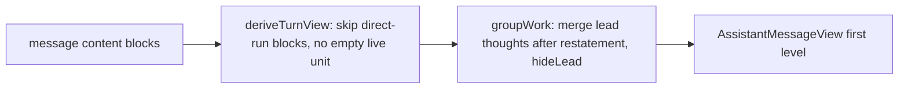
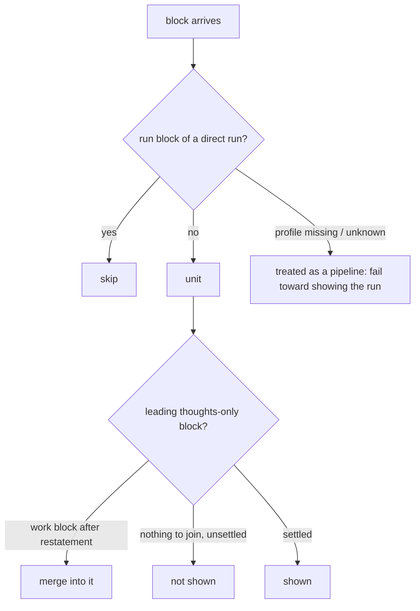

# Design Spec

**Run** `run_6c5ef452` · **profile** direct · **project** SwarmAI

> 我要疯了 你整个streaming response structure 1级 目录都不对 你找下我们的design, 对比看看 怎么上来就response 'Working Thinking'  是啥意思 都给我归到了PIPELINE是啥意思 我们还没run pipeline 呢  你能把我们的structure 搞对吗

_Generated from the run's stage artifacts by the pipeline (not hand-written)._

## Design

### User workflow

1. Today: XG sends a message; the turn opens with a 'Working · Thinking' card above everything, and a turn in which the agent made a direct run is shown as a PIPELINE checklist (PLAN/BUILD/GATE 2/DELIVER) though no pipeline ran
2. After: the turn opens with only the streaming bee; the restatement is the first thing on screen; the first WORKING block appears below it with the opening thought as its first item; a direct run turn reads restatement, WORKED, result

### Architecture

### Flow

### State lifecycle

| State | Created by | Removed by | Crosses |
|---|---|---|---|
| S1 lead thoughts held (not shown) | desktop/src/pages/chat/turnView.ts::groupWork (hideLead) | turnView.ts::groupWork merge when the first work block exists, or the settle (hideLead false) | stream end + settle → a thought-then-answer turn shows its thought block; nothing visible vanishes because the held block was never shown; pipeline run starting → lead thoughts stay at the top unshown (keepLeadThoughts) and join the first stage at the settle, so the stage body never remounts them |

### Invariants

| ID | Invariant | Enforced at |
|---|---|---|
| I1 (root) | The first first-level item of a turn is never a WORKING card made only of thoughts or of nothing | desktop/src/pages/chat/turnView.ts::groupWork |
| I2 | A run whose latest profile is direct never produces a pipeline block | desktop/src/pages/chat/turnView.ts::deriveTurnView |

### Failure modes

| ID | Scenario | Expected |
|---|---|---|
| F1 | a direct run is upgraded to full mid-turn | its latest profile is full, so the turn shows the pipeline block |
| F2 | a long opening thought with visible text and no restatement | only the bee until the first tool call; then the thought is the first item of the WORKING block |
| F3 | reconnect mid-stream replaces the live message by the stored copy | same units, nothing visible lost (replay test) |

## Plan

Frontend only. turnView.deriveTurnView skips pipeline_stage/pipeline_run blocks of runs whose latest profile is direct and no longer pushes an empty live process for empty content; groupWork merges the lead thoughts into the first block after the restatement while streaming too, and with hideLead drops an unmergeable leading thoughts-only block until the turn settles; groupWork no longer adds an empty WORKING card when nothing has arrived. AssistantMessageView passes hideLead (streaming or settling) at the top level and keeps lead thoughts at the top of a pipeline turn until settle. design-judgment.md Surface 6 #7 updated.

### Acceptance criteria

- AC1: a turn whose only run blocks are profile=direct renders no pipeline block and no checklist lines; restatement, one WORKED block and the result show as in a chat turn
- AC2: a direct run whose later block carries a pipeline profile renders as a pipeline from then on
- AC3: while streaming with no content there is no Working card; the streaming bee is the only indicator
- AC4: while streaming, thoughts written before the restatement never form a block above it; they are the first items of the first work block after it, and that block does not remount as the turn continues
- AC5: a settled turn that only thought and answered still shows its thought block

### Exit contract

| ID | Kind | Ref | Expect |
|---|---|---|---|
| X1 | test | desktop/src/pages/chat/components/__tests__/AssistantMessageView.thoughts.test.tsx | pass |
| X2 | test | mode:verify | pass |
