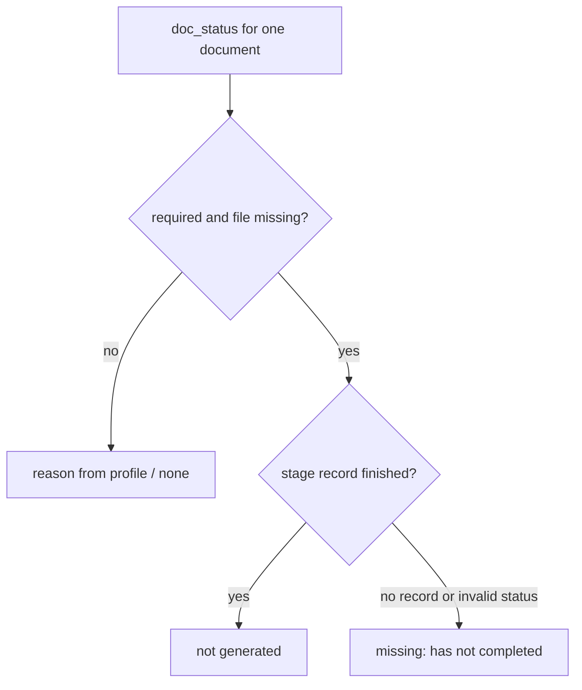

# Design Spec

**Run** `run_7032b9c1` · **profile** direct · **project** SwarmAI

> 起 direct run 提交这个修复

_Generated from the run's stage artifacts by the pipeline (not hand-written)._

## Design

### Flow

**No state:** pure read of run.json records and the run directory; nothing is written by this change

### Invariants

| ID | Invariant | Enforced at |
|---|---|---|
| I1 (root) | a reason never says a stage has not completed when its record is finished | backend/core/run_docs.py::doc_status |
| I2 | doc_status and completion_check agree on what a finished stage is | backend/core/run_docs.py::_DONE |

### Failure modes

| ID | Scenario | Expected |
|---|---|---|
| F1 | a stage recorded with the legacy status spelling 'done' or 'complete' | counted as finished: reason 'not generated' |

## Plan

One frozenset _DONE in core/run_docs.py used by doc_status and completion_check; doc_status reads the stage record it already loads.

### Change spec

- **backend/core/run_docs.py** — _DONE frozenset; doc_status reason branches on the stage record; completion_check uses _DONE
- **backend/tests/test_run_docs.py** — test_doc_status_tells_not_generated_from_not_completed

### Acceptance criteria

- AC1: doc_status gives a required document whose stage record is finished (completed / complete / done) but has no file the reason 'not generated: <stage> completed before run documents existed, or the write failed'; an unfinished stage keeps 'missing: <stage> has not completed'; completion_check counts the same three statuses as finished

### Exit contract

| ID | Kind | Ref | Expect |
|---|---|---|---|
| X1 | test | backend/tests/test_run_docs.py::test_doc_status_tells_not_generated_from_not_completed | pass |
| X2 | test | backend/tests/test_run_docs.py | pass |
