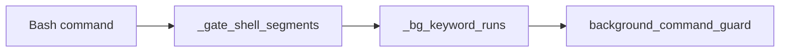
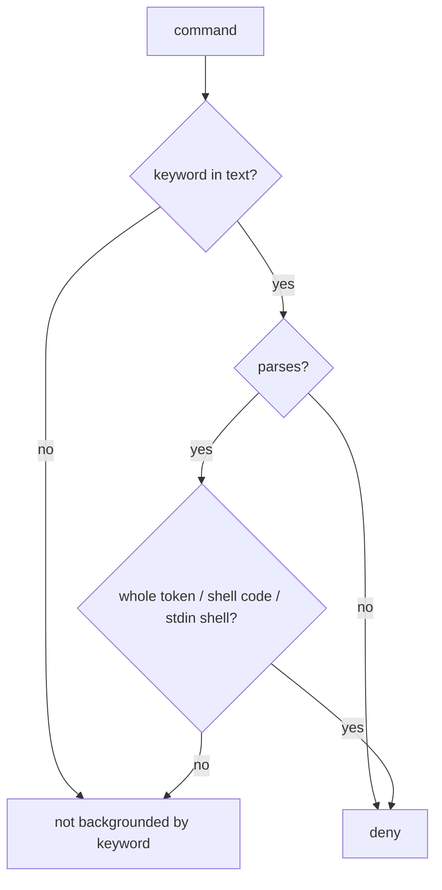

# Design Spec

**Run** `run_73b31d6d` · **profile** direct · **project** SwarmAI

> ‘3. 十几次被 gate 拦，多数是我自己的写法造成的。 这个会话被拦了 13 次以上，主要是在 heredoc 里写编辑脚本时撞上误判，这正是这次要修的问题。刚才排查时也一样：grep 的模式里写了 setsid，就被后台命令守卫拦了。这是一类新的误判，这次没修到。 ⏎ 4. 长时间不出声。 我遵守"调用工具时不写文字"的规则，结果出现过 5 分钟以上没有一句话的情况。你在界面上看不出我是在干活还是已经卡死。 ⏎ 5. 做完了没说清楚。 最后两次你问"为什么停"，答案其实是"已经提交，在等你批准重启"，但我第一次回复没有把"已经在 main 上了"放在最前面。另外，最后一次 run 的记录还留有两个毛病：状态是 verified=false，报告里写着"Gate-2 没有要修的"，这句是错的。’ 你修下这 还有 第4条 我们没这规则 这是别没有response 自己造response…

_Generated from the run's stage artifacts by the pipeline (not hand-written)._

## Design

### User workflow

1. today a grep or a requirement text naming a detach keyword is denied as backgrounding, and run records say 'nothing to fix' / push_ready true when they are not
2. after: those commands run, and the run record says what happened

### Architecture

### Flow

**No state:** classification functions and one payload field; no stored state

### Invariants

| ID | Invariant | Enforced at |
|---|---|---|
| I1 (root) | A detach keyword denies only when some shell, wrapper or exec flag can run it | backend/core/security_hooks.py::_bg_keyword_runs |
| I2 | A run record states what happened: a fix without a spec is not 'nothing to fix', and the deliver payload's push_ready is the record's | backend/core/run_docs.py::doc_status |

### Failure modes

| ID | Scenario | Expected |
|---|---|---|
| F1 | an unparseable command naming a keyword | still denied (raw-text check) |

## Plan

Replace the raw _BG_KEYWORD_RE.search with _bg_keyword_runs on the heredoc-aware segmenter; count fixed findings from the DELIVER artifact in doc_status; sync derived.push_ready after the two lowering steps.

### Acceptance criteria

- AC1: background_command_guard counts a detach keyword only when it can run: a whole token of a segment (wrappers, xargs, find -exec included), sh -c / eval code, a heredoc body a shell runs, or any command where a shell reads its script from stdin; inside a longer quoted argument or as an argument of grep / rg / echo / printf it is data. Unparseable commands keep the raw-text check.
- AC2: run_docs gives FIXING_SPEC.md the reason 'not written: N Gate-2 finding(s) were fixed without a fixing spec' when DELIVER fixed findings without one; 'skipped: Gate-2 had nothing to fix' only when nothing was fixed.
- AC3: stage-complete deliver's derived.push_ready matches the record when a later step (degrade, unverified gaps) lowers push_ready.

### Exit contract

| ID | Kind | Ref | Expect |
|---|---|---|---|
| X1 | test | backend/tests/test_background_command_guard.py | pass |
| X2 | test | backend/tests/test_run_docs.py | pass |
| X3 | test | backend/tests/test_stage_boundary_commands.py::test_deliver_payload_push_ready_matches_a_degraded_record | pass |
| X4 | test | mode:verify | pass |
