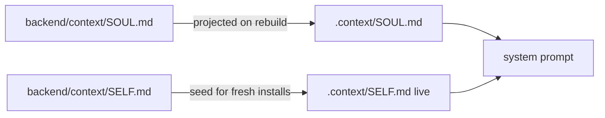
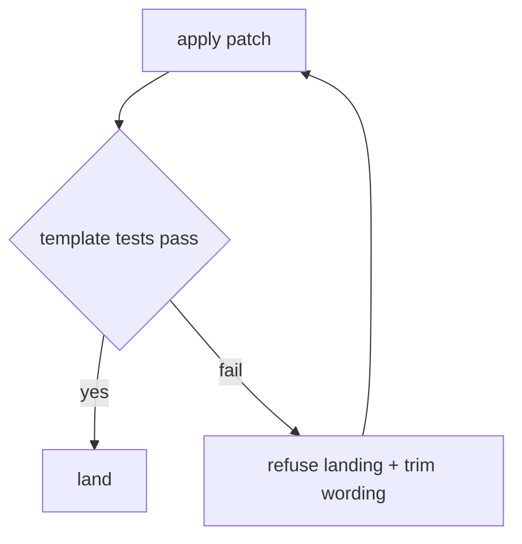

# Design Spec

**Run** `run_772dd29a` · **profile** direct · **project** SwarmAI

> 产品级 你要改Repo 啊

_Generated from the run's stage artifacts by the pipeline (not hand-written)._

## Design

### User workflow

1. Today SOUL P5 says the OS disposes but not what disposing may rest on, so a gate can block on a model verdict
2. After: every session reads that a block rests only on a deterministic signal or a human, and that model loops are budgeted

### Architecture

### Flow

**No state:** Text-only change to two prompt seed files; no runtime state, store or field is added or touched.

### Invariants

| ID | Invariant | Enforced at |
|---|---|---|
| I1 (root) | Product cognition states no behaviour the live system does not have | backend/context/SELF.md (no 'only tests block' claim) + adversarial review of the text |

### Failure modes

| ID | Scenario | Expected |
|---|---|---|
| F1 | a template test pins SOUL/SELF size or sections | the test fails and names the limit; wording is trimmed |

## Plan

Apply the reviewed governance patch (one adversarial round already run; its two HIGH findings fixed by moving the text from a P7 corollary into P5 and dropping the false 'only tests block' claim from SELF).

### Acceptance criteria

- AC1: backend/context/SOUL.md P5 carries 'The OS disposes deterministically' (models find; a review that RAN may be required; what it SAID blocks only as a deterministic check or once a human holds it; the signal list; counter-held budgets that end rounds, not work)
- AC2: backend/context/SELF.md My Gates states the same signal list and points to SOUL P5
- AC3: the context-template and context-budget suites still pass

### Exit contract

| ID | Kind | Ref | Expect |
|---|---|---|---|
| X1 | test | backend/tests/test_context_templates.py | pass |
| X2 | test | backend/tests/test_context_budget.py | pass |
