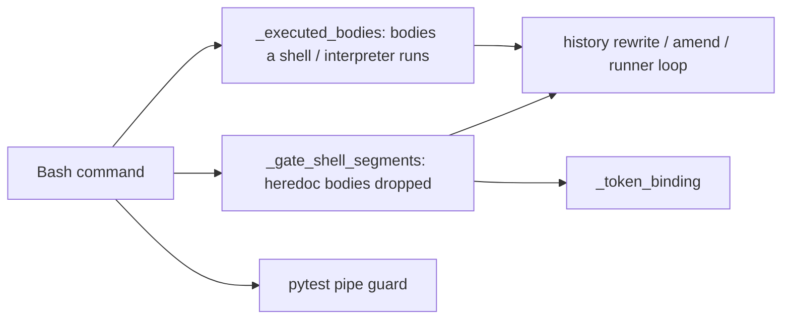
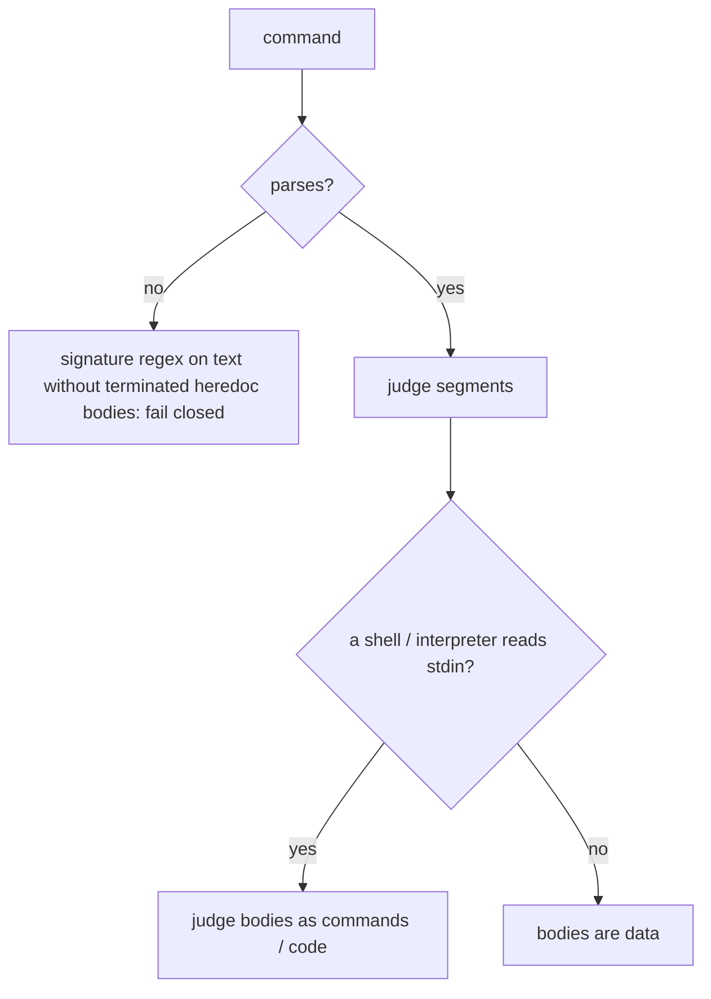

# Design Spec

**Run** `run_86a8fcbb` · **profile** direct · **project** SwarmAI

> direct run 直接做 1,2,3,4 因为你现在的pipeline 不ready.

_Generated from the run's stage artifacts by the pipeline (not hand-written)._

## Design

### User workflow

1. today edit scripts and output plumbing trip approvals and denies 12 times a day
2. after: they run; real rewrites, loops, pytest pagers and token misuse are still stopped

### Architecture

### Flow

**No state:** pure classification functions; no stored state

### Invariants

| ID | Invariant | Enforced at |
|---|---|---|
| I1 (root) | A gate judges what a command runs: a heredoc body counts only when a shell or interpreter executes it | backend/core/security_hooks.py::_judge_with_bodies |
| I2 | The hook token is handed to the CLI call only | backend/core/run_owner_gate.py::_token_binding |

### Failure modes

| ID | Scenario | Expected |
|---|---|---|
| F1 | an unparseable command naming rebase | still gated (regex on the text minus terminated data bodies) |
| F2 | an unquoted heredoc before the CLI ($(...) in its body runs) | token refused |

## Plan

One segmenter for every Bash gate: the naive _shell_segments (no heredoc handling) is deleted and its three callers use _gate_shell_segments plus _executed_bodies (heredoc bodies are judged only when a shell or interpreter reads its script from stdin). History rewrites resolve their directory (cd chains, git -C) and skip run worktrees and temp dirs. run_owner_gate._token_binding inserts the token right before the CLI call. The pytest pipe guard drops pytest-free substitutions first. _DYNAMIC_RE requires a bare call.

### Acceptance criteria

- AC1: A heredoc body is judged by what reads it: data for cat / tee / git commit -F - is never scanned as commands; a body a shell runs is judged as commands, a body python runs is judged only if the code can execute something.
- AC2: A git history rewrite inside a run worktree or a temp repo is not sent for approval; one in SwarmWS, in an unknown directory, through --git-dir, or run from a heredoc still is.
- AC3: The run owner gate hands the token to a CLI call that is the first command of the line, followed by any output plumbing, or preceded only by quoted-delimiter cat > FILE heredoc writes; anything else before it, a substitution, or a second token command is refused.
- AC4: The pytest pipe guard ignores $(...) / backtick spans with no pytest token; a pipe carrying pytest's own output stays denied.
- AC5: _code_can_execute treats re.compile( / df.eval( as methods, not the builtins; bare eval / compile / getattr still count.
- AC6: The day's false-positive shapes are allow tests and the matching true positives are deny tests (test_gate_false_positives.py).

### Exit contract

| ID | Kind | Ref | Expect |
|---|---|---|---|
| X1 | test | backend/tests/test_gate_false_positives.py | pass |
| X2 | test | backend/tests/test_worktree_gates.py | pass |
| X3 | test | mode:verify | pass |
