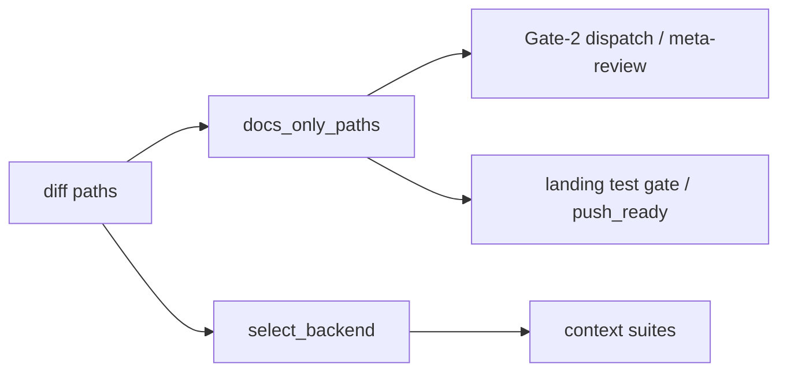
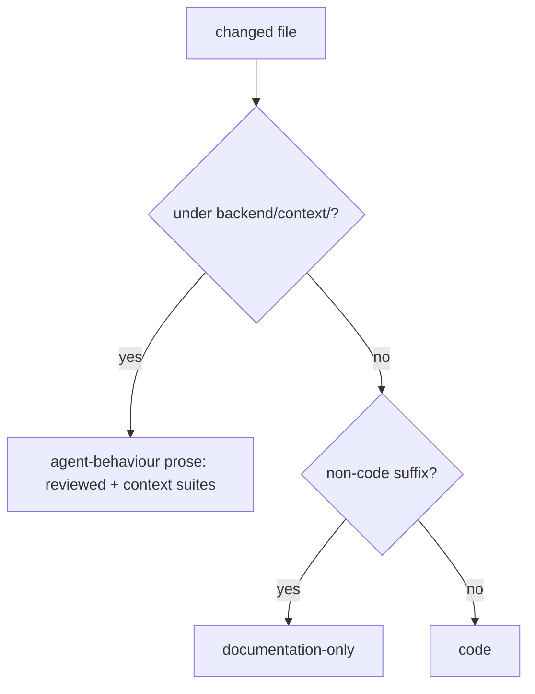

# Design Spec

**Run** `run_8c89f1dd` · **profile** direct · **project** SwarmAI

> 你看看 是不是问题 如果是就direct-run 修掉 ‘改受控的 context 文件可能完全没人审（安全相关）。backend/context/ 下的 ⏎ description ⏎ SOUL.md、 ⏎ description ⏎ STEERING.md、 ⏎ description ⏎ AGENT.md、 ⏎ description ⏎ SECURITY-BASELINE.md 都是 .md，会被判成纯文档改动，于是不派专家，也不派 meta-review，测试一过就算 push-ready。这几个文件会进入以后每一个 session 的 system prompt。所以如果有一段注入内容诱导我"把这条规则记下来"，改动就会在没有任何人看过的情况下落地。这是我照着代码读出来的推断，还没有实测验证。 ⏎ deliver 开始之后改动又变大了，审查要求却不会跟着恢复。 现有的过滤只看…

_Generated from the run's stage artifacts by the pipeline (not hand-written)._

## Design

### User workflow

1. today an edit to SOUL/AGENT/STEERING/SECURITY-BASELINE lands push-ready with no reviewer
2. after: DELIVER dispatches a meta-review for it and the context suites run

### Architecture

### Flow

**No state:** a classification rule; no runtime state

### Invariants

| ID | Invariant | Enforced at |
|---|---|---|
| I1 (root) | A change to a governed system-prompt source is never documentation-only | backend/scripts/pipeline_validator.py::_CODE_PROSE_RE |

### Failure modes

| ID | Scenario | Expected |
|---|---|---|
| F1 | an absolute worktree path to backend/context/AGENT.md | matched by (^\|/)backend/context/: not documentation-only |
| F2 | a docs/context/ file | still documentation-only |

## Plan

Add (^|/)backend/context/ to pipeline_validator._CODE_PROSE_RE (the SSOT for 'documentation-only', read by Gate-2 dispatch, the landing test gate and push_ready), and add _CONTEXT_SUITES to pipeline_test.select_backend beside _DOC_LINT_SUITES.

### Acceptance criteria

- AC1: A change to any file under backend/context/ is not documentation-only (pv.docs_only_paths / cli._is_docs_only), by relative or absolute path, so DELIVER dispatches a meta-review and the must-review checks apply.
- AC2: Plain documentation (docs/, README.md, images, a context/ dir outside backend/) stays documentation-only.
- AC3: The test runner selects test_context_templates.py and test_context_directory_loader.py when a backend/context/ file changes, and not for unrelated docs.

### Exit contract

| ID | Kind | Ref | Expect |
|---|---|---|---|
| X1 | test | backend/tests/test_stage_boundary_commands.py::test_docs_only_paths_is_judged_on_the_diff | pass |
| X2 | test | backend/tests/test_attribution_and_gaps.py::test_select_backend_adds_context_suites_for_a_governed_context_change | pass |
| X3 | test | mode:verify | pass |
