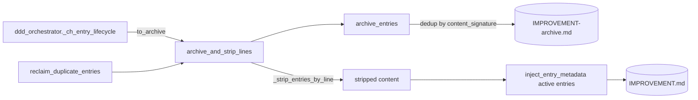
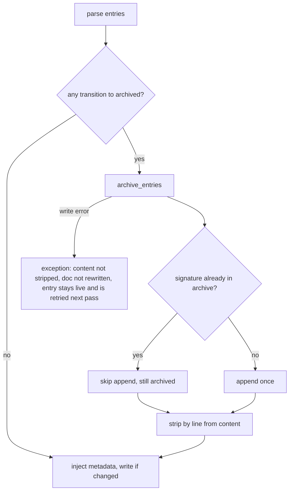

# Design Spec

**Run** `run_95bd0b0c` · **profile** full · **project** SwarmAI

> 按推荐

_Generated from the run's stage artifacts by the pipeline (not hand-written)._

## Approach (THINK)

**Solution class: SYSTEMIC** · addresses W3 · structural change: refactor
- **Why this is the root:** puts the move invariant (append once, strip from source) in one helper every archive-then-strip caller goes through, and makes the appender itself idempotent so no caller can duplicate
- **Structural change:** the rule must live in one helper plus the shared appender, not in each caller
- **Sibling coverage:** C1 reclaim_duplicate_entries uses the shared helper instead of its inline copy; its append becomes idempotent; C2 _archive_and_strip keeps its key strip but inherits the idempotent append; C3 excluded: context_health_hook MEMORY/KNOWLEDGE/EVOLUTION decay paths never call archive_entries

| | Approach | Effort | Risk | Tradeoff |
|---|---|---|---|---|
| 🎯 QUALITY | One shared apply-tail for line-precise archive+strip, used by the decay pass and reclaim_duplicate_entries, plus an idempotent archive_entries (skip a block already present, also within one batch). | S | touches the shared archive appender used by three callers | small refactor of reclaim_duplicate_entries' tail in exchange for one place that enforces 'archive is a move' |
| 🎯 SIMPLICITY | In the decay pass only, call _strip_entries_by_line after archive_entries and write the stripped content; add the idempotent check to archive_entries. | S | a third copy of the archive-then-strip sequence that can drift | smallest diff, but leaves two hand-written copies of the same move |
| DELETION | Delete archiving from the decay pass and let reclaim_noise_entries be the single archive+strip authority, as the MEMORY path does. | S | reclaim protects keep-class entries (decision/model/principle/correction/COE, ref>=2) | decayed decision/model entries would stay live forever marked archived, which breaks FR-1 |

**Recommendation:** QUALITY: a shared line-precise archive+strip helper used by the decay pass and reclaim_duplicate_entries, and an idempotent archive_entries. It fixes the root for every caller with a small diff; SIMPLICITY leaves a drifting copy and DELETION breaks FR-1.

## Design

### User workflow

1. Today: the daemon's DDD lifecycle pass marks an idle entry archived, appends it to IMPROVEMENT-archive.md, and leaves it in IMPROVEMENT.md; every later pass appends it again (archives grow to tens of MB of copies).
2. After: the pass appends the entry to the archive once and removes it from IMPROVEMENT.md in the same write; later passes no longer see it, and an entry already in the archive is never appended again.

### Architecture

### Flow

### State lifecycle

| State | Created by | Removed by | Crosses |
|---|---|---|---|
| S1 entry archived (in archive, not in live doc) | backend/core/ddd_entry_lifecycle.py::archive_and_strip_lines | never: archive content is never deleted; recovery is the archive plus git | an entry already present in the archive (today's duplicated shape) → the append is skipped and the live block is stripped, so the entry converges to S1 without a new copy; a same-title twin in the same section → only the archived block's line is stripped; the twin stays live |

### Invariants

| ID | Invariant | Enforced at |
|---|---|---|
| I1 (root) | An archived entry exists in exactly one place: archiving appends it to the archive at most once and removes it from the live doc in the same pass | backend/core/ddd_entry_lifecycle.py::archive_and_strip_lines + archive_entries |
| I2 | Archive content is only appended, never removed or rewritten | backend/core/ddd_entry_lifecycle.py::archive_entries |

### Failure modes

| ID | Scenario | Expected |
|---|---|---|
| F1 | the archive write raises (disk full, permission) | the exception propagates before the strip; the live doc is not rewritten, so nothing is lost and the next pass retries |
| F2 | another writer holds the IMPROVEMENT.md lock | the project is skipped this pass (existing md_lock non-blocking behaviour) |
| F3 | the process is killed after the archive append but before the live doc write | next pass sees the entry still live, the dedup skips a new append, and the strip completes |

## Plan

Make archiving a move in one place. (1) Extract archive_raw_lines' content_signature dedup into a shared helper and apply it in archive_entries for every caller (idempotent append, intra-batch too). (2) Add a line-precise archive+strip helper (archive_entries then _strip_entries_by_line, returns the stripped content, does not write) and use it in reclaim_duplicate_entries and in the orchestrator decay pass. (3) The decay pass strips the archived blocks from content first, then injects metadata for the surviving entries into the stripped content, then writes once.

### Acceptance criteria

- AC1: When the DDD entry lifecycle (ddd_orchestrator decay pass) transitions an entry to archived, that entry's bullet block is no longer present in the live doc after the pass, and it is present in the sibling archive file.
- AC2: Running the lifecycle pass twice on the same fixture leaves each archived entry exactly once in the archive file (second pass appends nothing for it).
- AC3: archive_entries skips an entry whose bullet text is already present in the target archive file, for every caller (decay pass, reclaim, retire).
- AC4: An entry in the live doc that is already marked decay:archived or decay:dormant past the archive threshold (today's real shape: still live after being archived many times) is archived at most once more and then stripped; no archive content is ever removed or rewritten.

### Exit contract

| ID | Kind | Ref | Expect |
|---|---|---|---|
| X1 | test | backend/tests/test_ddd_orchestrator.py | pass |
| X2 | test | backend/tests/test_ddd_entry_lifecycle.py | pass |

## Boundaries

- **Always:** archive before strip; never strip an entry that was not archived; strip by line number
- **Ask first:** any change that removes or rewrites existing archive content
- **Never:** delete or rewrite existing archive files (the one-time dedup is a separate data step); touch the MEMORY/KNOWLEDGE/EVOLUTION decay paths

## Test Strategy

| AC | How | Mock boundary | Inputs |
|---|---|---|---|
| AC1 | orchestrator test: fixture Projects/P/2-understanding/IMPROVEMENT.md with one dormant entry last referenced 200 days ago and one active entry; run _ch_entry_lifecycle; assert dormant bullet absent from live, present once in IMPROVEMENT-archive.md, active entry intact |  | two entries, fixed dates |
| AC2 | same fixture, run the pass twice; archive holds the entry exactly once |  | as AC1 |
| AC3 | lifecycle unit test: archive_entries twice with the same entry and once with two identical entries in one batch; archive contains it once; return value counts entries present |  | EntryMetadata with raw_text |
| AC4 | orchestrator test with today's real shape: archive already holding the entry 3 times and the live doc still holding it dormant; after the pass the live doc no longer holds it, the archive is byte-identical to before for its existing content (no removal or rewrite) and gains no new copy |  | pre-seeded archive |

## Success Criteria

- new tests fail on current main and pass after the change
- test_ddd_entry_lifecycle.py and test_ddd_orchestrator.py pass

## Contract readers

| ID | Contract | Pattern | Paths | Readers |
|---|---|---|---|---|
| K1 | archive_entries skips entries already in the archive; return value = entries now present in the archive (appended or already there) | `archive_entries\(` | backend | backend/core/ddd_orchestrator.py::_ch_entry_lifecycle migrated; backend/core/ddd_entry_lifecycle.py::reclaim_duplicate_entries migrated; backend/core/ddd_entry_lifecycle.py::_archive_and_strip unaffected — stores the count in report.archived for logging only; archive-then-strip semantics unchanged |
