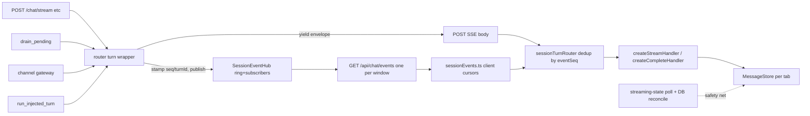
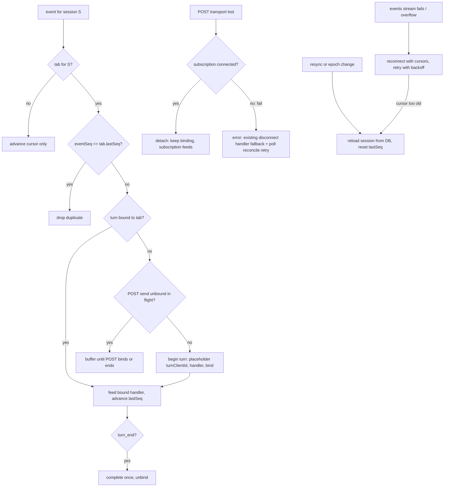

# Design Spec

**Run** `run_a0447441` · **profile** full · **project** SwarmAI

> 第一条绝对不可接受 不然streaming 就失去了意义 而且信息是错乱的 misleading 用户 你系统化的看下 我们到底还有什么类似的问题 一起从根上解决

_Generated from the run's stage artifacts by the pipeline (not hand-written)._

## Approach (THINK)

**Solution class: SYSTEMIC** · addresses W3 · structural change: redesign
- **Why this is the root:** Moves turn ownership from the HTTP request to the session and makes the session's event stream subscribable, which is the missed invariant every background-turn symptom and every frontend rescue comes from.
- **Structural change:** Turn lifetime and event delivery must change owner (request -> session) in one place every turn source goes through; no local patch can make a request-bound stream carry turns that have no request.
- **Sibling coverage:** C1 drain_pending runs through the router turn-runner, so its events are published and the subscribed tab renders them live; C2 auto_continue is deleted: a disconnect no longer interrupts the turn, so there is nothing to continue; C3 run_injected_turn runs through the turn-runner and publishes its events; C4 ui_command (and question/permission events) are ordinary turn events on the published stream, so they reach the subscribed tab from any turn; C5 the new session event log reuses task_manager.subscribe's register-then-replay order and adds seq/resume; migrating tasks onto it is a later follow-up; C6 channel-initiated turns (gateway.py:1913/:2040) go through the router and are published, so a desktop channel tab shows them live; C7 excluded: skill_creator and task_manager turns already have their own delivery channels; publishing adds events they do not consume, no behaviour change

| | Approach | Effort | Risk | Tradeoff |
|---|---|---|---|---|
| SPEED | Poll GET /streaming-state every 1s in every state and persist an in-progress text snapshot so DB reloads show partial text. | S | Still misses sub-second turns, no token/tool-progress streaming, ui_command still lost, disconnect still interrupts; adds load on every tab; the 34th patch on the reconcile layer. | Cheap, but leaves the root and every rescue in place. |
| 🎯 QUALITY | Session-owned turns + one subscribable event stream: every turn runs as a router-owned task whose events are published to a per-session event log with a monotonically increasing seq (bounded replay buffer); the desktop opens ONE multiplexed GET subscription for all its sessions and resumes from per… | L | Touches the session/streaming hot zone on both sides; dedup/handoff between POST and subscription must be exact; removing the disconnect interrupt must be proven safe with the continuous reader. | Largest change, but every background source (drain, injected, channel turns, continuations, questions, ui_command) becomes live through one path and two recovery mechanisms are deleted. |
| SIMPLICITY | Add a per-session subscription only for turns that have no POST stream (drain, injected, channel); keep POST turns bound to the request and keep the disconnect interrupt + auto_continue. | M | Two delivery architectures forever; a dropped POST still kills the turn and the continuation is again a background turn, so the disconnect class stays. | Smaller diff, but it leaves W3 (turn bound to request) standing. |

**Recommendation:** QUALITY: session-owned turns with one multiplexed per-window subscription stream (per-session seq, bounded replay, resync), POST SSE as a filtered subscriber, frontend subscription manager feeding the existing createStreamHandler for turns without a live POST reader, deletion of the disconnect interrupt and auto_continue. Frontend polling rescues are demoted to the safety net in this run and deleted in a follow-up after soak (R26 strangler-fig). SPEED and SIMPLICITY each leave the request-bound turn standing.

## Design

### User workflow

1. Today: a background task finishes, the CLI answers on its own; the tab shows nothing until a 15s poll lands in the turn or the user reloads; a dropped connection interrupts the turn and a synthetic 'Continue the task' turn runs invisibly.
2. After: every tab of the window receives every turn of its session live from one subscription stream: injected, drained, continuation and channel turns stream token by token with spinner, questions and ui_command; a dropped POST or a reload detaches/reattaches without stopping the turn; polling only catches what the stream missed.

### Architecture

### Flow

### State lifecycle

| State | Created by | Removed by | Crosses |
|---|---|---|---|
| S1 session event log (seq counter + bounded replay buffer) | backend/core/session_events.py::SessionEventHub.publish | backend/core/session_events.py::SessionEventHub.drop_session (called from the router's session release/eviction); daemo… | daemon restart → new epoch; clients treat every cursor as stale and reload from DB, so no seq collision is ever trusted; session eviction/cold → log kept until release so a reconnecting tab can still replay the last turn |
| S2 subscriber (one per window stream) | backend/routers/chat.py::session_events_stream | backend/core/session_events.py::SessionEventHub.subscribe finally (client disconnect or overflow close) | subscriber queue full → the subscriber is closed; the client reconnects with its cursors and replays, or gets resync; turn running → subscribing/unsubscribing never touches the turn |
| S3 detached turn (POST client gone, turn still running) | backend/routers/chat.py::sse_with_heartbeat finally (consumer not done) | the consumer task finishing at the turn's own end (result/error/interrupt by /chat/stop) | user Stop → /chat/stop interrupts the unit; the detached turn ends normally and publishes turn_end; new user send to the same session → SessionBusyError -> pending row -> drained after the turn; reply streams live via subscription; tab close without force → release_session skips the active unit; the turn finishes and the unit is reaped later as before |
| S4 tab turn binding {turnId, handler, complete, viaPost, completed} | desktop/src/hooks/sessionTurnRouter.ts::bindPost / beginSubscriptionTurn | desktop/src/hooks/sessionTurnRouter.ts::completeTurn (turn_end or POST complete) and tab close | POST and subscription both deliver → eventSeq dedup processes each event once, whichever source is first; POST complete and turn_end both arrive → completed flag makes the second a no-op; window reload mid-turn → no binding; the first event of the running turn begins a subscription turn on the existing message id (turnClientId) |

### Invariants

| ID | Invariant | Enforced at |
|---|---|---|
| I1 (root) | A session's event stream is owned by the session and is subscribable: every event of every turn is published exactly once with a per-session, strictly increasing eventSeq, and clients attach/detach without affecting the turn. | backend/core/session_events.py::SessionEventHub.publish + backend/core/session_router.py::SessionRouter._published_turn |
| I2 | A client disconnect never interrupts, cancels or re-drives a turn; only /chat/stop, release with force, or the turn's own end stop it. | backend/routers/chat.py::sse_with_heartbeat |
| I3 | The frontend renders each eventSeq of a session at most once and completes each turn at most once, regardless of how many sources delivered it. | desktop/src/hooks/sessionTurnRouter.ts::routeEvent |
| I4 | The inner turn generator is always closed when the wrapper is closed, so its finally blocks (pending rollback, slot release) run exactly as before. | backend/core/session_router.py::SessionRouter._published_turn (aclosing) |
| I5 | A desktop window holds exactly one events stream regardless of tab count. | desktop/src/services/sessionEvents.ts::sessionEvents (module singleton) |
| I6 | While the subscription is connected, the subscription is the only source that renders turn events; POST renders a turn only while the subscription is down. | desktop/src/hooks/sessionTurnRouter.ts::routePostEvent |

### Failure modes

| ID | Scenario | Expected |
|---|---|---|
| F1 | client reconnects with a cursor older than the replay buffer | server emits resync{sessionId, seq}; client reloads that session's tail from DB and continues live from seq |
| F2 | daemon restarts while the window is open | hello carries a new epoch; client resyncs every mapped session from DB; no stale cursor is trusted |
| F3 | subscription event of turn X arrives before the POST stream's first event of X | buffered while the tab's POST send is unbound; when POST binds X the buffer is replayed through eventSeq dedup; never a second bubble |
| F4 | POST stream stalls or drops mid-turn while subscription is connected | detach: no reconnecting UI, no error, the subscription feeds the same handler, turn_end completes it |
| F5 | subscription is down when the POST drops | existing createDisconnectHandler path runs unchanged (safety net) and the poll reconcile recovers |
| F6 | a slow window stops reading the events stream | its bounded queue overflows, the subscriber is closed, publishing to other subscribers and the turn are unaffected |
| F7 | the publishing wrapper is closed early by a caller (drain rollback test) | aclosing closes the inner generator; pending rollback and turn_end publish run |
| F8 | window reload during a turn | restored tab loads DB rows, the next live event begins a subscription turn on the existing message id; at turn_end the DB reconcile converges with no duplicate |
| F9 | a POST client disconnects and nothing reads the detached consumer's queue for a long turn | the consumer stops queueing on detach; memory stays flat while the turn runs to its end |

## Plan

Session-owned turns and one subscribable session event stream. Backend: a new SessionEventHub (core/session_events.py) assigns each session a monotonically increasing eventSeq and keeps a bounded per-session replay buffer plus per-subscriber bounded queues (register-then-replay, like task_manager.subscribe). The four router turn generators (run_conversation, continue_with_answer, continue_with_cmd_permission, run_injected_turn's loop) go through one wrapper that stamps every event with sessionId/turnId/turnClientId/eventSeq, publishes it, emits turn_start/turn_end, and closes the inner generator with aclosing. New GET /api/chat/events streams all sessions to one window with per-session cursors, an epoch hello and resync. sse_with_heartbeat detaches the consumer on client disconnect instead of cancelling it, so the turn runs to its own end; the disconnect interrupt (_recover_streaming_on_disconnect, _cleanup_subprocess_after_disconnect) and core/auto_continue are deleted. Frontend: services/sessionEvents.ts keeps ONE subscription per window (reconnect with cursors, epoch check, stall timeout on missing heartbeat); hooks/sessionTurnRouter.ts is a pure router that makes the subscription the single render source (POST turn events are dropped while it is connected and rendered only as a fallback while it is down, with an eventSeq gate for the switch), buffers subscription events while a POST send is unbound, begins a subscription turn for a tab with no active turn (placeholder id = turnClientId, existing message reused), completes each turn once (turn_end or POST complete), and turns a POST transport loss into a detach while the subscription is connected. useChatStreamingLifecycle wires it; polling reconcile stays as the safety net. The detached sse_with_heartbeat consumer stops queueing (drains and drops) so nothing grows unbounded. Deleted in this run: core/auto_continue.py and tests/test_auto_continue.py; chat.py _recover_streaming_on_disconnect, _cleanup_subprocess_…

### Acceptance criteria

- AC1: A tab subscribed to a session receives, live and in order, the events of EVERY turn of that session (user POST turn, drained pending turn, auto-continue turn, answer/permission continuation, CLI-initiated injected turn) within 1s of the backend producing them, with no dependency on GET /streaming-state polling.
- AC2: A CLI-initiated turn that starts and ends in under 3s while the tab is idle shows its spinner and its streamed content live, not on a later reload.
- AC3: Closing or dropping the HTTP connection of a tab (network drop, reload, frontend stall timer) does not interrupt the backend turn; on reconnect the tab replays every event after its last received sequence number and the live view converges to the DB view with no duplicated or missing bubble.
- AC4: AskUserQuestion / permission requests and ui_command events raised inside a turn that has no POST stream reach the subscribed tab live.
- AC5: GET /streaming-state polling and DB reconcile remain as the safety net only; a lost subscription is detected and re-established without user action.
- AC6: The frontend renders turn events from ONE live path, the subscription: while it is connected, POST streams are used only for pre-turn replies (events without turnId: validation, SESSION_BUSY, queued) and to bind the send to its turnId; POST turn events render only while the subscription is down (fallback), and a mid-turn switch is gated by eventSeq. The busy-poll DB loop is deleted (the drained turn streams on the subscription); the remaining poll rescues (B1 drain surface, symmetric re-arm, force-clear, disconnect timeout) stay only as the safety net and never deliver a turn the subscri…

### Exit contract

| ID | Kind | Ref | Expect |
|---|---|---|---|
| X1 | test | backend/tests/test_session_events.py | pass |
| X2 | test | backend/tests/test_session_events_publish.py | pass |
| X3 | test | backend/tests/test_chat_detach.py | pass |
| X4 | test | desktop/src/hooks/__tests__/sessionTurnRouter.test.ts | pass |
| X5 | test | desktop/src/services/__tests__/sessionEvents.test.ts | pass |
| X6 | test | mode:regression | pass |
| X7 | mutation | /tmp/run_a0447441/mutations.json | all_killed |
| X8 | manual | E2E smoke on the rebuilt app (cross_boundary Layer-4) | done |

## Security Boundaries

| Boundary | Trust assumption | Enforced at |
|---|---|---|
| frontend<->backend API GET /api/chat/events (new): streams every session's turn events to the caller | only the desktop owner (localhost) or an authenticated Hive client reaches it, same as GET /api/chat/sessions/{id}/messages which already returns the same content | backend/config_settings.py:27 |
| Hive mode access to GET /api/chat/events | HiveAuthMiddleware authenticates every request in SWARMAI_MODE=hive and is pure-ASGI so it does not buffer SSE | backend/middleware/hive_auth.py:98 |
| query parameter cursors (client-supplied JSON map sessionId->seq) | untrusted input: parsed with size and type limits, unknown sessions ignored, values coerced to non-negative ints; it only selects which already-authorized events to replay | escalate: enforcement is new code in routers/chat.py::session_events_stream; the reviewer must verify the parser bounds |

## Boundaries

- **Always:** every event of every router turn passes the single publishing wrapper; dedup by per-session eventSeq before any render; a turn completes in the UI exactly once; existing polling reconcile stays functional as the safety net
- **Ask first:** deleting the remaining safety-net rescues (B1 drain surface, symmetric re-arm, force-clear, disconnect timeout) and the SessionUnit disconnect cluster — follow-up run after soak; migrating task_manager.subscribe onto the hub; restarting the daemon or rebuilding the app
- **Never:** one long-lived stream per tab (WebKit per-host HTTP/1.1 connection cap); interrupting a turn because a client disconnected; unbounded subscriber queues; re-sending a user message from the frontend to recover a turn

## Test Strategy

| AC | How | Mock boundary | Inputs |
|---|---|---|---|
| AC1 | backend: drive run_conversation/continue_with_answer/injected with a fake unit and assert published envelopes (types, order, strictly increasing eventSeq); frontend: router feeds subscription events into handler |  | recorded event sequences |
| AC2 | router test: idle tab receives turn_start+text_delta+result+turn_end within one tick and begins/completes a turn |  | 2-event injected turn |
| AC3 | backend: sse_with_heartbeat with a request that reports disconnected; assert the generator ran to completion and no interrupt/recover was called; endpoint replay after cursor + resync; frontend: transport loss with subscription connected -> detach, no disconnect handler |  | disconnect at event 2 of 5 |
| AC4 | router test: ask_user_question and ui_command events delivered via subscription reach the handler |  | question event in a drained turn |
| AC5 | sessionEvents client: stream end -> reconnect with cursors; epoch change -> resync callbacks |  | two connections |
| AC6 | router tests: with the subscription connected, POST turn events are dropped and the subscription events render; with it down, POST renders; switch mid-turn is seq-gated; code grep shows the busy-poll loop gone |  | same turn delivered by both sources |

## Success Criteria

- backend: a POST client disconnect leaves the turn running to its result and persisted (test asserts no interrupt and a persisted assistant row)
- backend: injected, drained, answer-continuation and channel turns publish turn_start, their events and turn_end with strictly increasing eventSeq (tests)
- backend: GET /api/chat/events replays after a cursor, sends resync for a cursor older than the buffer, and an epoch hello (tests)
- frontend: sessionTurnRouter unit tests cover dedup, buffer-while-unbound, begin, complete-once, detach, resync
- frontend: tsc + targeted vitest green; backend targeted pytest + regression green
- E2E smoke on the rebuilt app: a 2s background-task turn appears live in an idle tab; a reload mid-turn continues live; a queued message's reply streams live

## Contract readers

| ID | Contract | Pattern | Paths | Readers |
|---|---|---|---|---|
| K1 | core/auto_continue is deleted: no continuation is scheduled after a disconnect and run_conversation loses its _auto_continue parameter | `auto_continue` | backend, desktop | backend/core/auto_continue.py::_persist_notice migrated; backend/core/auto_continue.py::_run migrated; backend/core/auto_continue.py::mark_user_stop migrated; backend/core/auto_continue.py::schedule migrated; backend/core/session_router.py::SessionRouter.run_conversation migrated; backend/core/turn_notice.py::<module> unaffected — the gave_up/disconnected notice kinds stay readable for rows already in the DB; only the comment names auto_continue; backend/routers/chat.py::_recover_streaming_on_disconnect migrated; backend/routers/chat.py::stop_session migrated; backend/tests/test_auto_continue.py::<module> migrated; backend/tests/test_auto_continue.py::_fast migrated; backend/tests/test_auto_continue.py::_settle migrated; backend/tests/test_auto_continue.py::test_auto_continue_turn_writes_no_user_row migrated; backend/tests/test_auto_continue.py::test_budget_then_gave_up_and_reset_on_a_new_user_turn migrated; backend/tests/test_auto_continue.py::test_chat_disconnect_recovery_schedules_it migrated; backend/tests/test_auto_continue.py::test_chat_stop_marks_the_user_stop migrated; backend/tests/test_auto_continue.py::test_disconnect_continues_the_turn migrated; backend/tests/test_auto_continue.py::test_other_owners_cancel_it migrated; backend/tests/test_auto_continue.py::test_stop_recorded_just_before_also_counts migrated; backend/tests/test_auto_continue.py::test_user_stop_after_the_abort_cancels_it migrated; desktop/src/pages/chat/components/__tests__/AssistantMessageView.zones.test.tsx::<file> unaffected — renders historical turn_notice rows of kind gave_up; no new rows are produced but old ones still render |
| K2 | _recover_streaming_on_disconnect (disconnect interrupt) is deleted; a disconnect only detaches the SSE consumer | `_recover_streaming_on_disconnect` | backend, desktop | backend/core/session_router.py::SessionRouter.release_session migrated; backend/routers/chat.py::_recover_streaming_on_disconnect migrated; backend/routers/chat.py::answer_question.message_generator migrated; backend/routers/chat.py::chat_stream.message_generator migrated; backend/routers/chat.py::cmd_permission_continue.message_generator migrated; backend/tests/test_auto_continue.py::test_chat_disconnect_recovery_schedules_it migrated; backend/tests/test_session_release.py::<module> migrated; backend/tests/test_session_release.py::test_release_streaming_unit_without_force_does_not_kill migrated; backend/tests/test_sse_disconnect_chain.py::<module> migrated; backend/tests/test_sse_disconnect_chain.py::TestNewSessionDisconnectRecovery.test_recovery_uses_captured_server_id_when_request_id_is_none migrated; desktop/src/__tests__/useChatStreamingLifecycle.test.ts::<file> migrated; desktop/src/hooks/useChatStreamingLifecycle.ts::<file> migrated; desktop/src/pages/ChatPage.tsx::<file> migrated |
| K3 | run_conversation events are published to the session hub and carry sessionId/turnId/turnClientId/eventSeq; turn_start/turn_end envelope events are added | `\.run_conversation\(` | backend | backend/channels/gateway.py::ChannelGateway._handle_conversation unaffected — forwards event text to the channel by type; extra eventSeq/turnId keys are ignored, publishing happens inside the router; backend/core/auto_continue.py::_run migrated; backend/core/session_router.py::SessionRouter.drain_pending unaffected — only inspects type/code/terminal of each event to finalize the claimed pending set; publishing now happens in the router wrapper it already calls; backend/core/skill_creator.py::<module> unaffected — re-yields events into its own skills SSE; extra envelope keys are ignored by its consumer; backend/core/skill_creator.py::run_skill_creator unaffected — re-yields events into its own skills SSE; extra envelope keys are ignored by its consumer; backend/core/task_manager.py::TaskManager._handle_pending_interaction unaffected — reads event types into the task event buffer; extra envelope keys pass through unread; backend/core/task_manager.py::TaskManager._run_task unaffected — reads event types into the task event buffer; extra envelope keys pass through unread; backend/routers/chat.py::chat_stream.message_generator migrated; backend/tests/test_auto_continue.py::test_auto_continue_turn_writes_no_user_row unaffected — drives run_conversation and reads event types/payloads; the extra eventSeq/turnId keys on each event do not change any asserted field; backend/tests/test_channel_gateway.py::TestChannelModelOverride.test_session_router_applies_channel_model unaffected — drives run_conversation and reads event types/payloads; the extra eventSeq/turnId keys on each event do not change any asserted field; backend/tests/test_eviction_queue_before_force.py::TestPrewarmPrefixTrustBoundary.test_client_supplied_prewarm_prefix_is_rejected unaffected — drives run_conversation and reads event types/payloads; the extra eventSeq/turnId keys on each event do not change any asserted field; backend/tests/test_eviction_queue_before_force.py::TestPrewarmPrefixTrustBoundary.test_normal_session_id_not_rejected_by_guard unaffected — drives run_conversation and reads event types/payloads; the extra eventSeq/turnId keys on each event do not change any asserted field; backend/tests/test_session_drain.py::test_cold_spawn_coalesce_integration_delivers_and_marks_sent unaffected — drives run_conversation and reads event types/payloads; the extra eventSeq/turnId keys on each event do not change any asserted field; backend/tests/test_session_drain.py::test_cold_spawn_multimodal_pending_gets_converted unaffected — drives run_conversation and reads event types/payloads; the extra eventSeq/turnId keys on each event do not change any asserted field; backend/tests/test_session_drain.py::test_cold_spawn_result_then_disconnect_keeps_sent unaffected — drives run_conversation and reads event types/payloads; the extra eventSeq/turnId keys on each event do not change any asserted field; backend/tests/test_session_drain.py::test_cold_spawn_rollback_on_abandoned_generator unaffected — drives run_conversation and reads event types/payloads; the extra eventSeq/turnId keys on each event do not change any asserted field; backend/tests/test_sse_disconnect_chain.py::TestSessionBusyErrorEvent.test_abort_sentinel_not_forwarded_to_sse unaffected — drives run_conversation and reads event types/payloads; the extra eventSeq/turnId keys on each event do not change any asserted field; backend/tests/test_sse_disconnect_chain.py::TestSessionBusyErrorEvent.test_router_yields_session_busy_on_active_session unaffected — drives run_conversation and reads event types/payloads; the extra eventSeq/turnId keys on each event do not change any asserted field; backend/tests/test_sse_disconnect_chain.py::TestSessionBusyErrorEvent.test_session_busy_converts_message_to_pending unaffected — drives run_conversation and reads event types/payloads; the extra eventSeq/turnId keys on each event do not change any asserted field |
| K4 | sse_with_heartbeat detaches (does not cancel) its consumer when the client disconnects | `sse_with_heartbeat\(` | backend | backend/routers/chat.py::answer_question unaffected — passes its generator and request unchanged; only the wrapper's teardown changes (detach instead of cancel); backend/routers/chat.py::chat_stream unaffected — passes its generator and request unchanged; only the wrapper's teardown changes (detach instead of cancel); backend/routers/chat.py::cmd_permission_continue unaffected — passes its generator and request unchanged; only the wrapper's teardown changes (detach instead of cancel); backend/routers/chat.py::sse_with_heartbeat migrated |
