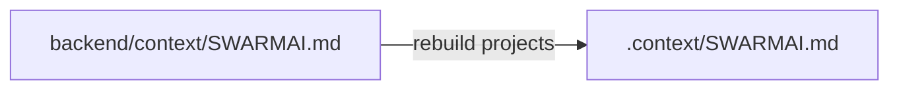
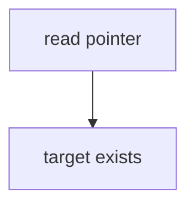

# Design Spec

**Run** `run_c7f28783` · **profile** direct · **project** SwarmAI

> 你为什么又停了

_Generated from the run's stage artifacts by the pipeline (not hand-written)._

## Design

### User workflow

1. today: the agent reads 'depth in KNOWLEDGE.md' and finds a 2KB index
2. after: it is pointed at the skill and the DDD TECH.md where the depth lives

### Architecture

### Flow

### Invariants

| ID | Invariant | Enforced at |
|---|---|---|
| I1 (root) | Every 'depth in X' pointer in SWARMAI.md names a place that holds that depth. | backend/context/SWARMAI.md |

### Failure modes

| ID | Scenario | Expected |
|---|---|---|
| F1 | a test pins the old wording | the regression run shows it; update only that pin |

## Plan

Edit the two lines in backend/context/SWARMAI.md; nothing else.

### Acceptance criteria

- AC1: backend/context/SWARMAI.md contains no pointer to a KNOWLEDGE.md section (KNOWLEDGE.md is only a directory index); the Pipeline depth line points to the s_autonomous-pipeline skill and AGENT.md R1, and the FAQ header points to the SwarmAI DDD TECH.md.

### Exit contract

| ID | Kind | Ref | Expect |
|---|---|---|---|
| X1 | manual | grep -n 'KNOWLEDGE.md §\\\|depth in KNOWLEDGE.md' backend/context/SWARMAI.md | done |

## Boundaries

- **Always:** keep the rest of SWARMAI.md byte-identical
- **Never:** edit the .context projection by hand

## Success Criteria

- grep finds no 'KNOWLEDGE.md §' or 'depth in KNOWLEDGE.md' in backend/context/SWARMAI.md
- the context-file tests that read SWARMAI.md pass
