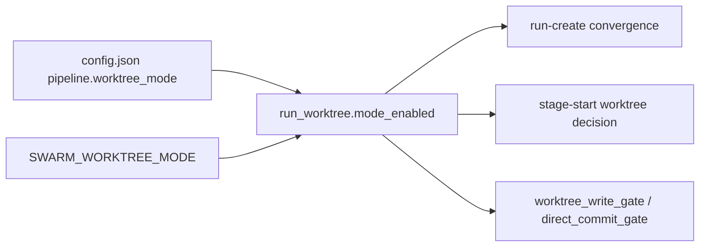
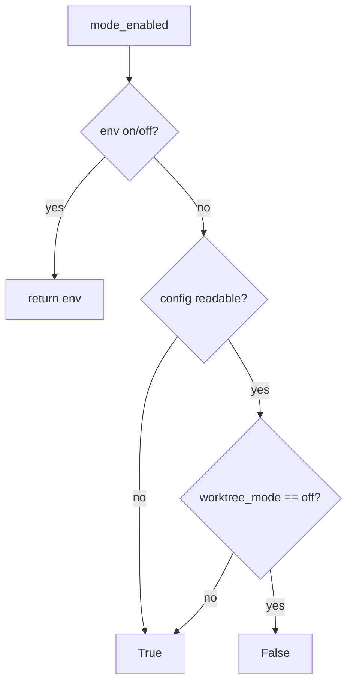

# Design Spec

**Run** `run_cf0c9fb4` · **profile** direct · **project** SwarmAI

> 把 worktree 模式改成默认开启

_Generated from the run's stage artifacts by the pipeline (not hand-written)._

## Design

### User workflow

1. today a fresh install has worktree mode off: runs use the shared checkout and the legacy Gate-2
2. after: a fresh install isolates each run in its own worktree and uses the deterministic Gate-2; off in Settings still turns it off

### Architecture

### Flow

### State lifecycle

| State | Created by | Removed by | Crosses |
|---|---|---|---|
| S1 worktree mode on without a key in config.json | backend/core/app_config_manager.py::DEFAULT_CONFIG | an explicit off written by PUT /api/settings or by hand | an install whose config.json already says off → stays off: the default only fills a missing key |

### Invariants

| ID | Invariant | Enforced at |
|---|---|---|
| I1 (root) | worktree mode is off only when config.json or the env says off | backend/core/run_worktree.py::mode_enabled |

### Failure modes

| ID | Scenario | Expected |
|---|---|---|
| F1 | config.json is unreadable | mode on; a run that cannot get a worktree still falls back to shared at stage-start |
| F2 | an existing install has off on disk | it stays off |

## Plan

Flip the default at its two homes (run_worktree.mode_enabled and DEFAULT_CONFIG). No migration: an off already on disk may be a user's choice. conftest pins SWARM_WORKTREE_MODE=off, the mode every in-process test ran under (its sandbox has no config.json), so test behaviour does not change.

### Acceptance criteria

- AC1: mode_enabled() is True with no config.json, an unreadable one, or no pipeline key, and False only for an explicit off (env SWARM_WORKTREE_MODE still overrides)
- AC2: DEFAULT_CONFIG writes worktree_mode on for a fresh install; an existing off on disk is kept
- AC3: tests keep running under worktree mode off unless they set it (conftest pin), and the comments and design doc state the new default

### Exit contract

| ID | Kind | Ref | Expect |
|---|---|---|---|
| X1 | test | backend/tests/test_app_config_manager.py | pass |
| X2 | test | mode:regression | pass |

## Boundaries

- **Always:** keep an explicit off
- **Ask first:** rewriting an existing config.json
- **Never:** migrate off to on

## Success Criteria

- X1-X2 pass
- the full regression passes

## Contract readers

| ID | Contract | Pattern | Paths | Readers |
|---|---|---|---|---|
| K1 | mode_enabled() now returns True unless the config says off | `mode_enabled\(` | backend | backend/core/prompt_builder.py::PromptBuilder.build_options unaffected — adds the worktree root to allowed dirs when on, as on this host today; backend/core/run_owner_gate.py::check unaffected — already handles mode on; backend/core/security_hooks.py::_direct_gate_mode unaffected — already handles mode on; backend/core/worktree_write_gate.py::create_worktree_write_gate unaffected — already handles mode on; backend/scripts/artifact_cli.py::_convergence_for migrated; backend/scripts/pipeline_worktree.py::_decide_and_create unaffected — already handles mode on and falls back to shared; backend/core/run_worktree.py::mode_enabled migrated; backend/core/run_owner_gate.py::_any_named_run_applies unaffected — already handles mode on (declared after PLAN); backend/core/run_owner_gate.py::_scope unaffected — already handles mode on (declared after PLAN); backend/core/worktree_write_gate.py::create_worktree_write_gate._decide unaffected — already handles mode on (declared after PLAN); backend/core/worktree_write_gate.py::create_worktree_write_gate._gate unaffected — already handles mode on (declared after PLAN) |
