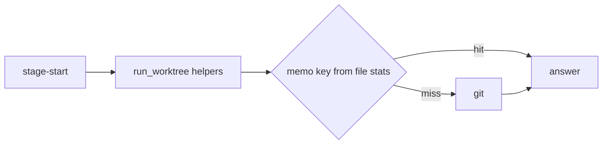
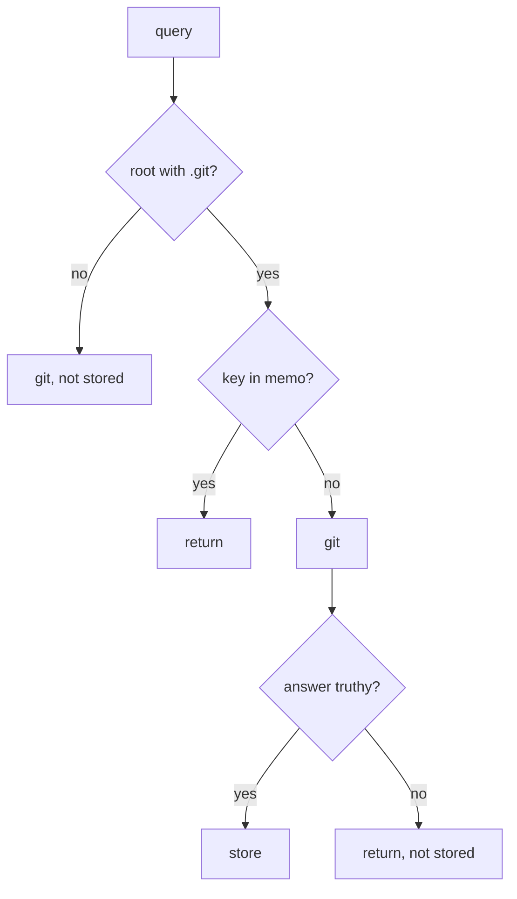

# Design Spec

**Run** `run_d470c536` · **profile** direct · **project** SwarmAI

> 起 direct run：砍 stage-start 的 git 调用

_Generated from the run's stage artifacts by the pipeline (not hand-written)._

## Design

### User workflow

1. today one stage-start runs ~30 git processes, many of them the same read-only query
2. after: the same decisions with the repeated queries answered from a per-process memo

### Architecture

### Flow

### State lifecycle

| State | Created by | Removed by | Crosses |
|---|---|---|---|
| S1 _REV_MEMO entries for head and wtlist | backend/core/run_worktree.py::_memo_get | never: per-process, cleared at 512 entries; a changed file gives a new key | git worktree add/remove, checkout in a worktree → the admin dir list or a HEAD/gitdir file changes, new key; a commit on a branch → no listed field changes; head sha is no longer returned |

### Invariants

| ID | Invariant | Enforced at |
|---|---|---|
| I1 (root) | A memoised answer is returned only while every file it is read from is unchanged by inode, mtime and size | backend/core/run_worktree.py::_git_marker, _worktree_list_key, _symbolic_head |

### Failure modes

| ID | Scenario | Expected |
|---|---|---|
| F1 | rev-parse prints fewer paths than names | WorktreeError git_failed, as any failed git call |
| F2 | a .git directory is removed and re-initialised | new inode and config, no stale answer |

## Plan

Key the existing per-process memo on the files each answer is read from (a .git directory's inode + config + commondir, not its mtime; .git/HEAD for symbolic-ref; common HEAD/config and each admin dir's HEAD/gitdir for worktree list), and resolve busy_state's five --git-path names in one rev-parse. change_tree is left as is: its result depends on working-tree contents.

### Acceptance criteria

- AC1: In one CLI process, repeated _toplevel/_common_dir/_symbolic_head on a main checkout make no new git call after a git write that only takes index.lock.
- AC2: _worktree_list answers from the memo while no listed field can have changed, and returns the new list after worktree add/remove, a branch switch or detach in a linked worktree.
- AC3: busy_state resolves all in-progress names with one git call and still sees each state per worktree.
- AC4: No decision changes: the worktree, landing and claim suites pass unchanged.

### Exit contract

| ID | Kind | Ref | Expect |
|---|---|---|---|
| X1 | test | backend/tests/test_run_worktree_memo.py | pass |
| X2 | test | mode:verify | pass |
