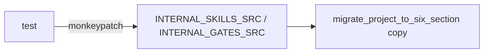
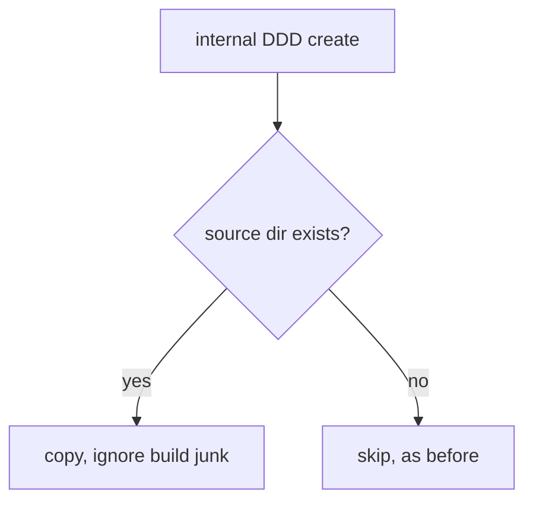

# Design Spec

**Run** `run_e23a88c7` · **profile** direct · **project** SwarmAI

> 修 main 上 3 个红测试

_Generated from the run's stage artifacts by the pipeline (not hand-written)._

## Design

### User workflow

1. today these tests are red in every run worktree and clean checkout
2. after: they pass anywhere and still test the behaviour

### Architecture

### Flow

**No state:** tests and two path constants

### Invariants

| ID | Invariant | Enforced at |
|---|---|---|
| I1 (root) | A test's verdict does not depend on gitignored local files | backend/tests/test_project_crud_properties.py::test_internal_ddd_gets_internal_skills_and_gate |

### Failure modes

| ID | Scenario | Expected |
|---|---|---|
| F1 | checkout without the internal skills | test still passes, using its temp sources |

## Plan

Rewrite the two stale stdin tests to the current contract. Give swarm_workspace_manager two module constants, INTERNAL_SKILLS_SRC and INTERNAL_GATES_SRC (same paths as before), and have the test point them at temp dirs.

### Acceptance criteria

- AC1: The stdin gate tests pin the cee0e33b rule both ways: a text-only heredoc naming pytest is allowed, a heredoc that imports subprocess to run pytest is denied, and the hint names the pathlib workaround.
- AC2: test_internal_ddd_gets_internal_skills_and_gate passes in a checkout without the gitignored backend/skills/s_internal-* and backend/templates/ddd-gates/: it supplies its own source dirs, and still checks that build junk is not copied.

### Exit contract

| ID | Kind | Ref | Expect |
|---|---|---|---|
| X1 | test | backend/tests/test_attribution_and_gaps.py | pass |
| X2 | test | backend/tests/test_project_crud_properties.py | pass |
| X3 | test | mode:verify | pass |
