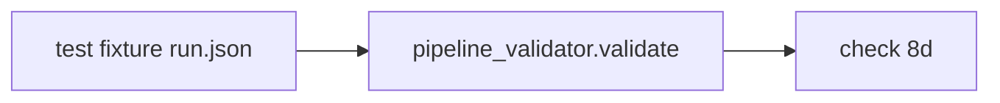
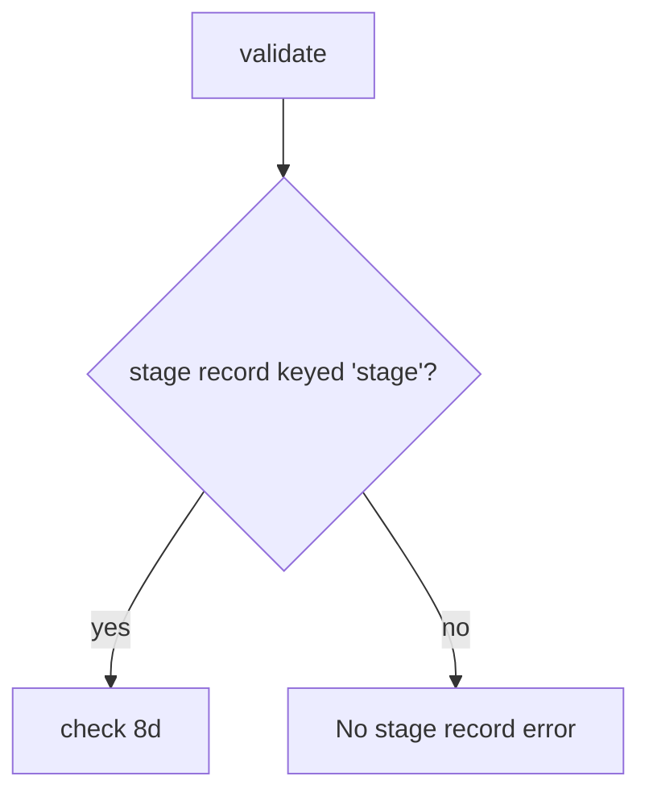

# Design Spec

**Run** `run_f1097a5b` · **profile** direct · **project** SwarmAI

> direct run：修 main 上 3 个红测试

_Generated from the run's stage artifacts by the pipeline (not hand-written)._

## Design

### User workflow

1. today three tests on main are red and two pass without reaching check 8d
2. after: all five reach check 8d and pass

### Architecture

### Flow

**No state:** test fixtures only; no runtime state

### Invariants

| ID | Invariant | Enforced at |
|---|---|---|
| I1 (root) | Each test reaches check 8d (the validator finds the stage record) | backend/tests/test_review_completeness_check.py |

### Failure modes

| ID | Scenario | Expected |
|---|---|---|
| F1 | a fixture uses a key the validator does not read | the pass-path tests now fail on the 'No stage record' error |

## Plan

Key the file's run fixtures by 'stage' (the only key the validator reads since a70811c8 dropped the legacy 'name' fallback) and assert in the two pass-path tests that no 'No stage record' error is returned.

### Acceptance criteria

- AC1: The three test_large_changeset_* tests pass because the validator finds the review stage record and runs check 8d.
- AC2: The two passing tests in the file fail if the validator cannot find the stage record.

### Exit contract

| ID | Kind | Ref | Expect |
|---|---|---|---|
| X1 | test | backend/tests/test_review_completeness_check.py | pass |
