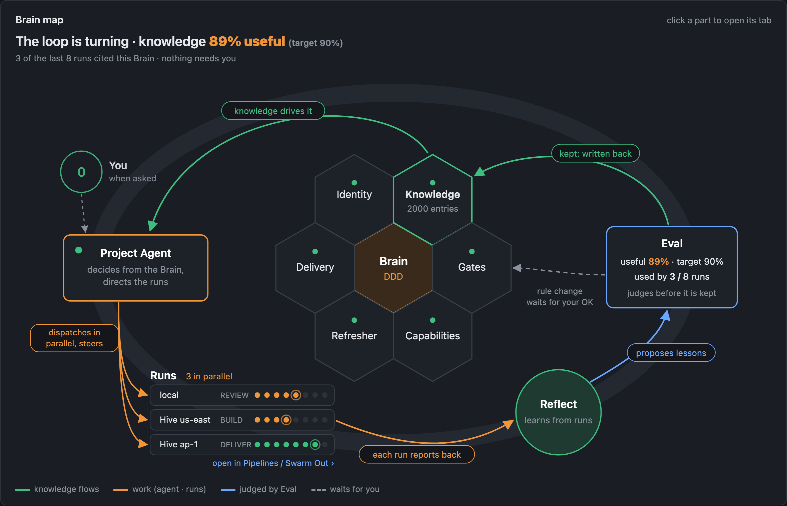
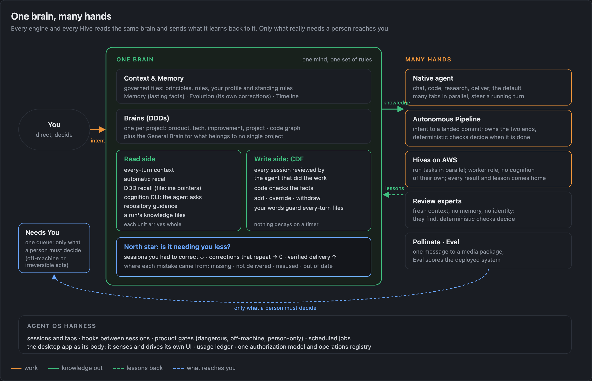
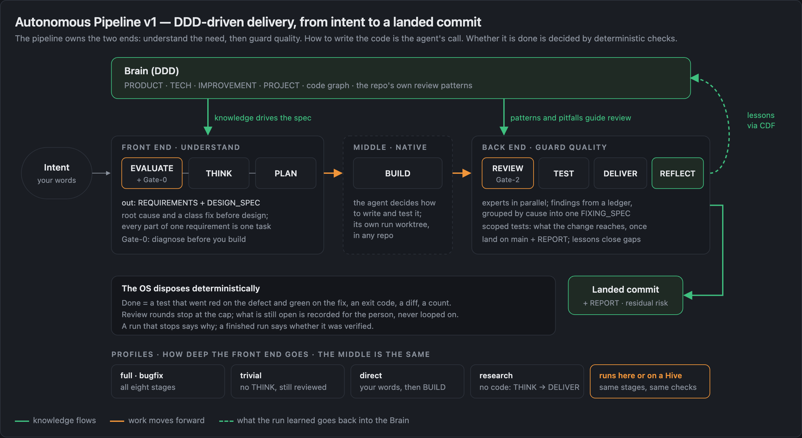
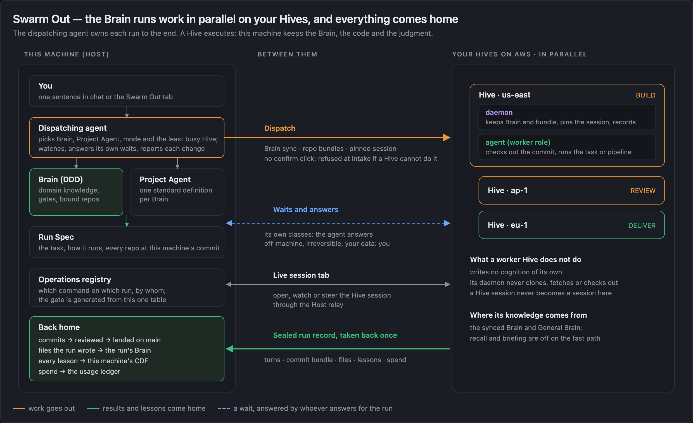
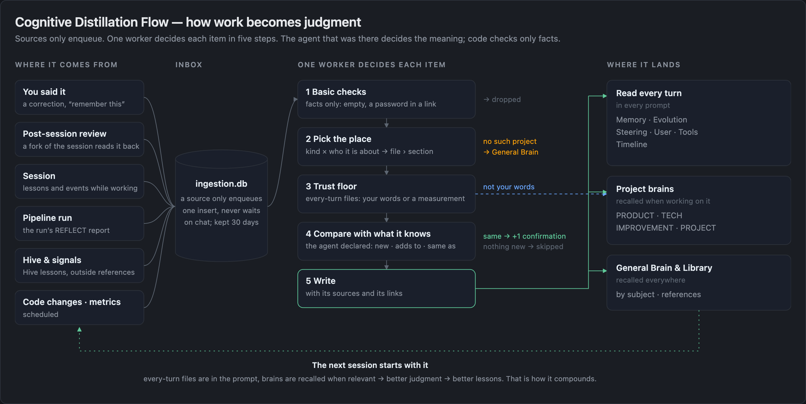
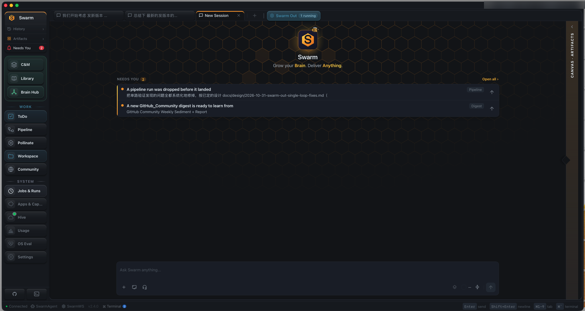
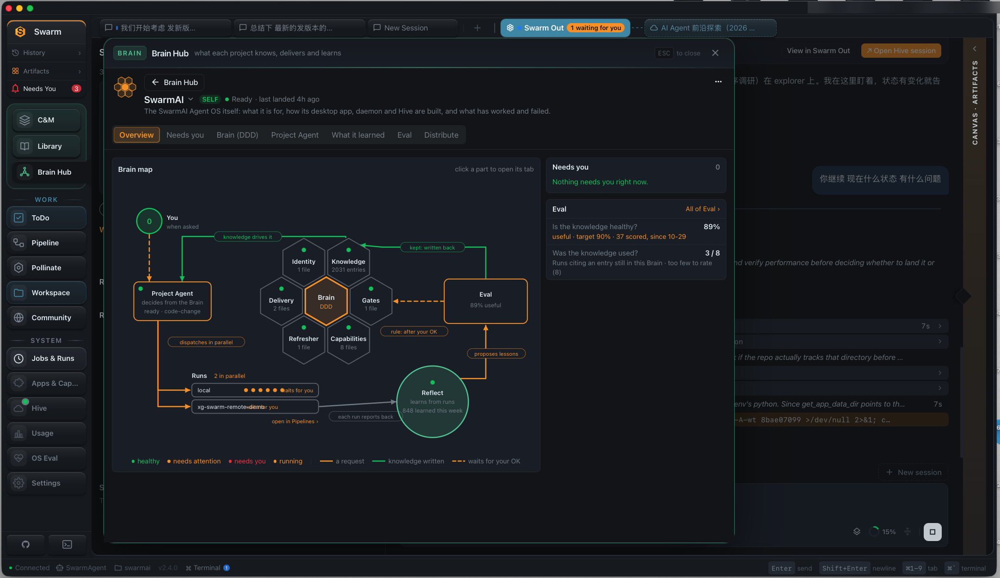
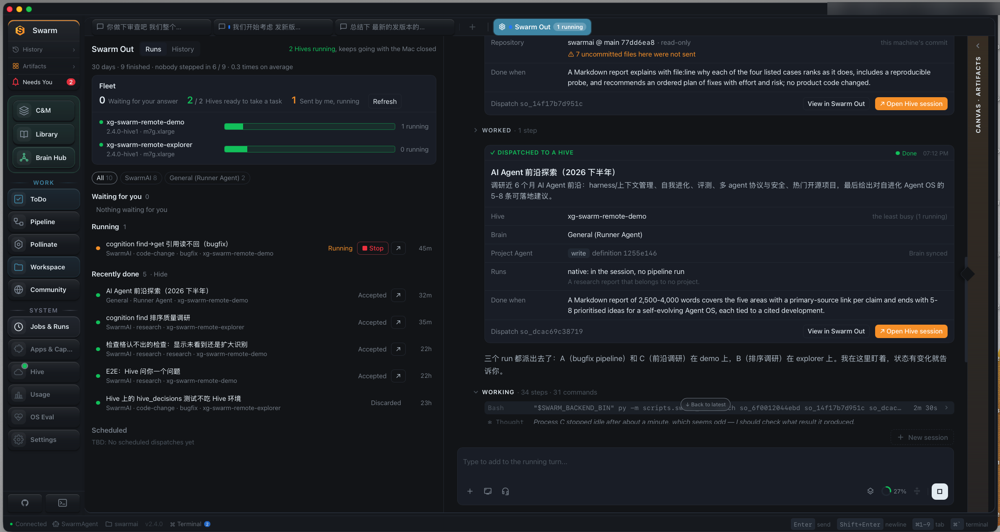
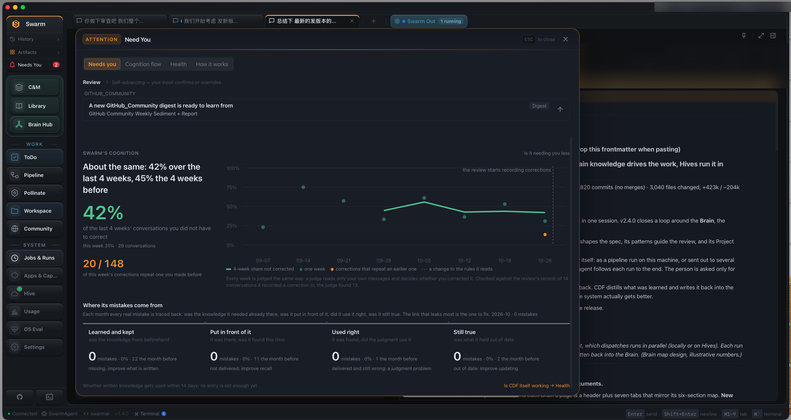

<div align="center">

# SwarmAI

### One brain, many hands — an Agent OS whose work compounds, so it needs less of your attention.

#### Human directs. AI delivers.

English | [中文](./README.zh-CN.md)

[](./LICENSE)
[](#quick-start)
[](https://github.com/anthropics/claude-code)

</div>

> **SwarmAI in one sentence:** it does the work by itself, in parallel on your own cloud machines, driven by one brain of domain knowledge that pulls the judgment out of every session automatically, so each task compounds into the next and needs less of your attention than the last.



<div align="center"><sub>The loop around a Brain: knowledge drives the work, runs go out in parallel, lessons come back, and the next task starts from a better Brain. (Brain map design, illustrative numbers.)</sub></div>

---

## Why SwarmAI

**The scarce resource in agent work is no longer what an agent can do. It is your attention.** Agents can write code, research and work for hours on their own. What breaks is the person around them: one more chat tab to watch, one more approval to click, one more result to check, one more agent that forgot what the last one learned. A team of agents often makes this worse, because you become its dispatcher, reviewer and memory.

SwarmAI is built for one purpose: **compounding.** Every task should leave the system sharper than it found it, so the next task needs less of you. Three moves get there, and they only compound together:

1. **Brain-driven.** Domain knowledge decides the work: what to build, how to review it and how a task should run. The agent stops asking you what the Brain already knows.
2. **Autonomous, in parallel, in the cloud.** Work runs to the end on its own, on your machine or on several **Hives** (your SwarmAI on AWS) at once, and the agent that dispatched it follows it to the end. You are asked only for what only a person can decide.
3. **Cognitive self-evolution.** Every run and every session sends its lessons back, and SwarmAI keeps what is true and useful. A mistake you corrected once should not need correcting again.

Put together, **SwarmAI turns every task into lasting cognition, and lasting cognition into increasingly autonomous delivery.**

---

## One brain, many hands



SwarmAI has **one brain**. This is a deliberate choice against "many brains", the common design where every agent in a team carries its own memory and its own role.

- **Many Brains, one mind.** Each project has a **Brain** (a DDD: the project's domain knowledge kept as one standard set of documents), and a built-in **General Brain** holds what belongs to no single project. They are the knowledge of one mind, not separate agents: one cognitive system, with domain-scoped Brains that share one set of rules for how knowledge is written, checked and used. Chat, the pipeline, content, Eval and every remote run read the same Brain.
- **The brain learns from every session by itself.** When a session ends, the agent that did the work reads back its own record and declares what changed its judgment: a correction you made, a decision, a lesson, a pitfall. **CDF** (the Cognitive Distillation Flow, SwarmAI's learning pipeline) checks the facts behind each one and files it in the right place. Nobody has to say "remember this".
- **Hives and reviewers are hands, not brains.** A worker Hive gets a copy of the Brain, does the work, writes no cognition of its own and sends every lesson home. Review experts start with fresh context and keep no memory, which is what keeps them honest critics.
- **Why one brain.** Compounding needs one place where value adds up. With many brains, knowledge splits and drifts, every hand-off loses context, and you end up as the integrator. With one brain, a lesson learned on any Hive improves the next task everywhere, there is one place where things wait for you (**Needs You**), and one set of numbers says whether it is getting better.

**How we measure it: less correction, less repetition, more verified delivery.** Not by how much is stored or how many agents run, but by your attention: the share of sessions in which you had to correct SwarmAI should fall, the share of corrections that repeat an earlier one should reach zero, and the share of work delivered and verified without you should rise. Having nothing to correct is not the same as being right, so delivery has to be verified, not just uncorrected. These north-star numbers are in every prompt and on the cognition panel.

---

## How it works

### 1 · Brain-driven: the Brain decides the work

A Brain has one six-section structure (Identity · Knowledge · Gates · Capabilities · Delivery · Refresher), the same for every domain, governing `0..N` assets: a code repo, a data source, a document corpus, or nothing at all. Brain Hub shows every Brain, what it knows and what it learned this week. Each Brain carries a **Project Agent**, its standard definition of how work runs. Code intelligence builds itself once a Brain has a repo.

**A lightweight ontology underneath, not a knowledge graph.** Every Brain rests on one small ontology: **classification × relations**, kept as plain text the agent reads directly, with no graph database and no query language. *Classification:* every entry is one of seven types in three layers — meta-cognitive (principle, correction), cognitive (decision, model) and operational (guideline, pitfall, process) — and its type decides where it lives and how much weight it carries. *Relations:* when new knowledge comes in, the agent that has the context declares how it relates to what is already there (new, the same, adds to, replaces, or repeats an earlier correction), so every change is an add, an override or a withdrawal. Code intelligence applies the same idea to code (symbols and call edges), so the blast radius of a change is one query. The ontology is there to help the agent decide, not to store more: classification and relations let it find the right piece, and the gates, approvals and audit trail turn that into action someone owns. Long version: [Ontology isn't a knowledge graph, it's a decision layer](https://github.com/xg-gh-25/SwarmAI/discussions/100).

The **Autonomous Pipeline** is the optional delivery mode for code. It owns the two ends: the front end understands the need (EVALUATE with Gate-0, THINK, PLAN), and the back end guards quality (REVIEW with Gate-2, TEST, DELIVER, REFLECT). How the code is written is the agent's call; whether it is done is decided by deterministic checks. Each link has its own check: the intent by the requirements and Gate-0, the change by a test that fails on the defect and passes on the fix, the result by expert review, and what the run learned by REFLECT, which turns it into a lesson or a closed gap.



### 2 · Autonomous, in parallel, in the cloud: Swarm Out

**Swarm Out** sends one sentence of work to a Hive and brings everything home. The task runs on your machine's commit of every repository in its Brain; commits come back as a bundle that is reviewed, then landed; files go into the run's Brain; every lesson goes into your machine's CDF. The dispatching agent owns each run to the end: it watches, answers the waits it is allowed to answer, and leaves anything off-machine, irreversible or touching your data to you. Every Hive run knows which version of the Brain it worked from, and its lessons are judged against that version when they come home, so runs in parallel add to the brain instead of overwriting each other.



### 3 · Cognitive self-evolution: the write side and the read side

**Write side.** Every source (sessions, pipeline runs, Hive runs, outside signals, code changes) enqueues into one inbox, and one worker decides each item in five steps. The agent with the context decides the meaning; code checks only facts. A Brain's main files hold only what is in force: every change is an add, an override or a withdrawal, and history is kept outside the main files. Nothing decays on a timer, but validity is still checked: every new commit is scanned and an entry the code has made false is retired (the only automatic retirement), a judge that took no part in writing scores samples of what was kept, and every real mistake is traced to whether stale knowledge caused it. Only your own words or a measurement may enter the files read in every session.



**Read side.** Writing knowledge down is half of it; the other half is putting the right piece in front of the agent when it decides:

| Door | What arrives |
|---|---|
| **Every-turn context** | Principles, rules, your profile, Memory and Evolution in full, recent activity and the north-star headline, assembled fresh each session. |
| **Automatic recall** | Relevant Library knowledge and past sessions (keyword / FTS5 / BM25, no vector store), at session start and on new messages. |
| **DDD recall** | When the project is detected, pointers (`file:line`) to the Brain entries that bear on the task, so the agent reads the source. |
| **`cognition` CLI** | The agent searches every store itself (Brains, Knowledge, Memory, Evolution, Timeline, past sessions, the code graph) with the words of the solution. |
| **Repository guidance** | The first time a session touches a repo: its own `AGENTS.md`, review patterns and lessons from earlier runs. |
| **A pipeline run's knowledge** | Files the run writes for its stages (product and decisions for EVALUATE; tech, improvement and lessons for THINK and PLAN; project knowledge for the reviewer), with ids its documents must cite. |

Every unit arrives whole: recall decides which entries to show, never how much of one. Because the every-turn files are injected whole, their size and the time to first token are measured; when they grow, entries are consolidated by declaration, never cut.

---

## See it

| | |
|---|---|
|  **Welcome:** one brand, one **Needs You** queue of what really waits on you. |  **A Brain's page:** the loop drawn live, with runs under way in parallel. |
|  **Swarm Out:** the fleet, what is running and what came back, and the dispatching chat. |  **Swarm's cognition:** is it needing you less, and where its mistakes come from. |

<sub>Screenshots from a real install; private Brain names, local paths and account totals are blurred.</sub>

---

## Quick Start

**Install the app:** download it from [Releases](https://github.com/xg-gh-25/SwarmAI/releases) — macOS `.dmg` (Apple Silicon or Intel), Windows `-setup.exe`, Linux `.AppImage` (`chmod +x`, then run it).

- You need an **AWS account** with access to Claude models on Amazon Bedrock: chat always runs on Bedrock. The setup wizard connects one SwarmAI AWS account (or a Bedrock API key), and the app, Bedrock and your Hives all use it.
- The installed app needs **git** (on Windows, Git for Windows with Git Bash). It brings its own Python backend and Claude CLI.
- macOS: the app is not signed by Apple yet — the first time, open System Settings → Privacy & Security and click **Open Anyway**.

**Build from source** (needs git, Node.js 18+, Python 3.11+, Rust, [uv](https://astral.sh/uv); on Windows also Git Bash):

```bash
git clone https://github.com/xg-gh-25/SwarmAI.git && cd SwarmAI
cd backend && uv sync && cp .env.example .env
cd ../desktop && npm install && npm run tauri:dev
```

> 📖 Full setup guide: [QUICK_START.md](./QUICK_START.md)

---

## Architecture

```
┌──────────────────────────────────────────────────────────────────────┐
│  HANDS        Native agent · Autonomous Pipeline · Hives (Swarm Out)   │
│               Review experts · Pollinate · Eval                        │
├──────────────────────────────────────────────────────────────────────┤
│  ONE BRAIN    Context & Memory · Brains (DDDs) + General Brain         │
│               Write side (CDF) · Read side (recall, cognition)         │
├──────────────────────────────────────────────────────────────────────┤
│  HARNESS      Sessions & tabs · Hooks · Product gates · Jobs           │
│               Desktop body · Authorization & operations registry       │
└──────────────────────────────────────────────────────────────────────┘
```

| Part | What it does | Read |
|------|-------------|------|
| **Context & Memory** | The governed files assembled into every prompt, what each one owns and how it changes | [SWARMAI.md](./backend/context/SWARMAI.md) |
| **CDF (write side)** | One flow from every session and run into the brain; the agent with the context decides, code checks facts | [design](./docs/design/2026-10-26-swarm-cognitive-distillation-flow.md) · [agent decides](./docs/design/2026-10-30-cdf-agent-decides.md) |
| **Brains (DDD)** | Domain brains whose main files hold only what is in force: add, override, withdraw | [design](./docs/design/2026-10-30-brain-driven.md) |
| **Read side** | Recall, DDD recall, the `cognition` CLI, repository guidance, a run's knowledge files | [cognition](./docs/design/2026-11-01-cognition-entrance.md) · [run knowledge](./docs/design/2026-10-26-run-knowledge.md) |
| **Autonomous Pipeline** | Intent to a landed commit; the pipeline owns the two ends, deterministic checks decide | [design](./docs/design/2026-10-26-pipeline-two-ends.md) |
| **Swarm Out & Hives** | Dispatch to your Hives in parallel; everything comes home; the dispatching agent owns the run | [design](./docs/design/2026-11-01-brain-to-hive-zero-touch.md) · [agent owns its runs](./docs/design/2026-10-31-swarm-out-agent-owns-its-runs.md) |
| **Authorization** | Whoever dispatches answers for the work; one registry of every Swarm Out and Hive operation | [approvals](./docs/design/2026-10-31-hive-approvals-person-and-host.md) · [registry](./docs/design/2026-10-31-swarm-out-ops-registry.md) |
| **Code intelligence** | A code graph per repo, built automatically; reviews see which callers a change can break | [design](./docs/design/2026-10-29-code-intel-unification.md) |
| **Product gates** | Dangerous or off-machine actions and person-only questions; a gate never blocks normal coding | [code](./backend/core/security_hooks.py) |
| **Sessions & hooks** | Concurrent isolated tabs, steer into a running turn, between-session hooks so no session starts cold | [code](./backend/core/hook_builder.py) · [store](./desktop/src/stores/MessageStore.ts) |
| **Eval** | System-level self-evaluation of the deployed system: golden set plus scoring of real sessions | [design](./docs/design/2026-10-26-eval-as-product.md) |
| **Pollinate** | One message to a multi-format media package, driven by the same Brain | [docs](./docs/Pollinate-Content-Engine.md) |

---

## 🤖 For AI Agents

Coding in this repo? Start with **[`AGENTS.md`](./AGENTS.md)** — data flow, process topology, conventions and invariants. It is the agent-facing entry point; this README is the human one.

---

## Design Philosophy

1. **One brain, many hands.** One mind holds the knowledge and the judgment; agents, pipelines, Hives and reviewers are hands. Division of labor between minds is a workaround for limited human bandwidth, not good design.
2. **Attention is the scarce resource; compounding is the goal.** Every task should leave the system needing less of you, and the north star measures exactly that.
3. **The model proposes, the OS disposes.** The agent with the context decides the meaning; code checks facts; a gate decides from a test, an exit code, a diff or a person's decision, never from a model's opinion of its own work.
4. **Evolution is cognitive, not data.** One edited line in `SOUL.md` shifts judgment more than a thousand memory rows, and every change is a `git diff`. A recurring error class gets a structural fix, not one more logged lesson.
5. **The brain holds only what is in force.** Knowledge changes by add, override or withdrawal, decided when the new knowledge arrives. Nothing leaves on a timer, and nothing is cut to fit a budget.
6. **Quality converges through deterministic checks.** Carefulness does not scale; checks do. Reviews find, tests decide, and review rounds stop at a cap.
7. **If you can't measure it, you didn't build it.** Eval, a golden set and the north star, all tied to git.

**The thesis behind it:** one builder + AI + a self-evolving system can deliver at team scale, in code and in everything else. SwarmAI is that experiment, and this repository is its evidence.

> 📖 Full thesis: [docs/THESIS.md](./docs/THESIS.md) · Latest release notes: [v2.4.0](./docs/releases/v2.4.0.md)

---

## Stack

**Tauri 2.0** (Rust) · **React 19** · **FastAPI** · **Claude Agent SDK + Bedrock** · **SQLite** (WAL + FTS5)

Four-platform backend (compile-time isolation): macOS daemon (`.dmg`) · Hive (EC2) · Windows (`-setup.exe`) · Linux (`.AppImage`).

---

## Resources

| What | Link |
|------|------|
| **Release notes** | [v2.4.0](./docs/releases/v2.4.0.md) · [all releases](https://github.com/xg-gh-25/SwarmAI/releases) |
| **Design docs** | [docs/design/](./docs/design/) |
| **Thesis** | [THESIS.md](./docs/THESIS.md) |
| **AI Agent Pitfall Guide** | [EN PDF](./docs/ai-agent-pitfall-guide-en.pdf) · [中文 PDF](./docs/ai-agent-pitfall-guide.pdf) |
| **For AI Agents** | [AGENTS.md](./AGENTS.md) |
| **Contributing** | [CONTRIBUTING.md](./CONTRIBUTING.md) |

---

[MIT License](./LICENSE)

---

<div align="center">

**SwarmAI — Human directs. AI delivers.**

</div>
