<div align="center">

# SwarmAI

### 一个大脑，多双手 —— 工作会产生复利的 Agent OS，越用越少占用你的注意力。

#### Human directs. AI delivers.

[English](./README.md) | 中文

[](./LICENSE)
[](#快速开始)
[](https://github.com/anthropics/claude-code)

</div>

> **一句话介绍 SwarmAI：** 它自己把活干完，在你自己的云端机器上并行地跑；驱动它的是一个装着领域知识的大脑，这个大脑会自动从每个 session 里提取判断力。于是每个任务都为下一个任务积累复利，一个比一个更少占用你的注意力。

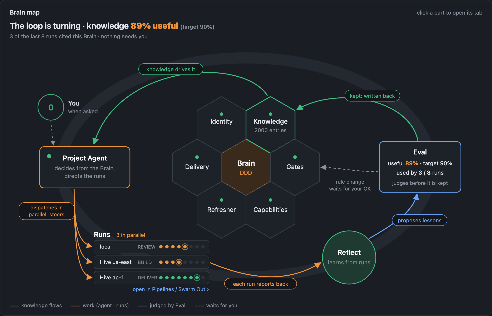

<div align="center"><sub>围绕一个 Brain 的闭环：知识驱动工作，run 并行派出去，经验带回来，下一个任务从更好的 Brain 开始。（Brain map 设计稿，数字为示意。）</sub></div>

---

## 为什么是 SwarmAI

**做 agent 的工作，稀缺的已经不是 agent 能做什么，而是你的注意力。** agent 已经能写代码、做调研、自己连续干几个小时。真正撑不住的是旁边的人：多一个 chat tab 要盯，多一个审批要点，多一个结果要查，多一个 agent 忘了上一个学到的东西。一队 agent 往往更糟，因为你成了它们的调度员、审核员和记忆。

SwarmAI 只为一个目的而做：**复利。** 每个任务都要让系统比接手时更强，下一个任务就更少需要你。做到这一点靠三个动作，三者缺一不可：

1. **Brain 驱动。** 领域知识决定怎么干：做什么、怎么审、任务怎么跑。agent 不再问你 Brain 已经知道的事。
2. **自主执行，云端并行。** 工作自己跑到底，可以在你的电脑上，也可以同时派到多台 **Hive**（你在 AWS 上的 SwarmAI），由派单的 agent 一直跟到结束。只有必须由人决定的事才会来问你。
3. **认知自进化。** 每个 run、每个 session 都把经验送回来，SwarmAI 只留下真实、有用的。你纠正过一次的错，不该再纠正第二次。

合在一起，**SwarmAI 把每一个任务变成长期的认知，再把长期的认知变成越来越自主的交付。**

---

## 一个大脑，多双手

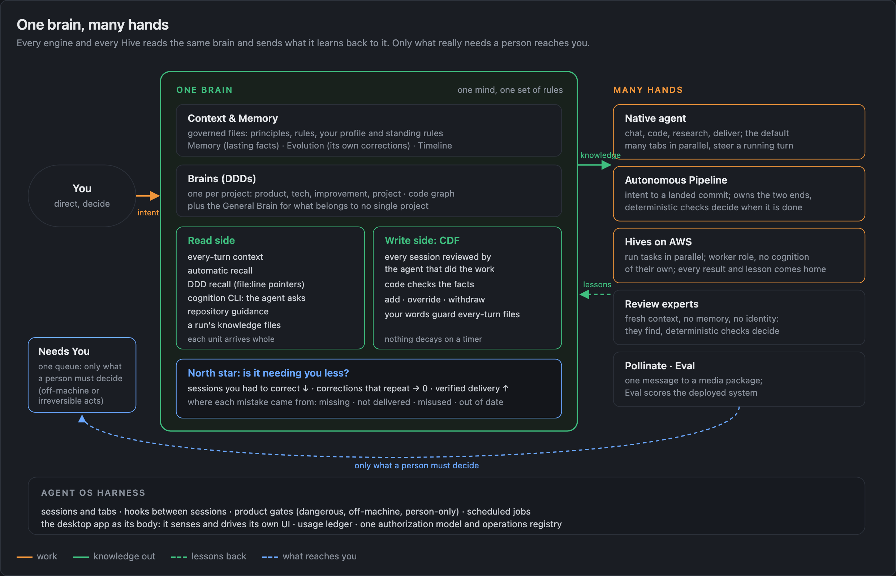

SwarmAI 只有**一个大脑**。这是有意为之，拒绝的是"多脑"：团队里每个 agent 各带自己的记忆、各演一个角色的常见做法。

- **多个 Brain，同一个心智。** 每个项目有一个 **Brain**（一个 DDD：用一套标准文档保存的项目领域知识），自带的 **General Brain** 保存不属于任何单个项目的知识。它们是同一个心智的知识，不是各自独立的 agent：一个统一的认知系统，多个按领域划分的 Brain，共用同一套知识怎么写、怎么查、怎么用的规则。chat、pipeline、内容、Eval 和每一个远端 run 读的都是同一个 Brain。
- **大脑自己从每个 session 里学。** session 结束时，干活的那个 agent 会回读自己的记录，说明哪些东西改变了它的判断：你的一次纠正、一个决定、一条经验、一个坑。**CDF**（Cognitive Distillation Flow，SwarmAI 的学习管道）核对每条背后的事实，写进该放的位置。不需要任何人说"记住这个"。
- **Hive 和审查专家是手，不是脑。** worker Hive 拿到 Brain 的副本去干活，不写自己的认知，经验全部送回本机。审查专家每次都用全新的上下文、不留记忆，所以能一直挑刺。
- **为什么只要一个脑。** 复利需要一个能把价值累加起来的地方。多脑的话，知识会分裂、漂移，每次交接都丢上下文，最后你成了整合者。一个脑的话，任何一台 Hive 上学到的经验，都会让下一个任务在所有地方变好；等你处理的事只在一个地方（**Needs You**）；也只有一套数字说明它是不是在变好。

**怎么度量：纠正更少，重复更少，通过验证的交付更多。** 不看存了多少，也不看跑了多少 agent，而看你的注意力：你需要纠正 SwarmAI 的 session 占比要下降，重复犯错的纠正占比要降到零，不用你介入、交付且通过验证的工作占比要上升。没被纠正不等于做对了，所以交付要经过验证，而不只是没人挑错。这几个 north star 指标在每个 prompt 里，也在 cognition 面板上。

---

## 怎么运作

### 1 · Brain 驱动：由 Brain 决定怎么干

每个 Brain 都是同一套六段结构（Identity · Knowledge · Gates · Capabilities · Delivery · Refresher），适用于任何领域，管理 `0..N` 个资产：一个代码仓库、一个数据源、一个文档集，或者什么都没有。Brain Hub 显示每个 Brain 知道什么、这周学到了什么。每个 Brain 带一个 **Project Agent**，是它关于"工作怎么跑"的标准定义。Brain 一旦绑定了仓库，代码图谱会自动建好。

**底下是一套轻量 ontology，不是知识图谱。** 每个 Brain 都建在同一套很小的 ontology（本体）上：**分类 × 关系**，全部是 agent 能直接读的纯文本，不用图数据库，也不用查询语言。*分类*：每条知识属于 7 种类型之一，分在三层——元认知（原则、纠正）、认知（决策、模型）、操作（指南、坑、流程），类型决定它放在哪里、分量多重。*关系*：新知识进来时，由掌握上下文的 agent 声明它和已有知识的关系（全新、相同、补充、替代，或者重复了以前的某次纠正），所以每次改动都是新增、覆盖或撤回。代码图谱把同样的思路用在代码上（符号和调用边），一次改动会波及哪些地方，查一次就知道。这套 ontology 的目的不是存得更多，而是帮 agent 做判断：分类和关系让它找到对的那条知识，gate、审批和审计记录再把判断变成有人负责的行动。详细版：[Ontology 不是知识图谱，是决策层](https://github.com/xg-gh-25/SwarmAI/discussions/99)。

**Autonomous Pipeline** 是可选的代码交付方式。它只管两头：前端理解需求（EVALUATE 和 Gate-0、THINK、PLAN），后端守质量（REVIEW 和 Gate-2、TEST、DELIVER、REFLECT）。代码怎么写由 agent 决定；写没写完、能不能交，由确定性的检查决定。每一环都有自己的检查：意图由需求文档和 Gate-0 把关，改动由一个在缺陷上失败、修好后通过的测试把关，结果由专家审查把关，这次 run 学到的东西由 REFLECT 变成一条经验或一个关闭的缺口。

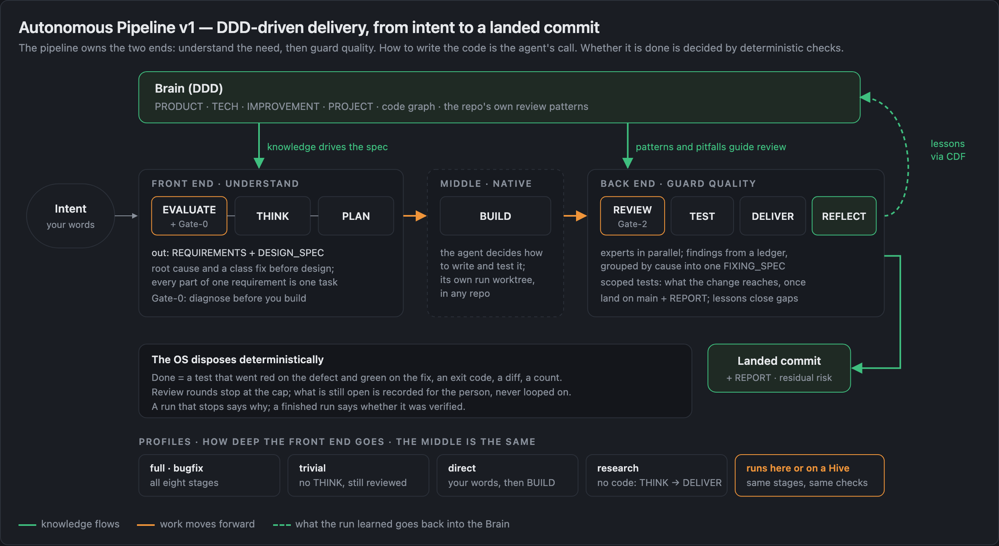

### 2 · 自主执行，云端并行：Swarm Out

**Swarm Out** 把一句话的任务派到一台 Hive，再把产出全部带回来。任务在你本机的 commit 上跑，覆盖它 Brain 里的每个仓库；commit 以 bundle 的形式带回，审过后再落地；文件写进这个 run 的 Brain；每条经验进本机的 CDF。派单的 agent 对每个 run 负责到底：它盯着进度，回答它有权回答的等待；凡是出机器、不可逆、碰到你的数据的事，都留给你。每个 Hive run 都知道自己基于哪一版 Brain 工作，带回来的经验按那一版来判断，所以并行的 run 是在给大脑做加法，而不是互相覆盖。

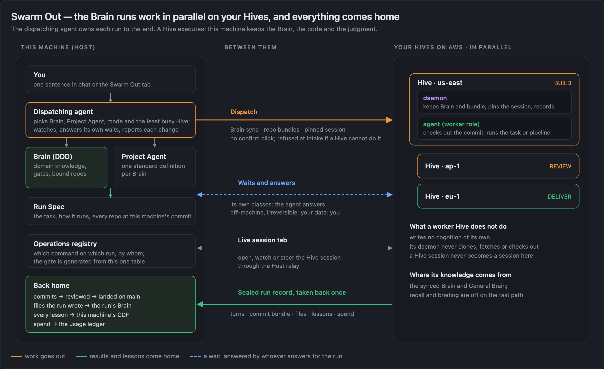

### 3 · 认知自进化：写入侧和读取侧

**写入侧。** 所有来源（session、pipeline run、Hive run、外部信号、代码变更）都进同一个 inbox，由一个 worker 分五步逐条判断。含义由带着上下文的 agent 决定，代码只核对事实。Brain 的主文件只保留当前有效的内容：每次改动是新增、覆盖或撤回，历史记录在主文件之外。没有任何东西会按时间自动淘汰，但有效性一直在检查：每个新 commit 都会被扫描，代码已经让它变成错的条目会被撤回（这是唯一的自动撤回）；一个不参与写作的判官抽样给留下的知识打分；每一个真实的错误都会追查是不是过期知识导致的。每轮都会读的文件，只接受你的原话或实测数据。

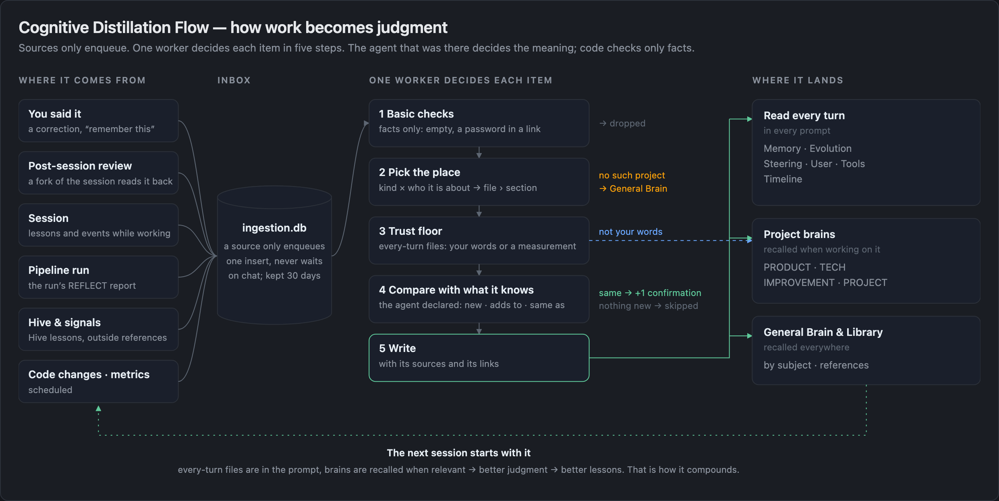

**读取侧。** 把知识写下来只是一半，另一半是在 agent 做判断的那一刻，把对的那条放到它面前：

| 入口 | 送来什么 |
|---|---|
| **每轮 context** | 原则、规则、你的画像，Memory 和 Evolution 全文，最近的活动和 north star 指标；每个 session 重新组装。 |
| **自动 recall** | 相关的 Library 知识和过去的 session（关键词 / FTS5 / BM25，没有向量库），在 session 开始和新消息时召回。 |
| **DDD recall** | 识别出项目后，给出与任务相关的 Brain 条目的位置（`file:line`），让 agent 去读原文。 |
| **`cognition` CLI** | agent 自己用"解法的词"搜所有存储：Brain、Knowledge、Memory、Evolution、Timeline、过去的 session、代码图谱。 |
| **仓库规则** | 第一次碰到一个仓库时，注入它自己的 `AGENTS.md`、review 规则和以往 run 的经验。 |
| **pipeline run 的知识** | run 为各阶段写好的知识文件（EVALUATE 读产品和决定，THINK 和 PLAN 读技术、改进和经验，审查专家读项目知识），文档里引用的条目都要能对上编号。 |

每条知识都整条送到：recall 只决定显示哪些条目，从不截断某一条。正因为每轮文件是整份注入，它们的体积和首 token 时间一直在测；变大了就按声明合并条目，绝不截断。

---

## 看一看

| | |
|---|---|
| 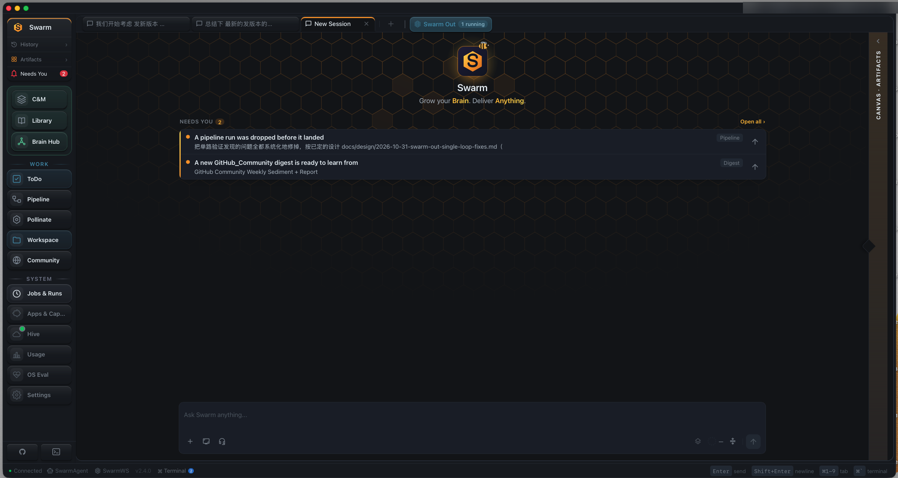 **欢迎页：** 一个品牌，一个 **Needs You** 队列，只放真正在等你的事。 | 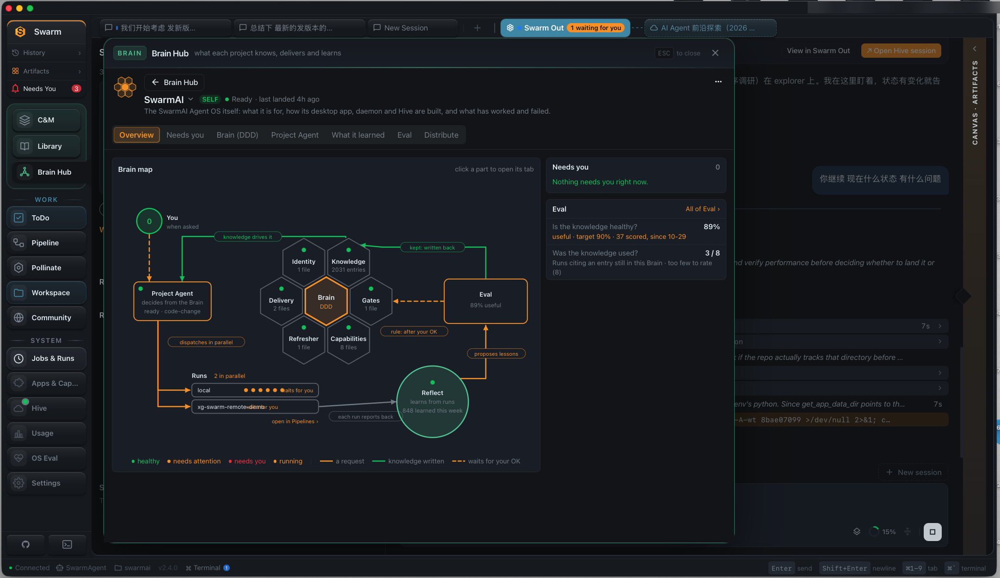 **Brain 页面：** 闭环用实时数据画出来，正在并行跑的 run 一目了然。 |
| 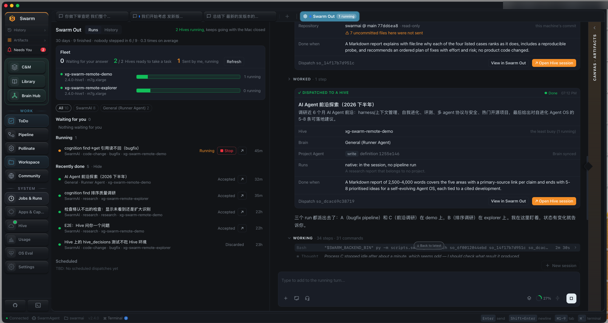 **Swarm Out：** 机群、在跑的和已带回的 run，以及派单的对话。 | 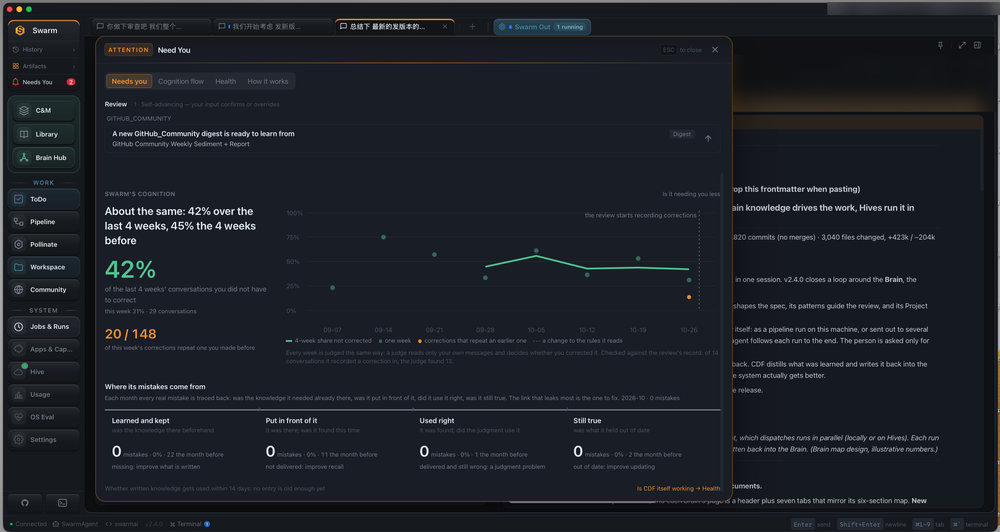 **Swarm 的认知水平：** 它是不是越来越少需要你，错误都出在哪一环。 |

<sub>截图来自真实安装；私有的 Brain 名称、本机路径和账户累计数据已打码。</sub>

---

## 自主交付指南

领域知识驱动的自主交付是怎么运作的，一页一页看。完整 deck（含 Checkpoints 附录）是一个 HTML 文件：[中文](./docs/decks/autonomous-guideline/domain-knowledge-driven-autonomous-zh.html) · [English](./docs/decks/autonomous-guideline/domain-knowledge-driven-autonomous-en.html)（下载后用浏览器打开，按 0–7 切换页面）。

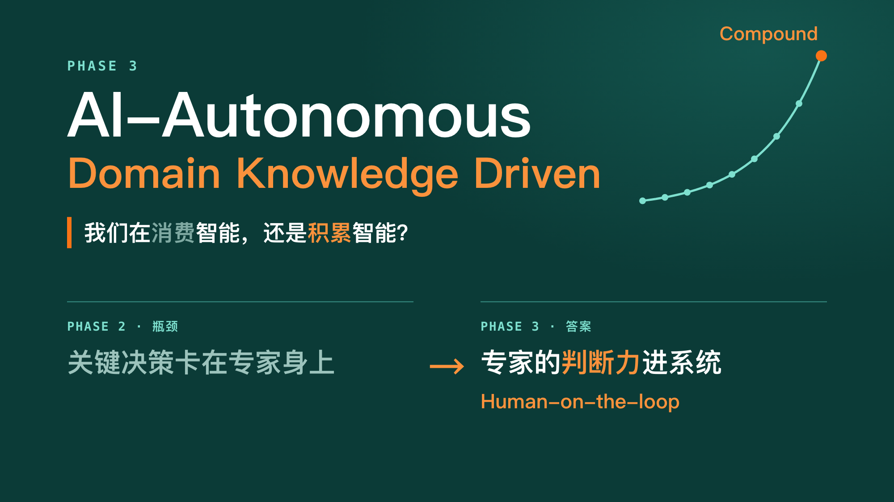

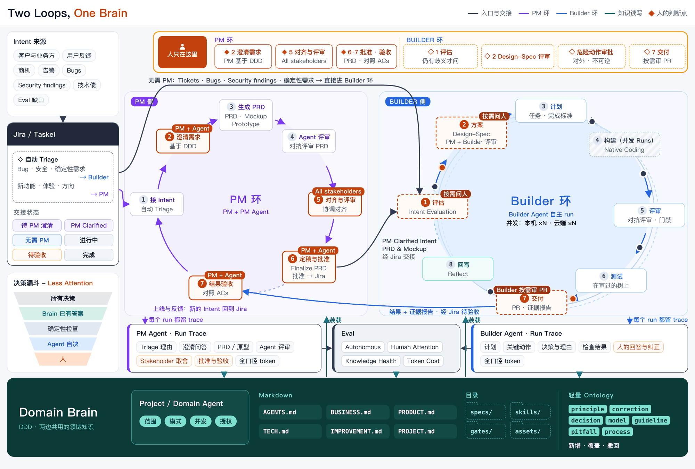

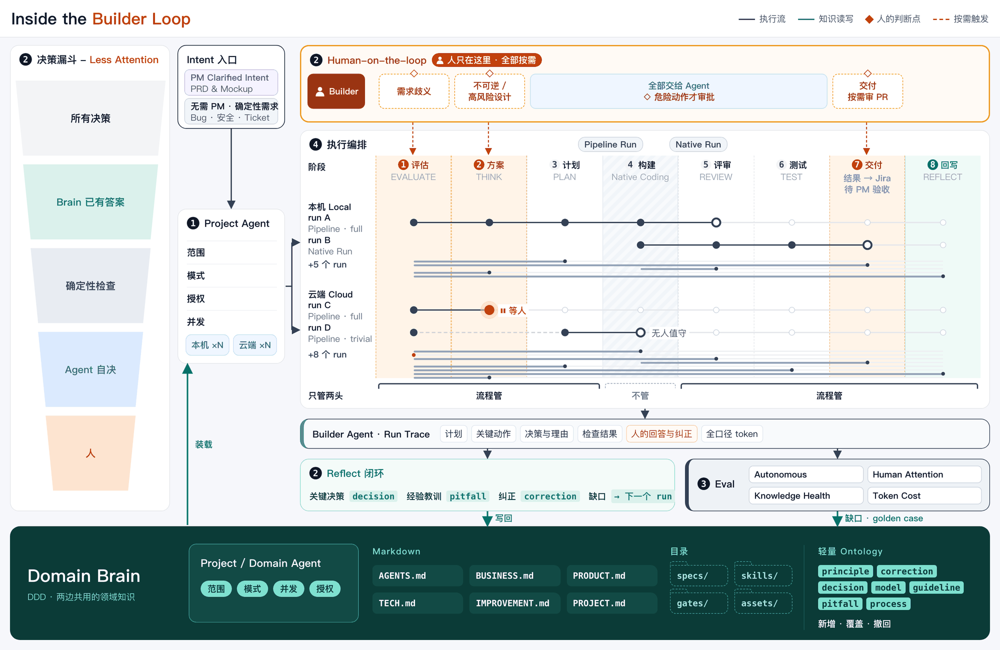

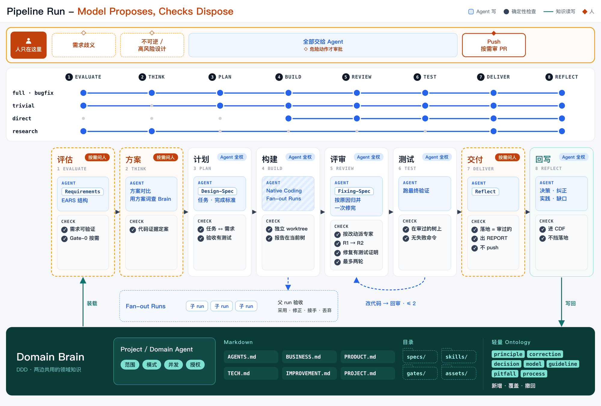

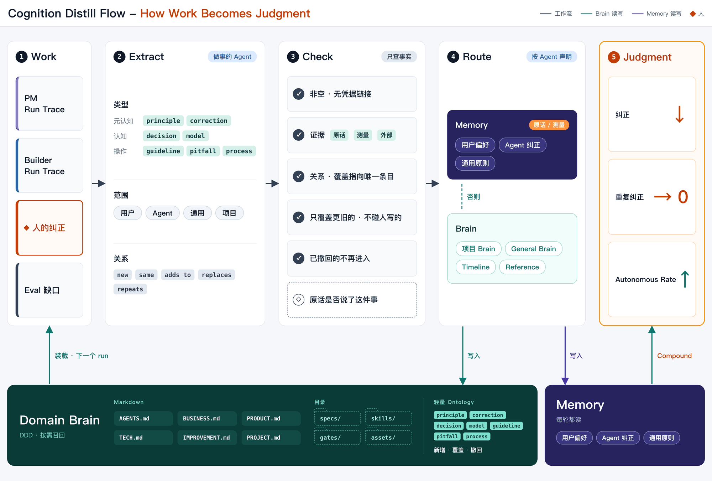

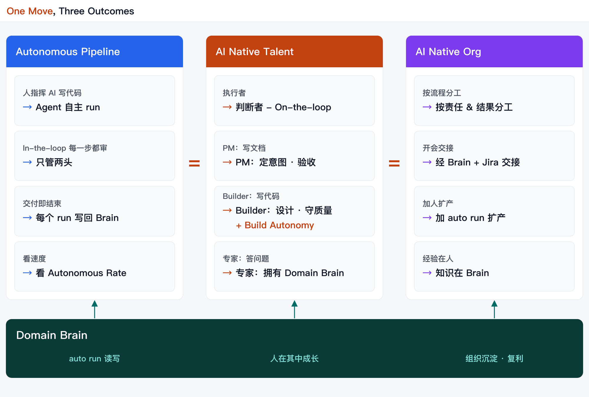

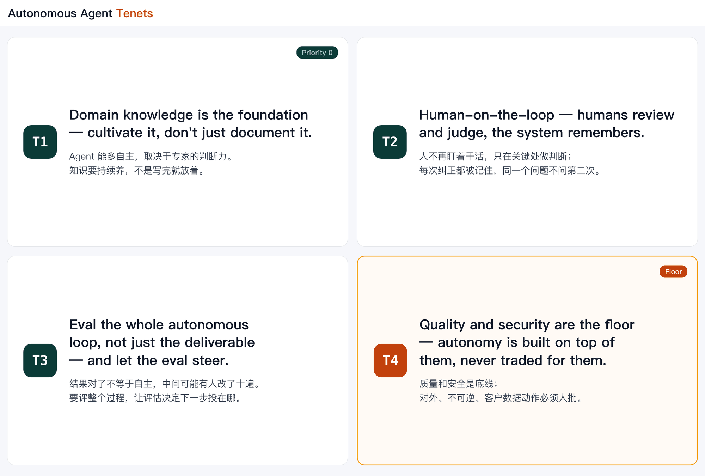

---

## 快速开始

**安装应用：** 从 [Releases](https://github.com/xg-gh-25/SwarmAI/releases) 下载 —— macOS `.dmg`（Apple Silicon 或 Intel）、Windows `-setup.exe`、Linux `.AppImage`（先 `chmod +x` 再运行）。

- 需要一个能在 Amazon Bedrock 上使用 Claude 模型的 **AWS 账号**：对话始终跑在 Bedrock 上。设置向导会连接一个 SwarmAI AWS 账号（或一个 Bedrock API key），应用、Bedrock 和你的 Hive 都用它。
- 安装后的应用需要 **git**（Windows 上需要 Git for Windows，自带 Git Bash）。Python 后端和 Claude CLI 由应用自带。
- macOS：应用还没有经过 Apple 签名，第一次打开时去「系统设置 → 隐私与安全性」点 **仍要打开**。

**从源码构建**（需要 git、Node.js 18+、Python 3.11+、Rust、[uv](https://astral.sh/uv)；Windows 上还需要 Git Bash）：

```bash
git clone https://github.com/xg-gh-25/SwarmAI.git && cd SwarmAI
cd backend && uv sync && cp .env.example .env
cd ../desktop && npm install && npm run tauri:dev
```

> 📖 完整安装指南：[QUICK_START.md](./QUICK_START.md)

---

## 架构

```
┌──────────────────────────────────────────────────────────────────────┐
│  手          Native agent · Autonomous Pipeline · Hive（Swarm Out）    │
│              审查专家 · Pollinate · Eval                               │
├──────────────────────────────────────────────────────────────────────┤
│  一个大脑    Context & Memory · Brain（DDD）+ General Brain            │
│              写入侧（CDF）· 读取侧（recall、cognition）                 │
├──────────────────────────────────────────────────────────────────────┤
│  底座        Session 与 tab · Hook · 产品级 gate · Job                  │
│              桌面端身体 · 授权模型与操作登记表                           │
└──────────────────────────────────────────────────────────────────────┘
```

| 部分 | 做什么 | 阅读 |
|------|-------|------|
| **Context & Memory** | 每个 prompt 都会组装进去的受管文件：每个文件管什么、怎么改 | [SWARMAI.md](./backend/context/SWARMAI.md) |
| **CDF（写入侧）** | 从每个 session 和 run 进入大脑的唯一通道；带着上下文的 agent 判断，代码核对事实 | [设计](./docs/design/2026-10-26-swarm-cognitive-distillation-flow.md) · [agent 判断](./docs/design/2026-10-30-cdf-agent-decides.md) |
| **Brain（DDD）** | 领域大脑，主文件只保留当前有效的内容：新增、覆盖、撤回 | [设计](./docs/design/2026-10-30-brain-driven.md) |
| **读取侧** | recall、DDD recall、`cognition` CLI、仓库规则、run 的知识文件 | [cognition](./docs/design/2026-11-01-cognition-entrance.md) · [run 的知识](./docs/design/2026-10-26-run-knowledge.md) |
| **Autonomous Pipeline** | 从意图到落地的 commit；pipeline 只管两头，由确定性检查判定 | [设计](./docs/design/2026-10-26-pipeline-two-ends.md) |
| **Swarm Out 与 Hive** | 并行派到你的 Hive，产出全部带回，派单的 agent 对 run 负责到底 | [设计](./docs/design/2026-11-01-brain-to-hive-zero-touch.md) · [agent 跟到底](./docs/design/2026-10-31-swarm-out-agent-owns-its-runs.md) |
| **授权** | 谁派的单谁负责；Swarm Out 和 Hive 的每个操作都登记在一张表里 | [审批](./docs/design/2026-10-31-hive-approvals-person-and-host.md) · [登记表](./docs/design/2026-10-31-swarm-out-ops-registry.md) |
| **代码智能** | 每个仓库一份代码图谱，自动构建；审查时能看到改动会影响哪些调用方 | [设计](./docs/design/2026-10-29-code-intel-unification.md) |
| **产品级 gate** | 危险或出机器的操作、只有人能回答的问题；gate 从不阻挡正常的写代码 | [代码](./backend/core/security_hooks.py) |
| **Session 与 hook** | 并发且互相隔离的 tab，可以往正在跑的回合里追加消息（steer），session 之间的 hook 让每个 session 都不冷启动 | [代码](./backend/core/hook_builder.py) · [store](./desktop/src/stores/MessageStore.ts) |
| **Eval** | 对已部署系统做系统级自评：golden set，加上对真实 session 的评分 | [设计](./docs/design/2026-10-26-eval-as-product.md) |
| **Pollinate** | 一条消息生成多格式的媒体内容包，由同一个 Brain 驱动 | [文档](./docs/Pollinate-Content-Engine.md) |

---

## 🤖 给 AI Agent

要在这个仓库里写代码？先读 **[`AGENTS.md`](./AGENTS.md)** —— 数据流、进程拓扑、约定和不变量。它是给 agent 的入口；这份 README 是给人的。

---

## 设计哲学

1. **一个大脑，多双手。** 知识和判断力集中在一个心智里；agent、pipeline、Hive、审查专家都是手。在多个心智之间分工，是为了弥补人的带宽有限，不是好的设计。
2. **注意力是稀缺资源，复利是目标。** 每个任务都要让系统更少需要你，north star 量的就是这件事。
3. **模型提议，OS 裁决。** 含义由带着上下文的 agent 决定；代码核对事实；gate 依据测试、退出码、diff 或人的决定来判，从不依据模型对自己工作的看法。
4. **进化是认知层面的，不是数据层面的。** 改 `SOUL.md` 里的一行，对判断力的影响胜过一千条记忆，而且每次改动都能 `git diff`。同一类错误反复出现，就做结构性修复，而不是再记一条教训。
5. **大脑只保留当前有效的内容。** 知识通过新增、覆盖或撤回来改变，在新知识进来时就定下。没有东西会按时间淘汰，也没有东西为了塞进预算被截断。
6. **质量靠确定性检查收敛。** 小心翼翼不能规模化，检查可以。审查负责发现问题，测试负责判定，审查轮数有上限。
7. **量不出来，就等于没做出来。** Eval、golden set 和 north star，都和 git 绑定。

**背后的 thesis：** 一个 builder + AI + 一个会自进化的系统，能交付团队级的产出，代码如此，其他工作也一样。SwarmAI 就是这个实验，这个仓库就是它的证据。

> 📖 完整 thesis：[docs/THESIS.md](./docs/THESIS.md) · 最新版本说明：[v2.4.0](./docs/releases/v2.4.0.md)

---

## 技术栈

**Tauri 2.0**（Rust）· **React 19** · **FastAPI** · **Claude Agent SDK + Bedrock** · **SQLite**（WAL + FTS5）

四平台后端（编译期隔离）：macOS daemon（`.dmg`）· Hive（EC2）· Windows（`-setup.exe`）· Linux（`.AppImage`）。

---

## 资源

| 内容 | 链接 |
|------|------|
| **版本说明** | [v2.4.0](./docs/releases/v2.4.0.md) · [全部版本](https://github.com/xg-gh-25/SwarmAI/releases) |
| **设计文档** | [docs/design/](./docs/design/) |
| **Thesis** | [THESIS.md](./docs/THESIS.md) |
| **AI Agent 避坑指南** | [EN PDF](./docs/ai-agent-pitfall-guide-en.pdf) · [中文 PDF](./docs/ai-agent-pitfall-guide.pdf) |
| **给 AI Agent** | [AGENTS.md](./AGENTS.md) |
| **参与贡献** | [CONTRIBUTING.md](./CONTRIBUTING.md) |

---

[MIT License](./LICENSE)

---

<div align="center">

**SwarmAI — Human directs. AI delivers.**

</div>
