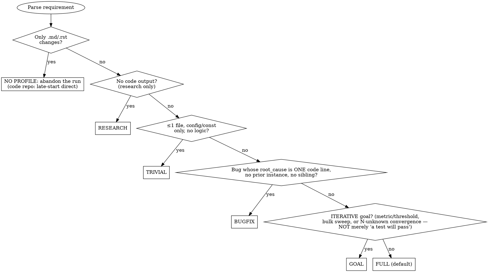

# EVALUATE ref — Profile Selection, Intelligence Adjustments, Goal Mode
Read when: goal vs full is unclear, `pipeline_intelligence.json` exists in the workspace root,
or the requirement is a goal (you need `dod_criteria`). The card (`stages/evaluate.md` step 4)
has the decision order.
## Profile Selection (Decision Tree)
**Core principle:** goal vs full is NOT about whether "done" is *verifiable* (almost everything
is). It is about whether reaching done requires ITERATING toward a moving target. Goal =
converge to a metric / sweep an open set / N-unknown changes. Full = one bounded change you can
scope upfront.

**Evaluate each condition sequentially.** The first YES determines the profile. All NO →
FULL. **Order matters:** the size/shape gates come BEFORE goal. Goal is the LAST gate before
FULL and requires a genuinely *iterative* target, not mere test-verifiability.
**Goal indicators** (all require iteration toward a moving target; a passing test alone is
NEVER a goal indicator):
- Metric/threshold targets: "Get X to Y%", "Reduce X below Y"
- Bulk/sweep operations: "Migrate all", "Fix all warnings", "Remove all instances"
- Quality hardening: "Fix all findings", "Make X production-ready"
- Iterative convergence: "Investigate and fix" where the number of changes is unknown upfront
## Goal vs full: what is NOT a goal
**NOT goal (route to bugfix/trivial/full):** a single bounded change whose "done" is "the
feature exists and its test passes", even though that test exits 0. One code-line root with
no prior instance and no sibling → bugfix (validator-checked against `root_cause`: a design-level
root, a prior instance or a sibling is a class problem, and a one-instance fix of it is
whack-a-mole → full), trivial (≤1 file, no logic) or full (multi-file feature).
**Decision heuristic (goal vs full ONLY, after the size/bug gates ruled out
trivial/bugfix/docs/research):** does "done" require *iterating toward a moving target* whose
number of steps you can't predict upfront (a metric to reach, an open-ended set to sweep)?
YES → goal. A single bounded change whose "done" is "it's built and the test passes" → full.
Nearly every change *can* be wrapped in a shell command that exits 0; that alone is NOT a goal
signal. The iteration is.
Scope → profile mapping and the stage list of each profile live in the orchestrator's profile
table in INSTRUCTIONS. `refactor` is a work_type, not a profile (→ full; see
`understanding.md`). A `cross_boundary=true` change can never be docs/research (see
`audits.md`, profile consistency).
## Intelligence-Informed Profile Selection (Meta-Intelligence L3)
Before classifying scope, check whether `pipeline_intelligence.json` exists in the workspace
root. If it does, load it and apply these adjustments:
```bash
# non-blocking: skip if absent
cat pipeline_intelligence.json 2>/dev/null | python3 -c "import sys,json; d=json.load(sys.stdin); print(json.dumps(d.get('dimensions',{}).get('abandon_patterns',{}).get('high_risk_shapes',[])))" 2>/dev/null
```
- **A1. High-risk shape detection:** if the requirement's shape matches a `high_risk_shapes`
  entry (>30% abandon rate): prefer the `goal` profile (iterative cycles recover from scope
  explosion); set `max_cycles` higher than default (abandoned runs often = underestimated
  scope); note in the artifact: "Intelligence: similar requirements have {N}% abandon rate in
  {profile} profile".
- **A2. Budget calibration:** if `dimensions.estimation_accuracy.stage_estimates` exists, use
  those values instead of the default budget estimates (calibrated from actual historical
  consumption across all completed runs).
**Skip intelligence if** the file doesn't exist, is >30 days old (stale), or confidence < 0.7
for a recommendation. Intelligence is advisory only: never override explicit user intent.
## Goal Mode Detection
**When the requirement matches the goal indicators:**
1. Set `scope: "goal"` in the evaluation (selects the `goal` profile).
2. Generate a `dod_criteria` array; each criterion has a type + check:
```json
{
  "goal_mode": true,
  "dod_criteria": [
    {"type": "command", "check": "<project's coverage command from TECH.md — SwarmAI-self example: pytest --cov-fail-under=90 src/; Go: go test -cover ./...; JS: vitest run --coverage>", "desc": "Coverage >90%"},
    {"type": "rubric", "check": "Read each error msg. PASS if: states problem, suggests fix, no stack traces.", "desc": "User-friendly errors"}
  ],
  "max_cycles": 10,
  "progress_path": "Projects/<PROJECT>/.artifacts/goals/<slug>.md",
  "cycle_scope": "one test file or one module fix per cycle",
  "review_cadence": 3
}
```
**DoD criteria rules:**
- `command` type: a shell command, exit 0 = pass. ALWAYS prefer this.
- `rubric` type: an explicit pass/fail rubric (not just the goal statement). Use only when the
  criterion is inherently subjective.
- >50% of criteria are `rubric` with vague rubrics → ESCALATE (goal too subjective).
- ALL criteria `rubric` and no measurable progress metric → ESCALATE.
**Not goal mode:** proceed with the standard evaluation (scope = standard/complex/trivial/bugfix).
**Ordering:** goal-mode detection runs AFTER scoring. A DEFER/REJECT from scoring takes
precedence (the requirement isn't worth pursuing whether it's a goal or a feature). Scoring says
GO and the requirement matches the goal indicators → override scope to "goal".
