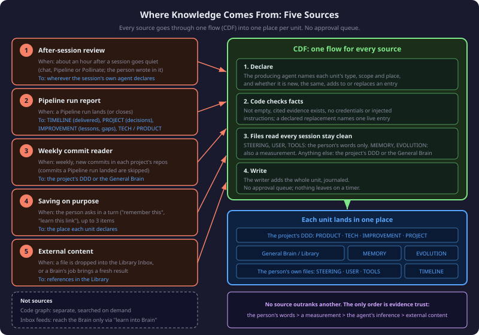
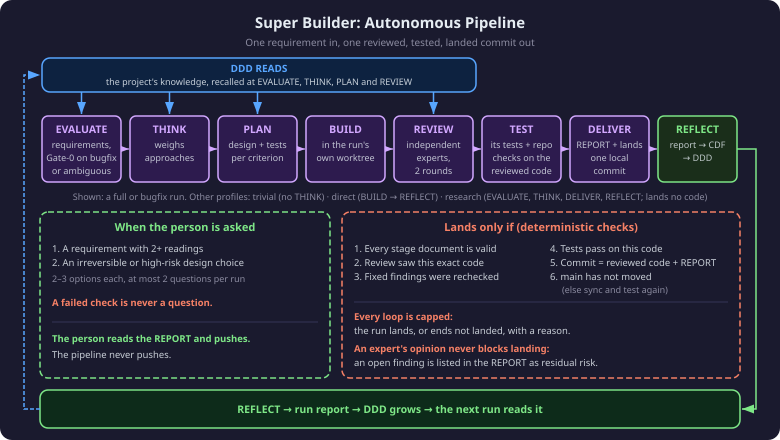
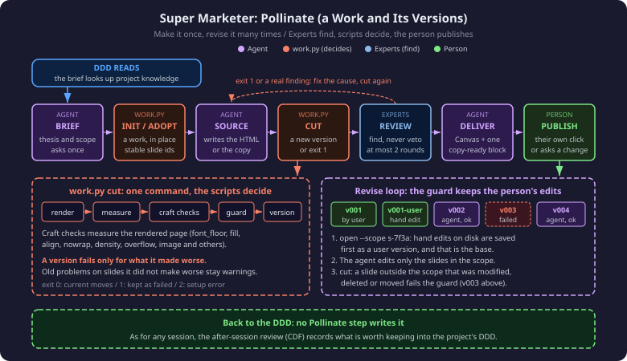
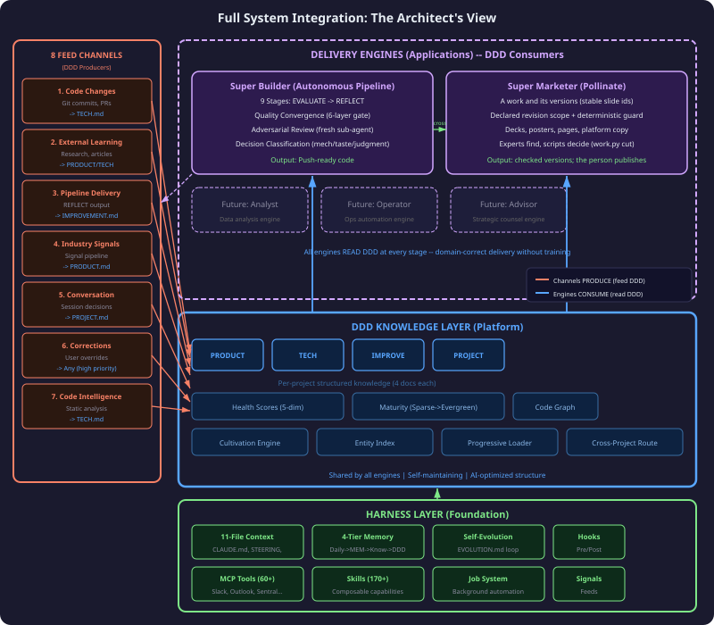

# DDD — One Knowledge Layer, Multiple AI Delivery Engines

> **What we're building:** A platform that turns any AI delivery engine into a domain expert.
>
> A senior engineer is valuable not because they code faster — but because they know the project's history,
> the team's rules, what failed before, and what not to touch. We encoded that growth curve into infrastructure:
>
> - **Harness** — context, memory, tools — the agent doesn't forget
> - **DDD** — a project's domain knowledge, fed by normal work — the agent doesn't repeat mistakes
> - **Pipeline** — expert review and deterministic landing checks — a change lands only on the exact code that was reviewed and tested
> - **Pollinate** — a work and its versions + a declared revision scope with a deterministic guard — the agent doesn't lose the person's edits
> - **Cultivation** — what work teaches goes back into knowledge — the agent gets smarter every session
>
> A regular AI agent used 100 times has the same capability as day one.
> This one compounds: session 100 reads a DDD that holds what the first 99 taught.

---

## 1. Thesis

**DDD as Platform** — one structured knowledge layer powering multiple specialized delivery engines.

This is not "an AI coding assistant." It's not "an AI content tool." It is **domain expertise as infrastructure** — a platform that makes any AI delivery engine operate with the contextual intelligence of someone who has been on the project for years.

The insight: AI agents fail not from lack of capability, but from lack of context. Today's models can all write code, generate content and analyze data. But they do it blind. Every session starts from zero. Every output lacks the accumulated wisdom that makes a senior professional's work different from a junior's.

**The platform model:** Three layers — each enables the one above. The Harness provides the substrate (context, memory, tools). The DDD provides domain knowledge (what to do, what not to do, what matters). Engines provide specialized delivery. And critically: what normal work teaches — the review after each session, each pipeline run's report, a weekly read of new commits, what the person saves on purpose — flows back into the DDD, creating a loop that compounds with every session.


---

## 2. The Problem: Domain Expertise Is The Universal Bottleneck

Every AI delivery task — code, content, analysis, operations — suffers from the same root cause: **domain-blindness.**

**In code delivery:** The AI writes technically correct implementations that violate project conventions, repeat mistakes already documented in post-mortems, miss established patterns, and touch areas that experienced developers know to avoid. The change looks fine to a reviewer who doesn't know the project. It's wrong to someone who does.

**In content delivery:** The AI produces well-written content that uses the wrong voice, targets the wrong audience, contradicts prior messaging, and ignores positioning decisions made months ago. It's generic competence without domain fit.

**In analysis delivery:** The AI generates rigorous analysis that ignores organizational context, prior decisions and known constraints. It's academically sound but operationally useless.

**Why existing approaches fail:**

| Approach | Failure Mode |
|----------|-------------|
| Documentation | Dies — maintenance cost exceeds benefit within weeks |
| RAG over raw documents | Retrieves text, doesn't judge or prioritize |
| Fine-tuning | Static snapshot, expensive to update, can't reason |
| Per-project prompts | Don't scale, can't share across projects, manual burden |
| Onboarding docs | Written once, never updated, quickly stale |

The pattern is consistent: domain knowledge either requires continuous human effort to maintain (unsustainable) or provides retrieval without understanding (insufficient).


**DDD solves this** by keeping domain knowledge current as a byproduct of normal work (every session and every pipeline run is reviewed), storing it as checked entries rather than prose, and sharing it across delivery engines (one knowledge layer, multiple consumers).

---

## 3. The Platform Architecture

Three layers, each enabling the one above:

### Layer 1: Harness (Foundation)

The Harness provides the substrate that makes persistent AI operation possible:

- **Eleven context files** — identity, principles, rules, the user's profile and standing rules, tool guidance, memory, corrections and a timeline go into the system prompt of every session. SwarmAI does not take instructions from a workspace CLAUDE.md or AGENTS.md.
- **Knowledge goes straight to its place** — each piece of knowledge is filed by what it is about: the user (STEERING, USER, TOOLS), the agent's own lessons (EVOLUTION), general facts (MEMORY), one project's DDD, a reference note (the Library), or an event (TIMELINE). A separate daily log records each session.
- **Self-evolution** — corrections are recorded in EVOLUTION.md. When the same mistake comes back three times, SwarmAI proposes a standing rule, and the person decides whether it becomes one. Its principles and rules are never rewritten automatically.
- **Session hooks** — when a session ends, hooks record the day's activity, queue the after-session review that records what is worth keeping, and commit the workspace. Context files are loaded when each session starts.
- **Skills** — dozens of built-in capabilities, from deep research to browser automation to expert code review, and you can add your own.
- **MCP connectors** — SwarmAI connects to external tools through MCP: a catalog of optional connectors (email, Slack, Teams, a browser, git, SQLite), plus any MCP server you add.
- **Scheduled jobs** — background work runs inside SwarmAI's own background service, with no session open. One job reads each project's new commits every week and passes what they teach to that project's DDD.

### Layer 2: DDD Knowledge Layer (Platform)

The DDD sits in the middle — read by engines above, fed by what work teaches. It provides structured domain knowledge that any engine can read to deliver domain-correct outputs. (Detailed in Section 4.)

### Layer 3: Delivery Engines (Applications)

Specialized workflows that turn requirements into deliverables. Each engine reads the DDD to work with domain knowledge. What an engine learns goes back into the DDD: a pipeline run sends its report when it lands; Pollinate has no write-back stage, and its sessions are reviewed like any other session.

Currently: Pipeline (code) and Pollinate (content). The platform model means new engines (analysis, operations, advisory) inherit all existing domain knowledge on day one.

**Why this layering matters:** A new engine doesn't need to "learn" the project. It reads the DDD. The knowledge already exists because every session and every run has been feeding it. This is what makes it a platform, not just a tool.

---

## 4. DDD: The Knowledge Layer

### 4a. Structure: A Project's Brain

A DDD is a folder, one per project, with the same six sections for every domain:

| Section | What it holds |
|---------|---------------|
| ① Identity | `AGENTS.md` (what this brain is about) and `aim.json` (its manifest, including how it may be distributed) |
| ② Knowledge | The four documents below, plus a `knowledge/` folder of deeper reference |
| ③ Gates | The project's own checks |
| ④ Capabilities | Domain skills, tools and jobs that belong to this project |
| ⑤ Delivery | `bindings.yaml`: the assets the brain governs — a code repository, a data source, a corpus, or nothing |
| ⑥ Refresher | `REFRESHER.md`: how what the brain governs is kept current (for a code repository, its code graph) |

**The four documents at its heart:**

| Document | Contains | Read most by |
|----------|----------|--------------|
| PRODUCT.md | What we're building, why, for whom, non-goals | Every engine (product context) |
| TECH.md | Architecture, conventions, runtime traps | Pipeline, others for feasibility |
| IMPROVEMENT.md | What worked, what failed, what to watch for | Every engine (avoid past mistakes) |
| PROJECT.md | Current focus, decisions and their reasons, open items | Every engine (operational context) |

Each entry in these documents is a whole unit with its type and its evidence. A decision keeps its reason and the options that were rejected.

**Beside the DDD (not part of it):**
- **Code graph** — for a project bound to a code repository, the Refresher keeps a code graph of that repository, refreshed every hour, which the agent can query (`cognition find --in code --project <P>`). It is built where it is used, never shipped with the DDD, and writes nothing into the four documents.
- **The General Brain** — knowledge that belongs to no single project, or to many, is kept in the Knowledge Library, which every session can search.

---

### 4b. Where Knowledge Comes From: Five Sources

Without these, a DDD would be static documentation that decays. With them, it grows with every session, every pipeline run, every commit and every correction.

| # | Source | When it runs | What it records | Where it can go |
|---|--------|--------------|-----------------|-----------------|
| 1 | **After-session review** | About an hour after any session you wrote in goes quiet (Pipeline, Pollinate or plain chat) | What you said and decided: corrections, decisions, preferences, lessons, open gaps, milestones, useful references | Wherever the reviewing agent says it belongs: one of the project's four documents, the General Brain, MEMORY, EVOLUTION, your own files (STEERING, USER, TOOLS), TIMELINE or the Library |
| 2 | **Pipeline run report** | When a pipeline run lands (or closes without landing) | What was delivered, decisions, corrections, good practices, open gaps, and what you answered during the run | The project's DDD (decisions in PROJECT, lessons and gaps in IMPROVEMENT, TECH or PRODUCT by topic) and TIMELINE; MEMORY or EVOLUTION only for measured results |
| 3 | **Commit reader** | Once a week, over the new commits of each project's repositories (commits a pipeline run landed are skipped: the run report already covers them) | Lessons, conventions and decisions visible in the code changes | The project's DDD, or the General Brain; never the files read in every session |
| 4 | **Saving on purpose** | When you ask in a turn ("remember this", "learn this link") | Up to three items from that message | Any place; the files read in every session take it only on your own words |
| 5 | **External content** | When you drop a file into the Library Inbox, or a Brain's job produces a fresh result | References | The Library |

Most of this runs with nobody asking: the review after every session, the report of every pipeline run, the weekly commit reader. The review after each session carries most of what is learned — corrections, decisions and preferences all come through it.

Two things are not sources. The code graph is kept separately and searched on demand. Feeds such as trending repositories appear in the Inbox; one reaches the Brain only when you choose "learn into Brain", which saves it as a reference.

There is no ranking of sources. The only ordering is how much a piece of evidence is trusted: your own words, then a measurement, then the agent's inference, then external content. That decides which files a unit may enter.



---

### 4c. Cultivation: Declare, Check Facts, Write

Cultivation is the mechanism (CDF, the Cognitive Distillation Flow) that turns what happens in work into structured knowledge. There is no approval queue: nothing waits for a person.

**The flow:**

1. A source hands over a unit of knowledge: the after-session review, a pipeline run's report, the weekly commit reader, something you asked to save, external content. The agent that produced it declares what it means: its type, its project and where it goes, and whether it is new, the same as an existing entry or adds to one. The session review and a landed run may also declare which entry it replaces.
2. Code checks facts: the unit is not empty, the evidence it cites exists, it carries no credentials or injected instructions, and a declared replacement names exactly one live entry. The files read in every session take only what your own words or a measurement show (your own files STEERING, USER and TOOLS: only your words). The quote must appear word for word in your message, and one isolated model check, shown only your messages, confirms they say what the unit claims. A unit that does not qualify goes to the project's DDD or the General Brain instead.
3. The writer adds the whole unit to its place: a DDD document, the General Brain, MEMORY, EVOLUTION, your own files, TIMELINE or the Library. Every write is journaled.
4. The next session loads it (the files read in every session) or finds it when a task needs it (everything else).

**Why no human approval:** the quality of knowledge is made when it is extracted, by the agent that holds the context, to one standard. A review queue made the person the control loop and still could not judge each entry better than the agent that saw the work. The checks stay light: code checks facts, plus one isolated model check for the files read in every session.

**How the brain stays true:** an entry leaves a main file only when the context that made a newer decision declares which entry it replaces (or a landed run marks an open gap fixed), when an entry is ticked done, or when you withdraw it on the Brain page. Nothing leaves on a timer, and CDF never retires what a person wrote. What was replaced or withdrawn, when and why, is recorded outside the main files, and a withdrawn entry cannot come back through a later unit.

---

### 4d. How AI Uses the DDD

A DDD can grow large. The AI doesn't load all of it into context:

- **With each message**, SwarmAI searches the active project's DDD for the words in it (keyword search, FTS5/BM25) and points the agent to the matching entries by file and line.
- **When a decision depends on what is known**, the agent searches further itself: `cognition find` reads every store — the project's DDD, the General Brain, memory, corrections, the timeline and past sessions — and `cognition get` opens one entry.
- **One project per session.** A session reads the DDD of the project it is working in; knowledge useful across projects lives in the General Brain, which every session can search.

This scales: only the matching entries are pointed to, however large the DDD grows.

---

### 4e. Distribution — A Grown DDD Is a Portable Capability Package

A mature DDD is not confined to SwarmAI. Because a DDD is a self-contained folder
(knowledge + its domain skills + tools + jobs), a grown one can be **packaged and
installed into another AI agent** — Kiro, Claude Code, Cursor — so that agent gets
the same domain-correct judgment. This is the last step of the DDD lifecycle:
**cultivate → version → DISTRIBUTE**.

Distribution is **opt-in and owner-declared**. Each DDD's `aim.json` carries a
`distribution` block declaring its `targets` and `visibility` — that declaration is
the *ceiling*, and the packager only ever emits at or below it (it never widens reach by
inference). A DDD that declares nothing distributes nothing, and that is a complete,
valid state — not a degraded one.

Two targets, one install primitive:

| Target | Shape | Where it goes |
|--------|-------|---------------|
| **Capabilities package** | an agent spec + skills, built for an organization's own package system | the organization's internal package store |
| **Open-Plugin** | `.plugin/plugin.json` + skills + agents + rules | a public plugin registry, or a local install |

Two governance rules make it safe: **(1)** only *domain* skills ship by default;
*enablement* skills (platform capabilities lent to the DDD) ship only in an explicit
`--with-enablement` variant. **(2)** before anything is published, a scan of the whole
package stops the build if it finds secrets, machine paths or (for public packages)
internal organization names — and an internal→external visibility change is always the
owner's decision.

**Full design:** [`2026-07-20-ddd-dual-target-distribution-design.md`](./2026-07-20-ddd-dual-target-distribution-design.md).

---

## 5. Engine 1: Super Builder — Autonomous Pipeline

**Vision:** One requirement in; one reviewed, tested and landed change out, with a report that says what was done and why.

**Goal:** The person gives the "what" and the "why". The Pipeline writes the requirements and the design, builds the change in its own git worktree, has independent experts review it, tests it, and lands it as one local commit. Use it for risky changes or when you ask for it; ordinary changes are made directly. The model writes and fixes; deterministic checks decide every stage exit and the landing.

### The Stages

A `full` or `bugfix` run has 8 stages. Smaller profiles drop some: `trivial` has no THINK, `direct` starts at BUILD, `research` ends after THINK and lands no code.

| Stage | What it does | DDD |
|---|---|---|
| EVALUATE | Writes the requirements with checkable acceptance criteria; decides one run or several. On a bug fix or an ambiguous request, a skeptic expert (Gate-0) checks the framing | Reads PRODUCT and PROJECT entries recalled for the request, plus the Knowledge Library |
| THINK | Compares approaches against the code | Reads TECH and IMPROVEMENT entries and the repository's past lessons; searches again with the design's own words |
| PLAN | Writes the design: tasks, failure paths, and the tests that cover each acceptance criterion | Same recall as THINK |
| BUILD | Makes the change in the run's worktree and reports what it ran | — |
| REVIEW | Independent experts read the full diff (correctness always; security when the change is security-relevant); fixes are rechecked in a second round | The correctness expert gets DDD entries for the changed files |
| TEST | Runs the change's tests and the repository's pre-commit checks on the reviewed code; a fix here goes back to REVIEW | — |
| DELIVER | Renders the run REPORT and lands the change | — |
| REFLECT | Runs inside landing and never changes its result | **Writes** what was delivered, decisions, corrections, practices and open gaps into the project's DDD and timeline (source 2, the run report) |

### How a run decides it can land

There is no score and no "push-ready" verdict. A change lands only when deterministic checks pass: the stage documents are valid; review saw the exact code that lands and every fixed finding was rechecked; the test report has no failed command and was recorded on that same code; the commit holds only the reviewed code plus the REPORT; and main has not moved since the run started (if it has, the run syncs and tests again).

An expert's opinion informs; it does not block landing. An unresolved high-severity finding is listed in the REPORT as a residual risk. One exception sits at the start: if Gate-0 twice finds the framing wrong, or finds the change already done, the run ends before any code. Every loop has a limit, so a run ends landed or not landed with a stated reason. Landing is a commit on the local main branch. The Pipeline never pushes and opens no pull request.

### How the person is involved

The Pipeline asks only two kinds of question: a requirement with more than one reasonable reading, or a design choice that is irreversible or high risk. Each comes with 2–3 options and their consequences, at most two per run; after that the agent chooses on the evidence and the REPORT says so. A failed check never becomes a question: the agent fixes it, or the run ends not landed. Dangerous commands, production actions and external sends still need approval. At the end the person reads the REPORT (changes, decisions, findings, tests, and an audit of isolation, speed, quality, autonomy and token cost) and decides whether to push.



---

## 6. Engine 2: Super Marketer — Pollinate

**Vision:** Make it once, revise it many times. A deck goes through ten rounds of "change slide 3"; every round must change only what was agreed.

**Goal:** Ask for a deck, a poster, a long image, a report or platform copy. Get a first version that looks professional, then revisions that change only the agreed slides and never lose the person's own edits.

What makes Pollinate different from a one-shot content generator:

- **A work and its versions.** A work is any folder with a `work.json`, registered where it is (also outside the workspace). Every version is kept read-only in `.versions/`. Slides have stable ids (`s-7f3a`), not positions.
- **A declared revision scope with a deterministic guard.** Before an edit, the agent names the slides that may change. A script, not a model, fails any change outside that scope.
- **Experts find, scripts decide.** Review experts report findings; only a failed `cut` blocks a version.
- **The person publishes.** Pollinate never posts, uploads or sends.

### The Flow

| Step | Who | What happens | DDD Interaction |
|------|-----|--------------|-----------------|
| Brief | Agent | Answers six questions (who, what should happen, the thesis, where, formats, sources); asks the person once, only what it cannot decide | **Reads** the project's knowledge first (`cognition find`): facts and numbers come from there and the person's sources |
| Init / adopt | `work.py` | Makes the work, or registers an existing deck in place and adds slide ids | A new work goes under the project's folder |
| Source | Agent | Writes the HTML (deck, poster, page) or the copy | — |
| Cut | `work.py` | Render → measure → craft checks → guard → version | — |
| Review | Experts | `content-accuracy`, `content-visual`, `content-copy`; at most two rounds | `content-accuracy` checks claims against the sources and project knowledge |
| Deliver | Agent | Canvas opens the version; one copy-ready chat block with every file, thumbnail and platform text | — |
| Publish | Person | Publishes, or asks for a change (the revise loop) | — |

There is no write-back stage. What a Pollinate session teaches reaches the DDD the way any session's lessons do: through the after-session review (source 1).

### Revision Scope and the Guard

A revision starts with `work.py open --scope <slide ids>`. If the person edited the files by hand, `open` first saves their files as a user version and uses it as the base, so the agent starts from the person's file, not from its memory of it. The agent edits only the slides in the scope. At `cut`, the guard compares each slide with the base version by hash: a slide outside the scope that was modified, deleted or moved is a violation, and so is a change to a shared file unless the revision was opened with `--shared`. The fix is to undo that change, not to widen the scope.

### Cut: The Scripts Decide

Parallel to the Pipeline's landing checks, `work.py cut` decides whether a version can ship. It renders in a pinned Chromium (every network request blocked during capture), measures every rendered slide, runs the craft checks (`font_floor`, `fill`, `align`, `nowrap`, `density`, `overflow`, `overlap`, `safe_area`, `image`, plus `brand` on posters and `reference` against a reference deck), exports PPTX on request, runs the guard, and writes the version. Exit 0 moves `current` to the new version; exit 1 keeps it, marked failed; exit 2 is a usage or setup error.

**A version fails only for what it made worse.** A problem the base version already had on a slide stays a warning, so revising slide 3 does not fail because slide 20 always had small labels.

Outputs: decks always in HTML, with PDF, PNG and PPTX export; posters; long images and reports; copy for 小红书, 朋友圈, 公众号, X and LinkedIn. Full design: [Pollinate — Content You Revise Many Times](Pollinate-Content-Engine.md).



---

## 7. How Everything Compounds


### The Full Flywheel

```
Session reviews, run reports, commits and what you save feed the DDD
    -> The DDD informs engines
        -> Engines deliver outputs
            -> Lessons go back: the run report (Pipeline) and the after-session review (every session)
                -> The DDD holds more
                    -> Next session: every engine starts better informed
```

It is not only the engines. While they run, the other sources keep working:
- A developer's own commits are read in the weekly commit scan.
- A link or article you ask to learn is saved to the Library in the same turn.
- A correction you make mid-delivery is recorded by that session's review.

The DDD grows from all of these at once. More knowledge means better delivery, which means richer lessons, which means more knowledge.

### Cross-Engine Compound Effects

The platform model creates cross-engine knowledge that wouldn't exist in siloed tools:

**Pipeline lands a feature -> DDD -> Pollinate describes it.** When the Pipeline lands a new feature, its run report records what was built and why. Pollinate's brief looks up the project's knowledge first, so a deck or post about the feature takes its facts from there, not from the model's memory.

**A Pollinate session learns something -> DDD -> Pipeline uses it.** When the person says in a Pollinate session what customers keep asking about, or decides how a feature is positioned, the after-session review can record it in the project's DDD. The Pipeline's EVALUATE stage reads the same DDD — without a human carrying the point from one tool to the other.

**User corrects a term -> every engine respects it.** When a user says "we don't use that word" in a Pollinate session, the after-session review records the correction. If it is the person's preference it goes to STEERING, read in every session; if it is a rule of the project it goes to that project's DDD, which the Pipeline reads at EVALUATE and THINK. Either way the next engine sees it.

### How It Compounds

Session 1: the DDD is sparse. Engines work, but without domain context. Delivery is generic.

After a few sessions: the DDD holds the project's first decisions, lessons and corrections. Engines start making domain-correct choices.

After many sessions: the DDD holds most of what the team has decided and learned, and corrections become rare. That is the goal the system is built for: the knowledge of every session, commit, correction and run, available to the next one.

**A regular AI agent at session 100 has the same capability as session 1.** This system at session 100 reads what the first 99 sessions taught.


---

## 8. Full System Integration

Everything together — the architect's complete view:



### What Each Layer Provides

| Layer | Provides | To Whom | Key Characteristic |
|-------|----------|---------|-------------------|
| **Harness** | Context, memory, tools, evolution, hooks | DDD + Engines | Loaded every session, always available |
| **DDD** | Structured domain knowledge | All engines equally | Fed by normal work, shared, checked entries |
| **Sources** | What is learned in normal work | The DDD and the rest of the brain (via CDF) | Mostly automatic: every session and run is reviewed; you can also save on purpose |
| **Engines** | Specialized delivery | End users | Domain-correct, checked by scripts (Pipeline landing checks, Pollinate `cut`) |
| **Cultivation** | Turning what work teaches into entries | DDD growth | Facts checked, whole units written, every change journaled |

### Information Flow Summary

```
SOURCES (session reviews, pipeline run reports, commits, what you save, external files)
    | (via CDF: the producing agent declares, code checks facts)
    v
DDD + THE REST OF THE BRAIN (written whole, journaled)
    | (keyword search each message, cognition find on demand)
    v
DELIVERY ENGINES (Pipeline, Pollinate, future)
    | (outputs)
    v
DELIVERABLES (landed local commits, checked content versions)
    | (the run report; the after-session review)
    v
BACK INTO THE DDD
```

### Platform Properties

**Shared knowledge:** Every engine reads the same DDD. Knowledge learned by one engine benefits all others. No duplication, no drift between "what engineering knows" and "what marketing knows."

**Incremental adoption:** A DDD starts sparse for any project. You don't need to write documentation upfront. Use the system normally — every session and run is reviewed, and what is worth keeping goes into the DDD. Value begins accumulating from session 1.

**Files you own:** The DDD itself is plain markdown files in a folder under git, readable with any editor. SwarmAI keeps local search indexes and a write journal beside it.

**Engine-agnostic platform:** Adding a new engine doesn't require rebuilding knowledge. A future Analyst engine would read the same DDD that Pipeline and Pollinate already enrich. Day-one domain knowledge for any new engine.

---

## 9. FAQs

**"Why not just RAG?"**

The DDD is also retrieved, by keyword. The difference is what it holds: curated entries, each with its type and its evidence, written by the agent that saw the work. RAG finds "we use React"; the DDD holds "we use React with these patterns, this state approach was chosen for these reasons, this alternative was rejected because X, and here are 3 mistakes we made that you should avoid."

**"Why not separate knowledge per engine?"**

Because cross-engine learning is where the platform value lives. If Pipeline has its own knowledge and Pollinate has its own, then the Pipeline landing a new feature can't inform how Pollinate describes it. A shared DDD means one learning event benefits all consumers.

**"What about future engines?"**

This is the strongest argument for the platform model. A new engine (data analysis, say) reads the existing DDD on day one. It already knows the product context (PRODUCT.md), the technical architecture (TECH.md), past lessons (IMPROVEMENT.md) and the team's decisions (PROJECT.md). Zero cold start. The investment in growing the DDD today pays forward to every future engine.

**"How does this differ from traditional DDD (Domain-Driven Design)?"**

Traditional DDD is a software design methodology — bounded contexts, aggregates, value objects. Our DDD is Domain-Driven Development in a different sense: the domain knowledge drives the development process itself. The similarity is intentional (domain expertise shapes delivery) but the mechanism is different (an AI knowledge layer fed by normal work vs. human design patterns).

**"What's the adoption cost?"**

Near zero for getting started. Ask SwarmAI to create a project: it sets up the DDD folder, with the four documents holding only their section headings. Use the system normally. From the first session, the review after it starts filling the DDD. There's no upfront documentation effort — the DDD is a byproduct of the work you already do.

**"Does this replace documentation?"**

It replaces the need for manually maintained documentation. The DDD is updated continuously from your sessions, runs and commits. It is AI-oriented documentation — checked entries, searched by keyword when a task needs them — rather than prose meant for onboarding reads. The two can coexist, but the DDD is the system's source of truth.

**"What happens if the DDD gets something wrong?"**

The after-session review. The user says "that's wrong, actually X." The review records the correction from the person's own words and declares which entry it replaces; the old entry leaves the main file and the replacement is recorded. If something wrong was written anyway, the person withdraws it on the Brain page, and it cannot come back. One correction, permanent fix.

**"Can this work for a team, not just an individual?"**

A DDD is a folder of files, so it can be kept in a shared repository. More team members means more sessions reviewed and more corrections recorded, all going into the same DDD.

---

*This document is the complete vision of the DDD Platform. After reading it, you understand: what the system is (a platform turning AI engines into domain experts), why it exists (domain-blindness is the universal bottleneck), how it works (normal work feeds the DDD, engines read the DDD), what powers the flywheel (the review of every session and run, the commit reader, what you save), and what the delivery engines are (Pipeline for code, Pollinate for decks, posters and copy that are revised many times, future engines for everything else). One knowledge layer. Multiple delivery engines. Compound growth.*
