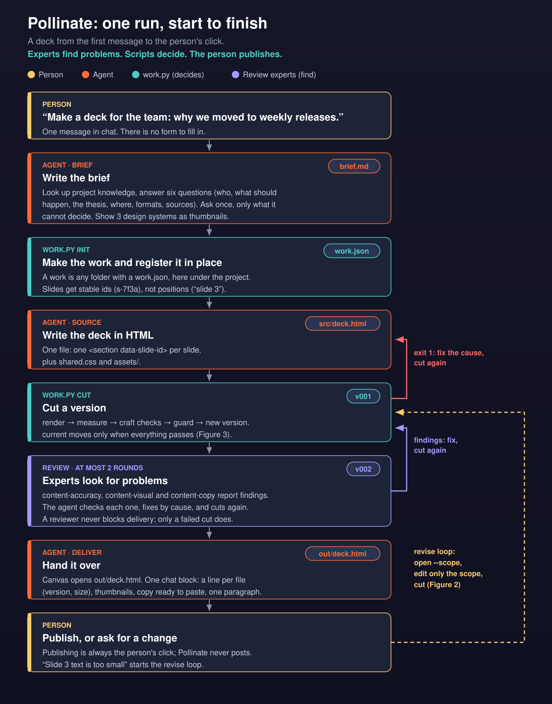
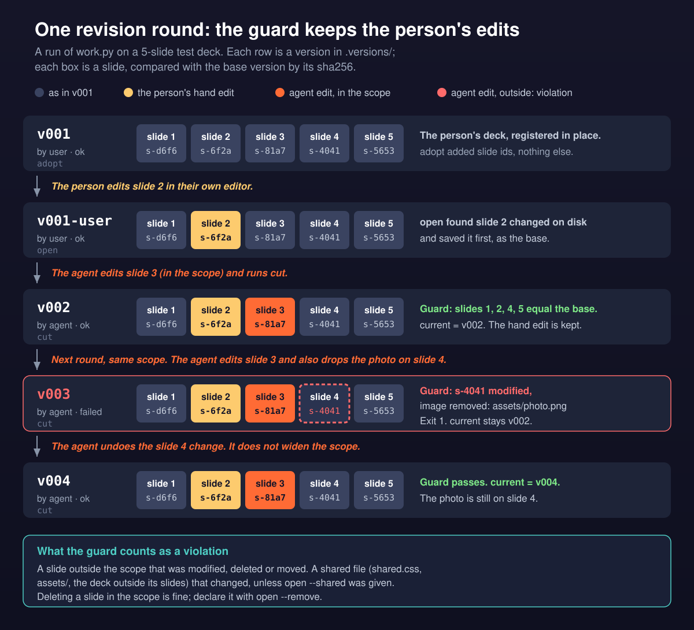
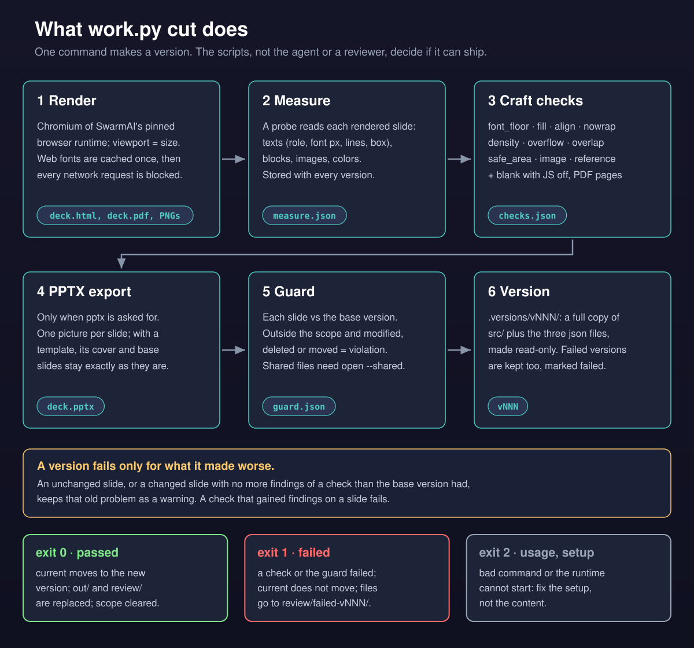

# Pollinate — Content You Revise Many Times

> **Thesis:** good content is not made in one shot. A deck goes through ten rounds of
> "change slide 3". Pollinate makes the first version look professional, and then makes
> every later round change only what was agreed, without ever losing the person's own edits.

> **This doc describes the shipped skill.** Where it disagrees with the code, the code
> wins; the [Source-of-truth map](#13-source-of-truth-map) at the end lists the files.
> Earlier versions of this doc described a 9-stage flow (DISCOVER, 11 tracks, brand
> gates, REFLECT). That flow was removed; none of it exists any more.

---

## 1. Summary

Pollinate is SwarmAI's content creator. It makes and revises:

- **decks** (always HTML, with PDF and PPTX export),
- **posters**,
- **pages**: long images (长图) and reports (dashboard, scorecard, comparison),
- **copy** for platforms (小红书, 朋友圈, 公众号, X, LinkedIn).

**Architecture in one sentence:** the agent writes the content and the HTML; a script
(`work.py`) decides whether a version can ship (it renders, the craft checks pass, the
revision guard passes); review experts only find problems; the person publishes.

Key properties:

| Property | What it means |
|---|---|
| **A work lives where it is** | A work is any folder with a `work.json`. It is registered in place, also outside the workspace. Nothing is moved or copied. |
| **Slides have stable ids** | `<section data-slide-id="s-7f3a">`. "Slide 3" is wrong after a merge or an insert; an id is not. |
| **A revision declares its scope** | Before an edit, the agent says which slides may change. A deterministic guard fails any change outside that scope. |
| **Hand edits are never lost** | If the person edited the files, the next revision first saves their files as a user version and starts from it. |
| **Scripts decide, experts find** | A version can ship only when `cut` exits 0. A reviewer's finding is a lead to check, never a veto. |
| **A version fails only for what it made worse** | Problems the base version already had stay warnings, so revising slide 3 does not fail because of slide 20. |
| **Delivery is copy-ready** | Canvas shows the result; the chat has one block with every file, thumbnail and platform text, ready to paste. |
| **Publishing is the person's click** | Pollinate never posts, uploads or sends. |

---

## 2. Why it works this way

The old Pollinate was a 9-stage production line. In practice it was almost never used
for the content people actually made, and when it was used, revisions hurt. Three causes:

1. **Routing and cost.** Deck, slide and report requests did not reach the skill at all,
   and a one-slide change meant reading thousands of lines of instructions.
2. **No revision model.** There was no "change only the agreed slides on *your* version".
   The real complaints were: "you reverted my change" (right after the person adjusted a
   slide by hand), "you deleted my two slides", "the portraits are gone".
3. **Too few craft checks.** The most common complaints were about craft, not content:
   "the text is too small", "too empty", "not aligned", "too much text", "the subtitle
   must not wrap; check the other slides too".

So the redesign keeps only the two ends and makes both of them deterministic:

- **The front end is the brief**: who it is for, the one thesis, and the scope.
- **The back end is checks, review and delivery**: cut a version, review it (at most two
  rounds), hand it over in a form the person can copy.

The middle (how to write the HTML, how to lay out a slide) is the agent's craft. Every
check comes from a real complaint, and each one is a script, not an opinion.

---

## 3. One run, start to finish



The person asks for a deck. The agent:

1. **Writes the brief** (`cards/brief.md`). If the session has a project, it first looks
   up the project's knowledge (`cognition find --project <P> --query …`); facts and
   numbers come from there and from the person's sources, never from memory. It answers
   six questions (who sees it, what should happen, the thesis, where and how they see it,
   which formats, sources and constraints), asks the person **once**, and only what it
   cannot decide. It writes `brief.md` next to `work.json`.
2. **Picks the look.** For a deck, `recommend_systems.py` ranks the 34 shipped design
   systems and the agent shows three of them as thumbnails. For a poster, two directions
   from `brand/directions/` (two variants, the person picks one).
3. **Makes the work** with `work.py init` and writes the source.
4. **Cuts a version** with `work.py cut` (Section 6). Exit 1 means a check or the guard
   failed: fix the cause and cut again.
5. **Reviews**, at most two rounds (Section 8).
6. **Delivers** (Section 9) and stops.

When the person asks for a change, the **revise loop** starts: `open` with a declared
scope, edit only that scope, `cut` (Section 5).

A one-off poster or post takes the **quick path**: no brief and no questions. The agent
decides the defaults and says them in the delivery paragraph. The quick path still makes
a work, so the next "change the title" is a normal revision.

---

## 4. The work

**A work is any folder that holds a `work.json`.** It is registered where it is, in
`<workspace>/.pollinate/works.json`, which stores only paths (`<workspace>` is
`$SWARM_WORKSPACE`, or `~/.swarm-ai/SwarmWS`).

```
<work>/
  work.json         kind, title, style, size, slide order (ids), current version, versions
  brief.md          the brief; not part of the source
  src/              the source: deck.html, or index.html (poster, page), or copy.md,
                    plus shared.css and assets/
  .versions/v003/   a full copy of src/ for that version, with checks.json, guard.json,
                    measure.json (read-only)
  out/              outputs of the current version only (rebuilt on demand; gitignored)
  review/           contact sheet and frames of the current version (gitignored)
```

- **Where a new work goes:** under the current project (`Projects/<P>/assets/<slug>/`), or
  `Knowledge/Pollinate/<yyyy-mm-dd>-<slug>/` when there is no project.
- **An existing deck or poster**, anywhere: `work.py adopt` registers it in place, adds the
  missing slide ids (nothing else in the file changes) and stores `v001` as the person's.
- **Slide ids**: 4–8 lowercase hex digits, unique in the work, never reused. The agent shows
  them as "slide 3 (s-7f3a)". A poster, page or copy is one unit with the id `main`. Files in
  `src/` other than the main source, and the deck outside its slides (head, styles,
  scripts), count as `_shared`.
- **Hashes**: each version stores the sha256 of every slide (its `<section>` text with line
  ends normalized), of every shared file, and of the outputs.
- **A version is cut only when it is handed over**, not on every save. While working,
  `work.py render` gives outputs to look at without making a version. Old versions keep
  only their source, so they stay small; `render --version V --out D` renders any of them
  again.
- **Only `work.py` writes `work.json`.**

| Command | What it does |
|---|---|
| `init --dir D --kind K --title T [--style S] [--size WxH]` | Creates the folder, `work.json`, an empty source and `.gitignore`; registers the work |
| `adopt --dir D --kind K [--src FILE]` | Registers an existing work in place; adds missing slide ids; stores `v001` (`by: user`) |
| `open --dir D --scope ids [--add N] [--remove ids] [--shared] [--note "…"]` | Absorbs hand edits first, then records the declared scope |
| `cut --dir D [--formats html,pdf,png,pptx] [--template T.pptx …] [--reference R]` | Render → measure → craft checks → (PPTX) → guard → new version |
| `render --dir D [--formats …] [--version V --out D]` | Renders without making a version |
| `list` | Prints the registry |

`K` is `deck`, `poster`, `page` or `copy`. Every script uses the same exit codes: **0**
passed, **1** a check or the guard failed, **2** usage or environment error.

---

## 5. Revision and the guard



Figure 2 is a real run of `work.py` on a 5-slide test deck.

**1. Open with a declared scope.** The agent maps the person's words to slide ids
("merge slides 3 and 4" is both ids plus `--remove` for the one that goes away; "the
subtitle must not wrap, check the other slides too" is every slide with a subtitle) and runs
`open`. If one request could mean two different sets of slides, it asks once.

**2. Hand edits are absorbed first.** When the files on disk differ from the current
version, `open` stores them as `vNNN-user` (`by: user`) and uses that as the base. It also
says so, because the script cannot prove who made the edit, only that it was on disk and
not in a version. The agent never redoes or "cleans up" anything in it.

**3. Edit only the scope.** The agent reads the source fresh from disk after `open` and
keeps every other `<section>` byte for byte, with its images, portraits and notes.

**4. Cut.** The guard compares the new source with the base version:

| Change | Result |
|---|---|
| A slide in the scope is modified | fine |
| A slide in the scope (or in `--remove`) is deleted | fine |
| A slide outside the scope is **modified**, **deleted** or **moved** | violation |
| A shared file changed (`shared.css`, `assets/`, the deck outside its slides) | violation, unless `open --shared` was given |
| More slides were added than `--add` declared | a note in `guard.json` |

A violation names the slide and what changed: "text changed: '…' -> '…'", "image removed:
assets/photo.png", "was page 4 of v002, is now page 3". The fix is to undo that change,
not to widen the scope, unless the person asked for that change.

The guard answers the three complaints it was built from: a reverted hand edit, deleted
slides, and lost portraits.

In a PPTX export with the person's template, the template's own slides (cover, base slides
with a footer) are outside the scope too: they are copied unchanged (Section 10).

---

## 6. Cut: render, measure, check, guard, version



`work.py cut` does, in order:

1. **Render.** The renderer is the Chromium of SwarmAI's pinned browser runtime (the one
   Feature Map uses: Node, Playwright and the Chromium headless shell, installed into the
   app data folder on first use). There is no Python Playwright. The viewport is the
   work's size. The first time a web-font stylesheet is linked, its CSS and font files are
   downloaded into `~/.swarm-ai/cache/fonts/` (only https, only public addresses) and
   rewritten to local files. During capture the browser may load only the rendered file
   and `data:` URLs; every other request is blocked and reported.
2. **Measure.** A probe (`PROBE_JS` in `craft_checks.py`) reads each rendered slide: every
   text block (role, font size, line count, box, container, characters, color), sibling
   blocks, images and colors. The result is stored as `measure.json` with the version.
3. **Craft checks.** `craft_checks.py` judges the measurement (Section 7).
4. **PPTX export**, only when `pptx` is in `--formats` (Section 10).
5. **Guard** (Section 5).
6. **Version.** The source and the three json files go into `.versions/vNNN/`, made
   read-only. `current` moves to the new version only when everything passed.

| Exit | Meaning | What happens |
|---|---|---|
| 0 | passed | `current` moves; `out/` and `review/` are replaced; the open scope is cleared |
| 1 | a check or the guard failed | the version is kept, marked `failed`; `current` does not move; its outputs go to `review/failed-vNNN/` |
| 2 | usage or environment error | fix the command or the setup (for example the runtime cannot start); the content is not the problem |

After three failed cuts on the same check, the agent stops, delivers the best passing
version (or none), names the check and asks one clear question.

Outputs in `out/`:

| Kind | Outputs |
|---|---|
| deck | `deck.html` (self-contained: CSS, images, scripts and fonts inlined; every slide visible with JavaScript off; one printed page per slide), `deck.pdf`, `slides/NN-<id>.png` (in slide order, at canvas size), `deck.pptx` on request |
| poster | `poster.png`, plus `poster@<w>x<h>.png` for other sizes |
| page | `page.png` (height follows the content) and `page.html` |
| copy | `copy.md` |

`review/sheet.jpg` is a contact sheet of all slides with page number and id.

### A version fails only for what it made worse

A person's own deck often has problems they accepted. Revising slide 3 must not fail
because slide 20 always had 14 px labels. So a fail finding is turned into a warning when:

- the slide is unchanged (same hash as the base, and no shared file changed), or
- the slide changed, but the base version had at least as many findings of the same check
  on that slide.

A check that gained findings on a slide keeps all of them as failures. When the base is a
version the person made (adopted, or absorbed hand edits) it has no `checks.json`, so `cut`
renders the base once to count. The first cut after `init` has no base: every slide is new.

---

## 7. Craft checks

Each check measures the rendered page, and each one came from a real complaint. The
thresholds are in `craft_checks.py` (`DEFAULTS`), each with a comment on why it was chosen.

| Check | What it measures | The complaint |
|---|---|---|
| `font_floor` | the smallest text is at least a share of the canvas short side (about 24 px for body, 18 px for labels on 1920×1080) and not tiny next to the slide's title | "the text is too small" |
| `fill` | the content covers at least 35% of the safe area; slides marked sparse with `data-layout` (cover, quote, stat, closing …) are skipped | "too empty", "cramped" |
| `align` | left and top edges of sibling blocks line up; a near miss fails, a clear offset is read as a choice | "not aligned" |
| `nowrap` | titles, subtitles and text marked `data-nowrap` render on one line, on every slide | "the subtitle must not wrap; check the other slides too" |
| `density` | characters per slide stay under a cap that scales with the canvas (a CJK character counts double) | "too much text" |
| `overflow`, `overlap`, `safe_area` | text leaves its box, elements collide, content leaves the safe area | earlier poster checks |
| `image` | an image did not load | "the portraits are gone" |
| `reference` | type scale, margins and colors move too far from a reference deck | "match the style of our earlier deck" |

The renderer adds checks of its own: a slide that is blank in `deck.html` with JavaScript
off, a slide that does not show at its size, PDF pages that do not equal the slide count, a
web font that did not load, a local file that is missing.

Authors help the probe with two attributes: `data-nowrap` on one-line titles, and
`data-role` (title, subtitle, body, label, caption) where the guess from tags and classes
would be wrong. A failed check is fixed at its cause, on every slide with the same cause,
in one pass.

---

## 8. Review: experts find, scripts decide

After each version there are **at most two review rounds**. Round 1 looks for defects.
Round 2 is optional craft: at most 3 changes on at most 3 slides. Then the agent stops and
reports what is left as "still open".

The reviewers are the content experts of the product's expert catalog
(`backend/skills/s_expert-review/CATALOG.md`), spawned in parallel only when the version
needs them:

| Expert | Used when | Looks at |
|---|---|---|
| `content-accuracy` | the content states facts, numbers, names or claims | the sources and project knowledge; an approximate number must not become an exact one |
| `content-visual` | anything was rendered | the contact sheet and frames in `review/`, `measure.json`, the kind page, the craft checks |
| `content-copy` | there is text for an audience or a platform | the audience, AI openers and empty phrases, platform habits, length |

Each finding is a lead. The agent checks it against the work, groups the real ones by
cause, fixes them in one pass and cuts again. A reviewer never blocks delivery; only a
failed `cut` does. A high finding still open after round 2 is delivered and said plainly.

---

## 9. Delivery

1. **Canvas opens the current version** (`out/deck.html`, `out/poster.png` or
   `out/page.png`). For a work outside the workspace, Canvas cannot open it, so the agent
   opens it in the browser or gives the path.
2. **One copy-ready chat block**, in the person's language:
   - one line per output: file, version, size (pixels, pages or slides, and file size);
   - thumbnails inline: the cover and the slides this version changed (at most 6);
   - each platform's copy as plain text in its own fields (小红书: title, body, tags;
     朋友圈: one block; X: one post of at most 280 characters, or a short thread);
   - no gate tables and no check lists.
3. **One paragraph**: the thesis; what the agent decided for the person (design system,
   size, platforms, text it cut); what review found and fixed; what is left; which slides
   this version changed, by number and id.

Then it stops. It offers at most one next step that fits, and never publishes, posts,
uploads or sends anything.

---

## 10. Kinds

| Kind | Source | Notes |
|---|---|---|
| **deck** | `src/deck.html`: one `<section data-slide-id>` per slide inside `<deck-stage width="1920" height="1080">`, theme CSS in `src/shared.css`, the deck stage script inlined | 34 design systems in `templates/html-deck/systems/`; the design system's own font link is kept (the renderer caches it) |
| **poster** | `src/index.html`, one unit | sizes per platform (1080×1440 for a 小红书 card, 1080×1080, 1200×630 …); two variants in two directions the first time; tokens only, everything centered, brand signature on every poster |
| **page** | `src/index.html`, one unit | a long image (1080 wide, at most 8000 px, at most 6 sections) or a report from `templates/html-report/` (report, scorecard, comparison) |
| **copy** | `src/copy.md`, one section per platform | `p2_scan.py` flags "what I built" hero framing; `geo_score.py` flags AI openers and unsupported claims in English text |

### PPTX export

A deck is always made in HTML. PPTX is an export, never the source. A .pptx the person
gives is read as content (text, images, notes) for a new HTML deck, or used as a template.

- **No template:** each slide becomes one full-size picture in the PPTX.
- **With the person's template:** `cut --template T.pptx --keep-head N --base-index I
  --keep-tail M`. The first N and last M template slides stay exactly as they are. Each
  content slide is a copy of template slide I, so its footer and logo stay, and the slide
  picture goes into its content area, keeping the aspect ratio. Empty placeholders are
  removed, so no "Click to add text" shows. The choice is stored in `work.json` and reused.

`export_pptx.py` opens the result again and checks it: slide count, kept slides unchanged,
one picture per content slide, no empty placeholder left. PDF pages and PPTX slides must
equal the source slides (head + content + tail with a template).

### Reference deck

"Match the style of our earlier deck": the agent registers that deck as a work too
(`adopt`), cuts it once so it has a `measure.json`, then cuts the new deck with
`--reference <that work>`. The reference measurement is copied into the new work and kept
for later cuts; the `reference` check lists where type scale, margins or colors drift.

### Brand and content rules

- **Brand is data.** The default brand is neutral: a plain style and no logo.
  `brand_config.py` merges the shipped `brand/identity.yaml` with the user's
  `~/.swarm-ai/pollinate-brand.yaml`; every visual output carries each configured element
  (watermark, link, QR, footer) and leaves out the unset ones.
- **Content principles** (`brand/content_principles.md`): value, not output counts; what is
  true, not "what I built"; one thesis; effects over mechanisms; each piece stands alone;
  no internal terms in the body.
- **Platform defaults follow the person's language:** X and LinkedIn for English; 小红书,
  朋友圈 and 公众号 for Chinese. A platform the person names wins.
- **The confirmed formats are the scope.** The agent may suggest one more format; it makes
  it only if the person says yes.

---

## 11. Routing and the app

**Routing.** `s_pollinate` triggers on deck, slides, HTML deck, 演示文稿, poster, 海报,
long image, 长图, report, 报告, 小红书, copy, and "revise this deck". The agent picks the path
from the request and does not ask which one:

| The person wants | Path |
|---|---|
| one poster or one post, made once | quick path |
| a deck, a long image, a report, or several kinds from one message (one work per kind) | work flow |
| a change to something that exists | revise loop |
| to read or edit a .pptx file itself | `s_pptx`, not Pollinate |
| a Word or Excel file | `s_docx` or `s_xlsx` |
| a video | not in this version; the agent says so and offers a deck or poster |

**In the desktop app.** The Pollinate overlay (WORK zone) shows the registered works first
(`GET /api/pollinate/works`): one card per work with its cover thumbnail, title, kind,
current version and date, and one action, **Open in Canvas**. A card is marked "Checks
failed" when the newest cut failed; the card still shows the last version that passed. A
work outside the workspace is listed but cannot be opened from the overlay. Below the
works, **Earlier runs** (`GET /api/pollinate/assets`) still shows the output folders of
runs made before this redesign. The overlay writes nothing; new work and changes go
through chat.

---

## 12. Key design decisions

| Decision | Why |
|---|---|
| **The work is the unit, not a run** | A run happens once; a deck is revised dozens of times. The revise loop needs "open a version on the work, change only the scope, see it at once", not a new run. |
| **Register in place** | People keep decks where they work, also outside the workspace. Moving them breaks their links and their habits. |
| **Stable slide ids** | Positions change on every merge or insert. The guard, the scope and the delivery paragraph all use ids. |
| **Deterministic guard on hashes** | "Did you change slide 4?" must have a yes/no answer that does not depend on a model's memory. |
| **Absorb hand edits before editing** | The person's file on disk is the truth. Starting from it is what makes "you reverted my change" impossible. |
| **HTML is the only deck source** | One renderer gives HTML, PDF, PNG and PPTX that match. PPTX import was dropped; a .pptx is content or a template. |
| **Checks are scripts with stated thresholds** | Craft complaints repeat. A measured check catches them on every slide, every time, and can be argued with in the open. |
| **Fail only for what got worse** | Without it, every revision of an adopted deck would fail on problems the person already accepted. |
| **Review is capped and has no veto** | Unbounded review rounds cost more than they find; the decision stays with the scripts and the person. |
| **Pinned browser, network blocked** | The same source must render the same way every time, offline, with the fonts it was designed with. |

**Not in this version:** video, a work wall with version history in the overlay, starting a
work from the app's top input box, one shared visual style across kinds, and a Pipeline
mode for multi-kind content packages. These are candidates, to be decided from real use.

---

## 13. Source-of-truth map

| Claim | File |
|---|---|
| Routing, the work, commands, flow, guard summary, checks table, review, delivery | `backend/skills/s_pollinate/INSTRUCTIONS.md`, `SKILL.md` |
| Brief, cut, revise, deliver steps | `backend/skills/s_pollinate/cards/` |
| Deck, poster, page, copy rules; PPTX export; reference deck | `backend/skills/s_pollinate/kinds/` |
| `work.json`, registry, versions, hashes, guard, carry-over of old findings, `--shared` | `backend/skills/s_pollinate/scripts/work.py` |
| Renderer, font cache, network block, outputs, JS-off check | `backend/skills/s_pollinate/scripts/work_render.py`, `work_render_driver.mjs` |
| Probe, measurement shape, checks and thresholds | `backend/skills/s_pollinate/scripts/craft_checks.py` |
| PPTX export and its self-check | `backend/skills/s_pollinate/scripts/export_pptx.py` |
| Content experts | `backend/skills/s_expert-review/CATALOG.md`, `backend/experts/content/` |
| Overlay and its two reads | `desktop/src/components/layout/PollinateOverlay.tsx`, `backend/routers/pollinate.py` |
| Tests | `backend/skills/s_pollinate/tests/` |
