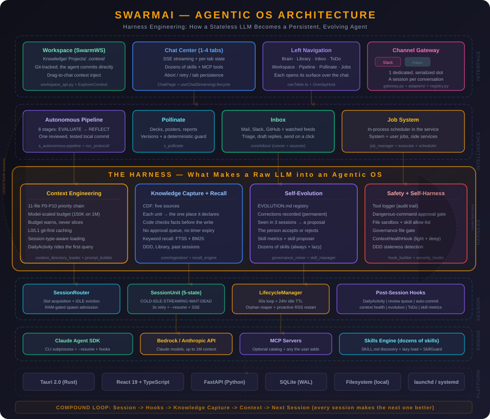
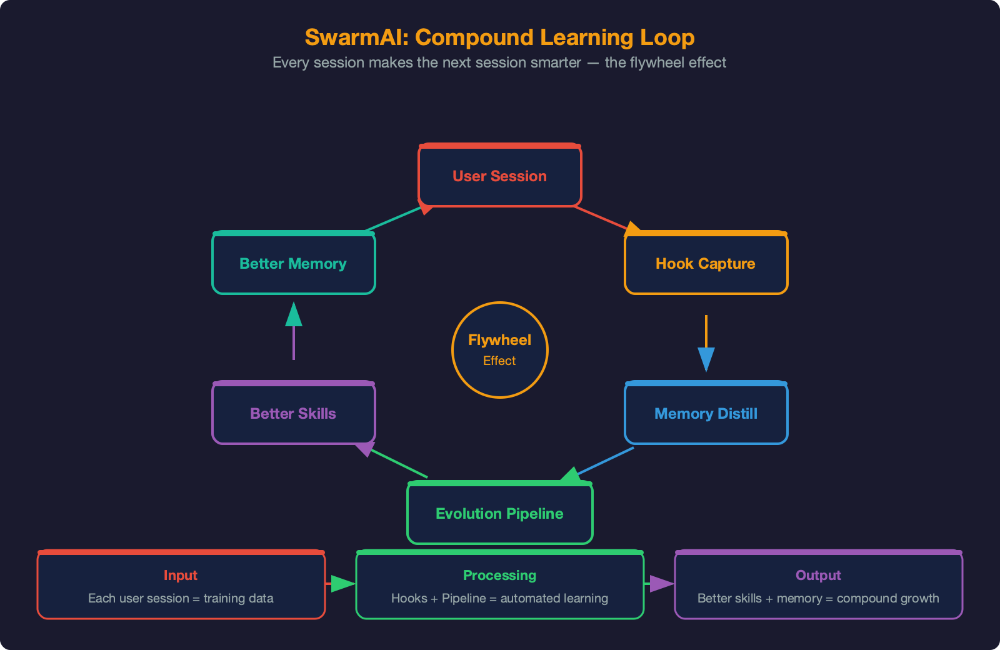
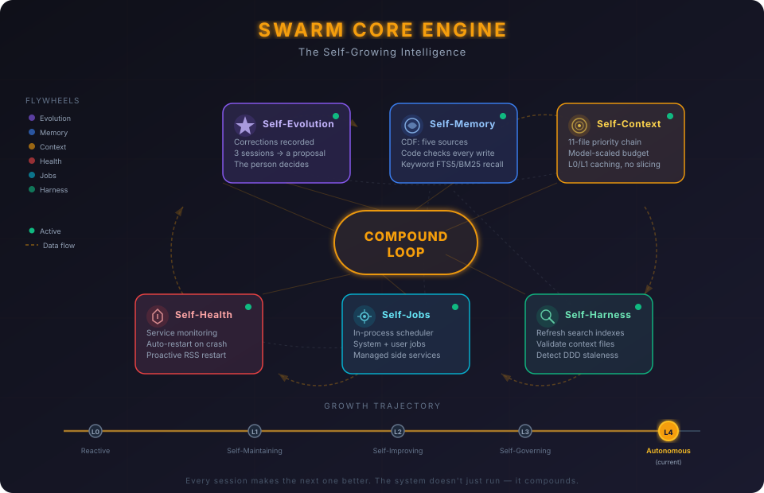
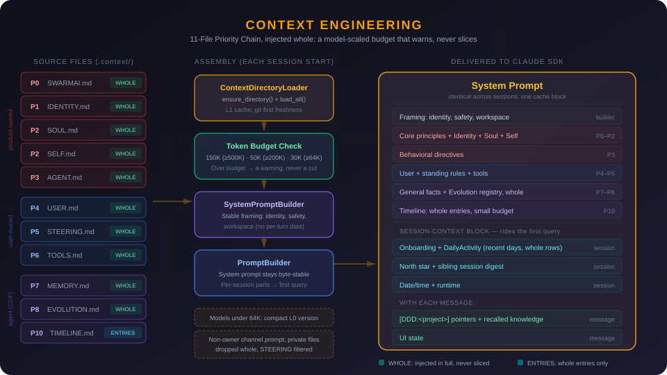
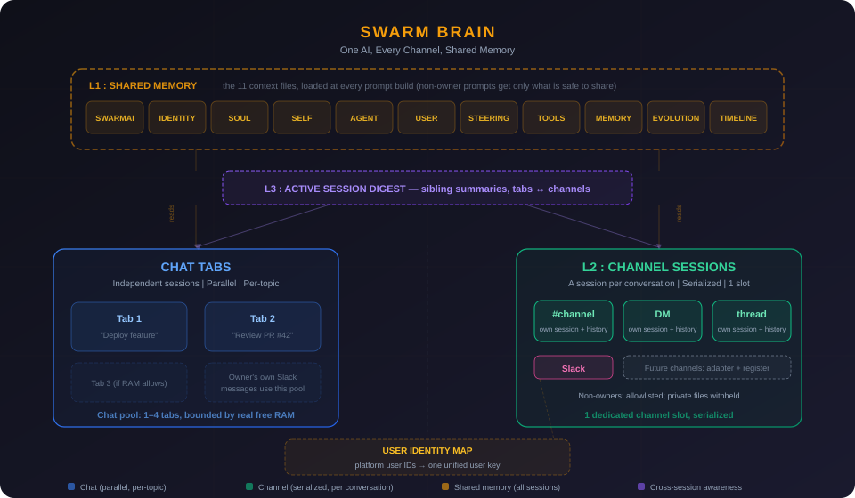
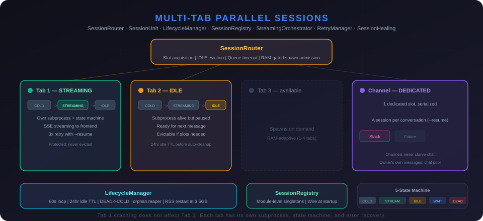
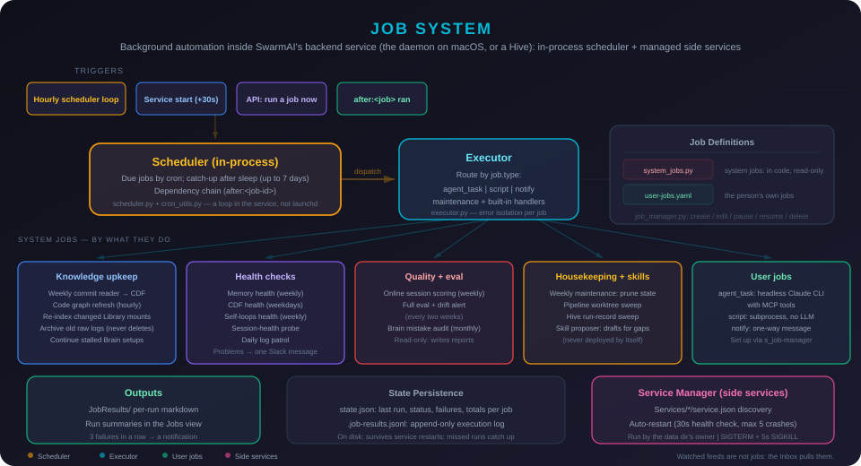

<!-- SOURCE OF TRUTH:
  This .md file is the canonical content. The figures in assets/ are drawn to match it.
-->

# SWARMAI — Agentic OS Architecture

## High-Level Design Document

**Harness Engineering: How a Stateless LLM Becomes a Persistent, Evolving Agent**

| Feature | Description |
|---------|-------------|
| **6 Architecture Layers** | Interface → Intelligence → Harness → Session → Engine → Platform |
| **11-File Context Chain** | Priority-ordered files (SOUL and SELF share P2), model-scaled token budget, L0/L1 caching; no section is ever sliced |
| **Knowledge Capture (CDF)** | Five sources; each unit goes straight to the one place it declares; code checks the facts before the writer adds it |
| **Memory Recall** | Pure-filesystem keyword FTS5 + Okapi-BM25 (no vector DB) |
| **Dozens of Skills (always + lazy tiers)** | Two-tier loading — lazy skills list a short stub and load their instructions on use |
| **Self-Evolution** | Corrections recorded → a pattern seen in 3 sessions becomes a proposal → the person decides |
| **Pipeline v1** | EVALUATE → THINK → PLAN → BUILD → REVIEW → TEST → DELIVER → REFLECT (full profile); deterministic checks own every stage exit and the landing |
| **Daemon-First Backend** | On macOS a launchd daemon runs 24/7 (or a Hive on the person's own cloud) — the desktop app is an optional UI layer |
| **OOM Resilience** | Proactive RSS-based restart at 3.5GB — prevents macOS jetsam kills |
| **Multi-Channel Unified Brain** | Desktop + Slack — same agent, same memory, same context |

Version: 3.0 • Date: November 25, 2026
Author: Swarm (AI Co-Architect) with the SwarmAI builder
Status: current • Classification: Public

---

## Table of Contents

1. [Executive Summary](#1-executive-summary)
2. [Architecture Overview](#2-architecture-overview)
   - 2.1 Six-Layer Architecture • 2.2 The Compound Loop
3. [Core Engine & Growth Trajectory](#3-core-engine--growth-trajectory)
4. [The Harness — Core Innovation](#4-the-harness--core-innovation)
   - 4.1 Context Engineering • 4.2 Knowledge Capture & Recall • 4.3 Self-Evolution • 4.4 Safety & Self-Harness
5. [Swarm Brain — Multi-Channel Architecture](#5-swarm-brain--multi-channel-architecture)
6. [Session Architecture & Multi-Tab Parallel Sessions](#6-session-architecture--multi-tab-parallel-sessions)
7. [Intelligence Layer](#7-intelligence-layer)
   - 7.1 Autonomous Pipeline • 7.2 Job System • 7.3 Inbox
8. [Command Center Layout](#8-command-center-layout)
9. [Daemon-First Backend](#9-daemon-first-backend)
10. [OOM Resilience & Proactive Restart](#10-oom-resilience--proactive-restart)
11. [Key Design Decisions & Tradeoffs](#11-key-design-decisions--tradeoffs)
12. [Competitive Positioning](#12-competitive-positioning)
13. [Future Roadmap](#13-future-roadmap)

The figures are older illustrations. Where a figure differs from the text, the text is current.

---

## 1. Executive Summary

SwarmAI is a desktop application that wraps Claude's Agent SDK inside a harness — a structured layer of context management, persistent memory, self-evolution, and safety controls that transforms a stateless large language model into a persistent, evolving personal AI agent.

The core thesis: most AI tools reset when you close them. Context is lost, decisions are forgotten, and users re-explain the same things session after session. SwarmAI solves this structurally — not through fine-tuning, but through engineered knowledge persistence.

> **Key Innovation:** The "Harness" — an 11-file context priority chain, a knowledge-capture flow (CDF) that puts each unit of knowledge where it belongs, pure-filesystem keyword/FTS5/BM25 recall, a self-evolution registry, and post-session hooks that create a compound loop: every session makes the next one better. Every correction prevents a class of future mistakes.

### Key Metrics

Counts that change every week (commits, lines of code, tests) live in [`CODEBASE_METRICS.md`](./CODEBASE_METRICS.md).

| Metric | Value |
|--------|-------|
| Built-in Skills | Dozens (always-loaded + lazy-loaded) |
| Context Files | 11 (SWARMAI, IDENTITY, SOUL, SELF, AGENT, USER, STEERING, TOOLS, MEMORY, EVOLUTION, TIMELINE) |
| Post-Session Hooks | DailyActivity, after-session review queue, workspace auto-commit, context health, evolution report, ToDo, skill metrics, then the CDF kick |
| Pipeline Stages | 8 in a full run (EVALUATE → THINK → PLAN → BUILD → REVIEW → TEST → DELIVER → REFLECT); lighter profiles run fewer |
| Session States | 5 (COLD, IDLE, STREAMING, WAITING_INPUT, DEAD) |
| Backend Mode | Daemon-first (launchd 24/7 on macOS, systemd on a Hive) — desktop app is optional UI layer |
| OOM Protection | Proactive RSS restart at 3.5GB — prevents jetsam kills |
| Memory Recall | Context files in every prompt + per-message keyword recall (FTS5/BM25) over the active project's DDD, the Library and past sessions |
| Evolution | Corrections → a pattern seen in 3 sessions → proposal → the person decides |
| Channels | Desktop + Slack (unified brain) |
| Tech Stack | 4 languages: Rust (Tauri), TypeScript (React), Python (FastAPI), SQL (SQLite) |

---

## 2. Architecture Overview

### 2.1 Six-Layer Architecture

SwarmAI's architecture is organized into six horizontal layers. Each layer has a clear responsibility boundary. The Harness layer (Layer 3) is the core innovation — it is what differentiates SwarmAI from a simple LLM wrapper.

*Figure 1: SwarmAI Agentic OS Architecture — Six-layer design with the Harness as the core innovation*

| Layer | What It Does | Key Components |
|-------|-------------|----------------|
| Interface | Visual workspace, multi-tab chat, navigation, channels | Chat (1–4 tabs), left navigation (Brain, Library, Inbox, ToDo, Workspace, Pipeline, Pollinate, Jobs), Gateway (Slack) |
| Intelligence | Autonomous execution, content, inbound messages, jobs | Autonomous Pipeline, Pollinate, Inbox, Job System |
| Harness | Core: raw Claude → persistent, evolving agent | Context (11 files), Knowledge capture (CDF) + keyword/FTS5/BM25 recall, Evolution (proposals, skills), Safety |
| Session | Multi-session lifecycle, isolation, recovery | SessionRouter, SessionUnit (5-state), LifecycleManager, SessionRegistry, StreamingOrchestrator, RetryManager, SessionHealing, post-session hooks |
| Engine | AI model access, tool ecosystem | Claude Agent SDK, Bedrock/Anthropic, MCP servers (a shipped catalog of optional connectors + any the user adds), Skills Engine |
| Platform | Desktop infra, local-first | Tauri 2.0, React 19, FastAPI, SQLite, filesystem; launchd daemon (macOS), subprocess (Windows/Linux), Hive (EC2 Linux, systemd) |

### 2.2 The Compound Loop

The defining characteristic is the compound loop — a feedback cycle where every session's output becomes the next session's input:

- **Session executes** — user interacts, decisions are made, code is written, files are created
- **Hooks fire** — post-session hooks write the DailyActivity log, queue the after-session review, commit the workspace, check context health, update ToDos and skill metrics
- **Knowledge is captured** — about an hour after a session goes quiet, the session's own agent records what is worth keeping; CDF checks each unit's facts and writes it to the one place it declares (STEERING/USER/TOOLS, EVOLUTION, MEMORY, a project's DDD, the Library, TIMELINE)
- **Context enriched** — the next session's system prompt is assembled from the updated 11-file chain, and each message recalls matching entries from the active project's DDD
- **Agent is smarter** — the next session starts with what was learned and the mistakes to avoid

> **Design Principle:** Prevention over recovery. The compound loop makes errors structurally impossible over time, not handled after they occur.

---

## 3. Core Engine & Growth Trajectory

The Swarm Core Engine is the meta-architecture that ties six flywheels together. Each flywheel feeds the others: memory informs context, context improves sessions, sessions produce corrections, corrections become proposed rules, rules improve the next session.

*Figure 2: Swarm Core Engine — Six interconnected flywheels and growth trajectory*

| Flywheel | What It Does | Key Components |
|----------|-------------|----------------|
| Self-Evolution | Records corrections, turns a repeated one into a proposed rule for the person, measures skill use | EVOLUTION.md, governance proposals (`core/evolution/governance_miner.py`), skill metrics, skill proposer, SkillGuard |
| Self-Memory | Captures knowledge from five sources into the one place each unit declares; keyword recall over all of it | CDF (`core/ingestion/`), DailyActivity, MEMORY.md, TIMELINE.md, SessionRecall, MemoryGuard |
| Self-Context | 11-file priority chain + model-scaled budget + caching | Context loader, prompt builder, budget tiers, freshness |
| Self-Harness | Keeps search indexes fresh, validates context files, detects DDD staleness | ContextHealthHook (light every session + deep once a day), auto-commit, integrity |
| Self-Health | Monitors services, resources, sessions; proactive restart, auto-restart | Service manager, resource monitor, lifecycle manager, session healing |
| Self-Jobs | Background automation and scheduled tasks | Job scheduler, system jobs, user jobs |

### Growth Trajectory

| Level | State | Capabilities | Status |
|-------|-------|-------------|--------|
| L0 | Reactive | Responds to questions, no memory | Complete |
| L1 | Self-Maintaining | Remembers, self-commits, captures corrections, health monitoring | Complete |
| L2 | Self-Improving | Weekly maintenance, unified jobs, feedback loops closed | Complete |
| L3 | Self-Governing | Session-type context, proactive gap detection, DDD auto-sync | Complete |
| L4 | Autonomous | Knowledge capture with no human trigger (CDF after-session review, pipeline run reports, weekly commit reader), evolution proposals the person decides, Pipeline v1 landing reviewed and tested commits, skill proposals, keyword/FTS5/BM25 recall, MemoryGuard on writes, proactive OOM restart. | Current |

---

## 4. The Harness — Core Innovation

The Harness is what makes SwarmAI more than a ChatGPT wrapper. It is a structured engineering layer between the user interface and the raw LLM that provides four critical capabilities: context continuity, memory persistence, self-improvement, and safety.

### 4.1 Context Engineering

Most AI tools assemble a single system prompt. SwarmAI maintains an 11-file priority chain that is assembled, cached, and budget-checked at every session start. This is the most token-intensive subsystem and the one with the highest impact on agent quality.

*Figure 3: Context Engineering — priority chain with token budget and L0/L1 caching*

#### Priority Chain

The source of truth is `CONTEXT_FILES` in `backend/core/context_directory_loader.py`.

| P | File | Owner | Purpose |
|---|------|-------|---------|
| P0 | SWARMAI.md | System (read-only) | Core identity & principles |
| P1 | IDENTITY.md | System (read-only) | Agent name, avatar, intro |
| P2 | SOUL.md | System (read-only) | Personality & tone |
| P2 | SELF.md | Runtime | The agent's self-portrait |
| P3 | AGENT.md | System default | Behavioral directives |
| P4 | USER.md | User | User preferences & background |
| P5 | STEERING.md | User | The person's standing rules |
| P6 | TOOLS.md | User | Tool & environment config |
| P7 | MEMORY.md | Agent (CDF) | General facts and decisions |
| P8 | EVOLUTION.md | Agent (CDF) | Corrections, competence, governance proposals |
| P10 | TIMELINE.md | Agent (CDF) | Events (episodic memory), selected by whole entries within a small budget |

#### Key Design Decisions

- **Session-type-aware loading** — A non-owner channel prompt drops USER, MEMORY, EVOLUTION, TOOLS and TIMELINE whole and gets only the part of STEERING the owner wrapped for it; channel sessions skip DailyActivity
- **L0/L1 cache** — L1 uses git-first freshness; L0 is a compact version for models under 64K context
- **No slicing** — generic assembly never cuts a section; the budget check warns instead of truncating
- **Token budget** — 150K tokens for models with ≥500K context, 50K for ≥200K, 30K for ≥64K
- **Resume context** — a five-layer resume context (checkpoint, git state, conclusions, key tool results, recent conversation) within a model-aware budget restores a session after a restart (`core/context_injector.py`)

### 4.2 Knowledge Capture & Recall

Knowledge is a two-part system: **capture** (CDF, the Cognitive Distillation Flow, in `backend/core/ingestion/`) puts each unit of knowledge in the one place it belongs, and **recall** makes sure any entry — regardless of age — can be found when relevant. There is no tiered memory pipeline and no approval queue.

#### Capture: Five Sources

| Source | When | What It Records |
|--------|------|----------------|
| After-session review (S7) | About an hour after a session the person wrote in goes quiet | Corrections, decisions, preferences, lessons, open gaps, milestones, references — by the session's own agent |
| Pipeline run report (S3) | When a run lands (or closes) | Delivered work → TIMELINE, decisions → PROJECT, corrections/practices → IMPROVEMENT, gaps → IMPROVEMENT "What to Watch For" |
| Commit reader (S4) | Weekly | New commits of each project's repos → that project's DDD or the General Brain |
| Saving on purpose (S1) | When the person asks ("remember this") | Up to 3 items from the turn |
| External content (S6) | A file dropped into the Library Inbox, or a fresh result of a Brain's job | References in the Library |

The producing agent declares each unit's type, scope and place, and whether it is new, the same as an entry, adds to one, or replaces one. Code then checks facts: not empty, the cited evidence exists, no credentials or injected instructions, a declared replacement names one live entry. Files read in every session take only the person's own words (STEERING/USER/TOOLS) or the person's words or a measurement (MEMORY/EVOLUTION); anything else goes to the project's DDD or the General Brain. The writer adds the whole unit and journals it. Nothing leaves on a timer: an entry leaves a main file only by a declared replacement, a gap a landed run closed, a done tick, or the person withdrawing it.

#### Recall

| Domain | Storage | Search | Injection |
|--------|---------|--------|-----------|
| Context files | `.context/` (11 files) | — | In every system prompt |
| Active project's DDD | PRODUCT / TECH / IMPROVEMENT / PROJECT | Keyword FTS5 + BM25 | With each message, a `[DDD:<project>]` block points to matching entries by file:line; the agent searches further with `cognition find` |
| General Brain | Knowledge Library | Keyword FTS5 + Okapi-BM25 | With a message, when relevant ("## Recalled Knowledge"); and on demand |
| Past sessions | Session messages (SQLite) | FTS5 keyword search | With a message, when relevant; and on demand |
| Code | A SQLite code graph beside each bound repo, refreshed hourly | Symbols, callers | On demand (`cognition find --in code --project P`) |

> **Design Principle:** "Power over token budget" — token saving is never the primary concern. The goal is powerful function and maximum recall. Any entry, regardless of age, can be recalled when relevant.

#### Evidence Check (Safety)

Born from a real Sev-2 incident (COE C005), where an activity summary captured mid-session froze a stale claim into long-term memory: a unit is written only when the evidence it cites exists, and the files read in every session take only the person's words or a measurement. An agent's inference about the person goes to the DDD or the General Brain, not into the every-session files.

### 4.3 Self-Evolution

Self-evolution changes rules a person can `git diff`, not model weights. Its loop:

1. **Record** — the after-session review records each correction in EVOLUTION.md ("Corrections Captured"), and marks a new correction that repeats an earlier one.
2. **Propose** — when a correction pattern has occurred in 3 distinct sessions, and the proposed rule says what it was checked against, it becomes a pending proposal in EVOLUTION.md's Governance Candidates table (`backend/core/evolution/governance_miner.py`).
3. **Decide** — the person accepts or rejects it. SOUL, AGENT and STEERING are never written automatically.
4. **Measure** — for an accepted rule, the repeats of its corrections are compared before and after acceptance (`accepted_outcomes`).

**Skills** — skill use is recorded after every session (skill metrics hook). A weekly skill proposer drafts a new skill when maintenance finds a recurring capability gap; drafts wait for the person and are never deployed automatically. SkillGuard scans skills when they are discovered.

**Skill tiering** — dozens of skills split into always-loaded and lazy-loaded. Lazy skills list a short stub and read INSTRUCTIONS.md on invocation. Complex skills declare scripts via `manifest.yaml`.

**EVOLUTION.md registry** tracks system growth:

| Section | Lifecycle | Examples |
|---------|-----------|----------|
| Corrections Captured | Permanent (never deleted) | Reported features as 'not started' when fully shipped (C005) |
| Competence Learned | In force until replaced | SSE streaming pipeline, multi-session architecture |
| Capabilities Built | In force until replaced | Browser agent, context monitor, workspace finder |
| Governance Candidates | Pending until the person decides | A proposed rule with its evidence and count |

> **Design Principle:** Corrections are the highest-value entries — proven failure modes with known patterns. Deleting a correction is equivalent to removing a safety guard. The registry is append-mostly; corrections are append-only. The post-session evolution hook only reports idle entries; it never changes the file.

### 4.4 Safety & Self-Harness

Safety is a structural property, not a feature. A family of PreToolUse hooks is registered per session (`backend/core/hook_builder.py`, implementations in `security_hooks.py`):

| Layer | Mechanism | Details |
|-------|-----------|---------|
| Tool Logger | Audit trail | Every tool invocation logged; never blocks |
| Dangerous-Command Gate | Pattern matching + human approval | Risky Bash commands and off-machine side effects go through an approval dialog; approvals tracked per session |
| File Access Sandbox | Path checks | Workspace file-path sandbox |
| Skill Access | Allow-list | Only allowed skills can run |
| Governance File Gate | Write interception | Writes to governed context files are intercepted |
| Pipeline Run Integrity | Commit + audit gates | Inside a run: no `git commit --amend`, no hand-commit of the run's files, no edits to the run's audit records |
| ContextHealthHook | Integrity validation | Light (every session): refresh search indexes. Deep (once a day): validate the 11 context files, check MEMORY.md against git, detect DDD staleness |

---

## 5. Swarm Brain — Multi-Channel Architecture

Swarm is a personal assistant with one brain. Regardless of channel — desktop or Slack — it is the same Swarm, same memory, same context. Adding a new channel: write an adapter, register it in the gateway, map user identity. Zero architecture change.

*Figure 6: Swarm Brain — One AI, every channel, three layers of continuity*

| Layer | Mechanism | Scope |
|-------|-----------|-------|
| L1: Shared Memory | 11 context files loaded at every prompt build (non-owner prompts get only what is safe to share) | All sessions (tabs + channels) |
| L2: Channel Sessions | Each Slack conversation (channel, chat, thread) keeps its own session and history | Slack + future channels |
| L3: Active Session Digest | Sibling session summaries injected into prompts | Tabs ↔ Channels (bidirectional) |

#### Key Design Decisions

- Chat tabs are parallel (multi-slot, per-topic) — for deep work
- Channel work is serialized in one dedicated channel slot — for quick exchanges; the owner's own messages use the chat pool
- Concurrency is bounded by real available RAM (`ResourceMonitor.spawn_budget()`), not a fixed slot count
- User identity mapping ties platform user IDs to one unified user key; non-owner senders must be allowlisted

---

## 6. Session Architecture & Multi-Tab Parallel Sessions

Replaced a monolithic AgentManager (5,428 lines) with seven focused components during the v7 re-architecture. Driven by real need: parallel chat tabs + dedicated channel slots without resource exhaustion.

*Figure 7: Multi-Tab Parallel Sessions — SessionRouter, 5-state SessionUnits, dedicated channel slot*

| Component | Responsibility |
|-----------|---------------|
| SessionRouter | Slot acquisition & routing, IDLE eviction, queue timeout. RAM-based spawn admission (see below) |
| SessionUnit | 5-state machine (COLD, IDLE, STREAMING, WAITING_INPUT, DEAD), subprocess spawn, SSE |
| LifecycleManager | 60s maintenance loop, 24hr idle TTL kill, DEAD→COLD cleanup, orphan reaper, **proactive RSS restart** |
| SessionRegistry | Module-level singletons, initialize() wires components, configure_hooks() |
| StreamingOrchestrator | Owns the SDK streaming loop — sends query, parses SDK messages into SSE events |
| RetryManager | Retry/recovery orchestration: up to 3 retries with --resume, failure-aware backoff, 10MB buffer-overflow recovery |
| SessionHealing | Invisible self-healing — HealthSensor + TaskCheckpoint + HealingLoop (checkpoint → kill → respawn → continue) |

#### Key Invariants

- Protected states (STREAMING, WAITING_INPUT) are never evicted
- Subprocess spawn serialized via module-level locks
- Retry uses `--resume` to restore conversation context across crashes
- Hooks fire via BackgroundHookExecutor — never block the request path
- **Spawn admission is RAM-gated**: admission is gated by `ResourceMonitor.spawn_budget()` (real available RAM, with a concurrent-peak penalty) — not by a fixed tab-count ceiling. When RAM is exhausted, a request evicts an idle peer or queues until a slot frees. (`compute_max_tabs` sizes the frontend's tab limit.)
- **Proactive restart**: when RSS exceeds 3.5GB, compact → kill → lazy resume (prevents jetsam OOM kills)

---

## 7. Intelligence Layer

The Intelligence layer provides autonomous execution, content work, inbound messages and background automation. While the Harness ensures the agent remembers and improves, this layer ensures it acts and automates.

### 7.1 Autonomous Pipeline

Pipeline v1 (`s_autonomous-pipeline` + `backend/core/run_protocol/`) takes one requirement to one reviewed, tested local commit. It is for a risky change or when the person asks; ordinary changes are done natively. The model writes content and fixes code; the engine owns state, checks, landing and audit. Full design: [`Autonomous-Pipeline-HLD.md`](./Autonomous-Pipeline-HLD.md).

| Stage | Output | Check |
|-------|--------|-------|
| EVALUATE | Requirements with checkable acceptance criteria | Gate-0: a skeptic expert checks the framing (bugfix or ambiguous request; 2 rounds max) |
| THINK | Alternatives compared against code and DDD knowledge | A real trade-off may go to the person as 2–3 options |
| PLAN | Design spec: tasks, exit criteria, chosen approach | Stage checks on the spec |
| BUILD | Code + tests in the run's own worktree, a validation report | A change exists; a report on its code tree |
| REVIEW | Findings from independent experts (correctness always, security when declared) | Every fix rechecked in a second round |
| TEST | The change's tests + the repo's checks on the reviewed code | No failed command |
| DELIVER | REPORT + one local commit (fast-forward of local main) | Landing checks: review saw this exact code, tests pass on it, main has not moved |
| REFLECT | The run's report to CDF (delivered, decisions, corrections, practices, gaps) | Never blocks landing |

Profiles: full and bugfix run all eight stages; trivial skips THINK; direct runs BUILD → REFLECT; research runs EVALUATE, THINK, DELIVER, REFLECT and lands no code. An expert's opinion never blocks landing (an open HIGH is listed as residual risk), every loop is capped, and the pipeline never pushes: the person reads the REPORT and pushes.

### 7.2 Job System

Background automation runs inside the backend service (the daemon on macOS, or a Hive) — independently of chat sessions. The scheduler loop checks due jobs every hour, routes them to type-specific handlers via the executor, and persists state across restarts. The service manager runs managed side services declared in `Services/*/service.json` and restarts them if they crash.

*Figure 9: Job System — scheduler, executor routing, and side services (the figure still shows launchd scheduling and the retired signal pipeline; both are gone)*

| Job Type | Handler | Examples | Token Cost |
|----------|---------|----------|------------|
| agent_task | Headless Claude CLI + MCP | Custom tasks | Variable |
| script | Subprocess (deterministic) | Loops health, code-graph reindex | Zero (no LLM) |
| maintenance and built-in handlers | Python handlers | Weekly maintenance, DDD refresh (the weekly commit reader), skill proposer, scheduled eval | Low |

System jobs (weekly-maintenance, memory-health, ddd-refresh, code-intel-reindex, eval-scheduled, ...) are defined in code and read-only. Watched feeds are not jobs: the Inbox pulls them. User jobs live in `user-jobs.yaml` with full CRUD via `job_manager.py`.

### 7.3 Inbox

The Inbox pulls the person's own messages (mail, Slack, GitHub) and watched feeds, triages them, drafts replies, and sends on a click. Feeds and trends stay in the Inbox; they reach the Brain only when the person picks "learn into Brain", saved as a reference.

---

## 8. Command Center Layout

The interface is a single integrated system where Chat orchestrates everything. A left navigation opens full surfaces over the chat; drag-to-chat injects context.

| Area | Purpose | Key Interactions |
|------|---------|-----------------|
| Left navigation | Chat history, artifacts and what needs you; the Brain, Library and Brain Hub; Inbox, ToDo, Workspace, Pipeline, Pollinate; Jobs, Capabilities, Usage, Eval, Settings | Each item opens its surface over the chat |
| Chat (center) | Multi-session command surface | SSE streaming, per-tab isolation, skills, MCP tools |
| Workspace | Persistent local workspace (SwarmWS) | Git-tracked. Agent reads/writes/commits directly |

---

## 9. Daemon-First Backend

A fundamental architectural shift (March 30, 2026): **on macOS, Tauri connects to a launchd-managed daemon instead of spawning a sidecar.** The backend runs independently of the desktop app, enabling 24/7 operation for Slack, background jobs, and scheduled tasks. On Windows and Linux the desktop app runs the backend as a subprocess that stops with the app; a Hive runs it on EC2 Linux under systemd.

### How It Works (macOS)

| Step | What Happens | Detail |
|------|-------------|--------|
| 1. App Launch | Tauri probes for the running daemon | Fixed port 18321 |
| 2. No Daemon? | Install and bootstrap | Deploy binary + wrapper + plist, then `launchctl bootstrap gui/<uid> <plist>` |
| 3. App Closes | Daemon stays alive | Slack, jobs and the Inbox's pulls continue 24/7 |
| 4. Crash Recovery | launchd auto-restarts | KeepAlive; a guardian launchd agent re-bootstraps a daemon that died deregistered |

### Key Benefits

- **Always-on Slack** — Slack bot stays connected when app is closed. No missed messages.
- **Background jobs run 24/7** — scheduled jobs and the Inbox's pulls execute on schedule without the desktop app.
- **Instant app startup** — No cold-start delay; backend is already warm.
- **Crash resilience** — launchd auto-restarts the daemon; desktop app reconnects seamlessly.

> **Architecture Insight:** The desktop app is now an **optional UI layer**, not the system's brain. SwarmAI's intelligence lives in the daemon — the app just visualizes it.

---

## 10. OOM Resilience & Proactive Restart

macOS jetsam kills processes that exceed memory pressure thresholds — with no warning, no cleanup, no resume. SwarmAI **proactively** restarts sessions before jetsam acts, preserving conversation context.

### The Problem

Each Claude CLI subprocess + its MCP servers costs hundreds of MB of RSS. Multiple active tabs plus context growth during long sessions push a process tree into multi-gigabyte territory, triggering jetsam exit code -9 kills. Previously: total data loss for that session.

### The Solution: Proactive Restart-with-Resume

| Component | What | Detail |
|-----------|------|--------|
| Trigger B (primary) | Post-turn RSS check | After STREAMING → IDLE, check process tree RSS. If > 3.5GB: trigger restart. |
| Trigger A (fallback) | Lifecycle maintenance loop | Every 60s, check IDLE sessions. Catches sessions that grew but received no new messages. |
| Restart Flow | Compact → kill → lazy resume | Trigger SDK compaction, kill subprocess, mark COLD. Next message auto-respawns with `--resume`. |
| Cooldown | 3-minute per-session cooldown | Prevents restart loops. An OOM crash adds a 30-120s backoff. |
| Auto-resume | `_ensure_spawned` always checks | If COLD + existing SDK session id → auto-inject `--resume`. Covers all kill-then-respawn paths. |

### Resource Monitoring

- **Effective memory**: `total - available` (matches macOS jetsam logic, NOT `psutil.virtual_memory().used`)
- **Pressure levels**: ok (<80%) | warning (80-90%) | critical (≥90%)
- **Spawn budget**: a spawn is denied if it would push the machine past 90% memory use — prevents overcommit

> **Design Principle:** "Prevent, don't handle." Proactive restart *prevents* jetsam kills structurally — it doesn't try to recover after the fact. The best error handler is the one that never fires.

---

## 11. Key Design Decisions & Tradeoffs

| Decision | Choice | Alternative | Rationale |
|----------|--------|------------|-----------|
| Memory | Each unit to one declared place + pure-filesystem keyword recall (FTS5/BM25) | Pure RAG / Vector DB | Files are git-trackable, human-readable, editable. Keyword recall + agentic re-search covers the synonym gap without embedding cost or a vector DB. |
| Knowledge writes | The producing agent declares; code checks facts | An approval queue, or a separate LLM judge | The agent that saw the evidence decides what a unit means; code checks only what it can check (design `docs/design/2026-10-30-cdf-agent-decides.md`). |
| Sessions | 7-component decomposition | Monolithic AgentManager | 5,428-line God Object caused 15+ bugs (COE). Clean error boundaries. |
| Context | 11-file priority chain + budget | Single system prompt | Identity and rules come first; the budget warns instead of cutting |
| Channels | One dedicated, serialized channel slot | A slot per channel | 'One brain': same context files everywhere; bounded memory use. |
| Skills | SKILL.md instruction files | Compiled plugins | LLM-native: agent reads as natural language. New skill = markdown file. |
| Data | Local (SQLite + filesystem), or the person's own Hive | Cloud database | Data stays with the person. Privacy by default. |
| Safety | Defense-in-depth (PreToolUse gate family) | Single permission gate | No single layer sufficient. Redundant protection. |
| Jobs | In-process scheduler inside the backend service | OS-level schedulers (launchd jobs) | One process to run and monitor; jobs run when the app is closed because the service does. |
| Backend | Daemon-first (launchd on macOS) | App-managed sidecar | 24/7 operation: Slack and jobs run without the desktop app. |
| OOM | Proactive RSS restart | Reactive crash recovery | Prevention > recovery. Jetsam kills lose all context; proactive restart preserves it. |
| Agents | One agent owns the judgment, role-switching | Multi-agent orchestration | Zero context transfer cost. Sub-agents only where independence is the point (review). |

---

## 12. Competitive Positioning

SwarmAI occupies a unique position: not a code editor, not an IDE, not a CLI agent, not a multi-platform connector. It is an agentic operating system optimizing for depth over breadth.

| Capability | SwarmAI | Claude Code | Kiro | Cursor | OpenClaw |
|-----------|---------|-------------|------|--------|----------|
| Memory | Knowledge capture to declared places + pure-filesystem keyword recall (FTS5/BM25) | CLAUDE.md (manual) | Per-project | Per-project | Session pruning |
| Context | 11-file + budgets | Single prompt | Spec-driven | Codebase index | Standard |
| Multi-session | 1-4 parallel tabs | 1 session | 1 session | 1 session | Per-channel |
| Self-evolution | Corrections → proposals the person decides + skill metrics | No | No | No | No |
| Autonomous pipeline | Pipeline v1: 8 stages, expert review, deterministic landing | Manual | Spec-driven | No | No |
| Multi-channel | Unified brain | Terminal | IDE only | IDE only | 21+ (isolated) |
| Scope | All knowledge work | Coding | Coding | Coding | Messaging |
| OOM protection | Proactive RSS restart | No | No | No | No |
| Always-on | launchd daemon or Hive, 24/7 | No | No | No | Per-channel |

> **Core Differentiator:** The Harness. No competitor provides the compound loop of context engineering + knowledge capture with keyword/FTS5/BM25 recall + self-evolution + safety harness that makes an AI agent genuinely improve over time.

---

## 13. Future Roadmap

| Phase | Target | Key Deliverables |
|-------|--------|-----------------|
| MCP Gateway | When SDK supports | Shared MCP instances across sessions (less memory per session) |
| Multi-User | Open | Team workspace, role-based access, collaborative memory |
| 24/7 on Windows/Linux desktops | Open | Today only macOS (launchd) and Hives (systemd) run the backend when the app is closed |

---

**Document History:**
- v3.0 (November 25, 2026) — Brought in line with the code: CDF knowledge capture replaces the distillation pipeline, evolution proposals replace the optimizer, Pipeline v1 replaces the 9-stage pipeline, the in-process scheduler replaces launchd jobs, the Inbox replaces the signal pipeline; retired context files and modules removed.
- v2.2 (May 14, 2026) — Updated: 82 skills, 1,380+ commits, Goal Loop design doc added.
- v2.1 (April 15, 2026) — Updated: 4-level memory recall, Evolution Pipeline v2 (MINE→ASSESS→ACT→AUDIT), lazy/always skill tiering, OOM threshold 1.8GB, signal fetcher service resolved.
- v2.0 (April 8, 2026) — Major refresh: Daemon-first backend, OOM resilience, hybrid memory recall, updated metrics & competitive positioning.
- v1.0 (March 26, 2026) — Initial release for PE/Tech Leadership review.

Generated by: Swarm, under the supervision of the SwarmAI builder.
Repository: github.com/xg-gh-25/SwarmAI
