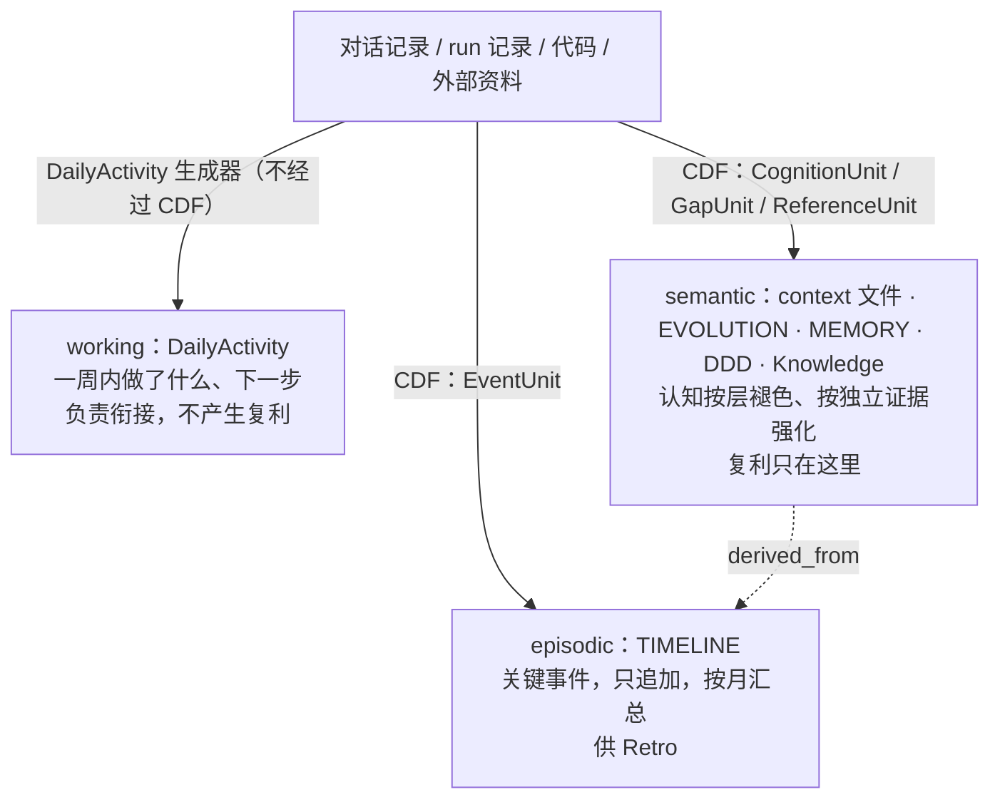
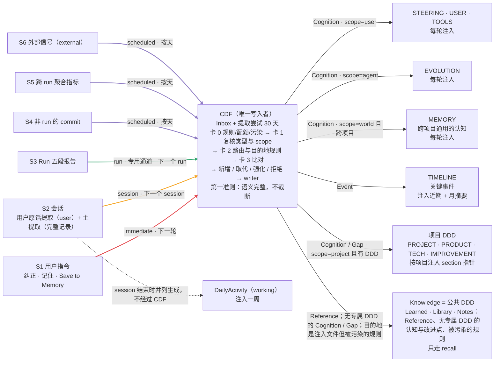

# Swarm Cognitive Distillation Flow

**Swarm Cognitive Distillation Flow（简称 CDF，认知蒸馏流）是 SwarmAI 认知系统的核心引擎。** 这是一项产品级能力，对每个 SwarmAI 用户都可用，在每种平台和运行模式下都能工作。它把会话、run、用户纠正和外部资料中值得长期保留的东西，按统一的标准蒸馏成 Memory、EVOLUTION、各项目的 DDD、Knowledge Library 和用户 context 文件。蒸馏全程自动完成，每一步都可审计。

AGENTS.md 说"认知和知识分开、模型提议、OS 决定、价值跨会话复利"，CDF 就是让这几句话在写入侧落地的那个机制。

**术语**：
- **CDF** 指整条流程：source 提取 → Inbox → ingestion（整理、答题卡、目的地规则、和已有内容比对、写入）→ 各目的地。
- **ingestion** 只指其中由 worker 完成的那一段。代码标识沿用 `ingestion_*`，比如表名、模块 `core/ingestion/`、CLI `ingest`。
- **Flow 视图** 指 Need You overlay 里的 dashboard（§10）。

## 0. 一句话

审计结论：三块写入问题的根源是同一个——**每个写入者都在提取内容的那一刻，自己判断、自己路由、自己写文件**。
所以准入可以被绕过、项目判断不出来、不同写入者之间会冲突，判官失败时还会卡住上游。

r13 改成**提取和 ingestion 解耦**：

```
各 source  ──只负责提取──▶  Inbox（ingestion.db）──按各自的节奏──▶  Ingestion worker  ──▶  MEMORY / EVOLUTION / DDD / Library / 用户 context
（r16：S1 用户指令、S2 会话、         候选、状态、审计        整理 → 答题卡 → 目的地规则         唯一写入者
 backflow、cultivation、       只保留 30 天           → 检索已有内容 → routing → 写入
 S3 Run、S4–S6，§5.2）                                           │
                                                                ▼
                                     Need You overlay 的 Flow 视图（CDF 的统一 dashboard）
```

- **source** 只做两件事：按自己定制的格式提取，然后入队。入队是一次插库操作，毫秒级完成，不会打断会话、run 或 chat。
- **Ingestion** worker 是唯一的自主写入者（用户编辑走 `governed_edit`，两者共用同一个落盘接口，§3.2），在后台按自己的节奏和要求处理：整理、分类、打分、执行目的地规则、和已有内容比对、routing、写入。
- **Inbox** 只保留 30 天，更早的行先汇总成统计数据，再删除（§4）。
- **dashboard** 放在 Need You overlay 里：这条流程是认知系统的核心，不再另开一个页面（§10）。

r13 起取代 r12。r14 和 r15 补上了"唯一写入者"的保证机制和恢复协议。r12 里大部分复杂机制，起因都是"多个写入者各自当场写"：准备→提交、租约、多写入者之间的版本冲突、多 worker 的分布式配额计数、受控写入的三层强制。解耦之后这些都不需要了。配额只保留 DB 里的持久计量（§12）。
**已经沉淀的内容不搬**：§2 审计里 MEMORY 的 57% 是项目专属内容，按 §13 "已写内容不改"，系统不会把它们移进 DDD。它们只能靠两种方式改善：阶段 C 的注入预算（按单元选取，不注入的仍可 recall），和用户自己编辑。CDF 只保证从切换起新写入的内容去向正确。

r12 里经过评审、而且仍然成立的结论都保留下来：答题卡的维度、路由表、卡 3 的纯函数、来源与污染、已沉淀内容不动、注入预算。

## 1. 怎么评估的

三个只读子 agent 并行审计，不改任何文件、不读会话数据。只有 Knowledge 那一路以只读方式查了派生的
`knowledge_chunks` 表。审计报告留在 scratch，不进仓库，因为里面引用了私人内容。这里只放汇总数字。

| 块 | 看了什么 |
|---|---|
| Memory | 所有写入和退出路径（带代码行号）；live MEMORY.md 每一条逐条分类；EVOLUTION 按 section 分类；`ref`/`decay` 元数据的维护 |
| DDD | 所有写入者及各自写入的条数；使用信号；把 48 次真实 DDD 注入指向的 section 打开，逐个判断有没有用、项目对不对；SwarmAI 的 TECH 和 IMPROVEMENT 随机抽 40 条做分类 |
| Knowledge | 各目录由谁写、按什么条件写；目录统计；backflow 写的 Note 抽 15 篇判断价值；10 月的中途 checkpoint |

同时用到前面读取侧回放和盲评的数据：库里 21062 个 chunk、约 3000 个打过标签的命中。

## 2. 发现

### 2.1 Memory（每轮整份注入）

| 实测 | |
|---|---|
| live MEMORY.md 的 97 条语义条目（87 条 parser 可见 + 10 条 Open Threads） | 该留 31（34% 字符）· **只关某个项目、该进 DDD 51（57%）** · 该归档 3 · 和 steering/SOUL/AGENT 重复 12 |
| `ref` 字段 | 87 条全是 `ref:0`。`bump_references()` 没有生产调用者；会话结束时的生命周期代码明确写着 `bumped = 0`（`context_health_hook.py:1536-1549`） |
| 能按时间退出的 | 只有 `guideline` / `process` 两类；`decision` / `model` / `principle` / `correction` / `pitfall`、COE、Open Threads、Standing Preferences、EVOLUTION 全部 section 都不受时间影响 |
| 每周 Memory Health | LLM 只看 MEMORY 前 8K 字符；被判过时的条目**直接删除**，不先归档 |

根因：
- 共用判官（`ingestion_gate`）的评分标准只问"具体吗、能执行吗、自洽吗"，判断不了的项目背景默认放行。
  它不问"这条内容是不是跨项目、不依赖查询、大多数会话都用得上"，而这是整份注入的存储唯一该问的问题。
- 自动蒸馏从 DailyActivity 提升到全局 MEMORY 时，**不先判断它属于哪个项目**。所以 57% 的内容是项目专属的。
- 绕过准入的写入口：`s_memory-distill` skill 的说明已经过时（段名、阈值、锁、"不删除"的规则都和代码不一致）；
  `s_persist` / `s_self-evolution` 用 Edit 直接写；两个工作区编辑接口可以不加锁地整文件覆盖。

### 2.2 DDD（按项目注入 section 指针）

| 实测 | |
|---|---|
| 写入路径及写入条数（SwarmAI TECH + IMPROVEMENT） | REFLECT 直写（标为 auto-cultivated）**592** · session 结束 writeback 196（大多是旧格式；现在的置信度 0.5 低于 0.7 的阈值，**实际已写不进去**） · DailyActivity 决策/纠正 20 · signal 桥 0 · 来源无法识别 333 |
| 随机抽 40 条 | 该留 23（57.5%）· 过时 4 · 重复 5 · 不是持久内容（会话流水、会变的数字）8 |
| 48 次真实 DDD 注入的 101 个指针 | 有用 28.7% · 沾边 32.7% · **噪音 38.6%**；43.8% 的消息至少拿到一个有用指针；项目识别正确 93.8% |
| 指针指向的 section | 中位 16K 字符，P90 234K；9% 指向已经不存在的 section 名 |
| 使用信号 | `ref` 没人加；`record_ddd_hit` 只记"最后命中日期"。而且渲染时只输出 `doc § section`，丢掉了 entry 正文，使用记录照样写，所以"命中过"不等于"内容被看到过" |

根因：
- **REFLECT 新增领域经验时直接调用 `apply_to_ddd`，绕过了 `admission_band`**（`reflect_job.py:231-284`）。
  它是 DDD 最大的写入路径，却是唯一不过判官的。
- 人工批准 cultivation 提案也直接写入（`routers/cultivation.py:130-236`）。人工批准可以跳过判官，
  但现在连去重和路由也一起跳过了。
- DailyActivity 里的决策和纠正一律归到 SwarmAI，代码注释写着"future: infer"（`context_health_hook.py:961-969`）。
- 去重只比完全相同的整串文字；TECH 没有自动退出路径；`pitfall` 永远不衰减；
  矛盾替换时直接删除旧条目（`ddd_cultivation.py:978-1007`）。

### 2.3 Knowledge Library（召回时排名过滤）

| 实测 | |
|---|---|
| backflow Note（418 篇，抽 15 篇） | 可复用 6 · **只在原会话里有意义 8** · 和人写的文档重复 1 |
| backflow 的同内容多份 | 515 组重复 chunk（按日期重复存） |
| 中途 checkpoint（10 月 20 块，覆盖 15 个会话） | 抽的 10 个会话，**都有完整的会话结束条目**，checkpoint 没有任何独立价值 |
| Pollinate 的 700 个 chunk | **429 个（61%）来自 `node_modules`** |
| 版本族（`-v2`、`final`、`r3` 并存） | 至少 24 组，没有"当前版本"这个标记 |
| DailyActivity | 冒烟探针 23 条（会话已被删除）；一个不属于任何条目的 `## Session Resume` 块 |
| frontmatter 开头的 chunk | 897 个，约 40% 没有正文；盲评 有用 28%、噪音 38% |

根因：backflow 的准入只看"长度 + 表面标记"，不问内容离开原会话还有没有意义、有没有更权威的文档已经覆盖；
索引只按目录排除，`node_modules` 这种依赖树会被扫进来；checkpoint 在会话结束条目写入之后没有被替换掉。

### 2.4 三块的共同问题

| 问题 | Memory | DDD | Knowledge |
|---|---|---|---|
| 准入不问"该不该在这里" | 判官不问跨项目 | 判官默认放行 | backflow 只看长度 |
| 写入者绕过准入 | 3 个 skill、2 个编辑接口 | REFLECT、人工批准 | 通用文件接口（人工，可接受） |
| 路由（放到哪） | 不先判断项目 | DailyActivity 一律 SwarmAI | 自动内容直接进可搜索目录 |
| 去重 | 只在会话结束时做同 section 的完全相同去重；不和 steering/DDD 比 | 只做完全相同去重 | 按日期重复存 |
| 使用信号 | `ref` 死了 | `ref` 死了，命中记录多报 | 无 |
| 退出 | 大部分类型不受时间影响；有直接删除 | TECH 无退出；有直接删除 | 精选目录永不老化；版本族没有当前版标记 |

## 3. 架构

| 角色 | 负责 | 不负责 |
|---|---|---|
| **source**（提取） | 从自己的上下文中提取候选，按自己的格式（§5）填写 payload 和稳定的幂等键，然后入队 | 判断值不值得写、该写到哪里、是否重复；不写任何受控文件 |
| **Inbox**（`ingestion_inbox` 等表） | 持久保存候选、单元、写入日志和处理状态，是唯一的事实来源，审计也只读这里 | 召回、索引 |
| **Ingestion worker** | 整理 → 卡 0/1 → 污染约束 → 卡 2 → 目的地规则 → 卡 3 → 写入 → 记录，按 lane 调度（§6） | 不阻塞任何上游，不占用 chat 正在等待的线程池 |
| **Writer**（worker 内部） | 唯一能写受控存储的代码：写入日志、加锁、版本检查、先归档后移除、原子写入、维护关系 | — |
| **Dashboard** | 在 Need You overlay 里展示 Cognitive Distillation Flow（§10） | 不提供审批按钮 |

### 3.1 唯一 owner：一个数据目录只有一个自主写入者

daemon 和 dev/subprocess 两种 backend 可以同时运行（见 `main.py:1474-1482`：检测到已有实例时，只是不写 `backend.json`，进程照常启动），并且默认使用同一个 app 数据目录（`config.py:47-67`）。所以"只有一个 worker"不能靠约定，必须由机制来保证：

- **owner 锁**：worker 启动前，用 `utils.file_lock` 对 `<app data>/state/ingestion_owner.lock` 加非阻塞的独占锁，worker 存活期间一直持有。进程崩溃时，操作系统会释放这把锁。
- **owner epoch**：拿到锁之后，把 `ingestion_owner.epoch` 加 1，同时记下 pid 和启动时间。之后每一次状态推进都写成 `UPDATE … WHERE id=? AND state=? AND owner_epoch=?`，并检查影响行数；影响行数不是 1，就放弃这一步。
- **文件写入也受 epoch 约束**：writer 每做一步文件操作（归档、替换、写基线），都在语料锁内先执行一次 `UPDATE ingestion_writes SET step_owner=? WHERE id=? AND step=? AND owner_epoch=(当前 epoch)`，影响行数为 1 才执行这一步，否则立刻退出。这样，一个已经被新 epoch 取代的旧 owner，即使手里有算好的输出，也执行不了 `os.replace`。
- **释放锁之前先停稳**：正常退出时，先停止接新任务，等 worker 任务、writer 和它用到的 executor 全部 join 完，再释放 owner 锁。新 owner 拿到锁之前，不做恢复。
- **接管遗留任务**：新 owner 拿到锁后，在一个事务里把所有还没结束的单元和写入计划的 `owner_epoch` 改成自己的 epoch，然后才开始恢复（§4.3）。新入队的行 `owner_epoch` 为 NULL，worker 领取时再写成当前 epoch。
- **拿不到锁的进程**：只能入队、读 dashboard，不启动 worker。
- **谁能当 owner**：只有完整的 HTTP backend（daemon、subprocess、hive、dev 四种模式）能在 FastAPI lifespan 里启动 worker。`py`、`pipeline-v1`、`hook`、`ingest` 这些短命子命令只能入队和读取。
- 故障注入测试要覆盖这个场景：writer 卡在"比较版本"和"替换文件"之间时，发生 shutdown 或 owner 交接。

### 3.2 并发边界和 materializer

**术语**：
- **唯一的自主写入者**是 ingestion worker。
- **唯一的落盘接口**是 `core/corpus_materializer.py`，writer 和 `governed_edit` 共用它。

受控语料的所有文件操作（写、追加、替换、归档、删除、移动、复制）都只能经过 materializer。materializer 在运行时判断路径是否受控：只要解析后的真实路径落在受控根目录下，就必须带上写入计划或编辑操作的 id，否则拒绝执行。

worker 内部是串行处理的。除了 worker 之外，受控语料只剩两类并发来源：

1. **应用内的用户编辑**。下面这些接口修改受控路径时，一律走 `governed_edit`：
   - 两个编辑器接口（`workspace_api.py:1759-1807`、`workspace.py:715-777`）；
   - 文件的 create、delete、trash、rename 和上传；
   - Library 的清理和 Inbox 复制；
   - 项目的 rename 和 delete（§8）。

   读取时返回 `revision`（内容的 SHA-256），保存时必须带上 `expected_revision`，不一致就返回 409。用户编辑和 worker 共用同一把语料锁、同一套写入日志（§4.3）。

   首版**不允许对包含受控文件的目录做目录级的 delete、trash、rename**，返回 409 并提示逐个文件操作。项目 rename 和 delete 是例外，走专门的树级操作：先把目录下所有受控文件的清单（相对路径、哈希）记进写入日志，再执行移动，崩溃后按日志继续做完。
2. **外部编辑器和其他程序**（不经过我们的锁）只能做到尽力而为，下面这段时间窗口在文档里明确列为已知限制：
   - writer 在锁内先保存原文件和预期输出，替换前紧接着再比一次 `expected_hash`，然后执行 `os.replace`。
   - 替换后立刻重读文件。内容等于预期输出，才算成功。不等于预期输出，说明这期间有外部写入：**保留磁盘上的现状，不用快照回写**，候选记为 `DEFER user_race`，原文件和预期输出都留作恢复副本，在 Need You 里提示。
   - 外部写入如果正好落在"最后一次比较版本"和 `os.replace` 之间，会被覆盖，而且这种情况检测不出来。只有从原文件备份里才能找回内容。需要强保证的编辑必须走 `governed_edit`。
   - maintenance 每天把文件内容和"基线 + 已写入的版本"做一次比对，对不上的部分记一行 `writer=unknown`（§8）。

本文所说的"版本检查"，指的都是在锁内比较 `expected_hash`，不是跨平台的原子 compare-and-swap。

**静态检查**（§8）的作用是保证 materializer 以外的生产代码不直接调用写文件的函数，包括 `write_text`、`open(…, "w")`、`os.replace`、`shutil.*`、`unlink`、`rename`。路径是否受控由 materializer 在运行时判断，静态检查只负责拦住绕过它的调用。PreToolUse 的 `governed_corpus_gate` 拦截 agent 直接写受控路径，并提示改用 `ingest submit`；这道 gate 只起提醒作用，不是安全边界。

## 4. Inbox：存储、状态、恢复、清理

CDF 的所有表放在一个独立的 SQLite 文件里：`<app data>/ingestion.db`。每个用户一份，路径从 app 数据目录取，不写死。chat 用的 `data.db` 里不放这些表。

**为什么单独建库**：
- SQLite 同一时刻只允许一个写事务。CDF 用自己的库，入队、清理和恢复就不会和 chat 写消息抢同一把锁，也不会受 `data.db` 的迁移、备份和体量拖累（本机实测 `data.db` 有 1.5 GB，过去 24 小时写入 7,307 条消息）。
- 新库从建表起就能开启 `auto_vacuum=INCREMENTAL`。
- 迁移版本号自己管理，和 `data.db` 互不影响。
- 不需要跨库 join。和消息绑定的 `session_inputs` 仍放在 `data.db`（§9），CDF 只按事件 id 去只读查询。SQLite 不是瓶颈，基准数据见附录 A。

**建库**：
1. 打开空文件，此时还没有开启任何事务。依次设置 `PRAGMA auto_vacuum=INCREMENTAL`、`PRAGMA journal_mode=WAL`、`PRAGMA synchronous=NORMAL`，每设一项都读回来确认生效。
2. 在一个显式事务里建好全部表和索引，并把 `user_version` 设为 1。
3. 任何一步失败，就删掉这个半成品文件，下次启动重新建。

以后升级 schema 时，按 `user_version` 逐级做幂等迁移。连接参数：WAL；`synchronous=NORMAL`（`data.db` 用的是默认值，这一项两个库不一样）；入队连接的 busy timeout 为 500 ms，worker 连接为 5 s。

**备份和恢复：`ingestion.db` 属于不可替代的状态**。理由是 30 天审计是这套设计里唯一的事后监督。具体做法：
- `backup_manager` 增加第二个 store，用 SQLite 的 online backup API 生成一份和 WAL 一致的快照，导出和恢复都与 `data.db` 走同一个流程。
- `data_safety` 把 `ingestion.db` 列为不可替代的数据。
- 恢复之后，owner 先跑一遍 §4.3 的恢复流程。备份时间点之后才写入的 `cand:` 单元，在库里找不到对应记录，就在审计里补一行 `writer=restored_orphan`，文件本身不动。
- 文件损坏时，先改名为 `ingestion.db.corrupt-<ts>`，再从最近一份备份恢复；没有备份就新建一个空库，并在 Need You 里提示。

**表**：

| 表 | 内容 |
|---|---|
| `ingestion_inbox`（候选） | `id`、`idem_key`（UNIQUE）、`source`、`source_ref`、`lane`、`payload`、`payload_schema`、`envelope`、`project_snapshot`、`project_candidates`、`state`、`owner_epoch`、`versions`、`created_at`（UTC） |
| `ingestion_units`（单元） | `unit_id = candidate_id + "." + 稳定槽位`、`claim_group`、每张卡的答案和理由、目的地规则的结果、去向、`project`、动作、`state`、`attempts`、`next_attempt_at`、`error_class`、`error_fingerprint`、`owner_epoch`、`merged_into` |
| `ingestion_writes`（写入日志） | 一行对应一次写操作，见 §4.3 |
| `ingestion_relations` | 单元之间的边：`supersedes`、`derived_from`（§7.3） |
| `extraction_attempts` | 每次提取的记录，包括没有产出和无效的单元（§5.4），保留 30 天 |
| `evidence_roots`、`claim_support` | 证据根和强化记录（§5.8），长期保留，不受 30 天清理影响 |
| `link_status` | 外部链接的检查结果：`url_root_id`、`last_checked`、`status`（`ok` / `dead` / `unreachable` / `unchecked`）、`http_status`（§5.12）。长期保留 |
| `redactions` | 用户触发的墓碑记录（§13）。长期保留 |
| `ingestion_quota` | 配额预留和扣减的流水（§12） |
| `ingestion_lanes` | 每个 lane 的 `next_due_at`、`last_started_at`、`last_completed_at`（UTC） |
| `ingestion_owner` | `epoch`、`pid`、`started_at` |
| `ingestion_daily_stats` | 30 天之前的汇总数据（§4.4） |
| `ingestion_access_log` | Flow 视图的详情访问记录（§10）。只由 worker 异步写入，只读接口从不写库。同样保留 30 天 |

### 4.1 入队和幂等

- 入队是一条短事务：`INSERT … ON CONFLICT(idem_key) DO NOTHING RETURNING id`。冲突时返回已有那一行的 id 和状态；如果已有那一行的内容哈希不同，就另外记一条 `id_collision`，并在 Need You 里提示。
- **两种键，分开写**：
  - **入队幂等键 `idem_key`**：防止同一个 source 重复提交同一条。可以包含 source，例如 `(S2, session_id, extractor 版本, 单元的 claim 哈希)`、`(S3, run_id, 段号, claim 哈希)`、`(S1, user 事件 id, 序号)`。不能用数组下标：拆分数量一变，下标就变。
  - **跨 source 去重键**：`(规范证据根集合, unit kind, claim 哈希)`，不包含 source。claim 哈希只对语义字段做空白归一化，所以**只有文本完全相同时**才能由键合并；同一件事被两个 source 用不同措辞提取出来时，靠卡 3 判 same / contained（§5.8）。holdout 里单独统计跨 source 的重复（§14）。
- 入队的 busy timeout 是 500 ms，失败时最多重试 2 次；还是失败，就给 source 返回 `ENQUEUE_BUSY`，由 source 决定下次再提取。这样入队最多拖慢 source 约 1.5 秒，chat 路径永远不会等它（§6.4）。

### 4.2 状态

**单元的状态转移表**。每一次转移都写成 `UPDATE … WHERE unit_id=? AND state=<from> AND owner_epoch=<当前 epoch>`，并要求影响行数等于 1：

| 从 | 到 | 条件 |
|---|---|---|
| `queued` | `merged` | 整理时发现，同一批里有另一个单元和它完全相同，或者可以合并进去。合并到哪个单元记在 `merged_into` |
| `queued` | `judged` | 卡 0 到卡 3 全部算完，结果是要写入 |
| `queued` | `rejected` | 某一张卡或某一条规则拒绝。拿不准时也走这里，原因码 `uncertain` |
| `queued` | `reinforced` | 卡 3 判定和一条合格的已有条目相同，并且带来了新的独立证据根（§5.8）。只写一条 `claim_support`，不改任何文件 |
| `queued` | `deferred` | 基础设施类错误，比如 LLM、检索、DB busy、版本冲突、项目有歧义 |
| `queued` | `failed_poison` | 同一个 `error_fingerprint` 连续出现 3 次 |
| `judged` | `writing` | 已经生成写入计划（§4.3） |
| `writing` | `written` | 写入计划进行到 `done` |
| `writing` | `deferred` | 写入计划过期，或者遇到 `user_race` |
| `deferred` | `queued` | 到了 `next_attempt_at`。总共最多 5 次，超过就转为 `failed_poison`，原因码 `retries_exhausted` |
| 任何非终态 | `expired_unprocessed` | 30 天清理执行时（§4.4） |

终态有六种：`merged`、`written`、`reinforced`、`rejected`、`failed_poison`、`expired_unprocessed`。`deferred` 不是终态。

**候选的状态由它所有单元的状态聚合得出**，规则是确定的，按顺序判断：
1. 只要有一个单元是 `writing` 或 `judged`，候选就是 `in_progress`；
2. 否则，只要有一个单元是 `queued` 或 `deferred`，候选就是 `partial_pending`；
3. 否则全部单元都已终态，候选就是 `done`，并附上各终态的单元数。

重试时只处理还没到终态的单元。统计和比率一律按单元计算。

**错误边界**：
- payload 不符合 schema 或解析失败：直接 `REJECT malformed_payload` / `unsupported_schema`，不重试；
- 其余代码异常：记下 `error_fingerprint`，同一个指纹连续出现 3 次就转为 `failed_poison`，在 Need You 里提示，附上样本和栈指纹；
- 同一批里每个候选各用一个 savepoint，一个候选出错不影响同批的其他候选。

### 4.3 写入日志和重启恢复

每一次写操作都有一份**不可变的计划**。worker 写入一个单元是一次操作，用户的一次编辑也是一次操作。计划在第一个副作用发生之前就提交进 `ingestion_writes`。

| 字段 | 内容 |
|---|---|
| `op_id`、`op_kind` | `op_kind` 取值：`ingestion_unit`、`user_edit`、`user_tree_move` |
| `target_path`、`before_hash` | 目标文件，以及计划生成时它的哈希 |
| `intended_bytes`、`after_hash` | 目标文件写完之后的完整内容和哈希 |
| `archive_path`、`archive_hash` | 需要归档时，归档文件的位置和内容哈希 |
| `anchors_present`、`anchors_absent` | 写完之后必须存在的锚点、必须消失的锚点 |
| `relations` | 要写的 `supersedes` / `derived_from` 关系，以及要登记的 `claim_support` |
| `baseline_patch` | 只有 `user_edit` 才有：基线清单要做的修改，以及要设为失效的关系 |
| `step`、`step_owner`、`owner_epoch` | 进行到哪一步，由哪个 owner 执行 |

**步骤按固定顺序执行**，用不到的步骤跳过：

`planned → archive_applied → target_applied → relations_applied → baseline_applied → done`

先归档，后替换。每一步执行前都在语料锁里抢占这一步的执行权（§3.1），执行完才把 `step` 往前推一格。

**每一步怎么判断已经完成**：

| 步骤 | 完成的判定 |
|---|---|
| `archive_applied` | 归档文件存在，并且哈希等于 `archive_hash` |
| `target_applied` | 目标文件哈希等于 `after_hash`，并且 `anchors_present` 全部存在、`anchors_absent` 全部不在。只看到 `cand:` 标记不算完成 |
| `relations_applied` | 关系表里已经有 `relations` 里的每一条 |
| `baseline_applied` | 基线清单里已经包含 `baseline_patch` 的修改 |

**启动时恢复**：owner 先接管所有还没完成的计划（§3.1），再逐份检查：

- 某一步已经满足完成判定：直接推进 `step`，不再执行一次。
- 某一步没完成，目标文件哈希仍等于 `before_hash`：照着计划执行这一步。
- 目标文件哈希既不是 `before_hash`，也不是 `after_hash`：说明中间被别的写入改过。不覆盖，这份计划作废；单元转为 `deferred`，原因码 `stale_plan`。如果是用户编辑，就保留现场，在 Need You 里提示。
- 停在 `judged`、还没生成计划的单元，回到 `queued`。

**故障注入测试**：在每一个 fsync、rename、DB commit 的边界杀掉进程，再加上 owner 交接的场景，恢复之后的结果必须和没出故障时一致。

### 4.4 清理：只保留 30 天

- **规则**：`created_at` 早于"当前 UTC 日期减 30 天"那一天 00:00 的候选，连同它的单元和写入计划，整体删除。按整天切，所以同一天的行总是在同一次清理里处理。保留天数写在契约里，可以配置。
- **删除前先汇总**：把要删的行汇总进 `ingestion_daily_stats`，主键是（UTC 日期、source、lane、目的地、状态、原因码、规则版本摘要），空值统一记成 `-`；同时记下候选数、单元数、写入字节数、LLM 调用次数和 token 数。汇总用累加式 upsert（`count = count + excluded.count`），并且和删除放在同一个事务里。事务一旦回滚，就不会多算；成功删掉的行也不会再被统计第二次。
- **写到一半的不删**：一个候选的写入计划里，只要有 step 已经越过 `planned`、还没到 `done`，这个候选这次不删。先按 §4.3 的恢复流程把它做完（或者按恢复规则判定失败），下一次清理再汇总、删除。
- **没处理完的候选也一样删**：到期时还没处理完的候选，在删除之前先把状态记为 `expired_unprocessed`，再计入汇总。它们并没有做完 5 次重试，dashboard 也不会这样显示。
- **清理一定会执行**：清理不调 LLM，也不受资源门控。它属于 maintenance lane 的保底时隙（§6.2），backend 启动后会第一个执行。
- **磁盘空间**：`ingestion.db` 建库时就开启了 `auto_vacuum=INCREMENTAL`。每次清理后，先读 `freelist_count`，按这个页数分块执行 `incremental_vacuum(N)`，每块最多 1000 页；跑完再做一次 `wal_checkpoint(TRUNCATE)`。验收时主文件和 WAL 文件的大小分开测量。
- **Inbox 只存提取结果**：source 自己的原始数据（会话 transcript、DailyActivity、run 记录）仍然归 source 自己管。Inbox 只存提取出来的内容和来源 id。
- 超过 30 天的数据，dashboard 只显示汇总统计（§10）。

**不进召回，也不进索引**：Inbox 是状态和审计记录，不是知识。

## 5. Source 与提取（r16 重写，r16.1 吸收两份独立评审）

**第一准则：语义完整，人和 AI 都能读懂。** 提取出来的每一条认知内容，离开原会话或原 run 也必须能读懂，人能读懂，AI 也能读懂。任何环节都不得截断语义。
- **提取**：一条单元说不完整，就拆成几条各自完整的单元，或者不提取。不允许出现说了一半的句子、以省略号结尾的结论、缺主语或指代不明的片段。
- **入队和存储**：语义字段（§5.3 中标为语义的字段）一个字都不截。放不下时整条拒绝（`too_large_incomplete`，§5.11），由 source 拆分后重新提交。被拒绝的情况记录在提取尝试表里（§5.4）。
- **整理**：normalizer 只能处理信封和非语义字段。它不得对语义字段做正则删除、折叠换行或截断。路径、哈希、id 如果确实属于语义的一部分，就原样保留。
- **写入和渲染**：writer 原样写入完整单元，不缩写，不改写成摘要。标题由 source 给出完整的标题字段，writer 不再从正文第一行截取前 N 个字。
- **注入和召回**：只能以整条单元为单位取舍。被舍弃的单元计数，并可以通过 recall 找回。Knowledge 的召回命中某个 section 时，返回完整的 section，并附上它的上级标题和文档的 `summary`；不能只返回切片里的半段。
- **展示**：Flow 视图可以折叠，但必须标明"已折叠"，并且能展开看到原文。
- **验收**：每个提取器都要用 fixture 证明：不会输出半句话、残缺的 DDD what/how/why 组合、半个 session 块或半个事件。另外用 AST 测试，扫描 source、writer 和注入路径上对语义字段的切片和截断调用。

**原则**：源头的质量决定一切。worker 只能挑选和整理，补不出 source 没提取到的认知，所以每个 source 在提取时就要按 ontology 分好类，写清 what、how、why，并指明证据。复利只发生在语义记忆这一层，只累积有判断力、有 taste 的认知。流水账和一次性事实不产生复利。

**命名**：本文用两套"三分"，含义不同，不能混用。
- **记忆类（memory class）**：`working`（工作记忆）、`episodic`（情节记忆）、`semantic`（语义记忆），见 §5.1。
- **认知层（cognitive layer）**：`meta`（元认知）、`cognitive`（认知）、`operational`（操作），只用于 `CognitionUnit`，由类型唯一决定（§5.3）。

### 5.1 三类记忆：各管各的



| 记忆类 | 载体 | 内容 | 谁写 | 生命周期 | 产生复利 |
|---|---|---|---|---|---|
| working | `Knowledge/DailyActivity/<date>.md` | 每个 session 做了什么、交付了什么、下一步 | DailyActivity 生成器，**不经过 CDF** | 注入最近 7 天（§5.7） | 不产生，只负责衔接 |
| episodic | `.context/TIMELINE.md` | 关键事件 | CDF 的 `EventUnit`（§5.6） | 只追加，按月汇总 | 间接：认知通过 `derived_from` 挂到事件上 |
| semantic | STEERING、USER、TOOLS、EVOLUTION、MEMORY、各项目 DDD、`Knowledge/` | `CognitionUnit`（三层七类）、`GapUnit`、`ReferenceUnit` | CDF | 认知按层褪色、按独立证据强化（§5.8）；Reference 不参与强化 | 认知产生；Reference 不产生 |

**Knowledge 就是公共 DDD**。`Knowledge/` 承担"不属于任何一个项目 DDD 的知识"的家，不再另建一套存储。它放两种东西：
- Reference 文档；
- 没有专属 DDD 时的认知单元和改进点（§5.10）。

### 5.2 Source 收拢：按证据从哪来划分

旧入口一共 13 个，同一份证据会被几个模块各提取一遍。r16 把它们收拢成 6 个 source。r16.1 规定了**证据归属**：同一个证据根只归一个 source，另一个 source 遇到它就跳过。

| Source | 合并掉的旧入口 | 拥有的证据 | lane | 主要产出 |
|---|---|---|---|---|
| **S1 用户指令** | correction、remember / `s_persist` / `ingest submit`、Save to Memory 按钮 | 用户明确表达指令的那条消息（纠正、"记住"、点按钮），以 `user` 事件记账 | `immediate` | 纠错、原则、偏好、事件 |
| **S2 会话** | distillation、memory_extractor、improvement_writeback、conversation→DDD cultivation、user_observer、backflow | 会话里其余的消息和工具结果。S1 已经认领的 user 事件，S2 不再重复提取 | `session` | 决定、经验、坑、心智模型、taste、事件、Reference 文档 |
| **S3 Run** | REFLECT | 和这个 run 关联的一切：需求、design/plan、review finding、人工回答、validation、**这个 run 落地的 commit** | `run`（专用通道，§5.9） | 五段知识报告（§5.5） |
| **S4 代码变更** | `ddd_refresh`、`code_change_feed` 的技术漂移检测 | 不由任何 run 落地的 commit（人手动提交的、外部合并进来的） | `scheduled` | 架构形状、约定（多数是 Reference，§9）、事件 |
| **S5 系统度量** | `evolution_optimizer`、eval governance | **跨 run 的聚合指标**。单个 run 的统计归 S3 | `scheduled` | agent 能力相关的纠错和经验、改进点 |
| **S6 外部信号** | `signal_ddd_bridge`、Library inbox、`s_learn-content` / `s_library` 抓取的外部内容 | 证据根是 `external` 的内容。决定它归 S6 的是证据根本身，不看它是从哪个会话里产生的 | `scheduled` | 只产出 Reference |

**去重键**改为"规范证据根 + 语义 claim 哈希"，不再包含 source（§4.1）。claim 哈希依赖 LLM 生成的文本，所以只有文本完全相同时才由键合并；其余情况靠卡 3，跨 source 的重复在 holdout 里单独统计。

**停用**：
- DailyActivity 不再作为 source。按行切片的提取方式删掉。
- 删掉以下几项：`user_observer_hook` 的"建议更新 USER.md"文件，`ddd_refresh` 的 proposal 文件，cultivation 的人工审批路径，REFLECT 的 `route` / `annotate_entry` / `reflect_library` 直接写入。

### 5.3 单元契约 v2：四类单元，一份判别联合

所有 source 都输出下面四类单元之一。这份契约（`core/ingestion/contracts_v2.py`）是**唯一来源**。卡 1 的答案变体、`route_for` 路由表、数据库的 CHECK 约束、本节和 §5.10 的表格，都从它生成或由它校验，不另外各写一份。旧的按 source 区分的 payload 联合直接删除，不做适配。

**七类认知的机器枚举**（与 `VALID_TYPES` 一致，层级由类型唯一决定，source 不能自己填层级）：

| 类型 id | 中文 | 认知层 |
|---|---|---|
| `principle` | 原则 | meta |
| `correction` | 纠错 | meta |
| `decision` | 决定 | cognitive |
| `model` | 心智模型 | cognitive |
| `guideline` | 经验 | operational |
| `pitfall` | 坑 | operational |
| `process` | 流程 | operational |

`layer = TYPE_TO_LAYER[type]`。DDD 的 `topic`（decision、product、architecture、lesson）只是领域维度，用来选文件和 section，不改变认知层。

`ddd_entry_lifecycle.MEMORY_SECTIONS` 里有几个历史例外，例如 COE Registry 把 pitfall 放在 meta、Standing Preferences 把 guideline 放在 meta。这些只是 MEMORY 文件的排版分区，不是 ontology 层级。新单元一律以 `TYPE_TO_LAYER` 为准。

| 单元类型 | 语义字段（不得截断） | 必填 | 条件必填 | 去向 |
|---|---|---|---|---|
| **CognitionUnit** | `title`、`what`、`how`、`why`、`applicability`、`rejected_alternatives` | `type`、`scope`、`title`、`what`、`evidence` | `decision` 必须有 `why` 和 `rejected_alternatives`（没有被否掉的方案就写"无"）；`pitfall` 必须有触发条件（写在 `applicability`）；`process` 必须有 `how`；写进 DDD 时 what/how/why 三项齐全（§7.2）；其余字段如实留空，**不允许编造** | 按 scope 和形态路由（§5.10） |
| **EventUnit** | `title`、`what`、`impact`、`outcome`、`follow_up` | `when`、`title`、`what`、`evidence` | `impact` 或 `outcome` 至少一项 | TIMELINE |
| **GapUnit** | `title`、`what`、`why`、`proposed_next` | `title`、`what`、`evidence`、`gap_kind`（`debt` / `risk` / `deferred_finding` / `process_issue` / `follow_up`） | — | DDD IMPROVEMENT / PROJECT，或公共 DDD（§5.10） |
| **ReferenceUnit** | `title`、`summary`、`body` | `reference_kind`（`learned` / `analysis` / `design` / `spec` / `note`）、`title`、`summary`、`body`、`evidence` | `summary` 必须是一句完整、能独立读懂的话 | `Knowledge/` 中与 `reference_kind` 对应的文件夹（§5.12） |

所有单元还有这些字段：`scope`（`user` / `agent` / `project:<name>` / `world`，Reference 和 Event 的 scope 可选）、`evidence`（证据锚点列表，§9）、`relation_hint`（可选）。

**卡 1 的角色**改为**复核**：它判断 source 给的类型和 scope 是否成立，并回答各类单元自己的质量题。
- Cognition 沿用原来 7 种形态的题目；
- Event 回答"重要性"题（§5.6）；
- Gap 回答"可执行、有证据"题；
- Reference 回答"能否独立读懂、是否在原会话之外仍有价值"题。

复核结果与 source 给的不一致时，按 `REROUTE_ALLOWED` 改投，或者拒绝。§7.1 的答题卡对 Cognition 继续生效；Event、Gap、Reference 的题目以本节为准。

**什么不提取**（所有提取器的 prompt 都写入以下各条，并附反例）：
- 操作流水，例如"12 小时 38 个 commit"。
- 未经验证的推测。
- agent 对注入给它的已有内容的复述。证据只要溯源到被复述的那条条目本身，就不提取。
- 只在当次任务里有意义的状态，这类内容属于 DailyActivity。

### 5.4 提取的可观测性：没产出也要留痕

source 不允许在审计之外悄悄丢掉东西。每一次提取都在 `ingestion.db` 写一条 `extraction_attempts` 记录，字段包括：
- source；
- 证据范围（会话 id 及消息范围、run id、commit 范围、指标窗口）；
- 提取器和 prompt 的版本；
- 开始和结束时间；
- 产出单元数；
- 无效单元数及其原因（缺必填字段、语义字段过长、证据解析不了）；
- 拆分次数；
- 失败与重试。

无效单元原样保存在这条记录里，状态记为 `rejected_at_source`，Flow 视图里可以查到。这张表和 Inbox 一样保留 30 天，到期汇总进按天的统计。

Flow 视图除了写入率，还要显示每个 source 的**提取覆盖率**：有证据但产出为零的尝试占多少，无效单元占多少。

### 5.5 各 source 的提取规范

**S1 用户指令**：原话转成单元，不做推断。入口先调用 `record_session_input(..., trust="user")`，再把这个事件作为 `evidence`。
- **S1 是注入通道，要收紧**（§9.2）：`s_persist` / `ingest submit` 的 `--evidence` **只接受触发当前回合的那条 user 消息**，服务端按本会话最新的 `user` 事件 id 校验，旧消息一律拒绝。每条 user 消息最多产出 `S1_MAX_UNITS_PER_MESSAGE`（契约常量，默认 3）个 S1 单元。没有用户消息的回合（cron、auto-nudge、注入的回合）不能用 S1。
- **写入后回显**：S1 单元写入后，在当前 tab 回显写入的完整文本和**实际去向**，并提供"撤回"按钮（§13 墓碑）。去向分两种：进了每轮注入的文件；或者只进了公共 DDD（只走 recall），这时附一句提示："要让它每轮生效，请用一句话直接说出这条规则。"
- **"记住这个"**：这类消息本身不表达主张，蕴含检查会判 `not_entailed`。这样的 S1 单元不丢弃，按 S2 主提取的规则处理（§9.2）。
- Save to Memory 按钮记一条 `user` 事件（"用户要求保存本会话"），然后对整个会话运行 **S2** 的提取器。产出按 S2 的规则处理（§9.1）：用户原话那一遍的单元是 `user` 信任，主提取的单元按血统计算，**不因为是按钮触发就获得 user 信任**。
- 像"记住周五看牙医"这种只有 what 的单元，作为 Cognition 时会因为缺 why 而拒绝（如果用户这句话本身就是一个事件，则按 Event 提交）。不允许为了凑字段而编造 why。

**S2 会话**：按页读取**完整**的对话记录，不设"最近 500 条"或"最近 2.5 万字符"之类的上限。每个单元都要引用它所依据的消息 id。重点提取：
- 用户的决定和取舍，以及被否掉的方案和原因；
- 用户的纠正，包括叙述式的纠正；
- 用户的品味和偏好，例如"先出 mockup"、"不打补丁，系统化地捋一遍"。这一类复利价值最高，由下面的**用户原话提取**写进 STEERING 或 USER；
- 经过验证的经验，以及带触发条件的坑；
- 能解释"为什么这样设计"的心智模型；
- 关键事件；
- 能独立成篇的文档，作为 Reference 提交（原 backflow 的作用）。

**S2 分两遍提取**（§9.1）：
- **用户原话提取**：读取范围**只包含用户本人发出的消息事件**。引用、转发、附件、代码块按 §9 已经是单独的 `external` 事件，不在读取范围内。输入由代码从 `session_inputs` 里按 `trust=user` 选出，不经过 agent，所以这一遍的上下文里没有任何外部内容。产出单元的证据根全是 `user`，可以写进 STEERING、USER、TOOLS、EVOLUTION、MEMORY。离开上下文读不懂的（例如"好，就按 A"）按 `not_self_contained` 拒绝，这类决定由主提取写进 DDD。
- **主提取**：读完整的对话记录（含 assistant 消息和工具结果），按上面列的重点提取。按"必须提交读过的全部根"的规则，产出几乎都带 `external` 根。其中规则类 Cognition 的目的地是每轮注入的文件、但被污染时，改投公共 DDD（§9.1）。

S2 和 DailyActivity 是同一份记录的两个并列产物。**S2 不从 DailyActivity 里提取。**

**S3 Run 知识报告**：run 是执行引擎，它的事件日志和统计数据留在 run 自己的记录和 REPORT 里。REFLECT 只做一件事：给 DDD 提供产品、技术、改进三方面的信息。

agent 在 DELIVER 阶段按下面五段写报告，每条都引用 run 产物的锚点（`finding:<id>`、`event:<seq>`、`doc:<path>#<heading>`、`commit:<sha>`）。任何一段都可以为空，不要为了凑数而写。

| 段 | 单元类型 | 内容 | 目的地 | 证据 |
|---|---|---|---|---|
| 1. 做了什么 | Event；改变了产品能力或架构形状时，再加一个 Cognition（`model` / `decision`） | 交付了什么、为什么做、结果是什么 | TIMELINE（带项目标签）；PRODUCT 或 TECH Key Subsystems | 需求 / contract、landing commit |
| 2. 关键决定 | Cognition `decision` | 定了什么、怎么做、为什么，以及被否掉的方案和原因 | PROJECT Recent Decisions / PRODUCT Strategic Priorities、Non-Goals / TECH Architecture | design/plan 段落、人工回答 |
| 3. 纠正 | Cognition `correction` / `pitfall` | 哪里走错了、谁纠正的、正确做法是什么 | TECH Runtime Traps / IMPROVEMENT What Failed；agent 自身行为的问题，由人工回答提取写进 EVOLUTION，主提取的被污染版本改投 `_agent.md` | review finding 及其处理、人工回答、validation |
| 4. 经验 | Cognition `guideline` / `process` | 验证有效、值得复用的做法 | IMPROVEMENT What Worked / TECH Conventions | validation、review 通过记录 |
| 5. 改进点 | Gap | 延后处理的发现、技术债、风险、流程问题 | IMPROVEMENT What to Watch For / Known Issues；明确的后续工作进 PROJECT Open Items | 被延后的 finding、本 run 的统计 |

- **S3 分两遍提取**，和 S2 对称：
  - **人工回答提取**：读取范围只包含 run 里人亲自给出的回答（决定卡上的人工选择和附言，即 run 事件日志里的 `human_answer`；渠道网关代答的不算），输入由代码从事件日志选出，不经过 agent。产出单元的证据根全是 `user`，可以进 EVOLUTION、MEMORY、STEERING。只选了一个选项、离开上下文读不懂的（例如"选 B"）按 `not_self_contained` 拒绝，这类决定由五段报告写进 DDD。
  - **主提取**：上面的五段报告。它读代码和 review 文本，产出带 `external` 根；目的地是注入文件时按 §9.1 改投。
- 旧的 `reflect-prepare` 格式不兼容。旧 run 和切换时正在运行的 run 进入 REFLECT 后允许失败，失败记录在 run 自己的记录里，不重试。
- Gap 不参与强化。之后被某个 run 解决时，用一条 `supersedes`（GapUnit → resolution）标为已解决，原文不改。
- PROJECT 的 Current Focus 和 Blocked By 是实时状态，S3 不写，由 Projects 页面渲染。

**S4 代码变更**：只处理 S3 没有认领的 commit。diff 和 commit message 都是 `external` 证据根，和 S3 读代码的处境一样，所以按同一条信任下限处理（§9）：
- 架构形状、约定、陷阱可以作为 Cognition，带 `taint: external` 写进对应项目的 DDD；没有专属 DDD 时写进公共 DDD；
- "大版本合并"这类 Event 写进 TIMELINE 的不注入区（被污染）；
- 永远到不了每轮注入的文件：目的地是注入文件时改投公共 DDD（§9.1）。

用户亲手写、亲手提交的 commit message，如果能证明作者就是用户本人（已认证的提交身份），可以作为 `user` 证据。这部分留到第二版再做，首版不做。

**S5 系统度量**：只认白名单里的结构化数值字段（`measured`）。基于数值做出的因果解释属于 `inferred`，单独标注。产出 EVOLUTION 的纠错或经验，或者 Gap。

**S6 外部信号**：只产出 Reference，带 `taint: external`，永远不会形成规则。

### 5.6 TIMELINE：长期的关键事件

- **文件**：`.context/TIMELINE.md`，属于受管文件。按月分节（`## 2026-10`），每个事件是一个带 `cand:` 标记的块。`parse_units()` 要支持这种块格式。
- **EventUnit 的稳定身份**：`event_key = hash(规范证据根 + when 的日期 + 规范化的 title)`。`event_key` 同样依赖生成的标题：文本完全相同时由键合并，其余由卡 3 对 TIMELINE 里同一日期附近的事件判 same。合并时各自的证据都登记到 `claim_support`（§5.8）。
- **重要性判断**（卡 1 的 Event 题）：满足以下任意一条才收录：
  - 改变了方向（产品方向或技术路线）；
  - 造成了损失或返工：用户纠正了已交付的结果、出了事故、run 失败后重来；
  - 里程碑或重要交付：landing 了一个 run，或合并了一个跨多个文件的功能；
  - 做出了关键决定：需要用户拍板的决定；
  - 用户明确说"记住这件事"。

  日常操作不收录。
- **只追加**：月度摘要也是追加的。每个月结束后，由 `summary` lane（§6）为上个月追加一个 `EventUnit(kind=month_summary)`，放在该月节的**末尾**，内容引用被汇总的事件锚点，原有事件不改。晚到的事件（月份已经汇总过之后才进来）照样追加，并追加一条"补充摘要"，不重写原摘要。
- **注入**：以整个单元为单位，先放当月和上月的摘要，再按时间倒序放最近的事件，直到预算用完（默认 1.5K tokens，按实测分布调整）。单个事件超过预算时整条不注入，只能通过 recall 找到。被省略的条数显示在 Flow 视图的健康区。被污染的事件不注入，只能通过 recall 找到，并放在不可信数据边界里。
- **Retro**：Cognition 可以带 `derived_from → <event anchor>`。Retro 时按时间范围列出事件，再顺着关系找到从中提炼出的认知，以及每条认知后来被独立证实的次数。

### 5.7 DailyActivity：一周的工作记忆

- **生成**：在 session 结束时，由 DailyActivity 生成器根据**完整**的对话记录生成。它不经过 CDF，也不属于受管的认知文件。当前 `summarization.py` 有几处截断，生成器要改写去掉：topic 截到 120 字符、decision 截到 150 字符、只读最新 2.5 万字符、总长压到 700 词。
- **格式**：每个 session 一个块，保留 Delivered / Outputs / Validation / Next 四段，去掉 Lessons 段（认知由 S2 产出）。
  - 块头给出 `session_id` 和一句话摘要。摘要 30–50 字，由生成器直接写成一句完整的话。
  - 每条 Next 带稳定的 `next_id`。
  - 后续 session 完成了某条 Next 时，在自己的块里写 `resolves: [next_id…]`。只认这种显式引用，不靠文本相似度去猜。
- **日汇总**：当天结束后，由 `summary` lane 在当天文件**末尾追加**一个日汇总块，内容是主线、交付、仍未解决的 `next_id`，**不回写 frontmatter**。
- **注入**（取代原来"最近两份，每份截取最新约 2000 tokens"的做法；这一步只改注入侧，不碰 DDD 注入）：
  - 今天和昨天：每个 session 一整行，内容是时间、标题、一句话摘要、未解决的 Next。
  - 第 3–7 天：每天一整段日汇总。
  - 以整行或整段为单位装进预算，装不下的整条放弃，计数，并且可以通过 recall 找回。
  - 预算默认 **4K tokens**，和现在的总量持平。实施时用最近 7 天的真实数据回放，报告 p50/p95/max。如果 p95 装不下，先缩短 Next 的写法，再考虑提高预算，并在 Flow 视图里标出"本轮省略了几个 session"。
  - 评审实测：最近 7 天有 91 个 session；只算今天、昨天的标题和 Next，就已经约 2K tokens。r16 估算的 2.7K 作废，以回放结果为准。
  - 已解决的 `next_id` 不再注入。

### 5.8 复利：强化有价值的认知

强化不是"再写一遍"，而是**为已有条目登记一个新的独立证据根**。这些记录存在两张长期表里。它们不受 30 天清理影响，体积很小：

| 表 | 字段 | 说明 |
|---|---|---|
| `evidence_roots` | `root_id`、`root_kind`（user_message / run_finding / run_validation / commit / file_revision / web_document / metric_window）、`content_hash`、`trust`、`observed_at`、`parent_root_ids` | 规范化的证据根。同一条用户消息、同一个 finding、同一个 commit、同一个文件版本、同一篇网页，只对应一个 root |
| `claim_support` | `claim_anchor`、`root_id`、`source_unit_id`、`weight`、`polarity`（support / refute）、`created_at` | 唯一键是 `(claim_anchor, root_id)`：同一个根对同一条认知只能计一次 |

**判定流程**：
1. 卡 3 判定新单元和一条已有的合格 Cognition 是 `same` 或 `contained`。
2. 确定性函数检查新单元的证据根：
   - 只要有一个根**不在**这条认知已有的支持集里，并且这个根**不是**从这条认知自身派生出来的（沿 `parent_root_ids` 追溯，不经过这条认知被注入或复述的那个事件），就写一条 `claim_support`，单元进入终态 `reinforced`。
   - 否则 `REJECT already_exists`。
3. 新证据和已有认知相互矛盾、并且是独立证据时，写一条 `polarity=refute`。下次卡 3 命中这条认知时，会把反证一起交给判官，可能导致它被取代。

**防回声**：
- agent 复述注入给它的记忆，不算新证据（它的根溯源到这条认知本身）；
- 同一篇网页在两个会话里分别被总结，算同一个根；
- 同一个 commit 同时出现在 S3 和 S4 里，算同一个根，而且按 §5.2 只归一个 source。

**只强化合格的认知**：新单元必须先通过卡 1 的质量题，被强化的条目本身也必须合格。Event、Gap、Reference（包括外部链接）不参与强化。

**卡 0 不挡强化**：卡 0 的 `already_exists` 只拒绝**证据根集合也相同**的完全重复。用户换一个场合原样重申一条认知，证据根不同，会进到卡 3，再由上面的判定流程记为 `reinforced`。

**读取侧的分数**（阶段 C 实施）：`score = base(layer) × decay(age, last_used) × support(Σ 独立根的权重，有上限) × trust − refute_penalty`。
- 元认知层不随时间衰减。
- 权重：user > measured > inferred。
- 支持数有饱和上限，一条认知被说一万遍也不会压过其他条目。
- 分数和状态都存在 DB 里，**不改正文**。

**关系**（`ingestion_relations`）：只保留两种单元之间的边：`supersedes` 和 `derived_from`（Cognition → Event）。强化不是边，是 `claim_support` 表里的记录。

**Flow 视图的口径**：单元的结果分成 `written`、`reinforced`、`merged`、`rejected`、`deferred`、`failed`、`expired` 几类。每个比率都写明分子和分母：
- 写入率 = written ÷（written + reinforced + rejected）；
- 强化率 = reinforced ÷ 同一个分母；
- `merged`、`deferred`、`failed`、`expired` 单独计数，不进分母。

### 5.9 时效：每条路径有自己的要求，并且写明失败时怎么办

| 档 | lane | 目标 | 生效保证 | 到期没处理完时 |
|---|---|---|---|---|
| 下一轮 | `immediate` | 秒级 | 入队即唤醒，不阻塞拼装 prompt；纠正本来就在当前会话的上下文里可见 | 在处理完之后的第一个回合生效；Flow 里显示处理耗时 |
| 下一个 session | `session` | session 结束后 30 分钟内 | 后台处理 | 下一个 session 照常开始；Flow 里显示积压，积压超过 24 小时进 Need You |
| 下一个 run | `run`（**专用通道**） | run 落地后 10 分钟内 | 见下面的 run 收尾协议 | 新 run 用旧 DDD 启动，并标"DDD 未更新到上一个 run"（fail-open） |
| 按天 | `scheduled` | 12 小时内 | 后台处理 | 积压超过 24 小时进 Need You |
| 汇总 | `summary` | 36 小时内 | 后台处理，可以调用 LLM；幂等键是（汇总对象，日期或月份） | 重试；连续失败进 Need You |
| 维护 | `maintenance` | 36 小时内 | 确定性操作，不调用 LLM | 照常 |

**run 收尾协议**（解决评审指出的死锁：worker 在 chat 流式期间不跑非 immediate 的 lane，而 pipeline 命令又是在流式回合里调用的）：
- 一个 run landing 时，它的 S3 报告在**同一个命令里**入队，然后交给一个**专用的有界执行器**处理。这个执行器不在 chat 的等待池里，不受"流式期间暂停"的限制，单次处理上限 10 分钟。专用执行器只处理 `run` lane，并发为 1。用实测的方式证明它不影响 chat 首 token 时延（§6.4）。
- 同一个项目的新 run 在 `create` 时检查上一个 run 的 S3 候选是否都已到达终态：
  - 都已到终态 → 正常启动；
  - 还有没处理完的 → **不等待**，用当前的 DDD 启动，在 run 记录里标 `ddd_stale_since=<上一个 run id>`。REPORT 里写明这一点。超过 1 小时仍未处理完的进 Need You。
- 任何情况下，新 run 的命令都**不等待** worker，不会形成环。

**卡 0 到卡 3 处理 immediate 时**仍然调用 LLM，通常要几秒到几十秒。"下一轮生效"的真实含义是：在处理完之后的第一个回合生效。对于用户纠正，CLI 会显示"已收到，正在处理"；纠正生效之前，当前会话仍然能在对话上下文里看到这次纠正。

### 5.10 从目的地反推：什么进哪里

去向由卡 1 复核后的单元类型和 scope 决定（`route_for`，由 §5.3 的契约生成）。source 只提供提示。



| 目的地 | 放什么 | 单元类型 / scope | 主要来源 | 读取方式 |
|---|---|---|---|---|
| `STEERING` | 用户希望 agent 怎么工作：偏好、品味、工作规则 | Cognition / user / preference | S1、S2 用户原话提取 | 每轮注入 |
| `USER` | 用户是谁：角色、背景、长期目标 | Cognition / user / profile | S1、S2 用户原话提取 | 每轮注入 |
| `TOOLS` | 用户的环境：机器、账号、工具、路径约定 | Cognition / user / environment | S1、S2 用户原话提取 | 每轮注入 |
| `EVOLUTION` | agent 自身的纠错和能力，跨项目通用 | Cognition / agent | S1、S2 用户原话提取、S3 人工回答提取、S5 | 每轮注入 |
| `MEMORY` | 跨项目都成立的认知 | Cognition / world，`global_relevance=true` | S1、S2 用户原话提取、S3 人工回答提取 | 每轮注入（阶段 C 按预算选取） |
| `TIMELINE` | 关键事件 | Event | S1、S2、S3 第 1 段、S4 | 注入近期事件和月摘要（§5.6） |
| 项目 DDD | 只属于这个项目的决定、取舍、架构、约定、陷阱、经验、改进点 | Cognition / project:X（DDD 存在）、Gap | S3（主要）、S2 | 按项目注入 section 指针（不变，§12） |
| `Knowledge/`（公共 DDD） | Reference 文档；**没有专属 DDD 的项目认知和改进点**；属于某个领域的认知；目的地是注入文件但被污染的规则（§9.1） | Reference；Cognition / project:X（DDD 不存在）或 world 非全局；Gap（DDD 不存在） | S2、S3、S4、S6 | 只走 recall，被污染的内容放在不可信数据边界里 |

**没有项目归属的认知，分三种情况**：
1. **项目确定，但没有 DDD** → 公共 DDD `Knowledge/Learned/<repo>.md`；
2. **属于某个领域，不属于任何项目**（包括 world scope 但不是全局的内容，不再 `REJECT not_global`）→ `Knowledge/Learned/<领域>.md`。**领域名不由 LLM 自由命名**：卡 1 只能从封闭列表里选，列表 = 契约里的 `LEARNED_DOMAINS` ∪ 已有 `Knowledge/Learned/*.md` 的文件名；比较前先做确定性的 slug 规范化（NFKC、小写、非字母数字转 `-`、合并连续的 `-`）。选不出就 `DEFER unknown_domain`，新领域由人改契约加入。`_` 开头的文件名留给上面的改投文件。repo 文件名由 `bindings.yaml` 里的 repo 名按同一规则 slug 化；
3. **项目有歧义**（候选列表里有多个、分不清）→ `DEFER ambiguous_project`，不猜。

**检索和唯一性**：卡 3 的检索范围包含 `Knowledge/Learned/*.md` 里所有同类单元。全枚举测试证明，对"单元类型 × scope × 是否有 DDD × 是否被污染 × 领域"的每个合法组合，`route_for_v2` 都给出唯一的文件和段。

前两种的写法：
- 认知**保持原来的类型、层级和关系**，作为 Cognition 单元写进 `Knowledge/Learned/<repo 或领域>.md`。格式和 DDD 的条目相同（`- [type] **title** …` 加 meta 行，带 `project_hint`），由 `parse_units()` 解析，照常参与卡 3 比对和强化。它不是 Reference，不会降级。
- Gap 写进同一个文件的 `## Open Gaps` 段。
- 不自动建 DDD，也不在 Need You 里请用户建 DDD。用户以后自己建了 DDD，已写的内容不搬（§13）；新单元直接写进新 DDD，卡 3 的检索范围同时包含这个 DDD 和 `project_hint` 相同的 Knowledge 单元，所以已有认知仍然能被强化或取代。

**同时属于多个项目的认知**：在每个相关的 DDD 里各写一条完整的单元，它们共用同一个证据根，卡 3 和 `claim_support` 会把它们识别为同源。不再只在审计里记一个 `secondary_projects` 了事。

**通用 Knowledge 不放每轮注入的规则**。跨项目的规则进 MEMORY；只属于某个项目的规则进那个项目的 DDD，没有 DDD 时进公共 DDD（Knowledge）。

### 5.11 长度上限

source 不把整段会话原样塞进 payload。payload 有长度上限，但必须遵守第一准则：
- 信封、JSON 结构和所有语义字段永不截断；
- 只有非语义的辅助字段可以截断，例如原文摘录 `excerpt`。schema 里逐个字段声明截断长度（按 UTF-8 计），截断处标明 `[已截断]`；
- 语义字段放不下时直接 `REJECT too_large_incomplete`，记入提取尝试表。由 source 拆分成几条各自完整的单元。

### 5.12 参考资料的索引：两层，都不靠人工逐条维护

`Knowledge/` 下的文件夹分两类：

| 类别 | 文件夹 | 谁写 | 是否经过 CDF |
|---|---|---|---|
| 认知参考与公共 DDD（受管） | `Learned`（另含公共 DDD 文件 `Learned/<repo 或领域>.md`，§5.10）、`Library`（含外部链接目录 `Library/Links/`）、`Notes`、`Inbox` | 只有 CDF 的 writer；用户自己通过 `governed_edit` 编辑 | 是 |
| 交付物（不受管） | `Reports`、`Designs` | agent 按用户请求直接写 | 否。它们是用户要的交付物，不是认知；系统只给它们建索引。如果受管，每份报告要么过卡 0–3，要么被 maintenance 报成带外修改 |
| 日志和产物（不受管） | `DailyActivity`、`DailyBriefs`、`Signals`、`JobResults`、`Handoffs`、`Meetings`、`Pollinate`、`Mockups`、`assets`、`Archives` | 各自的系统任务、skill 或用户 | 否。它们是日志或产物，不是认知；需要从中提炼认知时，由对应的 source 去提取 |

**CDF 的 Reference 只写进 `Learned`、`Library`、`Notes` 三个文件夹**：`learned` → Learned；`spec`、`link` → Library（链接在 `Library/Links/`）；`analysis`、`design`、`note` → Notes。frontmatter 里保留 `reference_kind` 作区分。

`Knowledge/` 原来就由 skill 写入的认知参考（`s_learn-content` 写 Learned，`s_library` 写 Library），改成调用 `ingest submit`：用户主动要求时走 S1；内容来自网页或外部文档时，信任是 `external`，按 S6 处理，只能写成 Reference。`is_governed()` 的受管列表和这张表保持一致（§3.2）。

**第一层：目录索引 `.context/KNOWLEDGE.md`**（P9，每轮注入，约 2 KB）
- 只写"什么问题去哪里找"和"每个文件夹放什么、谁写"，不列具体文档。它描述的是结构，不是认知，所以**CDF 不写它**；它仍然是用户可编辑文件（复制一次，之后不覆盖）。
- 模板随 r16 更新，与上表一致：DailyActivity 改为"一周工作记忆，不再作为提取来源"；Reports、Designs 标为交付物、不由 CDF 写；Learned、Library 写明经由 `ingest submit`。已有用户的 `KNOWLEDGE.md` 不自动覆盖，在 Need You 里提示一次"目录索引和新结构不一致"，附上差异，由用户决定是否用 `governed_edit` 更新。

**第二层：文档索引，从文件派生**
- `knowledge_store.sync_knowledge_index()` 扫描整个 `Knowledge/`，按标题切块，增量写入 FTS5（recall 的 `library` 域）。**索引唯一的来源就是文件本身和它的 frontmatter**，不另外维护一份清单。writer 写完一个 Knowledge 文件后，调用新增的 `sync_knowledge_file(path)` 对这一个文件做事务性的增量同步，不等定时任务；整树扫描只用于定期对账。召回命中某个 section 时返回完整 section，附上级标题和文档 `summary`（第一准则）。
- CDF 写的每个 Knowledge 文件，frontmatter 必须完整（遵守第一准则，`summary` 是一句完整、能单独读懂的话，供 recall 结果展示）：

| 字段 | 内容 |
|---|---|
| `title` | 标题 |
| `summary` | 一句话摘要，生成器直接写成完整的一句，不截断 |
| `reference_kind` | `learned` / `analysis` / `design` / `spec` / `note` / `link` |
| `ontology_types` | 文中涉及的七类，可以为空 |
| `source` | S1–S6，加上 session id 或 run id |
| `ingestion_candidate` | 写入它的单元 id |
| `project_hint` | 可选；无 DDD 的 run 产出时必填 |
| `taint` | 只有被污染时才有，值为 `external` |
| `created` | 写入时间 |

- recall 的结果展示 `title`、`summary`、`reference_kind`，以及被污染的标记。

**外部链接（r16.2）**：外部网站和互联网上的参考资料链接本身就是一种需要长期保存的知识，即使没有抓取正文，也要能留下来、查得到。

- **单元**：`ReferenceUnit(reference_kind="link")`。必填字段：
  - `source_url`：只接受 `https`，必须带主机名，不能带用户名或密码；**凭证类查询参数**按契约里的列表处理（`contracts_v2.URL_CREDENTIAL_PARAMS`，名字不区分大小写）：预签名参数（`X-Amz-Signature`、`X-Amz-Credential`、`X-Amz-Security-Token`，以及同时带 `Signature` 和 `Expires`）→ `REJECT credentialed_url`，这种链接会过期，本来也不是能长期保存的参考；`token`、`access_token`、`sig`、`signature`、`key`、`api_key`、`apikey`、`auth`、`password`、`secret` → 去掉这个参数后再保存。这一步在入队校验里执行，早于密钥扫描和 URL 规范化；
  - `title`；
  - `summary`：一句完整的话，说明这个链接讲什么；
  - `body`：为什么值得留、覆盖了什么、什么时候该看。

  可选字段：`retrieved_at` 和 `content_hash`，抓取过正文时才填。抓取过正文的其他 Reference（learned / spec 等）也必须带 `source_url`，用来记录内容从哪里来。
- **来源**：
  - S1：用户说"记住这个链接"，或者把链接发给 `s_library` / `s_learn-content`；
  - S2：会话里用户或 agent 真正用到、并且下结论时引用过的链接；
  - S6：外部信号。

  只在会话里一闪而过的链接不收。
- **去向**：`Knowledge/Library/Links/<规范化的主机名>.md`。按主机名分文件，不按主题，这样卡 2 是确定性的。每个链接是一个单元，格式和 DDD 条目一样：`- [link] **title** <url>`，再加一行 meta，带 `cand:`、`summary`、`retrieved_at`、`taint: external`。
- **一个文件多个单元**（`Library/Links/*.md`、`Learned/<repo 或领域>.md`）：文件 frontmatter 的 `ingestion_candidate` 写 `n/a (multi-unit)`，每个单元的 id 只记在单元自己的 meta 行里。`sync_knowledge_index` 对这类文件**按单元切块**（一个单元块是一个 chunk，块边界由 `parse_units()` 给出），所以每个单元都能被 recall 单独检索到、并且返回完整的单元。这是阶段 B 的改动。
- **去重**：URL 规范化之后作为证据根（`root_kind=web_document`）。规范化包括：scheme 和主机名转小写、去掉 fragment、去掉 `utm_*` 这类追踪参数、去掉末尾的 `/`。同一个 URL 只保存一条。规范化后的 URL 就是证据根，所以之后再出现属于"证据根相同的完全重复"，在卡 0 `REJECT already_exists`；链接和其他 Reference 一样不参与强化（§5.8）。同一个链接的新说明（比如它现在覆盖了更多内容）按 refine 处理：写一条新单元，再加一条 `supersedes`，原文不改。
- **信任**：链接和它的说明都算 `external`，只能当参考资料用，永远不会变成规则，召回时放在不可信数据边界里渲染。
- **写入时不访问链接**：CDF 写入链接时**不发起任何网络请求**，所以不存在 SSRF 风险。需要正文的时候，由 agent 按 `security-coding-baseline` A2 的规则去抓取：只接受 https，解析出的 IP 不能是内网、回环或链路本地地址，每次重定向都重新校验，所有出站请求都记日志。
- **失效检查**：**默认关闭，由用户在设置里开启**，因为定期请求会把用户关注的内容暴露给对方站点。开启后由 `scheduled` lane 每周做一次 HEAD 请求（同样遵守 A2，有超时和并发上限；maintenance lane 只做确定性的 DB 和文件操作，不发网络请求）。结果记在 `link_status` 表（§4），**不改文件**：
  - 只有 404、410 和域名不存在，记为 `dead`，Flow 视图和召回结果里注明"失效"；
  - 被 A2 拦截的内网地址、401 / 403 / 405、超时，记为 `unreachable`，不算失效；
  - 没开启或还没检查过的，记为 `unchecked`。
  - 失效的链接不删除。
- **链接的目的地规则**（替代 Library 的 L1 和 L4，两条对链接不适用：链接没有 200 字正文，一条消息里也可能有多个链接）：
  - **K1 URL 合法**：https、有主机名、无用户名密码、凭证参数已按上面处理；
  - **K2 说明完整**：`summary` 和 `body` 都是完整、离开原会话能读懂的句子；
  - **K3 一个规范化 URL 只有一个生效单元**；
  - **K4 文件由主机名决定**：`Library/Links/<host>.md`；
  - 只有 L3（frontmatter，多单元文件按上面的写法）照常适用。L2（权威性）不适用：已经有人写过同主题的文档，不该挡住保存一个链接。
  - **语义字段里的凭证 URL**：`summary` 或 `body` 里只要出现带凭证参数（`URL_CREDENTIAL_PARAMS`）的 URL，整条 `REJECT credentialed_url`，由 source 去掉后重新提交。第一准则不允许系统改写语义字段，所以这里不做剥离；`source_url` 照上面的规则处理。

**审计层**：哪个单元写进了哪个文件，记录在 `ingestion.db`，Flow 视图可查，保留 30 天。之后只能靠文件 frontmatter 里的 `ingestion_candidate` 和 `source` 长期追溯。

**为什么 r16 要重写 source**：阶段 A 的 holdout 实测了旧 source 的"该写"比例（多数票），分别是：session distillation 的 lessons 26%、DDD 条目 46%、backflow Note 8%、用户消息 4%、DailyActivity 按行切出的"决定" 0.8%。阶段 B 的 E2E 又发现，旧 source 没有逐条的证据，按 §9 的兜底规则，几乎所有候选都被判为污染：实际上只有 correction 能写进规则类目的地。阶段 B 的验收里，每个 source 的该写比例单独统计，低于 5% 的 source 会在 Need You 里提示。

## 6. 触发策略：按时效性分 lane，不一律事件驱动

| lane | 需要多快生效 | 何时触发 | 每次处理多少 |
|---|---|---|---|
| `immediate` | 几秒内，用户在等结果 | 入队后唤醒 | 1 条 |
| `session` | 下一个会话开始前 | 会话的 hook 链跑完之后（§6.1），以及 backend 启动时 | 一个会话的全部候选，批内先合并去重 |
| `run` | 同一项目的下一个 run 之前（§5.9） | landing 命令入队后交给**专用的有界执行器**（并发 1，单次上限 10 分钟，不受下面"流式输出时让路"的限制），以及 backend 启动时 | 一个 run 的全部候选 |
| `scheduled` | 当天内 | 每 6 小时一次（`ingestion_lanes.next_due_at`） | 至多 50 条 |
| `summary` | 36 小时内 | 每天一次（日终）和每月一次（月初） | DailyActivity 日汇总、TIMELINE 月摘要；可以调 LLM，追加写，幂等键是（对象，日期或月份） |
| `maintenance` | 天级 | 每天一次 | 清理、恢复、带外修改比对、写入容量统计；不调 LLM |

### 6.1 触发点

- **会话结束**：在 `session_hooks` 的注册顺序里，最后加一个 `IngestionSessionKickHook`。它排在所有提取 hook 之后，所以执行时这个会话的提取已经全部入队。它负责封存这个会话的批次，然后唤醒 worker。`lifecycle_manager` 的 120 秒 idle 回调本身不当作批次已就绪的信号（`session_hooks.py:275-298` 只是把 hook 排进队列，真正执行要晚一些）。
- **唤醒 worker**：同一进程内用 `asyncio.Event`。跨进程时（CLI、hook 子进程），先读 `backend.json` 拿到端口，再调用 owner 的 `POST /api/ingestion/wake`。这个接口有两层保护：一是专用凭证，backend 每次启动时随机生成，写进权限为 0600 的 `<app data>/state/ingestion_wake.key`，不写进 `backend.json`；调用方在 `X-Swarm-Wake` header 里带上它，backend 用常数时间比较来校验。二是来源地址必须是 loopback，否则返回 403。凭证文件只有本机同一用户的进程能读。hive 模式下 Caddy 有自己的 Basic auth，这个接口不依赖它。接口不接收任何数据，作用只是让 worker 去检查一次。四种运行模式下都要测：远端调用被拒，凭证错误被拒。调用失败也没关系，worker 每 60 秒还会轮询一次 `next_due_at` 和 `immediate` 队列。
- **backend 启动时**：按顺序执行：恢复（§4.3）→ 已逾期的 maintenance 清理 → 按优先级逐个处理积压的 lane。
- **四种运行模式都能跑**：上面这些触发点在四种完整的 HTTP backend 模式里都存在。daemon / hive 的调度器只是让 `scheduled` 和 `maintenance` 更准时，不是必需的。

### 6.2 调度：有优先级，也要公平

- **按权重轮转**：权重为 immediate 8、session 4、run 4、scheduled 2、maintenance 1。每个 lane 都有最长等待时间：session 和 run 是 30 分钟，scheduled 是 12 小时，maintenance 是 36 小时。超过这个时间，这个 lane 就插到队首。连续处理 immediate 不能超过 10 条，之后必须让给别的 lane。
- **maintenance 的保底时隙**：清理和恢复只做 DB 操作和文件 I/O，不调 LLM。它们不受资源门控限制，只在 chat 流式输出时让路，最长让 10 分钟。

### 6.3 负载感知

每批开始前先调用 `ingestion_admission()`。这个函数是 ingestion 读取负载状态的唯一入口，内部读两样东西：
- `resource_monitor` 的 `pressure_level`，取值为 `ok` / `warning` / `critical`；
- 一个新公开的 `session_unit.is_any_chat_streaming()`，它包装的是现在私有的 `_get_streaming_count`。

规则：
- `warning` / `critical`：只处理 `immediate` 和 maintenance 的保底部分。
- 有会话正在流式输出：除 `immediate` 和 `run` 的专用执行器外，所有需要调 LLM 的 lane 都等它结束。`run` 执行器对 chat 首 token 时延的影响要实测（§6.4）。
- 每种"负载状态 × lane"的组合都有测试覆盖。

### 6.4 热路径

- 入队只执行一条短事务。任何 DB 事务都不会跨越 LLM 调用、检索、文件 I/O 或 vacuum，清理按每 500 行一块分批提交。
- 验收要实测入队延迟的 p50、p90、p99，场景是 chat 写入、CLI 提交、清理和 dashboard 读取同时发生。chat 的发送路径本身不入队：即时纠正和"记住"都在 hook 或工具调用里入队，不在 SSE 主循环里。

### 6.5 "记住"的反馈

agent 调用 `"$SWARM_BACKEND_BIN" ingest submit --source remember --wait 10`。这条命令由 `desktop_main` 新加的 `ingest` 分支处理，在导入 FastAPI 之前就分派出去，执行过程如下：

1. 入队；
2. 唤醒 owner；
3. 每 300 毫秒查一次这一行的状态。

10 秒内处理完，就输出写到了哪里，或者被拒的原因；超时则输出"已收到，结果见 Cognitive Distillation Flow"。CLI 进程自己从不处理候选。

## 7. Ingestion pipeline：整理 → 标准答题卡 → 目的地规则 → 和已有内容比对 → 写入

一批候选按下面的顺序处理，每一步的结果都写进 `ingestion_units`。

1. **整理**（批内处理，不调 LLM）：根据信封和项目快照，用确定性规则算出 `project_candidates`，规则见本节末尾。然后解析 payload，只在信封和非语义字段上去掉会话 id、scratch 路径、PID、哈希这类噪音，语义字段原样保留（§5 第一准则）；批内内容完全相同的候选标为 `merged`。输出是若干 **claim-group**：一个结论，加上与它绑定的 why、how、依据和适用条件。拆分只在 claim-group 之间进行，同一个 group 内部的内容永远不拆开；没把握该怎么拆时，整条候选作为一个 group 交给卡 1。r16 起每个 source 都按 §5.3 的认知单元提取，一个认知单元就是一个 group。
2. **卡 0：规则**（不调 LLM）：检查污染、注入扫描、噪音、长度、内容指纹完全相同、会话已删除、配额。
3. **卡 1：复核**：调 1 次 LLM，一批候选可以打包成一次调用。输入是 source 提交的 v2 单元（§5.3），卡 1 复核它的类型、scope 和质量。输出 schema 是：**v2 单元类型 + 复核结论（成立 / 不成立，以及该类型对应的质量题答案）+ 可选的 `reroute_to`**（只能取契约允许的改投）。
4. **污染约束**（确定性，在卡 2 之后、写入之前）：按 §9 的"目的地信任下限"表执行。目的地是每轮注入的文件时，被污染的 Cognition 按 §9.1 的表改投 `Knowledge/Learned/_user|_agent|_world.md`，不写进注入文件；目的地是项目 DDD 或 Knowledge 时，允许写入，但要标 `taint: external`。这条约束由代码执行，不依赖 prompt。
5. **卡 2：路由表**（确定性）：每种形状只对应一个去向。写入前会解析目标段是否存在。
6. **目的地规则**（§7.2）：规则不通过时 `REJECT`，原因码标明是哪条规则。
7. **改投**（可选，最多 1 次）：卡 1 可以给出 `reroute_to`，目的地规则 D2 也可能判定去向不对，这两种情况会触发改投。改投后的去向必须在契约允许的"形状 → 形状"映射表里，例如 `UserSingle ↔ ProjectSingle`、`WorldSingle → WorldCrossGlobal`（还需要 `global_relevance` 为真）。改投后从第 5 步重新走一遍：路由、目的地规则、卡 3。第二次再需要改投，或者映射表里没有合法目标，就记 `REJECT destination_mismatch`。
8. **卡 3：和已有内容比对**：在目的地里检索。有命中时调 1 次 LLM，再由 `relation_for_hit` 和 `aggregate_hits` 两个纯函数算出动作。
9. **写入**：由 writer 按写入日志（§4.3）完成。新单元带 `cand:<unit_id>` 和类型；需要的话，先归档旧单元再移除；最后写关系。

**项目怎么定**：在整理阶段，按下面三条的顺序收集 `project_candidates`：source 给的显式绑定；source 所在 repo 对应的 DDD；项目快照里唯一涉及的那个 repo。卡 1 只能从这个列表里选项目。到了卡 2 之前，再由确定性的 resolver 核对一遍：候选列表为空，或者卡 1 选的项目不在列表里，就记 `DEFER ambiguous_project`。改投时，项目只能换成同一个列表里的另一个。

三者都确定不了，就 `DEFER ambiguous_project`。卡 1 只能从项目快照里选项目，不能自己编造。

### 7.1 标准答题卡（沿用 r12，r14 修正了改投和"更新"两处）

#### 卡 0：规则（不调 LLM）

| 检查 | 不通过 |
|---|---|
| 被污染（§9），并且去向是每轮注入的文件 | Cognition 改投公共 DDD，带 taint（§9.1）；Event 写进 TIMELINE 的不注入区 |
| `MemoryGuard` 扫描（附加检测，不是安全边界） | `REJECT unsafe` |
| 噪音规则：会话 id、scratch 路径、PID、提交哈希、"N 个测试通过"之类，**只检查信封和非语义字段**；语义字段里的这些内容原样保留（§5 第一准则；S3 的证据锚点本来就有 `commit:`），易变数字由 D4 处理 | `REJECT noisy` |
| 长度：rule 超过 600 字；reference 超过契约上限 | `REJECT not_atomic` / `too_large` |
| 内容指纹和某个受控单元完全相同，**并且证据根集合也相同** | `REJECT already_exists`。证据根不同的完全重复交给卡 3 和 §5.8 的强化判定 |
| 会话已被删除 | `REJECT session_gone` |
| 配额（§12） | `REJECT quota` |
| `candidate_id` 已存在，但内容哈希、来源信封或项目快照有任何一项不同 | `REJECT id_collision`，同时告警，审计里记下两边的哈希。完全一致时直接返回已有的状态 |

#### 卡 1：复核（1 次 LLM）

**r16.3 起，卡 1 的输出 schema 由 `contracts_v2.py` 生成**：对 Cognition 复核下面 7 种形状（scope × 形状），对 Event、Gap、Reference 分别回答 §5.3 列出的各自的题目。判官的输出不属于契约里的任何一种，就判 `REJECT untyped`。下表是 Cognition 的形状，和 scope 一一对应：

| 形状 | 字段 |
|---|---|
| `Reference`（即 `ReferenceUnit` 的复核） | `reference_kind` ∈ {learned, analysis, design, spec, note, link}；可选 `project`（取自项目快照） |
| `UserCross` | `type`；`user_kind` ∈ {preference, profile, environment} |
| `UserSingle` | `type`；`project`；`topic` ∈ {decision, product, architecture, lesson}（例如"在 X 仓库里用中文写 commit"属于 architecture） |
| `Agent` | `type`；`agent_kind` ∈ {correction, competence} |
| `ProjectSingle` | `type`；`project`；`topic` ∈ {decision, product, architecture, lesson} |
| `WorldSingle` | `type`；`project`；`topic`（同上）。领域知识，但目前只和这一个项目有关 |
| `WorldCrossGlobal` | `type`；**`global_relevance` 必须为 true**，含义是：不依赖具体查询，在多数会话里都会影响判断 |

- `type` 只能取 `VALID_TYPES` 里的值。`project` 只能从项目快照里选；有多个候选项目分不清时，`DEFER ambiguous_project`。
- 不存在 `ProjectCross`：项目的内容不进 MEMORY。不存在 `status` 这个 topic：进度和状态是 DailyActivity 的事。
- `WorldCross` 但 `global_relevance=false`：不再拒绝，改去公共 DDD `Knowledge/Learned/<领域>.md`（§5.10）。
- rule 类形状都要附带两样东西：`applicability`（一句话写清适用条件）和 `claims`（1 到 5 条原子主张）。

**质量题**：按 reference 或 rule 分支，任何一题答"否"就 `REJECT`。

| 维度 | rule | reference | 原因码 |
|---|---|---|---|
| 原子 | 只讲一件事（强相关的两件算一件） | 只讲一个主题 | `not_atomic` |
| 价值 | 下次遇到同类情况会改变做法，并且写明了触发条件和做法 | 以后会被检索到、被读，并且读懂不需要原会话 | `no_judgment_value` / `no_reference_value` |
| 自洽 | 不依赖"上面""刚才"这类指代 | 同左 | `not_self_contained` |
| 持久 | 会话结束后仍然成立，不是进度或状态 | 不是某次 review 或某次 run 的流水 | `not_durable` |
| 有依据 | 来自用户明说、实测、失败或评审，不是推测 | 有出处 | `speculative` |
| 内部一致 | 前后不矛盾 | 同左 | `self_contradictory` |
| 精炼 | 去掉复述、过程和寒暄 | 同左 | `not_concise` |

七类的判别句式（判官 prompt 和黄金用例共用）：原则 = 任何领域都成立的思考规则；纠错 = 我曾经这样做错 → 正确做法；决定 = 在几个选项里选了 X，理由是…；心智模型 = X 是这样运作的；经验 = 做 X 时这样做效果好；坑 = 现象 → 原因 → 怎么避开；流程 = 有先后顺序的步骤。

#### 卡 2：路由表（确定性，不调 LLM）

**r16.3 起由 `contracts_v2.route_for_v2` 生成**，按"单元类型 × scope × 是否有 DDD × 是否被污染"确定唯一去向，全枚举测试证明每个合法组合恰好一个去向。下表是它的展开：

| 形状 | 去向：文件 § 段 |
|---|---|
| `Reference` | `learned` → `Knowledge/Learned/`；`spec` → `Knowledge/Library/`；`link` → `Knowledge/Library/Links/<规范化的主机名>.md`；`analysis` / `design` / `note` → `Knowledge/Notes/` |
| `UserCross` | `preference` → `STEERING.md`；`profile` → `USER.md`；`environment` → `TOOLS.md`。段取文件里已有的标题，取不到就用契约给的默认段 |
| `Agent` | `EVOLUTION.md`：`correction` → `## Corrections Captured`；`competence` → `## Competence Learned` |
| `UserSingle` / `ProjectSingle` / `WorldSingle` | 该项目的 DDD，按下面的 topic × type 矩阵定位 |
| `WorldCrossGlobal` | `MEMORY.md` § `MEMORY_TYPE_TO_SECTION[type]` |
| Event | `.context/TIMELINE.md`（被污染的进不注入区） |
| Gap | 项目有 DDD → `IMPROVEMENT.md` § What to Watch For；明确的后续工作 → `PROJECT.md` § Open Items；没有 DDD → 公共 DDD § Open Gaps |
| 没有专属 DDD 的 Cognition | `Knowledge/Learned/<repo 或领域>.md`（文件名按 §5.10 的封闭列表和 slug 规则确定），section 按下面的 DDD 段矩阵 |
| 被污染、目的地是每轮注入文件的 Cognition | user → `Knowledge/Learned/_user.md`；agent → `_agent.md`；world 全局 → `_world.md`；段沿用原目的地的段名，带 taint（§9.1） |

**DDD 段矩阵**：段名取自 `backend/templates/ddd/*.md`。

| topic \ type | principle / model | decision | guideline / process | pitfall / correction |
|---|---|---|---|---|
| decision | `PROJECT.md` § Recent Decisions | `PROJECT.md` § Recent Decisions | `PROJECT.md` § Recent Decisions | `PROJECT.md` § Recent Decisions |
| product | `PRODUCT.md` § Vision（principle）/ § What Makes … Different（model） | `PRODUCT.md` § Strategic Priorities | `PRODUCT.md` § Success Criteria | `PRODUCT.md` § Non-Goals |
| architecture | `TECH.md` § Architecture（principle）/ § Key Subsystems (architecture shape)（model） | `TECH.md` § Architecture | `TECH.md` § Conventions | `TECH.md` § Runtime Traps |
| lesson | `IMPROVEMENT.md` § What Worked | `IMPROVEMENT.md` § What Worked | `IMPROVEMENT.md` § What Worked | `IMPROVEMENT.md` § What Failed |

- 这张矩阵的唯一真实来源是契约，文档里这一份是从契约生成的。测试要求矩阵里每个段名都和模板里的标题**逐字相同**（只做空白归一化），模板标题一旦改动，测试就会变红。DDD 模板也只保留一个来源 `backend/templates/ddd/*.md`：`swarm_workspace_manager.py:379-467` 里内嵌的那份 `DDD_TEMPLATES` 改成从这些文件读取。测试检查矩阵里的每个段在模板里都存在。
- 写入前解析目标文件里实际存在的标题。找不到目标段就 `DEFER missing_section`，不会自己新建段。用户的项目如果删过段，这条候选会留在审计里，看得见。
- 层由 `layer_for(target_section, type)` 唯一决定（§7.3）。

#### 卡 3：和已有内容的关系

**检索语料**：一个专用的单元语料，范围是卡 2 选定的去向，加上每轮都会注入的 MEMORY、EVOLUTION、STEERING、USER、TOOLS、SOUL、AGENT；去向是 DDD 时，再加上该项目的另外三份文档。语料由**统一的单元解析器**生成（§7.3），用 `memory_index._bm25_scores` 打分。召回取三路结果的并集：内容指纹、标题或锚点、BM25 前 8 个。被取代的单元**不剔除**，它们的命中按 §7.3 转交给当前生效的那一条。

**检索结果带类型**：`OK_EMPTY` 直接新加，不调 LLM；`OK_HITS` 继续往下走；`UNAVAILABLE` 和 `STALE` 一律 `DEFER`。语料摘要由受控文件的单元哈希直接算出；只有当这个摘要和写入计划里的目标版本对不上时，才判为 `STALE`，下一次处理时重建语料。批内维护一个增量的内存索引：writer 每成功写入一条，就把它加进去，所以同一批里后面的候选能检索到刚写进去的内容。

**判官对每个命中输出**（不是只对最接近的一个）。判官只填下面四个语义字段；`score`、双方的证据强弱、`observed_at` 由 pipeline 按 anchor 填入并覆盖判官的任何输出，判官给出不存在的 anchor 记 `untyped`（r15.2，阶段 A 实测时发现原实现允许判官自报证据强弱）：

| 字段 | 取值 |
|---|---|
| `overlap` | `same` / `contained`（候选被旧单元包含）/ `contains`（候选包含旧单元）/ `related` / `unrelated` |
| `same_topic` | true / false：主题和适用条件都相同 |
| `claim_verdicts` | 候选的每条 claim 一个结论：`agrees` / `refines`（更细或更准）/ `refutes` / `independent`，并指出旧单元里对应的那一句 |
| `scope_relation` | `equal` / `narrower`（候选更窄）/ `wider` / `disjoint` |

**证据强弱**由来源信封决定（§9），是全序：`user_explicit` > `measured` > `review` > `run_lesson` > `inferred`。

**动作由两个纯函数算出**，判官只负责给出上面那张表：

`relation_for_hit(hit) →` 按顺序，命中第一条就停：
1. 有任何 `refutes`，并且 `scope_relation=narrower` → `exception`
2. 有任何 `refutes`，并且 `scope_relation ∈ {equal, wider}`：候选的证据更强，就 `replace`；证据一样强时，只有双方都有可信的 `observed_at`（证据事件发生的时间，不用文件 mtime，也不用入队时间），并且候选更新，才 `replace`；其他情况一律 `blocked`
3. 有任何 `refutes`，并且 `scope_relation=disjoint` → `independent`
4. `overlap ∈ {same, contained}`，并且没有 `refutes` → `duplicate`
5. `same_topic=true`，并且没有 `refutes`（包含 `refines`、`agrees`、`contains`）→ `refine`
6. 其余 → `independent`

`aggregate_hits(relations) →` 按顺序，命中第一条就停：
1. 任何一个命中是 `blocked` → `REJECT conflicts_stronger`，审计里把两条并排列出
2. 有 `replace` 或 `exception`，同时又有 `duplicate` → `REJECT incompatible_hits`（同一批里既重复又冲突，说明已有内容自相矛盾，这时不再往里写）
3. 有两个或以上 `replace` → `REJECT incompatible_hits`
4. 恰好一个 `replace` → 替换那一条
5. 有 `duplicate` → `REJECT already_exists`
6. 有 `exception` → 新加，作为例外。和被命中的单元之间的关系只记在审计里，首版不写关系表
7. 有一个或多个 `refine` → 选分数最高的那一条，分数相同时取锚点字典序最小的那条。不管它是 `cand:` 单元还是基线单元，都**不原地修改**，按下面的"替换"流程生成一个新的有效单元（完整保留旧单元的全部主张；如果是 DDD 内容，保留 what、how、why），然后加一条 `supersedes`
8. 其余 → 新加

改投不在这两个函数里处理，它是 pipeline 的第 7 步。

两个函数都要做全枚举的属性测试，包括命中顺序打乱后结果不变。

**替换**：
- 旧单元是 `cand:`：先归档再移除，写入新单元，加 `supersedes` 边。
- 旧单元是基线单元，分三步：
  1. **列出旧单元的全部主张**：这一步叫卡 3b，是一次单独的判官调用，成本单独统计。为旧单元生成一份主张清单，每条带原文句子的位置。条数不设上限。
  2. **生成有效单元**：同一次调用里，对清单上每一条旧主张标明 `preserve` / `refute` / `refine`，然后写出新的有效单元。
  3. **校验**：每条 `preserve` 和 `refine` 的旧主张，在有效单元里都要能找到对应的句子；每条 `refute` 都要有候选里的一条 claim 支持。有效单元必须重新通过卡 1。任何一条旧主张没有对上，就 `REJECT conflict_unresolved`。
- 通过之后新加有效单元，加 `新 —supersedes→ 旧`。旧单元的文件不改。

**用户说"记住"**：同样过全部的卡，没有特权，只是证据强弱按来源信封走（§9）。结果通过 `ingest submit --wait` 回给 agent（§6）。

**已知局限**：没有向量库，换了说法或者跨中英文的重复，BM25 可能找不到。首版不做语义复审，这类漏网的重复先接受，并在 holdout 里单独计数（§14）。

### 7.2 目的地规则：标准答题卡之外的定制规则

每类目的地在 `store_contracts` 里有一组带版本的规则。规则跑在卡 2 之后、卡 3 之前，结果写进审计。

**DDD（最严格。DDD 的价值在于 what、how、why 三者放在一起）**
- **D1 结构完整**：决定类条目必须同时写清做了什么（what）、怎么做（how）、为什么（why），缺 why 就拒绝，原因码 `ddd_missing_why`。经验和坑类条目必须写清现象、原因、怎么避开。规则检查只看结构，判官同时检查内容是否真的回答了这三个问题。
- **D2 段落对位**：条目的语义要和目标段一致，比如 TECH 的 Conventions 段只放约定。不一致时，按 pipeline 第 7 步改投一次；没有合法的目标就 `REJECT destination_mismatch`。
- **D3 不拆散上下文**：条目必须能和它所在段的其他条目放在一起读懂。只有放进那一段才成立的补充，用"补充"动作挂到相关条目上，不新加一条孤立的条目。
- **D4 稳定性**：带具体行号、文件大小、测试数量这类会变数字的内容，必须写成"截至某版本"，否则 `REJECT ddd_volatile`。
- **D5 格式**：`- [type] **标题** 正文` 加元数据行，和 `parse_entries` 的解析格式一致。
- **D6 跨项目**：内容同时关系到多个项目时，在每个相关项目的 DDD 里各写一条完整的单元，它们共用同一个证据根（§5.10）。
- **读取侧不改**：DDD 注入保持现在的 section 指针方式。教训 2026-10-26：只注入排名最高的几条条目，在盲评里 8 对中输了 7 对，因为丢掉了整段的上下文。

**MEMORY**
- **M1 全局相关**：`WorldCrossGlobal` 形状的 `global_relevance` 必须为真（卡 1）。
- **M2 一句话可执行**：正文不超过 600 字，必须包含触发条件和对应做法。
- **M3 写入容量**：每天新增不超过 4 KB，`cand:` 单元总量不超过 40 KB（§12）。
- **M4 不和每轮注入的产品文件重复**：卡 3 的检索范围包含 SOUL、AGENT、STEERING。

**EVOLUTION**
- **E1 主体是 agent**：内容必须是"我（agent）做错了什么、学会了什么"，不能是项目事实。
- **E2 格式**：使用 `### Cnnn` / `### Knnn` 块格式，编号由 writer 在锁里分配。

**用户 context 文件（STEERING / USER / TOOLS）**
- **C1 只写用户自己的文件**：目标必须是 `auto_write_eligible` 文件，路径落在用户的 live `.context/` 下，不能在 `templates_dir` 下，且没有被 git 跟踪（§11）。
- **C2 证据**：证据强度必须是 `user_explicit`，也就是依据的输入事件全部来自用户本人发出的消息。
- **C3 不覆盖用户的原话**：只追加；和已有内容冲突时 `REJECT conflicts_user_text`，由用户自己去改。

**Library（Notes / Library / Learned）**
- **L1 独立可读**：必须有标题，正文至少 200 字，离开原会话也能读懂。
- **L2 权威性**：已经有人写的同主题文档时，`REJECT superseded_by_human`。
- **L3 frontmatter**：写入 `source`、`ingestion_candidate`、`ontology_types`；内容被污染时加 `taint: external`。
- **L4 一条消息只产出一份**：backflow 用 `message_id` 做幂等键。
- **外部链接**不适用 L1、L2、L4，只用 §5.12 的 K1–K4 和 L3。

规则集是一个 Python 模块（`core/ingestion_rules/<destination>.py`）。每条规则是一个带版本号的纯函数，可以附带一个判官字段，每条规则都要有表驱动的单测。安全类的不变量还必须做 mutation 检查：污染约束、C1 路径、基线不变、写入幂等、owner epoch。新增一类目的地，只需要加一个模块和一张契约表。

### 7.3 单元、层、关系

- **统一的单元解析器** `parse_units(path) -> [Unit]`。每个 Unit 带这几个字段：`path`（工作区相对路径）、`section`、`byte_start`、`byte_end`、`identity`、`byte_hash`。`byte_start` 和 `byte_end` 只表示这一次解析时的位置，同一个文件里任何地方插入内容都会让它们整体漂移，所以不能当作持久身份；能持久引用的只有 `identity` 和 `byte_hash`。
  - bullet 形式的单元（MEMORY、DDD）和 `###` 块形式的单元（EVOLUTION），都由它来解析。
  - 基线生成、卡 3 语料、MEMORY 组装、DDD 段语料和渲染，都只用这一个解析器。`context_directory_loader.py:256-302` 和 `recall_multi.py:100-220` 改为调用它。
  - `byte_hash` 是原始字节的哈希。`identity` 对 `cand:` 单元取 `cand:<unit_id>`，对基线单元取基线清单里记下的 `byte_hash`。
- **单元锚点**：`<path>#<section>#<identity>`。
- **层**：由 `layer_for(target_section, type)` 决定。所有合法组合列在一张表里，表里没有的组合直接拒绝。
- **关系**（首版只做最小的一套，不做通用图 v2）：
  - **存储**：放在 SQLite 的 `ingestion_relations` 表，字段为 `subject_anchor`、`predicate`、`object_anchor`、`created`、`inactive`。`predicate` 有两种：`supersedes`（取代，包括 Gap 被解决）和 `derived_from`（Cognition 来自某个 TIMELINE 事件，§5.6）。强化不是边，记在 `claim_support`（§5.8）。主键是 `(subject, predicate, object)`，写入用 upsert。`.knowledge-graph.yaml` 和 `knowledge_graph.py` 现有的边不迁移，读取侧继续照旧使用它们。
  - **约束**（在锁内校验，不满足就 `REJECT incompatible_hits`；下面的环和链头约束只对 `supersedes` 生效，`derived_from` 只要求两端可解析）：
    - 不能有环；
    - 每个锚点最多有一个生效中的取代者，第二次取代同一个旧单元时，改为取代当前的链头；
    - 边的两端都必须能解析出单元；
    - 只有 writer 能写这张表。
  - **链头**：`active_head(anchor)` 沿着生效中的 `supersedes` 边一直走到终点。
    - 链头被归档（只会发生在 `cand:` 单元上）时，整个取代链标为"无生效头"。旧单元**不会**因此重新生效，读取侧对这条链的命中一律丢弃，并在审计里计数。
    - 链损坏（端点解析不出来）时，按"无生效头"处理，同时在 Need You 里出一条提示。
- **读取侧**：命中一个被取代的单元时，把分数和命中理由转给 `active_head`，同一个链头被命中多次时取最高分。被取代的单元本身不进入输出。所以查询只匹配旧措辞时，模型看到的是当前有效的那一条，不会同时看到新旧两种说法。
- **Library 文件**：frontmatter 里写 `ontology_types:`，可以为空。
- **跨项目**：不建跨项目边。相关的每个项目各写一条完整单元，共用证据根；`claim_support` 和卡 3 把它们识别为同源（§5.10）。

## 8. 写入者迁移：source 只入队，worker 是唯一的自主写入者

| 现在的写入路径 | r15 |
|---|---|
| 第 5 节表里所有 source 的直接写入 | 改成 `enqueue()`，原来的写入代码删掉 |
| `ingestion_gate()`、`admission_band()` | 并进 worker 的卡 1 和 DDD 规则，不再是公开入口 |
| cultivation 提案的人工批准接口 | 删掉。三路输入直接作为候选入队 |
| session 结束的 writeback（置信度 0.5 永远过不了 0.7） | 先看过去 30 天它丢弃了哪些候选，再决定是删掉还是改成一个 source |
| `s_memory-distill` | 改成手动触发入口：立即运行一次 `session` 和 `maintenance` lane，然后汇总这次审计 |
| 两个编辑器接口、create / delete / trash / rename、上传（`workspace_api.py:1758-1807`、`1876`、`1937-1939`、`2019`、`2076`；`workspace.py:692`、`714-777`） | 涉及受控路径时，一律改走 `governed_edit`（带 `expected_revision`，§3.2），记为 `writer=user_edit`，并修订基线（§13） |
| 项目的 rename / delete（`swarm_workspace_manager.py:3073`、`3142-3195`，HTTP 入口 `routers/projects.py:143-197`） | 改走 `governed_edit` 的树级操作 `user_tree_move`（§3.2、§4.3） |
| Library 的清理（`library_health.py:191-244`，入口 `library_api.py:426-447`）、Library Inbox 复制（`library_inbox.py:69-103`，入口 `library_api.py:384-392`） | 改走 `governed_edit`，算用户编辑。Inbox 复制进 `Knowledge/Inbox` 也一样 |
| eval governance 改写 EVOLUTION（`evolution/governance_miner.py:120-163`，调用方 `eval_service.py:1287-1289`） | 改成 source：判定结果入队，由 worker 写入 |
| 随 DDD 下发的 `s_ddd-persist` skill（`templates/ddd-skills/s_ddd-persist/SKILL.md:91-113`、`scripts/locked_write.py:554`） | 改成调用 `ingest submit`，删掉直接写入的模式。模板和已经下发到各 DDD 的副本，都要被扫描规则覆盖 |
| loops-health 的自动修复（`s_loops-health/scripts/loops_health_check.py:786`、`858`、`877`、`999`） | 只保留诊断，删除修改部分 |
| `artifact_cli ddd-retire --apply`（`artifact_cli.py:526-529`） | 删除 `--apply`，只保留报告 |
| 迁移脚本 `migrate_memory_lifecycle.py:185`、`migrate_cultivated_titles.py:135` | 已经跑完的一次性迁移，删除 |
| workspace 初始化、codebase scan 创建 DDD 文档（`swarm_workspace_manager.py:1264`、`1450`、`1920`） | 允许"文件不存在时才创建"，这类写入作为显式豁免；已经存在的文件不覆盖 |
| 每周 Memory Health 的修改阶段（`memory_health.py:584`、`796`、`867`、`1005`、`1056`）、EVOLUTION prune 和维护（`evolution_maintenance_hook.py:422`、`866`、`950`）、context health 里的修改（`context_health_hook.py` 中写 MEMORY、EVOLUTION、KNOWLEDGE、DDD 的各处，行号由扫描器生成）、DDD 矛盾剥离、size valve 驱逐基线单元、`locked_write` 清理旧索引 | 这些都会改动已沉淀的内容，和 §13 冲突，**在阶段 B 全部关成只读**，只留下只读统计。size 控制改成只作用于 `cand:` 单元，并放进读取侧的注入预算（§12） |
| `ddd_orchestrator` 的机械替换、`ddd_maturity` 的成熟度注释 | 首版改成只读，不再写入 |
| DailyActivity、checkpoint、JobResults、Signals、Reports | 它们是日志，不进 Inbox。新的 checkpoint 写到恢复文件，不再写进 DailyActivity |

**写入者的边界靠 materializer 保证**（§3.2）。AST 扫描证明不了"所有写入点都找到了"，因为路径是在运行时拼出来的。所以分两层来做：
- **静态检查**：materializer 以外的生产代码，不能调用任何写文件的函数，例如 `write_text`、`open('w'|'a')`、`os.replace` / `rename` / `unlink`、`shutil.*`。随产品发布的非 Python 脚本单独扫描。
- **运行时判断**：由 materializer 判断路径是否受控。

AST 夹具只用来做回归，保证上表列出的每一个写入点都能被检出。上表里的行号是扫描器生成的证据，不是规范的一部分。豁免只有三类：writer、`governed_edit`、"文件不存在时才创建"。

**切换时的不变量**：只要有任何一个 source 开始用 Inbox，就不能再有任何非 writer 的自动写入在运行。所以阶段 B 上线时，上表所有旧的修改路径都会同时关闭。

**带外修改检测**：maintenance lane 每天把各受控文件的单元集合和"基线 + writer 写过的版本"做比对，对不上的部分在审计里记一行 `writer=unknown` 并附上 diff，同时在 Need You 里出现一条记录（§10）。

**切换方式**：所有 source 在阶段 B 一次切换（§14），旧的写入路径同时删掉，不做影子模式，也不做双写。上线后，按 source 分别统计观察指标；哪个 source 不达标，就单独修那个 source 的提取或规则。一次切换的安全保证放在切换之前：全量预演（§14 阶段 B）。

## 9. 来源和污染（r16.1：服务端推导证据血统）

**信任从哪里来**：后端无法知道一段文字是用户亲手打的还是粘贴进来的，所以不声称能区分这两种情况。所有信任判断都基于"内容来自哪个证据根"，并且**由服务端推导，调用方不能自报**。

- **唯一入口**：只有 `record_session_input()` 能写入会话输入事件。必须调用它的地方有：
  - dashboard 发送消息、已授权的 channel 消息；
  - 引用、转发、附件、fenced 代码块，各自拆成单独的事件；
  - 工具结果落库；
  - 会话压缩、会话恢复。

  run 的产物（finding、validation、人工回答、design/plan、landing commit）由 run 自己的事件日志记账。每个入口都要有端到端测试。
- **证据根**（`evidence_roots`，§5.8）：每个事件或产物都对应一个不可变的根，记录 `root_kind`、`content_hash`、`trust`、`parent_root_ids`。agent 生成的文档（design/plan、REPORT、Reference）也会登记成根，它的 `parent_root_ids` 是它在生成时读过的那些根，**它的信任取父根里最差的那一级**。

| 证据根 | trust |
|---|---|
| 用户在 dashboard 或已绑定频道里**本人发出**的消息（已认证的发送者）。引用块、转发块、附件、fenced 代码块不在此列，单独记成 `external` | `user` |
| 人工回答 run 里的决定卡 | `user` |
| 白名单里的结构化测量字段：exit code、测试通过/失败计数、耗时、`/health` 字段、run 的 review verdict 枚举和 validation 的结构化结果。只取字段值，不含任何文本 | `measured` |
| 受管语料里的单元（CDF 写入的单元，或用户通过 `governed_edit` 编辑过的内容）。引用时必须指向具体的单元锚点，不能只指向文件 | 该单元记录的 trust |
| agent 生成的文档；**assistant 消息**（agent 在会话里说的话） | 父根里最差的一级 |
| 其他一切：工具和命令的文本输出、网页、MCP 返回、读入的文件（**包括绑定到 DDD 的仓库**，因为路径属于用户不等于内容可信）、commit message 和 diff、review 结论的文字部分、他人发的频道消息 | `external` |

- **`enqueue()` 自己解析证据**：source 只提交证据锚点（事件 id、`finding:`、`event:`、`doc:`、`commit:`、单元锚点）。`enqueue()` 在同一个事务里完成以下几步：
  1. 解析每一个锚点；
  2. 校验它属于这次会话或这次 run；
  3. 校验内容哈希；
  4. 沿 `parent_root_ids` 追溯完整的血统；
  5. 算出这个单元的证据强度和污染标记。

  调用方提交的任何 trust 或 evidence 字段一律忽略。锚点解析不了的单元会被拒绝（`rejected missing_evidence`），并记入提取尝试表（§5.4）。
- **证据强度**：所有根都是 `user`，强度为 `user_explicit`；所有根都是 `user` 或 `measured`，强度为 `measured`；否则按单元类型取 `run_lesson` 或 `inferred`。
- **污染**：血统里只要有一个 `external` 根，这个单元就是 `tainted`。
- **防止有选择地引用**：source 漏报依据，是为了让单元看起来没被污染。所以 S2 和 S3 的提取器必须把这个单元在生成时读过的**全部**根都作为证据提交，由服务端判断哪些是关键依据。S2 的提取器在一次提取里读过的根是确定的（就是它拿到的消息页）。如果提交的证据不覆盖它读过的全部内容，提取器契约测试就失败。
- **按目的地设信任下限**（取代 r15 的"被污染的 rule 一律拒绝"）：

| 目的地 | 允许被污染的单元吗 | 理由 |
|---|---|---|
| STEERING、USER、TOOLS、EVOLUTION、MEMORY、TIMELINE 的注入部分 | **不允许**。被污染的 Cognition 改投公共 DDD（§9.1）；被污染的 Event 只写进 TIMELINE 的"不注入"区，只能通过 recall 找到 | 这些文件每轮注入，污染了就等于拿到了全局控制权 |
| 项目 DDD | 允许 Cognition 和 Gap，条目的 meta 标 `taint: external` | S3、S4 的技术决定和经验几乎都要读代码，代码是 `external`。如果一律拒绝，DDD 就写不进东西。**如实说明防护等级**：DDD 只注入 section 指针，正文由 agent 用 Read 直接读原文件，这条路径上**没有**不可信数据边界；被污染的 DDD 条目只带 taint 标记，防护等级和普通仓库文件相同。影响范围限于这个项目，全程留审计 |
| `Knowledge/`（公共 DDD） | 允许，规则同上 | 只能通过 recall 找到 |

  **已确认**（用户 2026-10-27）：项目 DDD 和 Knowledge 接受被污染的条目，但必须标注 `taint: external`；每轮注入的文件不接受被污染的内容。
- **转述不能洗白**：agent 转述、REFLECT 总结、review 结论、design 文档，都通过 `parent_root_ids` 继承原始根的污染。
- **召回**：被污染的内容一律放在不可信数据边界里渲染。
- `MemoryGuard` 只是附加检测，不是安全边界。
- **对抗测试**（阶段 B 验收）：
  - 绑定仓库里的文件含有注入文本；
  - 网页内容被抄进工作区文件；
  - 工具输出回显外部文本；
  - 有选择地漏报依据；
  - 同一个外部根分别经过 S2 和 S4。

  每一种都必须证明：被污染的内容到不了每轮注入的文件。

### 9.1 注入文件的来源

**问题**：S2、S3 必须提交读过的全部证据根，而对话页里几乎总有工具结果（`external`），所以主提取产出的规则几乎都是被污染的，永远进不了 STEERING / USER / TOOLS / EVOLUTION / MEMORY。用户在会话里流露的品味和偏好因此写不进 STEERING。

**做法**：
1. **用户原话提取**（§5.5 S2）和 **人工回答提取**（§5.5 S3，规则相同，输入是 run 的 `human_answer` 事件）：单独一遍，读取范围只有用户本人发出的消息事件。输入由代码从 `session_inputs` 按 `trust=user` 选出，提取器的上下文里没有任何外部内容，注入文本影响不到它。服务端校验这一遍产出的每个单元，证据根全部是本会话的 `user_message` 根，否则拒绝。这些单元是 `user` 信任，可以进每轮注入的文件。
2. **主提取的被污染规则改投公共 DDD**：目的地是每轮注入的文件、但被污染的 Cognition，不拒绝，改写进固定的文件，带 `taint: external`，原目的地记在 meta 里。只走 recall，放在不可信数据边界里，不注入。去向是确定的：

| 原目的地 | 改投文件 | 段 |
|---|---|---|
| STEERING / USER / TOOLS（user scope） | `Knowledge/Learned/_user.md` | 原文件的默认段（契约给出） |
| EVOLUTION（agent scope） | `Knowledge/Learned/_agent.md` | `## Corrections Captured` / `## Competence Learned` |
| MEMORY（world 全局） | `Knowledge/Learned/_world.md` | `MEMORY_TYPE_TO_SECTION[type]` |

3. **同一条认知只写一份**：
   - 同一个会话或 run 的两遍产出放进同一批，worker **先处理**用户原话 / 人工回答那一遍，再处理主提取；
   - 改投到公共 DDD 的单元，卡 3 的检索范围包含它的**原目的地**。两遍都提取到的认知，主提取那一条在卡 3 被判 duplicate（证据根已登记过就 `already_exists`，有新的独立根就 `reinforced`），只保留注入文件里那一份；
   - 两遍不在同一批时（例如 Save to Memory 稍后才触发）：后到的用户原话单元写进注入文件时，卡 3 的检索范围包含 `_user|_agent|_world.md` 里原目的地相同的单元；命中的那一条由新单元 `supersedes`，原文不改，读取侧只看到注入文件里的那一份。

### 9.2 S1 是注入通道：收紧和回显

S1 单元的内容由 agent 组装，服务端原来只校验 `--evidence` 是本会话的一条 user 事件。注入文本可以诱导 agent 引用任意一条 user 消息（例如"继续"），把任意规则写进 STEERING 或 MEMORY。收紧如下：
- `--evidence` 只接受**触发当前回合的那条 user 消息**（本会话最新的 `user` 事件 id），其他一律拒绝；
- 每条 user 消息最多产出 `S1_MAX_UNITS_PER_MESSAGE` 个 S1 单元（契约常量，默认 3）；
- **隔离蕴含检查**：S1 单元的内容由 agent 在当前上下文里组装，而上下文可能含有注入文本。所以另起一次判官调用，**只给它两样东西**：那条用户消息的原文、单元主张的 what / how / why，不给会话里任何其他内容，由它判断"这条用户消息是否表达了这个主张"（typed 布尔值加一句理由）。只说"继续""好的""按你说的做"这类不表达主张的消息，一律判为不蕴含。判为不蕴含（`not_entailed`）的单元**不丢弃**，改按 S2 主提取的规则处理：血统按实际计算（单元由 agent 在当前上下文里组装，父根是本会话到这一回合为止进入上下文的全部根，取最差的一级），被污染就带 taint 写进公共 DDD（§9.1），回显里写明去向。判官调用失败或不可用时，单元转为 `DEFER entailment_unavailable`，不放行。S2 的用户原话提取不需要这一步，因为它的输入本来就只有用户消息；
- 写进每轮注入的文件后，在当前 tab 回显完整文本，并提供撤回（§13 墓碑）；
- 没有用户消息的回合不能用 S1；
- Save to Memory 按钮按 S2 处理（§5.5）。

**安全边界是确定性的三条**：只接受当前回合的用户消息、每条消息的单元上限、回显加撤回。蕴含检查是额外的一层，判错时最坏的结果是一条规则进了注入文件但用户立刻看到回显并能撤回；它不是边界，安全论证不依赖它。

**新增的对抗测试**（并进上面的对抗测试列表）：
- 工具输出里的注入文本诱导 agent 产出一条规则：证明它进不了注入文件，只能带 taint 进公共 DDD；用户原话提取的输入里看不到这段文本。
- 工具输出诱导 agent 用一条旧的 user 消息做证据调用 `ingest submit`：必须被拒绝。
- 工具输出诱导 agent 用当前回合的 user 消息（内容是"继续"）做证据写一条规则：蕴含检查判不蕴含，单元带 taint 进公共 DDD，进不了注入文件。
- 用户说"记住这个"，而它之前的上下文里有注入文本：证明这条内容进不了注入文件，只能带 taint 进公共 DDD，回显写明去向。

## 10. 统一 dashboard：扩展 Need You overlay

Need You 现在是"需要你处理"的统一入口：它从 `AttentionAuthority`（`GET /api/attention`）取数据，按 tier 加 brain 分组展示。
ingestion 是认知系统的核心流程，所以放在这里，不另开新页面。overlay 用共享的 `Tabs` 组件分成两页。

**第 1 页「需要你」**（现有内容，保持不变）。另外由 ingestion 往 `AttentionAuthority` 加一个新的 source `ingestion`，只在出现异常时产生条目：
- 某个 source 熔断；
- `deferred` 积压超过 24 小时；
- 出现 `id_collision`；
- worker 比对时发现绕过 writer 的带外修改（`writer=unknown`）；
- 判官或检索连续失败超过 1 小时。

每个条目附一句可以直接发进 chat 的 prompt（沿用现有的 dispatch 机制），例如"看下 ingestion 为什么积压"。
不会因为某个候选被拒就产生条目：被拒是正常结果，在第 2 页查看。

**第 2 页「Cognitive Distillation Flow」**（新增，即 Flow 视图）
- **流程总览**：source → Inbox → 整理 → 卡 0/1/2 → 目的地规则 → 卡 3 → 写入，每一段显示最近 24 小时、7 天、30 天的数量，按 lane 着色。点任意一段，下面的列表就按这一段筛选。
- **候选列表**：时间、source、lane、内容开头、状态、去向、原因码。可以按 source、目的地、状态、原因码、关键词、时间筛选，分页显示。只列最近 30 天的候选。
- **候选详情**：
  - 原始 payload，以及"打开原会话"链接；
  - 来源信封；
  - 整理阶段的拆分和合并；
  - 每个单元在卡 0–3 上每道题的答案和理由；
  - 目的地规则的结果；
  - 卡 3 的每个命中和最终算出的动作；
  - 写到了哪个文件的哪一条，可以点开；替换或跳过了哪一条，归档在哪里；
  - 写了哪些关系边。
- **口径**：所有比率都按单元计算，定义以 §5.8 为准：写入率 = written ÷（written + reinforced + rejected），强化率同分母；`merged`、`deferred`、`failed`、`expired` 单独计数，不进分母。改投公共 DDD 的被污染规则单独计数。
- **历史趋势**（30 天以前）：只读 `ingestion_daily_stats`，按周或按月显示每个 source 的入队量、写入率、拒绝的原因码分布、各目的地的写入量和 LLM 成本。不显示任何原始内容。
- **健康区**：各 lane 的积压和最老一条的等待时间、熔断记录、每天的 LLM 调用次数和 token、Inbox 大小和上次清理时间、MEMORY 与 EVOLUTION 的大小及注入时省略的单元数。

**第一版的范围**：只做审计闭环，包括两个 tab、候选列表和详情、Need You 里的 ingestion 异常、各 lane 积压、上次清理时间、按天的统计。流程节点之间的联动筛选、周和月的切换、预取，这些放到下一版。

**安全和上限**（正文规定，不只写在修订记录里）：
- 查询连接以 SQLite 的 `mode=ro` 打开，并设置 `query_only`。
- 只读当前实例自己的 `ingestion.db`。需要来源信息时，再只读地查 `data.db` 的 `session_inputs`。
- 列表每页最多 50 条，时间窗最长 30 天；详情接口里的 payload 和理由字段，单个最多 16 KB。
- 写入 Inbox 之前，先用现有的密钥扫描规则做脱敏；返回给前端时再扫一遍。
- 所有文本都作为数据渲染（转义），从不返回存好的 HTML。
- "打开原会话"和"打开文件"会先校验路径确实在工作区根目录下。
- 每次访问详情都记一行访问日志：只读接口把这条记录交给 worker 的一个有界队列，由 worker 异步写进 `ingestion_access_log`，所以只读连接本身从不写库。

**实现**：后端在 `attention_authority.collect()` 里加 `_collect_ingestion()`；新增只读接口 `GET /api/ingestion/flow`（总览）、`/api/ingestion/items`（列表）、`/api/ingestion/items/{id}`（详情）、`/api/ingestion/stats`（历史趋势，读汇总表）。四个接口都跑在 `executors.run_nav` 上，做同步、参数化的 SQLite 只读查询，主要读当前实例自己的 `ingestion.db`；需要追溯来源时，另开一个只读连接，按事件 id 点查 `data.db` 里的 `session_inputs`。两个库不 ATTACH，也不假设两者之间有事务一致性。
另外新增 `POST /api/ingestion/wake`：要求专用凭证，并且只接受 loopback 来源；请求不带任何数据（§6.1）。前端改动：`NeedYouOverlay` 加 Tabs；新增 `CognitiveDistillationFlow` 视图；`AttentionEntry.source` 加 `ingestion`，`ATTENTION_SOURCE_LABEL` 加对应标签；每个 tab 用独立的 query key，徽标计数仍沿用现有的 attention 轮询；补中英文 i18n；遵守 Nav visual system，并通过 nav visual 测试和相等性测试。

**不提供审批按钮**：dashboard 只用来看。判断有误就去改契约、规则或 prompt，然后把版本号加一。可以对 Inbox 离线重放，验证修改的效果（§14）。

## 11. context 文件：写进用户的 `.context/`，不写源码仓库（沿用 r12）

| | 位置 | 归属 |
|---|---|---|
| 模板 | `backend/context/*.md`，即 `templates_dir`。dev 模式和 worktree 里它在源码仓库内，打包后在安装包内 | 产品 |
| 用户的 live 文件 | `<workspace>/.context/*.md` | 当前用户，prompt 读的是这一份 |

1. `ContextFileSpec` 新增 `auto_write_eligible`，只有 USER、STEERING、TOOLS 为真；不能从 `user_customized` 推出来。SWARMAI、IDENTITY、SOUL、AGENT 是产品文件，用户的规则一律写进 STEERING。
2. 候选里存工作区 id 和相对路径，执行时重新解析。绝对路径只作为审计里的快照。
3. 执行前在锁里校验：路径解析后必须正好在 live `.context/` 目录下，不在 `templates_dir` 下；工作区是 git 仓库时，目标文件必须是未跟踪或已忽略的；文件版本必须没变，变了就 `DEFER`。
4. 用户编辑走 `governed_edit`（§3.2）：带 `expected_revision` → 加锁 → 在锁里比较版本 → 记写入日志 → 归档整份旧文件 → 安全扫描 → 按文件名做格式校验 → 原子替换 → 保持 0o644 权限 → 触发基线修订（§13）。系统写入走 writer 的追加式插入，再经过同样的校验。
5. 受控模块没有写 `templates_dir` 的能力。

**TIMELINE 是新的私有 context 文件**（r16.3）：
- **第 12 个 context 文件，优先级槽位 P10**（排在 KNOWLEDGE 之后，最后注入）。`ContextFileSpec` 加一个可选字段 `inject_budget_tokens` 和选取方式 `selector`；TIMELINE 是第一个用它的文件：`selector="timeline"`（按 §5.6 以整个单元为单位选取），`inject_budget_tokens=1500`（默认值，按实测调）。其他文件不设这两个字段，行为不变。copy-only-if-missing，0o644，模板里只有月节标题的说明，没有内容。
- **产品层的 context 文件地图同步改**：`backend/context/SWARMAI.md` 里"11 个受管 context 文件、10 个优先级槽位"那段改为 12 个文件、11 个槽位，并列出 TIMELINE。SWARMAI 是系统文件，每次从模板覆盖，所以按"改源文件再 rebuild"的路径改，新安装的用户和升级后的用户都看到新的地图。AGENTS.md 的 Context and Memory System 一节和 `CONTEXT_FILES` 的注释同步改。
- 加进 `CONTEXT_FILES`、SwarmWS `.gitignore` 的私有列表，以及 `context_directory_loader.WHOLE_FILE_PRIVATE`（群聊和非 owner 的频道会话由此排除，否则会注入用户的关键事件）；
- 同步修改 `test_gitignore_private_set_matches_channel_privacy`，并加一条测试：群聊和非 owner 频道会话的 prompt 里没有 TIMELINE 的内容；
- §5.7 的 7 天 DailyActivity 注入：现在 `prompt_builder` 只在非频道会话里加载 DailyActivity（`not is_channel`），一周注入沿用这个条件，并加一条测试固定它。

## 12. 读取侧和容量

- **每轮注入文件的确定性预算**（本次改变 AGENTS.md 里"读取侧永不截断"的规则）：
  - MEMORY、EVOLUTION 各有一个注入上限，默认 MEMORY 24K tokens、EVOLUTION 8K tokens，可配置。源文件一个字节都不改。
  - 文件超过上限时，按单元选取，规则固定：
    1. 先剔除被取代的单元。
    2. 元认知层整层保留。
    3. 认知层和操作层各自按本轮查询的 BM25 分数排序，再按单元在文件里的顺序排序，依次装入，装满为止。
    4. 输出时按单元原来的顺序拼接。
  - 没装进去的单元仍然能被检索到：recall 的 `context_files` 那一路（读取侧设计 `2026-10-26-recall-precision-and-coverage.md` D4：只检索 MEMORY 里不在 prompt 中的条目）照常能召回它们。
  - STEERING、USER、TOOLS 由用户自己管，不设上限，只在超过 8K tokens 时在 Flow 视图里提示。
  - `over_budget` 警告保留，额外记录被省略的单元数，显示在Flow 视图的健康区。
  - 实施时同步改 AGENTS.md 的 Context and Memory System 一节和 `context_directory_loader` 的文档，L1 缓存的预算头也跟着改。
- **DDD 注入不改**：仍然只注入 section 指针（`doc § section`），条目正文由 agent 按需读取；所以 what、how、why 的完整性在读取那一刻才成立，读取路径必须返回完整的 section。现有的整文件回退（`session_router.py` 截到 65,536 字符）违反第一准则，但改它属于改 DDD 注入，按规则需要先做 DDD 专项成对盲评，所以列入阶段 C，阶段 B 不动。r12 计划改成只注入几条正文，2026-10-26 的成对盲评里 8 对输了 7 对，已经撤回。唯一的改动是：被 supersedes 的条目，命中时转交给它的链头（§7.3）。
- **Library 过滤不做**：多取后补足、过滤 frontmatter 和短正文，这几项在盲评里和基线持平，所以没有合并。等写入侧干净之后再评估。被污染的 Library 内容放进不可信数据边界里渲染。
- **写入容量**：每个每轮注入的文件，`cand:` 单元每天新增不超过 4 KB、总量不超过 40 KB；每个项目的 DDD 每天新增不超过 20 KB；Library 每天新增不超过 50 个文件或 5 MB。超出时 `REJECT quota`。配额按 UTC 日计算，计量的是最终新增的 UTF-8 字节数：replace 只算新单元的字节，归档不算。卡 0 先在 `ingestion_quota` 里写一条预留，writer 写成功后，在同一个事务里把这条预留转成扣减。预留 1 小时后自动失效；重启时，没有对应写入计划的预留会被回收。同一个 `unit_id` 只能扣减一次。
- **熔断**：同一个 source 1 小时内至少处理 20 条，且基础设施类的 `DEFER` 超过 50%，就暂停这个 source 1 小时，同时在 Need You 里出一条提示。内容被拒绝不计入熔断。
- **索引排除依赖目录**：`node_modules`、`.venv`、`dist`、`build`。
- 不重切 chunk，不重建索引。

## 13. 已经沉淀的内容：系统不动，用户可以改（沿用 r12）

- **基线**：上线后 backend 第一次启动时，对每个受控文件跑一遍 `parse_units()`，把每个单元的锚点和 `byte_hash` 记进 `baseline.json`。这一步只读不写。
- **系统不动**：基线单元不会被任何系统路径修改、移动、删除或打标记。这包括新功能、所有维护机制（§8 的退役清单），以及插入原语，后者只往段末追加字节。
- **用户可以改**：用户通过编辑器或上传修改受控文件时，`governed_edit` 生成一份 `op_kind=user_edit` 的写入计划（§4.3），其中带上 `baseline_patch`，然后依次完成下面三件事。中途崩溃的话，按同一个 `op_id` 继续往前做完：
  1. 对修改后的文件重跑 `parse_units()`；
  2. 更新 `baseline.json` 里这个文件的单元表。被删的单元移出基线；被改过的单元换成新的 `byte_hash`；新出现、但没有 `cand:` 的单元也算作基线，因为它们是用户亲手写的；
  3. 关系图里指向已消失单元的边设为失效。

  这次修订在审计里记一行 `writer=user_edit`，附 diff。
- **带外修改**：绕过适配器的改动，由 maintenance 的比对检测出来，记作 `writer=unknown`（§8），只作为一次观察结果记录下来。基线**不会**因此自动修订，包括启动时也不会，否则来历不明的内容会被静默认定为用户写的。只有用户下一次在编辑器里保存这个文件时，基线才会随之修订。
- **基线文件本身**：`baseline.json` 带版本号，用原子写入。损坏时从上一份备份恢复，并在 Need You 里出一条提示。文件被重命名时，基线按内容哈希重新对应到新文件。
- **新旧共存**：卡 3 检索到的基线单元只用于判断。补充和替换都新加一个完整的有效单元，并加一条 `supersedes`，读取侧把命中转发给链头（§7.1、§7.3）。
- **不在不变范围内的**：DailyActivity、会话、Reports、Signals、checkpoint、派生索引。它们是持续追加或会被 upsert 的日志和派生数据，不属于基线。验收时只检查切换前已有的记录仍然存在、内容不变，粒度到记录或块。
- **预算**：MEMORY 不再按大小驱逐基线单元，文件会变大，但每轮注入有确定性的上限（§12），所以 prompt 大小有界。`cand:` 单元的增长另有配额（§12）。
- **墓碑（r16.1，"已写内容不改"的唯一例外）**：某条已写内容含有敏感信息，或者事后被证明是错误事实，需要撤回时，**只能由用户本人触发**。触发方式有两种：在 Flow 视图的单元详情里点"撤回"，或者走 `governed_edit` 的 `redact` 操作。系统和 agent 都不能自动触发。执行过程如下：
  - 原文移到 `<app data>/state/redacted/`，权限为 0600，只做审计用，不能被检索到；
  - 目标文件里原位置换成一行墓碑：`[已撤回 <日期>，原因：<用户填写>]`，带原锚点；
  - 读取侧和召回不再返回原文；`claim_support` 和关系把它标为失效；
  - 写入日志记一条 `op_kind=user_redact`，整个过程可以恢复、可以审计。

### 13.1 对每个用户都可用，不依赖这台机器

- **路径**：只从 `config`、`get_workspace_path()`、app 数据目录取，不写死 `~/.swarm-ai`、仓库路径或项目名。候选里存的是工作区相对路径。项目归属只看用户自己的 DDD 和 `bindings.yaml`。
- **平台**：文件锁一律用 `utils.file_lock`，`knowledge_graph.py` 也一样。原子写和 fsync 用现有的跨平台工具。
- **运行模式**：daemon、subprocess、hive、dev 四种模式下都能触发全部 lane（§6）。
- **打包**：打包后 `templates_dir` 在安装包里，§11 的校验照样成立。不调用 `sys.executable -m`；`ingest` 走 `desktop_main.py` 的分发。
- **不依赖开发者自己的东西**：运行时不用 `Projects/SwarmAI` 里的 skill，不用回放或盲评脚本。
- **工作区不是 git 仓库**：跳过 §11 第 3 条里的 git 检查，只检查目录归属。

## 14. 实施和验收

实施只分三个阶段。每个阶段在 worktree 里做完，ff-merge 进本地 main；不 push，也不 rebuild。每个阶段末尾只有一道验收门，过了再进下一阶段。

**阶段 A：离线 go/no-go（不改生产代码）**
1. 实现 worker 的纯逻辑：整理、卡 0、卡 1 的 prompt、污染约束、卡 2、目的地规则、改投、卡 3 的检索和两个纯函数。全部放在 `core/ingestion/`，不接任何 source，也不写任何受控文件。
2. 实现离线工具 `scripts/ingestion_replay.py`。它把候选灌进一个**临时** Inbox，在只读的语料副本上运行，输出每个单元的决定。回放有两种模式：
   - **A，录制模式**：卡 1 和卡 3 的结构化输出用事先录好的，只测卡 2、规则、改投和聚合这些部分，结果必须完全确定。
   - **B，在线模式**：固定版本向量（见第 4 条）和批内顺序，同一份数据跑 3 次，报告结果和稳定率。
3. **数据分两份，互不重叠**：
   - **dev**：审计里用过的样本（MEMORY 97 条、DDD 40 条、backflow 15 篇）加上合成夹具。prompt 和规则只能在 dev 上反复调。
   - **holdout**：从会话历史、DDD 文档、backflow Note 里另外抽样，并排除 dev 里已有的条目。抽样前先冻结 parser、claim-group 的划分规则和"重复对"的构造方法，否则代码一改，分母也会跟着变。
     - **抽样单位是簇**：同一个会话、同一份文档或同一个 run 算一簇，按簇抽取，用固定的随机种子。置信区间用 cluster bootstrap 复核：如果它比 Clopper–Pearson 更严，以 bootstrap 的结果为准。
     - **标注**：由 3 个互相看不到对方结果的盲评 subagent 独立标注，标注规则和卡 1、卡 3、DDD 规则的定义一致，按多数票定标签。三票全不一致的样本标为 `unresolved`，**交给 用户 裁定**，不得丢弃。
     - **分层抽检，必做**：按 source、指标、"三票一致 / 二比一"三个维度分层，共抽 60 条，也由 用户 裁定。60 条里至少 54 条和多数票一致（单侧 95% 下界 ≥ 80%），这份 holdout 才有效；否则作废，修订标注规则后重新标注。按以往的分歧比例估计，用户 总共要看 60 条抽检，外加 20 到 40 条 `unresolved`。
     - **只用一次**：holdout 冻结后带上版本号，只在最终判定 go/no-go 时跑一次。没通过就回到 dev 上修改，最多再换 1 份新的 holdout。换新 holdout 时预注册 α 分配：两次判定各用单侧 α = 0.025。
   - **holdout 的预注册分母和门槛**：统一用 95% 单侧 Clopper–Pearson 下界判定。用了第二份 holdout 时改为 97.5%，对应的分母按同一个脚本重新计算。

     | 指标 | 单位 | 分母 | 门槛（下界） | 预注册分母 | 需要对的数 |
     |---|---|---|---|---|---|
     | 写入精确率 | 单元 | 判为写入的单元 | ≥ 93% | 210 | 202 |
     | 该写的召回率 | 单元 | 标签为该写的单元 | ≥ 75% | 180 | 145 |
     | 项目专属内容送到正确的 DDD | 单元 | 标签为项目专属的单元 | ≥ 80% | 150 | 129 |
     | D1 拦住缺 why 的条目 | 单元 | 标签为缺 why 的决定类条目 | ≥ 90% | 130 | 123 |
     | 已知重复被判为"不变" | 对 | 标签为重复的对 | ≥ 90% | 90 | 86 |

     预注册分母是保守取值：在真实准确率比门槛高 4 到 8 个点的前提下（精确率 97%、召回率 83%、路由 88%、D1 96%、重复 97%），通过的概率约为 82%、84%、81%、85%、87%。满足同样功效的最小分母更小一些，约为 185、167、135、116、76。计算脚本是 `scripts/ingestion_holdout_size.py`，它的输出由测试固定下来。作为参照：全对时，要证明 93% 至少需要 42 个样本，证明 90% 至少需要 29 个；现有的 15 篇 backflow 即使全对，下界也只有约 82%。缺 why 的条目和重复对这两类，真实样本不够时，可以通过改写真实条目来补，但补的部分不能超过分母的一半，并且单独报告。
   - **"被污染的 rule 不会进入每轮注入的文件"不做抽样统计**，因为有限样本证明不了"等于 0"。这一条改成安全不变量来保证：对形状、信任级别和去向的全部组合做全枚举测试和属性测试，并做 mutation 检查，要求零违规。
3a. **holdout 标注协议的补充**（r15.2，阶段 A 实际执行中发现）：
   - **排除自身来源**：从语料里抽出的候选（DDD 条目、EVOLUTION 记录），它在语料里的原文就是它自己。标注者和引擎都必须把这一条排除在比对之外（引擎用 `--exclude-origin`），否则会被判成"已存在"。阶段 A 第一轮标注没有这条说明，209 条 DDD/EVOLUTION 候选里有 132 条被三方一致判成"已存在"，重标后 DDD 的"该写"从 25 条变成 93 条。
   - **污染兜底不进 holdout**：会话来源候选在 holdout 里按 `tainted=false` 标注，并标记 `taint_fallback_in_production=true`。holdout 测的是判官质量；污染门由全枚举测试和 mutation 检查保证。
   - **正例补抽**：自然分布下正例太少（主池 6%），允许按簇补抽高产出来源，并在 manifest 里记录。补抽范围按分母缺口决定，必须在看到任何引擎结果之前冻结。
   - **判官 prompt 必须携带完整的输出契约**（字段说明、一个能通过解析器的示例、精确的 JSON schema），并且允许回复外面包一层 ```json 代码块。回放要记录每次调用的原始回复，包括解析失败的。阶段 A 的第一次在线探测因为缺这两点，全部回复都是 `untyped`。
4. **通过条件**：
   - 每项指标都达到门槛。
   - 在线模式的**稳定率** ≥ 95%。稳定率指同一个单元跑 3 次，最终动作（写入、拒绝、DEFER，以及去向）完全相同的单元所占的比例。另外单独报告每张卡各字段的一致率。
   - 录制模式要求结果完全确定，这是另一道独立的门，和稳定率不使用同一套置信表述。
   - 报告列出每项的分子、分母、点估计和下界；`DEFER` 和 `uncertain` 单独计数。
   - 每次运行都记录完整的版本向量：模型 id 和 provider 版本、temperature、top-p、seed（模型支持时才有）、prompt 哈希、normalizer / 规则 / 契约的版本、检索语料摘要、运行时版本。

**阶段 B：引擎上线，所有 source 一次切换**

这一阶段一次性交付下面这些内容：

- **存储和引擎**：
  - 新建 `ingestion.db`，包含 §4 的全部表；`data.db` 只加一张 `session_inputs`（v16 迁移）。
  - owner 锁和 epoch（§3.1），`enqueue()`。
  - `ingest` CLI 和 wake 凭证。
  - lane 调度、公平性、负载感知、清理（§6、§4.4）。
  - 写入日志和恢复（§4.3），writer，materializer。
  - `governed_edit`：包括编辑器 revision、树级操作，以及对目录操作的限制。
  - `ingestion.db` 的备份和恢复，`record_session_input()`。
- **provenance 先于切换**：`record_session_input()` 和每个单元的依据 id 是切换的前置条件（§9），不是附带工作。
- **r16 source 重写**：§5.3 的单元契约 v2；6 个 source 的提取器（§5.5）；提取尝试表（§5.4）；证据血统与目的地信任下限（§9）；TIMELINE 与 EventUnit；`claim_support` 强化；S3 五段报告和 run 收尾协议（§5.9）；DailyActivity 新格式和一周注入（§5.7）；公共 DDD（§5.10）。
- **不做兼容，没有存量**：Pipeline run 不兼容，旧 run 和切换时正在运行的 run 进入 REFLECT 后允许失败。CDF 从未上线，所以没有 `ingestion.db` 存量，也没有 r15 的候选或写入计划需要迁移。旧的 `.artifacts/proposals/`、`discarded-writeback.jsonl` 原样留在磁盘上，CDF 不读。
- **前提**：所有 source 一次切换，不做影子模式、双写或分批切换，也不设回退开关。所以**安全保证只能放在切换之前**。
- **实施顺序**：先在**关闭状态**下建好 v2：（1）契约和数据库；（2）证据血统和各 source 提取器，写进关闭状态的 Inbox；（3）writer、关系、TIMELINE、读取侧；（4）重建 holdout，做逐 source 的 E2E。
- **全量预演（必须通过的门槛）**：用真实工作区的完整副本（临时数据目录），v2 全部打开，§8 列出的旧写入路径全部关闭；用**真实的 source 代码**回放最近 7 天的真实会话和 run，走完 source → Inbox → worker → writer。回放只覆盖得到 S2、S4、S5、S6，所以还要在副本上：
  - **S1**：用真实的新 session 触发 `ingest submit`，包括 §9.2 的全部对抗场景；
  - **S3**：完整跑至少一个真实的新 pipeline run，走到 REFLECT 的五段报告、S3 入队和写入（历史 run 没有 v2 报告，按 §5.5 允许在 REFLECT 失败，不能代替）。

  下面验收门的全部内容（故障注入、两个 backend 同时启动、基线哈希不变、静态检查、每个 source 的真实链路 E2E、§9 和 §9.2 的对抗测试、性能、读取侧盲评）都先在这份副本上通过，再切生产。预演会真实调用 Bedrock，调用次数和成本在预演报告里列出。
- **切换提交**：v2 在之前的提交里带着开关、以关闭状态建好；**切换提交**做三件事：打开 v2、删掉旧写入代码、删掉开关本身。切换之后没有开关可以关回去。**全量预演必须跑在这个切换提交上**，也就是最终发布的版本。
- **第一准则的已知违规点**，阶段 B 必须修掉：`summarization.py`（topic 截到 120、decision 截到 150、只读最新 2.5 万字符、700 词总长）、`distillation_hook.py`（截到 200 字）、`prompt_builder.py` 的 DailyActivity 尾部截断、`normalize.py` 删 hex / 路径并折叠换行、`writer.py` 标题截到 80 字、`daily_activity_hook.py` / `knowledge_backflow_hook.py` 只读 500 条消息、`knowledge_store` 召回只返回切片、`runtime_hooks` 的 `prompt[:1000]`。DDD 整文件回退截断见 §12，放在阶段 C。
- **holdout 重做，分两层**（第一版已作废，见 §14.1 T1）：
  - **提取层**：从原始对话、run、diff、指标里按簇抽样，由标注者先标出"应该提取的单元"（gold），再和提取器的产出做语义匹配。报告提取精确率、**提取召回率**、可独立读懂率、ontology 分类准确率、流水账混入率。
  - **ingestion 层**：在提取层的产出上，沿用 §14 阶段 A 的指标，另外单独统计跨 source 的重复（§4.1）。
  - **先算标签噪声**：重标之前，先在 `ingestion_holdout_size.py` 里加入标签噪声参数，算出在约 4.2% 的标签噪声下，93% 的精确率下界还能不能测出来。测不出来，就先改门槛或标注方式，再重标（§14.1 T5）。
  - dev 同样换成新提取器的产出。
- **全部 source 一次切换**：§5 表里的每个 source 都改成入队，原来的写入代码删掉。§8 表里的每条旧修改路径，要么关成只读，要么改走新路径。必须同时切换，因为 §8 要求"只要有一个 source 开始用 Inbox，就不能再有任何非 writer 的自动写入"；如果逐个迁移，还没迁的 source 仍在直接写，正好违反这条不变量。
- **Flow 视图**：Need You 里的 Cognitive Distillation Flow 页（第一版范围），以及 `AttentionAuthority` 的 `ingestion` source。

**验收门**（一次性检查，全部通过才算完成）：

- **自动化测试**：
  - 故障注入：在每个写入步骤的边界杀进程，恢复后结果一致；
  - 两个完整的 backend 同时启动，只有一个 worker 在运行；
  - 被新 epoch 取代的旧 owner 写不成任何文件；
  - 外部编辑器在替换前、替换后各写入一次，两种时机都不会被系统自动回写；
  - 备份恢复之后，审计记录完整，恢复流程能补齐中断的写入；
  - 只含基线内容的夹具跑完所有 lane 后，基线单元的字节哈希完全不变；
  - 静态检查确认：materializer 以外没有任何直接写文件的调用；
  - **每个 source 一条真实链路 E2E**：造一个真实的会话账本或 run 记录（含 user、measured、external 根，以及 agent 生成的文档根），调用真实的 source 代码，经过 worker 和 writer 写入临时工作区，校验落盘内容、证据、污染判定和关系；所有目的地，加上 refine、supersedes、强化（`claim_support`）、反证、卡 3b、无专属 DDD 的公共 DDD 路径都要覆盖；§9 的五种对抗测试；卡 3b 要独立校验旧条目里每一条结论都被保留（不能只信判官自己列出的清单），对 what、how、why 和单条旧结论各做一次删除的 mutation；
  - **daemon 冒烟**：用预览 gateway（`pod_up`）指向临时数据目录，跑一个真实 session，确认 kick → worker → 写入 → Flow 视图自动完成。
- **性能**：chat、CLI、清理、dashboard 同时运行时，实测入队延迟 p99 < 200 ms；chat 首 token 的 p90 和基线相比，差异在误差范围内。
- **读取侧成对回放和盲评**：DailyActivity 一周注入（§5.7）和 TIMELINE 注入（§5.6）都是读取侧改动，按 §12 的规矩要做成对回放和盲评。因为一次切换，这两项并进阶段 B 的验收门：useful 和 noise 两项都不比基线差。
- **真实流量观察**：上线后观察 7 天，或者等每个 source 至少产生 30 个候选（哪个先满足以哪个为准），然后每个 source 都要满足下面这些条件：
  - 每个候选在 Flow 视图里都能看到完整的处理过程；
  - 重复率 < 2%；
  - 最老的 `deferred` 不超过 24 小时；
  - 抽查 20 条写入，错的不超过 1 条；
  - 没有出现带外修改。

  某个 source 不达标时，只修这个 source 的提取或规则，然后重新观察这一个 source，不回退整个阶段。

**阶段 C：注入预算（读取侧）**

MEMORY 和 EVOLUTION 的确定性注入预算（§12）改的是读取侧，按惯例要单独做成对回放和盲评，所以单独列为一个阶段。

**验收门**：
- MEMORY 超出预算时，选取结果是确定的；
- 元认知层完整保留；
- 成对回放加盲评：useful 和 noise 两项都不比基线差。

**每个阶段都要满足**
- 安全类的不变量（§7.2 末尾，以及"被污染的 rule 不会进入每轮注入的文件"）都做 mutation 检查：撤掉修复，对应的测试必须变红。其余规则用表驱动测试和 Hypothesis 属性测试；
- `swarm_select_tests.py` 选出的测试全部通过；
- Windows CI 通过；
- 四种完整的 HTTP backend 模式下，lane 都能被触发；CLI 和 hook 子进程从不处理候选；
- Inbox 只保留 30 天。删掉的行在汇总表里的计数和删除前一致；连续两次跨越午夜的清理、以及事务回滚，都不会多算或漏算；新建的 `ingestion.db` 上 `PRAGMA auto_vacuum` 为 INCREMENTAL；清理之后文件确实变小；文件损坏时能重建，并发出提示。

上线后：每次改 prompt 或规则，都要（1）用 holdout 的当前版本跑一次在线模式，各项门槛不能退化；（2）对 Inbox 里现有的 30 天真实数据跑一次录制模式，列出决定前后的差异。30 天内某个 source 的样本太少时，以 holdout 为准。30 天以前的数据只剩统计数字，不能回放。

### 14.1 调优待办（单独窗口做；用户 2026-10-27 决定先完成 E2E，接受跳过 go/no-go 的风险）

阶段 A 的离线判定还没完成。E2E 先按当前 prompt v3 打通；在下面这些项目做完、go/no-go 通过之前，**不 rebuild 上线**。

| # | 待办 | 现状 / 入口 |
|---|---|---|
| T1 | holdout 重标 | 第一版作废：人工确认的抽检一致 51/60，门槛 54。重标方案：标注规则 r6；约 305 条 2 比 1 的条目重标 should_write；141 条"缺 why"重标；再做一次新的 60 条分层抽检。人工裁定方式待定（用户全裁，或另一个模型初筛、用户只裁分歧） |
| T2 | 在 dev 上调 prompt | 基线：用户在自己终端跑的 2b（prompt v2）。当前 v3给卡 1 加了来源上下文，并明确了"有依据"的定义。原因是冒烟测试里 4/5 被判成"推测" |
| T3 | holdout 在线回放一次，打分 | `cdf_go_no_go.py`，按 §14 的门槛判定；评分脚本已经用合成数据验证过 |
| T4 | 42 条 shape 分歧 | 暂时采用 另一个模型 的裁定，标为模型裁定；重标时一并复核 |
| T5 | 标签噪声和精确率门槛 | 多数票的 should_write 错误率约 4.2%，集中在 2 比 1 的条目。**在 T1 之前**，先在 `ingestion_holdout_size.py` 加标签噪声参数，算出 4.2% 噪声下 93% 精确率下界能否测出；测不出就先改门槛或标注方式 |
| T6 | 各 source 的"该写"比例 | E2E 上线后按 source 统计；低于 5% 的 source 要改提取方式 |
| T7 | 卡 3 / 卡 3b 的真实判官质量 | dev 冒烟只走到卡 1，卡 3 和 3b 还没有真实回复 |

## 15. 不做

- **不做人工审批和提案**：答题卡就是最终决定，人通过审计来看结果。
- **不让 source 自己判断或写入**：source 只负责提取。
- **不做影子模式和双写**：所有 source 在阶段 B 一次切换（§14）。
- **不做 OS 层的写入隔离**：用"唯一的自主写入者 + materializer + 提示性的 gate + 带外修改检测"代替。
- **不引入向量库**：换了说法的重复只靠卡 3 的 BM25，漏掉的先接受，并在 holdout 里计数。
- **首版不做 maintenance 语义复审**：maintenance 只做清理、恢复、带外修改检测和统计。
- **首版不做 `extends` 关系**（例外和补充的关系只记在审计里），不做通用关系图 v2 和跨项目边，`ddd_orchestrator` 首版只读，也不做 `classify_entry_type` 对照，不做插件化的 source 注册。
- **不改 DDD 的注入方式。**
- **系统不整理已经沉淀的内容。**
- **不重切 chunk，不重建索引。**

## 16. 每个事实在哪、谁写谁读

| 事实 | 唯一来源 | 写 | 读 |
|---|---|---|---|
| source 的登记信息（lane、payload 格式、提示） | `store_contracts` | 人改 | `enqueue()`、worker |
| 标准答题卡、路由表、DDD 段矩阵、配额、注入预算、Inbox 保留期 | `store_contracts` | 人改 | worker、读取侧 |
| 目的地规则 | `core/ingestion_rules/*.py` | 人改 | worker |
| 候选的原始内容和信封（最近 30 天） | `ingestion.db` 的 `ingestion_inbox` | `enqueue()` | worker、dashboard |
| 单元的每张卡结果、去向、理由、状态（最近 30 天） | `ingestion.db` 的 `ingestion_units` | worker | worker、dashboard |
| 30 天以前的统计 | `ingestion_daily_stats` | maintenance lane，在删除前汇总 | dashboard 的历史趋势 |
| 输入事件和它的 trust | `data.db` 的 `session_inputs` | 消息入口、工具结果入口 | `enqueue()`、dashboard |
| 每个 lane 的到期时间 | `ingestion_lanes` 表 | worker | 触发点、调度 |
| 谁是 worker | owner 锁 + `ingestion_owner.epoch` | 完整的 backend 启动时 | 每一次状态推进 |
| 写入进行到哪一步 | `ingestion_writes` | writer、`governed_edit` | 启动时的恢复 |
| supersedes / derived_from 关系 | `ingestion_relations` | writer | 读取侧、卡 3、Retro |
| 证据根与强化 | `evidence_roots`、`claim_support` | `enqueue()`（根）、writer（强化） | 卡 3、读取侧分数、Flow |
| 提取尝试 | `extraction_attempts` | 各 source | Flow（提取覆盖率） |
| 外部链接的检查结果 | `link_status` | scheduled lane（用户开启后） | Flow、recall 结果的标注 |
| 墓碑 | `redactions` | 用户触发的 redaction（§13） | writer、读取侧 |
| URL 凭证参数列表 | `contracts_v2.URL_CREDENTIAL_PARAMS` | 人改 | 入队校验 |
| 单元契约 v2（类型、路由、ontology） | `core/ingestion/contracts_v2.py` | 人改 | 所有 source、卡 1/2、数据库约束、本文表格的生成 |
| 关键事件 | `.context/TIMELINE.md` | writer（`event` 单元）、maintenance（月度摘要） | 注入、recall、Retro |
| 一周工作记忆 | `Knowledge/DailyActivity/<date>.md` | DailyActivity 生成器（session 结束、日终汇总） | 注入（§5.7）、人 |
| 配额的预留和扣减 | `ingestion_quota` | 卡 0、writer | 卡 0、dashboard |
| 详情访问日志 | `ingestion_access_log` | worker（异步） | 审计 |
| 唤醒凭证 | `<app data>/state/ingestion_wake.key`（权限 0600） | owner 启动时 | CLI、hook 子进程 |
| 基线 | `<app data>/state/baseline.json` | 上线时生成一次，用户编辑时修订 | writer、比对、验收 |
| 单元、层 | `parse_units()`、`layer_for()` | — | writer、读取侧、dashboard |
| 需要人看的异常 | `AttentionAuthority` 的 `ingestion` source | 根据 Inbox 计算 | Need You |

**热路径**：source 一侧只多一次短事务插库（busy timeout 500 ms，§4.1），或一次 `session_inputs` 写入，都不在 chat 的等待池上执行；延迟靠实测（§6.4），不靠推断。worker 是后台任务，chat 流式输出期间会让路。
读取侧只有两处改动要实测：注入预算的选取、关系图的链头转发。

## 17. 已确认

1. 全自动：答题卡就是最终决定，人看审计（r6）。
2. 已经沉淀的内容系统不动（r7）。用户自己编辑时，修订基线（r12）。
3. 每轮注入的文件有确定性的预算，源文件不变（r12）。
4. 提取和 ingestion 解耦。Inbox 只保留 30 天，更早的只留统计。目的地有定制规则，source 有定制格式。dashboard 放在 Need You 里，叫 Cognitive Distillation Flow（Flow 视图）。按时效性分 lane 触发（r13）。
5. DDD 的注入方式不改；所有 DDD 规则都以保住 what、how、why 为前提（r13）。
6. 实施分三个阶段：A 离线 go/no-go → B 引擎上线，所有 source 一次切换 → C 注入预算。每个阶段只有一道验收门（r15.1）。
7. holdout 由 3 个盲评 subagent 独立标注，按多数票定标签（r14）；三票都不同的标为 `unresolved` 交给 用户 裁定，另做 60 条必做的分层抽检（r15）。
8. 首版的删减（r15 扩充）：首版不做 `extends`，`ddd_orchestrator` 只读；最小关系表、不做语义复审、mutation 检查只覆盖安全类不变量、dashboard 只做审计闭环、不做类型对照、source 用静态类型注册（r14）。
9. 整个设计定名为 **Swarm Cognitive Distillation Flow**：它是 SwarmAI 认知系统的核心引擎，也是对所有用户可用的产品级能力（r14.1）。
10. `ingestion.db` 是不可替代的状态，纳入备份和恢复；holdout 里标为 `unresolved` 的样本和分层抽检由 用户 裁定（r15）。
11. r16（用户 2026-10-27）：**第一准则：提取的所有认知内容，人和 AI 都能读懂，任何环节不截断语义**（§5 开头）；source 收拢为 6 个，按证据来源划分；提取即按三层七类分类，带 what/how/why 和逐条证据；复利只累积有判断力、有 taste 的认知，重复改为独立证据强化（Flow 里显示"强化"）；三层记忆：DailyActivity 一周工作记忆、TIMELINE 单独成文件供 Retro、语义记忆；S3 是给 DDD 的五段知识报告，run 统计留在 run 里；以上问题解决前不合入 main。

## 18. 修订记录（非规范，仅供追溯，不按这里的旧说法实现）

- **r1 到 r12（已被 r13 取代，只留摘要）**：
  - r1 到 r3：从只管 Knowledge，扩展到 Memory、DDD、Knowledge 三块共用一份契约，并引入答题卡。
  - r4 到 r8：只写用户的 `.context/`；全自动，加上审计；已经沉淀的内容一律不动；ontology 标签。
  - r9 到 r12：卡的维度和路由表、7 种形状、两个纯函数、来源和污染、基线、注入预算，经过四轮独立评审。
  - r12 里为"多个写入者各自当场写"设计的准备→提交、租约、三层强制、分布式配额计数，都已经作废；不要按这些说法实现。原文在 git 历史里可以查到（r13 之前的版本）。

- **r16.4**（再一轮独立评审意见）：
  - §9.2、§5.5 S1："记住这个"这类不表达主张的消息，S1 单元判 `not_entailed` 后不丢弃，按 S2 主提取的规则处理，被污染就带 taint 进公共 DDD；回显写明去向，只进公共 DDD 时提示用户直接说出规则。
  - §9.2：蕴含判官失败或不可用时 `DEFER entailment_unavailable`，不放行。
  - §9.2：写明安全边界是三条确定性规则（只接受当前回合的用户消息、单元上限、回显加撤回），蕴含检查是额外一层。
  - §9.2：新增对抗测试："记住这个"之前的上下文里有注入文本。
  - §14 阶段 B：全量预演补上 S1（真实新 session，含 §9.2 全部对抗场景）和 S3（至少一个真实新 pipeline run，走到 S3 写入）。
  - §14 阶段 B：v2 先带开关以关闭状态建好；切换提交打开 v2、删掉旧写入代码和开关本身；全量预演跑在切换提交上。
  - §9.1、§5.10、§7.1 卡 2：被污染的规则改投固定文件 `Knowledge/Learned/_user.md`、`_agent.md`、`_world.md`，段沿用原目的地。
  - §5.10：领域文件名只能从封闭列表（`LEARNED_DOMAINS` ∪ 已有文件名，先 slug 规范化）选，选不出 `DEFER unknown_domain`。
  - §5.10：卡 3 检索包含 `Knowledge/Learned/*.md` 全部同类单元；全枚举测试证明 `route_for_v2` 对每个合法组合给出唯一的文件和段。
  - §5.5 S3、§5.10 表：选 B，S3 增加人工回答提取（只读 run 的 `human_answer` 事件，`user` 信任，可进注入文件）；EVOLUTION、MEMORY 的来源改为 S3 人工回答提取。
  - §9.1 第 3 条：同一条认知只写一份：同批先处理用户原话 / 人工回答那一遍，改投单元的卡 3 检索包含原目的地，主提取那条判 duplicate；不同批时后到的用户原话单元 `supersedes` 改投那条。删掉"两者各写一份"。
  - §5.12、§7.2：链接不适用 L2，只用 K1–K4 和 L3。
  - §5.12：`summary`、`body` 里出现带凭证参数的 URL 整条 `REJECT credentialed_url`，不剥离语义字段。
  - §11：TIMELINE 是第 12 个 context 文件，槽位 P10，`ContextFileSpec` 增加 `inject_budget_tokens` 和 `selector`。
  - §11：`backend/context/SWARMAI.md` 的 context 文件地图和 AGENTS.md 同步改为 12 个文件，走改源文件再 rebuild 的路径。
- **r16.3**（又一轮独立评审意见）：
  - §14 阶段 B：一次切换的安全保证放在切换之前——真实工作区副本上的全量预演是必须通过的门槛；启用是一个原子动作，旧写入代码在同一次提交里删除；§8 删掉"回退整个阶段 B"；§15 改为"不做影子模式和双写"；DailyActivity 和 TIMELINE 注入的成对回放和盲评并进阶段 B 验收门。
  - §9.1 改为"注入文件的来源"：S2 增加一遍用户原话提取（只读用户本人的消息事件，`user` 信任，可进注入文件）；主提取产出的被污染规则改投公共 DDD，带 taint；卡 0 的 `tainted_rule` 改为改投。§9 表补上 assistant 消息。§5.5、§5.10 里 S2 写注入文件的地方都改为指向用户原话提取。
  - §9.2：S1 只接受触发当前回合的用户消息、每条消息有单元上限、做**隔离蕴含检查**（判官只看用户原话和主张）、写入后回显并可撤回；Save to Memory 按 S2 处理；新增三条对抗测试。
  - 外部链接（§5.12）：链接不参与强化，重复出现在卡 0 `already_exists`；链接单独一组目的地规则 K1–K4，替代 L1、L4；多单元文件的 frontmatter 和按单元切块的索引；凭证类查询参数的处理写进契约，早于密钥扫描；失效检查默认关闭、移到 scheduled lane，只有 404 / 410 / 域名不存在算失效；`link_status`、`redactions` 列进 §4 和 §16；链接文件按规范化主机名划分。
  - 其他遗漏：卡 0 的 `already_exists` 只拒证据根也相同的完全重复，不挡强化；卡 0 的噪音规则只作用于信封和非语义字段；TIMELINE 是私有 context 文件（gitignore、`WHOLE_FILE_PRIVATE`、频道排除测试），DailyActivity 一周注入同样不进频道会话；30 天清理不删写到一半的写入计划。
  - 同步 r16 改写后遗漏的段落：§7.2 D6 和 §7.3 跨项目改为每个相关 DDD 各写一条；§7.1 卡 1 改为复核、卡 1 和卡 2 由 `contracts_v2` 生成并补上 Event / Gap / 无 DDD 的去向；没有项目的认知分三种情况，world 非全局改去公共 DDD；Reference 五种（加 link）只写 Learned / Library / Notes；写入率统一为 §5.8 的定义；§4.1 分开入队幂等键和跨 source 去重键，并说明哈希只合并文本完全相同的情况。
  - 其他：Reports 和 Designs 不受管；§9 如实写明 DDD 路径上没有不可信数据边界；删掉 immediate 的 2 秒等待；S4 和 S3 同样允许被污染的认知带 taint 写进 DDD；T1 之前先算标签噪声；§0 写明已沉淀的 MEMORY 不会被系统搬走；清理人名、评审文件名和 commit 号。
- **r16.2**：外部和互联网参考链接的保存机制（§5.12 外部链接）：`reference_kind=link`，写入时不发网络请求，按规范化 URL 去重，每周检查是否失效，失效只标记、不删除。
- **r16.1**（吸收两份另一个模型的独立评审）：单元契约 v2（Cognition / Event / Gap / Reference 判别联合，七类机器枚举，层由类型唯一决定）；提取尝试表和两层 holdout（测提取召回）；证据归属与按证据根去重；强化改为 `evidence_roots` + `claim_support`，防回声，支持反证，分数有上限；§9 改为服务端推导证据血统，删除 `observed`，绑定仓库也算 `external`，按目的地设信任下限；Knowledge 作为公共 DDD，无专属 DDD 的认知不降级；TIMELINE 和 DailyActivity 的摘要改为追加写，由新的 `summary` lane 生成；Next 带稳定 id；DailyActivity 预算按实测回放确定；run 收尾协议（专用执行器，新 run 不等待，不更新就 fail-open 并打标记）；第一准则的代码违规清单；§12 如实描述 DDD 指针注入；Pipeline run 不兼容、CDF 没有存量；关闭状态构建 v2、离线验证、原子切换。
- **r16**（阶段 B E2E 之后的重设计）：§5.9 目的地反推和时效分档；§5.10 参考资料两层索引，Knowledge 文件夹分为受管和不受管，`reference_kind` 扩为五种并与实际文件夹对齐；§5 重写（三层记忆、6 个 source、认知单元、各 source 提取规范、S3 五段报告、TIMELINE、DailyActivity 一周注入、强化）；§9 新增 `observed`，删除整会话污染兜底；§7.3 关系扩为三种；§4.2 新增终态 `reinforced`；§14 阶段 B 增加 source 重写、holdout 重做、逐 source 真实链路 E2E 和 daemon 冒烟。
- **r15.3**（用户：先 E2E 后调优）：新增 §14.1 调优待办 T1–T7；go/no-go 改为 rebuild 上线前的门槛，不再作为阶段 B 开工的前提。
- **r15.2**（阶段 A 执行中的发现）：§5 加入各 source 的实测该写比例，逐行切片的提取方式停用；§9 和阶段 B 明确 provenance 是切换的前置条件；卡 3 的证据强弱和 observed_at 改由 pipeline 按 anchor 填入；§14 补充 holdout 标注协议（排除自身来源、污染兜底不进 holdout、正例补抽的冻结规则、判官 prompt 的契约要求）。
- **r15.1**（用户：执行计划不要拆得太碎）：§14 合并为三个阶段：A 离线 go/no-go；B 引擎上线，所有 source 一次切换，观察 7 天后统一验收；C 注入预算。逐个迁移 source 的计划同时作废，原因是它和"只要有一个 source 上了 Inbox，就不能再有非 writer 的自动写入"这条不变量冲突。
- **r15：吸收 r14.2 的两份独立评审**（代码和设计各一份独立评审），并按 用户 的两项决定修改：`ingestion.db` 是不可替代的状态，要纳入备份和恢复；holdout 中标为 `unresolved` 的样本和分层抽检由 用户 裁定。具体改动：
  - 文件副作用也受 owner epoch 约束：每一步执行前先抢占这一步；旧 owner 停下并 join 完成之后，才释放锁；新 owner 先接管遗留任务，再开始处理。
  - 删除"检测到外部编辑后自动恢复用户版本"的做法，改成：保留现状，标记 `DEFER user_race`，保留恢复副本；同时明确写出检测不到的那段时间窗口。
  - 新增 materializer，作为唯一的落盘接口，运行时判断路径是否受控；静态检查只禁止绕过它直接调用写函数。
  - 首版禁止目录级操作；项目 rename 和 delete 改走树级写入计划。
  - 写入日志的顺序改为先归档、再写目标、再写关系、最后更新基线；计划里保存预期的字节和哈希，以及必须存在、必须不存在的锚点；恢复时检查所有后置条件，不能只看 `cand:` 标记；用户编辑也走同一套日志。
  - 补全状态转移表（加上 `merged`、owner 接管）；明确候选状态如何聚合。
  - 唤醒改用专用的 0600 凭证，并且只接受 loopback 来源。
  - `ingestion.db` 的 PRAGMA 在事务之外设置；明确 `synchronous=NORMAL` 和 `data.db` 不一致；`incremental_vacuum` 按 `freelist_count` 执行。
  - 补上漏掉的写入者：项目 CRUD、Library 清理和 Inbox、eval governance、`s_ddd-persist`。
  - 修正 DDD 段名，改为和模板逐字比对。
  - `project_candidates` 在卡 1 之前算好；`reroute_to` 写进卡 1 的 schema。
  - refine 不再原地修改单元，改为新的有效单元加 `supersedes`；首版去掉 `extends`。
  - `record_session_input()` 成为唯一入口。
  - 配额预留单独建流水表；访问日志改为异步写入。
  - holdout 按簇抽样，`unresolved` 交给人裁定，分层抽检 60 条且必做，最多换一次 holdout 并预先分配 α；"预注册分母"附上实测功效；污染零容忍改由测试保证；明确稳定率的定义和完整的版本向量。
  - 删减：`ddd_orchestrator` 只读；去掉分类器不一致的统计；基准数据挪到附录 A；修订记录压缩成摘要。
- **r14.2**（用户）：CDF 的表改放在独立的 `ingestion.db`，`session_inputs` 留在 `data.db`。理由是和 chat 的写锁隔离，并且新库可以开启 `auto_vacuum`，这样代码评审 B4 不再成立。附上实测的入队延迟。受控语料仍然是文件系统。
- **r14.1**（用户）：整个设计定名为 Swarm Cognitive Distillation Flow（CDF），定位为 SwarmAI 认知系统的核心引擎、产品级能力；文件从 `2026-10-26-recall-corpus-ingestion.md` 改名为 `2026-10-26-swarm-cognitive-distillation-flow.md`；明确了 CDF、ingestion、Flow 视图三个术语的边界。内容不变。
- **r14：吸收 r13b 的两份独立评审**（代码和设计各一份独立评审）。新增：唯一 owner 锁和 epoch；写入日志和重启恢复（单写入者也需要）；`governed_edit` 和编辑器 revision；外部编辑只做到尽力而为（前后快照，检测到冲突就恢复用户版本）；`ingest` CLI 分支和 loopback 唤醒；idle 触发移到 hook 链的最后；公平调度和 maintenance 保底时隙；负载状态沿用代码的 `warning`；单元级状态、`failed_poison`、稳定的 `idem_key` 和 UNIQUE 约束；清理按整天切、累加汇总；`auto_vacuum` 只对新库生效；整理阶段改为 claim-group，DDD 的 why 不会被拆开；改投从 `aggregate_hits` 里移出，作为独立的一步；污染约束在卡 2 之前硬性执行；"更新"只认证据事件时间；写入者清单改为扫描生成，补上 6 处遗漏，旧修改路径在第 1 步全部关闭；基线不会因为 unknown 修改自动修订；审计接口的隔离、脱敏和上限写进正文；第 0 步改为 dev / holdout 分离，按 95% 单侧 Clopper–Pearson 预先定好分母和门槛，holdout 由盲评 subagent 标注。删减：最小关系表代替图 v2，不做语义复审，不做跨项目边。
- **r13b**（用户）：Inbox 清理简化为只保留 30 天，删除前汇总进 `ingestion_daily_stats`；dashboard 对超过 30 天的数据只显示统计；dashboard 定名为 Cognitive Distillation Flow（认知蒸馏流）。
- **r13：提取与 ingestion 解耦**（用户 提出）。source 只负责提取和入队，Inbox 有保留期并定期清理，ingestion worker 是唯一写入者；标准答题卡之外，每类目的地有定制规则（DDD 必须保住 what、how、why）；source 可以有定制的提取格式；按时效性分 lane 触发；统一 dashboard 放在 Need You overlay（「认知蒸馏流」页，加上 `AttentionAuthority` 的 ingestion 异常）。r12 里为多写入者并发设计的准备→提交、租约、跨进程配额、三层强制全部删除。DDD 注入方式和 Library 过滤不改（依据第 1 步的盲评结果）。新增第 0 步：先做离线 go/no-go。

## 附录 A. SQLite 基准（r14.2，2026-10-26，scratch）

在 WAL 模式下同时跑三路写入：chat 每秒写 20 条 4 KB 的消息；每 0.5 秒提交一个 500 行的批量事务；做 2,000 次 2 KB 的入队。测得入队延迟 p50 = 0.05 ms、p90 = 0.09 ms、p99 = 0.22 ms，最大 8.4 ms。三路写在同一个库里，SQLite 也不是瓶颈。分库是为了隔离锁和生命周期，不是为了吞吐。

## 19. 验收结果

（实施后填写。）
