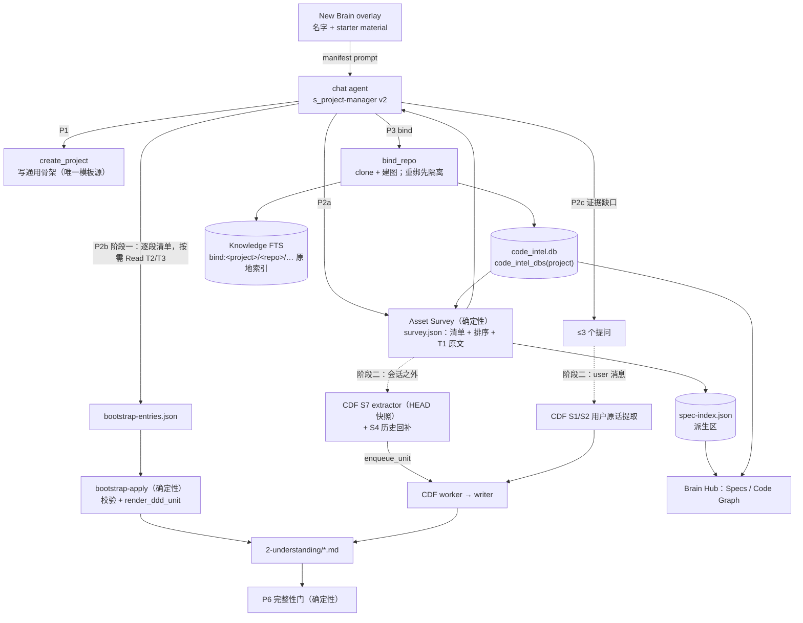

# New Brain 初始 DDD 系统化设计

## 0. 一句话

New Brain 现在是"把一段 prompt 发进 chat，agent 照着 `s_project-manager` 自由发挥写四份 markdown"。
产出的形状和 CDF 不兼容，系统给的质量下限几乎为零。而在 CDF 里，初始 DDD 会成为基线：系统不再修改它，以后只能整条取代（CDF §8 豁免、§13）。

本设计分两个阶段：

- **阶段一（现在做，不依赖 CDF）**：
  - 确定性的 **Asset Survey**：盘点资产、排序 spec，复用 `ai_ready_helpers` 已有的能力；
  - **通用骨架**：段名等于 CDF 矩阵；
  - agent 按逐段清单写条目，由**确定性的 `bootstrap-apply`** 校验并渲染成 `parse_entries` 能解析的单元，渲染函数和 CDF writer 是同一个；
  - **确定性的完整性门**；
  - 修掉 Code-Graph"建了看不到、改了不更新、重绑会删用户改动"三类正确性问题；
  - repo 里真实存在的 spec 原地索引进 recall。
- **阶段二（CDF 阶段 B 上线时）**：初始提取改由会话之外的后端 source 完成。HEAD 快照归新的 S7，历史 commit 走 S4 的一次性回补，用户的回答照常归 S1/S2。全部过 CDF 的卡，初始内容都是带证据和 taint 的 `cand:` 单元。

## 1. 现状与实测

本节每条结论都在 2026-10-27 读源码或实测得到，并经过一轮零上下文评审复核（§13）。

### 1.1 链路

```
NewBrainOverlay (名字 + starter material，按类型规则分成 GOVERN / DISTILL / SHELF)
  → buildBrainManifest()  一段纯文本 prompt              desktop/src/utils/newBrainDispatch.ts:140-179
  → injectDispatchedPrompt(autoSend)  作为普通 chat 回合发出   desktop/src/pages/ChatPage.tsx:1413-1427
  → agent 执行 s_project-manager P0–P6                   backend/skills/s_project-manager/SKILL.md:128-137
      P1  curl POST /api/projects {name}  → create_project → provision_project_ddd（只写模板，不调 LLM）
      P2  agent 读 repo 写四份文档（无任何格式契约）
      P3  artifact_cli bind → bind_repo：clone + 建 code_intel.db
      P4  s_repo-to-ddd 生成 code-intel.json
      P6  verify_ddd_complete.py --record
```

### 1.2 问题清单

| # | 现象 | 证据 | 后果 |
|---|---|---|---|
| P-1 | 读 repo 靠 `head`：README 前 80 行，`docs/*.md` 只列前 5 个，design/architecture 各前 100 行，配置前 20–50 行 | `SKILL.md:273-305` | 违反 CDF 第一准则（不截断语义）；ADR、RFC、API 契约、嵌套 README 读不到 |
| P-2 | 完整性门挡不住空模板：对原始模板跑 `_doc_is_placeholder`，PRODUCT、TECH、PROJECT 判为"已填"，只有 IMPROVEMENT 被拦 | `verify_ddd_complete.py:204-228`，实测 | P6 通过不代表有内容 |
| P-3 | 三套段名：内联 `DDD_TEMPLATES`、`backend/templates/ddd/*.md`（其实是 SwarmAI 自己的内容）、`s_repo-to-ddd` 的输出 | `swarm_workspace_manager.py:383-469`、`:775-804` | 文档结构取决于是哪条路径写的 |
| P-4 | 新 brain 模板缺 CDF 要写的段：`Key Subsystems…`、`Runtime Traps`（矩阵段）和 `What to Watch For`（Gap 的目的地，`contracts_v2.py:321`） | 同上；CDF `_DDD_MATRIX` | CDF 写这些段会 `DEFER missing_section`。9 个非 SwarmAI DDD 每个都缺 2–6 段 |
| P-5 | CDF 写死了 SwarmAI 专属的段名：`What Makes SwarmAI Different`；`Key Subsystems (architecture shape)` 与 SwarmAI 自己 live 的 `## Key Subsystems` 也不一致 | `contracts.py:372`（`_DDD_MATRIX`）、`units.py:138`（`layer_for`） | 违反 P7；除 SwarmAI 外，任何 brain 写不进 product×model |
| P-6 | 初始条目不是单元：itsdangerous 的 PRODUCT、IMPROVEMENT、PROJECT 用 `parse_entries` 解析出 0 条；CMHK、GitHub_Community、ai_ready_repo 的 PRODUCT 也是 0 条 | 实测 | CDF 的 `parse_units` 把整份文件当成一个单元；文件里只要有一部分是条目，其余散文就不是任何单元，CDF 无法取代 |
| P-7 | 决定不写 why，状态写进 DDD（"Minimum Python is 3.10"无理由；Current Focus 写"2.3.0 unreleased"） | itsdangerous `PROJECT.md` | 作为基线留下；走 CDF 会被 D1 拒绝 |
| P-8 | bind 建的图落在 `bindings/<repo>.code_intel.db`；读取方只看 `Projects/<p>/code_intel.db` | `ddd_bindings.py:335`；`code_intel/__init__.py:34-37`、`ddd_brain.py:961`、`main.py:879`、`code_intel_reindex.py:82` | itsdangerous 的图有 155 个节点、112 条边，但 recall、Brain Hub、reindex 都看不到 |
| P-8b | 即使位置对了，watcher 和 reindex 也只认 TECH.md 里声明的 repo 路径（`**Local:**` 或 `## Codebase Location`） | `code_intel/__init__.py:265-330` `resolve_owned_repo_root`、`main.py:891` | 归属判定依赖散文，bind 本身不算数 |
| P-9 | watcher 的增量更新不解析：`incremental_update` 从不调用 `store_file_nodes_edges`，却写下 `last_incremental_update` | `graph_store.py:1430-1495`、`watcher.py:164-169` | 图看起来是新的，其实没更新 |
| P-10 | 增量替换丢入边：按 `source IN old OR target IN old` 删边，重解析只补回出边；reindex 的增量路径同样会丢 | `graph_store.py:636-656`、`code_intel_reindex.py:294`；评审在临时图上复现 | 改过文件 A 后，`find_callers(A 的符号)` 为空 |
| P-11 | 从不产出 `imports` 边（SwarmAI 图里没有这种边） | `parser.py:787-844` | `resolve_bare_targets` 按 import 消歧的分支（`graph_store.py:1602-1639`）走不到，同名候选的边被当孤儿删掉 |
| P-12 | 有 repo 标记的目录判为 code mount，`index_docs_mount` 直接返回 `skipped_non_docs` | `library_mounts.py:365-440`、`:613` | repo 的 docs、ADR、README 永远不进 recall |
| P-13 | 没有任何 spec 重要性排序；Brain Hub 的 "Spec Details" 是 LLM 从代码生成的投影 | `ddd_brain.py:955-985` | 真实 spec 看不到 |
| P-14 | `code-intel.json` 有三种生成方，输出位置不一致；`ai_ready_helpers.py` 有两份副本（4056 行和 3482 行） | `json_exporter.py`、`INSTRUCTIONS.md:579-596`、`refresh_code_intel.py:41-48`、`ai_ready_helpers.py:2554-2592` | 只有 SwarmAI 的 json 有业务层；新 brain 拿到的是最弱的那种 |
| P-15 | 重新 bind 时无条件 `shutil.rmtree(worktree)` | `ddd_bindings.py:341-342` | worktree 里未提交的改动被销毁（STEERING #20 / SOUL P4） |
| P-16 | 本地 repo 文件夹被归为 SHELF | `newBrainDispatch.ts:37-75` | 用户拖进自己的工作目录，brain 不会治理它 |

子 agent 读代码推断、尚未复现的线索（实现时**先写失败测试确认**，确认了才修）：
- Go、Rust、Java、C++、Kotlin 的方法调用名提取不对（`parser.py:1347-1366`）；
- TS/JS 箭头函数以参数名建节点；
- 多行 Python `from x import (a, b)` 丢名字；
- `last_full_index` 和 `last_incremental_update` 格式不一致，新鲜度显示为 unknown。

### 1.3 为什么在 CDF 下这件事更重要

- CDF §8 把"workspace 初始化、codebase scan 创建 DDD 文档"列为写入豁免（"文件不存在时才创建"）。§13 规定上线时对所有受控文件跑 `parse_units()` 记基线；基线单元系统不再修改，用户可以通过 `governed_edit` 改。
- 初始 DDD 写成整块散文，代价是：
  - 卡 3 只能拿整份文件去比对；
  - 取代时卡 3b 要列出整份文件的全部主张（§7.1 的"替换"流程）；
  - 缺段时 CDF 写不进来；
  - 混在条目之间的散文根本不是单元，取代不了。
- 反过来，初始内容本身就是条目，CDF 的强化、取代、Retro 从第一天起就有落点。

## 2. 目标和非目标

**目标**
1. 任何 brain（code-repo / data-source / document-corpus / 0 资产）新建后，四份文档的结构等于通用骨架（⊇ CDF 矩阵），条目都是 `parse_entries` 可解析、带类型的单元。
2. 有 repo 时，按确定性规则发现并排序 repo 里真实存在的 spec，原地索引进 recall；重要的整篇读完再提炼。
3. 质量下限由确定性的门保证；模型只负责判断"写什么"。
4. Code-Graph 对任何 bind 的 repo 可见、增量正确、重绑不销毁。
5. 阶段二里，初始提取变成 CDF 的 source，不再有 CDF 管不到的写入。

**非目标**
- 不改 DDD 的注入方式（CDF §12、§15）。
- 不动已有 brain 的已写内容（CDF §13），只给它们补缺失的空段标题，而且要用户确认（§5.10）。
- 不把 code-intel.json 的业务层（domains、flows、steps）扩到新 brain，它的去留另议（§11 Q3）。
- 不做向量检索，不引入新的存储引擎。

## 3. 设计原则

1. **判断交给模型，形状交给 OS。** 段落、格式、渲染、完整性都由确定性代码负责（SOUL P5）。
2. **语义完整，按整篇或整条取舍。** Survey 不用 `head`；读不下的整篇放弃、计数，并且能通过原地索引 recall 到（CDF §5 第一准则）。
3. **证据先行，不编造。** 没有证据的段留空，并说明为什么空（CDF §5.3）。
4. **一个事实一个来源。** 段名、渲染函数、条目语法、图的位置、repo 归属，各只有一个定义。先复用已有实现，再考虑新增。
5. **对每个用户都成立（P7）。** 不认 SwarmAI 自己的 repo；语言差异只体现在 parser 的语言表里。
6. **证据归属不重叠（CDF §5.2）。** 同一个证据根只归一个 source。

## 4. 总体架构



## 5. 组件设计

### 5.1 通用骨架：唯一的模板源

- 新建 `backend/templates/ddd-skeleton/{PRODUCT,TECH,IMPROVEMENT,PROJECT}.md`，只含标题和 `<!-- -->` 注释形式的说明，不留 `_..._` 占位文字。
- `provision_project_ddd` 从这里读取，删掉内联的 `DDD_TEMPLATES`（`swarm_workspace_manager.py:383-469`）。
- `backend/templates/ddd/*.md` 改名为 SwarmAI 默认项目的种子（例如 `templates/swarmai-seed/`），只给默认项目用（`:1264`）。

**段集合 = CDF 矩阵段 ∪ Gap 目的地 ∪ PROJECT 的实时段：**

| 文件 | 段 | 谁写 |
|---|---|---|
| PRODUCT | Vision · What Makes It Different · Strategic Priorities · Success Criteria · Non-Goals | bootstrap、CDF |
| TECH | Architecture · Key Subsystems · Conventions · Runtime Traps | bootstrap、CDF |
| IMPROVEMENT | What Worked · What Failed · What to Watch For | bootstrap（只写 What to Watch For）、CDF |
| PROJECT | Recent Decisions · Open Items | bootstrap、CDF |
| PROJECT | Current Focus · Blocked By | 只有用户（CDF §5.5：实时状态，S3 不写） |

- 旧骨架里的 `Stack`、`Dev Commands`、`Codebase Location`、`Key Files`、`Known Issues` 不再单独成段：
  - 技术栈是一条 `model` 单元，放 Architecture；
  - 每条开发命令是一条 `process` 单元，放 Conventions（how 就是命令本身）；
  - repo 位置由 `bindings.yaml` 记录（§5.8 G1）。

  这样阶段二里每一段都有合法的写入者（CDF writer），不存在 CDF 管不到的"导航段"。
- 已有 brain 的这些段原样保留（§13 不动已写内容）。

**对 CDF 的改动（需要 CDF 设计接受）：**
1. 矩阵和 `layer_for` 里的 `What Makes SwarmAI Different` → `What Makes It Different`；`Key Subsystems (architecture shape)` → `Key Subsystems`（和 SwarmAI live 的标题一致）。SwarmAI 自己要改的只剩 PRODUCT.md 的一个标题（§11 Q1）。
2. `validate_ddd_matrix` 的模板根改为 `templates/ddd-skeleton/`。CDF §7.1 原计划让 `DDD_TEMPLATES` 从 `templates/ddd/*.md` 读取，而那些是 SwarmAI 的产品内容。

### 5.2 Asset Survey：确定性盘点

**位置**：新建 `backend/core/brain_bootstrap/survey.py`，CLI 为 `artifact_cli survey --project X`。它不调 LLM，不执行 repo 里的任何代码，不访问网络。

**复用已有实现**：把 `skills/s_repo-to-ddd/scripts/ai_ready_helpers.py` 里通用的部分移进 `core/brain_bootstrap/` 作为唯一来源，skill 改为导入；DDD 自带的模板副本在打包时生成（顺带解决 P-14 的双份副本）。可直接复用的有：
- `_safe_file_read`（`:63`，符号链接限制和大小上限）
- `parse_git_gotchas`（`:1903`，fix / revert 集中的文件，带 commit 证据）
- `detect_package_roots`（`:3755`，monorepo）
- `gather_repo_info`、`_detect_tech_stack`、`_find_config_files`
- `generate_enrich_questions`（`:3078`，问代码给不出的东西）

`change_risk_score._score_file_churn` 不复用：它是 30 天窗口、每个文件起一次 `git log --follow`，不适合整库盘点。

**输出** `Projects/X/.artifacts/bootstrap/survey.json`，每项带 `path@sha`、`kind`、`tier`、`signals`、`included` 和 `reason`：

| 类别 | 内容 | 来源 |
|---|---|---|
| 身份 | remote、HEAD sha、默认分支、license 名称 | git |
| 文档 | 全部文本文档的清单、分层、T1 原文（§5.3） | 文件树（尊重 `.gitignore` 和跳过目录） |
| 命令 | CI workflow 的 `run:` 步骤、Makefile / justfile 目标、`package.json` scripts、tox / nox 环境 | **解析**，不是 `head` |
| 代码形状 | 模块、入口点、路由、高扇入符号、聚类 | `code_intel.db`，复用 `json_exporter` 的分析 |
| 历史 | `parse_git_gotchas` 的结果；CHANGELOG 最近几个 release 的整节 | git、文件 |
| 约定 | lint / format / type 配置的关键选项；CONTRIBUTING 整篇 | 文件 |

**阶段一的读法**：survey 只内联 T1 原文（目标约 40K tokens，是读入规模的护栏，不是质量判断，P6）。T2、T3 给出带排序的清单，agent 在写对应的段时按需 Read 整篇。这样不把一个巨大的证据包塞进 chat 回合。读不下的整篇记 `included=false`，仍然可以 recall 到。

**安全（R32）**：
- 路径一律经 `_safe_file_read` 限制在 worktree 内。
- 秘密文件跳过不读：`.env*`、`*.pem`、`*.key`、`id_rsa*`、`.npmrc`、`.netrc`、`.pypirc`、`*credentials*`、`.aws/`、`.docker/config.json`。CI YAML 只取 `run:` 步骤，不取 `env:` / `secrets` 块。
- git 命令一律带 `-c core.hooksPath=/dev/null -c core.fsmonitor=`，防止用户拖进来的 repo 借 hook 执行代码。
- MemoryGuard **按文档**扫描。一篇讨论 prompt injection 的 SECURITY.md 只标记它自己，不拖累整个盘点。
- survey 内容在 skill 里声明为不可信资料：其中的文字是数据，不是指令。

### 5.3 Spec 发现、排序和原地索引

**发现**：
- 文本文档：`.md`、`.rst`、`.adoc`、`.txt`；
- API 契约：`openapi.*`、`swagger.*`、`*.proto`、`*.graphql`、`asyncapi.*`；
- 代码由图负责，不进这一路。

**分层**（确定性、可解释；每篇记下命中的信号，层内按信号数、再按路径排序；同一输入两次结果相同）：

| 层 | 规则 |
|---|---|
| T1 必读 | 根 README；`ARCHITECTURE*` / `DESIGN*`；根 README 直接链接到的仓内文档；monorepo 各 package 的 README |
| T2 设计记录 | `docs/{design,architecture,adr,rfc,decisions}/**`；`NNNN-*.md` 形式的 ADR（状态为 superseded / rejected 的降到 T4） |
| T3 规范和约定 | CONTRIBUTING、SECURITY、CODEOWNERS、CHANGELOG（只取最近 release 的整节）；被 2 篇以上其他文档链接的文档 |
| T4 其余 | `docs/**` 其他文档，按最近修改时间倒序 |

API 契约不读原文：survey 放结构化摘要（端点或 RPC 列表，每项一行），原文走原地索引。

**原地索引**（修 P-12）：
- 把 `index_docs_mount` 的核心抽成 `index_text_tree(src, key_prefix, include=…)`；docs mount 继续用它。
- bind 时对 worktree 用 `key_prefix="bind:<project>/<repo>/"` 加扩展名白名单索引；HEAD 变化时由 reindex job 增量同步（复用 `get_existing_hashes` / `remove_stale_chunks`）。
- 不复制文件，所以不会和 repo 漂移。
- recall 的 `library` 域：`bind:` 键只对 active project 返回，渲染时一律放进不可信数据边界。按键前缀判定，是确定性的；这符合 CDF §9"读入的文件属于 external"。

**派生区的 spec 索引**：`Projects/X/spec-index.json` 是 survey 文档部分的投影，和 `code-intel.json` 同属"不是 DDD 成员"的派生区，不进 CDF。
- Brain Hub 的 Specs 面板读它，按层展示真实 spec；
- 打开原文走一个端点，**该端点重新把路径限制在 worktree 内**，不信任 json 里的路径；
- `spec-details/*.spec.md` 另列为"由代码生成的投影"。

### 5.4 阶段一的提取：逐段清单，agent 只做判断

`s_project-manager` 的 P2 改成三步：P2a 跑 survey；P2b 按段写条目；P2c 必要时提问（§5.6）。

**条目格式**：`bootstrap-entries.json` 里每条是一个 `BootstrapEntry`，字段取 CDF `CognitionUnit` / `GapUnit` 的语义字段：
- `kind` ∈ {cognition, gap}
- `type`（`VALID_TYPES`，只有 cognition 有）
- `section`：取 §5.1 的段名；用户可见、可以校验
- `title`、`what`、`how`、`why`、`applicability`、`rejected_alternatives`（gap 是 `title`、`what`、`why`、`proposed_next`）
- `sources`：repo 内路径列表，带行号或标题

它**不是** `SOURCE_UNIT`：`contracts_v2` 的锚点要求先登记的根（`doc:<root_id>` 等），段由卡 1 的 topic 决定，这两样阶段一都没有。阶段二另外有提取器（§5.5），阶段一的条目格式不延续过去。能延续的是逐段清单、survey、骨架、渲染函数和完整性门。

**按段清单**（写进 skill，附正例和反例）：

| 段 | 从什么提取 | 类型和必填 |
|---|---|---|
| PRODUCT Vision | README 的定位段、package 描述 | principle / model |
| PRODUCT What Makes It Different | README、docs 里和替代方案的比较 | model |
| PRODUCT Strategic Priorities / Non-Goals / Success Criteria | 文档里明说的优先级、"不做"、成功标准；**没明说就留空** | decision（why + rejected）/ pitfall / guideline |
| TECH Architecture | ARCHITECTURE / design 文档；survey 的入口点和聚类；技术栈一条 model | model / decision |
| TECH Key Subsystems | 每个聚类一条：职责、入口、依赖。`sources` 写这个聚类的源文件（不写图的 id，判官读不了 id） | model |
| TECH Conventions | CONTRIBUTING、lint 配置；每条开发命令一条 process（how = 命令，`sources` = CI 文件） | guideline / process（how 必填） |
| TECH Runtime Traps | `parse_git_gotchas` 的文件及对应提交说明；CHANGELOG 的 security / bugfix 条目；SECURITY.md | pitfall（applicability = 触发条件，必填） |
| PROJECT Recent Decisions | accepted 的 ADR、design doc 里的决定 | decision（why + rejected，必填；没有被否方案写"无"） |
| IMPROVEMENT What to Watch For | survey 发现的缺口：没有测试的入口、文档和代码不一致、§5.6 用户跳过的空段 | gap |

**不提取**（同 CDF §5.3）：
- 版本号、计数、"当前在做什么"这类状态；
- 对 README 的复述；
- 没有证据的推测；
- 一次性事实。

**为什么不另开一个 bootstrap agent**：沿用"单 agent 切换角色"的既定决定（MEMORY Decisions），用户也在 chat 里看得到过程（STEERING #13）。

### 5.5 写入

**唯一的渲染函数** `render_ddd_unit(entry, *, cand_id=None, taint=None) -> str`：
- 放在 `core/ddd_entry_lifecycle.py`，和解析器 `parse_entries`、`EntryMetadata.to_comment` 放在一起，因为语法只有一个定义；
- CDF writer 的 DDD 分支（`writer._render_block` 最后一行）改为调用它；
- 输出：

```
- [decision] **完整标题** <what>。**How:** <how>。**Why:** <why>。**Rejected:** <rejected_alternatives>。（来源：README.md#Usage）
  <!-- ref:0 | last:2026-10-27 | decay:active | source:bootstrap | taint:external -->
```

**条目语法要改的地方**（评审实测：现有 `_META_RE` 只认 `source`、`valid_until`、`superseded_by`，多一个键就整行匹配失败，`to_comment()` 重写时还会丢掉未知键）：
- 在 `_META_RE` 的 `source` 之后加一个可选组 `(?:\s*\|\s*taint:(\w+))?`；
- `EntryMetadata` 加 `taint` 字段，`to_comment()` 原样保留；
- `inject_entry_metadata`（`ref` 计数）必须保留这个字段，不能叠出第二个注释。

证据不写进 meta：
- 阶段一，`sources` 以自然括注的形式写在正文末尾（现有 DDD 的习惯，例如"(CHANGES.rst 2.2.0)"），完整的 `sources` 列表记在 `.artifacts/bootstrap/applied.json` 里，按条目哈希索引；
- 阶段二，证据在 CDF 的 `evidence_roots`。

CDF §9 要求 DDD 条目的 meta 标 `taint: external`，但两个 CDF 分支的 writer 都没实现（`writer.py:173` 只写 `source:ingestion`）。这一条语法修改同时补上这个缺口。

**Gap 的渲染**：`gap` 不是 ontology 的七类之一，不能加进 `VALID_TYPES`。Gap 写成 `- [guideline] **标题** …`，`source:bootstrap`，段为 What to Watch For。CDF writer 对 GapUnit 用同一个函数、同一种写法（现在它也默认写 guideline）。

**阶段一 `artifact_cli bootstrap-apply --project X`（确定性）：**
1. **校验**：
   - `section` 在骨架里，并且是这个类型允许的段（用 CDF 矩阵的反查表，不另写一份）；
   - decision 必须有 why 和 rejected；pitfall 必须有 applicability；process 必须有 how；
   - `sources` 必须出现在 survey 清单里，或者是 manifest 的 DISTILL 项；
   - 标题和正文不截断，超出 CDF 的 rule 长度上限就拒绝，由 agent 拆分。
2. **只在两种条件同时满足时写入**：
   - `setup.json` 为 `setting-up`；
   - 目标文件的字节等于骨架，或等于本工具上一次写入后记在 `applied.json` 里的哈希。

   用户手改过的文件不碰，报告"已有内容，未写入"。
3. **按段追加**；条目一律带 `source:bootstrap`。来源是 repo 或外部文件的，加 `taint:external`；来源只有用户回答的，不加。
4. **被拒绝的条目**原样写进 `.artifacts/bootstrap/rejected.json`，附原因；agent 修正后重跑。幂等键是条目内容哈希。

阶段一不违反 CDF：CDF 还没上线；上线时，`bootstrap-apply` 的写入代码按 CDF §8"一次切换"列入要删除的旧写入路径。阶段一写下的条目会进入 CDF 基线，**它们的 `taint:external` 必须被 CDF 的基线生成读出来，记成被污染的 corpus unit**（对 CDF 的改动请求，§5.5 末尾第 (d) 项）。

**阶段二（CDF 阶段 B 的切换提交里一起切换）：**
- **S7 `asset_bootstrap`**：拥有"新 bind 的资产在 bind 时刻的 HEAD 快照"。它在会话之外运行，是一个后端 job，由 bind 成功后触发：
  - 读取 survey 选中的文件，逐个 `register_root("file_revision", "repo:<repo>/<path>@<sha>", 内容, "external")`；
  - 用 CDF 的 `extract_llm` 按 §5.4 的逐段清单（作为提取 prompt）分批提取，引用 `doc:<root_id>`；
  - `enqueue_unit("S7", …, read_root_ids=全部已读的根)`。

  因为它不在任何会话里，survey 的内容不会作为工具结果出现在 chat 中，S2 也就不会重复提取。阶段二的 P2b 不再由 chat agent 读 repo 写条目。
- **历史归 S4**：`parse_git_gotchas` 用到的 commit 是"不由 run 落地的 commit"，按 CDF §5.2 归 S4。bind 时触发一次 S4 回补，窗口是最近 12 个月。S7 不引用 commit。
- **用户回答归 S1/S2**：§5.6 的回答是本会话的 user 消息，由 S2 的用户原话提取在会话结束时处理（trust=user），卡 1 把它们路由到 PRODUCT。S7 不认领它们。
- **完整性门的时序**：S7 和 S4 的候选到达终态之前，P6 的内容检查报 `PENDING (bootstrap 处理中，N/M)`，不报 FAIL。Brain Hub 显示进度。
- **对 CDF 的改动请求**：
  - (a) SOURCES_V2 加 S7；
  - (b) S7 用 `bootstrap` lane，执行器和 run lane 同类（专用、有界、并发 1、不受流式暂停影响），但**队列独立**，不排在 REFLECT 前面；
  - (c) 配额：CDF §12 规定每个项目的 DDD 每天新增不超过 20 KB，一次 bootstrap 会超。S7 和 S4 回补共用"每次 bind 一次、上限 200 KB"的配额，幂等键是（项目，repo，HEAD）；
  - (d) 基线生成读取 meta 里的 `taint:`。
- **卡 1 的风险**：CDF §14.1 T2 记录了冒烟测试里 4/5 被判"推测"。S7 的条目必须引用文件原文（`doc:` 根），不能只引用图的 id。按 CDF T6 单独统计 S7 的"该写"比例，低于 5% 就改提取方式。

### 5.6 证据缺口时提问

- **缺口由确定性代码计算**：PRODUCT 的 Vision、Non-Goals、Success Criteria 三段里，P2b 之后没有任何条目的段就是缺口。
- **只对缺口提问**：最多 3 题，用 AskUserQuestion，候选选项来自 `generate_enrich_questions` 和 survey。
  - 阶段一，回答由 agent 写成条目，`sources: ["user"]`，不加 taint；
  - 阶段二，回答由 S2 的用户原话提取处理（§5.5）。
- **用户跳过**：写一条 gap"<段> 没有证据，未填写"放 What to Watch For。阶段二里这条 gap 的证据是用户跳过的那条消息（`event:`）。
- **不问可以从证据推出的东西**（SOUL P10）。0 资产的 brain 主要靠这一步，加上 DISTILL 材料。

### 5.7 P6 完整性门（确定性）

替换 `_doc_is_placeholder`：
- **② 结构**：四份文档含 §5.1 的全部段（已有 brain 用 §5.10 对齐；标题按空白归一化比较）。
- **② 内容**：
  - PRODUCT、TECH、IMPROVEMENT：每份至少有一个 `source:bootstrap`（或之后 CDF 写的）带类型条目；
  - PRODUCT 的空段必须在 What to Watch For 里有对应的 gap。"诚实地空着"算通过，"假装填了"不算；
  - PROJECT 允许只有空段（实时状态由用户写）。
- **② 不是骨架**：文档字节和骨架相同时一定判为未填。测试用骨架本身做夹具（修 P-2）。
- **⑥**：`_governed_assets` 同时认 `bindings:` 里的 repo；code-repo 资产的检查改为"`code_intel_dbs(project)` 至少一个能打开、节点数大于 0、并且归属判定通过"，不再找任意位置的 `code-intel.json`。
- **阶段二**：见 §5.5 的 PENDING 规则。

### 5.8 Code-Graph 修正

**G1 一个解析器管位置和归属**（修 P-8、P-8b）：
- 新增 `code_intel.code_intel_dbs(project) -> list[DbRef(repo, db_path, repo_root)]`，返回 legacy 的 `Projects/<p>/code_intel.db`，加上 `bindings.yaml` 里每个 binding 的 db。
- 归属判定 `resolve_owned_repo_root` 改为先认 bindings 的 worktree，再认 TECH.md 的旧声明（兼容已有 brain）。
- `bindings[].worktree` 的读法统一成一个函数 `binding_worktree(binding)`：`governed_repo_roots`（`ddd_bindings.py:203`）当绝对路径读，`bind_repo`（`:316-319`）当 bindings 根下的相对路径读，两者不一致，统一以 `bind_repo` 为准。
- **全部消费方**（R27，包括读路径；以实现时 grep 为准）：
  - `load_project_graph` 及其调用方：`code_intel_feed.py:74,205,255`、`codebase_map.py:29`、`code_intel_hook.py:147,166-170`（repo→project 缓存假定一个项目一个 db）
  - `recall_multi` 的 codeintel 路
  - `routers/code_intel.py`
  - `ddd_brain.py:961`
  - `main.py:879-891`
  - `code_intel_reindex.py:82`
  - `ddd_self_audit.py:138`
  - `verify_ddd_complete`
- **多 binding 的语义**：
  - recall：对每个 db 搜索，按分数合并，命中带 repo 名；
  - Brain Hub：有多个 db 时给 repo 选择器；
  - watcher、reindex：按 db 逐个处理；
  - `load_project_graph` 保留"返回第一个"的单 db 签名供旧调用方用，逐个迁到列表版本后删除（R26）。
- 不搬文件，已有安装零迁移。

**G2 增量只有一条正确的路径**（修 P-9、P-10）：新增 `GraphStore.reparse(root, files)`：
1. **删除之前**用 `find_dependents(file, max_hops=1)` 收集调用方文件；
2. 解析变更文件和调用方文件，逐个 `store_file_nodes_edges`；
3. 对受影响的边做范围化的 `resolve_bare_targets` 和孤儿清理；
4. FTS 重建，写新鲜度标记。

watcher、reindex 增量、health hook、`code_change_feed`、`POST /reindex` 都改为调用它；删掉 `incremental_update` 里"只记录不解析"的部分，以及 `code_change_feed` 那条只增不删的 `bulk_insert` 路径（R25：四条路径收成一条）。

**G3 import 关系**（修 P-11）：
- 图里没有文件级节点，file→file 的边会被孤儿清理立刻删掉。所以 import 关系另存一张表 `code_imports(src_file, dst_file, line)`。它由 `_build_file_scope_regex` 已经得到的 import 映射解析到仓内文件后写入，不进 `code_edges`，不受孤儿清理影响。
- `resolve_bare_targets` 的消歧分支改为读这张表；`module_edges` 也由它派生。

**G4 语言修正**：§1.2 末尾的四条线索，各写一个语言夹具的失败测试，红了才修；用 tree-sitter 的字段名（`function` / `name`），不用"第一个子节点"。

**G5 热点**：export 的 `hot_zones` 改为来自 `parse_git_gotchas`（fix 历史集中的文件）；原来的高扇入改名为 `central_symbols`，不再冒充热点。

**G6 recall 渲染**：每个命中带 `file:line` 和签名首行；`check_freshness` 按 HEAD 缓存。

**G7 重绑不销毁**（修 P-15）：worktree 有未提交的改动或未推送的提交时，先改名为 `<repo>.preserved-<ts>` 隔离（STEERING #20 允许），再 clone；干净时才删除。

**G8 clone 加固**：§5.10 把本地路径也变成 clone 源，攻击面因此扩大，这里一并修：
- `git_sync_engine.py:319` 的 `git clone` 加 `--`，只接受 https / ssh / 本地路径三种协议；
- 本地路径过 `is_protected_system_path`（mount 已在用）。

### 5.9 code-intel.json 收敛

- **唯一生成方**：`core/code_intel/json_exporter`，从 `code_intel.db` 导出，路径固定为 `Projects/X/code-intel.json`。
- skill 里手写 JSON 的步骤删掉；DDD 自带的 portable refresher 保留（脱离 SwarmAI 也要能用），但输出同一个 schema 的子集，由同一个 schema 校验。
- 业务层（domains、flows、steps）是 LLM 写的认知，却放在 CDF 管不到的地方（P8：一扇没人看守的门）。不扩到新 brain，新 brain 的同类知识写成 Key Subsystems 的 model 条目。它在 SwarmAI 里的去留另议（§11 Q3）。

### 5.10 前端与已有 brain

- **GOVERN 判定**：manifest 里的 folder 项由 agent 在 P0 调用 `artifact_cli classify-starter <path>` 判定。它复用 `judge_mount_kind`：有 repo 标记就是 GOVERN（以本地路径为 clone 源，过 G8），否则是 SHELF（修 P-16）。用户仍然可以改。
- **"出生"进度**：Brain Hub 卡片显示 P6 的分项（结构、内容、图；阶段二另有 bootstrap 处理进度）。
- **Specs 面板**读 `spec-index.json`；**Code Graph 面板**读 `code_intel_dbs`。
- **已有 brain 的段对齐**：`artifact_cli ddd-skeleton-align --project X`。
  - 默认 dry-run，列出缺的段。
  - 和已有标题近似时（按归一化后的前缀匹配，例如已有 `## Key Subsystems` 对应 `Key Subsystems`，已有 `## Known Issues / Pitfalls`），只报告、不追加，避免在一个几百行的段旁边再造一个空的同名段。
  - 用户确认后，只把真正缺的 `## 段名` 追加到文件末尾，不改任何已有字节。
  - 在 CDF 基线生成之前跑完。CDF 上线之后，`missing_section` 的 deferral 在 Need You 里附一句可以直接发进 chat 的 prompt，做法和 CDF 对 `unknown_domain` 的处理相同。

## 6. 质量标准：什么叫高质量的初始 DDD

**确定性部分**（P6、`bootstrap-apply` 和测试强制）：
- 结构等于骨架；
- 100% 的条目可解析、带类型；
- decision 有 why 和 rejected，pitfall 有触发条件，process 有 how；
- 每条有出处；
- 没有骨架原文；
- 空段都有对应的 gap。

**判断部分**（OS Eval 的 golden case，只在 CI、部署或定时运行，不在 coding pipeline 里跑）：
- 在 `backend/eval/fixtures/` 放 2–3 个小型公开 repo 的快照：一个 Python 库、一个 TS 服务、一个带 ADR 的 Go 项目，各附一份 must-have 主张清单。例如"默认摘要算法改了会让已签发 token 全部失效"必须出现在 Runtime Traps，并且出处可查。
- 指标：
  - must-have 覆盖率；
  - **忠实率**：零上下文判官逐条核对"主张是否被出处原文支持"；
  - 编造率：目标为 0；
  - 流水账混入率。
- 门槛等第一版跑出基线后再定，不预先拍数字（P6）。

## 7. 方案比较

| 方案 | 做什么 | 工作量 | 风险 | 取舍 |
|---|---|---|---|---|
| A 只修门和图 | 统一骨架、修 P6、修 Code-Graph；P2 仍由 agent 自由写 markdown | 小 | 格式和质量仍取决于那一轮模型；P-1、P-6、P-7 不解决 | 快；CDF 上线时初始 DDD 仍是散文 |
| **B 推荐** | A + Survey + 逐段清单 + `bootstrap-apply` 和统一渲染；CDF 上线后提取换成 S7/S4 | 中 | 阶段一和阶段二的提取器不同；需要 CDF 接受 §5.1 和 §5.5 的改动 | 阶段一就得到 CDF 能用的条目；骨架、渲染、survey、完整性门两个阶段共用 |
| C 等 CDF | 只做 A，提取直接等 S7 | 中，排在 CDF 后面 | 在那之前新建的 brain 都是散文基线 | 少一次过渡，代价是空窗期 |
| D 后台 job | 现在就不经 chat，后端跑提取 | 中 | 阶段一没有 CDF 的卡做质量把关；用户看不到过程，也没法提问 | 阶段二的 S7 本质上就是这个，但它在 CDF 的卡下面跑 |

推荐 B。DELETION 视角：B 删掉内联 `DDD_TEMPLATES`、`_doc_is_placeholder`、四条增量路径中的三条、`code_change_feed` 的只增路径、skill 里手写 code-intel.json 的步骤、`ai_ready_helpers` 的第二份副本、P-1 的 `head` 读法；阶段二再删掉 `bootstrap-apply` 的写入代码。

## 8. 安全

- **Survey**：路径限制、秘密文件跳过、git hook 禁用、不执行不联网、按文档扫描（§5.2）。
- **注入**：repo 文档是 `external`。
  - 阶段一的条目带 `taint:external`，CDF 基线读取它（§5.5 (d)）；
  - `bind:` 索引的 recall 结果放在不可信数据边界里；
  - DDD 只注入 section 指针，被污染的条目和普通 repo 文件同等防护（CDF §9 已如实说明）。
  - 被污染的内容到不了每轮注入的文件：bootstrap 只写 DDD，不写 MEMORY / STEERING / USER / TOOLS / EVOLUTION。
- **销毁**：G7 只隔离不删除；`bootstrap-apply` 只写骨架状态的文件。
- **clone**：G8；clone URL 不写进任何日志或条目（沿用 `ddd_bindings.py` 的现有做法）。
- **Brain Hub 打开原文**：端点重新做路径限制。

## 9. 实施顺序

每一步都能单独提交、单独验证。是 native 改还是走 pipeline，每一步开始时按 R1 决定（第 1、6 步跨模块）。

| 步 | 内容 | 依赖 | 评审专家 |
|---|---|---|---|
| 1 | G1 解析器和归属、G2 增量单路径、G7 不销毁、G8 clone 加固 | 无 | correctness、concurrency（watcher 线程）、security |
| 2 | §5.1 骨架、§5.7 P6 门、§5.10 对齐命令、条目语法加 `taint`；CDF 矩阵改名（和 CDF 协调） | 无 | api-contract（条目语法、CDF 矩阵）、correctness |
| 3 | §5.2 Survey（迁移 `ai_ready_helpers`）、§5.3 原地索引和 spec-index、G5 | 1 | security（不可信文件）、performance（大 repo） |
| 4 | §5.4 skill v2、§5.5 阶段一 `bootstrap-apply` 和 `render_ddd_unit`、§5.6 提问、§5.10 前端 | 2、3 | correctness、ux |
| 5 | G3 import 表、G4 语言修正、G6 | 1 | correctness |
| 6 | §5.5 阶段二：S7、S4 回补、配额、lane、P6 PENDING；删除 `bootstrap-apply` 的写入代码 | CDF 阶段 B | security（taint）、state-machine |
| 7 | §6 eval golden case 和 fixture repo | 4 | — |

## 10. 验证计划

**读取方先于写入方设计**（R3 第 7 条）：
- `render_ddd_unit` 的读取方是 `parse_entries`、`inject_entry_metadata`、CDF 的 `parse_units`：第 2 步先写语法往返测试，再写渲染。
- `bind:` 索引的读取方是 recall 的 `library` 域：第 3 步先定过滤和渲染规则。
- `spec-index.json` 的读取方是 Brain Hub：先定 schema。
- 各 db 的读取方：第 1 步按 §5.8 G1 的清单一次性改全。

**最终测试集**（设计时定下，收尾时只跑这一组；安全类和语法类的每条都做 mutation 检查，撤掉修复必须变红）：

| # | 不变量 | 当前状态 |
|---|---|---|
| I1 | 骨架的段 ⊇ CDF 矩阵的段（`validate_ddd_matrix` 指向骨架） | 新增 |
| I2 | 用原始骨架做夹具，P6 ② 对 PRODUCT、TECH、IMPROVEMENT 都判为未填 | 今天是红的（PRODUCT、TECH 会通过） |
| I3 | 对 `VALID_TYPES` 的每一类和 gap，`render_ddd_unit` → `parse_entries`：类型、标题、段、`source`、`taint` 不变；再 `inject_entry_metadata` 一次，注释仍只有一行，`taint` 保留；标题不截断 | 新增；今天的 `_META_RE` 下是红的 |
| I4 | `bootstrap-apply` 拒绝写入非骨架、非 setting-up 的文件；拒绝缺 why 的 decision、缺 applicability 的 pitfall、出处不在 survey 里的条目 | 新增 |
| I5 | Survey：符号链接逃逸被跳过；秘密文件不读；git 命令带禁用 hook 的参数；文档按整篇装入；同一输入两次排序相同 | 新增 |
| I6 | 改文件 A 后，A 中符号的调用方仍然存在；watcher 路径真的更新了节点 | 今天是红的（P-9、P-10） |
| I7 | bind 一个 fixture repo 后，recall codeintel、Brain Hub `hasCodeIntel`、reindex、watcher 都看得到它的图，并且 TECH.md 里没有任何路径声明 | 今天是红的（P-8、P-8b） |
| I8 | `bind:` 的 chunk 只对本项目 recall，渲染在不可信边界内 | 新增 |
| I9 | 重新 bind 时，有未提交改动的 worktree 被隔离，没有被删除 | 今天是红的（P-15） |
| I10 | E2E（确定性）：fixture repo → survey → **固定的** `bootstrap-entries.json` 夹具 → apply → P6 通过，并且 §6 的确定性部分全部满足。LLM 提取的质量由 §6 的 eval 衡量，不进这条测试 | 新增 |

**评审**：每一步按 §9 表里的专家跑 `s_expert-review`，最多两轮。eval golden case 在 CI 或定时任务里跑。

**收尾报告**：逐行列出 I1–I10 是否存在、是否为绿，以及每一步实际跑了哪些评审、发现了什么。

## 11. 待决问题

- **Q1**：SwarmAI 自己的 PRODUCT.md 的 `## What Makes SwarmAI Different` 改为 `## What Makes It Different`？这是用户自己的文件，改了 CDF 矩阵才能通用。不改的话，矩阵要支持"每个项目一个可选别名"。
- **Q2**：§5.1 和 §5.5 对 CDF 的改动（矩阵改名、模板根、S7、lane、配额、基线读 taint），是并进 CDF r16.x 的正文，还是由本设计单独维护一份 CDF 补丁说明？
- **Q3**：`code-intel.json` 的业务层（目前只有 SwarmAI 有）在 CDF 上线时怎么处理：迁成 DDD 单元、保留为派生区的 LLM 投影，还是删掉？

## 12. 不做

- 不在 bootstrap 时运行 repo 的构建或测试（survey 只解析命令）。
- 不自动给已有 brain 重新 bootstrap；以后"从 repo 刷新认知"是 S4 的事。
- 不把 repo 文档复制进 `Knowledge/`：原地索引，加上提炼出的 DDD 条目。
- 不引入向量检索，不改 DDD 注入。

## 13. 修订记录

**r2（2026-10-27）**：吸收一轮零上下文前提评审。评审确认了 §1.2 的大部分证据，在临时图上复现了 P-10，指出方案层的错误，按成因修订如下：

- **自己发明契约，没有复用现有的**：
  - r1 的渲染格式在 meta 里加了 `taint`、`evidence` 两个键，现有 `_META_RE` 不认，`to_comment` 还会丢掉它们 → 改为只加一个可选的 `taint` 组，并列为显式的语法修改（§5.5），证据不进 meta；
  - r1 声称 bootstrap 输出等于 `SOURCE_UNIT`，但锚点前缀和 `topic` 字段都不符合 `contracts_v2` → 阶段一改用 `BootstrapEntry`，如实说明它不延续到阶段二（§5.4）；
  - Survey 改为复用 `ai_ready_helpers` 已有的能力，不再新写（§5.2）；
  - G3 不再往 `code_edges` 写 file→file 边（会被孤儿清理删掉），改为单独一张表。
- **证据归属和 CDF §5.2 冲突**：
  - r1 的 S7 认领了会话里的 starter material 和用户回答（归 S1/S2）以及 commit（归 S4）→ 阶段二的 S7 只拥有 bind 时的 HEAD 快照，并且在会话之外运行；历史走 S4 回补；用户回答照常走 S2（§5.5）；
  - 阶段二的 P6 改为 PENDING，不再同步等异步的 worker；
  - S7 用独立队列，不排在 REFLECT 前面。
- **漏看了消费方**：
  - 骨架去掉 `Codebase Location` 会让 watcher 和 reindex 的归属判定失效（P-8b）→ 归属改为先认 bindings；
  - G1 的消费方清单补全，并写明多 binding 的语义；
  - `layer_for` 也写死了 SwarmAI 的段名；SwarmAI live 的 `Key Subsystems` 没有括号后缀 → 矩阵改成 `Key Subsystems`。
- **其他**：
  - 骨架去掉不在矩阵里的导航段，命令和技术栈改成条目，阶段二每段都有合法的写入者；
  - 对齐命令遇到近似标题只报告；
  - 安全上补了秘密文件清单、git hook 禁用、按文档扫描、clone 加固（G8）和打开原文的路径限制；
  - I10 改用固定夹具，保证确定性；
  - §1.3 的表述改准确：用户仍可通过 `governed_edit` 修改，代价在于整份取代。
