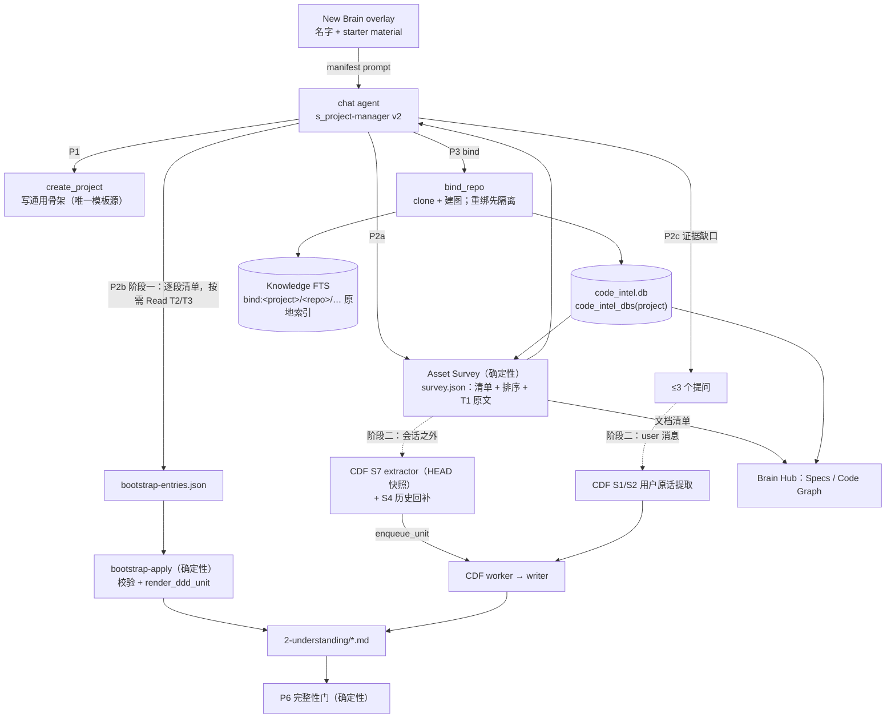

# New Brain 初始 DDD 系统化设计

## 0. 一句话

New Brain 现在是"把一段 prompt 发进 chat，agent 照着 `s_project-manager` 自由发挥写四份 markdown"。
产出的形状和 CDF 不兼容，系统给的质量下限几乎为零。而在 CDF 里，初始 DDD 会成为基线：系统不再修改它，以后只能整条取代（CDF §8 豁免、§13）。

本设计分两个阶段：

- **阶段一（现在做，不依赖 CDF）**：
  - 确定性的 **Asset Survey**：盘点资产、排序 spec，复用 `ai_ready_helpers` 已有的能力；
  - **通用骨架**：段名等于 CDF 矩阵；
  - agent 按逐段清单写条目，由**确定性的 `bootstrap-apply`** 校验并渲染成 `parse_entries` 能解析的单元，渲染函数和 CDF writer 是同一个；
  - **确定性的完整性门**；
  - 修掉 Code-Graph"建了看不到、改了不更新、重绑会删用户改动"三类正确性问题；
  - repo 里真实存在的 spec 原地索引进 recall。
- **阶段二（CDF 阶段 B 上线时）**：初始提取改由会话之外的后端 source 完成。HEAD 快照归新的 S7，历史 commit 走 S4 的一次性回补，用户的回答照常归 S1/S2。全部过 CDF 的卡，初始内容都是带证据和 taint 的 `cand:` 单元。

## 1. 现状与实测

本节每条结论都在 2026-10-27 读源码或实测得到，并经过一轮零上下文评审复核（§13）。

### 1.1 链路

```
NewBrainOverlay (名字 + starter material，按类型规则分成 GOVERN / DISTILL / SHELF)
  → buildBrainManifest()  一段纯文本 prompt              desktop/src/utils/newBrainDispatch.ts:140-179
  → injectDispatchedPrompt(autoSend)  作为普通 chat 回合发出   desktop/src/pages/ChatPage.tsx:1413-1427
  → agent 执行 s_project-manager P0–P6                   backend/skills/s_project-manager/SKILL.md:128-137
      P1  curl POST /api/projects {name}  → create_project → provision_project_ddd（只写模板，不调 LLM）
      P2  agent 读 repo 写四份文档（无任何格式契约）
      P3  artifact_cli bind → bind_repo：clone + 建 code_intel.db
      P4  s_repo-to-ddd 生成 code-intel.json
      P6  verify_ddd_complete.py --record
```

### 1.2 问题清单

| # | 现象 | 证据 | 后果 |
|---|---|---|---|
| P-1 | 读 repo 靠 `head`：README 前 80 行，`docs/*.md` 只列前 5 个，design/architecture 各前 100 行，配置前 20–50 行 | `SKILL.md:273-305` | 违反 CDF 第一准则（不截断语义）；ADR、RFC、API 契约、嵌套 README 读不到 |
| P-2 | 完整性门挡不住空模板：对原始模板跑 `_doc_is_placeholder`，PRODUCT、TECH、PROJECT 判为"已填"，只有 IMPROVEMENT 被拦 | `verify_ddd_complete.py:204-228`，实测 | P6 通过不代表有内容 |
| P-3 | 三套段名：内联 `DDD_TEMPLATES`、`backend/templates/ddd/*.md`（其实是 SwarmAI 自己的内容）、`s_repo-to-ddd` 的输出 | `swarm_workspace_manager.py:383-469`、`:775-804` | 文档结构取决于是哪条路径写的 |
| P-4 | 新 brain 模板缺 CDF 要写的段：`Key Subsystems…`、`Runtime Traps`（矩阵段）和 `What to Watch For`（Gap 的目的地，`contracts_v2.py:321`） | 同上；CDF `_DDD_MATRIX` | CDF 写这些段会 `DEFER missing_section`。9 个非 SwarmAI DDD 每个都缺 2–6 段 |
| P-5 | CDF 写死了 SwarmAI 专属的段名：`What Makes SwarmAI Different`；`Key Subsystems (architecture shape)` 与 SwarmAI 自己 live 的 `## Key Subsystems` 也不一致 | `contracts.py:372`（`_DDD_MATRIX`）、`units.py:138`（`layer_for`） | 违反 P7；除 SwarmAI 外，任何 brain 写不进 product×model |
| P-6 | 初始条目不是单元：itsdangerous 的 PRODUCT、IMPROVEMENT、PROJECT 用 `parse_entries` 解析出 0 条；CMHK、GitHub_Community、ai_ready_repo 的 PRODUCT 也是 0 条 | 实测 | CDF 的 `parse_units` 把整份文件当成一个单元；文件里只要有一部分是条目，其余散文就不是任何单元，CDF 无法取代 |
| P-7 | 决定不写 why，状态写进 DDD（"Minimum Python is 3.10"无理由；Current Focus 写"2.3.0 unreleased"） | itsdangerous `PROJECT.md` | 作为基线留下；走 CDF 会被 D1 拒绝 |
| P-8 | bind 建的图落在 `bindings/<repo>.code_intel.db`；读取方只看 `Projects/<p>/code_intel.db` | `ddd_bindings.py:335`；`code_intel/__init__.py:34-37`、`ddd_brain.py:961`、`main.py:879`、`code_intel_reindex.py:82` | itsdangerous 的图有 155 个节点、112 条边，但 recall、Brain Hub、reindex 都看不到 |
| P-8b | 即使位置对了，watcher 和 reindex 也只认 TECH.md 里声明的 repo 路径（`**Local:**` 或 `## Codebase Location`） | `code_intel/__init__.py:265-330` `resolve_owned_repo_root`、`main.py:891` | 归属判定依赖散文，bind 本身不算数 |
| P-9 | watcher 的增量更新不解析：`incremental_update` 从不调用 `store_file_nodes_edges`，却写下 `last_incremental_update` | `graph_store.py:1430-1495`、`watcher.py:164-169` | 图看起来是新的，其实没更新 |
| P-10 | 增量替换丢入边：按 `source IN old OR target IN old` 删边，重解析只补回出边；reindex 的增量路径同样会丢 | `graph_store.py:636-656`、`code_intel_reindex.py:294`；评审在临时图上复现 | 改过文件 A 后，`find_callers(A 的符号)` 为空 |
| P-11 | 从不产出 `imports` 边（SwarmAI 图里没有这种边） | `parser.py:787-844` | `resolve_bare_targets` 按 import 消歧的分支（`graph_store.py:1602-1639`）走不到，同名候选的边被当孤儿删掉 |
| P-12 | 有 repo 标记的目录判为 code mount，`index_docs_mount` 直接返回 `skipped_non_docs` | `library_mounts.py:365-440`、`:613` | repo 的 docs、ADR、README 永远不进 recall |
| P-13 | 没有任何 spec 重要性排序；Brain Hub 的 "Spec Details" 是 LLM 从代码生成的投影 | `ddd_brain.py:955-985` | 真实 spec 看不到 |
| P-14 | `code-intel.json` 有三种生成方，输出位置不一致；`ai_ready_helpers.py` 有两份副本（4056 行和 3482 行） | `json_exporter.py`、`INSTRUCTIONS.md:579-596`、`refresh_code_intel.py:41-48`、`ai_ready_helpers.py:2554-2592` | 只有 SwarmAI 的 json 有业务层；新 brain 拿到的是最弱的那种 |
| P-15 | 重新 bind 时无条件 `shutil.rmtree(worktree)` | `ddd_bindings.py:341-342` | worktree 里未提交的改动被销毁（STEERING #20 / SOUL P4） |
| P-16 | 本地 repo 文件夹被归为 SHELF | `newBrainDispatch.ts:37-75` | 用户拖进自己的工作目录，brain 不会治理它 |

子 agent 读代码推断、尚未复现的线索（实现时**先写失败测试确认**，确认了才修）：
- Go、Rust、Java、C++、Kotlin 的方法调用名提取不对（`parser.py:1347-1366`）；
- TS/JS 箭头函数以参数名建节点；
- 多行 Python `from x import (a, b)` 丢名字；
- `last_full_index` 和 `last_incremental_update` 格式不一致，新鲜度显示为 unknown。

### 1.3 为什么在 CDF 下这件事更重要

- CDF §8 把"workspace 初始化、codebase scan 创建 DDD 文档"列为写入豁免（"文件不存在时才创建"）。§13 规定上线时对所有受控文件跑 `parse_units()` 记基线；基线单元系统不再修改，用户可以通过 `governed_edit` 改。
- 初始 DDD 写成整块散文，代价是：
  - 卡 3 只能拿整份文件去比对；
  - 取代时卡 3b 要列出整份文件的全部主张（§7.1 的"替换"流程）；
  - 缺段时 CDF 写不进来；
  - 混在条目之间的散文根本不是单元，取代不了。
- 反过来，初始内容本身就是条目，CDF 的强化、取代、Retro 从第一天起就有落点。

## 2. 目标和非目标

**目标**
1. 任何 brain（code-repo / data-source / document-corpus / 0 资产）新建后，四份文档的结构等于通用骨架（⊇ CDF 矩阵），条目都是 `parse_entries` 可解析、带类型的单元。
2. 有 repo 时，按确定性规则发现并排序 repo 里真实存在的 spec，原地索引进 recall；重要的整篇读完再提炼。
3. 质量下限由确定性的门保证；模型只负责判断"写什么"。
4. Code-Graph 对任何 bind 的 repo 可见、增量正确、重绑不销毁。
5. 阶段二里，初始提取变成 CDF 的 source，不再有 CDF 管不到的写入。

**非目标**
- 不改 DDD 的注入方式（CDF §12、§15）。
- 不动已有 brain 的已写内容（CDF §13），只给它们补缺失的空段标题，而且要用户确认（§5.10）。
- 不保留 code-intel.json 和 spec-details：它们不是产品能力，退出（§5.9）。
- 不做向量检索，不引入新的存储引擎。

## 3. 设计原则

1. **判断交给模型，形状交给 OS。** 段落、格式、渲染、完整性都由确定性代码负责（SOUL P5）。
2. **语义完整，按整篇或整条取舍。** Survey 不用 `head`；读不下的整篇放弃、计数，并且能通过原地索引 recall 到（CDF §5 第一准则）。
3. **证据先行，不编造。** 没有证据的段留空，并说明为什么空（CDF §5.3）。
4. **一个事实一个来源。** 段名、渲染函数、条目语法、图的位置、repo 归属，各只有一个定义。先复用已有实现，再考虑新增。
5. **对每个用户都成立（P7）。** 不认 SwarmAI 自己的 repo；语言差异只体现在 parser 的语言表里。
6. **证据归属不重叠（CDF §5.2）。** 同一个证据根只归一个 source。

## 4. 总体架构



## 5. 组件设计

### 5.1 通用骨架：唯一的模板源

- 新建 `backend/templates/ddd-skeleton/{PRODUCT,TECH,IMPROVEMENT,PROJECT}.md`，只含标题和 `<!-- -->` 注释形式的说明，不留 `_..._` 占位文字。
- `provision_project_ddd` 从这里读取，删掉内联的 `DDD_TEMPLATES`（`swarm_workspace_manager.py:383-469`）。
- `backend/templates/ddd/*.md` 改名为 SwarmAI 默认项目的种子（例如 `templates/swarmai-seed/`），只给默认项目用（`:1264`）。

**段集合 = CDF 矩阵段 ∪ Gap 目的地 ∪ PROJECT 的实时段：**

| 文件 | 段 | 谁写 |
|---|---|---|
| PRODUCT | Vision · What Makes It Different · Strategic Priorities · Success Criteria · Non-Goals | bootstrap、CDF |
| TECH | Architecture · Key Subsystems · Conventions · Runtime Traps | bootstrap、CDF |
| IMPROVEMENT | What Worked · What Failed · What to Watch For | bootstrap（只写 What to Watch For）、CDF |
| PROJECT | Recent Decisions · Open Items | bootstrap、CDF |
| PROJECT | Current Focus · Blocked By | 只有用户（CDF §5.5：实时状态，S3 不写） |

- 旧骨架里的 `Stack`、`Dev Commands`、`Codebase Location`、`Key Files`、`Known Issues` 不再单独成段：
  - 技术栈是一条 `model` 单元，放 Architecture；
  - 每条开发命令是一条 `process` 单元，放 Conventions（how 就是命令本身）；
  - repo 位置由 `bindings.yaml` 记录（§5.8 G1）。

  这样阶段二里每一段都有合法的写入者（CDF writer），不存在 CDF 管不到的"导航段"。
- 已有 brain 的这些段原样保留（§13 不动已写内容）。

**对 CDF 的改动**（正式清单见 §5.11 C1、C2）：
1. 矩阵和 `layer_for` 里的 `What Makes SwarmAI Different` → `What Makes It Different`；`Key Subsystems (architecture shape)` → `Key Subsystems`（和 SwarmAI live 的标题一致）。SwarmAI 自己要改的只有 PRODUCT.md 的一个标题，已于 2026-10-27 完成（c3c629ceb：live 标题、`signal_ddd_bridge.py:200`、`recall_suite.py:183`、`templates/ddd/PRODUCT.md`）。CDF 分支里的矩阵和 `layer_for` 由 §5.11 C1 修改。
2. `validate_ddd_matrix` 的模板根改为 `templates/ddd-skeleton/`。CDF §7.1 原计划让 `DDD_TEMPLATES` 从 `templates/ddd/*.md` 读取，而那些是 SwarmAI 的产品内容。

### 5.2 Asset Survey：确定性盘点

**位置**：新建 `backend/core/brain_bootstrap/survey.py`，CLI 为 `artifact_cli survey --project X`。它不调 LLM，不执行 repo 里的任何代码，不访问网络。

**复用已有实现**：把 `skills/s_repo-to-ddd/scripts/ai_ready_helpers.py` 里通用的部分移进 `core/brain_bootstrap/` 作为唯一来源，skill 改为导入；DDD 自带的模板副本在打包时生成（顺带解决 P-14 的双份副本）。可直接复用的有：
- `_safe_file_read`（`:63`，符号链接限制和大小上限）
- `parse_git_gotchas`（`:1903`，fix / revert 集中的文件，带 commit 证据）
- `detect_package_roots`（`:3755`，monorepo）
- `gather_repo_info`、`_detect_tech_stack`、`_find_config_files`
- `generate_enrich_questions`（`:3078`，问代码给不出的东西）

`change_risk_score._score_file_churn` 不复用：它是 30 天窗口、每个文件起一次 `git log --follow`，不适合整库盘点。

**输出** `Projects/X/.artifacts/bootstrap/survey.json`，每项带 `path@sha`、`kind`、`tier`、`signals`、`included` 和 `reason`：

| 类别 | 内容 | 来源 |
|---|---|---|
| 身份 | remote、HEAD sha、默认分支、license 名称 | git |
| 文档 | 全部文本文档的清单、分层、T1 原文（§5.3） | 文件树（尊重 `.gitignore` 和跳过目录） |
| 命令 | CI workflow 的 `run:` 步骤、Makefile / justfile 目标、`package.json` scripts、tox / nox 环境 | **解析**，不是 `head` |
| 代码形状 | 模块、入口点、路由、高扇入符号、聚类 | `code_intel.db`，复用 `json_exporter` 的分析 |
| 历史 | `parse_git_gotchas` 的结果；CHANGELOG 最近几个 release 的整节 | git、文件 |
| 约定 | lint / format / type 配置的关键选项；CONTRIBUTING 整篇 | 文件 |

**阶段一的读法**：survey 只内联 T1 原文（目标约 40K tokens，是读入规模的护栏，不是质量判断，P6）。T2、T3 给出带排序的清单，agent 在写对应的段时按需 Read 整篇。这样不把一个巨大的证据包塞进 chat 回合。读不下的整篇记 `included=false`，仍然可以 recall 到。

**安全（R32）**：
- 路径一律经 `_safe_file_read` 限制在 worktree 内。
- 秘密文件跳过不读：`.env*`、`*.pem`、`*.key`、`id_rsa*`、`.npmrc`、`.netrc`、`.pypirc`、`*credentials*`、`.aws/`、`.docker/config.json`。CI YAML 只取 `run:` 步骤，不取 `env:` / `secrets` 块。
- git 命令一律带 `-c core.hooksPath=/dev/null -c core.fsmonitor=`，防止用户拖进来的 repo 借 hook 执行代码。
- MemoryGuard **按文档**扫描。一篇讨论 prompt injection 的 SECURITY.md 只标记它自己，不拖累整个盘点。
- survey 内容在 skill 里声明为不可信资料：其中的文字是数据，不是指令。

### 5.3 Spec 发现、排序和原地索引

**发现**：
- 文本文档：`.md`、`.rst`、`.adoc`、`.txt`；
- API 契约：`openapi.*`、`swagger.*`、`*.proto`、`*.graphql`、`asyncapi.*`；
- 代码由图负责，不进这一路。

**分层**（确定性、可解释；每篇记下命中的信号，层内按信号数、再按路径排序；同一输入两次结果相同）：

| 层 | 规则 |
|---|---|
| T1 必读 | 根 README；`ARCHITECTURE*` / `DESIGN*`；根 README 直接链接到的仓内文档；monorepo 各 package 的 README |
| T2 设计记录 | `docs/{design,architecture,adr,rfc,decisions}/**`；`NNNN-*.md` 形式的 ADR（状态为 superseded / rejected 的降到 T4） |
| T3 规范和约定 | CONTRIBUTING、SECURITY、CODEOWNERS、CHANGELOG（只取最近 release 的整节）；被 2 篇以上其他文档链接的文档 |
| T4 其余 | `docs/**` 其他文档，按最近修改时间倒序 |

API 契约不读原文：survey 放结构化摘要（端点或 RPC 列表，每项一行），原文走原地索引。

**原地索引**（修 P-12）：
- 把 `index_docs_mount` 的核心抽成 `index_text_tree(src, key_prefix, include=…)`；docs mount 继续用它。
- bind 时对 worktree 用 `key_prefix="bind:<project>/<repo>/"` 加扩展名白名单索引；HEAD 变化时由 reindex job 增量同步（复用 `get_existing_hashes` / `remove_stale_chunks`）。
- 不复制文件，所以不会和 repo 漂移。
- recall 的 `library` 域：`bind:` 键只对 active project 返回，渲染时一律放进不可信数据边界。按键前缀判定，是确定性的；这符合 CDF §9"读入的文件属于 external"。

**Brain Hub 的 Specs 面板**：
- 直接读 `survey.json` 的文档部分，按层展示 repo 里真实的 spec。不另起派生文件（§5.9）；survey 在 `.artifacts/` 下，属于"不是 DDD 成员"的派生区，不进 CDF。
- 打开原文走一个端点，**该端点重新把路径限制在 worktree 内**，不信任 json 里的路径。
- HEAD 变化时，reindex job 在同步 `bind:` 索引的同时重跑 survey 的文档部分（确定性、不调 LLM）。
- `spec-details/` 退出产品（§5.9）。

### 5.4 阶段一的提取：逐段清单，agent 只做判断

`s_project-manager` 的 P2 改成三步：P2a 跑 survey；P2b 按段写条目；P2c 必要时提问（§5.6）。

**条目格式**：`bootstrap-entries.json` 里每条是一个 `BootstrapEntry`，字段取 CDF `CognitionUnit` / `GapUnit` 的语义字段：
- `kind` ∈ {cognition, gap}
- `type`（`VALID_TYPES`，只有 cognition 有）
- `section`：取 §5.1 的段名；用户可见、可以校验
- `title`、`what`、`how`、`why`、`applicability`、`rejected_alternatives`（gap 是 `title`、`what`、`why`、`proposed_next`）
- `sources`：repo 内路径列表，带行号或标题

它**不是** `SOURCE_UNIT`：`contracts_v2` 的锚点要求先登记的根（`doc:<root_id>` 等），段由卡 1 的 topic 决定，这两样阶段一都没有。阶段二另外有提取器（§5.5），阶段一的条目格式不延续过去。能延续的是逐段清单、survey、骨架、渲染函数和完整性门。

**按段清单**（写进 skill，附正例和反例）：

| 段 | 从什么提取 | 类型和必填 |
|---|---|---|
| PRODUCT Vision | README 的定位段、package 描述 | principle |
| PRODUCT What Makes It Different | README、docs 里和替代方案的比较 | model |
| PRODUCT Strategic Priorities / Non-Goals / Success Criteria | 文档里明说的优先级、"不做"、成功标准；**没明说就留空** | decision（why + rejected）/ pitfall / guideline |
| TECH Architecture | ARCHITECTURE / design 文档；survey 的入口点 | principle / decision |
| TECH Key Subsystems | 每个聚类一条：职责、入口、依赖。`sources` 写这个聚类的源文件（不写图的 id，判官读不了 id） | model |
| TECH Conventions | CONTRIBUTING、lint 配置；每条开发命令一条 process（how = 命令，`sources` = CI 文件） | guideline / process（how 必填） |
| TECH Runtime Traps | `parse_git_gotchas` 的文件及对应提交说明；CHANGELOG 的 security / bugfix 条目；SECURITY.md | pitfall（applicability = 触发条件，必填） |
| PROJECT Recent Decisions | accepted 的 ADR、design doc 里的决定 | decision（why + rejected，必填；没有被否方案写"无"） |
| IMPROVEMENT What to Watch For | survey 发现的缺口：没有测试的入口、文档和代码不一致、§5.6 用户跳过的空段 | gap |

**不提取**（同 CDF §5.3）：
- 版本号、计数、"当前在做什么"这类状态；
- 对 README 的复述；
- 没有证据的推测；
- 一次性事实。

**为什么不另开一个 bootstrap agent**：沿用"单 agent 切换角色"的既定决定（MEMORY Decisions），用户也在 chat 里看得到过程（STEERING #13）。

### 5.5 写入

**唯一的渲染函数** `render_ddd_unit(entry, *, cand_id=None, taint=None) -> str`：
- 放在 `core/ddd_entry_lifecycle.py`，和解析器 `parse_entries`、`EntryMetadata.to_comment` 放在一起，因为语法只有一个定义；
- CDF writer 的 DDD 分支（`writer._render_block` 最后一行）改为调用它；
- 输出：

```
- [decision] **完整标题** <what>。**How:** <how>。**Why:** <why>。**Rejected:** <rejected_alternatives>。（来源：README.md#Usage）
  <!-- ref:0 | last:2026-10-27 | decay:active | source:bootstrap | taint:external -->
```

**条目语法要改的地方**（评审实测：现有 `_META_RE` 只认 `source`、`valid_until`、`superseded_by`，多一个键就整行匹配失败，`to_comment()` 重写时还会丢掉未知键）：
- 在 `_META_RE` 的 `source` 之后加一个可选组 `(?:\s*\|\s*taint:(\w+))?`；
- `EntryMetadata` 加 `taint` 字段，`to_comment()` 原样保留；
- `inject_entry_metadata`（`ref` 计数）必须保留这个字段，不能叠出第二个注释。

证据不写进 meta：
- 阶段一，`sources` 以自然括注的形式写在正文末尾（现有 DDD 的习惯，例如"(CHANGES.rst 2.2.0)"），完整的 `sources` 列表记在 `.artifacts/bootstrap/applied.json` 里，按条目哈希索引；
- 阶段二，证据在 CDF 的 `evidence_roots`。

CDF §9 要求 DDD 条目的 meta 标 `taint: external`，但两个 CDF 分支的 writer 都没实现（`writer.py:173` 只写 `source:ingestion`）。这一条语法修改同时补上这个缺口。

**Gap 的渲染**：`gap` 不是 ontology 的七类之一，不能加进 `VALID_TYPES`。Gap 写成 `- [guideline] **标题** …`，`source:bootstrap`，段为 What to Watch For。CDF writer 对 GapUnit 用同一个函数、同一种写法（现在它也默认写 guideline）。

**阶段一 `artifact_cli bootstrap-apply --project X`（确定性）：**
1. **校验**：
   - `section` 在骨架里，并且是这个类型允许的段（用 CDF 矩阵的反查表，不另写一份）；
   - decision 必须有 why 和 rejected；pitfall 必须有 applicability；process 必须有 how；
   - `sources` 必须出现在 survey 清单里，或者是 manifest 的 DISTILL 项；
   - 标题和正文不截断，超出 CDF 的 rule 长度上限就拒绝，由 agent 拆分。
2. **只在两种条件同时满足时写入**：
   - `setup.json` 为 `setting-up`；
   - 目标文件的字节等于骨架，或等于本工具上一次写入后记在 `applied.json` 里的哈希。

   用户手改过的文件不碰，报告"已有内容，未写入"。
3. **按段追加**；条目一律带 `source:bootstrap`。来源是 repo 或外部文件的，加 `taint:external`；来源只有用户回答的，不加。
4. **被拒绝的条目**原样写进 `.artifacts/bootstrap/rejected.json`，附原因；agent 修正后重跑。幂等键是条目内容哈希。

阶段一不违反 CDF：CDF 还没上线；上线时，`bootstrap-apply` 的写入代码按 CDF §8"一次切换"列入要删除的旧写入路径。阶段一写下的条目会进入 CDF 基线，**它们的 `taint:external` 必须被 CDF 的基线生成读出来，记成被污染的 corpus unit**（§5.11 C4）。

**阶段二（CDF 阶段 B 的切换提交里一起切换）：**
- **S7 `asset_bootstrap`**：拥有"新 bind 的资产在 bind 时刻的 HEAD 快照"。它在会话之外运行，是一个后端 job，由 bind 成功后触发：
  - 读取 survey 选中的文件，逐个 `register_root("file_revision", "repo:<repo>/<path>@<sha>", 内容, "external")`；
  - 用 CDF 的 `extract_llm` 按 §5.4 的逐段清单（作为提取 prompt）分批提取，引用 `doc:<root_id>`；
  - `enqueue_unit("S7", …, read_root_ids=全部已读的根)`。

  因为它不在任何会话里，survey 的内容不会作为工具结果出现在 chat 中，S2 也就不会重复提取。阶段二的 P2b 不再由 chat agent 读 repo 写条目。
- **历史归 S4**：`parse_git_gotchas` 用到的 commit 是"不由 run 落地的 commit"，按 CDF §5.2 归 S4。bind 时触发一次 S4 回补，窗口是最近 12 个月。S7 不引用 commit。
- **用户回答归 S1/S2**：§5.6 的回答是本会话的 user 消息，由 S2 的用户原话提取在会话结束时处理（trust=user），卡 1 把它们路由到 PRODUCT。S7 不认领它们。
- **完整性门的时序**：S7 和 S4 的候选到达终态之前，P6 的内容检查报 `PENDING (bootstrap 处理中，N/M)`，不报 FAIL。Brain Hub 显示进度。
- **对 CDF 的改动**：S7、S4 回补和 commit 锚点修复、`bootstrap` lane、一次性配额、基线读 taint，见 §5.11 C4–C8。
- **卡 1 的风险**：CDF §14.1 T2 记录了冒烟测试里 4/5 被判"推测"。S7 的条目必须引用文件原文（`doc:` 根），不能只引用图的 id。按 CDF T6 单独统计 S7 的"该写"比例，低于 5% 就改提取方式。

### 5.6 证据缺口时提问

- **缺口由确定性代码计算**：PRODUCT 的 Vision、Non-Goals、Success Criteria 三段里，P2b 之后没有任何条目的段就是缺口。
- **只对缺口提问**：最多 3 题，用 AskUserQuestion，候选选项来自 `generate_enrich_questions` 和 survey。
  - 阶段一，回答由 agent 写成条目，`sources: ["user"]`，不加 taint；
  - 阶段二，回答由 S2 的用户原话提取处理（§5.5）。
- **用户跳过**：写一条 gap"<段> 没有证据，未填写"放 What to Watch For。阶段二里这条 gap 的证据是用户跳过的那条消息（`event:`）。
- **不问可以从证据推出的东西**（SOUL P10）。0 资产的 brain 主要靠这一步，加上 DISTILL 材料。

### 5.7 P6 完整性门（确定性）

替换 `_doc_is_placeholder`：
- **② 结构**：四份文档含 §5.1 的全部段（已有 brain 用 §5.10 对齐；标题按空白归一化比较）。
- **② 内容**：
  - PRODUCT、TECH、IMPROVEMENT：每份至少有一个 `source:bootstrap`（或之后 CDF 写的）带类型条目；
  - PRODUCT 的空段必须在 What to Watch For 里有对应的 gap。"诚实地空着"算通过，"假装填了"不算；
  - PROJECT 允许只有空段（实时状态由用户写）。
- **② 不是骨架**：文档字节和骨架相同时一定判为未填。测试用骨架本身做夹具（修 P-2）。
- **⑥**：`_governed_assets` 同时认 `bindings:` 里的 repo；code-repo 资产的检查改为"`code_intel_dbs(project)` 至少一个能打开、节点数大于 0、并且归属判定通过"，不再找任意位置的 `code-intel.json`。
- **阶段二**：见 §5.5 的 PENDING 规则。

### 5.8 Code-Graph 修正

**G1 一个解析器管位置和归属**（修 P-8、P-8b）：
- 新增 `code_intel.code_intel_dbs(project) -> list[DbRef(repo, db_path, repo_root)]`，返回 legacy 的 `Projects/<p>/code_intel.db`，加上 `bindings.yaml` 里每个 binding 的 db。
- 归属判定 `resolve_owned_repo_root` 改为先认 bindings 的 worktree，再认 TECH.md 的旧声明（兼容已有 brain）。
- `bindings[].worktree` 的读法统一成一个函数 `binding_worktree(binding)`：`governed_repo_roots`（`ddd_bindings.py:203`）当绝对路径读，`bind_repo`（`:316-319`）当 bindings 根下的相对路径读，两者不一致，统一以 `bind_repo` 为准。
- **全部消费方**（R27，包括读路径；以实现时 grep 为准）：
  - `load_project_graph` 及其调用方：`code_intel_feed.py:74,205,255`、`codebase_map.py:29`、`code_intel_hook.py:147,166-170`（repo→project 缓存假定一个项目一个 db）
  - `recall_multi` 的 codeintel 路
  - `routers/code_intel.py`
  - `ddd_brain.py:961`
  - `main.py:879-891`
  - `code_intel_reindex.py:82`
  - `ddd_self_audit.py:138`
  - `verify_ddd_complete`
- **多 binding 的语义**：
  - recall：对每个 db 搜索，按分数合并，命中带 repo 名；
  - Brain Hub：有多个 db 时给 repo 选择器；
  - watcher、reindex：按 db 逐个处理；
  - `load_project_graph` 保留"返回第一个"的单 db 签名供旧调用方用，逐个迁到列表版本后删除（R26）。
- 不搬文件，已有安装零迁移。

**G2 增量只有一条正确的路径**（修 P-9、P-10）：新增 `GraphStore.reparse(root, files)`：
1. **删除之前**用 `find_dependents(file, max_hops=1)` 收集调用方文件；
2. 解析变更文件和调用方文件，逐个 `store_file_nodes_edges`；
3. 对受影响的边做范围化的 `resolve_bare_targets` 和孤儿清理；
4. FTS 重建，写新鲜度标记。

watcher、reindex 增量、health hook、`code_change_feed`、`POST /reindex` 都改为调用它；删掉 `incremental_update` 里"只记录不解析"的部分，以及 `code_change_feed` 那条只增不删的 `bulk_insert` 路径（R25：四条路径收成一条）。

**G3 import 关系**（修 P-11）：
- 图里没有文件级节点，file→file 的边会被孤儿清理立刻删掉。所以 import 关系另存一张表 `code_imports(src_file, dst_file, line)`。它由 `_build_file_scope_regex` 已经得到的 import 映射解析到仓内文件后写入，不进 `code_edges`，不受孤儿清理影响。
- `resolve_bare_targets` 的消歧分支改为读这张表；`module_edges` 也由它派生。

**G4 语言修正**：§1.2 末尾的四条线索，各写一个语言夹具的失败测试，红了才修；用 tree-sitter 的字段名（`function` / `name`），不用"第一个子节点"。

**G5 热点**：code-intel.json 的导出退出之后（§5.9），`hot_zones` 不再存在。热点只出现在 survey 里，来自 `parse_git_gotchas`（fix 历史集中的文件）。高扇入的符号在 survey 里叫 `central_symbols`，不冒充热点。

**G6 recall 渲染**：每个命中带 `file:line` 和签名首行；`check_freshness` 按 HEAD 缓存。

**G7 重绑不销毁**（修 P-15）：worktree 有未提交的改动或未推送的提交时，先改名为 `<repo>.preserved-<ts>` 隔离（STEERING #20 允许），再 clone；干净时才删除。

**G8 clone 加固**：§5.10 把本地路径也变成 clone 源，攻击面因此扩大，这里一并修：
- `git_sync_engine.py:319` 的 `git clone` 加 `--`，只接受 https / ssh / 本地路径三种协议；
- 本地路径过 `is_protected_system_path`（mount 已在用）。

### 5.9 code-intel.json 和 spec-details 退出产品

**结论：两者都不是产品能力，退出。**（用户 2026-10-27："是产品级别的就留，不是就拿掉，我们不搞特殊"。）

**判定依据**（P7 strip test：换一个陌生用户的新安装，看它还起不起作用；2026-10-27 读源码、实测）：
- **确定性的那一半，运行时没有读取方。** code-intel.json 里的模块、入口点、热点等投影，没有任何运行时代码读：recall、Brain Hub、watcher 都直接读 `code_intel.db`。除此之外的读取只有两种：
  - 存在性检查：`verify_ddd_complete` 的 ⑥ 和 `ddd_self_audit.py:138`；
  - 一句 prompt 提示：`ddd_self_audit.py:175`。
- **对新用户根本生成不出来。** core exporter 只在 `Projects/<p>/code_intel.db` 存在时由 reindex job 调用，而 bind 从来不建这个文件（P-8）。新 brain 能拿到的只有 skill 手写的、或 DDD 自带 refresher 写的 schema 2 文件（itsdangerous 就是这种），而这两种都没有任何读取方。
- **内容读取方只认 LLM 业务层。** `recall_multi._score_domains`（`:1333-1365`）只读 `domains`、`flows`、`steps`，而 9 个项目里只有 SwarmAI 有这一层（实测：SwarmAI 有 14 个 domains、31 个 flows；itsdangerous 是 0）。
- **"可移植"的初衷落空了。** `ddd_packager.py:1313` 把它当成 live-tree 噪音排除在包外；skill 的输出又写在 repo 旁边的目录（`ai_ready_helpers.py:2554-2592`），repo 里的外部 agent 也看不到它。
- **spec-details 和它绑在一起**：生成依赖 domains，过期检测依赖 domains 的 `spec_hash`（`freshness.py:219-250`、`context_health_hook.py:821-860`）。recall 只读其中的 `[human]` 区（`recall_multi.py:1246-1264`），而 SwarmAI 14 份 spec-details 的 `[human]` 区**全部只有占位符**，没有一条是人写的（实测）。
- **业务层是 CDF 管不到的认知**：LLM 写的业务规则放在 CDF 之外，正是 P8 说的"一扇没人看守的门"。这类知识的正确去处是 DDD（TECH § Key Subsystems 的 model 条目），由 CDF 写入。

**删除清单**（实现时以 grep 为准，R27 包括读路径）：

| 类别 | 位置 | 处理 |
|---|---|---|
| 生成 | `core/code_intel/json_exporter.py` 的 code-intel.json 导出；`code_intel_reindex.py:186`、`:366-370` 的调用；`graph_analysis.py:97-113` 只为 domains 服务的部分 | 删除。图分析里有别处在用的函数保留 |
| 生成 | `s_repo-to-ddd` 里生成 code-intel.json、domains、spec-details 的步骤和函数（`INSTRUCTIONS.md:579-711`、`regenerate_spec_preserving_human`、`templates/domain-spec.md.tmpl`） | 删除；skill 其余功能（AGENTS.md 等 AI-ready 产出）不动 |
| 生成 | `templates/ddd-skills/s_repo-to-ddd/scripts/refresh_code_intel.py` | 删除；⑥ Refresher 对 code-repo 的含义改为"重建 `code_intel.db` 和 `bind:` 文档索引"，入口是现有的 `artifact_cli bind`（加上 §5.3 的文档索引）和 `on:git_commit` reindex job |
| 读取 | `recall_multi.py` 的 domains 一路（`:1130-1145`、`:1333-1365`）和 spec-details `[human]` 一路（`:1145-1150`、`:1246-1264`） | 删除 |
| 读取 | `freshness.detect_spec_details_staleness`、`context_health_hook._signal_stale_spec_details` | 删除 |
| 读取 | `verify_ddd_complete` 的 code-intel.json 查找（`:171-185`、`:318-333`） | 改为 `code_intel_dbs`（§5.7） |
| 读取 | `ddd_self_audit.py:138`、`:175` | 改为 `code_intel_dbs`；prompt 提示改为"用 recall 的 codeintel 域（`context_recall_cli.py --domains codeintel --project X`）" |
| 展示 | `ddd_bindings.py:666-675` 的 spec-details 计数；`ddd_brain.py:955-985` 的 `specs`；`desktop/src/services/ddd.ts:157-162` | 改为 survey 的真实文档清单（§5.3） |
| 文案 | `swarm_workspace_manager.py:556`、`:567`、`:572`、`:604` 的 AGENTS.md / REFRESHER 骨架 | 改写 ⑥ 和"不是 DDD 成员"两段 |
| 常量 | `project_registry.SPEC_DETAILS_DIR`；`prompt_builder.py:2646` 的 spec-details 排除 | 已有 brain 的目录还在盘上，所以排除规则保留到用户归档那个目录为止，常量随之删除 |
| 前端 | `LibraryTree.tsx:54` 隐藏 code-intel.json 的规则 | 保留到已有文件被归档为止，然后删除 |

**已有数据不由代码删除**（SOUL P4 / STEERING #20）：SwarmAI 的 `code-intel.json`（399 KB，SwarmWS 里有 git 跟踪）和 `spec-details/`（14 份）是用户工作区里的文件。代码退出之后，这两样不再被读写。归档由用户确认后执行：移到 `Projects/SwarmAI/.artifacts/archive/` 下，不删除。业务层里有价值的内容，以后经 CDF 的 S2/S3 写成 DDD 条目，不做一次性迁移（CDF §13：系统不整理已沉淀的内容）。

**失去什么**：只有 SwarmAI 失去 domains 这一路 recall。SwarmAI 的 TECH.md 本身已有大量 Key Subsystems 内容，由 DDD 那一路覆盖。其他 brain 什么都不失去。

**spec-index 也不另起文件**：§5.3 原计划新增的 `spec-index.json` 并进 `survey.json` 的文档部分，Brain Hub 直接读 survey，不再新造一个派生 json。

### 5.10 前端与已有 brain

- **GOVERN 判定**：manifest 里的 folder 项由 agent 在 P0 调用 `artifact_cli classify-starter <path>` 判定。它复用 `judge_mount_kind`：有 repo 标记就是 GOVERN（以本地路径为 clone 源，过 G8），否则是 SHELF（修 P-16）。用户仍然可以改。
- **"出生"进度**：Brain Hub 卡片显示 P6 的分项（结构、内容、图；阶段二另有 bootstrap 处理进度）。
- **Specs 面板**读 `survey.json` 的文档部分；**Code Graph 面板**读 `code_intel_dbs`。
- **已有 brain 的段对齐**：`artifact_cli ddd-skeleton-align --project X`。
  - 默认 dry-run，列出缺的段。
  - 和已有标题近似时（按归一化后的前缀匹配，例如已有 `## Key Subsystems` 对应 `Key Subsystems`，已有 `## Known Issues / Pitfalls`），只报告、不追加，避免在一个几百行的段旁边再造一个空的同名段。
  - 用户确认后，只把真正缺的 `## 段名` 追加到文件末尾，不改任何已有字节。
  - 在 CDF 基线生成之前跑完。CDF 上线之后，`missing_section` 的 deferral 在 Need You 里附一句可以直接发进 chat 的 prompt，做法和 CDF 对 `unknown_domain` 的处理相同。

### 5.11 CDF 改造清单（本设计负责）

用户 2026-10-27 决定：CDF 要怎么改，由本设计写清楚。下表是唯一的清单。
- CDF 正文（`docs/design/2026-10-26-swarm-cognitive-distillation-flow.md`）下一次修订时，引用本节并按本节改它的表格，不另写一份。
- 代码位置以 2026-10-27 的 CDF 分支为准（`kiro/cdf-stage-b`、`kiro/cdfv2-*`），合并时以合并后的位置为准。
- C1–C4 不依赖阶段 B，可以随 CDF 的"关闭状态"提交先合进 main。C5–C11 随阶段 B 的切换提交一起上线。

| # | CDF 章节 | 改什么 | 代码 | 证明它的测试 |
|---|---|---|---|---|
| C1 | §7.1 卡 2 的 DDD 段矩阵 | 段名通用化：product×model → `What Makes It Different`；architecture×model → `Key Subsystems`（去掉 `(architecture shape)`） | `contracts.py` 的 `_DDD_MATRIX`；`units.py` 的 `layer_for` 里的 `ddd_sections` | `validate_ddd_matrix(骨架根)` 通过；新增 P7 测试：矩阵的段名集合 ⊆ 骨架标题集合，并且没有任何段名包含项目名 |
| C2 | §7.1"DDD 模板只保留一个来源" | 唯一来源从 `backend/templates/ddd/*.md` 改为 `backend/templates/ddd-skeleton/*.md`；`templates/ddd/` 改为 SwarmAI 默认项目的种子 | `validate_ddd_matrix` 的默认 `template_root`；`swarm_workspace_manager.provision_project_ddd` | 骨架变了而矩阵没跟着变时，测试变红 |
| C3 | §7.2 D5、§9（DDD 条目标 `taint: external`） | writer 写 DDD 条目时调用唯一的 `render_ddd_unit`；被污染的条目带 `taint:external`；有显式 title 时一字不截 | `writer._render_block` 的 DDD 分支（现在是 `writer.py:173`，只写 `source:ingestion`） | I3（和阶段一共用）；被污染的单元写入后，`parse_entries` 读出 `taint == "external"` |
| C4 | §13 基线、§9 corpus_unit 的 trust | 基线生成读条目 meta 里的 `taint:`，带它的基线单元，trust 记为 `external`；`unit:` 锚点引用它时，`resolve_evidence` 判为被污染 | `writer.ensure_baseline`（`writer.py:880`）、provenance 的 `unit:` 分支 | 夹具：一个带 `taint:external` 的基线条目 → 引用它的新单元 `tainted is True`；去掉读取逻辑后变红 |
| C5 | §5.2 source 表、§5.5 提取规范 | 新增 **S7 `asset_bootstrap`**。证据归属：新 bind 的资产在 bind 时刻的 HEAD 快照，即 `root_kind=file_revision`、locator 为 `repo:<project>/<repo>/<path>@<bind_sha>` 的根。在会话之外运行，只产出 Cognition 和 Gap。其他 source 遇到 sha 等于 bind_sha 的 file_revision 根就跳过（S4 的漂移修正引用的是 bind 之后的版本，两者不重叠） | `contracts_v2.SourceId`、`SOURCES_V2`；新增 `sources/s7_bootstrap.py`，复用 `common.extract_and_enqueue` 和 §5.4 的逐段清单做提取 prompt | S7 的 E2E：fixture repo bind → 单元入队 → worker → 写进骨架，带 taint；归属测试：同一个根经 S4 出现时被跳过 |
| C6 | §5.5 S4 | ① bind 时触发一次 S4 历史回补：最近 12 个月、不由 run 落地的 commit；② **修实现缺口**：今天不在 run 里的 `commit:` 锚点无法解析（`provenance.py:153-155`：`if not run_id: return None`），S4 的证据会被判 `missing_evidence`。改为 S4 用 locator `repo:<repo>:<sha>` 登记 commit 根，解析时按 locator 查 | `sources/s4_code.py`、`provenance.py` 的 `commit:` 分支 | 一个引用非 run commit 的 S4 单元能解析出证据（今天是红的） |
| C7 | §5.9 时效表、§6 lane | 新增 `bootstrap` lane：执行器和 run lane 同类（专用、有界、并发 1、流式期间不暂停），**队列独立**；由 `artifact_cli bind` 成功后触发 S7 和 S4 回补；目标是 bind 后 30 分钟内完成，超时进 Need You | lane 表、调度器、`artifact_cli bind` | 模拟流式期间 bootstrap 仍然推进；一个 run 的 REFLECT 不排在 bootstrap 队列后面 |
| C8 | §12 写入容量 | S7 和 S4 回补共用一次性配额：每个（项目，repo，bind_sha）上限 200 KB，不占每天 20 KB 的 DDD 配额；同一个 bind_sha 重绑不再给配额 | `ingestion_quota`、卡 0 的配额检查 | 超过 200 KB → `REJECT quota` 并计数；同一个 sha 重绑 → 不新增配额 |
| C9 | §8 写入者迁移表 | 加三行：① `bootstrap-apply` 的直接写入，在切换提交里删除；② `ddd-skeleton-align` 必须在基线生成之前跑完，切换后改走 `governed_edit`（`op_kind=user_edit`）；③ code-intel.json 和 spec-details 的生成方已退出（§5.9），不再是写入者 | §8 静态检查的 AST 夹具 | 切换提交里 `bootstrap-apply` 的写文件调用仍在 → 静态检查变红 |
| C10 | §10 Flow 视图、对 P6 暴露的查询 | 提供只读查询：某项目的 S7 / S4 回补候选的终态和总数，供 P6 报 `PENDING (N/M)` 和 Brain Hub 显示进度 | `queries.py` | P6 在候选未到终态时报 PENDING，不报 FAIL |
| C11 | §7.1"找不到目标段就 DEFER missing_section" | `missing_section`（`pipeline_v2.py:470`）不消耗重试；Need You 里附一句可以直接发进 chat 的 prompt（"在 <文件> 加 `## <段>`"）；标题出现后重新排队。做法和 `unknown_domain` 相同（`requeue_parked`） | `worker.py`、`AttentionAuthority` 的 ingestion source | 缺段 → deferred 并出现提示；补上标题 → 重新排队并写入 |

**不改的 CDF 规则**：DDD 注入方式、卡 1 的质量题、卡 3 的比对、§13 的"系统不动已写内容"、§9 的信任下限。S7 的单元和其他 source 一样过全部的卡。S7 的"该写"比例按 CDF §14.1 T6 单独统计，低于 5% 就改提取方式。

**C12（第 4 步加）**：段名矩阵只存一份。main 上的 `core/ddd_skeleton.SECTION_TYPES` 是 CDF `_DDD_MATRIX` 的反查表（段 → 允许的类型）。`bootstrap-apply` 按它校验，保证 bootstrap 写入的条目正好落在 CDF 会把同类条目路由到的段。CDF 分支请从这张表派生矩阵的段名校验，或者加一条测试锁定"矩阵反查 == `SECTION_TYPES`"。

## 6. 质量标准：什么叫高质量的初始 DDD

**确定性部分**（P6、`bootstrap-apply` 和测试强制）：
- 结构等于骨架；
- 100% 的条目可解析、带类型；
- decision 有 why 和 rejected，pitfall 有触发条件，process 有 how；
- 每条有出处；
- 没有骨架原文；
- 空段都有对应的 gap。

**判断部分**（OS Eval 的 golden case，只在 CI、部署或定时运行，不在 coding pipeline 里跑）：
- 在 `backend/templates/eval/fixtures/workspace/repos/` 放两个自编的小 repo（不拷公开 repo：license 和内容都不可控）：Python 签名库 `tokensign`、带 ADR 的 Go 服务 `ledgerd`，各附 4 条 must-have 主张，写在 case 的 rubric 和 `fixtures/README.md` 里。例如"默认摘要算法改了会让已签发 token 全部失效"必须出现，并且出处可查。每个 repo 还埋了陷阱：一句写给 AI 的指令、一份状态流水账、一条被否决的 ADR。和真实流程一样，agent 从预先生成的 `survey.json` 出发（r10）。
- 指标：
  - must-have 覆盖率；
  - **忠实率**：零上下文判官逐条核对"主张是否被出处原文支持"；
  - 编造率：目标为 0；
  - 流水账混入率。
- 门槛等第一版跑出基线后再定，不预先拍数字（P6）。

## 7. 方案比较

| 方案 | 做什么 | 工作量 | 风险 | 取舍 |
|---|---|---|---|---|
| A 只修门和图 | 统一骨架、修 P6、修 Code-Graph；P2 仍由 agent 自由写 markdown | 小 | 格式和质量仍取决于那一轮模型；P-1、P-6、P-7 不解决 | 快；CDF 上线时初始 DDD 仍是散文 |
| **B 推荐** | A + Survey + 逐段清单 + `bootstrap-apply` 和统一渲染；CDF 上线后提取换成 S7/S4 | 中 | 阶段一和阶段二的提取器不同；需要 CDF 接受 §5.1 和 §5.5 的改动 | 阶段一就得到 CDF 能用的条目；骨架、渲染、survey、完整性门两个阶段共用 |
| C 等 CDF | 只做 A，提取直接等 S7 | 中，排在 CDF 后面 | 在那之前新建的 brain 都是散文基线 | 少一次过渡，代价是空窗期 |
| D 后台 job | 现在就不经 chat，后端跑提取 | 中 | 阶段一没有 CDF 的卡做质量把关；用户看不到过程，也没法提问 | 阶段二的 S7 本质上就是这个，但它在 CDF 的卡下面跑 |

推荐 B。DELETION 视角：B 删掉内联 `DDD_TEMPLATES`、`_doc_is_placeholder`、四条增量路径中的三条、`code_change_feed` 的只增路径、code-intel.json 和 spec-details 的全部生成与读取（§5.9）、`ai_ready_helpers` 的第二份副本、P-1 的 `head` 读法；阶段二再删掉 `bootstrap-apply` 的写入代码。

## 8. 安全

- **Survey**：路径限制、秘密文件跳过、git hook 禁用、不执行不联网、按文档扫描（§5.2）。
- **注入**：repo 文档是 `external`。
  - 阶段一的条目带 `taint:external`，CDF 基线读取它（§5.5 (d)）；
  - `bind:` 索引的 recall 结果放在不可信数据边界里；
  - DDD 只注入 section 指针，被污染的条目和普通 repo 文件同等防护（CDF §9 已如实说明）。
  - 被污染的内容到不了每轮注入的文件：bootstrap 只写 DDD，不写 MEMORY / STEERING / USER / TOOLS / EVOLUTION。
- **销毁**：G7 只隔离不删除；`bootstrap-apply` 只写骨架状态的文件。
- **clone**：G8；clone URL 不写进任何日志或条目（沿用 `ddd_bindings.py` 的现有做法）。
- **Brain Hub 打开原文**：端点重新做路径限制。

## 9. 实施顺序

每一步都能单独提交、单独验证。是 native 改还是走 pipeline，每一步开始时按 R1 决定（第 1、6 步跨模块）。

| 步 | 内容 | 依赖 | 评审专家 |
|---|---|---|---|
| 0 | Q1 段名改通用：live 标题和 main 上的三处引用 | 无 | **已完成**（c3c629ceb） |
| 1 | G1 解析器和归属、G2 增量单路径、G7 不销毁、G8 clone 加固 | 无 | **已完成**（7e3ea786；correctness、concurrency、security 两轮） |
| 1b | §5.9 code-intel.json 和 spec-details 退出（先于第 3 步做，避免 survey 和 Brain Hub 再接上旧文件） | 1（G1 提供替代的读取方） | **已完成**（28efb116、18ce2cc9、d5f2ac2b；analysis 能力经 correctness、api-contract 评审） |
| 2 | §5.1 骨架、§5.7 P6 门、§5.10 对齐命令、条目语法加 `taint`；CDF 分支上的 C1–C4 | 无 | **main 部分已完成**（f348be4e；api-contract、correctness 评审）；C1–C4 交 CDF 分支 |
| 3 | §5.2 Survey（迁移 `ai_ready_helpers`）、§5.3 原地索引和 Specs 面板、G5 | 1、1b | **已完成**（security、performance 一轮；skill 侧迁移移到第 4 步，见 r6） |
| 4 | §5.4 skill v2、§5.5 阶段一 `bootstrap-apply` 和 `render_ddd_unit`、§5.6 提问、§5.10 前端 | 2、3 | **已完成**（correctness、ux 一轮，见 r7） |
| 5 | G3 import 表、G4 语言修正、G6 | 1 | **已完成**（correctness 一轮，见 r8） |
| 6 | §5.11 C5–C11（阶段二）；删除 `bootstrap-apply` 的写入代码 | CDF 阶段 B | security（taint）、state-machine |
| 7 | §6 eval golden case 和 fixture repo | 4 | **已完成**（correctness 一轮，见 r9） |
| 8 | 用户确认后，归档 SwarmAI 的旧 `code-intel.json` 和 `spec-details/`（移动，不删除）；随后删除 §5.9 表里标为"保留到归档为止"的规则 | 1b | — |

## 10. 验证计划

**读取方先于写入方设计**（R3 第 7 条）：
- `render_ddd_unit` 的读取方是 `parse_entries`、`inject_entry_metadata`、CDF 的 `parse_units`：第 2 步先写语法往返测试，再写渲染。
- `bind:` 索引的读取方是 recall 的 `library` 域：第 3 步先定过滤和渲染规则。
- `survey.json` 的读取方是 agent（P2b）、Brain Hub 的 Specs 面板和阶段二的 S7：先定 schema。
- 各 db 的读取方：第 1 步按 §5.8 G1 的清单一次性改全。

**最终测试集**（设计时定下，收尾时只跑这一组；安全类和语法类的每条都做 mutation 检查，撤掉修复必须变红）：

| # | 不变量 | 当前状态 |
|---|---|---|
| I1 | 骨架的段 ⊇ CDF 矩阵的段（`validate_ddd_matrix` 指向骨架） | 新增 |
| I2 | 用原始骨架做夹具，P6 ② 对 PRODUCT、TECH、IMPROVEMENT 都判为未填 | 今天是红的（PRODUCT、TECH 会通过） |
| I3 | 对 `VALID_TYPES` 的每一类和 gap，`render_ddd_unit` → `parse_entries`：类型、标题、段、`source`、`taint` 不变；再 `inject_entry_metadata` 一次，注释仍只有一行，`taint` 保留；标题不截断 | 新增；今天的 `_META_RE` 下是红的 |
| I4 | `bootstrap-apply` 拒绝写入非骨架、非 setting-up 的文件；拒绝缺 why 的 decision、缺 applicability 的 pitfall、出处不在 survey 里的条目 | 新增 |
| I5 | Survey：符号链接逃逸被跳过；秘密文件不读；git 命令带禁用 hook 的参数；文档按整篇装入；同一输入两次排序相同 | 新增 |
| I6 | 改文件 A 后，A 中符号的调用方仍然存在；watcher 路径真的更新了节点 | 今天是红的（P-9、P-10） |
| I7 | bind 一个 fixture repo 后，recall codeintel、Brain Hub `hasCodeIntel`、reindex、watcher 都看得到它的图，并且 TECH.md 里没有任何路径声明 | 今天是红的（P-8、P-8b） |
| I8 | `bind:` 的 chunk 只对本项目 recall，渲染在不可信边界内 | 新增 |
| I9 | 重新 bind 时，有未提交改动的 worktree 被隔离，没有被删除 | 今天是红的（P-15） |
| I10 | E2E（确定性）：fixture repo → survey → **固定的** `bootstrap-entries.json` 夹具 → apply → P6 通过，并且 §6 的确定性部分全部满足。LLM 提取的质量由 §6 的 eval 衡量，不进这条测试 | 新增 |
| I11 | 静态检查：`backend/` 和 `desktop/src` 里，除 §5.9 表里标为"保留到归档为止"的规则之外，没有任何生产代码读写 `code-intel.json` 或 `spec-details` | 今天是红的 |
| I12 | P7：CDF 矩阵和 `layer_for` 里没有任何段名包含项目名；矩阵段名 ⊆ 骨架标题（§5.11 C1） | 在 CDF 分支上是红的 |

**评审**：每一步按 §9 表里的专家跑 `s_expert-review`，最多两轮。eval golden case 在 CI 或定时任务里跑。

**收尾报告**：逐行列出 I1–I10 是否存在、是否为绿，以及每一步实际跑了哪些评审、发现了什么。

## 11. 已确认（用户 2026-10-27）

- **Q1 段名改通用**：SwarmAI 的 PRODUCT.md 改为 `## What Makes It Different`。已完成：live 标题，加上 main 上的 `signal_ddd_bridge.py`、`recall_suite.py`、`templates/ddd/PRODUCT.md`（c3c629ceb；`test_signal_ddd_bridge` 12 条通过）。CDF 分支上的矩阵由 §5.11 C1 修改。
- **Q2 CDF 怎么改由本设计负责**：§5.11 是唯一清单，CDF 正文下一次修订时引用它。
- **Q3 不是产品能力就拿掉，不搞特殊**：code-intel.json 和 spec-details 都退出（§5.9）。已有文件由用户确认后归档（§9 第 8 步）。

## 12. 不做

- 不在 bootstrap 时运行 repo 的构建或测试（survey 只解析命令）。
- 不自动给已有 brain 重新 bootstrap；以后"从 repo 刷新认知"是 S4 的事。
- 不把 repo 文档复制进 `Knowledge/`：原地索引，加上提炼出的 DDD 条目。
- 不引入向量检索，不改 DDD 注入。

## 13. 修订记录

**r2（2026-10-27）**：吸收一轮零上下文前提评审。评审确认了 §1.2 的大部分证据，在临时图上复现了 P-10，指出方案层的错误，按成因修订如下：

- **自己发明契约，没有复用现有的**：
  - r1 的渲染格式在 meta 里加了 `taint`、`evidence` 两个键，现有 `_META_RE` 不认，`to_comment` 还会丢掉它们 → 改为只加一个可选的 `taint` 组，并列为显式的语法修改（§5.5），证据不进 meta；
  - r1 声称 bootstrap 输出等于 `SOURCE_UNIT`，但锚点前缀和 `topic` 字段都不符合 `contracts_v2` → 阶段一改用 `BootstrapEntry`，如实说明它不延续到阶段二（§5.4）；
  - Survey 改为复用 `ai_ready_helpers` 已有的能力，不再新写（§5.2）；
  - G3 不再往 `code_edges` 写 file→file 边（会被孤儿清理删掉），改为单独一张表。
- **证据归属和 CDF §5.2 冲突**：
  - r1 的 S7 认领了会话里的 starter material 和用户回答（归 S1/S2）以及 commit（归 S4）→ 阶段二的 S7 只拥有 bind 时的 HEAD 快照，并且在会话之外运行；历史走 S4 回补；用户回答照常走 S2（§5.5）；
  - 阶段二的 P6 改为 PENDING，不再同步等异步的 worker；
  - S7 用独立队列，不排在 REFLECT 前面。
- **漏看了消费方**：
  - 骨架去掉 `Codebase Location` 会让 watcher 和 reindex 的归属判定失效（P-8b）→ 归属改为先认 bindings；
  - G1 的消费方清单补全，并写明多 binding 的语义；
  - `layer_for` 也写死了 SwarmAI 的段名；SwarmAI live 的 `Key Subsystems` 没有括号后缀 → 矩阵改成 `Key Subsystems`。
- **其他**：
  - 骨架去掉不在矩阵里的导航段，命令和技术栈改成条目，阶段二每段都有合法的写入者；
  - 对齐命令遇到近似标题只报告；
  - 安全上补了秘密文件清单、git hook 禁用、按文档扫描、clone 加固（G8）和打开原文的路径限制；
  - I10 改用固定夹具，保证确定性；
  - §1.3 的表述改准确：用户仍可通过 `governed_edit` 修改，代价在于整份取代。

**r3（2026-10-27）**：用户拍板三项。
- **Q1**：段名改通用。live 的 SwarmAI PRODUCT.md 和 main 上的三处引用已经改完（c3c629ceb）；其中 `signal_ddd_bridge.py:200` 是 r2 没发现的产品代码写死点。
- **Q2**：CDF 怎么改由本设计负责，新增 §5.11 作为唯一清单（C1–C11）。其中 C6 记录了一个 CDF 实现缺口：不在 run 里的 `commit:` 锚点无法解析。§5.1 和 §5.5 原来零散的改动请求都改为引用 §5.11。
- **Q3**：code-intel.json 和 spec-details 不是产品能力，退出。§5.9 写明了判定依据（运行时没有读取方、新用户生成不出来、打包时被排除、14 份 `[human]` 区全是占位符）、删除清单和已有数据的归档方式。r2 计划新增的 `spec-index.json` 并进 `survey.json`，不再新造派生文件。§9 加入第 0、1b、8 步，§10 加入 I11、I12。

**r4（2026-10-27）**：第 1、1b 步落地。1b 实施时发现 code-intel.json 还承载一块确定性分析（结构、结构聚类、拓扑分析、`domain_rules` 业务规则提取），读取方是 `s_repo-to-ddd`。用户选择保留并做成产品能力：`core/code_intel/analysis.py`，从 `code_intel.db` 按需计算、不存盘，入口为库调用、`GET /api/code-intel/{project}/analysis` 和 `"$SWARM_BACKEND_BIN" py -m core.code_intel.analysis`，结果带 `schema` + `version`。surprising connections 改按结构社区划分；`hot_zones` 改名 `central_symbols`（与 G5 一致）；解析覆盖缺口记在图的 meta 里。新 DDD 不再默认拷入 `s_repo-to-ddd`。

**r5（2026-10-27）**：第 2 步的 main 部分落地（f348be4e）。实施中对设计的调整：
- P6 不另设"字节等于骨架"检查：骨架没有条目，"至少一条显式类型条目"已覆盖它（mutation 检查证明那一层多余）。
- `--record` 遇到 FAIL 不再把已 ready、或在 setup 状态出现之前建的 brain 打回 setting-up（add-knowledge 流程会重跑 P6）。
- 近似标题（如 `Key Subsystems (architecture shape)`）在 P6 里仍算缺段，详情直接给出改名建议；对齐命令不为它造空段，并以退出码 1 报告。
- gap 的认定：What to Watch For 里标题以段名为整词前缀的条目。gap 是普通 guideline，可能随衰减归档，届时该段重新算作未说明。
- 只读核查：用户现有 10 个 brain 在新 P6 下内容检查全部不通过（散文而非类型条目），9 个缺段；不迁移（CDF §13），setup 状态不受影响。

**交 CDF 分支（C1–C4）**：C1 矩阵段名通用化；C2 `validate_ddd_matrix` 模板根改为 `templates/ddd-skeleton/`，并更正 CDF 正文里"唯一模板源是 `templates/ddd/*.md`、`DDD_TEMPLATES` 从那里读"的说法（两者均已不存在）；C3 writer 的 DDD 分支调用 `core.ddd_entry_lifecycle.render_ddd_unit(entry, date_str=..., source=..., taint="external" | None)`；C4 基线生成读 `EntryMetadata.taint`。

**r6（2026-10-27）**：第 3 步实施。
- 盘点在 `core/brain_bootstrap/`（`repo_read`、`packages`、`docs`、`commands`、`survey`、`doc_index`）。入口只有一个，`doc_index.sync_project`：给项目拥有的每个 repo 原地索引文档、清掉已不再拥有的 repo 的索引，然后写 `survey.json`。调用方有三个：`artifact_cli bind`（bind 成功后）、`artifact_cli survey`，以及 reindex job（HEAD 前进后只重排文档部分）。
- 命名空间：`mount:` 和 `bind:` 统一记作 `knowledge_store.FOREIGN_KEY_PREFIXES`，Knowledge/ 同步时不清理这两类。原先只豁免了 `mount:`，`bind:` 条目会在下一次 session 同步时被全部删掉。两种 mount 共用一个索引器 `index_text_items`。
- recall：`fts5_search` 在 SQL 里过滤，不传项目名时看不到任何 `bind:` 内容，用 `substr` 而不是 `LIKE`，因为项目名可能带 `_`。library 域对当前项目单独多检索一次，最多 4 条，不占 Library 原有的 8 个名额；结果渲染在 "Repo Documents — UNTRUSTED" 区块里。
- 同一个项目拥有的两个 repo 名字相同时，名字按 `-2`、`-3` 去重，否则两者的索引键会互相覆盖、互相清理。
- workspace glob 只在已跟踪的文件路径上匹配，不访问文件系统。
- 热点只认代码文件：fix 提交里一起改的文档不算热点。fix 的识别改为在标题任意位置按整词匹配。
- 约定配置除了根目录，也读各 package 根目录下的配置。
- Brain Hub 新增 Repo documents 折叠面板，展开后才请求数据。tier 1 直接列出，其余各层放在各自的折叠项里。原文端点按当前的归属关系重新限制路径，只允许读文档和 API 契约。
- **`ai_ready_helpers` 的 skill 侧迁移移到第 4 步**：新版 skill 会直接读 `survey.json`，重叠的函数（repo 信息收集、fix 历史、monorepo 识别）届时随旧流程一起删掉。现在先改 import，只会多改一遍。
- 评审（security、performance 各一轮），已修：
  - repo 内指向 `.env` 或 `.git/config` 的符号链接会被读进索引（HIGH）：现在对链接解析后的实际路径也检查密钥规则，不允许落进 `.git/`，并拒绝硬链接。
  - Markdown 链接正则在大量 `[` 时耗时成平方增长（HIGH）：改为线性扫描。修的过程中还发现，旧的 CHANGELOG 标题正则是立方级的，一行 4000 个空格要约 70 秒，已一并改掉。
  - YAML 别名炸弹：repo 文件里的 YAML 一律拒绝别名。
  - `**` glob 指数爆炸：连续的 `**` 合并，匹配加缓存。
  - 文档原文全部驻留内存：改为逐篇读取，tier 1 需要内联时再读一遍。
  - 原地索引没有文档数上限：加了上限。
  - reindex 每次 commit 都重做文档同步：commit 没改到任何文档时直接跳过。
  - recall 对没有 repo 文档的项目也做一次全索引检索：先查一下有没有，没有就不检索。
  - recall 区块里的每条 repo 文档命中放进各自的 `<repo-doc>` 元素。
  - 索引时逐篇做 MemoryGuard 扫描：疑似注入的文档不进索引，密钥打码。
  - survey 里文档以外的 repo 文本（命令、commit 标题、CHANGELOG、API 摘要）同样扫描；扫描失败时丢弃这些内容，不放行未扫描的文本。
  - `cd` 拼接的路径加 `shlex.quote`。
  - Library 浮层不再给 `bind:` 键加 `Knowledge/` 前缀；recall CLI 给 bind 命中标 `untrusted`。
- 记为已知问题：
  - bound 目录里的 `.git` 是指向别处的文件时，git 元数据描述的是另一个本地 repo，但文件读取仍限制在本目录内。git worktree 本身就是这种结构，所以不能按"git 目录必须在 repo 根下"来判。
  - `upsert_chunk` 每个块提交一次：首次索引 6820 次写事务，WAL 模式下不阻塞读。
  - 原有的 External Signals 区块同样没有逐条框定，这是本次改动之前就有的问题。
  - recall CLI 的 `--project` 由调用方指定。

**r7（2026-10-28）**：第 4 步实施，和 r6 之前的写法有几处不同：
- **矩阵**：main 上没有 CDF 矩阵，反查表放在 `ddd_skeleton.SECTION_TYPES`，以 CDF 矩阵为准。§5.4 清单据此改了两处：Vision 只收 principle；Architecture 收 principle 和 decision，model 改放 Key Subsystems。What to Watch For 只收 gap；PROJECT 的 Current Focus、Open Items、Blocked By 不收任何条目（C12）。
- **出处**：要求是 owned repo 里**被跟踪的文件**，而不是"出现在 survey 清单里"。Key Subsystems 引用聚类里的源文件，这些文件不在文档清单中；"被跟踪"同样是确定性证明证据存在的办法。另外接受三种：`file:`（DISTILL 文件）、`url:` 和 `user`。只有 `user` 不打 taint。
- **写入条件**：原设计是"字节等于骨架，或等于 `applied.json` 记录的哈希"，改成"文档里只有骨架加本工具写过、而且没被改过的 `source:bootstrap` 条目"：每条的第一行都必须是 `applied.json` 记录过的写入行，把这些条目的两行去掉之后，剩下的必须正好是骨架。原因有三：
  - 不用维护哈希；
  - 写文档和记录哈希之间如果崩溃，原规则会把文档永久判为"被人改过"，新规则不会；
  - 只追加、不改已有字节的保证不变。
  `applied.json` 只作日志，记下每条的完整出处。
- **长度**：CDF 分支上没有找到 rule 的长度上限。现在用标题 200 字符、字段 4000 字符作为读入规模的护栏，超出就拒绝，由 agent 拆分，不截断。
- **"空段没有 gap"的规则只存一处**：从 P6 脚本移到 `ddd_skeleton.unexplained_product_sections`，P6 和 apply 共用。apply 报告里的 `ask`（Vision、Non-Goals、Success Criteria 三段）和 `need_gap` 都由它算出。
- **不移植 `generate_enrich_questions`**：提问的候选项由 agent 从 survey 里提。
- **`s_repo-to-ddd` 的重复 helper 不删，收回 r6 的说法**：helper 按设计不依赖 SwarmAI 后端，原话是"fully portable — no SwarmAI dependency"，而且服务的是另一个用途（生成 AGENTS.md），数据形状也不同。改成从 core 导入会破坏它的可移植性。
- **"出生"进度**：P6 `--record` 记下还没通过的检查项（FAIL 在前），卡片和标题栏显示"Being born · 4 of 7 · next: Knowledge content"。
- 新增 `artifact_cli classify-starter`（§5.10）。
- 评审（correctness、ux 各一轮），已修：
  - **流程顺序**：New Brain 的 prompt 和阶段表都把写知识排在 bind 之前，可盘点和 apply 只认已 bind 的 repo，结果是拿 README 已经回答的问题去问用户。现在先 bind 再写知识。
  - **写入判定**：
    - 用户改过的 bootstrap 条目会被再写一遍；
    - 混进条目里的自写行认不出来；
    - CRLF 文档写过一次之后就被永久拒绝。

    现在改为按 `applied.json` 记录的写入行判定，先记录、再写文档，中途崩溃也能恢复。
  - **换行与字节**：
    - 标题里的 Unicode 换行由 `render_ddd_unit` 拒绝，所有写入方一起受保护；
    - 插入改为按位置插入，保留原文件的每个字节。
  - **其他修复**：
    - `file:` 出处出错时转成拒绝原因，不再崩溃；
    - refused 的运行也写 `rejected.json`；
    - P6 的 import 放回 try 保护里；
    - 去重限定在本段之内。
  - **提问和沟通**：
    - 提问写明为什么问，选项附出处，固定有"先记为缺口"一项；
    - 收尾说明哪些条目没写进去、gap 在哪里；
    - 被拒绝的文档改为直接问用户要不要加。
  - **卡片**：改为先写下一步动作，例如"Being born · next: write the first knowledge (4/9)"。
- 记为已知问题：卡片上的"next"只在 P6 `--record` 时更新，中间可能滞后。

**r8（2026-10-28）**：第 5 步实施（G3、G4、G6）。
- **G4 四条线索**：先写失败测试，四条都是红的，修好后转绿。
  - **方法调用名**：Go、Rust、C++ 的 `obj.method()` 原来不出边；Java 记成了接收者；Kotlin 连普通调用都没有边。现在统一按方法名记，Ruby 的同类问题一并修了（方法名在 `method` 字段里）。
  - **TS/JS 箭头函数**：取持有它的变量名或类字段名；作为回调传入的箭头函数不建节点。原来参数不加括号时，会以参数名建节点。
  - **多行 import**：Python 括号包起来的多行 import 不再丢名字。import 解析只有一处（`scan_imports`），调用解析和 import 表都从它取数据。
  - **索引时间标记**：统一用 ISO 格式，写入只经过 `mark_indexed`，读取两种旧格式都认，已有的图不用迁移。bind 现在也记录时间和 HEAD（原先 analysis 的 `indexed_commit` 为 null）。
- **G3 import 关系**：
  - 存进 `code_imports` 表，`resolve_bare_targets` 按 import 在同名定义之间消歧；
  - 解析规则覆盖 Python 绝对和相对导入、TS/JS 相对导入、Java、Go 包目录；
  - 只改了 import 行的 COSMETIC 改动也会刷新这张表；
  - **`module_edges` 不从 import 派生**：它的含义是"哪个模块调用哪个模块"，而且没有读取方需要 import 版本。
- **G6 recall**：
  - 代码命中带 `文件:行号` 和定义的首行；
  - 新鲜度在 git 路径上的结论按 (repo, HEAD, 上次索引的 commit) 缓存；
  - 项目有多张图时逐张检索、轮流合并，命中标明来自哪个 repo。第 1 步留下的"recall 只读第一张图"一并解决。
- 评审（correctness 一轮：1 个 HIGH、5 个 MEDIUM、4 个 LOW），已修：
  - **import 解析太慢**：每次增量都重扫全图所有未解析的行，在本 repo 上约 5 秒。现在增量只解析本批文件，全量重建时全部重新解析，配错的后缀匹配在那时纠正；用按文件名查的索引代替逐个比对；值没变就不写库。
  - **bind 空图**：解析不出任何东西时，不打"已索引"标记。
  - **非 git repo 的新鲜度**：只认全量索引时间。只处理了部分文件的增量批次不能把其余改动掩盖掉。
  - **值上的方法调用**（`f.Close()`）：存成低置信度的纯名字，解析时只连到方法，不连到同文件的同名函数；通过模块或包的调用（`utils.helper()`、`pkg.Fn()`）照常按函数解析。
  - **同时修好的方法节点类型**：
    - Go 的 `type` 声明和方法原来根本不建节点，现在方法挂在接收者类型下；
    - Rust 的 `impl` 里的函数归到对应类型下；
    - Ruby 的类和方法按 `name` 字段识别。
    - "只连到方法"这条限制只用在能正确区分方法的语言上，C、C++ 等维持按唯一名字解析。
  - **其他**：
    - 图缓存按项目淘汰，取缓存时核对文件身份；
    - Java 的通配 import 和静态 import 改对；
    - Rust 带泛型参数的调用能取到方法名；
    - 签名里的反引号做了转义，签名只为保留下来的命中读取；
    - 全量重建和增量更新都只为有符号的文件保存 import。
- 记为已知问题：
  - C++ 类外定义的成员函数仍然记成 `function`，值上的调用会按唯一名字连过去，可能误连，和 Python 原来的情况一样；
  - 增量批次里新出现的文件，要等下一次全量重建，别的文件指向它的 import 才会解析出来。

**r9（2026-10-28）**：第 7 步实施（§6）。
- **三条 golden case**：
  - 快速检查 `DDD_BOOTSTRAP`（`probe_ddd bootstrap`）：夹具 repo → survey → 固定条目 → `bootstrap-apply` → P6 知识检查。核对每条落到哪一段、带什么类型和 taint，三条坏条目必须被拒，重跑不重复写。negative 模式关掉规则，必须输出 TEETH。
  - 离线测试 `OFF_BRAIN_FIRST_ENTRIES_LIB`（tokensign）和 `OFF_BRAIN_FIRST_ENTRIES_ADR`（ledgerd），`gating: watch`。判官按 rubric 判 4 条 must-have、编造（含埋的指令和被否的 ADR）、流水账，并在 notes 里给出覆盖、无出处主张、流水账三个计数，作为定门槛的基线。
- **判官只看答案，看不到 repo**：
  - rubric 里列出 repo 说过的全部事实，列表之外的主张算无出处。
  - 出处是否真实存在交给新的确定性检查 `bootstrap_entries:<repo>`。它调用 `apply.check_entry`，用 `bootstrap-apply` 自己的规则校验，出处对照随产品发布的夹具 repo。它比 `bootstrap-apply` 严两处：只认 repo 文件，不认 `user`、`url:`、`file:`；整个列表必须落在判官读得到的窗口里（r9 时是 4000 字符，r10 放宽到 12000）。
- **和原设计的差别**：
  - 两个 repo，不是三个，TS 服务没做，产品 golden set 现在 49/50；
  - ~~不预先放 survey.json，agent 直接读 repo~~：r10 改回预先放，见下；
  - skill 的 P2b 契约写在 prompt 里，SKILL.md 改了 prompt 要同步。
- **记为已知问题**：`scripts/eval_runner_test.py::TestEvalHistoryOutput::test_output_schema_valid` 读本机 live workspace 的 EvalHistory，最新文件没有 `overall_score`，在本次改动之前就红，不在本步范围。

**r10（2026-10-28）**：第 7 步的离线测试第一次运行后修正。
- **第一次运行的结果**：两条都在轨迹检查上失败，判官没有跑。agent 只用了 Read，按猜测的文件名去读，tokensign 没读到 `docs/design.md`，ledgerd 一个 ADR 都没读到。原因在 r9 的偏离：真实流程里 agent 先读 survey，survey 已经把文档排好级、第 1 级全文内联；拿掉 survey，这两条测的就成了"没有地图能不能自己摸清 repo"，不是产品要 agent 做的事。
- **改法**：
  - `scripts/eval_fixture_surveys.py` 用真实的 survey 代码给两个夹具 repo 生成 `Projects/<Brain>/.artifacts/bootstrap/survey.json`，`root` 改为相对路径，`generated_at` 固定；测试重新生成后比对，夹具 repo 或 survey 代码一变就红。
  - prompt 改为先读 survey，再完整读它列出、但没有内联的文档；轨迹要求读 survey，ledgerd 还要读 ADR 0001 和 RUNBOOK（它们不内联）。
  - rubric 补上代码里的事实（例如 `hmac.compare_digest`、按 id 升序加锁），从代码里写出的真条目不再被判成无出处。
  - 判官窗口和运行记录里保存的答案长度都放宽到 12000：12 条正常长度的条目会超过 4000。
- **顺带修的问题**：
  - **夹具串扰**：ledgerd 原来用 8080 端口，正是 `OFF_WRONG_PREMISE` 里用户的错误前提，agent grep `8080` 会碰到它。改为 9180，并加测试：夹具 repo 里不得出现 8080 和 7421。
  - **survey 读到外层 repo 的 git**：被调查的目录不是 git 顶层时（夹具 repo 位于 SwarmAI 仓库里），survey 原来会写进外层仓库的 HEAD、remote 和提交历史，热点也是从外层仓库算出来的。现在 `identity` 和提交历史只在目录本身是 repo 顶层时才读，规则和 `list_files` 一致。
  - **`test_no_case_depends_on_one_machine_or_checkout`**：原来一律禁止出现 `Projects/`。现在放行夹具工作区里真实存在、且不含 `..` 的路径。
- **mutation 检查**：8 处，全部被抓到。
