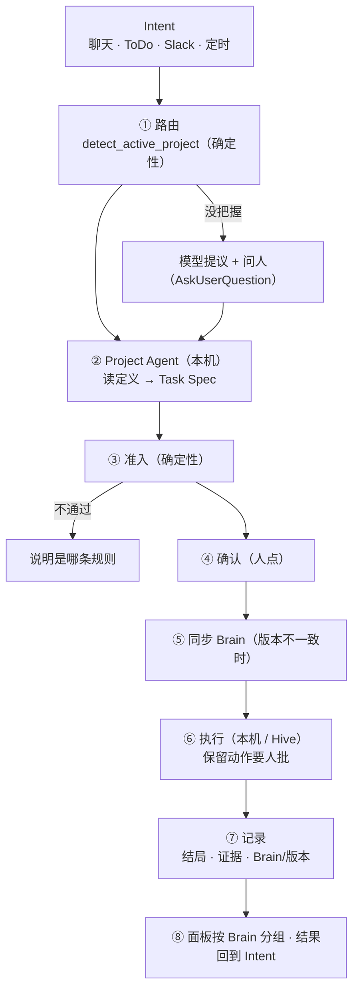
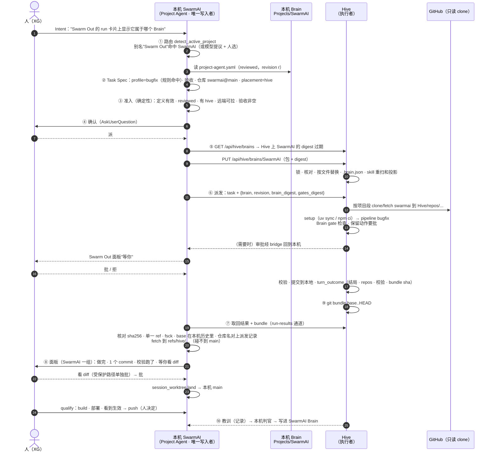

# Project Agent：从 Intent 到 Hive 执行

**r5（XG 2026-10-28）：**
- **一个 Brain 对一个 Project Agent，Project Agent 里分多个工作模式（mode）（§4）。** 同一个 Brain 里的活，在在哪跑、跑哪些校验、准备什么环境、用哪些 skill、交付方式上都不一样，只靠 `profile_rules` 装不下。但如果拆成多个独立的 agent，路由会多一层判断，共享的部分要写好几遍，版本也会散开。所以共享的部分只写一次，每个 mode 只能在它的基础上收紧。
- **每个 mode 有自己的交付方式 `delivery`（§7 ⑨）：**
  - **`bundle`：** 默认值，所有仓库都能用，Hive 上不需要写凭据。
  - **`branch-pr`：** 由 Hive 推一个 `hive/**` 分支再开 PR，只用于满足五个前提的 GitHub 仓库。
  - **直接推 `main`、在 Hive 上直接发 Amazon 内部的 CR：** 都不做。

**r4（定稿）：** 加 §14 E2E 流程图和 §15 推演：用"一个 SwarmAI 代码改动"走完整条 flow。推演暴露出五个缺口，已补进正文：
- **代码怎么回到本机（§7 第 ⑨ 步）。** Hive 没有推送凭据，SwarmAI 也规定只有本机能推（STEERING #5）。r3 写的是在 Hive 上提交，可这个 commit 回不来。现在改成 Hive 把改动打成 `git bundle`，本机取回，用 `session_worktree land` 落地，再在本机做 qualify。
- **执行环境（mode 的 `setup`）。** Hive 上装的是 SwarmAI 的运行时包，不是开发环境。仓库的测试依赖（backend 的开发依赖、desktop 的 node_modules）在 Hive 上没有装（未实测，按 Hive 包的内容推断），校验跑不起来。定义加一个 `setup`，从 CI 里抄装依赖的命令。
- **能力分平台（§4）。** SwarmAI Brain 的 4 个开发 skill 是 `platform: desktop`，Hive 上本来就会过滤掉。定义校验时按 `placements` 提示"这个 skill 在 Hive 上不可用"。
- **路由别名。** SwarmAI 的 `aim.json` 没有 `aliases`，"Swarm Out 的卡片……"这类说法，确定性信号认不出它属于 SwarmAI。生成器从 PRODUCT.md 里的模块名提议别名，人审。
- **qualify 在本机。** SwarmAI 的"qualified"要求本机 build、部署、观察到生效。Hive 上的校验只能算证据，不能算 qualified。Task Spec 的验收把这两件事分开写。

§12 的决策按建议定下来，任何一条你都可以推翻。

**r4 的最后一轮审查（security）：** 找到 2 个 HIGH 和 7 个 MED，都按原因改进了正文，后面靠测试验证：
- **HIGH，代码回本机不经人看（§7 ⑨）：** Hive 上的 agent 会读到不可信的内容，它写的 commit 原本会直接落到本机 main，紧接着在 qualify 时被 build、执行。现在落地前必须由人看 diff。改到受保护路径要单独批。
- **HIGH，bundle 的 fetch（§7 ⑨）：** refspec 写得太宽，能覆盖本机的 `main`。现在只取一个 ref，放进 `refs/hive/` 命名空间，打开 fsck，base 由本机自己核实。
- **MED，安装接口（§6）：** tar 成员和符号链接的检查、Brain 名的校验、大小上限都写清楚了。
- **MED，gate 的执行（§8.2）：** 读一次 gate 文件、对这份字节算 hash、执行的也是这一份，堵住先查后跑的空档。环境变量用白名单。超时就杀掉整个进程组。勾选和 gate 的内容 hash 绑在一起。digest 的范围和同步白名单一致。
- **MED，钉住的值在重启后丢失（§8.2）：** 原来会悄悄放行，现在改成拦下，并由本机核对 gate 的执行记录。
- **MED，导入 Brain 的 skill（§8.2）：** 和 gate 一样要人勾选。
- **MED，保留动作（§8.1）：** 补上 `gh api`、git 别名这些绕法，解释器间接调用写明是已知的缺口。
- **MED，措辞：** "绕过看得见"在 Hive 上只是尽力而为，真正能防篡改的检查是本机对取回来的 diff 的审查。这一点在 §8.2 照实写了。

**r3（XG 2026-10-28 的三条意见）：**
- **没有 Brain 的任务也能派到 Hive。** 这类任务归到通用知识（`Knowledge/Library`），由一个通用的 **Runner Agent** 接手，调研之类的活大多是这一类（§3、§5、§7）。
- **Brain 同步不依赖 Hive 重装或更新。** 本机通过 HTTPS 把包直接推给 Hive 的安装接口，不经过 S3，也不改 IAM（§6）。唯一的前提是 Hive 的版本里有这个接口，这是一次性的。
- **Brain 自带的 skill 和 gate 在 Hive 上真正生效。** Hive 用某个 Brain 的 Project Agent 时，除了系统自带的，还加上这个 Brain 自己的 skill 和 gate。r2 把"执行 Brain 的 gate"推到以后，r3 把它做进来（§8.2），安全上的前提按同一台机器、同一个用户的威胁模型写清楚。
- **新增 §13：** 回答"这是不是 Brain/DDD driven autonomous 的方向"，并补上 r2 缺的一半：Hive 上的经验要回到 Brain。

**r2（一次前提审查之后）：** 审查找到 8 个 HIGH，按原因归成七组，一次改完：
- **§8 的前提是错的。** 现有 gate 只拦 force push 和删除（`security_hooks.py:509-560`），普通的 `git push`、`gh pr create`、`gh release create` 都直接放行。所以"保留给人的动作"要加一个新的判断，挂在带 Project Agent 的会话上，并且不吃审批缓存。
- **执行 Brain 自带的 gate 代码，这一块拆出去另做设计（§8.3）。** Hive 上的 agent 能 `chmod` 和改记录。它能放一个 `json.py` 去顶替 gate 导入的标准库。gate 出错时放行，正好给它留了口子。gate 在后端进程里执行，比上一轮删掉的"执行仓库命令"权限还高。这些问题都要先解决才能做，v1 不执行 gate。
- **schema v2 不能直接向下兼容（§4）。** 已知的键换了位置，三个读取方都要按 `schema` 分开读，P6 改成调用同一个 `validate`。
- **引用检查和版本号（§4）。** 校验命令的来源文件在仓库里，不在 Brain 里，所以只在本机审核时检查，结果存下来。版本号按整个目录算。
- **SwarmAI 的默认定义（§5）。** 种子加载器只读 4 份文档。新装的机器上没有仓库、gate 和 skill，所以默认定义只能引用种子里有的东西。`user_customized` 规则用在这里不对，改成记下发布时的 hash，用它来判断用户有没有改过。
- **Hive 同步（§6）：**
  - **顺序：** 先通过 `update()` 把 IAM 更新上去，才有安装接口可用，最后才能同步。
  - **并发：** Hive 上只有一份 `Projects/<brain>/`，同一个 Brain 装和跑要加锁。
  - **改动检测：** 不再设只读权限，因为 Hive 上有合法的写入方，设了会让它们崩溃。改成安装时记下每个文件的 hash，控制台显示"Hive 改过几个文件"。
- **路由（§7）：** 直接用 `detect_active_project` 的三个信号，别名统一放在 `aim.json` 的 `aliases`，不另加 `keywords`。Task Spec 显式传 `--profile`。
- **另外：** P6 要等现有 Brain 都补上草稿之后再收紧。

## 0. 一句话

**Brain 是一个项目的认知，Project Agent 是这个 Brain 的执行面。**
- 一个 Intent 进来，先找到它属于哪个 Brain。
- 这个 Brain 的 Project Agent 决定做什么、做到什么程度、怎么交付，也就是管 what。
- 然后交给执行者去做，执行者可以是本机或 Hive 上的 agent，管 how。
- 执行者读的 Brain 是从本机同步过去的快照，本机是唯一写入者。
- 执行过程受 Project Agent 里人审过的规则约束。其中会出事的几条，由产品的确定性 gate 拦，不靠提示词。

## 1. 现在缺什么（2026-10-28 读代码，经前提审查核实）

| 环节 | 现状 | 位置 |
|---|---|---|
| Project Agent 定义 | 只有粗的 schema：`default_profile`、`profile_rules`、`placements`、`status` 会校验，其余字段只读不校验 | `core/project_agent.py:43-64,86-104` |
| 建 Brain 时生成 | 只有 skill 里的一段说明（P3b），没有生成代码。缺了 P6 只算 PENDING，草稿算 PASS。模板注释里还列着已删除的 `goal` profile | `skills/s_project-manager/SKILL.md:128-181`、`verify_ddd_complete.py:414-443` |
| 现有定义 | 11 个 Brain 只有 itsdangerous 有，是草稿，只允许 `chat-tab` | `Projects/itsdangerous/project-agent.yaml` |
| 谁读它 | 只有 Brain Hub 和 P6。pipeline、聊天、派发都不读。`pipeline create` 的 `--profile` 默认值是 `direct`，不看 `default_profile` | `routers/ddd_brain.py:621,965`、`run_protocol/cli_commands.py:122-125` |
| Intent → Brain | 没有路由。`detect_active_project` 有三个信号（编辑器路径、绑定的仓库、名字或 `aim.json` 别名），不确定就放弃，现在只用来决定召回哪个 DDD。ToDo 没有项目字段。Swarm Out 派发没有 Brain 参数 | `recall_multi.py:1353-1393,1441-1466`、`routers/todos.py:280`、`core/swarm_out.py:184-200` |
| 能力（④） | 领域 skill 按 `ddd_path(...,"capabilities")` 扫目录，启动时注册成 `source_tier=ddd`。生命周期 skill 和 `aim.json` 里的 native skill 排除在外 | `core/ddd_skill_registry.py:66-96`、`core/skill_manager.py:711-768` |
| 规则（③） | `3-gates/` 里是 Kiro 格式的 preToolUse 钩子：stdin 读 JSON，exit 2 直接拒绝（不是询问），gate 自己出错就放行。SwarmAI 运行时从不执行它们。`no_git_push` 只有 AIDLC 有 | `Projects/AIDLC/3-gates/no_git_push.py:1-12`、`ddd_packager.py:1367` |
| 产品的 gate | 只有在命中以下几类时才要求审批：危险命令列表（sudo、chmod 777 等）、递归 rm、force push 和删除远端、不可替代的存储、v1 land。**普通 push、PR、release、发布包都直接放行**。外部写操作的 gate 对所有会话都开着，但不认识的 MCP 工具一律当成只读 | `security_hooks.py:124-146,509-560,1639-1662,1925-1932`、`tool_risk.py:22-24` |
| 会话怎么被 gate 认出来 | gate 通过闭包里的 `session_key` 和一个可变的 `session_context` 字典识别会话。hook 在每个子进程里只组装一次，预热和复用都共用这一组 | `hook_builder.py:309-375` |
| SwarmAI Brain 默认带 | 每次安装都会建默认的 SwarmAI 项目，种子加载器只读 4 份 canonical 文档，已经存在就不覆盖。Hive 只有用 `--with-live-ddd` 打的包才有完整的 DDD | `swarm_workspace_manager.py:683-708,1127,1255-1300` |
| 本机 → Hive 同步 | 没有。Hive 的 IAM 只能读 `v*` 和 `bridge/<HiveName>/answer/*`，策略在 `update()` 时重写 | `hive/provisioner.py:99,142-155` |
| Hive 控制台 | 有 Hive Fleet（账户、实例、启停、更新、凭据、健康）和 Swarm Out 面板。面板上"按 Brain 分组"标着 TBD | `routers/hive.py:250-709`、`SwarmOutDashboard.tsx:9-11` |

## 2. 参考 AgentSpaces 借什么、不借什么

AgentSpaces（Amazon 内部）已经有同名的 Project Agent：每个项目一个编排者，驱动并行的 worker 会话
（[howto-project-agent](https://docs.hub.amazon.dev/docs/agentspaces/user-guide/howto-project-agent.html)、
[发布博客](https://w.amazon.com/bin/view/JahoodBlog/2026/09-08-introducing-agentspaces-project-agent/)）。

**借：**
1. **分工：Project Agent 管做什么，worker 管怎么做**，Project Agent 不直接改代码（[troubleshooting](https://code.amazon.com/packages/BTDocs-AgentSpaces/blobs/mainline/--/user_guide/troubleshooting.rst)）。
2. **两层规则：**
   - 平台锁死的安全底线：单一写入者，先调查、再按置信度决定，证据只能靠干活产生，人是唯一的发布者，审查者是独立的子 agent。
   - 每个项目自己的规则，每条都经过人审。
3. **规则只能引用真实存在的能力**：定义里提到的 skill、仓库、命令来源都要存在，校验时检查。
4. **置信度门槛**：不到"高"就不动手，先给出"能一锤定音的那个检查"。
5. **证据由记录产生**，模型自报不算。
6. **定义可移植、有版本。** AgentSpaces 用 AIM 包分发，我们用 Brain 本身做载体，再加一个内容 digest 当版本（AgentCore Registry 的版本化配置是同一个思路，[AgentCore](https://docs.aws.amazon.com/bedrock-agentcore/latest/devguide/what-is-bedrock-agentcore.html)）。

**不借：**
1. **会出事的动作只靠提示词拦。** AgentSpaces 自己承认，worker 推送、发 Slack 只靠规则文字拦（[On-Call Project Agent](https://w.amazon.com/bin/view/Amazon_Music/ALPS/Huntrx/OnCallProjectAgent/)）。我们用确定性的 gate 拦（§8）。
2. **一个工作区一个 Project Agent，不加锁。** 我们在 Hive 上对同一个 Brain 的安装和运行加锁（§6）。
3. **没有版本钉住，也没有管理面。** 我们每个 run 都记下定义的版本，控制台能看到每台 Hive 装的是哪一版（§6）。

## 3. 概念和归属

| 概念 | 是什么 | 存在哪 | 谁写 |
|---|---|---|---|
| **Brain（DDD）** | 一个项目的认知：① 身份 ② 知识 ③ 规则 ④ 能力 ⑤ 交付 ⑥ 刷新 | 本机 `Projects/<brain>/` | 本机（唯一写入者） |
| **通用 Brain（General）** | 不属于任何项目的任务用的"大脑"：知识是 `Knowledge/Library` 里的 Markdown（现在 50 篇，约 0.8 MB），没有 ③、④、仓库 | 本机 `Knowledge/Library/` | 本机 |
| **Runner Agent** | 通用 Brain 的 Project Agent：调研、写报告、回答问题这类不属于任何项目的活 | 产品自带的一份定义（§5） | 产品发布，用户审 |
| **Project Agent 定义** | Brain ⑤ 里的一份文件：这个项目的活怎么接、怎么干、怎么交付。从 Brain 的其他部分推出来，人审过才生效 | `Projects/<brain>/project-agent.yaml` | 建 Brain 时生成草稿，人审 |
| **工作模式（mode）** | 一个 Project Agent 里的一种活：什么时候用、哪个 profile、在哪跑、校验、环境、skill、交付方式。只能在共享部分的基础上收紧 | 定义文件里的 `modes` | 同定义 |
| **定义版本（revision）** | 定义文件加上它引用的 skill 目录（整个目录）的 sha256 | 计算得到 | — |
| **Brain 快照** | 一个 Brain 的白名单文件打成的包，按内容寻址 | `bridge/<hive>/brain/<digest>.tar.gz`。Hive 上装到 `Projects/<brain>/` | 本机打包 |
| **Intent** | 人要的结果：一句话、一个 ToDo、一条 Slack | 来源各异 | 人 |
| **Task Spec** | Project Agent 把 Intent 落成的可执行说明：做什么、验收、profile、仓库、在哪跑、定义版本 | 派发记录 | 本机上扮演 Project Agent 的 agent |
| **执行者** | 本机聊天、本机后台 worker，或 Hive 上的 agent | — | — |

## 4. Project Agent 定义：schema v2

一个文件，按 AgentSpaces 的规则分类组织，每条都写来源。

```yaml
schema: 2
status: draft | reviewed          # 只有 reviewed 的能派到 Hive
reviewed_at: 2026-10-28T10:00:00Z
reviewed_by: <login>

# ── 共享部分：所有 mode 都继承，只写一次 ──────────────────────────────
identity:                         # ① 从 AGENTS.md / PRODUCT.md 推出
  summary: 一句话：这里的活通常是什么样
  in_scope: [...]                 # 接哪些活
  out_of_scope: [...]             # 不接哪些（路由时用来排除）
  source: PRODUCT.md

intake:                           # 路由用（§7）。别名不放这里，放在 aim.json 的 aliases（detect_active_project 在读）
  handles:                        # 典型的 Intent，3-8 条，每条一句话，给模型提议时对照
    - 修 SwarmAI 的后端或前端 bug
    - 调研 SwarmAI 某个子系统怎么工作
  repos: [swarmai]                # bindings.yaml 里的资产名。在这些仓库里干活就归这个 Brain

confidence: 不确定根因时先用 research mode，不直接改代码

watches:                          # 审查重点
  - {area: frontend, why: 信息密集的界面先读 design-judgment, source: IMPROVEMENT.md}

gates:                            # ③ 用这个 Project Agent 的会话都要执行的 gate（§8.2）
  enforce: []

reserved_for_human:               # 每次都要人批的动作（§8.1）
  - push
  - open_pr
  - publish_release
  - send_external_message

placements: [chat-tab, hive]      # 所有 mode 的上限
landing: {approval: human}        # 分支和远端类型来自 bindings.yaml

# ── 工作模式：每个 mode 只能收紧，不能放宽 ─────────────────────────────
modes:
  - id: code-change
    when: 改 backend / desktop / hive 的代码
    profile: bugfix               # 或 profile_rules: [{when: 跨模块或改接口, profile: full}]
    placements: [chat-tab, hive]
    repos: [swarmai]
    setup:                        # 执行环境准备，从 CI 里原样抄
      - {command: "cd backend && uv sync", source: .github/workflows/ci.yml}
    validations:
      - {id: backend-tests, command: "...", source: .github/workflows/ci.yml}
    skills: [s_health-check]
    delivery: bundle              # bundle（默认）| branch-pr（§7 ⑨）
  - id: release
    when: build、发版、管 daemon
    profile: direct
    placements: [chat-tab]        # 开发 skill 只能在桌面上用
    skills: [s_swarm-build, s_swarm-release, s_swarm-daemon]
    gates: {enforce: []}          # 只能比共享部分多
    reserved_for_human: [publish_release]   # 只能比共享部分多
  - id: research
    when: 调研、写设计、回答问题
    profile: research
    placements: [chat-tab, hive]
default_mode: code-change

sources: [PRODUCT.md, TECH.md, IMPROVEMENT.md, bindings.yaml, .github/workflows/ci.yml]
```

**兼容：** v2 把已知的键挪了位置，比如 `default_profile` 和 `profile_rules` 被 `modes` 取代。v1 文件读进来时，等同于只有一个 mode 的 v2：`default_profile` 成为这个 mode 的 profile，`profile_rules` 成为它的 profile_rules，`validations` 成为它的校验。不认识的键会被忽略，但这帮不上忙，因为挪走的是认识的键。所以第 1 步要同时改三个读取方：`project_agent.validate` 和 `load_project_agent` 按 `schema` 分开读，`verify_ddd_complete` 的 P6 改成直接调 `validate`，不再保留一份自己的检查。v1 文件照样能读。

**校验（扩展 `validate`）：**
- **保留 v1 的检查：** profile、placements、status。
- **引用检查（共享部分和每个 mode）：**
  - `skills` 里的每一项，都要出现在 `scan_domain_skill_dirs` 的结果里。它返回的是路径，要换成名字。它读不了目录时会抛 `OSError`，抛了就算这一项没通过。
  - `gates.enforce` 里的每一项，都要在这个 Brain 的 `3-gates/` 里。
  - `intake.repos` 里的每一项，都要在 `bindings.yaml` 里。
- **只在本机审核时做的检查：** 各 mode 的 `validations` 的 `source` 在绑定的仓库里，不在 Brain 里。这一项只在本机、在人审核时检查，结果连同检查时间写进 `.project-agent-check.json`。Hive 上不重新检查，只认这份结果。
- **保留动作：** `reserved_for_human` 只能取产品认识的动作名（§8.1 的固定列表）。
- **派到 Hive 的前提：** `placements` 里有 `hive` 时，`status` 必须是 `reviewed`。
- **能力分平台：** 一个 mode 的 `skills` 里有 `platform: desktop`（或 `macos`）的 skill，而这个 mode 的 `placements` 有 `hive` 时，标出"Hive 上不可用"。这不算错，但项目段在 Hive 上不会列出它。
- **mode 只能收紧，不能放宽：**
  - mode 的 `placements` 必须是共享 `placements` 的子集。
  - mode 的 `reserved_for_human`、`gates.enforce` 只能在共享部分的基础上增加，不能删。
  - mode 的 `repos` 必须在 `intake.repos` 里。
  - 违反任何一条都算错。这样安全底线只在共享部分审一次。
- **`default_mode`** 必须是一个存在的 mode。每个 mode 的 `when` 不能为空。mode 的 `id` 不能重复。
- **`delivery: branch-pr`** 只能用在这个仓库的 `bindings.yaml` 里 `remote_kind` 是 GitHub 的 mode 上，其余前提在派发准入时检查（§7 ⑨）。内部仓库（`kind: internal`）只能用 `bundle`。
- **不通过时：** Brain Hub 显示问题清单，派发拒绝。

**版本：** revision 是定义文件，加上所有 mode 用到的 skill 目录、以及整个 `3-gates/` 目录的 sha256。目录里的文件按同步白名单取（`.gitkeep` 这类不同步的文件不算），所以 Hive 从自己那份算出的 revision 和本机相同。改任何一个 mode，revision 都会变。人改了其中任何一样，revision 就变，下一个 run 用新的版本。

## 5. 建 Brain 时同时建出 Project Agent

**新 Brain：P3b 从说明变成代码。** 新增 `core/project_agent_draft.py`，做法和 `brain_bootstrap/apply.py` 一样，模型判断，确定性工具写：

| 字段 | 谁出 | 怎么出 |
|---|---|---|
| `intake.repos`、各 mode 的 `repos` | 代码 | 从 `bindings.yaml` 读 |
| 各 mode 的 `validations` | 代码 | 从绑定仓库的 `validations.json` 或 CI 文件里抽命令，原样抄，不编 |
| 各 mode 的 `skills` | 代码 | `scan_domain_skill_dirs`（路径换成名字，`OSError` 时记成问题），再按平台分到能用它的 mode 里 |
| `gates.enforce` | 代码 | `3-gates/` 里的 gate 文件名。从包导入的 Brain，默认一个都不勾，等人在审核卡上勾 |
| `reserved_for_human` | 代码 | 默认四项都带，人可以删 |
| `modes` 的骨架 | 代码 + 模型 | 代码先放一个 `research` mode（每个 Brain 都有）。有 code-repo 资产的，再放一个 `code-change` mode，`delivery: bundle`。模型读完知识和 skill 后提议别的 mode（比如 SwarmAI 的 `release`、CMHK 的报表），以及每个 mode 的 `when`，并写明来源。每个 mode 的 skill 由代码按平台分好 |
| 各 mode 的 `setup` | 代码 | 从 CI 文件里抽装依赖的命令，原样抄 |
| `aim.json` 的 `aliases` | 模型提议 | 从 PRODUCT.md 里的模块名、产品名提议几个，人审后写进 `aim.json`，路由的确定性信号就能认出它们 |
| `placements` | 代码 | 默认 `[chat-tab]`，人审时可以加 `hive` |
| `identity`、`intake.handles`、各个 mode 的 `when` 和 `profile_rules`、`confidence`、`watches` | 模型提议 | 读完 ② 知识后写成 JSON，每条带来源，工具检查来源存在后才写入 |

生成的定义是 `status: draft`。New Brain 流程最后，Brain Hub 打开这个 Brain，显示一张**审核卡**：
- 每条一行，来源可以点开看。
- 人可以改、删，也可以加上 `hive`。
- 点"确认"之后，状态变成 `reviewed`，写入 `reviewed_at` 和 `reviewed_by`。

**已有的 Brain：** 加一条命令 `artifact_cli project-agent-draft --project <name>`，用同一个生成器给现有的 Brain 补草稿，补好后进 Brain Hub 等人审。SwarmAI、SecDLC、CMHK_SalesIntel、itsdangerous 先补。**P6 等它们都有了草稿再收紧**，收紧后：没有定义算 FAIL，草稿算 PENDING。不先补就收紧，11 个 Brain 里会有 10 个立刻 FAIL。

**默认的 SwarmAI Brain：** 产品随 4 份种子文档一起发一份 SwarmAI 的定义。
- **只引用种子里有的东西。** 新装的机器上没有 `bindings.yaml`，没有 gate，也没有领域 skill，所以这份定义只有一个 `research` mode，没有 `intake.repos`，没有校验，`placements: [chat-tab]`。绑定了 SwarmAI 仓库的机器，可以用生成器在这份默认定义的基础上补全。
- **种子加载器要改。** 现在它只读 4 份 canonical 文档，要加上这个文件。
- **怎么知道用户改过。** 加载时记下发布版本的 hash：本机文件的 hash 等于上次发布的 hash，说明没被改过，就更新成新发布的版本。不等于，说明用户改过，就不动它。这条规则另立，不是 `user_customized`。`user_customized` 是给 context 文件用的固定标记。
- **默认是草稿。** 发布的这份是 `status: draft`，每个用户自己审。如果发成 `reviewed`，就等于产品维护者替每个用户批了保留动作（问题 3）。

**通用的 Runner Agent：** 产品再发一份定义，给不属于任何 Brain 的任务用：
- `identity`：通用调研、写报告、回答问题，不改任何项目的代码。
- 两个 mode：`research`（profile research）和 `write`（写文档、写报告，profile direct）。
- `placements: [chat-tab, hive]`。
- `capabilities` 只用系统 skill。没有仓库，没有 Brain 自己的 gate。
- `reserved_for_human` 四项都带。
- 知识是 `Knowledge/Library` 的 Markdown，同步到 Hive 时作为通用 Brain 的快照（§6）。

和 SwarmAI 默认定义一样以草稿发布，由每个用户自己审。

## 6. Brain 同步到 Hive（带控制台）

**原则：** 本机是唯一写入者，Hive 上的 Brain 是缓存。同步的单位是"一个 Brain 的一个版本"，不是"一次任务"。

**和 Hive 的更新分开：** 同步不经过 S3，也不改 IAM。本机直接把包推给 Hive：
- 走已有的 HTTPS 通道：CloudFront → Caddy 的 basic auth → 应用层的 `hive_auth`（`middleware/hive_auth.py`，hive 模式下每个 `/api/*` 都校验，失败就拒绝）。
- 所以同步随时可以做，不需要重装、也不需要更新 Hive。
- 唯一的前提是 Hive 的版本里有安装接口，这是一次性的。没有这个接口的 Hive 返回 404，本机标成"这台 Hive 的版本太旧，更新一次之后就能同步"。

**同步机制：**
1. 本机按白名单打包这个 Brain，算出 digest。白名单和"文档正在被写就不打包"的检查，见简报设计 r2 §3。通用 Brain 的白名单是 `Knowledge/Library/**/*.md`。和简报设计 r2 不同，`2-understanding/` 下的 `*-archive*.md` 和 `assets/data-source/data-contract/**/*.md` 也在白名单里：它们是知识寻址（`docs/design/2026-10-28-knowledge-addressing.md`）单元表的一部分，带上它们，Hive 上的 `knowledge find` 和本机读到同一批单元、同一批 `unit_id`。测试把 `core.addressing` 读的文件集合钉在白名单里。
2. 本机调 Hive 的 `PUT /api/hive/brains/<brain>`，body 是包本身，带 `digest` 头。Hive 先做这些检查，任何一项不过就拒绝，什么都不写：
   - `<brain>` 符合 `^[A-Za-z0-9_-]{1,64}$`（URL 解码之后再检查，`%2F`、`..` 都过不去），并且不区分大小写地和已有的 Brain 名比对，防止只有大小写不同的两个 Brain。
   - 按 Content-Length 在读入之前就检查 20 MB 上限。解包后的总大小、成员数也有上限。
   - tar 里只接受普通文件：符号链接、硬链接、设备文件、目录项一律拒绝。每个成员的路径规范化之后，必须落在白名单里，不能含 `..`，不能是绝对路径。
   - 每次写或删之前，目标文件和它的每一级父目录，`realpath` 都必须在 `realpath(Projects/<brain>)` 之下，路径中任何一级都不能是符号链接。写文件用 `O_NOFOLLOW`。这样 Hive 上的 agent 事先放进去的目录符号链接，也引不走写入和删除。

   检查都通过后，Hive 把这个 Brain 标成"正在安装"（见下面的"安装和 turn 互斥"），然后：
   - 先删掉旧的 `.brain.json`，再把包里每个文件要落的目录都打开一遍（遇到符号链接、或该是目录的地方是个文件，就在写任何文件之前失败）。装到一半失败时没有记录，这个 Brain 显示"没同步"，不能派发。
   - 白名单内的文件逐个先写临时文件，再 rename。临时文件名是随机的，用 `O_EXCL` 创建，事先放在那里的链接或硬链接永远不会被打开。
   - 白名单范围内、但包里已经没有的文件，删掉。
   - `.artifacts/`、`code_intel.db*`，以及白名单以外的东西不动。
   - 写 `.brain.json`：`{digest, revision, installed_at, files: {路径: sha256}}`。
   - 重新扫描 Brain 的 skill（`ddd_skill_registry.build_manifest`），再执行一次 skill 投影（`projection_layer.project_skills`），新的 skill 就能用了。同一时间只做一次重扫。重扫完才解除"正在安装"。
   - 解包前先有上限地解压：解压后超过上限就拒绝，`tarfile` 读不到一个超大的头。
3. 包大小上限 20 MB。实测：SwarmAI 的文本部分约 5 MB，通用 Brain 约 0.8 MB。

**完整性不靠 Hive 自己的记录：**
- 派发时，本机把这个 Brain 的 digest 和 `3-gates/` 的 digest 写进派发请求。
- Hive 在会话开始时把它们记在会话记录的 `metadata.project_agent` 里（要在后端重启后仍然有效），hook 读一次放进会话的 `session_context`。会话记录在 Hive 的数据库里，agent 改得了它，这和下面说的 P5 边界相同。
- 一个 run 开始时、以及每次执行 gate 之前，都**从文件内容重新计算** digest，再和这个值比对（§8.2）。不读 `.brain.json`，因为它是 Hive 上的文件，agent 改得了。
- 安装接口的 basic auth 防的是外面的人，不保护 Hive 上 Brain 的完整性。Hive 上的 agent 本来就能直接写 `Projects/<brain>/`，也能改掉凭据的 hash 再重启后端（按 P5，这在防范范围之外）。

**安装和 turn 互斥（`core/brain_use.py`）：** 按 turn 计，不按会话计。
- 一个 Project Agent 会话的每个 turn，从第一个事件之前到 turn 结束，都占用它的 Brain。所有 turn 都经过 `SessionRouter._published_turn`，占用就放在这里。新会话的 Brain 来自派发的 pin，老会话的来自会话记录。只在 Hive 上这样做。
- 有 turn 占用时，安装直接拒绝（423），本机提示"Hive 正忙，等它跑完再同步"。不排队等：一个 pipeline turn 可能跑一个小时，HTTP 请求等不了这么久。派发前的自动同步遇到 423，就不派，并说明原因。
- 正在安装时，新的 turn 等安装和 skill 重扫做完再开始，不会读到装了一半的 Brain。
- 判断和标记之间没有 `await`，都在事件循环里完成，所以没有"先查再装"中间插进一个 turn 的窗口。
- 读不出会话记录的 turn（数据库一时读不了）占用所有 Brain，不会有安装落在它下面。
- 已知取舍：排队等 CLI slot 的 turn 也算占用；几个会话的 turn 一直首尾相接时，安装会一直被拒（控制台显示"正忙"）。两种情况都只是同步推迟，不会读到装了一半的 Brain。
- 不同的 Brain 之间互不影响。
- 一个会话的两个 turn 之间，Brain 可以被更新。下一个 turn 用新文件、旧 pin。gate 不一样时，Brain gate 钩子会拦下它的 gated 动作（"Brain 的 gate 被改过"），这个任务要重新派发，而不是在派发时没定过的规则下继续跑。

**只认编号布局：** 白名单只认 `2-understanding/` 这种编号布局。文档还在 Brain 根目录的旧布局 Brain 不同步，提示先迁移，免得 Hive 上缺文档。

**文档正文照原样同步：** `bindings.yaml` 去掉本机的 `worktree` 路径，但文档正文里写到的本机路径（比如设计文档里的 `/Users/<name>/...`）会原样带到 Hive。Hive 是用户自己账户里的机器，这是接受的。

**Hive 上的改动看得见，但不设只读：** Hive 上有合法的写入方会往 `Projects/<brain>/` 里写，比如 pipeline、code_intel、cultivation。设成只读，没有处理 `PermissionError` 的写入方会直接崩溃。所以不设只读，改成：
- 控制台按 `.brain.json` 里的 hash 比对，显示"Hive 改过 N 个文件"。
- 下一次安装会还原这些文件，Hive 上的改动丢掉。

经验带回本机是 HLD §17.4 的封存记录和导入，不在本设计里。在那之前，Hive 上学到的东西不进 Brain，这一点是有意接受的。

**什么时候同步：**
- **派发时自动同步：** 目标 Hive 上这个 Brain 的 digest 和本机不一样，就先同步，同步完再派。
- **控制台手动同步：** "立即同步"、"全部同步"。
- **SwarmAI Brain 和通用 Brain 默认同步：** 每台 Hive 新建、或者控制台第一次看到它时，本机用已有的 basic-auth 客户端（`core/swarm_out.py:154-161`）同步这两个 Brain。这取代 `--with-live-ddd` 打包的做法：那种方式的 seed 在首次启动之后就再也不变了。

**控制台：** 在 Hive Fleet 里每台 Hive 加一栏"Brains"，回答两个问题：这台 Hive 上的 Brain 是不是最新的？哪些 Brain 能派到这里？

| 列 | 内容 |
|---|---|
| Brain | 名字，以及 Project Agent 的状态：已审 / 草稿 / 没有 |
| 本机版本 / Hive 版本 | digest 前 8 位和同步时间。两边不一致时标"过期"。Hive 上改过文件时标"Hive 改过 N 个文件" |
| 能不能派 | 能，或者不能并写明原因：草稿、`placements` 里没有 hive、Hive 版本太旧 |
| 在跑 | 这台 Hive 上用这个 Brain 的 run 数 |
| 操作 | 同步（移除不在第 5、6 步里：没有需要它的流程，等有了再加） |

数据来自 Hive 的 `GET /api/hive/brains`，它读各个 `.brain.json`，只返回 digest、时间和改过的文件数。本机自己的 digest 由本机计算。本机不读 Hive 写的任何文字。

## 7. 一个 Intent 的完整流程



**① 路由：从 Intent 找到 Brain。**
- **先用确定性信号。** 直接用 `detect_active_project`，三个信号都用上，不另写规则：编辑器里打开的路径、会话绑定的仓库、Brain 的名字或 `aim.json` 里的别名。在它前面再加一个信号：人明确指定了 Brain，比如带 `--brain`、在某个 Brain 的页面里发起、ToDo 上带了 Brain。
- **都没命中、或命中了多个时：** 让模型对照各个 Brain 的 `identity` 和 `intake.handles` **提议**一个，并给出理由，然后用已有的 AskUserQuestion 让人选。
- **不属于任何 Brain 的 Intent：** 选项里一定有"不属于任何 Brain"。选了它，就交给通用 Brain 的 **Runner Agent**：走同样的 Task Spec、准入和确认，可以派到 Hive，面板上单独归成"通用"一组。

**② Project Agent：把 Intent 变成 Task Spec。** v1 里的 Project Agent 不是常驻进程，就是本机的 agent 加载这个 Brain 的定义，按 s_swarm-out skill 的步骤写出 Task Spec：

| 字段 | 来自 |
|---|---|
| 做什么 | Intent 原文，加上 Project Agent 补的范围说明 |
| 验收 | 必填，写成能检查的句子 |
| mode 和 profile | 先选 mode：命中哪个 mode 的 `when`（写明是哪个），一个都没命中就用 `default_mode`。再按这个 mode 的 profile 或它的 `profile_rules` 选 profile。派 pipeline 时显式传 `--profile`，不用 CLI 的默认值 |
| 仓库 | 这个 mode 的 `repos` 对应到 `bindings.yaml` 的 clone 地址和分支 |
| 在哪跑 | 人选，但必须在这个 mode 的 `placements` 里 |
| 交付方式 | 这个 mode 的 `delivery` |
| 定义版本 | 当前的 revision，钉住 |

置信度不够的 Intent（根因不清、范围不清），按 `confidence` 先用 research mode，不直接派实现。

**③ 准入（确定性，拒绝时说明是哪一条）：**
- 定义通过 `validate()`。
- 派到 Hive 时：定义是 `reviewed`，`placements` 里有 `hive`，本机审核时的来源检查通过。
- 仓库都有 Hive 拉得到的远端。
- 验收不为空。
- 目标 Hive 能同步 Brain。

**④ 确认：** 列出 Brain、mode 和 profile（以及各自命中的规则）、验收、仓库、在哪跑、交付方式、定义版本，人点了才派。沿用 s_swarm-out 已有的"派出前确认"这一步，用 AskUserQuestion 的形式。

**⑤ 同步：** 见 §6。

**⑥ 执行：**
- 执行者收到 Task Spec，前面加一段由定义生成的项目段：身份、知识怎么取、要跑的校验、交付方式、哪些动作保留给人、会执行哪些 gate、可以用哪些 skill。
- 知识不在项目段里另画地图：Brain 装在 Hive 自己的 `Projects/<brain>/`，Hive 上的 SWARMAI.md 已经写明布局和 `knowledge map | find | get`。项目段只给一行"本任务属于 Brain <brain>，定方案前用方案里的词跑 `knowledge find --project <brain>`"，路径由 Hive 当场算，不会把本机路径带过去。
- 会话的 `metadata.project_agent = {brain, revision}` 来自本机的派发记录，执行约束（§8）靠它认出这个会话。

**⑦ 记录：** 在 run-results 设计已有的记录上，再加：
- `brain`、`revision`。
- `mode`、`delivery`。
- `profile`：派发时定的，和 pipeline 实际用的。
- 每条校验"跑了 / 报错了 / 没跑"：比对 Bash 调用得出，见简报设计 r2 §7。

**⑧ 结果：** 面板按 Brain 分组，没有 Brain 的单独一组。结果挂回原来的 Intent。Intent 是 ToDo 的，更新它的状态。

**⑨ 代码回到本机（改了代码的 run）：**

Hive 不推送，也不需要推送凭据。改动以 `git bundle` 的形式回到本机，**经人看过之后**才落到本机 main。

- **Hive 端：**
  - turn 结束时，对每个声明的仓库，把 `base..HEAD` 打成一个 bundle，放在 `Hive/bundles/<session>/<repo>.bundle`。
  - bundle 的 sha256 写进 `turn_outcome.repos[]`。
- **本机端，先核对**（都在本机做，不信 Hive 报来的任何值）：
  - **sha256 和大小：** sha256 对得上，大小在上限之内。
  - **仓库名：** 和本机的派发记录逐字比对，必须完全一致。本机的任何路径都不从这个名字拼出来。
  - **bundle 本身：** 先 `git bundle verify`，再用 `git bundle list-heads` 确认**只有一个 ref**。
  - **取进来：** 在一个新的 worktree 里执行 `git -c fetch.fsckObjects=true -c transfer.fsckObjects=true fetch --no-tags --no-recurse-submodules <bundle> <ref>:refs/hive/<session>/<repo>`。只取这一个 ref，只写进 `refs/hive/` 这个命名空间，碰不到本机的 `refs/heads/*` 和 tag。fsck 不让畸形对象进来，比如带非法路径的 `.gitmodules`。
  - **base：** base 必须已经在本机仓库里，并且从本机的 `main` 或 `origin/main` 可达。同时 `merge-base --is-ancestor <base> <tip>` 必须为真。base 的值由本机自己检查，不认 Hive 报的。
- **人看过才落地（AskUserQuestion）：**
  - **卡片上列出：** 改了哪些文件、增删多少行、每个 commit 的 sha 和说明。commit 说明是 Hive 写的文字，按数据显示，不进 agent 的上下文。
  - **受保护路径要单独批：** 改到这些路径时，卡片上醒目标出，必须单独确认，不能和别的改动一起批：
    - `backend/core/security_hooks.py`、`backend/hooks/**`、hook 的注册。
    - `.claude/**`、CLAUDE.md、AGENTS.md、`backend/context/**`。
    - `scripts/**`、CI 配置、包清单（`pyproject.toml`、`package.json` 等）。
    - Brain 的 `3-gates/**`。

    这份清单放在仓库自己的 `.swarmai/pipeline.toml` 里（新加一节 `[hive_return] protected`）。每个仓库自己定，产品只提供机制。
  - **人拒绝：** `refs/hive/...` 留着，以后还能看，不会落地。
  - **为什么必须有人看：** Hive 上的 agent 会读到不可信的内容，可能被注入。按 P5，它在 Hive 上能绕过任何 gate。如果不经人看就落地，再在 qualify 时 build、执行，被注入的那一轮就能改掉本机的保护代码，而且这些代码会在本机、用你的凭据跑起来。push 由人决定也来不及，因为 qualify 在 push 之前就已经执行了这些代码。
- **落地：** 人批了以后，用 `session_worktree land` 落到本机 main。`land` 自带 rebase 和"不能把别人的改动改回去"的检查。
- **qualify：** 必须在人批准之后才做，按仓库自己的规则来。SwarmAI 的规则是 STEERING #5：build、部署、看到生效、受影响的测试是绿的。push 仍然只由人决定。
- **Hive 写的文字不进本机 agent 的上下文：** 落地后，`code_change_feed` 会读 commit 说明，把它当成数据加上界线标记，或者在落地时重写 commit 说明、原文作为引用保留。这样 Hive 写的话不会顺着代码变更流，进到本机 agent 之后的上下文里。
- **上面写的是 `delivery: bundle`（默认）。** `self-hosted-main` 的仓库（SwarmAI）落到本机 main。其他仓库在本机落地后，由人决定要不要推送、要不要开 PR。Amazon 内部仓库在本机落地后，由本机的 `s_internal-crux-cr` 准备好 CR 命令，人来执行。

**`delivery: branch-pr`：Hive 推 `hive/**` 分支，再开 PR。**

这种方式适用于 GitHub 上的仓库，人审 diff 的地方从本机的卡片换成了 GitHub 上的 PR。是同一道控制，只是换了位置：PR 上能评论、能看 CI，代码先在 GitHub 的 CI 里跑，然后才可能到本机。

**五个前提，派发准入时都由确定性检查确认，少一条就不允许用 `branch-pr`，并说明是哪一条：**
1. **凭据要窄、要短：**
   - 用一个只装在这个仓库上的 GitHub App，权限只有 contents 写和 PR 写。
   - 每次派发，由本机签发一个 installation token，1 小时内有效，随 Task Spec 发过去，只放进这个会话的 git credential helper，不写到盘上。
   - 绝不用人的 token：人的账号通常在 `main` 分支保护的绕过名单里。
   - Hive 上的 agent 和后端是同一个系统用户，能读到这个 token。所以靠的是范围小、时间短：最坏的情况，是它在 1 小时内往 `hive/**` 分支写东西。
2. **只能写 `hive/**`：** GitHub 的 ruleset 限定这个 App 只能推 `hive/**`。`main` 要求 PR 加批准，而且 App 不在绕过名单里。本机调 GitHub API 确认这两条规则都在。
3. **不让 CI 带出 secret：** 同一个仓库里的分支开 PR，分支里的 workflow 会带着仓库的 secret 跑，被注入的 agent 改一下 workflow 就能把 secret 带走。所以：
   - 默认 `pr_remote: fork`：推到 fork，从 fork 开 PR，这样的 PR 拿不到 secret。
   - 如果用 `pr_remote: origin`，必须有 ruleset 禁止 App 改 `.github/workflows/**`。本机同样调 API 确认。
4. **公开仓库就是发布：** 推上去的分支马上公开，而 Hive 上的 agent 读过私有 DDD。所以公开仓库：
   - 要么推到一个**私有** fork。
   - 要么每次 push 都要人批，批准卡上显示 diff 统计和"这是公开仓库"。
5. **push 和开 PR 仍然是保留动作：** 每次都经 bridge 问人。被批准的 push 只能到 `hive/**`，由 token 的权限保证。

**PR 合并之后：** 本机按平常的方式拉取。SwarmAI 这类要在本机 qualify 的仓库，qualify 仍然在本机做，推送 `main` 也仍然由人决定。

**各仓库用哪种：**

| 仓库 | delivery | 原因 |
|---|---|---|
| SwarmAI | `bundle` | 公开仓库，要在本机 qualify，只能从本机推（STEERING #5）。换成 `branch-pr` 换不来什么，反而多一道发布的风险 |
| itsdangerous 这类外部开源仓库 | `branch-pr`，`pr_remote: fork` | 和开源贡献的正常流程一样 |
| Amazon 内部仓库 | `bundle` | CR 要 Midway 和公司网络，Hive 拿不到，也不该拿到 |
| 直接推 `main` | 任何仓库都不做 | 跳过了人审 |

## 8. 执行约束

三层，越往下越硬：

| 层 | 内容 | 怎么起作用 |
|---|---|---|
| **说明** | 身份、知识、审查重点、置信度、能力 | 写进项目段，执行者读了照做。这一层不能防出事 |
| **证据** | 校验命令、证据要求 | 记录比对，没跑的在面板上显示"没跑" |
| **硬拦** | `reserved_for_human`（询问）、`gates.enforce`（拒绝） | 确定性的钩子，执行者正常干活时绕不过，故意绕过会留下痕迹（§8.2） |

### 8.1 保留给人的动作

**机制：** `dangerous_command_gate` 里加一个判断 `_is_reserved_action(command, reserved)`：
- **生效条件：** 只在会话带着 Project Agent 时生效，也就是 `session_context["project_agent"]` 有值。
- **这个值从哪来：** 会话开始或派发时，从 `metadata.project_agent` 写进去。gate 在被调用的那一刻去读它。
- **为什么这样写：** hook 在每个子进程里只组装一次，所以只能注册一个常驻的判断，在调用时读状态。
- **切命令的方式：** 和现有判断用同一套 `shlex` 切分，复用里面对 git 全局参数和 `gh api` 的处理（`security_hooks.py` 约 530-546 行）。
- **已知的缺口，照实写出：**
  - 现有判断的绕法同样存在：`nice`、`timeout`、子 shell。
  - 通过解释器间接执行（`python -c 'subprocess.run(["git","push"])'`，或者先写一个脚本再运行），这个判断看不到。
- **兜底的控制是凭据：**
  - **Hive 上：** 本来就没有推送和发布的凭据。
  - **本机：** 带 Project Agent 的会话，环境里不放 `GH_TOKEN`，也不配置 credential helper。

| 动作名 | 判断 |
|---|---|
| `push` | 任何 `git push`、`git send-pack`。带 `-c alias.*` 的 git 调用和 `git config alias.*`，都按 push 算 |
| `open_pr` | `gh pr create`、`gh pr merge`、`gh pr ready`。`gh api` 对 `.../pulls` 的写请求 |
| `publish_release` | `gh release create`、`upload`、`edit`。`gh api` 对 `.../releases` 的写请求。`npm`、`pnpm`、`yarn`、`uv`、`poetry`、`hatch` 的 publish。`twine upload`。`cargo publish`。`gem push`。`docker push` |
| `send_external_message` | 外部写操作的 gate 本来就对所有会话开着。在带 Project Agent 的会话里，它不认识的 MCP 工具当成外部写操作，不再当成只读 |

**每次都要批：** 保留动作不吃审批缓存（`permission_mgr.is_command_approved`），做法和 v1 land 请求现在跳过缓存一样（`_is_v1_land_request`，`security_hooks.py:484,1772`）。这样批过一次 `git push`，下一次还得再批。

**在 Hive 上：** 审批走已有的问题面板，再由 bridge 镜像回本机（每 20 秒一次，最多等 4 小时）。上一轮的真机测试已经验证过放行和拒收两条路径。

### 8.2 Brain 自己的 gate 和 skill

**一个会话用某个 Brain 的 Project Agent 时，能用的东西 = 系统自带的 + 这个 Brain 自己的。**

**Brain 的 gate（`3-gates/`）：** 新加一个产品级的 PreToolUse 钩子，所有会话都注册。被调用时先读 `session_context["project_agent"]`：
- 没有这个值：直接放行，不执行任何 Brain gate。行为和现在完全一样。
- 有这个值：按定义里的 `gates.enforce` 依次执行这些 gate。
  - **协议：** 和 Kiro 一样，stdin 读 JSON，exit 2 表示拦下，stderr 作为理由给 agent 看。已有的 gate 不用改。
  - **先核对完整性：** 每个 gate 文件只读一次，对读到的字节算 hash，执行的也是这一份字节：把它复制到临时目录里再执行，这样中间被换掉也没用。digest 的范围和同步白名单一致，不含 `__pycache__`，必须等于派发时钉住的值（§6）。不等，就拦下这个动作，并报"Brain 的 gate 被改过"。
  - **隔离执行：**
    - 用后端自己的解释器（`sys.executable -I`），不去 PATH 上找 `python`。
    - 在一个临时的空目录里执行，所以放一个 `json.py` 之类的文件，顶替不了标准库。
    - 环境变量用白名单，只给 `PATH`、`LANG`，`HOME` 指向临时目录。AWS、Bedrock、`hive-auth.env` 里的变量都不传进去。
    - 新开一个进程组（`start_new_session=True`），超时就杀掉整个进程组。
    - 这些措施挡不住同一个用户对文件系统的访问：gate 是代码，可以读写这个用户能读写的一切。所以导入 Brain 的 gate，人勾选它，就等于批准执行一段代码（见下）。
  - **gate 自己吞掉的错误：** 有的 gate 自己约定"出错放行"，例如 `no_git_push.py` 第 11 行，出错就 exit 0。这种情况在外面看来就是放行。审核卡上会标出这类 gate。
  - **出错就拦：** gate 自己出错、超时（上限 5 秒）、或 digest 不对，在 Project Agent 会话里一律拦下。这里不沿用 AIDLC 那个 gate"出错放行"的约定，因为用了 Project Agent，就是要这些规则真正生效。
  - **开销：** 每次工具调用会为每个 gate 起一个进程。v1 只对 Bash、Write、Edit 执行，其他工具不执行。

**gate 拦下和保留动作的区别：**
- gate exit 2 是**拒绝**：不进审批，人也放不行。要放行，只能改 Brain 本身，也就是在本机改 gate、再同步一次。
- §8.1 的保留动作是**询问**：每次都等人批。
- 两者都配了的动作（比如 Brain 带了 `no_git_push`，`reserved_for_human` 里又写了 `push`），拒绝优先。审核卡上会提示这种重复，建议只留一个。

**这样做合不合 P7：** 执行 Brain 自己声明的 gate，是一个对所有用户、所有 Brain 都一样的产品能力。每个 Brain 都有 `3-gates/`，执行与否由这个 Brain 的定义决定，不认任何特定的仓库或项目。它也不挡正常的工作：没有用 Project Agent 的会话完全不受影响。被拦下时有理由，改 Brain 就能放行。

**安全前提（按同一台机器、同一个用户的威胁模型）：**
- **防的是什么：** 在 Hive 上，agent 和后端是同一个系统用户，所以 agent 能改的东西，后端也能改，反过来也一样。这和本机的情况相同，按已经定下的 P5：同一个用户的 agent，不在加密级的防范范围内。
- **gate 防的是：** 执行者犯错，或者被读到的内容带偏、去做 Brain 不允许的事。
- **gate 防不了：** 一个铁了心要绕过的 agent。它可以停掉这个钩子所在的进程。
- **能做到的最好的事：** 让绕过变得看得见。digest 不对就拦、改过的文件在控制台标出来、拦下的动作写进记录。
- **这和上一轮删掉的东西不一样：** 上一轮删掉的，是 turn 结束时后端去执行仓库里的命令，执行什么由 Hive 上的 agent 能改的仓库配置决定。这一次，执行的是本机 Brain 里的 gate，内容由派发时钉住的 digest 锁定，Hive 上改了就不执行。
- **gate 是代码，信不信看来源：**
  - 本机自己写的 Brain，直接执行。
  - 从包导入的 Brain，它的 gate 和 skill 都是别人写的。审核卡上逐个列出，人勾选了才执行 gate、才投影 skill。勾选和这一项的内容 hash 绑在一起，重新导入后内容变了，就要重新勾选。没勾选的，记一条"有 gate / skill 没被信任"。
- **钉住的值在重启后会丢：**
  - Hive 的后端是 `Restart=always`，重启后，内存里钉住的值就没了。
  - 如果会话记录说它是 Project Agent 会话，内存里却没有钉住的值，就拦下 Bash、Write、Edit，直到本机重新发来钉住的值，不会悄悄放行。
  - 会话记录本身在 Hive 的数据库里，agent 改得了，所以本机再做一层核对：`turn_outcome` 报告执行了几个 gate、核对了哪些 digest，本机拿它和自己的派发记录比，对不上就标出"Project Agent 会话没有执行 gate"。
- **"看得见"的程度，照实写：**
  - 在 Hive 上，拦下、改动计数、执行记录都由 Hive 上的代码产生，一个铁了心的 agent 都改得了。所以在 Hive 上，这些只能做到尽力而为，做不到防篡改。
  - gate 能防的，是犯错和不针对 gate 本身的注入。
  - 真正能防篡改的，是本机对取回来的东西的审查：§7 ⑨ 的 diff，由人来看。

**Brain 的 skill（`4-capabilities/`）：**
- 同步之后，Hive 上的 skill 扫描和投影会把这个 Brain 的领域 skill 加进来（§6 第 2 步），和本机现在的做法一样。导入的 Brain 只投影人勾选过的 skill（见上）。
- **v1 的边界：**
  - 投影是整个 workspace 一份，不是每个会话一份。所以 Hive 上同步了的 Brain，它的 skill 对所有会话都可见。
  - 项目段里列出这个 Project Agent 要用哪几个 skill，执行者按这个名单用。
  - 两个 Brain 有同名 skill 时，按 skill_manager 现有的遮蔽规则只留一个，同时记一条警告。审核卡上提示改名。
- **以后：** 要做到"只有用这个 Brain 的会话才看得到它的 skill"，需要每个会话一份投影目录。现在会话共用同一个 cwd，这是单独的一步。

## 9. 对已有设计的影响

- **简报设计 r2：** §3（简报内容）、§4（安装）、§7（证据）并入本设计。简报不再按任务打包，改成按 Brain 同步。和任务有关的部分（验收、profile、仓库）放进 Task Spec。r2 里"Hive 上的文件设成只读"那条改成本设计 §6 的改动检测。
- **Swarm Out HLD §5.2 的 worker 角色：** 本设计先做到"Hive 上的 Brain 由本机同步，Hive 上的改动看得见"。全面关闭认知写入和经验导入，仍按 HLD 做。
- **delivery OS HLD 的 Asset Registry：** v1 就是 Brain Hub，加上 Project Agent 的状态和版本，不另建注册表。
- **New Brain 设计：** P3b 从说明变成代码。P6 等补完草稿之后再收紧。

## 10. 分步落地

| 步 | 内容 | 依赖 | 能单独验证的结果 |
|---|---|---|---|
| 1 | schema v2：三个读取方同时改，引用检查，本机来源检查，revision | — | v1 的 itsdangerous 定义照常显示。一个 v2 示例，validate 能列出它的问题 |
| 2 | 草稿生成器和命令。skill 的 P3b 改成调用生成器。SwarmAI 默认定义、Runner Agent 定义和种子加载器 | 1 | SwarmAI、SecDLC、CMHK_SalesIntel、itsdangerous 和通用 Brain 都有了草稿 |
| 3 | Brain Hub 审核卡（含导入 Brain 的 gate 勾选）。补完草稿后收紧 P6 | 2 | 你审完的 Brain 变成 reviewed，版本号显示出来 |
| 4 | §8.1 保留动作 + §8.2 Brain gate 钩子（完整性、隔离、出错就拦） | 1 | 本机带 Project Agent 的聊天里：`git push` 每次都要批。itsdangerous 声明的 gate 生效。改了 gate 文件，动作被拦下 |
| 5 | Hive 端：安装接口（HTTPS 推送）、`GET /brains`、锁、改动检测、skill 重扫和投影。默认同步 SwarmAI 和通用 Brain | 1 | 两台 Hive 上 SwarmAI 和通用 Brain 都和本机同一版本，同步不需要更新 Hive |
| 6 | Hive Fleet 的 Brains 栏 | 5 | 控制台能看到版本、过期、Hive 改过的文件数、能不能派，能手动同步 |
| 7 | 派发：路由（含 Runner Agent）、Task Spec、准入、确认、自动同步。改写 skill | 3、4、5 | 用 itsdangerous 派一个 bugfix。用 Runner Agent 派一个调研 |
| 8 | 记录：brain、revision、profile、校验比对、被 gate 拦下的动作。面板按 Brain 分组 | 7 | 面板上 itsdangerous 一组、通用一组 |
| 9 | 代码回到本机（§7 ⑨）：Hive 打 bundle，本机取回、核对、`land` | 8 | §15 的 SwarmAI 推演从头跑到尾，改动落到本机 main |
| 9b | `delivery: branch-pr`：GitHub App 的签发、ruleset 和 fork 的检查、只推 `hive/**` | 9 | 用 itsdangerous 派一个 bugfix，Hive 推到 fork 的 `hive/<run>`，开出一个 PR |
| 10 | 经验回流（§13）：Hive run 的教训作为记录交回，本机用同一个判官写进 Brain | 8 | 一个 Hive run 的教训，过判官后出现在本机 Brain 的 IMPROVEMENT 里 |

## 11. 验证计划

- **定义：**
  - 引用了不存在的 skill、gate、仓库，validate 能报出来。
  - 本机来源检查没过的定义，不能派到 Hive。
  - 草稿不能派到 Hive。
  - 改了引用的 skill 目录里任何一个文件，revision 都会变。
  - v1 的文件照常能读。
- **生成器：**
  - 生成的 validations 都能在来源文件里逐字找到。
  - 没有来源的行不写。
  - SwarmAI 默认定义只有在没被改过（hash 等于上次发布的）时才更新。
- **路由：**
  - 确定性信号命中时，不问模型。
  - 命中多个或一个都没命中时，一定问人。
  - "不属于任何 Brain"的 Intent 交给 Runner Agent，能派到 Hive，面板上归到"通用"一组。
- **同步：**
  - 白名单以外的文件不在包里。
  - 同样的内容，digest 相同。
  - 有 run 在用这个 Brain 时不装。一个 run 要开始时，如果 digest 不对就被拒。
  - 白名单范围内已经被删掉的文件，在 Hive 上也删掉。
  - Hive 上改过的文件能在控制台看到，下一次安装还原。
  - 没有安装接口的 Hive（404）标成"更新一次之后就能同步"。有接口的 Hive，同步不需要更新。
  - 同步之后，Brain 的 skill 出现在 Hive 的 skill 列表里。
- **执行：**
  - 带 Project Agent 的会话里，四个保留动作每次都要审批，批过一次不会自动放行。
  - 不带 Project Agent 的会话，行为不变。
  - Hive 上的审批能经 bridge 回到本机。
  - Brain gate：exit 2 时动作被拦，理由给到 agent。`3-gates/` 里改了任何一个文件（包括新放一个 `json.py`），digest 不对，动作被拦。gate 出错或超时，动作被拦。不带 Project Agent 的会话里 gate 不执行。
  - 导入的 Brain，没被勾选的 gate 不执行、skill 不投影，并记下"有 gate / skill 没被信任"。gate 内容变了，原来的勾选失效。
  - gate 文件在计算 hash 之后被换掉，执行的仍然是计算 hash 时的那份字节。gate 的环境里没有 AWS 和 auth 变量。gate 超时，整个进程组被杀掉。
  - 后端重启后，Project Agent 会话没有钉住的值时，Bash、Write、Edit 被拦。
  - `gh api` 对 pulls 和 releases 的写请求、带 git 别名的 push、`git send-pack`，都被当成保留动作。
- **安装接口：**
  - tar 里有 `..` 路径、绝对路径、符号链接或硬链接时，整包拒绝。
  - 事先放好的目录符号链接，引不走写入和删除。
  - Brain 名是 `..`、`%2F`，或者只是大小写不同的，都拒绝。
  - 超过大小上限，在读入之前就拒绝。
- **mode：**
  - mode 放宽了共享部分（多了一个 placement、少了一个保留动作、少了一个 gate），validate 报错。
  - `release` mode 派到 Hive，被准入拒绝。
  - v1 文件读出来，等同于一个 mode。
  - 选中的 mode 和它命中的 `when` 出现在确认卡上和记录里。
- **branch-pr：**
  - 五个前提少了任何一个，准入时都拒绝用 `branch-pr`，并说明是哪一条。
  - token 推 `main` 被 GitHub 拒绝。
  - fork 来的 PR 拿不到 secret。
  - 内部仓库配了 `branch-pr`，validate 报错。
- **代码回本机：**
  - 一个试图更新 `refs/heads/main` 的 bundle，只会写进 `refs/hive/`。含两个 ref 的 bundle 被拒。含畸形对象的 bundle 被 fsck 拒。
  - base 不在本机历史里时拒绝。
  - 仓库名和派发记录不一致时拒绝。
  - 没有人批，不落地。改到受保护路径时，要单独批。
  - commit 说明不以文字形式进入本机 agent 的上下文。
- **记录：**
  - run 的 brain 和 revision 来自本机的派发记录。
  - 面板分组正确，没有 Brain 的单独一组。

**审查：** 前提审查已经做过一次（r2）。r3 里新增的 §8.2（gate 执行）和 §6（HTTPS 推送），实现前再审最后一次（security），之后靠测试验证。每一步实现完，按改动请 correctness。第 4、5 步加 security。

## 12. 已定的决策（按建议定，任何一条都可以推翻）

| # | 决策 | 理由 |
|---|---|---|
| D1 | 路由：确定性信号命中就直接用。没命中时，模型提议、人用 AskUserQuestion 选。全自动以后按记录的准确率再开 | 派到 Hive 前一定有人看过是哪个 Brain |
| D2 | 没有 Brain 的任务交给通用 Brain 的 Runner Agent，可以派到 Hive | XG 2026-10-28 |
| D3 | 通用 Brain 同步 `Knowledge/Library` 下的全部 Markdown | 量小（约 0.8 MB），只到用户自己账户里的 Hive |
| D4 | SwarmAI 默认定义和 Runner Agent 定义以草稿发布，每个用户自己审 | 发成 reviewed，等于产品替每个用户批了保留动作 |
| D5 | Brain gate 在 Project Agent 会话里出错就拦 | 用了 Project Agent，规则就要真正生效 |
| D6 | Brain 的 skill 在 Hive 上对所有会话可见（v1） | 按会话隔离需要每个会话一份投影目录，单独做 |
| D7 | 同步走 HTTPS 推送，和 Hive 的更新分开 | XG 2026-10-28 |
| D8 | Hive 不推送，代码用 bundle 回到本机落地 | Hive 上没有凭据，只有本机能推（§7 ⑨） |
| D10 | 一个 Brain 对一个 Project Agent，里面分多个 mode。mode 只能收紧 | 既有按活分开的表达力，又不多一层路由，共享部分只审一次 |
| D11 | `delivery` 默认 `bundle`。`branch-pr` 只用于满足五个前提的 GitHub 仓库。任何仓库都不直接推 `main`。Hive 上不发内部 CR | 人审 diff 这一道控制，无论用哪种交付方式都在 |
| D9 | 先做 §10 的 1–4 步 | 做完就能审定义。本机会话里，保留动作和 Brain gate 开始生效 |

## 13. 这是不是 Brain/DDD driven autonomous 的方向

**方向是对的，判断依据有三条：**
- **判断力在 Brain 里，不在执行者里。** 一个任务做得好不好，取决于它拿到的是哪个 Brain：知识、规则、能力和交付约定。执行者是本机还是 Hive、是哪一个模型，都可以换。这就是"DDD 驱动"：同一个执行者，带上不同的 Brain，就按不同项目的标准干活。
- **约束是确定性的，不是提示词。** Brain 自己的 gate、保留给人的动作、校验证据，都由 OS 执行和记录（模型提议，OS 决定）。自治的程度，取决于这些确定性的约束有多完整，而不是模型有多听话。
- **本机是唯一的大脑。** Hive 是执行面，同步过去的是快照。这样 Brain 不会分叉，所有 run 都由同一个 Brain 来判断。

**但 r2 只做了一半：上下文出得去，经验回不来。**
- 只有"派出去"这一半，Hive 上的 run 只是在消耗 Brain，不会让它变聪明。
- 而 SwarmAI 的核心是复利：每一次干活，都让下一次更好。
- 所以 r3 加了第 9 步，**经验回流**：
  - Hive 上一个 run 结束时，它 REFLECT 出来的教训，连同证据，作为记录交回本机，走的是 run-results 已有的取回通道。
  - 本机用和本地 run 同一个判官、同一套路由，写进这个 Brain。本机仍然是唯一写入者。
  - 判官没通过的，进可恢复的存档，和本地的做法一样。
  - 这一步做完，环才闭合：Brain → Project Agent → 执行 → 证据和教训 → 判官 → Brain。

**还有两个缺口，现在不做，但要记下：**
- **定义会过期。** Brain 的知识在变：cultivation 会往里写，人也会改。Project Agent 定义是从 Brain 推出来的，Brain 变了，定义也可能需要变。后续可以在 Brain 变化时重新跑一遍生成器、和现有定义做对比，有差异就在 Brain Hub 提示"定义可能需要更新"。这样定义不会悄悄跟 Brain 脱节。
- **自治程度应该按记录来放开。** 每个 Brain 的 run 都有记录：有多少不需要人介入、校验跑了没有、被 gate 拦了几次。这些数字可以用来决定哪些 Brain 可以少问人（比如路由不再确认、低风险 profile 自动派发），而不是一开始就全部放开。这是 delivery OS HLD 里 Autonomous Delivery Rate 的一个具体用法。

## 14. E2E 流程图



## 15. 推演：一个 SwarmAI 的代码改动

**Intent：** "Swarm Out 的 run 卡片上，显示这个 run 属于哪个 Brain。"这是一个真实的小需求，§7 第 ⑧ 步会用到它。

**前提（§10 的 1–9 步已经落地）：** SwarmAI 的定义已经审过、写了 `hive`，两台 Hive 是新版本。表里引用的 SwarmAI 定义内容（profile 规则、审查重点、校验命令）是假设的：现在这份定义还不存在，要由生成器出草稿、你审过之后才有。

| 步 | 发生了什么 | 依据 |
|---|---|---|
| ① 路由 | 消息里没出现"SwarmAI"。审过的别名里有"Swarm Out"（来自生成器的提议），信号 3 命中 SwarmAI。如果没有这个别名，就由模型对照各个 Brain 的 `handles` 提议 SwarmAI，再问你 | `recall_multi.py:1441-1466`（别名来自 `aim.json`） |
| ② Task Spec | 命中 `code-change` mode 的 `when`（改 backend / desktop 的代码），这个 mode 的 profile 是 `bugfix`，`delivery: bundle`。仓库：`swarmai`，`https://github.com/xg-gh-25/SwarmAI.git@main`。验收分成两条：Hive 上的校验跑过（证据），本机落地后 qualified（STEERING #5） | `Projects/SwarmAI/bindings.yaml`、`project-agent.yaml` |
| ③ 准入 | 定义有效，是 reviewed，`placements` 里有 `hive`。仓库是公开的，Hive 拉得到。4 个开发 skill 是 `platform: desktop`，项目段在 Hive 上不会列出它们 | `4-capabilities/s_swarm-*/SKILL.md` |
| ④ 确认 | 你看到：SwarmAI · code-change / bugfix · bundle · 验收两条 · swarmai@main · explorer · revision 前 8 位 | — |
| ⑤ 同步 | explorer 上的 SwarmAI 还是 `--with-live-ddd` 的旧 seed，digest 对不上，先推一个新包（约 5 MB）。装的时候拿锁，没有用 SwarmAI 的 run 在跑 | §6 |
| ⑥ 执行 | Hive 上的 agent 读到项目段：`AGENTS.md`、知识地图、审查重点（例如"前端改动要先读 `s_frontend-design` 的 design-judgment"）、`setup`、要跑的校验（受影响的 vitest、tsc）、"只提交、不推"、保留动作。它 clone 仓库，跑 setup，进 pipeline bugfix。SwarmAI 的 `3-gates/` 里没有 gate 脚本，所以 Brain gate 这一层什么都不执行。它在 Hive 本地 clone 的 main 上 land（pipeline 的落地），不推 | `.swarmai/pipeline.toml`、`ci.yml` |
| ⑦ 记录 | `turn_outcome`：结局 `completed`。`repos[0]`：2 个文件 +40 −3、1 个 commit、`pushed: no`、bundle sha。校验：vitest 跑了，tsc 跑了。`brain: SwarmAI`、`revision`。pipeline 五维 | run-results 设计 |
| ⑨ 代码回本机 | 本机取回 bundle，核对 sha256。bundle 里只有一个 ref，fsck 通过，base 在本机 main 的历史里，仓库名和派发记录里的 `swarmai` 一致。fetch 到 `refs/hive/<session>/swarmai` | §7 ⑨ |
| ⑧ 面板 | SwarmAI 一组里，这张卡片写着：做完 · swarmai：1 个 commit，改了 2 个文件 +40 −3 · 校验：vitest、tsc 跑了 · **等你看 diff** | — |
| 人看 diff | 卡片列出 2 个文件：`LiveDispatches.tsx`、`swarm_out_results.py`。都不在受保护路径里，你看过后批准。然后 `session_worktree land`：本机 main 上有别人的新提交，`land` 先 rebase，再做回退检查，然后 fast-forward | `scripts/session_worktree.py:140` |
| qualify | 你 build、重启，看到卡片上真的出现 Brain 名。受影响的测试本机再跑一次，是绿的。然后决定 push | STEERING #5 |
| ⑩ 经验 | REFLECT 出一条教训（例如"`/runs` 白名单要显式加字段，否则新字段到不了卡片"），作为记录交回，过本机判官，写进 SwarmAI 的 IMPROVEMENT | §13 |

**推演暴露出的缺口和处理（已经补进正文）：**

| 缺口 | 处理 |
|---|---|
| Hive 上的 commit 回不到本机 | §7 ⑨：bundle，人看 diff，再在本机 `land` |
| Hive 上没有开发依赖，校验跑不起来 | 每个 mode 加 `setup`，从 CI 里抄 |
| SwarmAI 的开发 skill 只能在桌面上用 | 校验按 `placements` 标出。项目段在 Hive 上不列出它们 |
| "Swarm Out"这类说法认不出是 SwarmAI | 生成器提议 `aim.json` 的 `aliases`，人审 |
| Hive 上的校验不等于 qualified | Task Spec 的验收分开写。qualify 在本机，push 由人决定 |

**推演里刻意没解决的：**
- **SwarmAI 的 `3-gates/` 是空的。** 这个推演里 Brain gate 这一层不起作用，会出事的动作只靠保留动作那一层拦（push 要批）。要不要给 SwarmAI 写 gate，是 SwarmAI 这个 Brain 自己的事，不是这份设计的事。
- **本机 main 落后很多时，rebase 可能冲突。** 冲突由 `land` 报出来，人来处理，和本地的 worktree 冲突一样。
