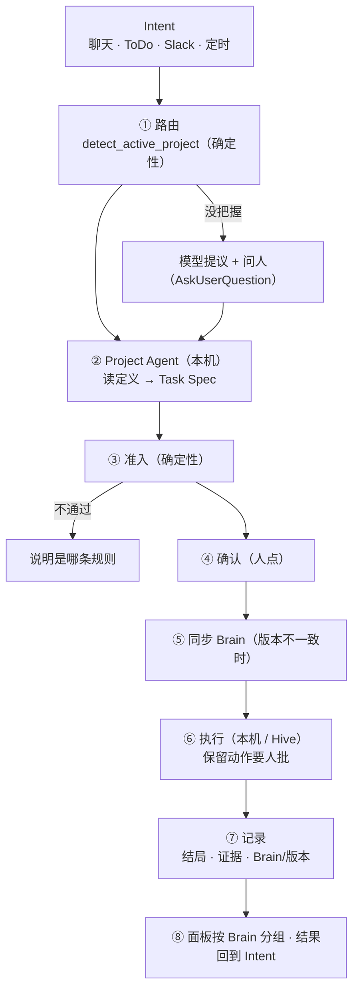

# Project Agent：从 Intent 到 Hive 执行

**r2（一次前提审查之后）：** 审查找到 8 个 HIGH，按原因归成七组，一次改完：
- **§8 的前提是错的。** 现有 gate 只拦 force push 和删除（`security_hooks.py:509-560`），普通的 `git push`、`gh pr create`、`gh release create` 都直接放行。所以"保留给人的动作"要加一个新的判断，挂在带 Project Agent 的会话上，并且不吃审批缓存。
- **执行 Brain 自带的 gate 代码，这一块拆出去另做设计（§8.3）。** Hive 上的 agent 能 `chmod` 和改记录。它能放一个 `json.py` 去顶替 gate 导入的标准库。gate 出错时放行，正好给它留了口子。gate 在后端进程里执行，比上一轮删掉的"执行仓库命令"权限还高。这些问题都要先解决才能做，v1 不执行 gate。
- **schema v2 不能直接向下兼容（§4）。** 已知的键换了位置，三个读取方都要按 `schema` 分开读，P6 改成调用同一个 `validate`。
- **引用检查和版本号（§4）。** 校验命令的来源文件在仓库里，不在 Brain 里，所以只在本机审核时检查，结果存下来。版本号按整个目录算。
- **SwarmAI 的默认定义（§5）。** 种子加载器只读 4 份文档。新装的机器上没有仓库、gate 和 skill，所以默认定义只能引用种子里有的东西。`user_customized` 规则用在这里不对，改成记下发布时的 hash，用它来判断用户有没有改过。
- **Hive 同步（§6）：**
  - **顺序：** 先通过 `update()` 把 IAM 更新上去，才有安装接口可用，最后才能同步。
  - **并发：** Hive 上只有一份 `Projects/<brain>/`，同一个 Brain 装和跑要加锁。
  - **改动检测：** 不再设只读权限，因为 Hive 上有合法的写入方，设了会让它们崩溃。改成安装时记下每个文件的 hash，控制台显示"Hive 改过几个文件"。
- **路由（§7）：** 直接用 `detect_active_project` 的三个信号，别名统一放在 `aim.json` 的 `aliases`，不另加 `keywords`。Task Spec 显式传 `--profile`。
- **另外：** P6 要等现有 Brain 都补上草稿之后再收紧。

## 0. 一句话

**Brain 是一个项目的认知，Project Agent 是这个 Brain 的执行面。**
- 一个 Intent 进来，先找到它属于哪个 Brain。
- 这个 Brain 的 Project Agent 决定做什么、做到什么程度、怎么交付，也就是管 what。
- 然后交给执行者去做，执行者可以是本机或 Hive 上的 agent，管 how。
- 执行者读的 Brain 是从本机同步过去的快照，本机是唯一写入者。
- 执行过程受 Project Agent 里人审过的规则约束。其中会出事的几条，由产品的确定性 gate 拦，不靠提示词。

## 1. 现在缺什么（2026-10-28 读代码，经前提审查核实）

| 环节 | 现状 | 位置 |
|---|---|---|
| Project Agent 定义 | 只有粗的 schema：`default_profile`、`profile_rules`、`placements`、`status` 会校验，其余字段只读不校验 | `core/project_agent.py:43-64,86-104` |
| 建 Brain 时生成 | 只有 skill 里的一段说明（P3b），没有生成代码。缺了 P6 只算 PENDING，草稿算 PASS。模板注释里还列着已删除的 `goal` profile | `skills/s_project-manager/SKILL.md:128-181`、`verify_ddd_complete.py:414-443` |
| 现有定义 | 11 个 Brain 只有 itsdangerous 有，是草稿，只允许 `chat-tab` | `Projects/itsdangerous/project-agent.yaml` |
| 谁读它 | 只有 Brain Hub 和 P6。pipeline、聊天、派发都不读。`pipeline create` 的 `--profile` 默认值是 `direct`，不看 `default_profile` | `routers/ddd_brain.py:621,965`、`run_protocol/cli_commands.py:122-125` |
| Intent → Brain | 没有路由。`detect_active_project` 有三个信号（编辑器路径、绑定的仓库、名字或 `aim.json` 别名），不确定就放弃，现在只用来决定召回哪个 DDD。ToDo 没有项目字段。Swarm Out 派发没有 Brain 参数 | `recall_multi.py:1353-1393,1441-1466`、`routers/todos.py:280`、`core/swarm_out.py:184-200` |
| 能力（④） | 领域 skill 按 `ddd_path(...,"capabilities")` 扫目录，启动时注册成 `source_tier=ddd`。生命周期 skill 和 `aim.json` 里的 native skill 排除在外 | `core/ddd_skill_registry.py:66-96`、`core/skill_manager.py:711-768` |
| 规则（③） | `3-gates/` 里是 Kiro 格式的 preToolUse 钩子：stdin 读 JSON，exit 2 直接拒绝（不是询问），gate 自己出错就放行。SwarmAI 运行时从不执行它们。`no_git_push` 只有 AIDLC 有 | `Projects/AIDLC/3-gates/no_git_push.py:1-12`、`ddd_packager.py:1367` |
| 产品的 gate | 只有在命中以下几类时才要求审批：危险命令列表（sudo、chmod 777 等）、递归 rm、force push 和删除远端、不可替代的存储、v1 land。**普通 push、PR、release、发布包都直接放行**。外部写操作的 gate 对所有会话都开着，但不认识的 MCP 工具一律当成只读 | `security_hooks.py:124-146,509-560,1639-1662,1925-1932`、`tool_risk.py:22-24` |
| 会话怎么被 gate 认出来 | gate 通过闭包里的 `session_key` 和一个可变的 `session_context` 字典识别会话。hook 在每个子进程里只组装一次，预热和复用都共用这一组 | `hook_builder.py:309-375` |
| SwarmAI Brain 默认带 | 每次安装都会建默认的 SwarmAI 项目，种子加载器只读 4 份 canonical 文档，已经存在就不覆盖。Hive 只有用 `--with-live-ddd` 打的包才有完整的 DDD | `swarm_workspace_manager.py:683-708,1127,1255-1300` |
| 本机 → Hive 同步 | 没有。Hive 的 IAM 只能读 `v*` 和 `bridge/<HiveName>/answer/*`，策略在 `update()` 时重写 | `hive/provisioner.py:99,142-155` |
| Hive 控制台 | 有 Hive Fleet（账户、实例、启停、更新、凭据、健康）和 Swarm Out 面板。面板上"按 Brain 分组"标着 TBD | `routers/hive.py:250-709`、`SwarmOutDashboard.tsx:9-11` |

## 2. 参考 AgentSpaces 借什么、不借什么

AgentSpaces（Amazon 内部）已经有同名的 Project Agent：每个项目一个编排者，驱动并行的 worker 会话
（[howto-project-agent](https://docs.hub.amazon.dev/docs/agentspaces/user-guide/howto-project-agent.html)、
[发布博客](https://w.amazon.com/bin/view/JahoodBlog/2026/09-08-introducing-agentspaces-project-agent/)）。

**借：**
1. **分工：Project Agent 管做什么，worker 管怎么做**，Project Agent 不直接改代码（[troubleshooting](https://code.amazon.com/packages/BTDocs-AgentSpaces/blobs/mainline/--/user_guide/troubleshooting.rst)）。
2. **两层规则：**
   - 平台锁死的安全底线：单一写入者，先调查、再按置信度决定，证据只能靠干活产生，人是唯一的发布者，审查者是独立的子 agent。
   - 每个项目自己的规则，每条都经过人审。
3. **规则只能引用真实存在的能力**：定义里提到的 skill、仓库、命令来源都要存在，校验时检查。
4. **置信度门槛**：不到"高"就不动手，先给出"能一锤定音的那个检查"。
5. **证据由记录产生**，模型自报不算。
6. **定义可移植、有版本。** AgentSpaces 用 AIM 包分发，我们用 Brain 本身做载体，再加一个内容 digest 当版本（AgentCore Registry 的版本化配置是同一个思路，[AgentCore](https://docs.aws.amazon.com/bedrock-agentcore/latest/devguide/what-is-bedrock-agentcore.html)）。

**不借：**
1. **会出事的动作只靠提示词拦。** AgentSpaces 自己承认，worker 推送、发 Slack 只靠规则文字拦（[On-Call Project Agent](https://w.amazon.com/bin/view/Amazon_Music/ALPS/Huntrx/OnCallProjectAgent/)）。我们用确定性的 gate 拦（§8）。
2. **一个工作区一个 Project Agent，不加锁。** 我们在 Hive 上对同一个 Brain 的安装和运行加锁（§6）。
3. **没有版本钉住，也没有管理面。** 我们每个 run 都记下定义的版本，控制台能看到每台 Hive 装的是哪一版（§6）。

## 3. 概念和归属

| 概念 | 是什么 | 存在哪 | 谁写 |
|---|---|---|---|
| **Brain（DDD）** | 一个项目的认知：① 身份 ② 知识 ③ 规则 ④ 能力 ⑤ 交付 ⑥ 刷新 | 本机 `Projects/<brain>/` | 本机（唯一写入者） |
| **Project Agent 定义** | Brain ⑤ 里的一份文件：这个项目的活怎么接、怎么干、怎么交付。从 Brain 的其他部分推出来，人审过才生效 | `Projects/<brain>/project-agent.yaml` | 建 Brain 时生成草稿，人审 |
| **定义版本（revision）** | 定义文件加上它引用的 skill 目录（整个目录）的 sha256 | 计算得到 | — |
| **Brain 快照** | 一个 Brain 的白名单文件打成的包，按内容寻址 | `bridge/<hive>/brain/<digest>.tar.gz`。Hive 上装到 `Projects/<brain>/` | 本机打包 |
| **Intent** | 人要的结果：一句话、一个 ToDo、一条 Slack | 来源各异 | 人 |
| **Task Spec** | Project Agent 把 Intent 落成的可执行说明：做什么、验收、profile、仓库、在哪跑、定义版本 | 派发记录 | 本机上扮演 Project Agent 的 agent |
| **执行者** | 本机聊天、本机后台 worker，或 Hive 上的 agent | — | — |

## 4. Project Agent 定义：schema v2

一个文件，按 AgentSpaces 的规则分类组织，每条都写来源。

```yaml
schema: 2
status: draft | reviewed          # 只有 reviewed 的能派到 Hive
reviewed_at: 2026-10-28T10:00:00Z
reviewed_by: <login>

identity:                         # ① 从 AGENTS.md / PRODUCT.md 推出
  summary: 一句话：这里的改动通常是什么样
  in_scope: [...]                 # 接哪些活
  out_of_scope: [...]             # 不接哪些（路由时用来排除）
  source: PRODUCT.md

intake:                           # 路由用（§7）。别名不放这里，放在 aim.json 的 aliases（已有，detect_active_project 在读）
  handles:                        # 典型的 Intent，3-8 条，每条一句话，给模型提议时对照
    - 修 itsdangerous 的签名或时间戳 bug
    - 回答 itsdangerous 的兼容性问题
  repos: [itsdangerous]           # bindings.yaml 里的资产名。在这些仓库里干活就归这个 Brain

run:                              # 怎么干
  default_profile: bugfix
  profile_rules:
    - {when: 只改文档或 CI 配置, profile: direct}
  confidence: 不确定根因时先派一个 research run，不直接改代码

evidence:                         # 什么算做完
  validations:
    - {id: tests, command: "uv run --locked tox run -e py3.13", source: .github/workflows/tests.yaml}
  require: [每条校验在最后一次改动之后跑过]

watches:                          # 审查重点
  - {area: security, why: 签名比较必须是常数时间, source: IMPROVEMENT.md}

capabilities:                     # ④ 允许执行者用的领域 skill，只能是这个 Brain 里真有的
  skills: [s_itsdangerous-release]

gates:                            # ③ 这个 Brain 的 gate。v1 只写进说明，不执行（§8.3）
  declared: [no_git_push]

reserved_for_human:               # 执行者自己不能做、每次都要人批的动作（§8.1）
  - push
  - open_pr
  - publish_release
  - send_external_message

placements: [chat-tab, hive]
landing: {approval: human, via: github-pr}   # 分支和远端类型来自 bindings.yaml
sources: [PRODUCT.md, TECH.md, IMPROVEMENT.md, bindings.yaml, .github/workflows/tests.yaml]
```

**兼容：** v2 把已知的键挪了位置，比如 `default_profile` 移到了 `run:` 下。不认识的键会被忽略，但这帮不上忙，因为挪走的是认识的键。所以第 1 步要同时改三个读取方：`project_agent.validate` 和 `load_project_agent` 按 `schema` 分开读，`verify_ddd_complete` 的 P6 改成直接调 `validate`，不再保留一份自己的检查。v1 文件照样能读。

**校验（扩展 `validate`）：**
- **保留 v1 的检查：** profile、placements、status。
- **引用检查：**
  - `capabilities.skills` 里的每一项，都要出现在 `scan_domain_skill_dirs` 的结果里。它返回的是路径，要换成名字。它读不了目录时会抛 `OSError`，抛了就算这一项没通过。
  - `gates.declared` 里的每一项，都要在这个 Brain 的 `3-gates/` 里。
  - `intake.repos` 里的每一项，都要在 `bindings.yaml` 里。
- **只在本机审核时做的检查：** `evidence.validations` 的 `source` 在绑定的仓库里，不在 Brain 里。这一项只在本机、在人审核时检查，结果连同检查时间写进 `.project-agent-check.json`。Hive 上不重新检查，只认这份结果。
- **保留动作：** `reserved_for_human` 只能取产品认识的动作名（§8.1 的固定列表）。
- **派到 Hive 的前提：** `placements` 里有 `hive` 时，`status` 必须是 `reviewed`。
- **不通过时：** Brain Hub 显示问题清单，派发拒绝。

**版本：** revision 是定义文件加上 `capabilities.skills` 各个 skill 目录全部文件的 sha256。人改了其中任何一样，revision 就变，下一个 run 用新的版本。

## 5. 建 Brain 时同时建出 Project Agent

**新 Brain：P3b 从说明变成代码。** 新增 `core/project_agent_draft.py`，做法和 `brain_bootstrap/apply.py` 一样，模型判断，确定性工具写：

| 字段 | 谁出 | 怎么出 |
|---|---|---|
| `intake.repos`、`landing.via` | 代码 | 从 `bindings.yaml` 读 |
| `evidence.validations` | 代码 | 从绑定仓库的 `validations.json` 或 CI 文件里抽命令，原样抄，不编 |
| `capabilities.skills` | 代码 | `scan_domain_skill_dirs`（路径换成名字，`OSError` 时记成问题） |
| `gates.declared` | 代码 | `3-gates/` 里的 gate 文件名 |
| `reserved_for_human` | 代码 | 默认四项都带，人可以删 |
| `run.default_profile` | 代码 | 有 code-repo 资产用 `bugfix`，没有资产用 `research` |
| `placements` | 代码 | 默认 `[chat-tab]`，人审时可以加 `hive` |
| `identity`、`intake.handles`、`run.profile_rules`、`run.confidence`、`watches` | 模型提议 | 读完 ② 知识后写成 JSON，每条带来源，工具检查来源存在后才写入 |

生成的定义是 `status: draft`。New Brain 流程最后，Brain Hub 打开这个 Brain，显示一张**审核卡**：
- 每条一行，来源可以点开看。
- 人可以改、删，也可以加上 `hive`。
- 点"确认"之后，状态变成 `reviewed`，写入 `reviewed_at` 和 `reviewed_by`。

**已有的 Brain：** 加一条命令 `artifact_cli project-agent-draft --project <name>`，用同一个生成器给现有的 Brain 补草稿，补好后进 Brain Hub 等人审。SwarmAI、SecDLC、CMHK_SalesIntel、itsdangerous 先补。**P6 等它们都有了草稿再收紧**，收紧后：没有定义算 FAIL，草稿算 PENDING。不先补就收紧，11 个 Brain 里会有 10 个立刻 FAIL。

**默认的 SwarmAI Brain：** 产品随 4 份种子文档一起发一份 SwarmAI 的定义。
- **只引用种子里有的东西。** 新装的机器上没有 `bindings.yaml`，没有 gate，也没有领域 skill，所以这份定义 `default_profile: research`，没有 `intake.repos`，没有 `validations`，`placements: [chat-tab]`。绑定了 SwarmAI 仓库的机器，可以用生成器在这份默认定义的基础上补全。
- **种子加载器要改。** 现在它只读 4 份 canonical 文档，要加上这个文件。
- **怎么知道用户改过。** 加载时记下发布版本的 hash：本机文件的 hash 等于上次发布的 hash，说明没被改过，就更新成新发布的版本。不等于，说明用户改过，就不动它。这条规则另立，不是 `user_customized`。`user_customized` 是给 context 文件用的固定标记。
- **默认是草稿。** 发布的这份是 `status: draft`，每个用户自己审。如果发成 `reviewed`，就等于产品维护者替每个用户批了保留动作（问题 3）。

## 6. Brain 同步到 Hive（带控制台）

**原则：** 本机是唯一写入者，Hive 上的 Brain 是缓存。同步的单位是"一个 Brain 的一个版本"，不是"一次任务"。

**上线顺序：**
1. 更新 Hive，通过 `update()` 加上 `bridge/<HiveName>/brain/*` 的读权限。
2. 新版本的 Hive 才有安装接口。
3. 然后才能同步。

还没更新的 Hive 读这个前缀会得到 S3 403，本机统一标成"这台 Hive 不能同步 Brain，请更新"。

**同步机制：**
1. 本机按白名单打包这个 Brain（白名单和"文档正在被写就不打包"的检查，见简报设计 r2 §3），算出 digest，上传到 `bridge/<hive>/brain/<digest>.tar.gz`。这个前缀只有本机能写，只有那台 Hive 能读。
2. 本机调 Hive 的 `POST /api/hive/brains/install {brain, digest}`。Hive 先拿这个 Brain 的锁（见下），下载，核对 sha256，然后：
   - 白名单内的文件逐个先写临时文件、再 rename。
   - 白名单范围内、但简报里已经没有的文件删掉。
   - `.artifacts/`、`code_intel.db*`，以及白名单以外的东西不动。
   - 写 `.brain.json`：`{digest, revision, installed_at, files: {路径: sha256}}`。
3. 旧版 Hive 没有这个接口（404），或读不到前缀（403），本机就标"请更新"。

**锁：** Hive 上每个 Brain 有一把锁。
- 安装要拿到锁。用这个 Brain 的 run 在跑时拿不到，安装就等这个 run 结束。
- 新的 run 开始时也要拿锁，确认装好的 digest 和派发里写的一致。不一致就拒绝，提示"Brain 正在同步，或版本不对"。
- 这样就没有"先查再装"中间被插进一个 run 的窗口。
- 一台 Hive 上同一个 Brain 只有一份，所以一个 Brain 的 run 和安装是串行的。不同的 Brain 之间互不影响。

**Hive 上的改动看得见，但不设只读：** Hive 上有合法的写入方会往 `Projects/<brain>/` 里写，比如 pipeline、code_intel、cultivation。设成只读，没有处理 `PermissionError` 的写入方会直接崩溃。所以不设只读，改成：
- 控制台按 `.brain.json` 里的 hash 比对，显示"Hive 改过 N 个文件"。
- 下一次安装会还原这些文件，Hive 上的改动丢掉。

经验带回本机是 HLD §17.4 的封存记录和导入，不在本设计里。在那之前，Hive 上学到的东西不进 Brain，这一点是有意接受的。

**什么时候同步：**
- **派发时自动同步：** 目标 Hive 上这个 Brain 的 digest 和本机不一样，就先同步，同步完再派。
- **控制台手动同步：** "立即同步"、"全部同步"。
- **SwarmAI Brain 默认同步：** 每台 Hive 新建或更新、健康检查通过之后，本机用已有的 basic-auth 客户端（`core/swarm_out.py:154-161`）同步一次 SwarmAI Brain。这取代 `--with-live-ddd` 打包的做法：那种方式的 seed 在首次启动之后就再也不变。

**控制台：** 在 Hive Fleet 里每台 Hive 加一栏"Brains"，回答两个问题：这台 Hive 上的 Brain 是不是最新的？哪些 Brain 能派到这里？

| 列 | 内容 |
|---|---|
| Brain | 名字，以及 Project Agent 的状态：已审 / 草稿 / 没有 |
| 本机版本 / Hive 版本 | digest 前 8 位和同步时间。两边不一致时标"过期"。Hive 上改过文件时标"Hive 改过 N 个文件" |
| 能不能派 | 能，或者不能并写明原因：草稿、`placements` 里没有 hive、Hive 版本太旧 |
| 在跑 | 这台 Hive 上用这个 Brain 的 run 数 |
| 操作 | 同步、移除 |

数据来自 Hive 的 `GET /api/hive/brains`，它读各个 `.brain.json`，只返回 digest、时间和改过的文件数。本机自己的 digest 由本机计算。本机不读 Hive 写的任何文字。

## 7. 一个 Intent 的完整流程



**① 路由：从 Intent 找到 Brain。**
- **先用确定性信号。** 直接用 `detect_active_project`，三个信号都用上，不另写规则：编辑器里打开的路径、会话绑定的仓库、Brain 的名字或 `aim.json` 里的别名。在它前面再加一个信号：人明确指定了 Brain，比如带 `--brain`、在某个 Brain 的页面里发起、ToDo 上带了 Brain。
- **都没命中、或命中了多个时：** 让模型对照各个 Brain 的 `identity` 和 `intake.handles` **提议**一个，并给出理由，然后用已有的 AskUserQuestion 让人选。
- **不属于任何 Brain 的 Intent：** 选项里一定有"不属于任何 Brain"。这样的 Intent 照样能在本机执行，但不能派到 Hive。面板上把它们单独归成一组。

**② Project Agent：把 Intent 变成 Task Spec。** v1 里的 Project Agent 不是常驻进程，就是本机的 agent 加载这个 Brain 的定义，按 s_swarm-out skill 的步骤写出 Task Spec：

| 字段 | 来自 |
|---|---|
| 做什么 | Intent 原文，加上 Project Agent 补的范围说明 |
| 验收 | 必填，写成能检查的句子 |
| profile | `run.profile_rules` 里命中的那条（写明是哪条）。一条都没命中就用 `default_profile`。派 pipeline 时显式传 `--profile`，不用 CLI 的默认值 |
| 仓库 | `intake.repos` 对应到 `bindings.yaml` 的 clone 地址和分支 |
| 在哪跑 | 人选，但必须在 `placements` 里 |
| 定义版本 | 当前的 revision，钉住 |

置信度不够的 Intent（根因不清、范围不清），按 `run.confidence` 先派一个 research run，不直接派实现。

**③ 准入（确定性，拒绝时说明是哪一条）：**
- 定义通过 `validate()`。
- 派到 Hive 时：定义是 `reviewed`，`placements` 里有 `hive`，本机审核时的来源检查通过。
- 仓库都有 Hive 拉得到的远端。
- 验收不为空。
- 目标 Hive 能同步 Brain。

**④ 确认：** 列出 Brain、profile（以及它命中的规则）、验收、仓库、在哪跑、定义版本，人点了才派。沿用 s_swarm-out 已有的"派出前确认"这一步，用 AskUserQuestion 的形式。

**⑤ 同步：** 见 §6。

**⑥ 执行：**
- 执行者收到 Task Spec，前面加一段由定义生成的项目段：身份、知识地图在哪、要跑的校验、交付方式、哪些动作保留给人、这个 Brain 声明了哪些 gate。
- 会话的 `metadata.project_agent = {brain, revision}` 来自本机的派发记录，执行约束（§8）靠它认出这个会话。

**⑦ 记录：** 在 run-results 设计已有的记录上，再加：
- `brain`、`revision`。
- `profile`：派发时定的，和 pipeline 实际用的。
- 每条校验"跑了 / 报错了 / 没跑"：比对 Bash 调用得出，见简报设计 r2 §7。

**⑧ 结果：** 面板按 Brain 分组，没有 Brain 的单独一组。结果挂回原来的 Intent。Intent 是 ToDo 的，更新它的状态。

## 8. 执行约束

三层，越往下越硬：

| 层 | 内容 | 怎么起作用 |
|---|---|---|
| **说明** | 身份、知识、审查重点、置信度、能力、声明的 gate | 写进项目段，执行者读了照做。这一层不能防出事 |
| **证据** | 校验命令、证据要求 | 记录比对，没跑的在面板上显示"没跑" |
| **硬拦** | `reserved_for_human` | 产品的确定性 gate，执行者绕不过 |

### 8.1 保留给人的动作

**机制：** `dangerous_command_gate` 里加一个判断 `_is_reserved_action(command, reserved)`：
- **生效条件：** 只在会话带着 Project Agent 时生效，也就是 `session_context["project_agent"]` 有值。
- **这个值从哪来：** 会话开始或派发时，从 `metadata.project_agent` 写进去。gate 在被调用的那一刻去读它。
- **为什么这样写：** hook 在每个子进程里只组装一次，所以只能注册一个常驻的判断，在调用时读状态。
- **切命令的方式：** 和现有判断用同一套 `shlex` 切分，所以已知的绕过（`nice`、`timeout`、子 shell，`security_hooks.py:542-546`）也一样存在，这里照实写出来。

| 动作名 | 判断 |
|---|---|
| `push` | 任何 `git push` |
| `open_pr` | `gh pr create`、`gh pr merge` |
| `publish_release` | `gh release create`、`npm publish`、`twine upload`、`cargo publish` |
| `send_external_message` | 外部写操作的 gate 本来就对所有会话开着。在带 Project Agent 的会话里，它不认识的 MCP 工具当成外部写操作，不再当成只读 |

**每次都要批：** 保留动作不吃审批缓存（`permission_mgr.is_command_approved`），做法和 v1 land 请求现在跳过缓存一样（`_is_v1_land_request`，`security_hooks.py:484,1772`）。这样批过一次 `git push`，下一次还得再批。

**在 Hive 上：** 审批走已有的问题面板，再由 bridge 镜像回本机（每 20 秒一次，最多等 4 小时）。上一轮的真机测试已经验证过放行和拒收两条路径。

### 8.2 和 Brain 自己的规则怎么配合

`no_git_push` 这类 Brain gate 表达的是"push 要人批"，§8.1 的 `push` 已经确定性地做到了。所以 v1 里：
- `gates.declared` 只写进项目段，告诉执行者这个 Brain 有这些规则。
- 在 SwarmAI 里会出事的动作，统一由 §8.1 拦。

这样一来，一个动作不会既被"拒绝"、又被"等人批"：原来 `no_git_push` 是 exit 2 直接拒绝，那样人永远批不了。

### 8.3 执行 Brain gate 的代码：拆出去另做设计

要在会话里真正执行 `3-gates/*.py`，至少要先解决这几件事：
- **版本只认本机钉住的。** gate 文件的 digest 要和本机 Task Spec 里钉住的版本比，不能和 Hive 自己的 `.brain.json` 比，因为 Hive 上的 agent 能连 gate 文件带记录一起改。
- **隔离执行。** 用 `python -I`、在单独的工作目录里执行，防止有人放一个 `json.py` 之类的文件去顶替标准库。
- **出错就拦。** gate 自己出错，或 digest 不对，都按拦下处理。不能像 AIDLC 那个 gate 的约定一样放行。
- **按来源决定信不信。** 本机自己写的 Brain 和从包导入的 Brain 信任程度不同，导入的 Brain 里的 `3-gates/` 是别人的代码。
- **符合 hook 的准入规则。** gate 在后端进程里执行，不经过危险命令的 gate，所以权限比 agent 的 Bash 还高。另外要说明为什么它能拒绝一条合法命令（`hook_builder` 的准入规则 3 要求 hook 出错时放行），以及每次调用都起一个进程的开销。

这些不在 v1 的范围里。v1 用 §8.1 守住会出事的动作，§8.2 把 Brain 的规则写进说明。问题 4 就是要不要现在就开这个设计。

## 9. 对已有设计的影响

- **简报设计 r2：** §3（简报内容）、§4（安装）、§7（证据）并入本设计。简报不再按任务打包，改成按 Brain 同步。和任务有关的部分（验收、profile、仓库）放进 Task Spec。r2 里"Hive 上的文件设成只读"那条改成本设计 §6 的改动检测。
- **Swarm Out HLD §5.2 的 worker 角色：** 本设计先做到"Hive 上的 Brain 由本机同步，Hive 上的改动看得见"。全面关闭认知写入和经验导入，仍按 HLD 做。
- **delivery OS HLD 的 Asset Registry：** v1 就是 Brain Hub，加上 Project Agent 的状态和版本，不另建注册表。
- **New Brain 设计：** P3b 从说明变成代码。P6 等补完草稿之后再收紧。

## 10. 分步落地

| 步 | 内容 | 依赖 | 能单独验证的结果 |
|---|---|---|---|
| 1 | schema v2：三个读取方同时改，引用检查，本机来源检查，revision | — | v1 的 itsdangerous 定义照常显示。一个 v2 示例，validate 能列出它的问题 |
| 2 | 草稿生成器和命令。skill 的 P3b 改成调用生成器。SwarmAI 默认定义和种子加载器 | 1 | SwarmAI、SecDLC、CMHK_SalesIntel、itsdangerous 都有了草稿 |
| 3 | Brain Hub 审核卡。补完草稿之后收紧 P6 | 2 | 你审完的 Brain 变成 reviewed，版本号显示出来 |
| 4 | §8.1 保留动作：判断、`session_context` 标记、跳过审批缓存、未知 MCP 当成外部写 | 1 | 本机带 Project Agent 的聊天里，`git push` 每次都要你批 |
| 5 | Hive 端：IAM（通过 update）、安装接口、`GET /brains`、锁、改动检测。Hive 更新后同步 SwarmAI Brain | 1 | 两台 Hive 上的 SwarmAI Brain 和本机是同一个版本 |
| 6 | Hive Fleet 的 Brains 栏 | 5 | 控制台能看到版本、过期、Hive 改过的文件数、能不能派，能手动同步 |
| 7 | 派发：路由、Task Spec、准入、确认、自动同步。改写 skill | 3、4、5 | 用 itsdangerous 派一个 bugfix，从一句话 Intent 开始 |
| 8 | 记录：brain、revision、profile、校验比对。面板按 Brain 分组 | 7 | 面板上有 itsdangerous 一组，三条校验各自显示跑了没有 |

## 11. 验证计划

- **定义：**
  - 引用了不存在的 skill、gate、仓库，validate 能报出来。
  - 本机来源检查没过的定义，不能派到 Hive。
  - 草稿不能派到 Hive。
  - 改了引用的 skill 目录里任何一个文件，revision 都会变。
  - v1 的文件照常能读。
- **生成器：**
  - 生成的 validations 都能在来源文件里逐字找到。
  - 没有来源的行不写。
  - SwarmAI 默认定义只有在没被改过（hash 等于上次发布的）时才更新。
- **路由：**
  - 确定性信号命中时，不问模型。
  - 命中多个或一个都没命中时，一定问人。
  - "不属于任何 Brain"的 Intent 能在本机执行，但不能派到 Hive。
- **同步：**
  - 白名单以外的文件不在包里。
  - 同样的内容，digest 相同。
  - 有 run 在用这个 Brain 时不装。一个 run 要开始时，如果 digest 不对就被拒。
  - 白名单范围内已经被删掉的文件，在 Hive 上也删掉。
  - Hive 上改过的文件能在控制台看到，下一次安装还原。
  - 还没更新的 Hive，不论是 403 还是 404，都标成"请更新"。
- **执行：**
  - 带 Project Agent 的会话里，四个保留动作每次都要审批，批过一次不会自动放行。
  - 不带 Project Agent 的会话，行为不变。
  - Hive 上的审批能经 bridge 回到本机。
- **记录：**
  - run 的 brain 和 revision 来自本机的派发记录。
  - 面板分组正确，没有 Brain 的单独一组。

**审查：** 设计只审这一次，之后靠测试验证。每一步实现完，按改动请 correctness。第 4、5 步涉及 gate、IAM 和同步，再加 security。

## 12. 要你定的

1. **路由的最后一步谁拍板：** 我建议确定性信号命中就直接用。没命中时，模型只提议，由人用 AskUserQuestion 选。全自动（模型高置信度时不问人）可以等记录攒够、看过它的准确率之后再开。
2. **不属于任何 Brain 的 Intent，能不能派到 Hive：** 我建议不能。没有定义，就不知道该怎么交付，也不知道哪些动作要留给人。
3. **SwarmAI 默认定义发成草稿，每个用户自己审：** 我建议这样。如果发成 reviewed，就等于产品维护者替每个用户批了"派到 Hive"和保留动作。
4. **Brain gate 代码的执行（§8.3）：** 我建议 v1 不做。会出事的动作由 §8.1 确定性地拦。gate 只写进说明。§8.3 列的那几件事要单独设计。
5. **先做哪几步：** 我建议先做 1–4。做完你就能审每个 Brain 的定义，本机带 Project Agent 的会话里保留动作也开始生效。然后做 5–6，同步和控制台。最后做 7–8，派发和记录。
