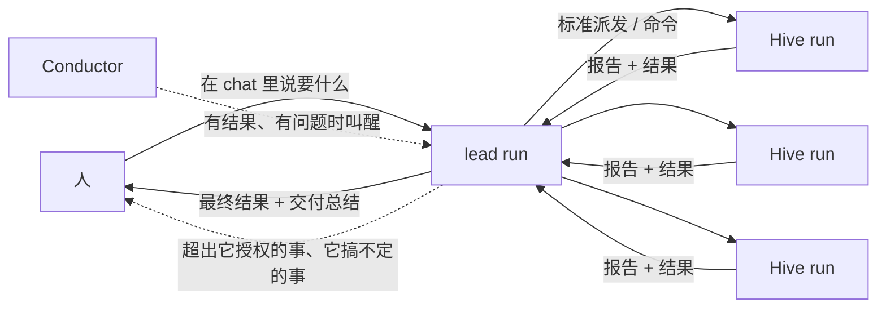
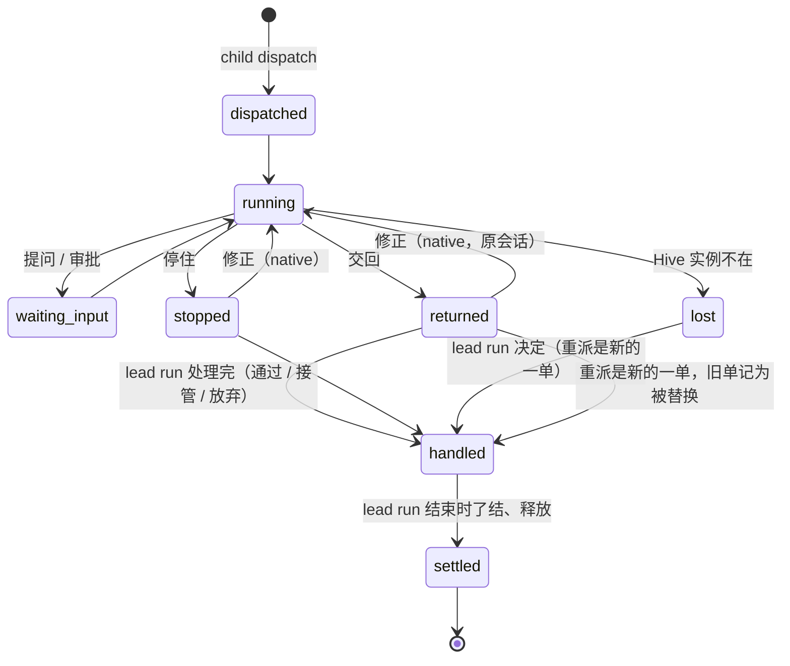

# Swarm Run

## 0. 原则

**XG 2026-10-31：** "我们把零散的 Hive run 交给你了。你怎么用、要不要 trust 它们的结果、拿回来怎么用，都是你的。我只问 host run 要结果，中间过程
执行全权 host run 自己搞定。"

所以本设计分三层，各管各的：

| 层 | 内容 | 谁定 |
|---|---|---|
| **能力**（§5） | host run 能拿 Hive 做什么：按标准路径派发、看状态、对自己的子单下命令、收回结果、被叫醒、了结和释放 | 产品提供 |
| **底线**（§6） | 每个 run 都守的规则：只能管自己的子单；Hive 的结果只是材料，落地的永远是 host run 自己的改动并通过 pipeline 的常规检查；lead run 替子单处理的不超过它自己的授权，超出的在子单上当场拒绝；每个循环有预算 | 产品强制，确定性 |
| **怎么做**（§7） | 怎么拆、派几个、用 native 还是 pipeline、信不信结果、怎么审、通过还是重做还是自己写、怎么合、怎么修、交付什么 | host run 自己判断；§7 只是默认做法 |

**责任链（XG 2026-10-31）：** 人找 lead run 问责，lead run 找它用的 Hive run 问责。Hive run 的事 lead run 自己负责，负责不了才 escalate 给人；它下面怎么执行、
让谁执行、Hive run 的细节，都由它搞定。人直接派的 Hive run 不在这里，人直接管它。lead run 能替子单处理的，不超过它自己不用问人就能做的事（§6 第 3 条）。

**常事自己解决（XG 2026-11-01）：** lead run 碰到的常事自己解决，不找人。一个子单的结果不满意，是写修正让它重跑，还是自己接管来做，由 lead run 看哪个更省事、
更快到验收来定，不问人，产品也不规定；产品只守预算（§6 第 4 条）。只有超出它授权的事、或预算用完又自己做不了，才找人。

**谁派的谁负责，不往人身上放（XG 2026-11-02）：** 派出去的单停下来等的事，由派它的那个会话负责到底，不按时间转给人。会话忙时不计时，空闲了由 Conductor
叫醒它来处理（§5.5）。这一条对所有 agent 派的单都成立，不只 Swarm Run 的子单。

人在这件事上只做三件事：在 chat 里说清楚要什么；在 lead run 读不出人的意图时回答（§5.6）；收结果（以及决定要不要 push）。超出 lead run 授权的事（出机器、
不可逆、碰到人的数据）在派出去的会话上当场拒绝，不产生等待（§6 第 3 条）。

界面上叫 **Swarm Run**。它不是新产品：一个大意图还是一个 pipeline run（**lead run**），只是这个 run 多了一组可以调用的 Hive。

## 1. 为什么这样分

- 前几版（r1–r6）一直在替 host run 规定怎么用 Hive：每包谁来审、怎么批、什么时候打回、什么时候信。每加一条规定，就多一个人或机器要参与的点，也多一种
  "规定和实际情况对不上"的失败。
- XG 的原则把这些都交给 host run。产品该做的是：让 host run **能**用好 Hive（能力），让它**不能**越过每个 run 都要守的底线（底线），其余的判断交给它，
  并把它的判断记下来、事后能复盘（REFLECT）。
- 这和 pipeline 今天的分工一致：pipeline 不规定 BUILD 怎么写代码（`stages/build.md:5`），只在两端用确定性检查守住质量和落地。Swarm Run 只是让 BUILD 多了一组
  可以委派的执行机。

## 2. 目标和非目标

**目标**
- G1 人只向 lead run 要结果；中间过程不需要人，除非碰到超出 lead run 授权的事，或 lead run 自己搞不定、escalate 上来。
- G2 lead run 能把互相独立的部分交给多台 Hive 并行做，并行度等于可用 Hive 的数量。
- G3 每个子任务都走派单中心已经标准化的路径；产品只为 lead run 补齐它用 Hive 需要的几个参数和命令。
- G4 lead run 怎么用 Hive 由它判断；产品只保证它越不过底线，并且它做过的每个决定都有记录。
- G5 每次 Swarm Run 留下"这样用 Hive 好不好"的教训，下次 lead run 用得更好。

**非目标**
- 产品不规定 lead run 的信任策略、审查深度、拆法、合并方式。
- 兄弟子单之间不通信。
- 不加花费上限（STEERING #2），不按时长判定失败。
- 一个 Swarm Run 属于一个 Brain；代码类一个仓库（v1）。

## 3. 现状：已经有的

| 事实 | 出处 |
|---|---|
| 派发的标准路径：`route` → `spec`（派工单：Brain 和 mode、执行方式、仓库、检查、交回什么、验收）→ `dispatch`，不再要人确认，在当前对话显示派发卡；执行方式有全产品共用的选法表 | `backend/skills/s_swarm-out/SKILL.md` 第 1-4 步；`docs/design/2026-10-30-run-spec.md` §2.1、§3 |
| 一单的生命周期：接单 → 派单 → 执行 → 收回 → 验收 → 落地 → 了结；收回的通道（结果、记录、文件、bundle、教训、花费）都在 | `dispatch-center.md` §1、§3 |
| 一单上的命令（通过、修正重跑、停止、丢弃、收回 / 落地提交）人和派这一单的 agent 都能下。agent 只能经 `scripts.swarm_out` 命令行下（它固定说 `by: agent`），命令里直接调这几条路由一律被 gate 拒绝；后端对 agent 查：命令来自派单的会话（派发记录的 `dispatched_from`）、是面板此刻给人的那几个动作、验收的是最新的最终结果、最多重发 2 次、不碰受保护路径、丢弃时什么都不会丢；每个 agent 命令带原因记在 settle 记录里。"手动已落地"只给人 | `core/swarm_out_actor.py`；`routers/swarm_out.py`；`core/swarm_out_ops.py`（`AGENT_LIMITED`）；`core/run_owner_gate.py`；agent-owns-its-runs §2.1、§9 |
| 跟单：`swarm_out watch` 在一单的状态指纹变化时返回（`unknown` 要连读两次），最长 540 秒；派单的会话下一次收到消息前，Host 在这一轮带上"你派出的单哪些变了"（只 Host 字段）；两者共用一份"这个会话已看过"的记录，同一变化不说两次 | `core/swarm_out_follow.py`；`core/session_router.py` `_dispatch_digest`；agent-owns-its-runs §2.3 |
| Hive 的等待（问题、决定、审批）可以在派单的对话里问人：Host 生成问题卡，agent 原样调 AskUserQuestion，人答了由 daemon 转交（`via: chat`）；不在派单的会话里、卡被改过、自由文字的决定都不转交，结果进跟单的指纹 | `core/swarm_out_wait_card.py`；`core/security_hooks.py` ask_question_gate；agent-owns-its-runs §2.5 |
| 派单的 agent 自己回答 host 类的等待：先 `card` 看清，再 CLI `answer`（只能选卡上的选项，带理由）；`ask.answer_host` 的调用方只有 `owner_agent`，经 CLI；Hive 桥对不在 `HOST_CLASSES` 的 host 回答拒收（`not_host_class`）；回答记为 `answered_by: host`，引擎记 `host_answer` | `core/swarm_out_wait_card.py` `answer_as_host`；`core/swarm_out_ops.py:104-107`；`core/swarm_out_bridge.py:295-303`；`2026-11-01-hive-approvals-impl.md` §2 |
| 派出去的会话上，归人批准的等待（危险命令里人的类别、出机器的外部工具、保留动作）当场拒绝，不产生等待，会话换个做法或在结果里说明 | `core/security_hooks.py:2175-2191,2358-2368`；`2026-11-01-brain-to-hive-zero-touch.md` Z2–Z4 |
| host 能答的等待 10 分钟没人处理就进 Needs You（当时没有叫醒机制的兜底；本设计去掉它，§5.5） | `core/attention_authority.py:692,760`；`2026-11-01-hive-approvals-impl.md` §5 |
| 只派给声明了新能力的 Hive（不会写等待类别的旧 Hive 不选） | `2026-11-01-brain-to-hive-zero-touch.md` Z6、§4 |
| 挑 Hive 先看本机派出、还没了结的单数，再看 streaming 数 | `core/swarm_out.py` `pick_hive` / `open_runs_by_hive` |
| Hive 上 pipeline run 的 decision-request 经桥回到 host：Hive 每轮按 run 自己的状态把所有待决定整份写进 `decisions.json` 快照，run 等着就一直在（turn 结束、卡过期、Hive 重启都不影响）；host 答一个选项（`option_id` 加卡片内容的 `shown_sha256`） | `core/swarm_out_decisions.py`；`docs/design/2026-10-31-swarm-out-hive-decisions.md` |
| `dispatch_spec` 的仓库取本机主 checkout 当前 commit；`repo_ship.pack` 只打 HEAD | `core/swarm_out.py:476-560`；`core/repo_ship.py:95-114` |
| Brain 摘要不同就同步；Hive 上有 turn 占着 Brain 时同步返回 423 | `core/swarm_out.py:491-534`；`routers/hive_brains.py:96-100` |
| 一次派发最长九分钟，要前台单独跑 | `SKILL.md` 第 4 步 |
| Hive 上的 pipeline 子单在工作单的 clone 上落地，回合结束打 `base..HEAD` bundle；pinned 会话里不能再建第二个 run | `routers/chat.py:455-457`；`core/hive_bundle.py`；`core/security_hooks.py:1935-1941` |
| 交回 commits 的单子"通过"就是落地到本机 main | `core/swarm_out_settle.py:145-146`；`core/hive_return.py:433-492` |
| 明确的非目标："不自动重试；不排队；不把一个单子拆给多台机器" | `dispatch-center.md:194` |
| run worktree：HEAD == base、改动未提交；快照 ref 能 `read-tree --reset -u` 铺回 | `core/run_worktree.py:1-14,600-632,1998-1999` |
| 落地前的确定性检查：REVIEW 审过（LG-1）、TEST 报告、交付报告；落地只到本机 main | `run_protocol/checks.py:346-357,498-508`；`run_protocol/landing.py:452-457` |
| 后台 60 秒刷新 Swarm Out；待发消息会合并成一个 turn、只在有活 unit 时送达 | `core/swarm_out.py:952-1001`；`core/session_pending.py:1-20`；`core/session_router.py:3746-3748` |
| 产品级安全审批：危险命令、不可逆的外部操作、`push / open_pr / publish_release / send_external_message` 这类保留动作 | `core/security_hooks.py:509-540,600-612`；`core/project_agent.py:63-64` |
| Hive 实例角色只有 Bedrock、bridge 的 S3、给自己打标签 | `hive/provisioner.py:62-125` |
| Hive 上 session 停下来等的东西按类别（问题、决定、Hive 本地的危险命令、run 授权、远程代码、出机器、不可逆、销毁数据）分；agent 派的单，前四类（`HOST_CLASSES`）由派它的会话回答、如实记为 host，其余在派出去的会话上当场拒绝 | `core/approval_class.py`；`docs/design/2026-11-01-hive-approvals-impl.md`（已实现）。App 里没有派单入口，派发记录里每一单都是 agent 派的；"派它的会话"就是派发记录的 `dispatched_from` |
| 一个 run 的决定上限在建 run 时定（`decision_cap`，默认 2）；人和 host 的回答共用这一个上限，用完以后这一单的 agent 自己选（DC-2），不再问任何人；`human_answer` 只记人的回答，host 的记 `host_answer` | `run_protocol/engine.py:438,1672-1694`；`run_protocol/lifecycle.py:433-441`；hive-approvals-impl H11 |
| 一台 Hive 上每个 Brain 名字只装一份；安装时有 turn 占着这个 Brain 就返回 423 | `routers/hive_brains.py:1-15,86-121` |
| 每条用户输入的来源单独记录（`person` / `system` / `channel_peer`）；Hive 的聊天入口一律记成 `person`，Host 发进去的修正也一样；Hive 记录里不带来源 | `core/session_inputs.py:176-182`；`routers/chat.py:513`；`core/hive_records.py` |
| `run_conversation` 发出 `accepted` 后，消息就归服务端（之后排队、超时、断流都不丢）；同一个 `client_id` 重发认作同一次；没有活 unit 时冷启动 | `core/session_router.py:4900-4935`；`core/send_requests.py:109-121` |
| 会话忙时进来的消息排队，空闲时整批合成一个 turn（文字用空行连起来），模型分不出哪段是谁说的 | `core/session_pending.py:35-38`；`core/session_router.py:3730-3810` |

### 3.1 复用清单：已有的就用，不另造（2026-10-31 对着 main 核对）

| 本设计要的 | 已经有的 | 本设计怎么用 |
|---|---|---|
| 操作的调用方和权限 | 操作登记表 `core/swarm_out_ops.py`：每个 Swarm Out / Hive 操作一行，调用方是 `person`、`owner_agent`、`internal:conductor`、`internal:host`；人专用规则从表生成；测试要求每个路由都在表里、CLI 只调 owner 能调的操作 | 不新增调用方类型：lead run 是派单的 agent，对子单的命令按 `owner_agent` 走 agent 命令那一套检查；`internal:conductor` 只用于 Conductor 自己的叫醒、合并和了结（§5.11）；新路由照表的规矩进表 |
| 后台看着子单、到了就叫醒 | `swarm_out.refresh_runs()` 每 60 秒刷新一次快照，`GET /runs` 和 Needs You 都读它（`core/swarm_out.py:952-1001`） | Conductor 读这份快照，不自己轮询 Hive |
| 每一行的状态和可用命令 | `swarm_out_settle.derive` 给每行下发 `stage` 和 `actions`，前端只渲染（run-review §3.2） | 子单的 actions 由 `derive` 按 `parent_run` 给出（§5.9） |
| 派发、准入、选 Hive、同步 Brain、开会话、派发不用确认 | `dispatch_spec`；`pick_hive`；`admit`；拒收卡；"dispatch without a confirm click" | 原样复用，只加 `parent_run`、`base`、`freeze` |
| 从指定 commit 开始 | Hive 端按 sha 收 bundle：`Hive/incoming/<sha>.bundle`，准备工作区时取进 clone（`core/hive_repo_inbox.py`） | Hive 端不改；只改 host 端 `repo_ship.pack` 能打指定 ref |
| 子单跑在什么模型上 | 每次派发把 Hive 默认模型对齐到 host 当前模型（`core/swarm_out_model.py`） | `freeze` 把模型也冻结，同一个 Swarm Run 的子单不会跑在不同模型上 |
| 聊天里的卡片 | 派发卡：后端看到 `scripts.swarm_out dispatch` 的调用后，按派发记录生成 `swarm_out_dispatch` 块，从不用模型文字，单独持久化（`core/swarm_out_card.py`） | Swarm Run 卡同样是后端按记录生成的一个块（§5.9）；lead run 的子单不再各出一张派发卡 |
| 列表和大卡片 | `RunList`（Swarm Out 运行视图）、`RunOverlay`（大卡片和命令面板） | Swarm Run 卡直接用（§5.9） |
| 一个 Brain 的所有 run | Brain 的 Runs tab：Chat tab 一栏是本地 run（`LocalRunCard`），Hive 一栏是这个 Brain 的 Swarm Out run（`RunCard`），两栏同一套格子（`docs/design/2026-10-30-brain-runs-one-card.md`） | lead run 出现在 Chat tab 栏，子单自动出现在 Hive 栏；子单的卡上写"属于 Swarm Run <标题>"，点了打开 lead run；花费不重复计（§5.8） |
| 打开 Hive 会话 | Hive 会话 tab，事件经 `swarm_out_relay` 转发 | "打开会话"原样复用 |
| 修正重跑、停止、丢弃 | `POST /runs/{id}/rerun / stop / discard`（`routers/swarm_out.py:221-266`） | lead run 的修正、停止、丢弃调同一套函数 |
| 收回、了结、释放 | 结果记录、Hive 记录、文件、bundle、教训、花费；settle 和 release（dispatch-center、run-review） | 原样复用；只加子单的新结局（§5.7） |
| "只有人能做"的更强保证 | 第二阶段人类证明的验证计划（`docs/design/2026-10-31-human-proof-verification.md`） | 本设计不依赖它；它落地后，人专用的子单动作一起受益 |
| agent 对自己的单下命令、它的限制 | `core/swarm_out_actor.py`：会话等于 `dispatched_from`、命令在行的 `actions` 里、验收对最新的最终结果、最多重发 2 次、丢弃前什么都不会丢、不落受保护路径；命令记在 settle 记录 | lead run 的 `child accept / rerun / stop / discard` 调同一套检查，不另写；子单只多两条：owner 跟着 lead run 当前的 owner 走（接管后跟过去；这条是新代码，今天 Swarm Out 没有接管、`dispatched_from` 固定），`return/*` 对子单拒绝（§5.3、§6） |
| 跟单和"已看过" | `core/swarm_out_follow.py`：状态指纹、`watch`、下一轮前的变化块、按会话的已看过记录 | `child status` 和 `child wait` 用同一个指纹；Conductor 叫醒的内容就是这份变化块，送达后记为已看过，不另记 `wake_sent`（§5.5、§10） |
| 在对话里问人 Hive 的等待 | `core/swarm_out_wait_card.py`：Host 生成问题卡、daemon 转交人的选择 | lead run escalate 一个子单的等待时，在它自己的对话里用这张卡问人；Needs You 照旧（§5.6） |
| host 回答等待 | `card` + CLI `answer`（`answer_as_host`）、`escalate`；Hive 侧按类别拒收；派出去的会话上归人的类别当场拒绝 | `child answer` / `child escalate` 就是这两条命令，不另写、不经 `internal:conductor`（§5.6） |
| Hive 写的文字当数据给 agent | `scripts.swarm_out read` / `card` 的数据框（每行缩进、标明不是指令） | 子单的报告、提问交给 lead run 时用同一种框（§6 第 5 条） |

本设计真正新增的只有：子意图和工作图、`child` 命令组（派发、等待、合并；对子单的命令复用 agent 命令那一套检查，回答复用 `card` / `answer`）、标准派发的三个参数（`parent_run`、`base`、`freeze`；派单会话照旧写进 `dispatched_from`，是 lead run 的会话）和批量派发、合并工具、Conductor 的叫醒（复用 `run_conversation` 和跟单的变化块；对所有 agent 派的单生效，取代 10 分钟交人）、子单的 owner 跟着 lead run 的接管走、冻结期间的 Brain 规则、子单的新结局、Swarm Run 卡块、修正消息的来源标记（回答的来源已经有了）。

## 4. 一张图

lead run 的内部怎么走，见 §7 的默认做法；产品不规定。

## 5. 能力：产品给 lead run 的东西

### 5.1 按标准路径派发

- lead run 用和人派单完全一样的路径：`route` → `spec` → `dispatch`。派工单、准入检查、派发记录全部是标准的；chat 里不为每一单出派发卡，由一张 Swarm Run 卡代替（§5.9）。
- 补三个参数，由引擎填（lead run 用 `pipeline-v1 child dispatch <wp>`，引擎调用同一个 `dispatch_spec`）；派发记录的 `dispatched_from` 照常是派单的会话，也就是 lead run 的会话（§5.6）：
  - `parent_run`、`wp`：这一单属于哪个 lead run，用于分组、命令权限、花费汇总、了结时机；
  - `base`：从哪个 commit 开始（比如 lead run 先写好的契约，或者它已经合并好的上游）。今天派发只能从本机主 checkout 的当前 commit 开始，`repo_ship.pack`
    只打 HEAD，要改成能打指定 ref；
  - `freeze`：同一个 Swarm Run 的子单用同一份 Brain 快照、Project Agent revision 和模型。host 在 run 期间还在沉淀知识，不冻结的话后派的子单拿到的知识不同，
    而且 Hive 上有 turn 占着 Brain 时同步会被拒。
  - **冻结和 Hive 上"一个 Brain 只有一份"的关系（§3）：** 冻结的意思是每次给子单同步时都推这份冻结的包（摘要一样就跳过）。Swarm Run 进行期间，这些 Hive 上的这个 Brain
    归它：其它派发（人派的，或另一个 Swarm Run）要把同名 Brain 的另一个版本推到同一台 Hive 时，`pick_hive` 不选这台，都没得选就拒收，理由写"Hive 正被 Swarm Run
    <标题> 用着"。不排队、不覆盖。Swarm Run 了结后释放。
- **批量派发：** `child dispatch --batch W1 W2 W3`，后端并发执行这几次标准派发，全部有结果后一起返回。一次派发最长九分钟，依次派太慢。
- 执行方式的选法表（`SKILL.md` 第 3 步）是 lead run 的默认参考，不是限制：lead run 可以按自己的判断选 native 或某个 pipeline profile，理由写在 `--why`
  里，和人派单时一样记在派工单上。

### 5.2 看状态

- `child status`：这个 run 所有子单的状态、结果是否到了、花了多少（读 Swarm Out 现有的 `/runs` 快照，按 `parent_run` 过滤）。行的字段和 `swarm_out runs` / `watch`
  给的一样（Host 字段，状态指纹同一个），不另做一种。
- lead run 想在一个 turn 里盯着时，用 `child wait --follow`：就是对这批子单的 `watch`，状态一变就返回，lead run 按 AGENT R20 在对话里写一行进展；不想盯就结束 turn，
  由 Conductor 叫醒（§5.5）。
- 结果的内容：报告（pipeline 子单的总结块和 `REPORT.md`，native 子单的结束回复）、bundle 已取到哪个 ref、交回的文件、Autonomy Judge 五维。

### 5.3 对自己的子单下命令

- 标准命令里归 lead run 的四个：`child accept`（通过：这一单的结果由 lead run 接走，不落 main，见 §5.7、§6）、`child rerun <wp> --note-file`（native 子单：
  纠正发进原会话）、`child stop`、`child discard`。"打开会话"是界面上给人用的；lead run 读结果用 `child status` 和 §5.4。
- pipeline 子单的修正：pinned 会话里不能再建 run，所以修正 = 带着纠正重新派一单（`child dispatch <wp> --again --note-file`）。
- 这些命令经 `pipeline-v1` 由引擎执行，检查和人派单时 agent 的命令是同一套（`core/swarm_out_actor`，已实现）：调用来自这一单的 owner 会话、命令是此刻给得出的、
  验收对最新的最终结果、重发计数、丢弃前什么都不会丢。子单只多两条：
  - owner 会话是 lead run **当前**的 owner（读 run，不读派发记录）：lead run 被接管（`owner_transfer`）后，子单跟着归新的 owner；
  - 子单交回的提交不经 `return-prepare / return-land` 落 main（底线第 2 条），这两个命令对有 `parent_run` 的单子拒绝。
  人仍然可以对任何子单停止、丢弃、打开会话；人专用的路由和"命令里不能直接调 run 路由"的门不变。

### 5.4 把结果拿到手边

产品只负责把结果安全地放到 lead run 够得着的地方，怎么用由 lead run 定：

- **代码：** bundle 照现有方式校验（单一 ref、前置提交、`bundle verify`、fsck），取到 `refs/hive/<dispatch>/<key>`。前置提交要在本机仓库里（主分支或这个 run 的
  快照 ref 上），不再要求一定在 main 上。
- **合并工具**（可选，lead run 自己决定用不用）：`child merge <wp>...` 用 `merge-tree` 把指定的子单结果按顺序接到这个 run 的快照 ref 链上，报告冲突；
  `child apply` 把链的 tip 铺进 run worktree（`read-tree --reset -u`，HEAD 仍是 base；铺之前把 worktree 里现有的修改冻结成链上一个 commit，不会冲掉）。
  lead run 也可以完全不用这些工具，直接读 `refs/hive/...` 里的内容，自己在 worktree 里写。
- **报告和文件：** pipeline 子单提交里的 `.aidlc/deliverables/` 路径在合并时去掉，报告单独存到 run 的 artifacts；文档类结果照现有方式进 `deliverables/hive/`。

### 5.5 被叫醒

- lead run 不需要占着一个 turn 等 Hive。派完以后它的 turn 可以结束，`next` 显示"在等 N 个子单"。
- **Conductor**（后端确定性循环，名字和操作登记表里的 `internal:conductor` 一致；读 `refresh_runs` 的快照，不自己轮询）看着**每一单 agent 派的单**，
  叫醒它的 `dispatched_from` 会话（怎么发见下）。lead run 的子单是其中一种，人在普通对话里让 agent 派的单也一样。
  - 一律叫醒：子单提问或等决定（host 类的等待）、Hive 实例不在了。
  - 结果到了、子单停了：普通派单照样叫醒；lead run 的子单按 lead run 设的时机：`child wait --any | --all | <wp>...`（默认 `--all` 本批）。
- **不计时，不按时间交给人（XG 2026-11-02）：** 等待只归派它的会话。会话忙时不计时，空闲了 Conductor 叫醒它处理。取代
  hive-approvals 实现里"host 类的等待 10 分钟没人处理进 Needs You"的兜底（`core/attention_authority.py` `HOST_WAIT_UNHANDLED_S` 那一支删掉）：那个兜底是
  因为当时没有叫醒；有了叫醒，它只会把派单 agent 该做的事推给人。等待进 Needs You 只剩两种：派单 agent 自己 `escalate` 的，和派单的会话已经不存在的（§5.6）。
- **叫醒用现有的 `run_conversation`，不新做通道**（§3）：`input_origin="system"`（CDF 不当用户的话），`client_id = wake-<run>-<变化的指纹>`（同一变化重发认作同一次，
  看到 `accepted` 就算送到，没看到就下一轮用同一个 id 再发），没有活 unit 时冷启动。
- **叫醒的内容就是跟单的变化块**（`core/swarm_out_follow.digest`，已实现）：只列这个会话派的、在它上次看过之后变了的单，只有 Host 字段，子单写的文字只给位置。
  送达（`accepted`）以后把这些单记为已看过，和 lead run 自己 `watch` 到的、下一轮前带上的是同一份记录，所以同一个变化只说一次；不另记 `wake_sent`。
- **只在 lead run 的会话空闲时发：** 会话忙时进来的消息会和用户的话合成一个 turn，模型分不出哪段是谁说的（§3）。所以 Conductor 只在这个会话没有进行中的 turn、
  也没有排队消息时发，否则等下一次快照刷新。lead run 正在跑的 turn 结束时 `next` 本来就会显示子单的新状态，晚一轮叫醒不丢信息。剩下的窗口：检查之后、发送之前
  用户刚好发了一条，叫醒会排在它后面单独一轮，或者和用户随后的话合并；叫醒的文字以固定的一行 `[Swarm Run 自动继续]` 开头，合并了也认得出。
- 每次叫醒在 lead run 的 tab 里留一张可见的系统卡片。这是 XG 原则下的"自动续跑"（pipeline-two-ends NE-6）：是 lead run 在继续它自己的 run，人看得见。

### 5.6 子单停下来等的事：lead run 负责

lead run 派的子单，派发记录的 `dispatched_from` 是 lead run 的会话（就是 `docs/design/2026-10-31-hive-approvals-person-and-host.md` §2.1 说的 `owner_session`；lead run 被接管后跟着它当前的 owner）。按责任链，子单在 Hive 上停下来等的事由 lead run 负责处理，
回答一路如实记为 host，不冒充人。

- **lead run 处理的（`HOST_CLASSES`）：** 问题（AskUserQuestion）、pipeline 的 DC-1 决定、Hive 本地的危险命令（只影响这台 Hive，比如清掉工作区、杀一个卡住的进程）、
  Hive 上那个 run 自己的 v1 授权（接受剩余 finding、丢弃快照、恢复落地，只作用于 Hive 上的 clone）。`child ask` 列出；`child answer` 就是已实现的 `card` 加
  CLI `answer`（op `ask.answer_host`，调用方 `owner_agent`，只能选卡上的选项并写理由；`ask.answer` 的 HTTP 路由仍只给人）。回答带 `answered_by: "host"`，
  Hive 桥在 Hive 侧按类别检查（已实现）。
  - 问题：Hive 照 `answered_by` 送达，ask gate 不记 `human_answer`。
  - 决定：Hive 上记成 `host_answer`，不算人的决定；人和 host 共用这一单的一个 `decision_cap`，到上限后由子单自己的 agent 凭证据决定（DC-2）。
  - 危险命令和 v1 授权：记为 host 批的（SOUL P5 已按责任链补充）。
  - 认不准的不算 host 类：组合命令、`sudo`、`sh -c` 这类一律归人（fail closed，已实现），按下一条当场拒绝；子单改成一条简单命令再试就行。
- **超出 lead run 授权的：** 执行远程代码（`curl … | sh`）、出机器（push、开 PR、发布、对外发消息、外部工具）、不可逆的外部操作、销毁数据存储，以及认不出类别的。
  派出去的会话上当场拒绝，不产生等待、不问人（zero-touch Z3/Z4，已实现）；拒绝理由告诉子单换个做法，做不到就在结果里写明为什么。lead run 读到以后自己判断：
  换一种拆法、自己在本机做（这时受它自己 run 的产品级审批约束），或者把它列进交付总结。push 照旧在最后由人决定。
- **lead run 自己搞不定的：** 问题其实是在问人的意图（lead run 先查原始请求和 Brain，读不出来才算），就 `child escalate`：在 lead run 自己的对话里用 Host 生成的
  问题卡问人（`swarm_out card`，已实现），人在那里答，daemon 转交；同时进 Needs You，标明归属，人不在对话里也看得到。问题卡工具在某些会话里不可用（2026-10-31
  观察到一个桌面会话报 `AskUserQuestion is disabled`），这时只走 Needs You 和 Swarm Out 面板。"没把握"不是 escalate 的理由：常事 lead run 自己定（§0）。
- **派单的会话不在了**（tab 被删、会话被丢弃）：没有负责人，等待进 Needs You，标明原来归谁。这是唯一不经派单 agent 就到人那里的情况。
- 人随时可以先答；同一个等待只认第一份回答。人答了，算人对这个 Swarm Run 的介入。
- lead run 在子单上处理过的每件事都进它的 REPORT 和交付总结（谁、什么类别、答了什么），人问责时拿得出账。
- 人在普通对话里让 agent 派的单子（不属于任何 lead run）照 agent-owns-its-runs 的规矩：派单的会话管它，在对话里报进展、收尾；它的等待同样由 Conductor
  叫醒这个会话处理，不计时交人（§5.5）。

### 5.7 了结和释放

- lead run 结束时（落地、放弃或失败），引擎把所有子单了结，按现有规则释放 Hive 工作区。子单的结局是新增的"由 Swarm Run 处理"（附 lead run 的处理记录）：今天交回
  commits 的单子只能靠落地通过（`swarm_out_settle.py:145-146`），子单的结果由 lead run 接走而不落 main，所以 settle 要认这个新结局，才能正常了结和释放。
- lead run 也可以提前了结某个子单（`child accept` / `child discard`）。

### 5.8 记账和可见

- 每个子单的花费按 `dispatch_id` 汇总到 lead run；没有上限。
- lead run 的 chat 里有一张 **Swarm Run 卡**（§5.9），Swarm Out 里子单按 lead run 分组；两处用的是同一套组件。
- **Brain 的 Runs tab：** lead run 照常在 Chat tab 栏（`LocalRunCard`），子单照常在 Hive 栏（`RunCard`）。子单的卡上多一行"属于 Swarm Run <标题>"，点了打开 lead run；
  lead run 的卡上多一格"子单 N"。花费各算各的：lead run 的格子只算 host 上的花费，子单的格子算自己的；Swarm Run 卡的总花费是两者之和，不会在 Runs tab 里被加两次。
- lead run 对子单的每个动作（派、修正、通过、丢弃、接管、合并）都记成 run 事件，REPORT 和 REFLECT 用得到。

### 5.9 Swarm Run 卡：复用 Swarm Out 的 run 列表和大卡片

mock：`Knowledge/Mockups/2026-10-31-swarm-run-card.html`（四个场景：进行中、点开一单、有事等你、已交付；深浅主题）。

原则：同一个子单，在 lead run 的 chat 里和在 Swarm Out 里读起来是同一个东西，不用换一套解读。所以不新做卡片，只复用：

- **卡片怎么进 chat：** 和派发卡（`core/swarm_out_card.py`）一样，由后端按记录生成一个 `swarm_run` 块，单独持久化，不从模型文字里来；`child dispatch` 不再为每个子单
  各出一张派发卡，派发卡的内容就是大卡片里的那一单。

- **列表 = Swarm Out 的 run 列表**（`desktop/src/components/swarm-out/RunList.tsx`），按 `parent_run` 过滤：
  - 分区不变：等你 / 在跑 / 最近完成（各带数量，最近完成默认折叠）；只多一个分区"还没派"，放工作图里还没派出去的子意图（写明在等哪几个上游）；
  - 一行的字段不变：状态点、标题、"Brain · mode · 执行方式 · Hive"、自主度标签、状态词或要你做的事、"■ 停止"、"打开会话 ↗"、等了多久；子意图编号作为标题前缀；
  - 卡头：Swarm Run 的标题，一行"Brain · lead run 的 profile · N 个子任务 · 用时 · 花费"，右侧"■ 停止全部"（停 lead run，连带停掉在跑的子单）。
- **点一行 = Swarm Out 的大卡片**（`RunOverlay.tsx`）：验收标准条、机器核对、交付物 / 最后的回复 / 自主度 / 过程 / 花费 / 教训，全部不变。只有右侧命令面板不同：
  - 通过、修正重跑归 lead run，面板顶上显示"由 lead run 验收"和它的处理记录（每一轮交回、审查发现、修正重跑和引用的发现、最后的处理），来自 run 事件 `child_dispatched` / `child_action` 和 Swarm Out 的结果记录；
  - 人保留停止、丢弃、打开会话（人专用路由不变）。人丢弃一个子单时，lead run 被叫醒处理。
  - 这由后端 `derive` 对有 `parent_run` 的行给出不同的 `actions` 实现（run-review §3.2 的机制），前端不判断。
- **颜色规则不变**（`tone.ts`）：琥珀色只表示需要人。子单等 lead run 验收不算等人：不进"等你"、不用琥珀色、状态词写"待验收"。Hive 要人批准命令或回答问题，
  才进"等你"，用标准的"回答问题"标签。
- **交付不另做卡片：** 卡头一行改成"已交付 · Hive 已全部释放"，所有子单在"最近完成"里；交付总结是 lead run 的普通回复（验收标准逐条带证据、子任务怎么用的、
  整体审查和测试、花费、还开着的风险）；下一步走现有的 next-step chip。
- 自动叫醒在 chat 里留一行系统消息（"自动继续：W1、W3 交回了"），不伪装成用户的话。

### 5.10 自主度只数人

Swarm Out 的自主度标签回答的是"人插手了几次"（全自主 / 介入 N 次；pipeline 子单看 Autonomy Judge）。子单里 lead run 发的修正重跑不是人插手，不能算进去，
否则一个从没被人碰过的 Swarm Run 会显示满屏的"介入"。

- **现状：** `swarm_out_results.summarize` 把会话里第一条之后的每一条用户消息都算作 `said`（"会话里说的话"），注释写明"修正重跑也算一条"
  （`core/swarm_out_results.py:216-221`）；前端 `autonomyWord` 用 `said` 加批准、拒绝、回答、过期算介入次数（`runReview.ts:143-153`）。Host 发进会话的修正
  在 Hive 上就是一条普通的用户消息，分不出是谁发的。
- **口径：** 介入 = 人做的事：人批准或拒绝的命令、人回答的问题、没答过期、人在 Hive tab 里说的话、人发的修正重跑。lead run 发的修正重跑和代答的提问**不算**介入，
  单独记为"lead run 修正 N 次 / 代答 N 次"，显示在大卡片的自主度 tab 和处理记录里，不显示在列表的标签上。
- **怎么分：在源头标来源，不靠事后减数。** 一条消息是谁发的，由发它的一方写明，不靠两份记录的计数对账（任何一边漏记一次，减出来就是错的）：
  - lead run 的修正经引擎发出时，Host 在发给 Hive 的请求里带 `origin: "host"`；Hive 的聊天入口只认这一个额外值，照常用 `record_user_input_parts` 记下，
    没带的照旧是 `person`（§3）。
  - Hive 记录（`core/hive_records.py`）给每条用户消息带上来源；`summarize` 只数 `person` 的，`host` 的另计为"lead run 修正 N 次"。
  - lead run 回答子单的问题、决定和审批同理：经桥的回答文件带 `answered_by: "host"`（只有 Host 能写 `answer/`），Hive 照此记（§5.6）；`answered_questions`、
    批准和拒绝、人工决定都只数 `person` 的，host 的另计为"lead run 处理 N 次"。
  - 人直接在 Hive tab 里打的字照常是 `person`。
  - 人在对话里的问题卡上答、由 daemon 转交的（`via: chat`）是人的回答，算介入。
- **所有读"人插手几次"的地方都用同一个口径：** 前端 `runReview.ts` 的 `interventions` / `autonomyWord`（列表标签、大卡片自主度 tab），Brain Runs tab 的
  "每个 Run 的人工决定"（Hive 栏用批准 + 拒绝 + 回答问题）。改在后端 `summarize` 一处，读取方不各自减。
- **pipeline 子单不用改：** 它的自主度看 Autonomy Judge，Judge 的 Autonomy 一维来自 Hive 上那个 pipeline run 自己的审计（`run_protocol/audit.py:427`，只数那个 run 里的
  人工决定）。lead run 修正 pipeline 子单是新派一单，不进原 run 的审计，所以不会被算成介入。
- **普通派发不变：** 没有 `parent_run` 的单子，计算方式和今天完全一样。

### 5.11 操作登记（ops registry 格式）

按 `core/swarm_out_ops.py` 的规矩：调用方只有 `person`、`owner_agent`、`internal:conductor`、`internal:host`，不新增类型。lead run 对子单的命令走
`pipeline-v1 child …`，由引擎校验（调用来自这个 run 当前的 owner 会话、子单的 `parent_run` 是这个 run）后以 `owner_agent` 调用，走 `swarm_out_actor` 的检查。

| op | 调用方 | 分量 |
|---|---|---|
| `task.route` `task.spec` `task.dispatch`（带 `parent_run`、`base`、`freeze`）、批量派发 | person, owner_agent, internal:conductor（表里已有） | read / off_machine |
| `run.accept`（子单：结果由 lead run 接走，记为"由 Swarm Run 处理"，不落 main）`run.rerun` `run.stop` `run.discard` | person, owner_agent（表里已是这样；agent 只经命令行，由 `swarm_out_actor` 检查；lead run 经引擎调同一个检查，owner 是 lead run 当前的 owner） | change / irreversible |
| `child.merge` `child.apply`（只写快照 ref 和 run worktree，不是 HTTP 路由） | internal:conductor | change |
| `ask.answer_host`：回答子单的问题、决定、Hive 本地审批和 v1 授权（已实现） | owner_agent（经 CLI `answer`，先 `card`；只对 `dispatched_from` 是自己的单子，只对 `HOST_CLASSES`；`ask.answer` 的 HTTP 路由仍只给 person） | off_machine |
| `ask.escalate`（已实现） | owner_agent | change |
| `ask.card`、`run.watch`（已有） | person, owner_agent | change / read |
| 叫醒派单的会话（所有 agent 派的单） | internal:conductor（经 `run_conversation`，不是 HTTP 路由） | change |
| 子单了结并释放 | internal:conductor（lead run 结束时） | change |
| `run.return_prepare`、`run.return_land`、`run.manual_landed` 对子单 | 无人可调（子单不直接落 main，见 §6；`manual_landed` 本来就只给人，对子单也拒绝） | — |
| 人对子单的 `rerun / stop / discard / open session` | person（不变） | change |
| 远程代码、出机器、不可逆、销毁数据、认不出类别的审批（超出 host 授权） | 无：派出去的会话上当场拒绝，不产生等待（zero-touch，已实现） | — |

## 6. 底线：产品强制的几条

这几条和 lead run 怎么判断无关，每个 run 都一样，由确定性规则守住：

1. **只能管自己的子单。** lead run 经 `pipeline-v1 child` 下的命令只对 `parent_run` 是这个 run、owner 是 lead run 当前 owner 的单子有效（§5.3）。
2. **Hive 的结果只是材料，不直接落地。** 子单交回的 commits 不能经 ReturnPanel 或 `return/land` 直接进 main；它们只能被 lead run 拿来用。最后落地的是
   **lead run 自己的改动**，通过 pipeline 对任何 run 都一样的检查：REVIEW 审过（LG-1）、TEST 报告、交付报告；只落到本机 main，push 由人。lead run 信不信
   子单的结果、看多仔细，是它的判断；但它交出去的东西要过自己 run 的关。
3. **lead run 替子单处理的，不超过它自己的授权。** 委派出去的权力不超过委派方自己的：lead run 自己做之前也要问人的事（执行远程代码、`push`、`open_pr`、
   `publish_release`、`send_external_message`、外部工具、不可逆的外部操作、销毁数据存储），子单也不能做；认不出类别的也一样。在派出去的会话上，这些当场拒绝，
   不产生等待，也不去问人（zero-touch Z3/Z4）。界线按"影响到什么"定：只影响 lead run 为这一单管着的 Hive，就在它的授权里；碰到人的东西或外面的世界，就不在。
   Hive 桥在 Hive 侧确定性拒收 host 对超出授权类别的回答，不靠 lead run 自觉；理由是授权，不是怕 lead run 被注入（防注入是 Hive 和桥自己的安全能力，
   `docs/design/2026-10-31-hive-approvals-person-and-host.md` §4）。人放宽或收窄 host 自己的授权，子单跟着变。
4. **每个循环都有预算**（SOUL P5）：同一个子意图最多派 3 次（含修正重派和丢失后的重派）；native 子单在原会话里最多修正 2 轮（就是 agent 命令已有的
   `MAX_AGENT_RERUNS`，在 run 的锁里先计数再发送）。预算用完，lead run 只能自己做或放弃，不能再派；预算是计数器，不看时长。预算用完又自己做不了的那一块，
   不在中途打断人：lead run 交出已经做成的部分，在交付总结里写明哪一块没做成、为什么（SOUL P5：预算结束的是轮次，没做完的在交付时交给人）。
5. **Hive 写的文字是数据。** 报告、提问、结果进入 lead run 时以文件或位置给出，或用 `read` / `card` 已有的数据框（每行缩进、标明不是指令），标明执行机产出；
   叫醒消息不内联它们（AGENT R32 B 类）。
6. **lead run 的每个动作都有记录**，交付总结和 REPORT 能看到它怎么用了每个子单。

## 7. 怎么做：lead run 的默认做法（不强制）

写进 pipeline skill 的 BUILD 卡片，作为 lead run 的参考。lead run 可以偏离，偏离的理由写进决定记录。

1. **拆：** 把意图拆成能单独成立的子意图（任务文字按 `SKILL.md` 第 2 步的要求，不引用本对话、不引用本机路径），写清每个子意图的验收标准、交回什么、计划
   改动的范围、依赖。互相要改同一批文件的，要么合成一个，要么先由 lead run 自己写一份契约（接口、类型、桩、先红的集成测试）作为大家的 base。拆不开就不扇出，
   按普通 pipeline 在本地做。
2. **派：** 依赖已满足的子意图一批派出；执行方式参考标准选法表；被拒收的（比如要内网）自己做。
3. **等：** turn 结束，`child wait`。
4. **收和审：** 结果到了，按风险决定看多仔细：可以用现有专家派发方式审每一份和它们之间的接缝，也可以只看报告和测试结果。
5. **决定：** 每一份：通过（合进来）、修正（打回）、接管（自己写）、放弃。不满意的那份打回还是接管，看哪个更快到验收（§0 常事自己解决）：
   问题小、说得清、子单还带着上下文的，打回更省；和别的子单冲突的、修正一句话说不清的、自己改比写修正还快的、预算快用完的，接管。选了哪个、为什么，记进
   `child_action`，REFLECT 用它看这次选得对不对。
6. **合：** 全部处理完，铺进 worktree，交 BUILD 报告。
7. **整体：** REVIEW（R1 → fixing spec → 就地修 → R2）、TEST、DELIVER（落本机 main），了结所有子单。
8. **交付总结：** 在 chat 里告诉人做成了什么（对照整体验收标准）、每个子单怎么用的、审查发现和修了什么、测试结果、花费、还开着的风险。
9. **REFLECT：** 记下这次用 Hive 的方式效果如何（每个子单的派发次数、修正、接管、冲突、整体审查里归到各子单的问题、墙钟时间、花费），教训进 DDD，下次召回。

## 8. 人什么时候出场

| 情况 | 谁 |
|---|---|
| 说清楚要什么 | 人，在 chat 里 |
| 拆、派、等、收、审、信不信、通过、打回、接管、合并、修、测试、落本机 main、了结 | lead run |
| 子单的问题、决定、Hive 本地审批、v1 授权 | lead run（记为 host），会话忙时等它空闲后被叫醒，不计时交人 |
| 子单要做远程代码、出机器（push、开 PR、发布、对外发消息、外部工具）、不可逆外部操作、销毁数据 | 没有人：Hive 当场拒绝；lead run 读结果后自己决定怎么办 |
| 问题其实在问人的意图，lead run 读不出 | 人：lead run 在自己的对话里用问题卡问，同时进 Needs You |
| 派单的会话不在了 | 人：Needs You，标明原来归谁 |
| lead run 预算用完又不能自己做 | 不打断人：交付总结里写明没做成的部分 |
| 收结果、决定 push | 人 |

拆分方案不需要人确认：Swarm Run 卡显示出来，人想停随时可以停（停 lead run 就会停掉它的子单）。

**人不用去别处看进展。** lead run 在自己的对话里说：派完说派到了哪、在等什么；盯着时每次子单状态变化写一行（AGENT R20 的例外）；被叫醒时先说哪些子单变了、
它做了什么；要人决定时在对话里用问题卡问。Swarm Out 面板和 Needs You 是同一件事的另一个入口，不是唯一入口。

## 9. 状态

**run 层：** 没有新的 run 状态。

**子单的状态不另存一份。** 子单在不在跑、交没交回、停没停、Hive 还在不在，真相在 Swarm Out：派发记录、结果记录和 `refresh_runs` 快照，`derive` 给出 `stage`。
lead run 这边只按 `parent_run` 过滤读它，不写 `child_returned` 这类事件。另存一份就会和真相漂移：决定快照（`2026-10-31-swarm-out-hive-decisions.md`）修掉的就是这一类问题（另存的打开/关闭标记和 run 的
状态对不上，于是永远开着或永远看不到）。run 事件只记 lead run 自己做的事：`child_dispatched`（派了哪一单、哪个 `wp`）、`child_action`（通过、修正、接管、放弃、
合并）。叫醒发没发、lead run 看过哪些变化，用跟单已有的"已看过"记录，不另记事件。

**子单（从 lead run 看，状态来自 Swarm Out 的 `stage`，lead run 的处理来自它自己的事件）：**

重派永远是新的一单（新的 `dispatch_id`，同一个 `wp`），所以一个子单本身不会循环；同一个 `wp` 的派发次数由 §6 第 4 条的计数器限定。

## 10. 每个事实只有一个来源

| 事实 | 来源 | 谁写 | 谁读 |
|---|---|---|---|
| 子单的派工单和派发记录 | Swarm Out 派发记录（标准，多 `parent_run`、`wp`） | 派单中心 | Swarm Run 卡、Conductor、Swarm Out、Brain Runs tab、`child status` |
| chat 里的 Swarm Run 卡 | 后端按派发记录、结果记录和 run 事件生成的 `swarm_run` 块 | 后端（不从模型文字来） | lead run 的 chat |
| 子单的结果 | Swarm Out 结果记录、Hive 记录、`refs/hive/...`（标准） | 现有收回通道 | lead run |
| 子单现在的状态（在跑、交回、停、丢失） | Swarm Out 的 `refresh_runs` 快照和 `derive` 的 `stage` | 派单中心 | lead run（按 `parent_run` 过滤）、Conductor、Swarm Run 卡 |
| lead run 怎么用每个子单 | run 事件 `child_dispatched` / `child_action` | 引擎（执行 lead run 的命令时） | `next`、Swarm Run 卡、REPORT、REFLECT |
| 一条子单消息是谁发的 | Hive 上每条输入的来源（`person` / `host`），随 Hive 记录交回 | 发消息的一方 | `summarize` 和所有数"人插手几次"的地方 |
| 合并后的代码 | 这个 run 的快照 ref 链（如果 lead run 用了合并工具）和 run worktree | 引擎 / lead run | REVIEW、落地 |
| 冻结的 Brain 快照、Project Agent revision、模型 | 事件 `frozen_spec` + 快照 | 引擎 | 派发 |
| 叫醒是否已发、lead run 已经看过哪些变化 | 按会话的"已看过"记录（`core/swarm_out_follow`，和 `watch`、下一轮前的变化块共用）；送达以 `accepted` 为准 | Conductor、`watch`、变化块 | Conductor、`child status` |
| 花费 | `usage_ledger` | 现有写入者 | 交付总结 |

## 11. 失败和恢复

- **Hive 实例不在**（连续几个 tick 观察到，或回来后会话不存在）：叫醒 lead run，由它决定重派、自己做还是放弃。
- **派发失败、拒收、"可能已派出"：** 按标准规则；"可能已派出"按 work id 确认后再决定，不重复派。
- **daemon 重启：** 重放事件日志，Conductor 继续。
- **笔记本合上：** Hive run 继续；收回和叫醒在醒来后进行。
- **慢：** 不处理。

## 12. 风险和局限

| 风险 | 怎么兜 | 剩下的 |
|---|---|---|
| lead run 用错 Hive（拆错、信错、该打回的通过了） | 落地前仍要过自己 run 的 REVIEW 和 TEST；每个动作有记录；REFLECT 把"通过后在整体审查里又出问题"记下来，下次召回 | 判断质量取决于模型；这是 XG 原则下有意交给 lead run 的 |
| Hive 写的代码在 host 的 TEST 里执行，之前没人看过 | 底线第 2 条：它要先成为 lead run 自己的改动并过 REVIEW；仓库可以设 `[swarm] verify_on_hive = true` 让 TEST 先在 Hive 上跑 | 和 lead run 自己读外部内容后写代码是同一类风险，多一个环节 |
| 子单文字影响 lead run（回答子单的问题和审批时最直接） | 当数据给出；lead run 能批的类别影响都留在 Hive 上，出机器的在 Hive 上当场拒绝、Hive 桥也拒收 host 的回答；lead run 自己的外部动作仍受 host 上的产品级审批约束 | lead run 有完整工具，读了就可能受影响 |
| 去掉 10 分钟交人后，派单会话长时间不空闲，等待一直挂着 | 会话忙说明它在干活，turn 结束后 Conductor 叫醒 | Host 不再接受超过 4 小时的等待的回答（`ASK_MAX_AGE_S`、`core/swarm_out.py` `_too_old`）；一个 turn 跑得比这还长时，这个等待答不上了，子单在 Hive 上怎么收场照现状；接受，不另加计时 |
| 派发慢 | 批量并发派发 | 第一次 Brain 同步仍然慢 |
| 笔记本合上 | Hive run 继续 | 收回、叫醒、合并都停 |
| 容量：没有并发位 | 每台 Hive 人配置的并行数，默认 1 | 默认并行度等于 Hive 台数（现在 2） |
| 速度和效果没证明 | 开工前提（§13）先跑通单路；P1 先在本机跑通、测量 | 本机现有 5 个 v1 run 用时 17–46 分钟，BUILD 3.7–33 分钟（中位约 12），REVIEW 4–13 分钟：只有 2 台 Hive、一次派发最长九分钟时，这种规模的 run 扇出很可能不省时间；值不值要看 BUILD 长、又拆得开的意图 |
| 冻结占住 Hive | 同名 Brain 的其它派发不选这台 Hive，都没得选就拒收（§5.1） | Swarm Run 期间这几台 Hive 只能接不用这个 Brain 的单子 |

**局限：** 一个 Brain、代码类一个仓库；上 Hive 的仓库要有远程 URL；需要内网的子意图只能 lead run 自己做；超出 lead run 授权的事（远程代码、出机器、不可逆、销毁数据）仍要等人。

## 13. 分期

- **已完成：** run-review 后端（后台刷新、Needs You、五个命令）；ops registry 第一阶段（`core/swarm_out_ops.py`，门从表生成）；单路修复（等待的阶段和收据、
  一张等待卡、检查格"没看到"、记录带答案）；agent 跟单和收尾（agent-owns-its-runs：对自己的单下命令和限制、`dispatched_from`、`watch` 和变化块、对话里的问题卡转交、
  命令只经命令行、挑 Hive 数开着的单、CI / release / Hive 按锁装依赖）；Hive 审批按责任链（2026-11-01-hive-approvals-impl：等待类别、host 用 `card` / `answer`
  回答、`escalate`、桥的 `answered_by`、`host_answer`、共用 `decision_cap`）；zero-touch（派出去的会话上归人的类别当场拒绝、只派给有新能力的 Hive）；
  派发超时已对齐（CLI 540 秒，整次派发 `DISPATCH_DEADLINE_S = 480`）。
- **开工前提：** 单路跑通（2026-10-31 一单 pipeline bugfix 和三单验证，已满足）。还差一次"全程在对话里跟单、不开 Swarm Out"的 E2E（agent-owns-its-runs §6
  E2E 行），在 P0 之前跑；跑之前两台 Hive 先更新到带 hive-approvals 和 zero-touch 的版本，否则等待不带类别，测不出 host 回答这条路。
- **P0：** Conductor 叫醒所有 agent 派的单的派单会话（`run_conversation`、只在空闲时发、内容用变化块，§5.5），同时删掉 `attention_authority` 的 10 分钟交人
  （`HOST_WAIT_UNHANDLED_S`），hive-approvals 的 H12 跟着改；本文的操作按表的规矩进表（§5.11）；标准派发加 `parent_run`、`base`、`freeze` 和批量派发；
  `repo_ship.pack` 打指定 ref（今天 HEAD 离开 `sha` 就报错）；冻结期间同名 Brain 的派发规则（§5.1）；Hive 聊天入口认 `origin: "host"`、Hive 记录给每条用户消息
  带来源（§5.10；回答的 `answered_by` 已有）。
- **P1 本机：** `pipeline-v1 child` 命令组（dispatch / status / wait / accept / rerun / stop / discard / redispatch / merge / apply / ask / answer / escalate；status、wait、
  对子单的命令、answer 和 escalate 复用跟单、agent 命令、`card` / `answer` 和问题卡已有的实现）；子单的 owner 跟着 lead run 的接管走；
  子单了结；Swarm Run 卡（复用 RunList / RunOverlay，§5.9）；修正消息按来源计入自主度（§5.10）；BUILD 卡片里的默认做法；REFLECT 指标。子单先在本机另一个 worktree 里跑，验证整条链。
- **P2 Hive：** 真正派到 Hive；回收的前置提交校验放宽到本 run 的快照 ref；lost 识别；每台 Hive 的并行数。
- **P3 调研：** research profile 加 PLAN 和审查阶段（D7，已同意），调研的子意图可以派给 Hive，交回 document，由 lead run 综合。
- **之后：** 其它类型（文档、内容、数据）按同一套能力和底线接入，不需要新的机制。

## 14. 验证计划

| # | 不变量 |
|---|---|
| I1 | lead run 派出的每一单，派工单和派发记录和人派的单子格式相同（只多 `parent_run`、`wp`、`base`、`freeze`）；它在大卡片里显示的内容和人派的单子一样 |
| I2 | lead run 对子单的命令只对 `parent_run` 是这个 run、owner 是 lead run 当前 owner 的单子有效，其余检查和普通 agent 命令同一套（`swarm_out_actor`）；人专用路由和"命令里不能直接调 run 路由"不变；`test_swarm_out_ops` 照旧全绿（新路由都在表里） |
| I3 | 子单交回的 commits 不能直接落 main（`return/prepare`、`return/land`、`manual-landed` 对子单拒绝） |
| I4 | lead run 的落地照常要求 REVIEW 审过、TEST 报告、交付报告 |
| I5 | 远程代码、出机器、不可逆、销毁数据和认不出类别的动作，在子单的会话上当场拒绝、不产生等待；host 对这些类别的回答被 Hive 拒收（已有测试，回归时照跑） |
| I6 | 同一个 `wp` 派发不超过 3 次，native 子单原会话修正不超过 2 轮 |
| I7 | 同一个 Swarm Run 的子单用同一份冻结的 Brain 快照、Project Agent revision 和模型，从 lead run 指定的 base 开始 |
| I8 | 合并工具只写本 run 的快照 ref 和 run worktree；铺回不冲掉 worktree 里已有的修改；扇出期间 main 不变 |
| I9 | 叫醒只在派单会话空闲时发（lead run 和普通 agent 派单都一样）；同一变化只送达一次（同一个 `client_id`，以 `accepted` 为准），已经 `watch` 到或在变化块里看过的不再叫醒；记为 `system` 来源，以固定的 `[Swarm Run 自动继续]` 开头（普通派单用对应的固定开头） |
| I10 | lead run 结束时所有子单以"由 Swarm Run 处理"了结并释放；Brain Runs tab 里子单标明所属的 Swarm Run，花费不被加两次 |
| I11 | 人派的普通单子、不扇出的 pipeline run 行为完全不变（包括自主度的计算） |
| I12 | Swarm Run 卡和 Swarm Out 用同一套列表和大卡片组件；子单"待验收"不进"等你"、不用琥珀色；子单的 actions 由后端 `derive` 给出，不含通过和修正重跑 |
| I13 | 自主度只数人：一个只被 lead run 修正过、没有任何人的动作的子单显示"全自主"；人批准一条命令后显示"介入 1 次"；计数按每条消息、每个回答的来源，不做减法 |
| I14 | lead run 回答的子单决定在 Hive 上记成 `host_answer`，不产生 `human_answer`，不算进人的介入；人和 host 共用一个 `decision_cap`，到上限后由子单自己的 agent 决定 |
| I17 | 没有计时交人：一单 agent 派的单，host 类的等待只有在派单 agent `escalate`、或派单会话已不存在时才进 Needs You；派单会话忙了多久都不会让它进 Needs You |
| I18 | lead run 预算用完又做不了的部分不产生 Needs You 条目，出现在交付总结里 |
| I15 | 一个 Swarm Run 进行期间，同一台 Hive 上它冻结的 Brain 不会被换成别的版本；要换的派发不选这台，都没得选就拒收 |
| I16 | 子单的状态只从 Swarm Out 的快照推出；lead run 的 run 事件里没有 `child_returned` 这类状态事件 |

审查分工：`child` 命令和底线检查 security；Conductor、合并工具、子单状态 concurrency + state-machine；标准派发的新参数和批量派发 api-contract + integration；
Swarm Run 卡 ux（mock 已做，§5.9）。

## 15. 已定和待定

**按 XG 原则已定（2026-10-31）：**
- 怎么用 Hive、信不信结果、怎么处理结果，由 lead run 判断；产品不规定信任策略（取代 r5/r6 的 D17）。
- 拆分方案不需要人确认（取代 D18）。
- lead run 可以对自己的子单下通过、修正重跑、停止、丢弃，经 `pipeline-v1 child` 由引擎调 agent 命令同一套检查（取代 D19；r7.9 起不经 `internal:conductor`）。
- 子单结果不满意时，打回重跑还是接管由 lead run 按效率自己定，不问人（XG 2026-11-01）。
- Conductor 自动叫醒 lead run，每次留可见卡片（取代 D10，即 NE-6 对 Swarm Run 的部分）。
- 推翻 dispatch-center 的"不拆单、不自动重试"，只在 pipeline 层（D1）；推翻 two-ends 的"中段不自己造"，只对用 Hive 的 BUILD（D9）。
- research profile 加 PLAN 和审查阶段，让调研也能拆给 Hive（D7，XG 同意）。
- r7.6（XG 2026-10-31 同意按评估改）：~~pipeline 子单 `decision_cap = 0`，不向 host 要决定~~（r7.7 改为由 host 回答、如实记录）；自主度按来源计数；子单状态只从 Swarm Out 快照推；冻结期间同名 Brain
  归这个 Swarm Run；叫醒复用 `run_conversation`、只在空闲时发；开工前先跑通单路。

- r7.7（XG 2026-10-31）：Hive run 支持人审批，也支持 SwarmAI host 审批；Hive 是 host 的 workers，host 像管自己的 workers 一样管它们（`docs/design/2026-10-31-hive-approvals-person-and-host.md`）。
- r7.8（XG 2026-10-31）：责任链：人找 lead run 问责，lead run 找它用的 Hive run 问责；lead run 负责不了才 escalate；人直接派的 Hive run 人直接管。lead run 替子单处理的不超过它自己的授权。
- r7.11（XG 2026-11-02）：谁派的谁负责，不往人身上放。子单的等待在派单会话忙时不计时，空闲以后由 Conductor 叫醒处理；去掉"10 分钟没人处理就交给人"，叫醒对所有
  agent 派的单生效。预算用完做不了的部分写进交付总结，不中途打断人。

**不在本设计范围：** 云上部署这类场景只是举例（XG 2026-10-31）。它们需要的东西（部署审批、专用执行机）如果以后要做，单独设计；本设计不新增任何审批或执行机。

没有待定的决定。

## 16. 要测的（先拿数据，不设阈值）

- 每个 Swarm Run 人出场几次，都是 §8 哪一类。
- lead run 对子单的处理分布：通过、修正、接管、放弃各多少。
- "通过后在整体审查里又出问题"的次数。
- 墙钟时间和花费：用 Hive 和全在本地对照；按阶段拆开（BUILD 省了多少，派发、同步、交回、合并、审接缝多花了多少）。

## 17. 修订记录

- r1–r4：BUILD 扇出；两轮零上下文审查（汇总链、native 执行、系统 turn、状态机、发布执行机等）；逐包回收审查和人的批量决定。
- r5：子单可以是 pipeline 或 native，交回报告和 bundle；host run 汇总、审查、自己决定。
- r6：host run 是负责人，子单走派单中心的标准路径，不另造派发机制。
- r7：XG 原则："Hive run 交给你了，怎么用、信不信、拿回来怎么用都是你的；我只问 host run 要结果。"设计改成三层：**能力**（产品提供）、**底线**（产品强制：
  只管自己的子单；Hive 结果只是材料，落地的是 lead run 自己的改动并过常规检查；产品级安全审批不变；循环预算；Hive 文字是数据；动作有记录）、**怎么做**
  （lead run 判断，§7 只是默认做法）。去掉 r6 的信任策略、拆分确认、采纳规则表、强制的批量审查和契约要求；合并工具改为可选；Watcher 的叫醒时机由 lead run
  设；子单重派永远是新的一单。
- r7.1：D7 同意；云上部署相关内容（D11、D16、`cloud_deploy` / `cloud_delete`、发布执行机）移出范围，只是举例场景；没有待定的决定。
- r7.2：Swarm Run 卡改为复用 Swarm Out 的 run 列表和大卡片（§5.9，mock 第 2 版）；新增"自主度只数人"的口径（§5.10）；I12、I13。
- r7.3：对照 main 上最新的 Swarm Out 改动核对（§3.1 复用清单）：沿用操作登记表的调用方（不新增 `lead_run`，由 `internal:conductor` 执行）、Watcher 改回登记表里的 Conductor 并读 `refresh_runs` 快照、Swarm Run 卡像派发卡一样由后端按记录生成块、Brain Runs tab 里的子单和花费、`freeze` 加模型、Hive 端已按 sha 收 bundle、自主度口径覆盖所有读取方；ops registry 第一阶段已完成。
- r7.4：全文一致性检查：派发卡统一为"由 Swarm Run 卡代替"（§5.1、I1）；lead run 的命令是通过、修正重跑、停止、丢弃四个（打开会话归人）；代答由 `internal:conductor` 内部调用，和登记表一致；子单的新结局写明为什么 settle 要认它（§5.7）；去掉"pipeline 子单的 Autonomy Judge 也要改"这句（Judge 来自 Hive 上那个 run 自己的审计，lead run 的修正是新派一单）；补上已知缺口：pipeline 子单的 decision-request 不经桥（§3、§5.6、§12、P2）；冻结的内容含模型（§10、I7）；Brain Runs tab 进不变量 I10；去掉 §5.11 多出的表头；修订记录按时间排序。
- r7.5：pipeline 子单的 decision-request 已经接进桥（`2026-10-31-swarm-out-hive-decisions.md`），从 §3、§5.6、§12、P2 去掉这个已知缺口；`child answer` 回答 decision 时给的是 `option_id`。
- r7.6：对照代码自评后改 5 处。① pipeline 子单 `decision_cap = 0`，不向 host 要决定：桥送达决定用的是人的身份、写成 `human_answer`，lead run 去答等于替人签字（§5.6、I14）。
  ② 自主度在源头标来源（Hive 聊天入口认 `origin: "lead_run"`，记录带来源，桥的回答带 `answered_by`），不做事后减数（§5.10、I13）。③ 子单状态只从 Swarm Out 快照推，
  run 事件只记 lead run 自己的动作（§9、§10、I16）。④ 冻结期间同名 Brain 归这个 Swarm Run，别的版本不推到这几台 Hive（§5.1、I15）。⑤ 叫醒用 `run_conversation`
  （`system` 来源、按事件的 `client_id`、以 `accepted` 为准），只在会话空闲时发，不新做系统 turn 通道（§5.5、I9）。另加开工前提：先跑通单路（§13），并写入实测用时（§12）。
- r7.7：XG："Hive run 得支持 human 审批，还有 SwarmAI host 审批。"Hive 上的等待按类别分，`approver = host` 时问题、决定、Hive 本地审批和 v1 授权由 lead run 作为 host
  回答，如实记为 host（`docs/design/2026-10-31-hive-approvals-person-and-host.md`）；撤掉 r7.6 的 `decision_cap = 0`；派工单的第四个参数改为 `approver`；`origin` / `answered_by` 的值统一为 `host`；
  §0、§2、§5.6、§5.10、§5.11、§6、§8、§12、§13、I5、I14 跟着改。Hive 本地审批和 v1 授权要等 SOUL P5 补充一句范围后才接（XG 拍板）。
- r7.8：按 XG 的责任链重写（§0、G1、§5.1、§5.6、§5.11、§6 第 3 条、§8、§12、§13、I14）：去掉派工单的 `approver`，改由派发记录的 `dispatched_by` / `owner_session` 推出；
  lead run 对子单负责，搞不定才 escalate；超出授权的交给人，理由是"委派出去的权力不超过委派方自己的"，不是怕注入；交给人的都标明是哪个 Swarm Run 的；
  lead run 在子单上处理的每件事进 REPORT 和交付总结。
- r7.8.1：SOUL P5 按责任链补充获 XG 批准（2026-10-31），Hive 本地审批和 v1 授权不再等待，归 hive-approvals 的 P2 实现。
- r7.9（2026-11-01）：对照已落地的 agent-owns-its-runs 改成复用，不另造。① 对子单的命令用 `swarm_out_actor` 那一套检查，子单只多"owner 跟着 lead run 当前的 owner"
  和"`return/*` 对子单拒绝"（§3.1、§5.3、§5.11、I2、I3）；`internal:conductor` 只留给 Conductor 自己的叫醒和了结。② 派单会话用已有的 `dispatched_from`，不加
  `dispatched_by` / `owner_session`（App 没有派单入口，每一单都是 agent 派的）。③ `child status` / `child wait --follow` 用跟单的状态指纹和 `watch`；Conductor 叫醒的
  内容就是变化块，"已看过"一份记录，去掉 `wake_sent` 事件（§5.2、§5.5、§10、I9）。④ escalate 先在 lead run 的对话里用问题卡问人，Needs You 照旧（§5.6）。
  ⑤ 人不用去别处看进展：lead run 在自己的对话里报（§8）。⑥ 开工前提已满足，分期按已完成的改写（§13）。
- r7.10（XG 2026-11-01）：§0 加"常事自己解决"：子单结果不满意，打回重跑还是接管由 lead run 按效率定；§7 第 5 条写出怎么比；§6 第 1 条、§15 的命令通道改成 `pipeline-v1 child`。
- r7.11（2026-11-02）：对照 2026-11-01 落地的 hive-approvals 实现和 zero-touch 对齐，并按 XG 的"谁派的谁负责"改。① Hive 审批已实现：§3 改成已实现，P0 去掉这一项；
  `child answer` / `escalate` 就是已有的 `card` + CLI `answer` 和 `escalate`，调用方 `owner_agent`，不经 `internal:conductor`（§3.1、§5.6、§5.11）。
  ② `decision_cap` 按实现：人和 host 共用一个（§3、§5.6、I14）。③ 超出授权的类别在派出去的会话上当场拒绝、不进 Needs You（zero-touch），§0、§5.6、§5.11、§6、§8、§12、I5
  跟着改。④ Conductor 叫醒覆盖所有 agent 派的单，删掉 10 分钟交人；等待进 Needs You 只剩 escalate 和会话不在（§0、§5.5、§5.6、§13 P0、I9、I17）。⑤ 预算用完做不了的
  写进交付总结（§6 第 4 条、§8、I18）。⑥ 子单的 owner 跟着 lead run 的接管走是新代码，不是复用（§3.1、P1）。⑦ §10 的来源值统一为 `host`；派发超时已对齐，从 P0 删掉；
  开工前的 E2E 要先更新 Hive。
