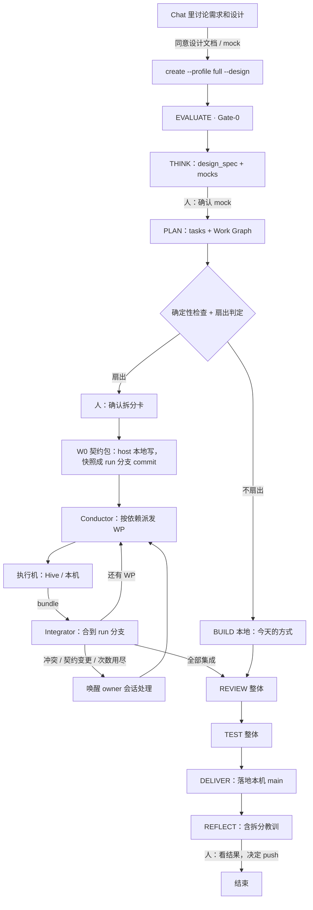
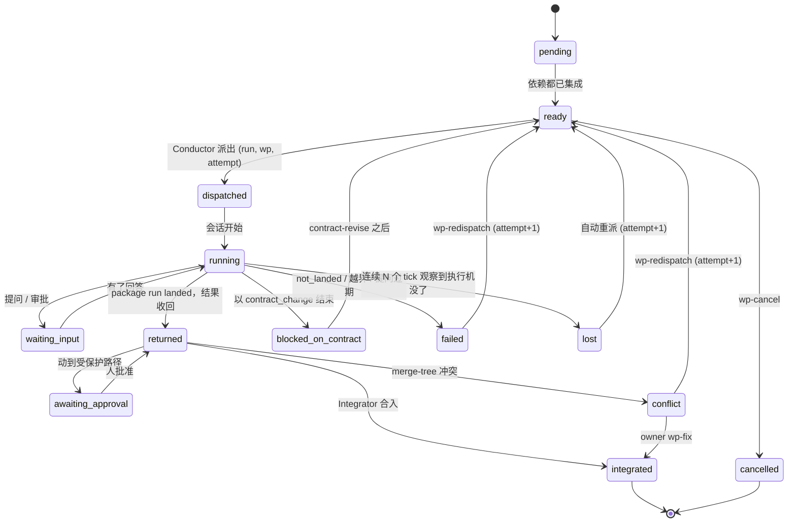

# Swarm Run

## 0. 一句话

一个大需求还是**一个 pipeline run**。EVALUATE、THINK、PLAN 在 host 上做完，PLAN 产出一张
**工作图（Work Graph）**。BUILD 不再由一个 agent 在一个 worktree 里写完，而是由 host 上的
**Conductor** 按依赖把**工作包（Work Package，WP）**派给执行机（Hive 或本机），收回结果后逐个
集成到 run 分支。之后 REVIEW、TEST、DELIVER、REFLECT 照旧对整个 run 做一次。人只在三处出场：
同意设计（含 UX mock）、同意拆分、最后看结果。

界面上把这种 run 叫 **Swarm Run**。它不是新产品，也不是新 profile，而是 `full` profile 的 BUILD
多了一种执行方式：`build: fanout`。

## 1. 为什么做，做到哪里

### 1.1 目标

- G1 一个讨论清楚的大需求，从 chat 进入 pipeline 后，能无人值守地跑到"整体验收待人看"。
- G2 互相独立的部分并行执行，并行度等于可用执行机的数量，而不是一台笔记本的内存。
- G3 人的出场次数不随工作包数量增长：一个 run 最多三次固定出场，加上真实的例外。
- G4 拆分、派发、集成、终止都是确定性的：模型提议，检查和计数器决定（SOUL P5）。
- G5 已有的 pipeline 阶段、Swarm Out 派发、Hive 回收全部复用，不另起一套。
- G6 每次 Swarm Run 都留下"怎么拆才对"的教训，下次拆得更好（复利在拆分质量上）。

### 1.2 非目标（本设计不做）

- 不做 agent 之间的实时协作。兄弟工作包之间不通信，只通过契约 commit 和 host 交互。
- 不让 Hive 做决定。Hive 只执行一个工作包，拆分、集成、验收都在 host。
- 不做跨多个仓库的一次 Swarm Run（v1 只做单仓库）。
- 不做非代码任务的扇出（研究、写作，留到 P4）。
- 不加任何花费上限（STEERING #2）。花费记账、展示，不截断。
- 不按时间判定失败。慢是正常的；只有观察到执行机没了才算丢失（§8）。

## 2. 现状：已有什么，缺什么

以下每条都是本次对照代码读到的。

| 事实 | 出处 | 对本设计的意义 |
|---|---|---|
| `full` 的阶段：evaluate → think → plan → build → review → test → deliver → reflect；profile 在 `create` 时固定 | `core/run_protocol/lifecycle.py:95-101`，`cli_commands.py:122-131`，`engine.py:509-535` | 不加 profile，扇出是 `full` 内部 BUILD 的执行方式 |
| PLAN 的任务字段只有 `id, file, symbol, change, requirements, depends_on, creates_test_files` | `core/run_protocol/schemas.py:464-482` | 已有依赖字段，但只校验引用存在，不查环，引擎也不按它排序；没有归属，没有仓库字段 |
| DS-3（任务结构检查）不阻断阶段 | `checks.py:133`，`stages/plan.md:5` | 工作图的检查要新加，而且扇出时必须阻断 |
| BUILD 没有任务循环："Write and test the change your own way… The pipeline does not say how" | `stages/build.md:5` | 扇出是 BUILD 的一种新执行方式，本地方式保持不变 |
| 每个 run 每个仓库一个 worktree，分支 `run/<run_id>`；写入限制在自己的 worktree | `run_worktree.py:84-88`，`core/worktree_write_gate.py:1-30` | run 分支天然就是集成分支 |
| 测试结果是 agent 自报，绑定到引擎自己算的 code tree | `validation_report.py:1-20`，`checks.py:310-342` | 工作包的测试结果同样是自报，最终可信度来自 host 的 TEST |
| REVIEW 对整个 run 的 diff（fork base → 当前 code tree）；名单只会选 correctness 和 security | `engine.py:2637-2732`，`review.py:362-392` | 集成完成后 REVIEW 不用改就能审整个变化；按 WP 分片是增强 |
| DELIVER：`commit-tree` 加 `merge --ff-only`；LG-4 要求 main 仍在 run 的 base，否则先同步 | `landing.py:405,452-457`，`checks.py:498-508`，`engine.py:3269-3298` | 最终落地完全复用 |
| 已经能把整个 pipeline run 派到一台 Hive：pin 带 `execution: {how:"pipeline", profile, run_id, requirement}` | `core/swarm_out.py:423-443`，`core/project_agent_session.py:139-152` | 工作包派发复用这条路，换一种 execution |
| `dispatch_spec`：revision 校验 → `admit()` → 选 Hive → Brain 同步 → 发 bundle → 开会话 | `core/swarm_out.py:473-560` | 每个工作包就是一次 dispatch，但 Brain 版本和 base commit 要由 run 固定（§5.6） |
| Brain 摘要不同就同步；Hive 上有 turn 占着这个 Brain 时安装返回 423 | `core/swarm_out.py:513-534`，`routers/hive_brains.py:96-100` | 同一 run 的第二个工作包派到同一台 Hive 时，若 host 摘要变了会失败——必须按 run 固定版本 |
| 没有并发位：只有内存 critical 且还有别的流时才算 saturated；忙就拒绝，不排队 | `routers/chat.py:879-944`，`core/session_unit.py:281-303`，`core/swarm_out.py:370-371` | 要有自己的派发队列和每台 Hive 的并行数（人配置） |
| `pick_hive` 确定性挑选：空闲优先，再按流数、内存、名字 | `core/swarm_out.py:450-470` | 调度直接复用 |
| 明确的非目标："不排队；不把一个单子拆给多台机器" | `docs/design/2026-10-30-dispatch-center.md:199` | 本设计在 pipeline 层推翻这一条（§15 D1） |
| 回收：Hive 打 bundle，host 校验后取到 `refs/hive/<dispatch>/<key>`；`land` 在审过的 base 上做 `merge-tree`，冲突拒绝，`commit-tree` 后 `ff-only`；受保护路径要另外批准 | `core/hive_return.py:377-412,433-492` | 集成器就是这个算法，把目标从 main checkout 换成 run worktree |
| 落地、拒绝、放弃是只能由人调用的路由 | `core/run_owner_gate.py:67-71` | 集成到 run 分支不是落地到 main，可以由引擎做；落 main 仍走 DELIVER |
| 结果收回和了结只在 `GET /runs` 被轮询时才跑；没有后端定时器 | `core/swarm_out.py:909-977`，`main.py:1536-1539` | Conductor 需要后端定时循环（前置 P0-a） |
| 问题桥：Hive 的 AskUserQuestion 和危险命令审批镜像到 S3；pipeline 的 decision 不走桥；超过 4h5m 的提问被丢掉 | `core/swarm_out_bridge.py:1-37,57` | 工作包里的提问只能走 AskUserQuestion |
| 回答路由 `POST /api/swarm-out/asks/.../answer` 不在 owner gate 里，任何本地进程都能代答 | `routers/swarm_out.py:271-276`；HLD §15 | 本设计让 agent 回答部分问题之前，先把这条边界收紧（§9） |
| Needs You 没有 Swarm Out 来源 | `core/attention_authority.py` | 前置 P0-b |
| Hive 工作者角色：只跑 S2/S7 抽取，教训以外部证据进入 host 的 CDF | `core/app_role.py:1-44`，`core/hive_lessons.py:1-46` | 工作包的教训自动回流，不用新机制 |
| 花费账本有 `run_id`、`dispatch_id` 列；Hive 的行每 900s 同步回来 | `database/sqlite.py:2108-2168`，`core/usage_hive_sync.py:1-35` | 整个 Swarm Run 的花费可以汇总 |
| 唤醒会话：`send_requests` 以 `client_id` 为主键保证恰好一次，`session_pending.persist_pending` 写待发行，会话空闲时 drain | `core/send_requests.py:62,96`，`core/session_pending.py:304`；`managed-local-run.md` §10 | Conductor 叫醒 owner 会话复用这条通道 |
| code graph：`impact` 给出一个文件或符号的调用者（深度 1-3），有盲区；`imported_files` 给出导入关系 | `core/code_intel/impact.py:40-100,200-203`，`graph_store.py:1004` | 能对工作包之间的耦合做确定性提示，但不能证明不耦合 |
| pipeline 里没有 UX mock 产物；design 的 `user_workflow` 是纯文本 | `schemas.py:541-544` | mock 要成为 design 的一等产物（§5.2） |
| 并行子任务"原则上允许"但引擎不知道任务 | 2026-10-22 native-execution 文档 §4（已被取代） | 本设计让引擎第一次真正知道任务 |

一句话：**派发、回收、合并、落地、审查都有了；缺的是工作图、确定性的拆分检查、调度队列、
集成到 run 分支、唤醒 owner 会话，以及把这些串起来的 Conductor。**

## 3. 方案比较

| 方案 | 是什么 | 工作量 | 风险 | 取舍 |
|---|---|---|---|---|
| A 父子 run | 一个编排对象拆出 N 个完整的 pipeline run，每个派到一台 Hive，最后合并 | 高 | 每个子 run 都跑 EVALUATE、Gate-0、REVIEW、DELIVER：N 次评审、N 次框定，整体却从没被审过 | 正是"每轮循环重复整套阶段"的结构错误；否决 |
| **B BUILD 扇出（推荐）** | 一个 run，host 做框定和规划；只有 BUILD 扇出；REVIEW/TEST/DELIVER 对整体一次 | 中 | 拆分质量和集成是主要风险，见 §11 | 和 pipeline 现有规则一致："一个需求一个 run，PLAN 列出所有部分" |
| C 单机内并行 | 整个 run 派到一台 Hive，在那台机器上用 subagent 并行写 | 低 | 同一个 worktree 里并行写会互相踩；并行度受一台机器限制；没有隔离 | 适合小规模；作为 P4 的补充，不当主干 |
| D 云端 Conductor + 共享记录层 | 10-08 Hive-Mind 设计：调度在云上，笔记本可以合上 | 很高 | 要新建记录层、云上调度和写回 | 远期方向；v1 先在 host 上做，接口按以后能搬上云来设计 |

透过几个角度看 B：**速度**——并行度等于执行机数；**质量**——整体只审一次，但审的是集成后的
真实结果；**简单**——不加 profile，不加新的 run 类型，复用 dispatch 和 land；**灵活**——执行机
可以是 Hive 也可以是本机，同一个接口；**删除**——N 张派发确认卡和 N 次人工验收合成一次。

## 4. 总体形态



**人的三个固定出场：**

1. **同意设计**：chat 里讨论出的设计文档，以及涉及界面时的 UX mock（THINK 阶段的 decision）。
2. **同意拆分**：拆分卡（§10.1）。一次确认替代 N 张派发确认卡。这是花费成倍放大之前的那一刻。
3. **看结果**：REPORT 和整体验收结果；push 仍由人决定（现有规则）。

**例外才打扰人**：工作包问了 agent 答不了的意图问题；动到受保护路径；某个工作包或契约的
次数用完；危险命令审批（永远是人）。

## 5. 组件

每个组件写清：做什么、读什么、写什么、复用什么、新增什么。

### 5.1 C1 Intake：从 chat 设计进入 run

- **做什么：** chat 里已经和人讨论好的设计文档（可能还有 mock），作为 run 的输入，不让 THINK
  从零重推一遍。
- **新增：** `pipeline-v1 create --design <path>`（可多次，指向设计文档和 mock 文件）。引擎把
  文件拷进 run 的 `artifacts/inputs/`，算 sha256，写进 `run_create` 事件。THINK 的 design_spec
  必须引用这些输入（新检查 DS-I：每个输入都被 design_spec 的 `inputs[]` 引用）。
- **不变：** Gate-0 照常审 requirements。导入的设计是"人已同意的输入"，不是免审通行证。
- **为什么要：** 2026-10-22 的 `--from-spec` 没做，原因是当时没有消费方。Swarm Run 就是消费方：
  不导入，chat 里花一小时讨论的结果在 THINK 里会被重新推导一遍，可能推出不同的结论。

### 5.2 C2 设计产物：design_spec 和 UX mock

- **design_spec 不变的部分：** alternatives、chosen、design{user_workflow, architecture, flow,
  states}、properties、failure_modes、exit_criteria、security_boundaries（`schemas.py:437-554`）。
- **新增 `design.mocks[]`：** `{id: "M<n>", path: "artifacts/mocks/<id>.html", covers: [R/X ids],
  decision: <decision event id>}`。mock 在 THINK 里由 agent 用 `s_frontend-design` 产出，产出前先
  读 `data/design-judgment.md`（AGENT R15）。
- **mock 的确认是一次 decision-request（DC-1，人）。** 已有机制，`full` 的 caps 里 `decisions=True`
  （`lifecycle.py:129-134`）。
- **新检查 W-8：** 声明了 `mocks` 的工作包，它引用的每个 mock 都必须有一个人确认过的 decision。
  界面类工作包没有确认过的 mock 就不能派出。
- **mock 随工作包一起送到执行机**（§5.6 的 packet），作为实现界面的形状参照。
- **不做：** 不自动判定"这个需求涉及界面"。需要 mock 由 THINK 声明，或者由导入的设计带入。

### 5.3 C3 Planner：工作图

PLAN 在现有 `tasks[]` 之外产出 `work_packages[]`，同在 `design_spec.json`：

```jsonc
{
  "id": "W1",                     // W0 固定是契约包
  "title": "后端：Work Graph 校验器",
  "repo": "swarmai",              // v1 只允许一个仓库
  "tasks": ["T3", "T4"],          // 每个任务恰好属于一个 WP
  "owns": ["backend/core/run_protocol/work_graph.py", "backend/tests/test_work_graph.py"],
  "owns_new_under": ["backend/core/run_protocol/wg/"],   // 允许新建文件的目录前缀
  "reads": ["backend/core/run_protocol/schemas.py"],     // 只读参照，送进 packet
  "depends_on": ["W0"],
  "exit_criteria": ["X2", "X5"],  // 这个 WP 必须让哪些测试通过
  "mocks": [],
  "placement": "any"              // any | local（内网仓库、私有网络需要时）
}
```

- **任务加一个字段 `wp`** 不必要：`work_packages[].tasks` 已经给出归属，单一来源。
- **`owns` 只接受明确的路径，加一个"可新建目录前缀"。** 不接受 glob，否则不重叠检查算不准
  （AGENTS.md：算不准的不猜）。
- **W0 契约包**：放各工作包共享、而且多个包都要改的东西——接口、类型、数据结构、事件名、配置键、
  桩实现、集成测试（先红）、测试夹具。它由 host 本地写（§5.5）。
- **规划的教训来源：** PLAN 开始前，按 `knowledge find --query "拆分 工作包 冲突"` 召回以往 Swarm
  Run 的拆分教训（§5.11 写入）。

### 5.4 C4 Plan Validator 和扇出判定（确定性）

PLAN 收尾时，引擎跑这些检查。扇出时它们阻断 PLAN；本地 BUILD 时它们只进审计。

| 检查 | 内容 |
|---|---|
| W-1 | 依赖图无环；每个依赖都指向已知 WP；W0 没有依赖，其它 WP 都（直接或间接）依赖 W0 |
| W-2 | 每个 task 恰好属于一个 WP；每个 task 的 `file` 在所属 WP 的 `owns` 或 `owns_new_under` 里 |
| W-3 | 任意两个**可能同时执行**的 WP（依赖图里没有先后关系的一对），`owns` 和 `owns_new_under` 两两不重叠（前缀感知） |
| W-4 | 被两个以上 WP 需要修改的文件，只能归 W0 |
| W-5 | 每个 `kind: test` 的 exit criterion 至少被一个 WP 覆盖，或者明确标为"集成后验证" |
| W-6 | 耦合提示：对每对可同时执行的 WP，用 code graph 查 A 拥有的文件是否被 B 拥有的文件调用或导入。**只提示，不阻断**，连同 graph 的盲区一起显示在拆分卡上 |
| W-7 | 受保护路径（`GIT_PROTECTED` 加仓库 `[hive_return] protected`）出现在哪些 WP 里，提前列出：集成时需要人批准 |
| W-8 | 见 §5.2 |

**扇出判定**是一个纯函数，相同的工作图得到相同的结论：

```
fanout = W-1..W-5, W-8 全部通过
     and 存在一层（antichain）至少有 2 个 WP
     and 至少有一个可用执行机能接 placement=any 的 WP
     and 仓库可以打 bundle（有提交，能在执行机上 clone）
否则 build = local，原因写进事件 build_plan
```

- 判定写成一个事件 `build_plan{mode, reason, graph_sha}`，之后不可改，和 profile 一样。要改就重新
  规划（§5.10），重新规划会生成新的 `build_plan`，旧的保留在日志里。
- **不用时长估计做判定。** 没有可靠的方法估计一个包要跑多久，用估计值做判定就是猜。只看结构。
- 人在拆分卡上可以选"本地执行"覆盖扇出（反过来不行：检查不过就不能扇出）。

### 5.5 C5 契约包 W0

- **谁写：** host 上的 owner agent，在 run worktree 里写，和今天的 BUILD 一样。
- **写完：** agent 提交 W0 的 BUILD 报告；引擎把 run worktree 当前的 code tree 写成 run 分支上的一个
  commit（`swarm: W0 contract`），worktree 回到干净状态。这个 commit 是所有第一层 WP 的 base。
- **W0 的集成测试先红是预期的。** 它们由后续 WP 变绿；W-5 记录哪个 WP 负责哪个测试。
- **契约变更：** 某个 WP 发现契约不对时，不能自己改契约文件（§5.7 的归属限制），只能以
  `contract_change` 结束并给出提议（§5.8）。agent 修改契约就是 W0 的新版本（W0 rev 2），受计数器
  限制（§8）。

### 5.6 C6 Conductor 和调度

Conductor 是 host 后端的一个**确定性循环**，不调用模型。它不是 agent，不在任何 chat turn 里。

- **触发：** 后端定时器（P0-a 先为 Swarm Out 补上的那个）每个 tick 跑一次，外加事件驱动
  （WP 结果收回、人回答了问题、人确认了拆分）。
- **每个 tick 做：**
  1. 读 run 的事件日志，算出每个 WP 的状态（§6）。
  2. 就绪集合 = 依赖都已集成、还没派出的 WP。
  3. 按工作图里的顺序（W 编号，确定性）把就绪 WP 派给有空位的执行机。
  4. 对已返回的 WP 调 Integrator（§5.9），一次一个，持有 run 的 oplock（`core/run_protocol/oplock.py`）。
  5. 需要模型判断的情况（冲突、契约变更、agent 能答的问题、次数用尽）→ 唤醒 owner 会话（§5.10）。
- **空位：** 每台 Hive 有一个人配置的 `parallel`（默认 1，在 Fleet 里设置），表示这台机器同时接几个
  Swarm Run 的 WP。这是资源上限，不是猜测；默认值保守，实测之后再调（§16）。另外照旧尊重
  `saturated`。本机执行机默认 `parallel = 1`。
- **选机器：** 复用 `pick_hive`（`core/swarm_out.py:450-470`），在 `parallel` 没满的机器里选。
- **固定 Brain 版本：** fan-out 开始时，Conductor 把 Brain 打成一个快照（摘要 + 内容），之后这个 run
  的每个 WP 都同步这个快照，而不是同步 host 当下的 Brain。原因：host 在 run 期间还在沉淀知识，
  摘要会变；而 Hive 上有 turn 占着 Brain 时同步会被 423 拒绝（`routers/hive_brains.py:96-100`）。
  同一台 Hive 上摘要已经等于快照时不再同步。新增：`brain_sync_host.sync` 接受一个快照（P0-e）。
- **固定代码版本：** WP 的 base 是 run 分支上的一个具体 commit（W0 或其依赖集成之后的 tip），
  不是本机 checkout 的 HEAD。`_ship_repos` 和 spec 的 `repos[].sha`（`task_spec.py:260-284`）需要接受
  显式的 ref/sha。
- **派发：** 每个 WP 就是一次 `dispatch_spec`，pin 里 `execution.how = "package"`（§5.7）。dispatch 行
  多两个字段 `parent_run`、`wp`，供 Swarm Out 分组和花费汇总。派发确认卡不再单独出现：拆分卡的确认
  就是这批派发的确认，spec 的 revision 在拆分卡上一并展示和校验。
- **幂等：** 派发键是 `(run_id, wp, attempt)`。Conductor 崩溃后重跑，看到已有这个键的 dispatch 就
  不再派。

### 5.7 C7 执行机和 `package` 执行方式

执行机有一个接口，两种实现：

| | 本机执行机（local） | Hive 执行机 |
|---|---|---|
| 在哪里 | host 上另开一个 worktree `~/.swarm-ai/worktrees/<run_id>-<wp>/` 和一个后台 agent 会话 | 一台 Hive 的工作单 clone |
| 用途 | P1 不依赖 Hive 先验证拆分和集成；内网仓库、私有网络的 WP（`placement: local`） | 并行和隔离 |
| 结果 | 本地分支 tip | bundle → `refs/hive/<dispatch>/<key>` |

**`package` 是一种新的 execution，不是用户可选的 profile。** 执行机上创建一个 pipeline run，阶段只有
build → test → deliver → reflect：

- 不跑 EVALUATE、THINK、PLAN、REVIEW：这些属于整个 run，已经在 host 做过或者之后对整体做。
- 输入是 packet：需求摘录、design 摘录、本 WP 的定义、`reads` 文件、mock、exit criteria 对应的测试
  命令、base commit。
- **packet 怎么送到 Hive：** 就我读到的工作单字段（`run-spec.md:122-133`），没有附件。新增：工作单带
  一个 packet 附件（有大小上限，超出就拒绝派发，不截断）。
- **归属限制（协作式）：** 执行机上的 `worktree_write_gate` 对 package run 增加一条：写 `owns`、
  `owns_new_under`、本 WP 的 `creates_test_files` 以外的路径一律拒绝，提示"以 contract_change 结束"。
  Hive 上 agent 和 daemon 是同一个系统用户，这条限制挡不住故意绕过的 agent，所以它只是让正常 agent
  不走错路。**真正的边界在 host 的 Integrator（§5.9）。**
- **结束状态映射：** package run 的 landed → `returned`；not_landed 带原因 → `failed`；新增 not_landed
  原因 `contract_change`（REPORT 里带提议）→ `blocked_on_contract`。
- **教训：** 工作者角色照旧把 cognition/gap 单元送回 host 的 CDF（`core/hive_lessons.py`），不新增机制。

### 5.8 C8 问题和注意力

- **工作包里的提问只走 AskUserQuestion**（已经有桥，`core/swarm_out_bridge.py`）。package run 的
  caps 里 `decisions=False`，不发 pipeline decision（不走桥）。
- **路由：** host 收到一条 ask，若它属于某个 Swarm Run 的 dispatch，就挂到该 run 的问题队列。
- **谁来答（§15 D2，推荐 B）：**
  - A：全部给人。简单、安全，但人要回答 N 个工作包的问题。
  - **B：先唤醒 owner agent。** agent 只能用新命令 `pipeline-v1 wp-answer` 回答**本 run 的 WP 的
    提问**，答案必须引用需求、设计或 mock 里的出处；答不了或者涉及意图，就 `wp-escalate` 到 Needs You。
    每条代答都记成一条 intervention，REPORT 里列出。
  - **危险命令审批永远由人决定**，agent 没有任何回答审批的路径。
- **Needs You：** 一个 Swarm Run 在 Needs You 里只占一个条目，条目里列出这个 run 当前等人的事
  （意图问题、受保护路径、次数用尽）。依赖 P0-b（attention_authority 接上 Swarm Out）。
- **提问会过期：** 桥丢掉 4h5m 以上的提问（`swarm_out_bridge.py:57`）。人很久没回时，工作包按现有超时
  路径继续或结束；结束就算一次失败（§8）。这是 v1 的局限。

### 5.9 C9 Integrator：合到 run 分支

把 `hive_return.land` 的算法（`core/hive_return.py:433-492`）抽成一个按目标参数化的函数：

1. **归属检查（确定性，真正的边界）：** `git diff --name-status <base> <tip>` 涉及的每个路径（重命名两边
   都算）必须在该 WP 的 `owns` / `owns_new_under` / `creates_test_files` 里。超出 → 拒绝，WP 记为
   `failed(out_of_scope)`，不合入任何东西。
2. **受保护路径：** 涉及时需要人批准（现有 `approve_protected`），WP 停在 `awaiting_approval`。
3. **合并：** `merge-tree --write-tree --merge-base=<WP base> <run 分支 tip> <WP tip>`。
   - 退出码 1（冲突）→ WP 记为 `conflict`，唤醒 owner agent（§5.10）。
   - 成功 → `commit-tree`，提交信息写明 WP 和来源。
4. **前移：** 在 run worktree 里 `merge --ff-only`。要求 run worktree 干净、owner 没有在 turn 里、
   持有 run 的 oplock。不满足就这个 tick 不集成，下个 tick 再试，不算失败。
5. **记录：** 事件 `wp_integrated{wp, attempt, base, tip, commit}`。

- **不写 main。** main 只在 DELIVER 由现有 `land` 写（`landing.py:452-457`）。
- **不需要人逐个批准：** 这是引擎在 run 自己的分支上做的确定性合并，和 pipeline 今天 agent 在 run
  worktree 里写代码属于同一信任范围。人对整体结果的批准在最后。
- **集成之后跑不跑测试：** v1 不在每次集成后跑。下游 WP 在集成后的 tip 上构建，自己的测试会先暴露
  问题；最终可信度来自 host 的 TEST 阶段。P4 可以把"集成后验证"也作为一个只读工作包派出去。

### 5.10 C10 唤醒 owner 会话

Swarm Run 在 BUILD 里可能要等几个小时。owner agent 不能一直占着一个 turn 等。

- **扇出期间 owner 会话空闲。** `next` 返回"Conductor 在执行工作图，现在不需要你写代码"，并列出当前
  状态。人这时在会话里说话，agent 可以回答进度、执行 `wp-*` 命令（见下），但不会自己去写 BUILD。
- **需要模型判断时，Conductor 叫醒会话：** 复用 `send_requests.reserve` +
  `session_pending.persist_pending`（`core/send_requests.py:62`，`core/session_pending.py:304`）。
  `client_id = swarm-run:<run_id>:<event_seq>`，同一个事件只会出现一次；会话不在线时待发行一直保留，
  打开时再送。消息带 `metadata.source = "swarm_run"`，前端显示成系统卡片，**不算用户的话**
  （CDF 的 `user_quote` 不能引用它）。
- **唤醒的原因只有这几类：** 冲突、契约变更提议、可以代答的提问、某个 WP 次数用尽、全部集成完成
  （进入 REVIEW）。
- **owner 能用的命令：** `wp-status`、`wp-answer`、`wp-escalate`、`wp-fix <wp>`（在 run worktree 里
  手工解决冲突后提交）、`wp-redispatch <wp> --note`（带纠正重派，attempt+1）、`contract-revise`
  （W0 新版本）、`wp-cancel`、`replan`（回到 PLAN，需要人再确认拆分卡）、`fanout-stop`（停止派发，
  已在跑的跑完，剩下的转本地执行）。
- 这条通道和 `managed-local-run.md` §10 是同一个需求。谁先实现，另一个就复用，不做两个。

### 5.11 C11 整体验收和交付

- **REVIEW：** `review_start` 照旧对 fork base → run 分支 tip 的整个 diff（`engine.py:2637-2732`）。
  增强：REVIEW.md 按 WP 分节，另加一节"接缝"（契约文件和跨 WP 的调用点）。扇出 run 的名单加
  `integration` 专家（专家目录里已有，`backend/experts/code/integration.md`），触发条件是确定性的 `build_plan.mode
  == fanout`（§15 D5）。轮数上限照旧两轮。
- **修复：** 审查发现按现有规则汇总成一份 fixing spec。小的由 owner 在 run worktree 里直接修；某个 WP
  范围内的大问题可以 `wp-redispatch` 带 fixing spec 重派。
- **TEST：** 在集成后的完整代码上跑更宽的检查（现有 TS-1）。这是整个 Swarm Run 的可信度来源。
- **DELIVER：** 现有 `land`。默认一个仓库一个 commit；REPORT 里列出每个 WP（§15 D3）。
- **REFLECT：** 除现有内容外，写入一组**拆分指标**：每个 WP 的 attempt 数、冲突数、契约版本数、
  越界拒绝数、代答数、上报给人的次数、墙钟时间、花费。由此产出的教训（"这类改动不要按层拆"）进入
  SwarmAI DDD 的 IMPROVEMENT，供下次 PLAN 召回。这是 G6 的复利环。

### 5.12 C12 可见性和花费

- **单一事实来源：** run 的事件日志（`events.jsonl`）。WP 状态由事件折叠得出，`run.json` 是投影
  （`engine.py:1013-1059`）。Swarm Out 的 dispatch 行只是执行记录，通过 `parent_run` 指回来。
- **花费：** host 侧用现有 `attr:pipeline:{run_id}` 归因行；Hive 侧按 `dispatch_id` 从账本汇总
  （`usage_hive_sync` 同步）。REPORT 和界面显示总花费和每个 WP 的花费，没有上限。
- **热路径成本：** Conductor 在后端定时器上跑，不在发送和流式路径上；每个 tick 读一个 run 的事件日志、
  做几次 git 对象操作。git 操作放进 `asyncio.to_thread`，不占 chat 等待的线程池（`core/executors`）。
  实现时按 AGENTS.md 实测并写进提交信息。

## 6. 状态

### 6.1 run 层

run 的状态值不新增（`lifecycle.py:23-25`）。BUILD 阶段内部多一个子状态，由事件折叠得出：

`planned_local` | `contract`（W0 在写）| `fanned_out`（Conductor 执行中）| `integrated`（全部集成）|
`stopped`（`fanout-stop` 后转本地）

BUILD 阶段完成的条件：所有 WP 是 `integrated` 或 `cancelled`，并且有一份针对 run 分支 tip 的 BUILD
报告（现有 BX-3）。`cancelled` 的 WP 覆盖的 exit criteria 在 REPORT 里列为未完成。

### 6.2 工作包



- **重派的 base：** 原 base 加上此后已集成的依赖。冲突重派用最新的 run 分支 tip 作 base，并把冲突
  信息写进 packet。
- **取消依赖链：** 取消一个 WP，依赖它的 WP 变成不可达，Conductor 把它们一起标出来让 owner 决定
  （取消或者改依赖后重新规划）。

## 7. 每个事实只有一个来源

| 事实 | 唯一来源 | 谁写 | 谁读 |
|---|---|---|---|
| 工作图 | `design_spec.json` 的 `work_packages[]`（PLAN 的 blob） | owner agent，在 PLAN | Validator、Conductor、拆分卡、REVIEW |
| 扇出判定 | 事件 `build_plan` | 引擎 | Conductor、界面、REPORT |
| WP 状态 | 事件 `wp_dispatched / wp_returned / wp_integrated / wp_failed / ...` | Conductor、Integrator、`wp-*` 命令 | 折叠 → `run.json`、界面 |
| WP 的执行记录 | Swarm Out dispatch 行 + Hive run 记录 | 现有 dispatch / 记录拉取 | Conductor（只读） |
| 固定的 Brain 版本 | 事件 `brain_snapshot{digest}` + 快照文件 | Conductor | 派发 |
| 代码 | run 分支的 commit | Integrator、owner | 一切 |
| 花费 | `usage_ledger` | 现有写入者 | REPORT、界面 |

## 8. 失败、终止和恢复

每个循环都有计数器，计数器到顶就交给人，不会无限转（SOUL P5）。不使用任何时间上限。

| 情况 | 识别方式 | 处理 | 计数器 |
|---|---|---|---|
| 执行机没了 / Hive 重启丢了 turn | 连续 3 个 tick 观察到 `hive_gone / hive_stopped / stopped` 且无新记录（`swarm_out.py:823-846`） | `lost` → 自动重派 | 每个 WP attempt ≤ 2，之后交给人 |
| package run 没落地 | 结果的 not_landed 原因 | `failed`，唤醒 owner 决定重派还是取消 | 同上 |
| 越界写 | Integrator 的归属检查 | `failed(out_of_scope)`，不合入 | 同上 |
| 冲突 | `merge-tree` 退出码 1 | 唤醒 owner：`wp-fix` 或重派 | 同上 |
| 契约不对 | `contract_change` | 唤醒 owner：`contract-revise` | W0 版本 ≤ 2（初版之外再改两次），之后交给人：大概率该重新规划 |
| 重新规划 | `replan` | 回到 PLAN，人再确认 | 每个 run ≤ 1 次，之后交给人：拆分方式本身错了 |
| Conductor 或 daemon 重启 | 启动时重放事件日志 | 继续；派发键幂等 | — |
| host 笔记本合上 | 没有 tick | 已派出的 WP 在 Hive 上继续跑；收回和集成在下次醒来时进行 | 局限，见 §11 |
| main 在 run 期间前进 | DELIVER 的 LG-4 | 现有 `_sync_moved_bases` 在落地前 rebase run 分支（`engine.py:3269-3298`）；扇出期间不 rebase，以免改动已派出 WP 的 base | — |
| 一个 WP 一直不结束 | 无（慢是正常的） | 不处理。人可以在拆分进度里看到，也可以 `wp-cancel` | — |

交给人的形式统一：Needs You 里一个条目，说清是哪个 WP、发生了什么、可选的动作，绝不让 run 停在没有
下一步的状态（不变量 I7）。

## 9. 安全边界

- **Hive 的 bundle 是不可信输入。** 现有校验照旧（单一 ref、前置提交、`bundle verify`、fsck，
  `hive_return.py:377-412`），加上归属检查。越界的结果一个字节都不合入。
- **归属检查在 host，不在 Hive。** Hive 上 agent 和 daemon 同用户（`run-spec.md:27-31`），Hive 侧的
  限制只是引导。
- **代答提问的边界（§5.8 B）。** 前置条件：先把现在不设防的回答路由收紧（P0-c）。危险命令审批的回答
  只接受人发起的请求；agent 只能通过 `wp-answer` 回答本 run 的 WP 的问题，路由校验 dispatch 属于
  该 run。HLD §15 记的"一条 curl 就能替人回答或批准"在本设计里必须先关掉。
- **受保护路径永远要人批准。**
- **合成的唤醒消息不是用户的话。** 带 `source=swarm_run`；进入 CDF 时不能作为 `user_quote` 的来源；
  其中引用的执行机输出标为不可信数据（AGENT R32 B 类）。
- **packet 只带本 run 的需求、设计、mock 和本 WP 需要读的文件。** 不带 MEMORY、USER、EVOLUTION 等
  私有上下文（Hive 工作者角色的现有边界）。
- **私有网络：** 需要内网的 WP 只能 `placement: local`。admit() 照旧拒绝派到 Hive（`task_spec.py:152-193`）。

## 10. 界面（以决策为中心，mock 是下一步）

按 `s_frontend-design` 的原则：一个面回答一个决定，只把改变决定的东西放出来。

### 10.1 拆分卡（chat 里，PLAN 收尾）

- **回答的决定：** 按这个拆法派出去吗？
- **最突出的一行：** 判定和原因，例如"扇出：3 层，5 个工作包，最多 3 个同时跑；用 2 台 Hive"。
- **主体：** 按层排的工作包，每个一行：标题、负责的区域（目录级）、依赖、它让哪些测试变绿。
- **需要注意的（只在有时出现）：** 耦合提示（W-6）、受保护路径（W-7）、依赖 mock 的包。
- **动作：** 派出去 / 本地执行 / 在 chat 里改拆法。
- **展开才看：** 每个包的完整 `owns`、packet 内容、spec revision。

### 10.2 Swarm Run 进度（Pipeline 面板的 run 详情 + Swarm Out 里按 run 分组）

- **回答的决定：** 有没有事等我，有没有卡住的？
- **最上面一行：** "5 个里 3 个已集成 · 1 个等你 · 1 个在跑"。
- **主体：** 工作图，每个节点一个状态点；只有例外的节点展开（冲突、等人、次数用尽）。
- **Swarm Out 面板里：** 子派发折叠在父 run 下面，不再各自要求 Accept；它们在集成后自动了结。

### 10.3 Needs You

一个 Swarm Run 一个条目，列出当前等人的事，每件事一行带动作。

### 10.4 最终结果

现有的 REPORT 和 turn result 卡，多一张 WP 表（每行：状态、attempt、花费、时间）。

mock 在设计被接受后做，放在 `Knowledge/Mockups/2026-10-31-swarm-run/`，先读 `design-judgment.md`。

## 11. 风险（按严重程度排）

| # | 风险 | 为什么严重 | 缓解 | 剩下的 |
|---|---|---|---|---|
| R1 | **拆错，隐性耦合** | 文件不重叠不等于行为不耦合：共享的配置键、数据库结构、事件名、约定。各自通过、合起来就错 | W0 契约包承载所有共享的东西；W-4 强制共享文件归 W0；W-6 用 code graph 提示调用和导入；集成测试写在 W0 里先红 | 动态调用、字符串分派、跨仓库调用是 graph 的盲区（`impact.py:200-203`）；靠最终 TEST 和 REVIEW 的接缝一节兜底 |
| R2 | **契约反复导致连锁返工** | 契约一改，依赖它的包可能都要重做，花费和时间成倍 | 契约版本计数器（≤2）；`contract_change` 要给出提议而不是自己改；改版时只重派真正读到改动文件的 WP（按 `reads` 和 `owns` 求交） | 契约设计质量取决于 PLAN；反复两次就交给人重新规划 |
| R3 | **语义冲突** | `merge-tree` 没有文本冲突，但合起来行为错 | 下游 WP 在集成后的 tip 上构建；最终 TEST；REVIEW 接缝一节；integration 专家 | 两个互不依赖的包之间的语义冲突要到 TEST 才暴露，修复成本在最后 |
| R4 | **自报的测试结果** | pipeline 不运行测试，靠 agent 报告（`validation_report.py:1-20`）；N 个远端 agent 的自报更难核实 | 报告绑定到 code tree；最终在 host 的完整代码上跑 TEST；REFLECT 记录"WP 报告通过但集成后失败"的次数 | 和今天 pipeline 的信任模型一样，没有更差，也没有更好 |
| R5 | **host 依赖笔记本** | Conductor 在 host 上；合上笔记本，收回和集成就停了 | 已派出的 WP 继续跑；醒来后按事件日志继续；设计上 Conductor 不依赖 chat 会话，以后能搬到云上（方案 D） | v1 不能实现"合上盖子整个 run 照样跑完" |
| R6 | **Brain 版本漂移** | host 在 run 期间持续沉淀；不固定版本时，后派的 WP 拿到不同的知识，或者同步被 423 拒绝 | run 固定 Brain 快照（§5.6，P0-e） | 快照之后沉淀的新知识，这个 run 用不上 |
| R7 | **容量是未知数** | 没有并发位概念；m7g.xlarge 上同时跑几个 agent 会话加测试，没测过（HLD §20） | `parallel` 由人配置，默认 1；P2 先实测再调 | 默认值下并行度 = Hive 台数（现在是 2） |
| R8 | **agent 代答答错** | 代答错了，工作包就照错的方向做完 | 只能答引用需求、设计、mock 的问题，必须写出处；每条代答进 REPORT；意图问题必须上报 | 引用了出处也可能理解错；靠最终验收发现 |
| R9 | **花费放大** | 每个 WP 都要加载上下文、读代码；契约、集成、重派都是额外开销 | 不设上限（STEERING #2），但每个 WP 的花费可见；REFLECT 比较扇出和本地的花费 | 小需求扇出几乎一定更贵——由扇出判定和人在拆分卡上把关 |
| R10 | **卡住不终止** | 等待链条长，任何一环没有下一步就会挂着 | 每个循环一个计数器；`lost` 靠观察判定；交给人时一定带动作（I7） | 一个慢的 WP 会一直等，这是有意的（不按时间判定失败） |
| R11 | **很难查问题** | N 个远端会话，各有自己的记录 | 单一事件日志；每个 WP 能一键打开它的 Hive 会话（现有 Hive tab） | 跨 WP 的问题要人自己对照 |
| R12 | **人的注意力被问题淹没** | N 个 WP 都可能提问 | 代答（D2-B）；Needs You 每个 run 一条；拆分卡上先把可预见的问题答掉（设计导入） | 选 D2-A 时这个风险就留着 |
| R13 | **大 diff 的审查质量** | 一个 reviewer 看一个很大的 diff，容易浅 | 按 WP 分节、接缝单独一节、integration 专家 | 两轮上限不变；审得更细需要更多专家，这是 P3 的取舍 |
| R14 | **速度收益没有证明** | 拆分、契约、集成、等待本身都花时间；耦合紧的需求扇出可能更慢 | 扇出判定只看结构；P1 先在本机测返工率；P2 和单 run 做对照 | 第一批数据出来前，"更快"只是假设 |
| R15 | **推翻已有的非目标** | dispatch-center 明确不拆单（`dispatch-center.md:199`） | 拆分发生在 pipeline 层，由 host 规划；每个 dispatch 仍然是一个单子、一台机器 | 需要你拍板（D1） |

## 12. 局限（v1 明确做不到的）

- 只支持一个仓库、纯代码任务。
- 内网仓库的 WP 只能本机执行，所以内网项目的并行度只有本机。
- host 必须开着，收回和集成才会推进。
- 兄弟 WP 之间不能实时沟通；所有协调都经过契约和 host。
- 不会自动重新规划；重新规划要 owner 发起、人再确认。
- 耦合很紧、改动集中在少数文件的需求，判定会选本地执行，Swarm Run 帮不上忙。
- 提问超过约 4 小时没人回会过期。

## 13. 分期

每一期都是独立的设计细化加一串 commit，各自有用，前一期不依赖后一期。

**P0 前置（每一项单独都有价值，有的已在待办里）**

- a. Swarm Out 结果收回和了结改由后端定时器驱动，不再依赖界面轮询。
- b. `attention_authority` 接上 Swarm Out（Hive 的提问出现在 Needs You）。
- c. 收紧回答路由：审批只接受人发起；为 D2-B 准备按 run 校验的 agent 回答入口。
- d. Hive 工作者角色 step 5：真实端到端跑一次（`hive-run-record-and-worker-role.md:253`）。
- e. Brain 快照同步：`sync` 能发一个固定快照。
- f. 派发超时不一致：CLI 540s 短于 Hive 准备上限 1200s（`scripts/swarm_out.py:39` 对 `core/swarm_out.py:270`）。

**P1 本机扇出（不用 Hive）**

工作图结构和 W-1..W-8；扇出判定和 `build_plan`；拆分卡；W0 快照 commit；Conductor；本机执行机
（一次一个）；Integrator（run 分支）；唤醒通道；`wp-*` 命令；REFLECT 拆分指标。
**要证明的：** 拆分和集成这套机制本身成立，测出返工率。

**P2 Hive 执行机**

`package` 执行方式和 pin；按 run 固定 ref 发 bundle；packet 附件；Hive 侧归属引导；结束状态映射；
`lost` 识别；代答（D2）；每台 Hive 的 `parallel`；Swarm Out 按 run 分组和自动了结。
**要证明的：** 并行确实缩短墙钟时间，并测出 Hive 能同时跑几个。

**P3 设计产物和审查增强**

`--design` 导入；`design.mocks[]` 和 W-8；REVIEW 按 WP 分节、接缝一节、integration 专家。

**P4 远期**

Conductor 搬到云上（合上盖子照样跑完）；多仓库；研究和写作类扇出；集成后验证作为只读工作包；
单机内 subagent 并行（方案 C）作为小规模补充。

## 14. 验证计划

### 14.1 最终测试集（实现完成时必须全部成立）

| # | 不变量 | 测试形状 |
|---|---|---|
| I1 | 相同的工作图得到相同的扇出判定 | 纯函数测试：同一输入多次调用、打乱 JSON 键顺序，结论相同；任一 W 检查失败时结论是 local |
| I2 | 可同时执行的 WP，`owns` 两两不重叠（前缀感知） | Validator 测试：构造前缀重叠、`owns_new_under` 覆盖另一个包的文件等情况，必须拒绝 |
| I3 | 越界的 WP 结果不会合入任何东西 | Integrator 测试：在临时仓库里造一个改了 `owns` 之外文件（含重命名）的 tip，run 分支不变，WP 是 `failed(out_of_scope)` |
| I4 | 扇出期间 main 不被写 | 端到端测试：整个 P1 流程跑完到 REVIEW 前，main 的 ref 不变 |
| I5 | 同一个 `(run, wp, attempt)` 最多派发一次、最多集成一次 | 重放测试：Conductor 在派发后、集成后两个点崩溃重启，dispatch 行和 run 分支提交各只有一个 |
| I6 | agent 不能回答危险命令审批，也不能回答别的 run 的提问 | 路由测试：两种请求都被拒绝；人的请求通过 |
| I7 | 任何 WP 状态最终都会到达 `integrated / cancelled`，或者交给人且带动作 | 状态机性质测试：随机事件序列（丢失、失败、冲突、契约变更）下，计数器到顶后必然出现 Needs You 条目，不存在无出路的状态 |
| I8 | 同一 run 的所有 WP 使用同一个 Brain 摘要 | 派发测试：派发之间改动 host 的 Brain，后面的 WP 拿到的仍是快照摘要 |
| I9 | 唤醒消息对同一事件恰好出现一次，且不算用户的话 | 复用 `send_requests` 的测试方式：重复投递同一 `client_id`；CDF 的 `user_quote` 校验拒绝引用它 |
| I10 | 所有 WP 的花费都汇总到父 run | 账本测试：按 `dispatch_id` 写入的行在父 run 的报告里出现 |
| I11 | 本地 BUILD 的行为完全不变 | 现有 pipeline 测试中，`full` 不扇出时的用例全部照旧通过 |

每个修复按现有规则做变异检查：撤掉修复，对应的测试变红（`scripts.mutation_check`）。

### 14.2 谁读每一步写的东西（读的一方先设计）

| 写入 | 读的一方 |
|---|---|
| `work_packages[]` | Validator、扇出判定、拆分卡、Conductor、REVIEW 分节 |
| `build_plan` | Conductor、`next`、拆分卡、REPORT |
| `wp_*` 事件 | 折叠成 `run.json`、Pipeline 面板、Swarm Out 分组、Needs You |
| dispatch 行的 `parent_run / wp` | Swarm Out 分组、花费汇总、Conductor 幂等 |
| `brain_snapshot` | 派发 |
| 唤醒消息 | owner agent、前端系统卡片、CDF（排除） |
| REFLECT 拆分指标 | 下次 PLAN 的召回、DDD IMPROVEMENT |

### 14.3 每一步的审查

| 部分 | 专家 | 原因 |
|---|---|---|
| Validator、扇出判定 | correctness | 纯逻辑，边界多 |
| Conductor、Integrator、oplock | concurrency + state-machine | 定时器、事件、git ref 同时在动 |
| 回答路由、归属检查、bundle | security | 不可信输入和人/agent 边界 |
| `package` 执行方式、pin、packet | api-contract + integration | host 和 Hive 两边的线上格式 |
| 拆分卡、进度面 | ux | 先 mock 再做 |
| 文档本身 | 一次零上下文的前提审查 | 现在做（本文 r1 之后） |

## 15. 需要你拍板

- **D1 推翻"不把一个单子拆给多台机器"。** 推荐：在 pipeline 层推翻，Swarm Out 层不变（每个 dispatch
  仍是一单一机）。
- **D2 工作包的提问谁来答。** 推荐 B：owner agent 先答能从需求、设计、mock 找到出处的问题，其它给人；
  审批永远给人。前提是 P0-c 先做。
- **D3 交付粒度。** 推荐：保持现有一个仓库一个 commit，REPORT 列 WP。另一种：每个 WP 一个 commit，
  历史更清楚，但要改 `land` 的提交方式。
- **D4 恢复 `--design` 导入。** 推荐：做（P3）。chat 里讨论的结果是 Swarm Run 的起点。
- **D5 扇出 run 的审查名单加 integration 专家。** 推荐：加，触发条件是 `build_plan.mode == fanout`。
- **D6 扇出只给 `full`。** 推荐：只给 `full`。bugfix 的修复通常集中在少数文件，扇出没有意义。
- **D7 每台 Hive 的 `parallel` 默认 1，实测后再调。** 推荐：是。
- **D8 名字。** 界面叫 Swarm Run；代码里是 `build_plan.mode = fanout` 和 `execution.how = package`。

## 16. 要测的（不设阈值，先拿数据）

- 每个 run 人出场几次（固定三次之外的例外有多少）。
- 每个 WP 的 attempt、冲突、越界、契约变更次数。
- WP 报告通过但集成后 TEST 失败的次数（R4 的真实大小）。
- 墙钟时间：同类需求扇出和本地对照。
- 花费：扇出和本地的倍数。
- 一台 m7g.xlarge 同时跑几个 WP 时内存和时间的变化（决定 `parallel`）。

## 17. 修订记录

- r1（2026-10-31）：初稿。现状逐条对照代码；方案 B（BUILD 扇出）；组件 C1-C12；风险、局限、分期、
  验证计划、待决问题。
