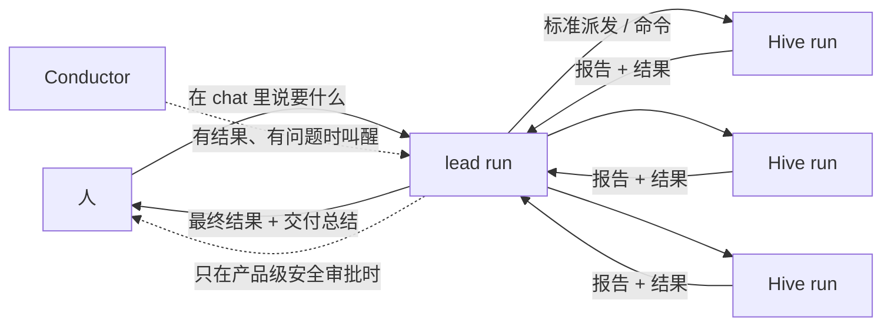
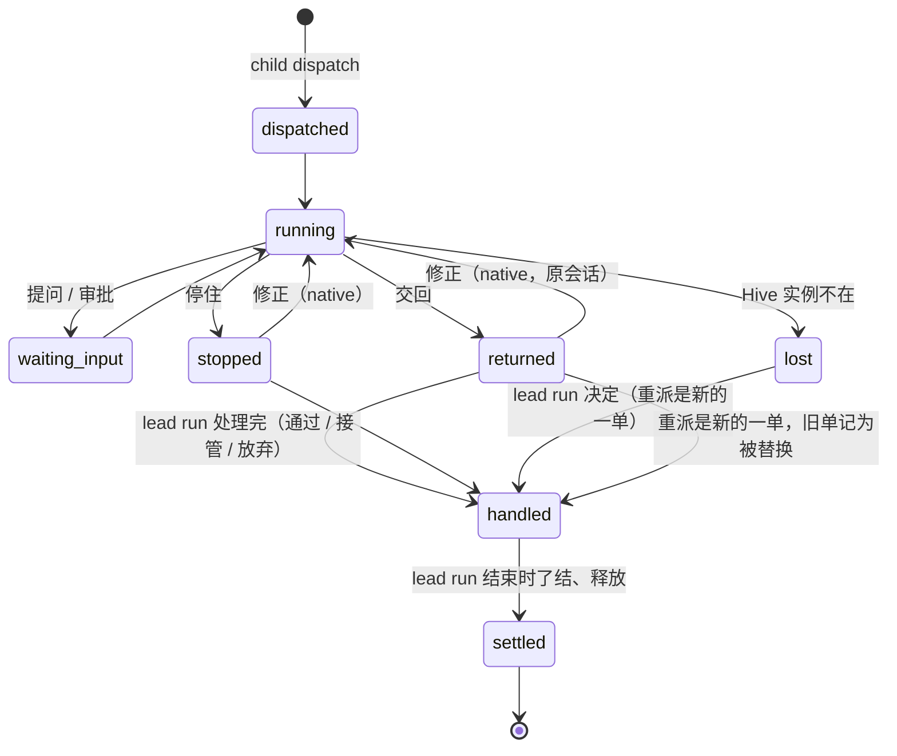

# Swarm Run

## 0. 原则

**XG 2026-10-31：** "我们把零散的 Hive run 交给你了。你怎么用、要不要 trust 它们的结果、拿回来怎么用，都是你的。我只问 host run 要结果，中间过程
执行全权 host run 自己搞定。"

所以本设计分三层，各管各的：

| 层 | 内容 | 谁定 |
|---|---|---|
| **能力**（§5） | host run 能拿 Hive 做什么：按标准路径派发、看状态、对自己的子单下命令、收回结果、被叫醒、了结和释放 | 产品提供 |
| **底线**（§6） | 每个 run 都守的规则：只能管自己的子单；Hive 的结果只是材料，落地的永远是 host run 自己的改动并通过 pipeline 的常规检查；产品级安全审批不变；每个循环有预算 | 产品强制，确定性 |
| **怎么做**（§7） | 怎么拆、派几个、用 native 还是 pipeline、信不信结果、怎么审、通过还是重做还是自己写、怎么合、怎么修、交付什么 | host run 自己判断；§7 只是默认做法 |

人在这件事上只做三件事：在 chat 里说清楚要什么；在产品级安全审批出现时拍板；收结果（以及决定要不要 push）。

界面上叫 **Swarm Run**。它不是新产品：一个大意图还是一个 pipeline run（**lead run**），只是这个 run 多了一组可以调用的 Hive。

## 1. 为什么这样分

- 前几版（r1–r6）一直在替 host run 规定怎么用 Hive：每包谁来审、怎么批、什么时候打回、什么时候信。每加一条规定，就多一个人或机器要参与的点，也多一种
  "规定和实际情况对不上"的失败。
- XG 的原则把这些都交给 host run。产品该做的是：让 host run **能**用好 Hive（能力），让它**不能**越过每个 run 都要守的底线（底线），其余的判断交给它，
  并把它的判断记下来、事后能复盘（REFLECT）。
- 这和 pipeline 今天的分工一致：pipeline 不规定 BUILD 怎么写代码（`stages/build.md:5`），只在两端用确定性检查守住质量和落地。Swarm Run 只是让 BUILD 多了一组
  可以委派的执行机。

## 2. 目标和非目标

**目标**
- G1 人只向 lead run 要结果；中间过程不需要人，除非碰到产品级安全审批。
- G2 lead run 能把互相独立的部分交给多台 Hive 并行做，并行度等于可用 Hive 的数量。
- G3 每个子任务都走派单中心已经标准化的路径；产品只为 lead run 补齐它用 Hive 需要的几个参数和命令。
- G4 lead run 怎么用 Hive 由它判断；产品只保证它越不过底线，并且它做过的每个决定都有记录。
- G5 每次 Swarm Run 留下"这样用 Hive 好不好"的教训，下次 lead run 用得更好。

**非目标**
- 产品不规定 lead run 的信任策略、审查深度、拆法、合并方式。
- 兄弟子单之间不通信。
- 不加花费上限（STEERING #2），不按时长判定失败。
- 一个 Swarm Run 属于一个 Brain；代码类一个仓库（v1）。

## 3. 现状：已经有的

| 事实 | 出处 |
|---|---|
| 派发的标准路径：`route` → `spec`（派工单：Brain 和 mode、执行方式、仓库、检查、交回什么、验收）→ `dispatch`，不再要人确认，在当前对话显示派发卡；执行方式有全产品共用的选法表 | `backend/skills/s_swarm-out/SKILL.md` 第 1-4 步；`docs/design/2026-10-30-run-spec.md` §2.1、§3 |
| 一单的生命周期：接单 → 派单 → 执行 → 收回 → 验收 → 落地 → 了结；收回的通道（结果、记录、文件、bundle、教训、花费）都在 | `dispatch-center.md` §1、§3 |
| 五个命令（通过、修正重跑、丢弃、停止、打开会话）现在只能由人发起 | `swarm-out-run-review.md` §1.1；`core/run_owner_gate.py:70-75` |
| ops registry：`task.dispatch` 的调用方包含 owner_agent；五个命令只有 person | `swarm-out-ops-registry.md` §5.1 |
| `dispatch_spec` 的仓库取本机主 checkout 当前 commit；`repo_ship.pack` 只打 HEAD | `core/swarm_out.py:476-560`；`core/repo_ship.py:95-114` |
| Brain 摘要不同就同步；Hive 上有 turn 占着 Brain 时同步返回 423 | `core/swarm_out.py:491-534`；`routers/hive_brains.py:96-100` |
| 一次派发最长九分钟，要前台单独跑 | `SKILL.md` 第 4 步 |
| Hive 上的 pipeline 子单在工作单的 clone 上落地，回合结束打 `base..HEAD` bundle；pinned 会话里不能再建第二个 run | `routers/chat.py:455-457`；`core/hive_bundle.py`；`core/security_hooks.py:1935-1941` |
| 交回 commits 的单子"通过"就是落地到本机 main | `core/swarm_out_settle.py:145-146`；`core/hive_return.py:433-492` |
| 明确的非目标："不自动重试；不排队；不把一个单子拆给多台机器" | `dispatch-center.md:194` |
| run worktree：HEAD == base、改动未提交；快照 ref 能 `read-tree --reset -u` 铺回 | `core/run_worktree.py:1-14,600-632,1998-1999` |
| 落地前的确定性检查：REVIEW 审过（LG-1）、TEST 报告、交付报告；落地只到本机 main | `run_protocol/checks.py:346-357,498-508`；`run_protocol/landing.py:452-457` |
| 后台 60 秒刷新 Swarm Out；待发消息会合并成一个 turn、只在有活 unit 时送达 | `core/swarm_out.py:952-1001`；`core/session_pending.py:1-20`；`core/session_router.py:3746-3748` |
| 产品级安全审批：危险命令、不可逆的外部操作、`push / open_pr / publish_release / send_external_message` 这类保留动作 | `core/security_hooks.py:509-540,600-612`；`core/project_agent.py:63-64` |
| Hive 实例角色只有 Bedrock、bridge 的 S3、给自己打标签 | `hive/provisioner.py:62-125` |

### 3.1 复用清单：已有的就用，不另造（2026-10-31 对着 main 核对）

| 本设计要的 | 已经有的 | 本设计怎么用 |
|---|---|---|
| 操作的调用方和权限 | 操作登记表 `core/swarm_out_ops.py`：每个 Swarm Out / Hive 操作一行，调用方是 `person`、`owner_agent`、`internal:conductor`、`internal:host`；人专用规则从表生成；测试要求每个路由都在表里、CLI 只调 owner 能调的操作 | 不新增调用方类型：lead run 对子单的命令由 `internal:conductor` 执行（§5.11）；新路由照表的规矩进表 |
| 后台看着子单、到了就叫醒 | `swarm_out.refresh_runs()` 每 60 秒刷新一次快照，`GET /runs` 和 Needs You 都读它（`core/swarm_out.py:952-1001`） | Conductor 读这份快照，不自己轮询 Hive |
| 每一行的状态和可用命令 | `swarm_out_settle.derive` 给每行下发 `stage` 和 `actions`，前端只渲染（run-review §3.2） | 子单的 actions 由 `derive` 按 `parent_run` 给出（§5.9） |
| 派发、准入、选 Hive、同步 Brain、开会话、派发不用确认 | `dispatch_spec`；`pick_hive`；`admit`；拒收卡；"dispatch without a confirm click" | 原样复用，只加 `parent_run`、`base`、`freeze` |
| 从指定 commit 开始 | Hive 端按 sha 收 bundle：`Hive/incoming/<sha>.bundle`，准备工作区时取进 clone（`core/hive_repo_inbox.py`） | Hive 端不改；只改 host 端 `repo_ship.pack` 能打指定 ref |
| 子单跑在什么模型上 | 每次派发把 Hive 默认模型对齐到 host 当前模型（`core/swarm_out_model.py`） | `freeze` 把模型也冻结，同一个 Swarm Run 的子单不会跑在不同模型上 |
| 聊天里的卡片 | 派发卡：后端看到 `scripts.swarm_out dispatch` 的调用后，按派发记录生成 `swarm_out_dispatch` 块，从不用模型文字，单独持久化（`core/swarm_out_card.py`） | Swarm Run 卡同样是后端按记录生成的一个块（§5.9）；lead run 的子单不再各出一张派发卡 |
| 列表和大卡片 | `RunList`（Swarm Out 运行视图）、`RunOverlay`（大卡片和命令面板） | Swarm Run 卡直接用（§5.9） |
| 一个 Brain 的所有 run | Brain 的 Runs tab：Chat tab 一栏是本地 run（`LocalRunCard`），Hive 一栏是这个 Brain 的 Swarm Out run（`RunCard`），两栏同一套格子（`docs/design/2026-10-30-brain-runs-one-card.md`） | lead run 出现在 Chat tab 栏，子单自动出现在 Hive 栏；子单的卡上写"属于 Swarm Run <标题>"，点了打开 lead run；花费不重复计（§5.8） |
| 打开 Hive 会话 | Hive 会话 tab，事件经 `swarm_out_relay` 转发 | "打开会话"原样复用 |
| 修正重跑、停止、丢弃 | `POST /runs/{id}/rerun / stop / discard`（`routers/swarm_out.py:221-266`） | lead run 的修正、停止、丢弃调同一套函数 |
| 收回、了结、释放 | 结果记录、Hive 记录、文件、bundle、教训、花费；settle 和 release（dispatch-center、run-review） | 原样复用；只加子单的新结局（§5.7） |
| "只有人能做"的更强保证 | 第二阶段人类证明的验证计划（`docs/design/2026-10-31-human-proof-verification.md`） | 本设计不依赖它；它落地后，人专用的子单动作一起受益 |

本设计真正新增的只有：子意图和工作图、`child` 命令组、标准派发的三个参数和批量派发、合并工具、系统 turn、子单的新结局、Swarm Run 卡块、自主度按来源区分。

## 4. 一张图

lead run 的内部怎么走，见 §7 的默认做法；产品不规定。

## 5. 能力：产品给 lead run 的东西

### 5.1 按标准路径派发

- lead run 用和人派单完全一样的路径：`route` → `spec` → `dispatch`。派工单、准入检查、派发卡、派发记录全部是标准的。
- 补三个参数，由引擎填（lead run 用 `pipeline-v1 child dispatch <wp>`，引擎调用同一个 `dispatch_spec`）：
  - `parent_run`、`wp`：这一单属于哪个 lead run，用于分组、命令权限、花费汇总、了结时机；
  - `base`：从哪个 commit 开始（比如 lead run 先写好的契约，或者它已经合并好的上游）。今天派发只能从本机主 checkout 的当前 commit 开始，`repo_ship.pack`
    只打 HEAD，要改成能打指定 ref；
  - `freeze`：同一个 Swarm Run 的子单用同一份 Brain 快照、Project Agent revision 和模型。host 在 run 期间还在沉淀知识，不冻结的话后派的子单拿到的知识不同，
    而且 Hive 上有 turn 占着 Brain 时同步会被拒。
- **批量派发：** `child dispatch --batch W1 W2 W3`，后端并发执行这几次标准派发，全部有结果后一起返回。一次派发最长九分钟，依次派太慢。
- 执行方式的选法表（`SKILL.md` 第 3 步）是 lead run 的默认参考，不是限制：lead run 可以按自己的判断选 native 或某个 pipeline profile，理由写在 `--why`
  里，和人派单时一样记在派工单上。

### 5.2 看状态

- `child status`：这个 run 所有子单的状态、结果是否到了、花了多少（读 Swarm Out 现有的 `/runs` 快照，按 `parent_run` 过滤）。
- 结果的内容：报告（pipeline 子单的总结块和 `REPORT.md`，native 子单的结束回复）、bundle 已取到哪个 ref、交回的文件、Autonomy Judge 五维。

### 5.3 对自己的子单下命令

- 五个标准命令：`child accept`（这一单了结；对 lead run 来说"通过"不等于落 main，见 §6）、`child rerun <wp> --note-file`（native 子单：纠正发进原会话）、
  `child stop`、`child discard`、打开会话（只读查看）。
- pipeline 子单的修正：pinned 会话里不能再建 run，所以修正 = 带着纠正重新派一单（`child dispatch <wp> --again --note-file`）。
- 这些命令经 `pipeline-v1` 由引擎执行：引擎校验调用来自这个 run 的 owner 会话，子单的 `parent_run` 是这个 run，再调 Swarm Out 内部同一个函数。人专用的
  HTTP 路由和它们的门不变；人仍然可以对任何子单停止、丢弃、打开会话。

### 5.4 把结果拿到手边

产品只负责把结果安全地放到 lead run 够得着的地方，怎么用由 lead run 定：

- **代码：** bundle 照现有方式校验（单一 ref、前置提交、`bundle verify`、fsck），取到 `refs/hive/<dispatch>/<key>`。前置提交要在本机仓库里（主分支或这个 run 的
  快照 ref 上），不再要求一定在 main 上。
- **合并工具**（可选，lead run 自己决定用不用）：`child merge <wp>...` 用 `merge-tree` 把指定的子单结果按顺序接到这个 run 的快照 ref 链上，报告冲突；
  `child apply` 把链的 tip 铺进 run worktree（`read-tree --reset -u`，HEAD 仍是 base；铺之前把 worktree 里现有的修改冻结成链上一个 commit，不会冲掉）。
  lead run 也可以完全不用这些工具，直接读 `refs/hive/...` 里的内容，自己在 worktree 里写。
- **报告和文件：** pipeline 子单提交里的 `.aidlc/deliverables/` 路径在合并时去掉，报告单独存到 run 的 artifacts；文档类结果照现有方式进 `deliverables/hive/`。

### 5.5 被叫醒

- lead run 不需要占着一个 turn 等 Hive。派完以后它的 turn 可以结束，`next` 显示"在等 N 个子单"。
- **Conductor**（后端确定性循环，名字和操作登记表里的 `internal:conductor` 一致；读 `refresh_runs` 的快照，不自己轮询）看着这个 run 的子单：结果到了、子单停了、Hive 实例不在了、子单提问时，用新的**系统
  turn** 叫醒 lead run。叫醒的时机由 lead run 设：`child wait --any | --all | <wp>...`（默认 `--all` 本批）。
- 系统 turn：单独成 turn、不和用户的话合并、按需冷启动、存成系统来源（CDF 不当用户的话）、按事件幂等；内容只有后端算出的结构化字段，子单写的文字
  只给位置。现有的待发消息通道会合并消息、只在有活 unit 时送达，不能用。
- 每次叫醒在 lead run 的 tab 里留一张可见的系统卡片。这是 XG 原则下的"自动续跑"（pipeline-two-ends NE-6）：是 lead run 在继续它自己的 run，人看得见。

### 5.6 回答子单的提问

- 子单的 AskUserQuestion 经现有的桥回到 host，先交给 lead run（`child ask` 列出，`child answer` 回答，内部调用 `internal:wp_answer`）。
- lead run 答不了，或者问题其实是在问人的意图，就 `child escalate` 到 Needs You。
- 子单在 Hive 上触发的**危险命令审批**不在这里：它是产品级安全审批，永远给人（§6）。

### 5.7 了结和释放

- lead run 结束时（落地、放弃或失败），引擎把所有子单了结（新结局"由 Swarm Run 处理"，附 lead run 的处理记录），按现有规则释放 Hive 工作区。
- lead run 也可以提前了结某个子单（`child accept` / `child discard`）。

### 5.8 记账和可见

- 每个子单的花费按 `dispatch_id` 汇总到 lead run；没有上限。
- lead run 的 chat 里有一张 **Swarm Run 卡**（§5.9），Swarm Out 里子单按 lead run 分组；两处用的是同一套组件。
- **Brain 的 Runs tab：** lead run 照常在 Chat tab 栏（`LocalRunCard`），子单照常在 Hive 栏（`RunCard`）。子单的卡上多一行"属于 Swarm Run <标题>"，点了打开 lead run；
  lead run 的卡上多一格"子单 N"。花费各算各的：lead run 的格子只算 host 上的花费，子单的格子算自己的；Swarm Run 卡的总花费是两者之和，不会在 Runs tab 里被加两次。
- lead run 对子单的每个动作（派、修正、通过、丢弃、接管、合并）都记成 run 事件，REPORT 和 REFLECT 用得到。

### 5.9 Swarm Run 卡：复用 Swarm Out 的 run 列表和大卡片

mock：`Knowledge/Mockups/2026-10-31-swarm-run-card.html`（四个场景：进行中、点开一单、有事等你、已交付；深浅主题）。

原则：同一个子单，在 lead run 的 chat 里和在 Swarm Out 里读起来是同一个东西，不用换一套解读。所以不新做卡片，只复用：

- **卡片怎么进 chat：** 和派发卡（`core/swarm_out_card.py`）一样，由后端按记录生成一个 `swarm_run` 块，单独持久化，不从模型文字里来；`child dispatch` 不再为每个子单
  各出一张派发卡，派发卡的内容就是大卡片里的那一单。

- **列表 = Swarm Out 的 run 列表**（`desktop/src/components/swarm-out/RunList.tsx`），按 `parent_run` 过滤：
  - 分区不变：等你 / 在跑 / 最近完成（各带数量，最近完成默认折叠）；只多一个分区"还没派"，放工作图里还没派出去的子意图（写明在等哪几个上游）；
  - 一行的字段不变：状态点、标题、"Brain · mode · 执行方式 · Hive"、自主度标签、状态词或要你做的事、"■ 停止"、"打开会话 ↗"、等了多久；子意图编号作为标题前缀；
  - 卡头：Swarm Run 的标题，一行"Brain · lead run 的 profile · N 个子任务 · 用时 · 花费"，右侧"■ 停止全部"（停 lead run，连带停掉在跑的子单）。
- **点一行 = Swarm Out 的大卡片**（`RunOverlay.tsx`）：验收标准条、机器核对、交付物 / 最后的回复 / 自主度 / 过程 / 花费 / 教训，全部不变。只有右侧命令面板不同：
  - 通过、修正重跑归 lead run，面板顶上显示"由 lead run 验收"和它的处理记录（每一轮交回、审查发现、修正重跑和引用的发现、最后的处理），来自 run 事件 `child_*`；
  - 人保留停止、丢弃、打开会话（人专用路由不变）。人丢弃一个子单时，lead run 被叫醒处理。
  - 这由后端 `derive` 对有 `parent_run` 的行给出不同的 `actions` 实现（run-review §3.2 的机制），前端不判断。
- **颜色规则不变**（`tone.ts`）：琥珀色只表示需要人。子单等 lead run 验收不算等人：不进"等你"、不用琥珀色、状态词写"待验收"。Hive 要人批准命令或回答问题，
  才进"等你"，用标准的"回答问题"标签。
- **交付不另做卡片：** 卡头一行改成"已交付 · Hive 已全部释放"，所有子单在"最近完成"里；交付总结是 lead run 的普通回复（验收标准逐条带证据、子任务怎么用的、
  整体审查和测试、花费、还开着的风险）；下一步走现有的 next-step chip。
- 自动叫醒在 chat 里留一行系统消息（"自动继续：W1、W3 交回了"），不伪装成用户的话。

### 5.10 自主度只数人

Swarm Out 的自主度标签回答的是"人插手了几次"（全自主 / 介入 N 次；pipeline 子单看 Autonomy Judge）。子单里 lead run 发的修正重跑不是人插手，不能算进去，
否则一个从没被人碰过的 Swarm Run 会显示满屏的"介入"。

- **现状：** `swarm_out_results.summarize` 把会话里第一条之后的每一条用户消息都算作 `said`（"会话里说的话"），注释写明"修正重跑也算一条"
  （`core/swarm_out_results.py:216-221`）；前端 `autonomyWord` 用 `said` 加批准、拒绝、回答、过期算介入次数（`runReview.ts:143-153`）。Host 发进会话的修正
  在 Hive 上就是一条普通的用户消息，分不出是谁发的。
- **口径：** 介入 = 人做的事：人批准或拒绝的命令、人回答的问题、没答过期、人在 Hive tab 里说的话、人发的修正重跑。lead run 发的修正重跑和代答的提问**不算**介入，
  单独记为"lead run 修正 N 次 / 代答 N 次"，显示在大卡片的自主度 tab 和处理记录里，不显示在列表的标签上。
- **怎么分（确定性，用 host 自己的记录，不靠 Hive）：** lead run 的每次修正和代答都经引擎执行，写 run 事件（`child_action{action: rerun | answer}`）；`summarize`
  得到 `said` 之后，减去这一单的 lead run 修正次数，得到人的 `said`；代答从 `answered_questions` 里减掉 lead run 代答的次数。人直接在 Hive tab 里打的字照常算。
- **所有读"人插手几次"的地方都用同一个口径：** 前端 `runReview.ts` 的 `interventions` / `autonomyWord`（列表标签、大卡片自主度 tab），Brain Runs tab 的
  "每个 Run 的人工决定"（Hive 栏用批准 + 拒绝 + 回答问题），pipeline 子单的 Autonomy Judge 的 Autonomy 一维。改在后端 `summarize` 一处，读取方不各自减。
- **普通派发不变：** 没有 `parent_run` 的单子，计算方式和今天完全一样。

### 5.11 操作登记（ops registry 格式）

| op | 调用方 | 分量 |
|---|---|---|
按 `core/swarm_out_ops.py` 的规矩：调用方只有 `person`、`owner_agent`、`internal:conductor`、`internal:host`，不新增类型。lead run 对子单的命令走
`pipeline-v1 child …`，由引擎校验（调用来自这个 run 的 owner 会话、子单的 `parent_run` 是这个 run）后以 `internal:conductor` 调用。

| op | 调用方 | 分量 |
|---|---|---|
| `task.route` `task.spec` `task.dispatch`（带 `parent_run`、`base`、`freeze`）、批量派发 | person, owner_agent, internal:conductor（表里已有） | read / off_machine |
| `run.accept`（子单的 `consolidate` 变体）`run.rerun` `run.stop` `run.discard` | person（不变）+ internal:conductor（只对 `parent_run` 是这个 run 的单子） | change / irreversible |
| `child.merge` `child.apply`（只写快照 ref 和 run worktree，不是 HTTP 路由） | internal:conductor | change |
| 代答子单提问 | internal:conductor（`ask.answer` 的 HTTP 路由仍只给 person） | change |
| 子单了结并释放 | internal:conductor（lead run 结束时） | change |
| `run.return_land`、`run.manual_landed` 对子单 | 无人可调（子单不直接落 main，见 §6） | — |
| 人对子单的 `rerun / stop / discard / open session` | person（不变） | change |
| 危险命令审批 | person（不变） | — |

## 6. 底线：产品强制的几条

这几条和 lead run 怎么判断无关，每个 run 都一样，由确定性规则守住：

1. **只能管自己的子单。** lead run 经 `internal:conductor` 下的命令只对 `parent_run` 是这个 run 的单子有效。
2. **Hive 的结果只是材料，不直接落地。** 子单交回的 commits 不能经 ReturnPanel 或 `return/land` 直接进 main；它们只能被 lead run 拿来用。最后落地的是
   **lead run 自己的改动**，通过 pipeline 对任何 run 都一样的检查：REVIEW 审过（LG-1）、TEST 报告、交付报告；只落到本机 main，push 由人。lead run 信不信
   子单的结果、看多仔细，是它的判断；但它交出去的东西要过自己 run 的关。
3. **产品级安全审批不变，对 host 和 Hive 上的每个 run 都一样：** 危险命令和不可逆的外部操作要人批准；`push`、`open_pr`、`publish_release`、
   `send_external_message` 等保留动作要人批准。本设计不新增任何审批。XG 原则交给 lead run 的是
   "过程"，不是这些审批：这些审批本来就不属于任何一个 run 的过程。
4. **每个循环都有预算**（SOUL P5）：同一个子意图最多派 3 次（含修正重派和丢失后的重派）；native 子单在原会话里最多修正 2 轮。预算用完，lead run 只能自己做或
   放弃，不能再派；预算是计数器，不看时长。
5. **Hive 写的文字是数据。** 报告、提问、结果进入 lead run 时以文件或位置给出，标明执行机产出；叫醒消息不内联它们（AGENT R32 B 类）。
6. **lead run 的每个动作都有记录**，交付总结和 REPORT 能看到它怎么用了每个子单。

## 7. 怎么做：lead run 的默认做法（不强制）

写进 pipeline skill 的 BUILD 卡片，作为 lead run 的参考。lead run 可以偏离，偏离的理由写进决定记录。

1. **拆：** 把意图拆成能单独成立的子意图（任务文字按 `SKILL.md` 第 2 步的要求，不引用本对话、不引用本机路径），写清每个子意图的验收标准、交回什么、计划
   改动的范围、依赖。互相要改同一批文件的，要么合成一个，要么先由 lead run 自己写一份契约（接口、类型、桩、先红的集成测试）作为大家的 base。拆不开就不扇出，
   按普通 pipeline 在本地做。
2. **派：** 依赖已满足的子意图一批派出；执行方式参考标准选法表；被拒收的（比如要内网）自己做。
3. **等：** turn 结束，`child wait`。
4. **收和审：** 结果到了，按风险决定看多仔细：可以用现有专家派发方式审每一份和它们之间的接缝，也可以只看报告和测试结果。
5. **决定：** 每一份：通过（合进来）、修正（打回）、接管（自己写）、放弃。冲突的那一份通常接管；问题集中在一份里、子单更适合修的，打回。
6. **合：** 全部处理完，铺进 worktree，交 BUILD 报告。
7. **整体：** REVIEW（R1 → fixing spec → 就地修 → R2）、TEST、DELIVER（落本机 main），了结所有子单。
8. **交付总结：** 在 chat 里告诉人做成了什么（对照整体验收标准）、每个子单怎么用的、审查发现和修了什么、测试结果、花费、还开着的风险。
9. **REFLECT：** 记下这次用 Hive 的方式效果如何（每个子单的派发次数、修正、接管、冲突、整体审查里归到各子单的问题、墙钟时间、花费），教训进 DDD，下次召回。

## 8. 人什么时候出场

| 情况 | 谁 |
|---|---|
| 说清楚要什么 | 人，在 chat 里 |
| 拆、派、等、收、审、信不信、通过、打回、接管、合并、修、测试、落本机 main、了结 | lead run |
| 子单的提问 | lead run；它答不了、或者是在问人的意图，才到 Needs You |
| 危险命令、不可逆外部操作、保留动作（push、开 PR、发布、对外发消息） | 人（产品级安全审批，现有规则） |
| lead run 自己卡住（预算用完又不能自己做） | 人，Needs You 里一条，带可选动作 |
| 收结果、决定 push | 人 |

拆分方案不需要人确认：Swarm Run 卡显示出来，人想停随时可以停（停 lead run 就会停掉它的子单）。

## 9. 状态

**run 层：** 没有新的 run 状态。BUILD 阶段里 lead run 用 Hive 的过程由事件记录（`child_dispatched`、`child_returned`、`child_action`），`next` 据此提示。

**子单（从 lead run 看）：**

重派永远是新的一单（新的 `dispatch_id`，同一个 `wp`），所以一个子单本身不会循环；同一个 `wp` 的派发次数由 §6 第 4 条的计数器限定。

## 10. 每个事实只有一个来源

| 事实 | 来源 | 谁写 | 谁读 |
|---|---|---|---|
| 子单的派工单和派发记录 | Swarm Out 派发记录（标准，多 `parent_run`、`wp`） | 派单中心 | 派发卡、Conductor、Swarm Out、`child status` |
| 子单的结果 | Swarm Out 结果记录、Hive 记录、`refs/hive/...`（标准） | 现有收回通道 | lead run |
| lead run 怎么用每个子单 | run 事件 `child_*` | 引擎（执行 lead run 的命令时） | `next`、Swarm Run 卡、REPORT、REFLECT |
| 合并后的代码 | 这个 run 的快照 ref 链（如果 lead run 用了合并工具）和 run worktree | 引擎 / lead run | REVIEW、落地 |
| 冻结的 Brain 快照 | 事件 `frozen_brain` + 快照 | 引擎 | 派发 |
| 叫醒是否已发 | 事件 `wake_sent` | Conductor | Conductor |
| 花费 | `usage_ledger` | 现有写入者 | 交付总结 |

## 11. 失败和恢复

- **Hive 实例不在**（连续几个 tick 观察到，或回来后会话不存在）：叫醒 lead run，由它决定重派、自己做还是放弃。
- **派发失败、拒收、"可能已派出"：** 按标准规则；"可能已派出"按 work id 确认后再决定，不重复派。
- **daemon 重启：** 重放事件日志，Conductor 继续。
- **笔记本合上：** Hive run 继续；收回和叫醒在醒来后进行。
- **慢：** 不处理。

## 12. 风险和局限

| 风险 | 怎么兜 | 剩下的 |
|---|---|---|
| lead run 用错 Hive（拆错、信错、该打回的通过了） | 落地前仍要过自己 run 的 REVIEW 和 TEST；每个动作有记录；REFLECT 把"通过后在整体审查里又出问题"记下来，下次召回 | 判断质量取决于模型；这是 XG 原则下有意交给 lead run 的 |
| Hive 写的代码在 host 的 TEST 里执行，之前没人看过 | 底线第 2 条：它要先成为 lead run 自己的改动并过 REVIEW；仓库可以设 `[swarm] verify_on_hive = true` 让 TEST 先在 Hive 上跑 | 和 lead run 自己读外部内容后写代码是同一类风险，多一个环节 |
| 子单文字影响 lead run | 当数据给出；lead run 的外部动作仍受产品级审批约束 | lead run 有完整工具，读了就可能受影响 |
| 派发慢 | 批量并发派发 | 第一次 Brain 同步仍然慢 |
| 笔记本合上 | Hive run 继续 | 收回、叫醒、合并都停 |
| 容量：没有并发位 | 每台 Hive 人配置的并行数，默认 1 | 默认并行度等于 Hive 台数（现在 2） |
| 速度和效果没证明 | P1 先在本机跑通、测量 | 第一批数据前只是假设 |

**局限：** 一个 Brain、代码类一个仓库；上 Hive 的仓库要有远程 URL；需要内网的子意图只能 lead run 自己做；Hive 上的危险命令审批仍要等人。

## 13. 分期

- **已完成：** run-review 后端（后台刷新、Needs You、五个命令）；ops registry 第一阶段（`core/swarm_out_ops.py`，门从表生成）。
- **P0：** 本文的操作按表的规矩进表（§5.11）；标准派发加 `parent_run`、`base`、`freeze` 和批量派发；`repo_ship.pack` 打指定 ref；系统 turn 通道；派发超时
  不一致（`scripts/swarm_out.py:39` 对 `core/swarm_out.py:270`）。
- **P1 本机：** `pipeline-v1 child` 命令组（dispatch / status / wait / accept / rerun / stop / discard / redispatch / merge / apply / ask / answer / escalate）；Conductor；
  子单了结；Swarm Run 卡（复用 RunList / RunOverlay，§5.9）；自主度按来源区分（§5.10）；BUILD 卡片里的默认做法；REFLECT 指标。子单先在本机另一个 worktree 里跑，验证整条链。
- **P2 Hive：** 真正派到 Hive；回收的前置提交校验放宽到本 run 的快照 ref；lost 识别；每台 Hive 的并行数。
- **P3 调研：** research profile 加 PLAN 和审查阶段（D7，已同意），调研的子意图可以派给 Hive，交回 document，由 lead run 综合。
- **之后：** 其它类型（文档、内容、数据）按同一套能力和底线接入，不需要新的机制。

## 14. 验证计划

| # | 不变量 |
|---|---|
| I1 | lead run 派出的每一单，派工单、派发卡、派发记录和人派的单子格式相同（只多 `parent_run`、`wp`、`base`、`freeze`） |
| I2 | `internal:conductor` 代 lead run 下的命令，对 `parent_run` 不是这个 run 的单子一律拒绝；人专用路由行为不变；`test_swarm_out_ops` 照旧全绿（新路由都在表里） |
| I3 | 子单交回的 commits 不能直接落 main（`return/land`、`manual-landed` 对子单拒绝） |
| I4 | lead run 的落地照常要求 REVIEW 审过、TEST 报告、交付报告 |
| I5 | Hive 上的危险命令审批和保留动作仍然只有人能批（现有规则不变） |
| I6 | 同一个 `wp` 派发不超过 3 次，native 子单原会话修正不超过 2 轮 |
| I7 | 同一个 Swarm Run 的子单用同一份冻结的 Brain 快照，从 lead run 指定的 base 开始 |
| I8 | 合并工具只写本 run 的快照 ref 和 run worktree；铺回不冲掉 worktree 里已有的修改；扇出期间 main 不变 |
| I9 | 叫醒消息单独成 turn、对同一事件只出现一次、不算用户的话 |
| I10 | lead run 结束时所有子单了结并释放 |
| I11 | 人派的普通单子、不扇出的 pipeline run 行为完全不变（包括自主度的计算） |
| I12 | Swarm Run 卡和 Swarm Out 用同一套列表和大卡片组件；子单"待验收"不进"等你"、不用琥珀色；子单的 actions 由后端 `derive` 给出，不含通过和修正重跑 |
| I13 | 自主度只数人：一个只被 lead run 修正过、没有任何人的动作的子单显示"全自主"；人批准一条命令后显示"介入 1 次" |

审查分工：`child` 命令和底线检查 security；Conductor、合并工具、子单状态 concurrency + state-machine；标准派发的新参数和批量派发 api-contract + integration；
Swarm Run 卡 ux（mock 已做，§5.9）。

## 15. 已定和待定

**按 XG 原则已定（2026-10-31）：**
- 怎么用 Hive、信不信结果、怎么处理结果，由 lead run 判断；产品不规定信任策略（取代 r5/r6 的 D17）。
- 拆分方案不需要人确认（取代 D18）。
- lead run 可以对自己的子单下五个命令（取代 D19）。
- Conductor 自动叫醒 lead run，每次留可见卡片（取代 D10，即 NE-6 对 Swarm Run 的部分）。
- 推翻 dispatch-center 的"不拆单、不自动重试"，只在 pipeline 层（D1）；推翻 two-ends 的"中段不自己造"，只对用 Hive 的 BUILD（D9）。

- research profile 加 PLAN 和审查阶段，让调研也能拆给 Hive（D7，XG 同意）。

**不在本设计范围：** 云上部署这类场景只是举例（XG 2026-10-31）。它们需要的东西（部署审批、专用执行机）如果以后要做，单独设计；本设计不新增任何审批或执行机。

没有待定的决定。

## 16. 要测的（先拿数据，不设阈值）

- 每个 Swarm Run 人出场几次，都是 §8 哪一类。
- lead run 对子单的处理分布：通过、修正、接管、放弃各多少。
- "通过后在整体审查里又出问题"的次数。
- 墙钟时间和花费：用 Hive 和全在本地对照。

## 17. 修订记录

- r1–r4：BUILD 扇出；两轮零上下文审查（汇总链、native 执行、系统 turn、状态机、发布执行机等）；逐包回收审查和人的批量决定。
- r5：子单可以是 pipeline 或 native，交回报告和 bundle；host run 汇总、审查、自己决定。
- r6：host run 是负责人，子单走派单中心的标准路径，不另造派发机制。
- r7.3：对照 main 上最新的 Swarm Out 改动核对（§3.1 复用清单）：沿用操作登记表的调用方（不新增 `lead_run`，由 `internal:conductor` 执行）、Watcher 改回登记表里的 Conductor 并读 `refresh_runs` 快照、Swarm Run 卡像派发卡一样由后端按记录生成块、Brain Runs tab 里的子单和花费、`freeze` 加模型、Hive 端已按 sha 收 bundle、自主度口径覆盖所有读取方；ops registry 第一阶段已完成。
- r7.2：Swarm Run 卡改为复用 Swarm Out 的 run 列表和大卡片（§5.9，mock 第 2 版）；新增"自主度只数人"的口径（§5.10）；I12、I13。
- r7.1：D7 同意；云上部署相关内容（D11、D16、`cloud_deploy` / `cloud_delete`、发布执行机）移出范围，只是举例场景；没有待定的决定。
- r7：XG 原则："Hive run 交给你了，怎么用、信不信、拿回来怎么用都是你的；我只问 host run 要结果。"设计改成三层：**能力**（产品提供）、**底线**（产品强制：
  只管自己的子单；Hive 结果只是材料，落地的是 lead run 自己的改动并过常规检查；产品级安全审批不变；循环预算；Hive 文字是数据；动作有记录）、**怎么做**
  （lead run 判断，§7 只是默认做法）。去掉 r6 的信任策略、拆分确认、采纳规则表、强制的批量审查和契约要求；合并工具改为可选；Watcher 的叫醒时机由 lead run
  设；子单重派永远是新的一单。
