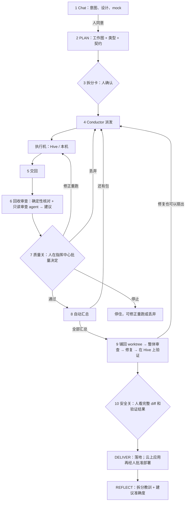
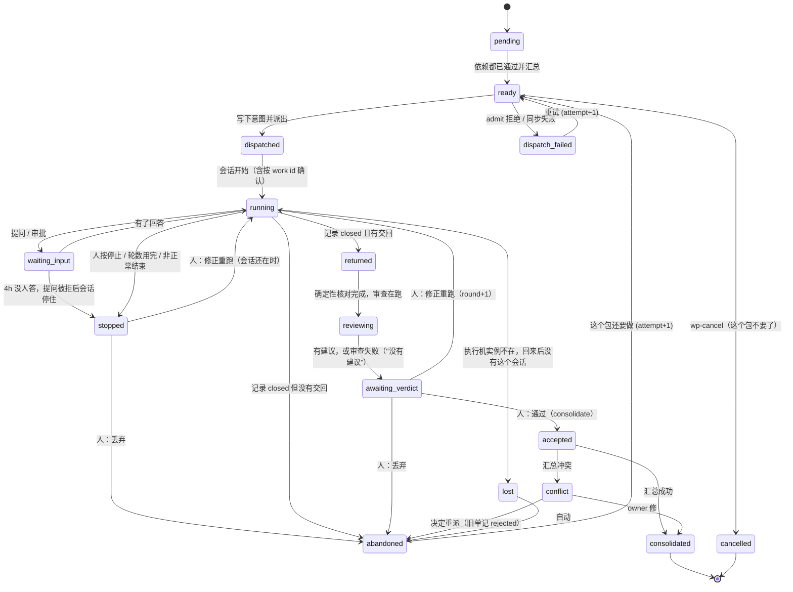

# Swarm Run

## 0. 一句话

在 chat 里把一个大意图讨论清楚，交给 pipeline。pipeline 把它拆成一张**工作图**，把每个**工作包（WP）**
派给蜂群。每个工作包交回时，先有一次**回收审查**（确定性核对加一位只读的审查 agent），给出"通过 / 修正重跑 /
丢弃"的建议；人在 Swarm Out 指挥中心参考建议**批量决定**。通过的结果**自动汇总**进这个 pipeline run 的
worktree；全部汇总后对整体做一次审查、修复、验证，最后人看一次完整结果再交付。

两道关分开：**逐包审批是质量关**，可以批量，目的是早发现、早返工；**最后的落地批准是安全关**，人看汇总后的
完整 diff 和验证结果。在安全关之前，Hive 写的代码只在 Hive 上执行，不在你的电脑上执行，也不进 main。

工作包分**类型**：代码、云上应用、调研、文档和内容、数据分析。骨架相同，审查、汇总、验证、交付按类型插拔。

界面上叫 **Swarm Run**。它是 pipeline 的升级：一个大意图仍是一个 pipeline run，只是干活阶段多了扇出的执行方式。

## 1. 目标和非目标

### 1.1 目标

- G1 讨论清楚的大意图能无人值守地推进，人只在固定的几个点和真实的例外上出场。
- G2 互相独立的部分并行执行，并行度等于可用执行机的数量。
- G3 每个工作包交回都有一次审批：机器先审、给建议，人批量拍板。
- G4 通过的结果自动汇总；汇总后对整体审查、修复、验证、交付各一次。
- G5 拆分、派发、汇总、终止都是确定性的；模型只提议，计数器和人决定（SOUL P5）。
- G6 适用于代码之外：在 AWS 账户上搭一个应用、调研一个大课题、做一套内容。
- G7 每次 Swarm Run 留下两类教训：怎么拆才对，回收审查的建议准不准。

### 1.2 非目标

- 兄弟工作包之间不实时通信，只通过契约（W0）和 host 交互。
- Hive 不做决定，也不产生外部副作用。部署、发布、发送只在 DELIVER，对汇总后的整体，由人批准。
- 建议从不自己生效：不做"建议通过就自动通过"。
- 一个 Swarm Run 只属于一个 Brain。
- 不加任何花费上限（STEERING #2）。
- 不按时长判定失败。

## 2. 现状

### 2.1 Swarm Out 和 Hive

| 事实 | 出处 | 对本设计的意义 |
|---|---|---|
| 五个命令：通过、修正重跑、丢弃、停止、打开会话；后端 `derive` 给每行下发 `stage` 和 `actions` | `docs/design/2026-10-31-swarm-out-run-review.md` §1-§3.2 | 这就是指挥中心；子单用这五个命令 |
| run-review 明确不做批量通过："批量通过违背'看了才通过'" | `swarm-out-run-review.md:125` | 本设计要为 Swarm Run 子单改这一条（§17 D14） |
| 交回 commits 的单子不能用 verdict 通过，只能靠落地通过；`derive` 只在代码状态是 landed 时判为通过 | `core/swarm_out_settle.py:145-146,259-270,338-339` | "接受进汇总"要在 settle 里新增一种代码状态（§6.8） |
| 这些命令和 Hive 会话代理的写操作对 agent 的 Bash 命令拒绝；但这个 gate 自己写明"是减速带，不是边界"：运行时拼出来的路径看不到，agent 和 daemon 同一个系统用户 | `core/run_owner_gate.py:70-75,376-381` | 不能把"审查 agent 调不了命令"建立在这个 gate 上；审查 agent 不给 Bash（§6.7） |
| 后台每 60 秒刷新结果和了结；Needs You 读这个快照 | `core/swarm_out.py:952-1001`，`core/attention_authority.py:770` | 后台循环的模式已有 |
| Hive 的提交信息"当数据显示，从不放进 agent 的上下文" | `core/hive_return.py:17-22` | 回收审查要读 Hive 产出，是对这条的有意放宽，放宽到哪里写清楚（§11） |
| 交回类型只有 `answer`、`document`、`commits`，一个任务只能是其中一种 | `core/task_spec.py:44,219-224` | 云上应用的"计划输出"只能是交回文件，不是第二种交回类型 |
| 明确的非目标："不自动重试；不排队；不把一个单子拆给多台机器" | `dispatch-center.md:194` | 在 pipeline 层推翻（§17 D1） |
| Hive 上 agent 和 daemon 同一个系统用户，不防故意越界 | `run-spec.md:27-31` | Hive 产出永远当不可信输入 |
| Hive 实例角色只有 Bedrock、bridge 的 S3 和给自己打标签 | `hive/provisioner.py:62-125` | Hive 上跑不了 `terraform plan`、需要查账户的 `cdk synth`，也不能部署 |
| 产品级的"保留给人"动作：`push`、`open_pr`、`publish_release`、`send_external_message`，各自有命令识别规则 | `core/project_agent.py:63-64`，`core/security_hooks.py:600-612` | 云部署和删除按同一机制加两个动作（§11） |
| 不可逆外部操作的 gate 只认 gh 和 git push | `core/security_hooks.py:509-540` | `cdk destroy`、`terraform destroy`、`aws cloudformation delete-stack` 现在不被识别 |
| 后台 job 用 `claude --print --bare` 跑，跳过所有 hook；每天有次数上限 | `jobs/executor.py:787-796`，`jobs/models.py:236` | 不能用 job 跑回收审查 |
| `task_manager` 的任务跑一个完整会话，默认 agent 有 Bash 和写权限，占 host 的会话位 | `core/task_manager.py:258` | 也不适合直接跑回收审查 |
| 私有网络、Hive 上可用的技能、仓库 URL 必须是 `https://`/`git@`/`ssh://`、Project Agent 必须已确认且来源核对是新的 | `task_spec.py:152-193,245,291-345`，`project_agent.py:476-502` | 包按需要放 Hive 或本机；没远程的仓库不能上 Hive；新仓库要先确认 Project Agent |
| Brain 同步：摘要不同就同步；Hive 上有 turn 占着 Brain 时 423 | `swarm_out.py:491-534`，`routers/hive_brains.py:96-100` | 一个 Swarm Run 冻结一份 spec 和 Brain 快照 |
| 提问和审批的 hook 等 4h，到时提问被拒（会话不被杀）；4h05m 看门狗是最后兜底 | `permission_manager.py:45-55`，`lifecycle_manager.py:69-74` | 很久没人答的提问以"停住"结束，而不是会话消失 |
| 出站请求的 SSRF 防护：只允许 https，挡私有地址 | `jobs/adapters/http_client.py:26-120` | 调研的来源核对用它；内网来源因此核对不了 |

### 2.2 Pipeline

| 事实 | 出处 | 对本设计的意义 |
|---|---|---|
| full 和 bugfix：evaluate → think → plan → build → review → test → deliver → reflect；research：evaluate → think → deliver → reflect，而且没有 design spec、不落代码 | `run_protocol/lifecycle.py:95-101,128-140` | 调研扇出要给 research 加 PLAN、工作图和审查（§17 D7） |
| PLAN 的任务字段只有 `id, file, symbol, change, requirements, depends_on, creates_test_files`；design_spec 的键是严格的 | `schemas.py:464-482,516-519` | 工作图升 schema 版本 |
| BUILD 不规定怎么写 | `stages/build.md:5` | 扇出推翻 two-ends 的一条原则（§17 D9） |
| run worktree 的不变量：HEAD == base，改动未提交 | `run_worktree.py:1-14,744-746` | 汇总用快照 ref 链，不在 `run/<id>` 上提交 |
| 快照 ref `refs/swarm/snapshots/<run_id>/<label>`；快照能 `read-tree --reset -u` 铺回 | `run_worktree.py:600-632,1998-1999` | 汇总链和铺回都有先例 |
| REVIEW：`review_start` 只在 REVIEW 阶段可用，只审 run worktree 的 diff；派给专家的记录按 `stage="review"` 计数，专家回答会抄进 owner 会话 | `engine.py:2637-2732`，`hook_bridge.py:437,489` | 回收审查不能复用 REVIEW 的那套记录（§6.7） |
| LG-1：落地的改动必须被 REVIEW 过 | `checks.py:346-357` | 工作包在 Hive 上用 native 执行，不跑 pipeline |
| 落地：`commit-tree` 加 `merge --ff-only`；`run-land` 是人先批准的动作 | `landing.py:405,452-457`，`run_owner_gate.py:74` | 扇出 run 只走 `run-land`（安全关） |
| 回收：bundle 的前置提交要在主 checkout 当前分支上；`land` 用 `merge-tree`，冲突拒绝；提交绑定在准备好的 tip 上 | `hive_return.py:23-24,282-307,433-492` | 合并算法复用，按汇总链参数化；接受要绑 tip |
| `repo_ship.pack` 只打 HEAD；spec 带 Brain 绑定的全部仓库 | `repo_ship.py:95-114`，`task_spec.py:252-284` | 要能打指定 ref、只带包需要的仓库 |
| 待发消息通道会把多条合成一个 turn，只在有活 unit 时送达 | `session_pending.py:1-20`，`session_router.py:3746-3748` | 叫醒 owner 另做系统 turn |
| run 事件的 producer 只有 `hook` 和 `cli`；pipeline 的花费归因按 owner 会话的记录算 | `run_protocol/events.py:26`，`run_protocol/usage.py:26-48` | Conductor 要新 producer；审查会话的花费要单独归因 |
| 专家目录只有代码类（`backend/experts/code/*` 加 `_core/adversarial-stance.md`） | `backend/experts/` | 调研、内容、数据的审查专家要新写（P3、P5） |
| NE-6 自动续跑被搁置，等 XG 定边界 | `pipeline-two-ends.md:61` | 叫醒 owner 就是这个（§17 D10） |

一句话：**指挥中心、命令、后台刷新、合并算法、快照 ref、派发、回收、整体审查和落地都有了。缺的是：工作图和拆分
检查；一个安全的回收审查运行方式；子单"接受进汇总"的 settle 状态和批量决定；按汇总链参数化的发送和回收；DELIVER
的云上副作用和它的批准与专用执行机；以及串起这些的 Conductor。**

## 3. 方案比较

| 方案 | 是什么 | 取舍 |
|---|---|---|
| A 父子 run | 拆出 N 个完整 pipeline run 各派一台 Hive，最后合并 | 每个子 run 都框定、审查、落地，整体没人审；否决 |
| B1 扇出，只在最后人审（r2） | 交回就自动集成，人只看最终结果 | 问题发现得晚，一个坏包要到最后才知道 |
| **B2 扇出，逐包质量关 + 最后安全关（r4，推荐）** | 每包交回：确定性核对 + 审查 agent 给建议，人批量决定；通过的自动汇总；最后人看完整 diff 批准落地 | 问题在单包上被挡住或重跑；人平时只看建议和核对结果，安全上的责任集中在最后一次完整查看；多一步审批等待（§13 R5） |
| C 单机内并行 | 整个 run 派到一台 Hive，用 subagent 并行写 | 小规模补充（P6） |
| D 云端 Conductor + 共享记录层 | 10-08 Hive-Mind | 远期 |

B2 为什么要两道关：逐包审批如果同时承担"安全"，就不能批量（这正是 run-review 定的"看了才通过"）；把安全放到最后一次
完整查看，逐包审批就可以只管质量、可以批量，而 Hive 代码在安全关之前只在 Hive 上执行。

## 4. 通用流程



**人的固定出场：** 同意设计和 mock；确认拆分；每批交回的批量决定（质量关）；最后的完整查看和落地批准（安全关）；
云上应用的每次部署和删除批准。push 由人另行决定。

**真实例外：** Gate-0 需求有多种读法；agent 答不了的意图问题；受保护路径；计数器到顶；危险命令审批（永远是人）。

## 5. 工作包类型

**通用原则：工作包只产出东西，不改变外部世界；改变外部世界只在 DELIVER，对汇总后的整体，人先批准。安全关之前，
Hive 写的东西只在 Hive 上执行。**

| 类型 | 交回 | 确定性核对（host 上，只读，不执行交回的内容） | 审查 agent 看什么 | 汇总 | 整体验证（在哪执行） | 交付 |
|---|---|---|---|---|---|---|
| **代码** | `commits` | bundle 校验；归属；和汇总链试合并有无冲突（只做对象操作）；受保护路径；结束报告里有无测试结果 | 对照本包验收标准的 correctness；有风险声明时加 security | git：`merge-tree` 接到汇总链 | 验证包，在 Hive 上 | `run-land`（人批准） |
| **云上应用** | `commits`（基础设施代码和应用代码） | 同代码，再加对**源码**的静态检查（仓库在 `.swarmai/pipeline.toml` 声明的 lint 命令；只读源码，不运行它）；资源命名和标签约定写在 W0 里由静态检查对照 | security（权限、暴露面、密钥）+ correctness | 同代码 | 验证包在 Hive 上跑单元测试；整体计划（`cdk synth` / `terraform plan`）只在**发布执行机**上生成（§6.12） | `run-land` 后，人批准部署：预览 → 冒烟 → 正式 |
| **调研** | `document`（发现、证据、来源） | 来源 URL 格式；引用的原文片段确实出现在来源页面里（host 用 SSRF 防护的客户端去取，只取公开 https）；没有来源的结论被标出 | 来源可信度、结论和证据是否对得上、有没有漏掉反方 | 综合：owner 写综合报告，每个结论链到某条发现（确定性检查链条完整）；列出矛盾和空白 | 怀疑者审查综合报告 | 报告进 `Knowledge/Reports/`，导出 docx/pdf |
| **文档和内容** | `document` 或文件 | 文件齐全、能打开 | 风格、受众、事实和数字 | 组装加统一检查（术语、数字、口径） | 通读审查 | 文件进对应目录 |
| **数据分析** | `document`（结果、口径、查询或脚本） | 查询或脚本存在；只做静态检查 | 口径和样本 | 合并表和结论 | 验证包在 Hive 上重跑（用只读的、任务范围的数据凭据；没有这种凭据就不重跑，标为"未复现"） | 报告 |

一个 Swarm Run 可以混合几种类型（云上应用里可以有一个调研包）。审查调研、内容、数据要的专家提示词目前没有，要新写（P3、P5）。

## 6. 组件

### 6.1 C1 Intake

- `pipeline-v1 create --design <path>`（可多次）：chat 里同意过的设计和 mock 拷进 `artifacts/inputs/`，记 sha256；THINK 必须引用
  每个输入（DS-I）；`.context/` 下的文件不接受。
- **需要先做的选择不放进工作图。** 比如"私有访问用哪种做法"这种会决定整个拆法的问题，先单独跑一个调研 run（可以是 Swarm Run），
  结果作为 `--design` 输入。工作图里的包都在 W0 之后。
- **起步资产：** 新 Brain 用 `s_project-manager`；新仓库要有远程 URL 才能上 Hive，建远程仓库要人批准；Project Agent 要先确认，
  来源核对要通过（`project_agent.py:476-502`）。这些都在拆分卡之前完成，所以冻结的 spec 不会因此改变。没有远程时只能用本机执行机。

### 6.2 C2 设计产物：design_spec 和 UX mock

- `design.mocks[]`：`{id, path: artifacts/mocks/<id>.html, covers, decision}`；THINK 用 `s_frontend-design` 产出，先读
  `data/design-judgment.md`；人用已有的 decision-request 确认。
- W-8：引用 mock 的包，mock 必须已被人确认。mock 随 packet 送到执行机。

### 6.3 C3 Planner：工作图

design_spec 升 schema 版本，新增 `work_packages[]`：

```jsonc
{
  "id": "W2",
  "kind": "code",                 // code | cloud | research | content | data
  "title": "API：会话列表接口",
  "repo": "status-site",          // code / cloud 才有；一个 Swarm Run 一个仓库
  "tasks": ["T3", "T4"],
  "owns": ["api/sessions.ts", "api/sessions.test.ts"],
  "owns_new_under": ["api/sessions/"],
  "question": null,               // research：要回答的问题
  "reads": ["api/contract.ts"],
  "depends_on": ["W0"],
  "acceptance": ["X2"],
  "returns": "commits",           // commits | document | answer（task_spec 的三种之一）
  "needs": [],                    // 需要的技能、私有网络
  "mocks": [],
  "placement": "any"              // any | local
}
```

- **W0 契约按类型：** 代码和云上应用是接口、类型、依赖和锁文件、桩、先红的集成测试、基础设施骨架、资源命名和标签约定；调研是
  问题树、术语表、来源标准（如"一手来源优先，每条结论至少两个独立来源"）、输出模板；内容是风格指南和大纲。
- 调研的问题树就是工作图，每个叶子问题一个包。
- 召回以往 Swarm Run 的拆分教训。

### 6.4 C4 拆分检查和判定（确定性）

| 检查 | 内容 | 适用 |
|---|---|---|
| W-1 | 依赖无环；W0 没有依赖，其它包都直接或间接依赖 W0 | 全部 |
| W-2 | 每个 task 恰好属于一个包，文件在所属包的 `owns` 里 | code、cloud |
| W-3 | 归属独占：任何路径最多一个包拥有，前缀不嵌套 | code、cloud |
| W-4 | 派生文件（`[swarm] derived`，如锁文件、生成代码）只归 W0 | code、cloud |
| W-5 | 每条验收标准恰好由一个包负责，或标为"汇总后验证" | 全部 |
| W-6 | 耦合提示（code graph），只提示，标出盲区 | code、cloud |
| W-7 | 受保护路径在哪些包里 | code、cloud |
| W-8 | 见 §6.2 | 全部 |
| W-9 | 两个调研包的问题不相同；每个叶子问题有来源标准 | research |
| W-10 | 每个包的 `needs` 能被某个执行机满足 | 全部 |

结构判定 `build_plan{fanout_possible, reason, graph_sha}` 是纯函数；人的选择 `fanout_choice{mode}` 在拆分卡；有没有空闲机器
是 Conductor 的事。不用时长估计。

### 6.5 C5 契约 W0

- owner 在 host 写 W0。代码和云上应用：`pipeline-v1 wp-contract` 用 `snapshot_commit` 冻结成汇总链的第一个 commit（不完成
  BUILD）。调研和内容：W0 是 run artifacts 里的一组文件，冻结时记 sha256。
- 第一个非 W0 的包被通过之前，契约可以修订两次；之后冻结，再有契约问题就 `replan`。

### 6.6 C6 Conductor 和调度

host 后端的确定性循环，不调用模型，不在任何 chat turn 里。

- **触发：** 和 Swarm Out 后台刷新同样的模式，外加事件驱动。
- **每个 tick：** 折叠事件 → 依赖都已通过并汇总的包就绪 → 派给有空位的执行机 → 交回的包先做确定性核对，再排回收审查 → 人通过的
  包汇总 → 需要 owner 时叫醒。
- **空位：** 每台 Hive 人配置的 `parallel`（默认 1）；尊重 `saturated`；复用 `pick_hive`。回收审查包和验证包也占空位。
- **冻结 spec 和 Brain：** 拆分卡确认时冻结；所有包从冻结版本派发；一台 Hive 同时只服务一个快照。
- **代码版本：** 包的 base 是汇总链上的 commit；spec 只带这个包的仓库、带显式 sha；`repo_ship.pack` 打指定 ref。
- **幂等：** 先生成 `dispatch_id`，写 `wp_dispatch_intent`，再派发；重启后按 work id 向 Hive 确认，没开始才重发同一个 id。
- **先行派发（默认关）：** 下游可以在上游"确定性核对全过、建议通过"但人还没决定时先开始。上游没被通过，下游这次作废重派，**计入
  单独的"先行作废"计数，不占下游的 attempt**。

### 6.7 C7 回收审查

分两部分，由不同的东西写，存在不同的文件里。

**确定性核对（代码写，`checks.json`）：** Conductor 在交回时用代码算出 §5 那一列：bundle 校验、归属、试合并、受保护路径、来源片段
是否存在等。只做 git 对象操作和只读解析，**不执行交回的任何内容**。`derive` 判断"能不能通过、能不能进批量"只读这个文件。

**审查 agent（模型写，`review.json`，只是建议）：**

- **在哪跑：** 推荐派到 Hive 上，作为一个只读的**审查包**（§17 D15）。理由：
  - 它必须读 Hive 写的东西，而 Hive 写的东西可能带着引导性的文字；放在 Hive 上读，host 上的任何 agent 都不接触它，host 只收回一个结构化
    的 `review.json`；
  - 不占 host 的会话位；
  - host 上现有的两种无界面执行方式都不合适：后台 job 跳过所有 hook（`jobs/executor.py:787-796`），`task_manager` 的任务带 Bash 和写
    权限（`core/task_manager.py:258`）。
  - 没有可用的 Hive 时（比如 `placement: local` 的包），在 host 上开一个专用会话跑，工具只有 Read、Grep、Glob，没有 Bash、Write、Edit，
    不挂 pipeline 命令。
- **它不能做什么：** 没有 Bash，就发不出任何命令；它的结果只是一份文件。（`run_owner_gate` 只是减速带，`run_owner_gate.py:376-381`；
  这里的保证来自"没有 Bash"，不是来自那个 gate。）
- **审查记录不进 REVIEW：** 用单独的记录类别 `wp_review`，不计入 REVIEW 的派发次数、LG-1 和 REVIEW 指标，也不抄进 owner 会话
  （`hook_bridge.py:437,489` 现在按 `stage="review"` 处理，要区分开）。
- **专家：** 按类型用专家目录里的提示词（代码类已有；调研、内容、数据要新写）。
- **输出：** `recommendation`（accept / rerun / discard）、一句话理由、每条发现的严重程度和证据位置、建议重跑时**一段写好的修正文字**。
  文件按 `<wp>/<attempt>/<round>/` 存，每次修正重跑是一个新的 round，绑定那一轮的 `ended_at` 和（代码类）`tip`。
- **审查失败：** 行上显示"没有建议"，人照样可以决定；可以重排一次。
- **准确度要记账：** 每条建议和人的决定都记下；整体审查发现的问题按文件或发现编号归到当初通过它的那个包，算"建议通过但后来出问题"。
  REFLECT 汇总这两个数，教训回到这个审查的知识里。

### 6.8 C8 批量决定（质量关）

**这一节改了 run-review 定下的"不做批量通过"（`swarm-out-run-review.md:125`），只对 Swarm Run 的子单，需要你拍板（§17 D14）。**
理由：子单通过后进的是汇总，不是 main；安全上的完整查看放在最后的 `run-land`（§6.12）。普通派发仍然"看了才通过"。

- **分组：** Swarm Out 里子单按父 run 分组。每行：包名、类型、状态、建议词、一句理由、`checks.json` 有无问题、花费。
- **新的通过方式 `consolidate`：** `derive` 对 `parent_run` 不为空的行，accept 只给 `consolidate` 变体，**不给** `land` 或 `manual`
  （子单不能直接落 main；`hive_return.land` 和 `manual-landed` 对这类行也拒绝）。
- **新路由** `POST /api/swarm-out/runs/{id}/consolidate {ended_at, tip?}` 和批量路由 `POST /api/swarm-out/runs/consolidate-batch {items[]}`；
  两个都加进 `run_owner_gate` 的人专用规则（`run_owner_gate.py:70-75`）。批量路由逐行返回结果：哪些成了，哪些因为 `ended_at` 或 `tip`
  对不上被拒绝。
- **批量资格只由确定性信息决定：** "按建议通过这 N 个"只包含：`checks.json` 全过、审查严重程度里没有 HIGH、不涉及受保护路径、
  建议是 accept 的行。建议只能把一行**排除**出批量，不能把核对没过的行**加进**批量。
- **"发送修正给这 M 个"：** 列出每个包的修正文字，每段一个可编辑的大输入框（至少 6 行），人改完一次发出（复用 `rerun`）。
- **丢弃永远逐个确认。**
- **settle 里的新状态：** 子单被 `consolidate` 后，会话关成只读（和普通"通过"一样）；它的代码状态记为 `consolidate_requested`，汇总
  成功后记 `consolidated{int_ref, tip}`，汇总冲突且决定重派时记 `rejected`。"代码已处理" = `consolidated` 或 `rejected`。这样子单能
  正常了结、释放 Hive 工作区，而且释放发生在汇总已经取走 bundle 之后。
- **通过后要改：** 子单通过后会话就只读了，不能再修正重跑；要改就是新派一次（attempt 加一），或者在汇总后修。

### 6.9 C9 汇总（按类型插拔）

人通过一个包，它就自动汇总；全部通过后，汇总结果铺进 pipeline run 当前的 worktree。

- **代码和云上应用：汇总链** `base ── W0 ── int-1 ── …`（`refs/swarm/snapshots/<run_id>/int-<n>`）。
  1. 取回按汇总链参数化：前置提交要在汇总链上，base 是派发时的 base；
  2. 归属检查（`checks.json` 里已经算过；汇总时针对绑定的 tip 再算一次）；
  3. `merge-tree --write-tree --merge-base=<base> <链 tip> <包 tip>`，冲突就停下交给 owner；成功就 `commit-tree` 加 `update-ref`。
  只写 ref，不碰 checkout，不执行任何东西。
- **铺回：** `read-tree --reset -u <链 tip>` 写文件，索引写同一棵树，HEAD 仍是 base。之后 run worktree 是"base 加一份未提交的改动"。
- **铺回之后再改：** owner 在 worktree 里的修改，在任何新的扇出（修复包）之前，先用 `snapshot_commit` 冻结成汇总链的下一个 commit；
  修复包以它为 base；修复包汇总后再铺回。这样再次铺回不会冲掉 owner 的修改。
- **调研：综合。** owner 读通过的发现（以文件给出，标明执行机产出，当数据读），写综合报告；确定性检查每个结论都链到发现、每条发现都
  有来源。矛盾和空白可以变成追加的包（§6.11）。
- **文档和内容：组装**加统一检查。**数据：合并**，口径冲突列出。

### 6.10 C10 叫醒 owner（系统 turn）

- 扇出期间 owner 空闲，`next` 说明 Conductor 在执行。需要 owner 时（冲突、契约问题、可代答的提问、全部汇总完成、要写综合报告）叫醒。
- 新增系统 turn 通道：单独成 turn、按需冷启动、存成系统来源（CDF 不当用户的话）、按 run 事件幂等。现有待发消息通道会和用户的话合并，
  不能用。
- 内容只放 host 自己算出的结构化字段；执行机写的文字不内联，只给路径。
- 这就是 NE-6，要你定边界（§17 D10）。`managed-local-run.md` §10 有同样需求，应共用。

### 6.11 C11 工作图追加

- **调研：** 综合时发现的空白，owner 提出追加包，出现在指挥中心的同一批次里，人勾选后才派出；每个 run 最多追加两轮。
- **修复：** 整体审查的发现汇总成一份 fixing spec；小的在 worktree 里修，大的作为修复包派出（以冻结后的最新链 commit 为 base），照样走
  回收审查和批量决定。修复包计入它所修的那个包的 attempt。

### 6.12 C12 整体验证、安全关和交付

- **验证在 Hive 上：** 全部汇总后，owner 派一个验证包到 Hive（base 是汇总链 tip，交回 `document`，跑仓库测试和"汇总后验证"的标准）。
  Hive 写的代码在安全关之前不在 host 执行。结果作为 BUILD 和 TEST 报告的依据。
- **REVIEW：** 照旧对整个改动；扇出 run 加 integration 专家。
- **安全关：** 扇出 run 只走 `run-land`（人先批准；agent 的 `land` 对 `fanout_choice.mode == fanout` 拒绝）。批准页给出：完整 diff、REVIEW
  报告、验证结果、每个包的表（建议、人的决定、修正轮数、花费）。**这是人对 Hive 产出唯一一次完整查看，批准之后它才进 main、才可能在
  host 上执行。**
- **云上应用：发布执行机。** 计划和部署会执行基础设施代码，并且需要部署权限。在笔记本上用人的凭据做，就等于用人的全部权限执行 Hive 写的
  代码。推荐（§17 D16）：
  - 用一个**专用的发布执行机**：一台 Hive，挂一个只有部署权限的角色，限定账户和区域，由人在 Fleet 里创建并批准；
  - `run-land` 之后，在它上面生成整体计划，人看计划批准，部署预览环境，跑冒烟检查，人批准，部署正式环境，交回访问地址和资源清单；
  - 部署命令来自 Brain 的 Project Agent（mode 里声明 `release` 命令）；
  - 预览环境属于 DELIVER，不在它之前。
  - 做不到专用执行机，云上应用类型就不做（只做代码类的基础设施代码，部署由人自己执行）。
- **调研：** 怀疑者审查；报告进 `Knowledge/Reports/`。**文档、内容、数据：** 通读审查或在 Hive 上重跑，交付文件。
- **REFLECT：** 拆分指标（attempt、冲突、越界、修正轮数、先行作废、墙钟时间、花费）和审查指标（建议与人的决定一致的比例、"建议通过但
  后来出问题"的次数）。

### 6.13 C13 可见性和花费

- 单一事实来源是 run 的事件日志。子单的执行记录在 Swarm Out，通过 `parent_run`、`wp` 指回。
- 花费：host 归因加各子单按 `dispatch_id` 汇总；审查会话（host 上跑时）的记录要加进归因（`run_protocol/usage.py:26-48` 现在只算 owner）。
- Conductor 和审查都在后台；git 操作放进 `asyncio.to_thread`。

## 7. 三个场景

### 7.1 SwarmAI 开发自己：一个跨前后端的功能

W0 接口和事件格式、先红的集成测试；W1 后端存储、W2 后端路由、W3 前端组件并行；W4 前端接线依赖 W2、W3。第一批交回：建议"通过、通过、
修正（缺空状态）"，人点"按建议通过这 2 个"，改了改修正文字发出；W3 第二轮通过；W4 通过；铺回、整体审查、修两处；验证包在 Hive 上跑测试；
人在 `run-land` 看完整 diff 后批准落地。

### 7.2 在 AWS 账户上给 SwarmAI 搭一个私有网站

意图："给 SwarmAI 搭一个只有我能访问的状态页，显示各 Hive 和 Swarm Run 的状态。"

- **先单独调研**"私有访问的几种做法和代价"，人选定方案，作为 `--design` 输入。
- **起步：** 新 Brain、私有远程仓库（人批准）、Project Agent 声明 `release` 命令；Fleet 里有一台发布执行机（只有部署权限）。
- **工作图：** W0 = CDK 骨架、API 契约、命名和标签约定；W1 前端、W2 读状态的 API、W3 认证、W4 基础设施栈、W5 冒烟检查脚本。
- **质量关：** W3、W4 的审查必选 security；确定性核对只看源码。
- **之后：** 汇总 → 验证包跑单元测试 → 整体审查 → `run-land` → 发布执行机生成整体计划 → 人批准 → 预览 → 冒烟 → 人批准 → 正式 → 交回地址。
- **暴露的局限：** 要远程仓库；要发布执行机；部署和删除要新的批准；访问内网资源的包只能本机。

### 7.3 调研一个大课题

意图："调研企业级 AI agent 平台的安全治理现状，给出我们该怎么做的建议。"

- W0：问题树、术语表、来源标准、输出模板。每个叶子问题一个包，大多可以一层并行；"我们该怎么做"依赖前面全部。
- 质量关：核对引用片段确实在来源页面里；审查看结论和证据、是否漏了反方。常见建议："修正：第 3 条结论只有一个来源"。
- 综合：每个结论链到发现；列出矛盾和空白，追加两个包（人勾选）；最终报告进 `Knowledge/Reports/`。
- **暴露的局限：** research profile 要先改（D7）；Hive 上有没有可用的网络搜索还没确认（Hive 走 Bedrock，内置搜索不一定可用，也没有
  配 Tavily key），P3 之前要实测；内网来源只能本机执行，也核对不了引用；页面会变，核对只证明"当时在"。

## 8. 状态

### 8.1 run 层

干活阶段内的子状态：`planned` → `contract` → `fanned_out` → `consolidated`（全部通过并汇总、已铺回）→ `fixing`（可选，修复包）→
`verifying`（验证包）→ 阶段完成。`fanout-stop`：剩下的包改用本机执行机。`replan`：回到 PLAN，已汇总的部分作为新规划的起点；最多一次。

### 8.2 工作包



- **两种"不要"：** `abandoned` 是"这一次派发不要了"（对应 Swarm Out 的丢弃，那个子单是终态）；包本身回到 `ready` 再派一次。
  `cancelled` 是"这个包不要了"（`wp-cancel`）。被取消的包如果负责验收标准，run 必须 `replan`、或经记录的决定去掉这条标准、或以未完成结束。
- **计数器：** attempt（每个包最多 3 次派发）；round（每次派发最多 3 轮修正重跑，每轮都是人发起的）；先行作废（单独计，不占 attempt）；
  契约修订 ≤ 2；`replan` ≤ 1；调研追加 ≤ 2 轮。到顶后在 Needs You 列出，可用动作是 `wp-cancel`、`replan`、`fanout-stop`。
- `accepted` 之后会话只读，没有"新一轮"这条路；要改就新派一次或在汇总后修。
- `lost` 只看执行机实例是否还在。

## 9. 每个事实只有一个来源

| 事实 | 唯一来源 | 谁写 | 谁读 |
|---|---|---|---|
| 工作图、类型、归属 | `design_spec.json` 的 `work_packages[]` | owner，在 PLAN | 检查、Conductor、拆分卡、审查 |
| 结构判定 / 人的选择 | 事件 `build_plan` / `fanout_choice` | 引擎 / 人 | Conductor、`next`、界面 |
| 包的状态 | 事件 `wp_*` | Conductor、`wp-*` 命令、人的命令 | 折叠 → `run.json`、指挥中心、Needs You |
| 确定性核对 | `artifacts/returns/<wp>/<attempt>/<round>/checks.json` | Conductor（代码） | `derive`（批量资格）、指挥中心 |
| 审查建议 | 同目录 `review.json` | 审查包 / 审查会话（模型） | 指挥中心（展示）、REFLECT |
| 人的决定 | Swarm Out settle 记录 + 事件 `wp_verdict` | 人的命令 | Conductor、REFLECT |
| 汇总后的代码 | 汇总链 ref | Conductor、`wp-contract`、owner 修改的冻结 | 派发、铺回、验证包 |
| 汇总后的文档 | `artifacts/consolidated/` | owner | 整体审查、交付 |
| 冻结的 spec 和 Brain | 事件 `frozen_spec` + 快照 | Conductor | 派发 |
| 部署了什么 | 事件 `release{env, plan_sha, resources, outputs}` | DELIVER | 清理、REPORT |
| 花费 | `usage_ledger` | 现有写入者 | REPORT、界面 |

## 10. 失败、终止和恢复

| 情况 | 识别 | 处理 | 计数 |
|---|---|---|---|
| 执行机实例没了 | 实例状态连续 3 个 tick 不在，或回来后会话不存在 | `lost` → `abandoned` → 重派 | attempt ≤ 3 |
| 派发失败 | admit 拒绝、同步失败 | 重试 | attempt |
| 派发结果不明 | 有意图没会话 | 按 work id 确认后决定 | 不计 |
| 回合结束没交回 | 记录 closed 无交回 | `abandoned` → 重派 | attempt |
| 停住（人停、轮数用完、非正常结束、提问没人答） | `derive` 的 `stopped` | 修正重跑或丢弃 | round ≤ 3 |
| 越界、冲突、校验失败 | `checks.json` | "通过"不可用；`wp-trim` / owner 修 / 重派 | attempt |
| 契约问题 | 结束报告 `contract_issue` | 冻结前修订，冻结后 `replan` | 修订 ≤ 2；`replan` ≤ 1 |
| 审查失败 | 审查包或会话的结果 | 显示"没有建议"，人照样决定；可重排一次 | 重排 ≤ 1 |
| daemon 重启 | 重放事件日志 | 继续 | — |
| 笔记本合上 | 没有 tick | Hive 上的包继续；审查、汇总醒来后进行 | 局限 |
| 部署失败 | 部署命令退出码 | 停在 DELIVER 报告给人；不自动回滚、不自动删资源 | — |
| 慢 | 无 | 不处理 | — |

## 11. 安全边界

- **Hive 产出是不可信输入。** 安全关之前只写 ref 和 artifacts，只在 Hive 上执行。确定性核对只做对象操作和只读解析，不执行交回的内容。
- **两道关的分工写明：** 逐包审批是质量关，允许参考建议批量处理；最后的 `run-land` 是安全关，人看完整 diff。批量通过不等于人看过代码，
  所以批量通过之后代码仍然只在 Hive 上执行。
- **审查 agent 不能行动**，靠的是它没有 Bash、没有写工具，结果只是一份文件；不是靠 `run_owner_gate`（那只是减速带）。
- **有意放宽的一条：** `hive_return` 原来规定 Hive 的提交信息"从不放进 agent 的上下文"（`hive_return.py:17-22`）。回收审查必须读 Hive
  产出，所以放宽为：只有没有行动能力的审查 agent 读它，推荐放在 Hive 上读；host 上有行动能力的 agent（owner）只在汇总调研、文档时读通过的
  文档，而且以文件给出、标明执行机产出。这是 AGENT R32 B 类风险的一个已知暴露面，列在 §13 R7。
- **批量资格只看确定性信息**（`checks.json`），建议只能排除、不能加入。
- **代答提问**（§17 D2）：只答提问，引用必须存在于 run 的 artifacts；审批永远给人。
- **云上副作用：**
  - Hive 实例永远没有部署权限；部署和计划只在发布执行机上，它的角色只有部署权限，限定账户和区域；
  - 在产品级"保留给人"的动作里加 `cloud_deploy` 和 `cloud_delete`，各自有命令识别规则（cdk、terraform、cloudformation、sam 的部署和删除），
    和 `publish_release` 同一机制（`security_hooks.py:600-612`）。这样不管谁发起（owner、测试脚本），都要人批准；
  - 删除前，把要删的资源和 `release` 事件里记录的资源清单对比，不在清单里的一律拒绝；不靠标签判断（标签由 Hive 写的代码决定，一个栈删除也不看
    标签）；
  - 部署失败不自动回滚、不自动删除（STEERING #20 的同类约束）。
- **调研的来源访问：** host 核对时用 SSRF 防护的客户端，只取公开 https；从不带任何用户的 cookie 或凭据去访问 Hive 给的 URL。
- **送出去的东西：** packet 只含本 run 的需求、设计、输入、mock、`reads`；`.context/` 不接受。Brain 同步本来会送整个 Brain。
- **私有网络：** 需要内网的包只能本机执行。

## 12. 界面（mock 在设计接受后做）

- **拆分卡（chat 里）：** "按这个拆法派出去吗？"最突出的一行是判定和原因；主体是按层排的包；有时才出现：耦合、受保护路径、mock、会送出的
  文件、先行派发开关、会用到的 Hive 和发布执行机。
- **指挥中心的 Swarm Run 组：** "这一批交回的怎么处理？"顶部一行"5 个里 3 个已汇总 · 2 个待你决定"和两个批量按钮；每行一个建议词加一句理由
  和核对标记；大卡片里看证据和修正文字。
- **安全关（`run-land` 批准页）：** "可以落地吗？"完整 diff、REVIEW、验证结果、每个包的表。
- **云上部署批准卡：** 写明会创建、修改、删除哪些资源。
- **Needs You：** 一个 Swarm Run 一条。

做 mock 前读 `s_frontend-design` 的 `data/design-judgment.md`；输入框做大。

## 13. 风险（按严重程度排）

| # | 风险 | 缓解 | 剩下的 |
|---|---|---|---|
| R1 | **人变成橡皮图章** | 批量资格只看确定性核对；建议只能排除；安全关单独、要看完整 diff；记录"建议通过但后来出问题" | 人在安全关也可以不看就批；产品只能让代价看得见 |
| R2 | **审查建议不准** | 确定性核对优先；准确度记账，教训回流 | 早期质量未知 |
| R3 | **拆错，隐性耦合** | W0、归属独占、耦合提示、逐包审查 | graph 有盲区；语义冲突到整体验证才暴露 |
| R4 | **云上不可逆动作** | 发布执行机、只有部署权限；`cloud_deploy`/`cloud_delete` 要人批准；删除对照记录的清单 | 部署本身产生费用和外部可见的东西；发布执行机是新的基础设施 |
| R5 | **审批等待拖慢依赖链** | 批量；先行派发（可选） | 人不在时有依赖的包就停着 |
| R6 | **调研真实性** | 引用片段核对、来源标准、怀疑者审查 | 核对只证明引用存在；内网来源核对不了 |
| R7 | **执行机文字影响 agent** | 审查 agent 没有行动能力，推荐在 Hive 上跑；owner 只读通过的文档，以文件给出 | owner 在汇总调研时仍会读到它；靠"owner 的外部动作都要人批准"兜底 |
| R8 | **汇总冲突、契约错** | 契约冻结、owner 修、修复包 | 冻结后只能 `replan` |
| R9 | **host 依赖笔记本** | 包在 Hive 上继续 | 合上盖子时审查、汇总、派发都停 |
| R10 | **容量** | `parallel` 默认 1；审查包和验证包也占空位 | 默认并行度等于 Hive 台数（现在 2），审查会和工作包抢 |
| R11 | **花费放大** | 每个包、每次审查、验证都记账 | 小意图扇出几乎一定更贵 |
| R12 | **卡住不终止** | 每个循环一个计数器；每个状态有动作 | 慢的包会一直等，这是有意的 |
| R13 | **速度收益没证明** | 先本机测返工率，再上 Hive 对照 | 第一批数据前只是假设 |
| R14 | **推翻已有决定** | 拆分在 pipeline 层；子单一单一机；安全关保留"看了才落地" | 需要你拍板（D1、D9、D10、D14） |

## 14. 局限（v1 做不到的）

- 一个 Swarm Run 一个 Brain，代码和云上应用一个仓库。
- 上 Hive 的仓库要有远程 URL；新建远程仓库要人批准。
- 访问内网的包只能本机执行，内网来源核对不了。
- 笔记本合上时，审查、汇总、派发都停。
- 契约在第一个包被通过后冻结。
- 子单通过后不能再修正重跑，只能新派或汇总后修。
- 云上应用需要发布执行机；没有它就不做云上部署。
- 没有"建议通过就自动通过"。

## 15. 分期

**已完成（run-review 后端）：** 后台刷新、Needs You 来源、五个人专用命令、已了结会话关闭。

**P0 前置**
- 对照 Swarm Out 能力清单（另一 session 设计中）：子单命令、批量决定、分组以那份清单为准，冲突时改本文。
- `dispatch_spec` 接受冻结的 spec；`brain_sync_host.sync` 接受快照。
- 系统 turn 通道（和 managed-local-run 共用）。
- 派发超时不一致：CLI 540s 短于 Hive 准备上限 1200s（`scripts/swarm_out.py:39` 对 `core/swarm_out.py:270`）。
- Hive 工作者角色 step 5：真实端到端跑一次（`hive-run-record-and-worker-role.md:253`）。

**P1 骨架，代码类型，本机执行机**
工作图和 W-1..W-8、W-10；判定事件；拆分卡；W0 和汇总链；Conductor；本机执行机；`checks.json`；host 上的只读审查会话（没有 Hive 时的那种）；
`consolidate` 和批量路由、settle 新状态；铺回；安全关 `run-land`；REFLECT 两组指标。验证在 P1 用本机执行机（只有 host 自己的 agent 写的代码）。
**要证明：** 拆分、逐包审批、汇总这条链成立；测返工率和建议准确度。

**P2 Hive 执行机**
spec 子集和显式 sha；`pack` 打指定 ref；回收按汇总链参数化；`lost` 识别；`parallel`；审查包和验证包上 Hive；先行派发。
**要证明：** 并行缩短墙钟时间；测一台 Hive 能同时跑几个。

**P3 调研类型**
D7 的 research profile 改动；问题树和 W-9；引用核对；综合和追加包；调研专家提示词；先实测 Hive 上的网络搜索。

**P4 云上应用类型**
发布执行机和它的角色；`cloud_deploy`/`cloud_delete` 保留动作；Project Agent 的 `release` 声明；资源清单对照删除。

**P5 文档、内容、数据类型**；`--design` 导入；mock 产物和 W-8；REVIEW 按包拆分输入。

**P6 远期：** Conductor 上云；跨 Brain；单机内 subagent 并行。

## 16. 验证计划

### 16.1 最终测试集

| # | 不变量 | 测试形状 |
|---|---|---|
| I1 | 相同工作图得到相同结构判定 | 纯函数测试 |
| I2 | 归属独占、问题不重叠、需要能被满足 | 拆分检查测试 |
| I3 | 没有被人通过的包什么都不进汇总 | 建议通过但未决定、丢弃、修正重跑中的包：汇总链和汇总目录不变 |
| I4 | 核对没过的包不能通过，也不进批量 | `derive` 测试；批量路由对这些行逐行拒绝 |
| I5 | 批量资格不受 `review.json` 影响而扩大 | 把 `review.json` 改成"全部通过、没有 HIGH"，核对没过的行仍不进批量 |
| I6 | 审查 agent 没有行动能力 | host 审查会话的工具列表不含 Bash、Write、Edit；审查包在 Hive 上的 spec 交回 `document`，仓库只读 |
| I7 | 子单不能直接落 main | 对 `parent_run` 不为空的行，`return/land` 和 `manual-landed` 拒绝，`derive` 不给 land |
| I8 | 安全关之前 Hive 代码不在 host 执行 | 端到端：从派发到 `run-land` 批准之前，host 上没有对 run worktree 或汇总链的执行类调用（测试、构建、计划）；验证由验证包完成 |
| I9 | 扇出期间不写 main，不在 `run/<id>` 上提交 | worktree HEAD 始终等于 base |
| I10 | `(run, wp, attempt)` 最多派发一次、最多汇总一次 | 三个崩溃点重放 |
| I11 | 每个状态都有出路 | 性质测试：随机事件序列下，计数器到顶后必有带动作的 Needs You 条目 |
| I12 | 通过绑定那一轮的 `ended_at` 和 `tip` | 对不上时 `consolidate` 被拒绝 |
| I13 | 再次铺回不冲掉 owner 的修改 | 修改 → 修复包 → 汇总 → 铺回，修改还在 |
| I14 | 云部署和删除都要人批准；删除只涉及记录过的资源 | 保留动作测试；清单对照测试 |
| I15 | 调研综合里每个结论都链到发现 | 综合检查测试 |
| I16 | 叫醒消息单独成 turn、只出现一次、不算用户的话 | 通道测试 |
| I17 | 本地 BUILD 和普通派发完全不变 | 现有测试照旧通过 |
| I18 | 所有包、审查、验证的花费汇总到父 run | 账本测试 |

### 16.2 谁读每一步写的东西

| 写入 | 读的一方 |
|---|---|
| `work_packages[]` | 拆分检查、判定、拆分卡、Conductor、审查、REVIEW |
| `checks.json` | `derive`（能否通过、批量资格）、指挥中心 |
| `review.json` | 指挥中心（展示）、REFLECT |
| `wp_verdict` 和 settle 新状态 | Conductor、了结和释放、REFLECT |
| 汇总链 / 汇总目录 | 派发 base、铺回、验证包、交付 |
| `release` 事件 | 清理、REPORT |
| 系统 turn | owner、前端系统卡片、CDF（排除） |

### 16.3 每一步的审查

| 部分 | 专家 |
|---|---|
| 拆分检查、判定 | correctness |
| Conductor、汇总链、状态机、settle 新状态 | concurrency + state-machine |
| 回收参数化、`checks.json`、批量资格、`consolidate` 路由、审查会话的工具限制、保留动作、清单对照、系统 turn | security |
| spec 子集、packet、结束报告、`checks.json` / `review.json` 格式 | api-contract + integration |
| 拆分卡、指挥中心分组、安全关页面、部署批准卡 | ux（先 mock） |

## 17. 需要你拍板

前提问题（第二轮审查之后留下的，必须你定）：

- **D14 为 Swarm Run 子单改 run-review 的"不做批量通过"。** 推荐：改，只对子单；安全上的完整查看放到最后的 `run-land`。不改的话，每个子单都要
  逐个打开看，Swarm Run 仍可用，只是人更忙。
- **D15 回收审查在哪跑。** 推荐：派到 Hive 上作为只读审查包；没有 Hive 时在 host 开一个只有 Read/Grep/Glob 的会话。另一种是全在 host，代价是占 host
  会话位、Hive 文字进 host 的 agent。
- **D16 云上应用的计划和部署由谁执行。** 推荐：专用的发布执行机（只有部署权限的 Hive）。另一种是在笔记本上用你的凭据，等于用你的全部权限执行 Hive
  写的基础设施代码，我不推荐。两者都不选，就先不做云上部署。

其它决定：

- **D1** 推翻 dispatch-center 的"不拆单、不自动重试"，只在 pipeline 层；自动重试只限执行机丢失。
- **D2** 工作包的提问：owner 先答能引用出处的，其余给人；审批永远给人。
- **D3** 代码交付粒度：一个仓库一个 commit，REPORT 列出每个包。
- **D4** 恢复 `--design` 导入。
- **D5** 扇出 run 的整体审查加 integration 专家。
- **D6** 子单"通过"的含义是"接受进汇总"。
- **D7** research profile 加 PLAN、工作图（design spec 或单独的工作图文档）和审查阶段；非扇出的调研也走同一结构。
- **D8** 名字：Swarm Run；回收审查。
- **D9** 推翻 two-ends 的"中段不自己造"，只对扇出 run。
- **D10** 叫醒 owner（NE-6）：冲突、可代答的提问、全部汇总完成时自动叫醒并留可见卡片；其余放 Needs You 由人点。
- **D11** 新增 `cloud_deploy`、`cloud_delete` 两个产品级保留动作。
- **D12** 先行派发默认关。
- **D13** 不做"建议通过就自动通过"（SOUL P5）。

## 18. 要测的（先拿数据，不设阈值）

- 每个 run 人出场几次；每次批量决定处理几个包、花多久；安全关看了多久。
- 建议和人的决定一致的比例；"建议通过但后来出问题"的次数。
- 每个包的 attempt、round、冲突、越界、先行作废。
- 墙钟时间：扇出和本地对照；审批等待占多少。
- 花费：扇出和本地的倍数；审查、验证占多少。
- 一台 m7g.xlarge 同时跑几个包。

## 19. 修订记录

- r1：初稿。BUILD 扇出，集成在 `run/<id>` 上提交。
- r2：第一轮零上下文审查，按原因修完：快照 ref 汇总链；native 执行；按汇总链参数化；系统 turn；Hive 代码不在 host 执行；状态机补全；引用更正。
- r3：按 XG 方向重构：逐包回收审查、批量决定、自动汇总进当前 worktree、工作包类型、外部副作用只在 DELIVER、三个场景。
- r4：第二轮零上下文审查（9 HIGH / 9 MEDIUM / 4 LOW），这是最后一轮。按原因修完：
  1. **回收审查没有安全的运行方式**（后台 job 跳过 hook，task_manager 带写权限，复用 REVIEW 会污染父 run，"调不了命令"建立在减速带上）→ 推荐派到 Hive
     作为只读审查包，否则 host 上开无 Bash 的会话；记录类别 `wp_review` 与 REVIEW 分开。
  2. **批量资格读了模型写的文件** → 确定性核对单独写 `checks.json`，批量资格只看它，建议只能排除。
  3. **批量通过和 run-review 的已定决定冲突，"人通过了就能在 host 执行"不成立** → 两道关分开：逐包是质量关，最后 `run-land` 是安全关；安全关之前 Hive
     代码只在 Hive 上执行，验证改回 Hive 上的验证包；D14。
  4. **"接受进汇总"在 settle 里没有落脚点** → settle 新状态 `consolidate_requested / consolidated / rejected`；子单不能直接落 main；新路由加进人专用规则；
     绑定 `ended_at` 和 `tip`；通过后会话只读。
  5. **云上：确定性核对其实在执行 Hive 代码，plan 用人的凭据跑，标签删除不成立，审批只盖住 `release`** → 核对只看源码；计划和部署只在发布执行机上；
     `cloud_deploy`/`cloud_delete` 保留动作；删除对照记录的清单；预览环境移进 DELIVER；D16。
  6. **状态机** → 加 `stopped`；区分"这次派发不要了"和"这个包不要了"；先行作废单独计数；铺回前冻结 owner 修改，修复包以它为 base；去掉通过后的新一轮。
  7. **场景和类型** → 决定拆法的选择先单独调研再进 `--design`；research profile 还缺 design spec 和审查；非代码专家要新写；Hive 上的搜索未确认；"计划输出"
     只能是交回文件；新仓库的 Project Agent 在拆分卡之前确认；审查会话的花费归因。
