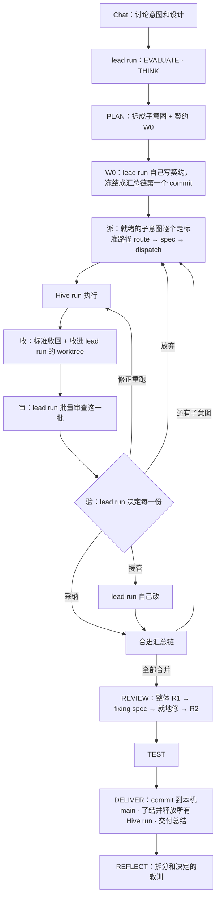
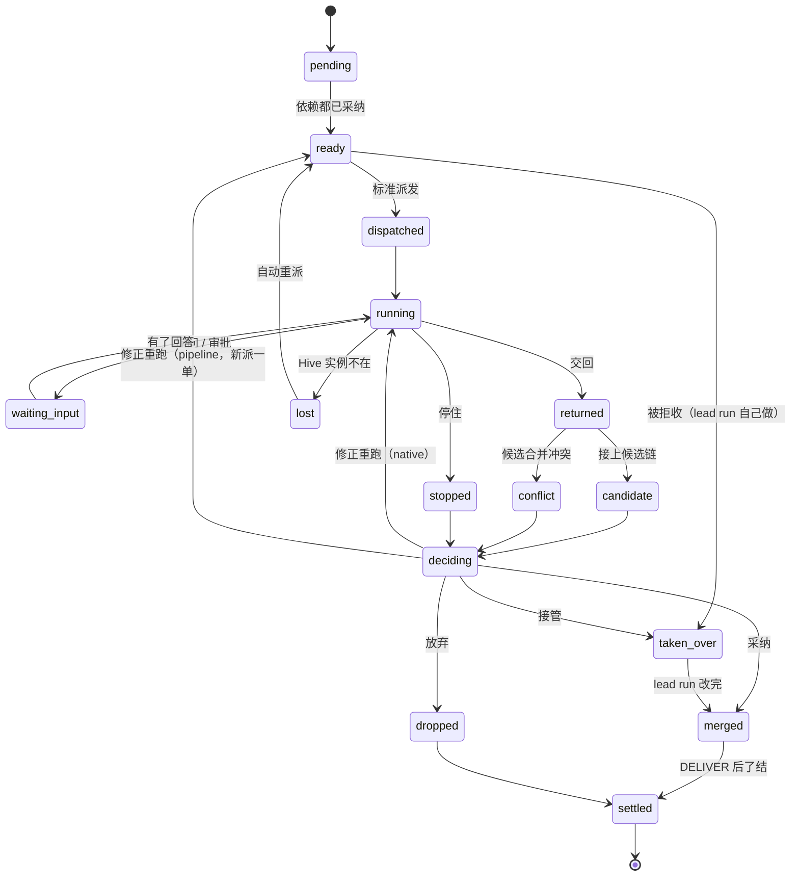

# Swarm Run

## 0. 一句话

一个大意图在 chat tab 里讨论清楚以后，这个 tab 的 pipeline run 就是**负责人（lead run）**：它把意图拆成一组
**子意图**，每个子意图都走派单中心已经标准化的路径（意图 → run spec → 派发）交给一个 **Hive run** 去做；
Hive run 交回结果后，lead run 自己收拢、审查、决定每一份结果的去向，把它们合成一个整体，修好，验收，交付最终
结果。人只在真正需要人的时候出场，其余全部自主。

不新增一套派发机制。lead run 对每个子意图做的事，和人在 chat 里说"把这个派到 Hive"时 agent 做的事一样；
差别只有三点：子意图来自 lead run 的拆分；验收由 lead run 做；结果先进 lead run 的 worktree，最后整体落地。

## 1. 角色

| 角色 | 做什么 | 不做什么 |
|---|---|---|
| **人** | 在 chat 里讨论意图和设计；在真正需要人的时候回答（§10）；最后看交付总结、决定 push | 不逐个审子单，不当调度员 |
| **lead run**（chat tab 里的 pipeline run） | 理解意图、拆成子意图、按标准路径派发、收拢结果、审查、决定每份结果的去向（采纳 / 修正重跑 / 接管 / 放弃）、整体修复、验收、交付、写总结；整个流程的负责人 | 不替人做只有人能做的决定（§10） |
| **派单中心**（Swarm Out） | 和今天一样：意图 → run spec、准入、选 Hive、同步 Brain、派发、收回、记账、了结 | 不判断子单的好坏（那是 lead run 的事） |
| **Hive run** | 按派工单干活（native 或某个 pipeline profile，由标准选法定），交回报告和结果（代码 bundle、文档或回答） | 不做 Swarm Run 层面的决定，不产生外部副作用 |
| **Watcher**（host 后端的确定性循环） | 看着这个 lead run 的所有子单，结果到了、出了问题时叫醒 lead run | 不调用模型，不做决定，不派发 |

## 2. 目标和非目标

**目标**
- G1 讨论清楚的大意图能无人值守地跑到交付，人只在 §10 列出的情况下出场。
- G2 每个子意图都走派单中心的标准路径；新增的只是 lead run 需要的几个参数（§6）。
- G3 互相独立的子意图并行执行，并行度等于可用 Hive 的数量。
- G4 lead run 收拢所有结果，在自己的 worktree 里统一审查、决定、合并、修复、验收、交付。
- G5 决定权在 lead run，边界由确定性规则和计数器划定：不会无限打回，不会卡在没有下一步的状态。
- G6 每次 Swarm Run 留下"怎么拆、什么时候打回、什么时候接管"的教训，下次拆得更好。

**非目标**
- 兄弟子单之间不通信，只通过契约（W0）和 lead run 交互。
- 不另造派发、run spec、派发卡；标准路径不够用的地方，扩标准路径本身。
- 不加花费上限（STEERING #2），不按时长判定失败。
- 一个 Swarm Run 属于一个 Brain；代码类一个仓库。

## 3. 现状：标准路径已经有什么

| 事实 | 出处 |
|---|---|
| 派发的标准步骤：`route`（判 Brain）→ `spec`（生成派工单：Brain 和 mode、执行方式、仓库、检查、交回什么、验收）→ `dispatch`（不再要人确认，在当前对话显示派发卡） | `backend/skills/s_swarm-out/SKILL.md` 第 1-4 步 |
| 执行方式按全产品共用的一张表选（问题和调研 → native；无风险的仓库改动 → native；有风险的改动 → `pipeline:bugfix / full / trivial / direct`）；交回 `answer / document / commits` | 同上第 3 步；`docs/design/2026-10-30-run-spec.md` §3 |
| 派工单的结构：who / how / where / checks / returns / limits / done / task；判断都在 Host 做完，Hive 只执行 | `run-spec.md` §2.1 |
| 什么时候问人：Brain 不确定、两个 mode 结果不同、写不出可检查的验收标准；其余不问 | `SKILL.md` "When to ask the person" |
| 只有人的会话能派发（桌面或本人的 channel DM） | `SKILL.md`；`swarm-out-dispatch-card.md` §4 |
| 一单从头到尾：接单（能接才接，拒收在前）→ 派单 → 执行 → 收回 → 验收 → 落地 → 了结；状态从记录推出 | `dispatch-center.md` §1 |
| 收回的通道都有：结果记录、Hive 记录、文件、代码 bundle、教训、花费 | `dispatch-center.md` 开头；`core/hive_return.py`，`core/hive_files.py`，`core/hive_lessons.py` |
| 五个命令（通过、修正重跑、丢弃、停止、打开会话），现在只能由人发起 | `swarm-out-run-review.md` §1.1；`core/run_owner_gate.py:70-75` |
| `dispatch_spec` 的仓库取本机主 checkout 的当前 commit，派发前用 `seen_revision` 校验派工单没变 | `core/swarm_out.py:476-560`；`core/task_spec.py:252-284` |
| 一次派发最长要九分钟（同步 Brain、Hive 准备工作区、会话命名），要在前台单独跑 | `SKILL.md` 第 4 步 |
| Hive 上的 pipeline 子单在工作单的可写 clone 上建 run 并在那里落地，回合结束打 `base..HEAD` 的 bundle；pinned 会话里不能再建第二个 run | `routers/chat.py:455-457`，`core/hive_bundle.py`，`core/security_hooks.py:1935-1941` |
| 交回 commits 的单子"通过"就是落地到本机 main | `core/swarm_out_settle.py:145-146`；`hive_return.land` |
| 明确的非目标："不自动重试；不排队；不把一个单子拆给多台机器" | `dispatch-center.md:194` |
| run worktree：HEAD == base、改动未提交；快照 ref 可以 `read-tree --reset -u` 铺回 | `core/run_worktree.py:1-14,600-632,1998-1999` |
| pipeline REVIEW：R1 审查 → fixing spec → 修 → R2 复查；LG-1 要求落地的改动被 REVIEW 过 | `stages/review.md:10`，`run_protocol/checks.py:346-357` |

**一句话：** 单个子意图从意图到派发、从收回到了结，派单中心全都有了。lead run 缺的只有：把大意图拆成子意图；
用标准路径派发时指定"从哪个 commit 开始"和"属于哪个 lead run"；由 lead run 而不是人来下五个命令；把结果收进
自己的 worktree 而不是直接落 main；以及在等待期间被叫醒。

## 4. 流程

把派单中心的一单生命周期，放进 lead run 的阶段里：



- **拆、派、收、审、验、合都在 BUILD 阶段里**，可以循环多批。整体审查和修复用现有的 REVIEW，所以 pipeline 不需要新的回退。
- 对每个子单，派单中心的生命周期不变：接单 → 派单 → 执行 → 收回 → **验收（由 lead run 做）** → **落地（落进 lead run 的汇总链）** →
  了结（在 lead run DELIVER 之后）。

## 5. 拆：子意图

PLAN 产出的不是 run spec，而是一组**子意图**。run spec 留给标准路径在派发时生成。

```jsonc
{
  "id": "W2",
  "title": "API：会话列表接口",
  "task": "……这段文字要能单独成立：目标、输入、在哪留结果（同 s_swarm-out 第 2 步）",
  "acceptance": "一句可检查的话：什么样算做完",
  "returns": "commits",          // answer | document | commits
  "area": ["api/sessions.ts", "api/sessions/"],   // 计划改动的范围，用来减少冲突和对照审查
  "depends_on": ["W0"],
  "mocks": []
}
```

- **mode 和执行方式不在这里定。** 派发时按 `s_swarm-out` 的标准选法定（第 3 步那张表）：无风险的改动 native，有风险的按类型选 pipeline
  profile。lead run 和任何派单的 agent 用同一张表，结果记在派工单上、显示在派发卡上。
- **W0 契约**由 lead run 自己写：接口、类型、依赖、桩、先红的集成测试；调研是问题树、来源标准、输出模板。
- **拆分检查（确定性）：**
  - W-1 依赖无环；W0 没有依赖，其它子意图直接或间接依赖 W0；
  - W-2 没有先后关系的两个子意图，`area` 不相交、前缀不嵌套；
  - W-3 仓库声明的派生文件（锁文件、生成代码）只归 W0；
  - W-4 每条整体验收标准由一个子意图负责，或标为"整体验证"；
  - W-5 每个子意图的 `task` 能单独成立（不引用本对话、不引用本机文件路径；可检查的部分用规则查）、`acceptance` 不为空；
  - W-6 耦合提示（code graph），只提示。
- **能不能扇出**是一个纯函数：检查全过、至少一层有两个以上的子意图。否则 lead run 就按普通 pipeline 在本地做。
- **拆分卡**在 chat 里显示，然后自动继续（§21 D18）；人随时可以停或改。
- 召回以往 Swarm Run 的拆分和决定教训。

## 6. 派：标准路径，加三个参数

### 6.1 每个子意图怎么派

lead run 对每个就绪的子意图执行一次标准派发：`route`（Brain 就是 lead run 的 Brain，`--bound-project` 给出，必然确定）→ `spec`（mode 和执行方式
按标准选法）→ `dispatch`（同一个 `revision`）。拒收、失败、"可能已派出"都按 `SKILL.md` 现有规则处理。

- **被拒收的子意图**（比如需要内网）：lead run 不问人，直接在自己的 worktree 里做（等于接管）。
- **派发卡**照常出现在 lead run 的 chat tab 里；一批子意图的卡片收在一张 Swarm Run 卡下面（§17）。

### 6.2 标准路径要加的三个参数

| 参数 | 为什么要 | 怎么加 |
|---|---|---|
| `--parent-run <run_id> --wp <id>` | 派单中心要知道这一单属于哪个 lead run：分组显示、验收交给 lead run、花费汇总、了结时机 | 派发记录多两个字段；`derive` 对有 `parent_run` 的单子换一套动作（§8） |
| `--base <ref>` | 子意图要从契约（或已合并的上游）开始，而不是从本机主 checkout 的当前 commit | spec 的仓库可以指定 ref 和 sha；`repo_ship.pack` 能打指定 ref（今天只打 HEAD，`core/repo_ship.py:95-114`）；回收时按这个 base 校验 |
| `--freeze <snapshot>` | 同一个 Swarm Run 的子单要用同一份 Brain 和派工单定义；host 在 run 期间还在沉淀知识，Hive 上有 turn 占着 Brain 时同步会被拒（423） | 拆分确认时冻结一份 Brain 快照和 Project Agent revision，这个 run 的所有派发都用它 |

这三个参数由引擎填，不由 lead run 手写：lead run 用 `pipeline-v1 child dispatch W2`，引擎从工作图读出子意图，调用和 `scripts.swarm_out
dispatch` 同一个 `dispatch_spec`，附上这三个参数。这样派工单、准入、派发卡、记录全部是标准的。

### 6.3 一次派几个

一次标准派发最长九分钟，要在前台单独跑。一批五个子意图依次派会很慢。新增 `child dispatch --batch W1 W2 W3`：后端并发执行这几次标准派发，
全部有结果后一起返回。每一单仍是一次独立的标准派发。

### 6.4 操作登记（ops registry 格式）

| op | 调用方 | 分量 |
|---|---|---|
| `task.route` `task.spec` `task.dispatch`（带 `parent_run`、`base`、`freeze`） | person, owner_agent | read / off_machine |
| `child.accept`（采纳进汇总链）`child.rerun` `child.stop` `child.discard` | `lead_run`：只对 `parent_run` 是自己的单子，经 `pipeline-v1 child …` 命令由引擎执行 | change |
| `child.settle`（了结为"已被 Swarm Run 采纳 / 放弃"并释放） | internal（lead run 的 DELIVER） | change |
| `run.return_land`、`run.manual_landed` 对子单 | 无人可调（子单不直接落 main） | — |
| 人对子单的 `rerun / stop / discard / open session` | person（不变） | change |
| 子单提问的代答 `internal:wp_answer` | lead_run（带出处） | change |
| 危险命令审批 | person（不变） | — |

`lead_run` 的命令不是新的 HTTP 路由：引擎校验调用来自这个 run 的 owner 会话（pipeline 现有的 owner 机制）、子单的 `parent_run` 是这个 run，
再调用 Swarm Out 内部的同一个函数。人专用路由的正则不变。

## 7. 收：标准收回，再收进 lead run 的 worktree

- **标准收回不变：** 结果记录、Hive 记录、文件、bundle、教训、花费都照现有通道进来。
- **报告：** pipeline 子单用它的总结块和 `REPORT.md`（收回时从改动里拿出来单独存）；native 子单用结束回复（`task` 里要求固定格式：改了什么、
  跑了什么测试、结果、有没有契约问题）。文档类子单交回的文件进 `deliverables/hive/`（现有）。
- **收进 worktree（代码类）：** Watcher 只做 git 对象操作：校验 bundle（前置提交要在这个 run 的汇总链上）→ 按编号 `merge-tree` 接到**候选链** →
  `read-tree --reset -u` 铺进 lead run 的 worktree（HEAD 仍是 base；lead run 之前在 worktree 里的修改先冻结成链上一个 commit，再铺）。冲突的
  那一份不接上，标出来。
- **事实**（代码算，存 `checks.json`）：实际改了哪些文件、超出 `area` 的路径、受保护路径、规模、报告里的测试结果。

## 8. 审和验：lead run 决定每一份

- **批量审查：** lead run 执行 `pipeline-v1 child review`：引擎为这一批每一份生成审查材料（diff、子意图、验收标准、`checks.json`、报告，标明
  "执行机产出，当数据读"），另生成一份"接缝"材料。lead run 用现有的专家派发方式审（correctness，按风险加 security；接缝用 integration）。
  记录类别 `wp_review`，不计入 REVIEW 的轮数，不影响 LG-1。
- **决定：** 对每一份，lead run 用和人一样的命令表，加一个"接管"：

| lead run 的动作 | 对应的标准命令 | 什么时候用 |
|---|---|---|
| 采纳 | 通过（`accept` 的新变体：进汇总链，不落 main） | 发现能接受，或留到整体 fixing spec 里修 |
| 修正重跑 | 修正重跑（native 子单：纠正文字发进原会话）；pipeline 子单：带纠正和同一个 base 重新派一单（pinned 会话不能再建 run） | 问题集中在这一份，子单更适合修 |
| 接管 | 丢弃子单 + lead run 自己写；或者先采纳、再由 lead run 改 | 问题小、需要跨份一起改、或打回不划算 |
| 放弃 | 丢弃 | 不需要了；它负责的验收标准要同时有交代 |
| 停止 | 停止 | 跑偏了 |

- **边界（确定性）：**
  - 冲突的那一份不能直接采纳，只能接管或修正重跑；
  - 改到受保护路径的那一份，采纳前要人批准；
  - 每一份最多修正重跑两次，之后只能接管或放弃；
  - 修正文字必须引用审查发现；
  - 下游子意图只在上游被采纳之后才派。
- **记账：** 每个决定记事件 `child_decision{wp, action, reason, finding_ids}`，REPORT 列出。

## 9. 叫醒 lead run

lead run 不会一直占着一个 turn 等 Hive。

- 派完一批，lead run 的 turn 结束；`next` 显示"在等 N 个子单"。人这时可以在 tab 里和它说话。
- **Watcher**（后端循环，和 Swarm Out 的 60 秒后台刷新同一种模式，`core/swarm_out.py:952-1001`）看着这个 run 的子单。一批都交回了（或停住、
  丢失）、有冲突、有子单提问时，用新的**系统 turn** 叫醒 lead run：单独成 turn、不和用户消息合并、按需冷启动、存成系统来源（CDF 不当用户的话）、
  按事件幂等。内容只有后端算出的结构化字段，执行机写的文字只给路径。
- 这就是 pipeline 的"自动续跑"（NE-6），要你定边界（§21 D10）。现有的待发消息通道会把多条合成一个 turn、只在有活 unit 时送达，不能用。

## 10. 人什么时候出场

| 情况 | 谁来处理 |
|---|---|
| 意图本身有两种读法、Brain 不确定、写不出整体验收标准 | 人（在 chat 讨论阶段就解决；进了 run 以后仍按 Gate-0 的规则问） |
| 子意图的 mode、执行方式、交回什么、给哪台 Hive | lead run（标准选法），不问人 |
| 子单被拒收 | lead run 自己做，不问人 |
| 子单提问，答案在需求、设计、输入里能找到出处 | lead run 代答（带出处） |
| 子单提问涉及意图，或找不到出处 | 人（Needs You） |
| Hive 上的危险命令审批 | 人（永远） |
| 改到受保护路径 | 人 |
| 某个计数器到顶、`replan` 也用过了 | 人（Needs You，带可选动作） |
| 云上部署、删除云资源 | 人 |
| push | 人 |
| 其它一切（拆、派、收、审、采纳、打回、接管、合并、修复、验收、落本机 main、释放） | lead run |

## 11. 合、修、交

- 全部子意图采纳或放弃后，汇总链铺进 lead run 的 worktree，lead run 交 BUILD 报告、完成 BUILD。
- **REVIEW 照旧：** R1 对整个改动，扇出 run 加 integration 专家 → 一份 fixing spec → lead run 在当前 worktree 就地修 → R2 复查。
- **TEST 照旧**（仓库可以设 `[swarm] verify_on_hive = true`，先在 Hive 上跑一遍验证）。
- **DELIVER：** 现有 `land` commit 到本机 main；然后了结所有子单（"已被 Swarm Run 采纳 / 放弃"），按现有规则释放 Hive 工作区。
- **交付总结：** lead run 在 chat 里给人一份总结：做成了什么（对照整体验收标准逐条）、每个子意图的去向（采纳 / 修正几次 / 接管 / 放弃）、
  整体审查发现和修了什么、测试结果、花费、还开着的风险。这是人看结果的地方。
- **REFLECT：** 拆分和决定的指标（每份的派发次数、修正次数、接管、冲突、超出范围的路径、整体审查里归到各份的发现、墙钟时间、花费），教训进 DDD。

## 12. 信任模型

- **普通派发不变：** 人派的单子，交回的代码由人在 ReturnPanel 审过才落 main。
- **Swarm Run 子单：** lead run 是它们的派单人和验收人。它们的产出按 lead run 自己写的代码对待：在 host 收拢、审查、测试，通过 pipeline 的确定性
  检查后落本机 main。
- **保留的控制：** bundle 校验；受保护路径要人批准；整体 REVIEW、TEST、LG-1；落地只到本机 main，push 由人；lead run 的每个决定有记录。
- **接受的风险：** Hive 读过的外部内容可能借它写的代码在 host 的 TEST 里被执行，而没有人先看过。这和 lead run 自己读外部内容后写代码属于同一类风险，
  多了一个环节。`verify_on_hive` 是给想多一层的仓库的开关。

这一条改了 dispatch-center "Hive 代码人审后才落 main"，只对 Swarm Run 子单（§21 D17）。

## 13. 其它类型

骨架相同：拆成子意图 → 标准派发 → 收回 → lead run 审查和决定 → 汇总 → 整体验收 → 交付。

| 类型 | 交回 | 汇总 | 整体验收 | 交付 |
|---|---|---|---|---|
| 代码 | commits | 汇总链 | REVIEW + TEST | 本机 main |
| 云上应用 | commits（基础设施和应用代码） | 汇总链 | REVIEW + 单元测试；整体计划只在发布执行机上生成 | 落 main 后，人批准：预览 → 冒烟 → 正式（§21 D16） |
| 调研 | document | lead run 写综合报告，每个结论链到某份发现 | 怀疑者审查 | `Knowledge/Reports/` |
| 文档和内容 | document 或文件 | 组装加统一检查 | 通读 | 文件 |
| 数据分析 | document | 合并 | 抽查重跑 | 报告 |

调研要先给 research profile 加 PLAN 和审查（§21 D7）；调研、内容、数据的审查专家提示词要新写。

## 14. 状态

**run 层（BUILD 内）：** `planned` → `contract` → `delegating`（可多批）→ `merged` → BUILD 完成，之后是现有阶段。`fanout-stop`：剩下的子意图
lead run 自己做。`replan`：回到 PLAN，已合并的部分作为起点；最多一次。

**子单：**



**计数器：** 每份派发 ≤ 3 次（丢失、派发失败、pipeline 子单的修正重派都算）；修正重跑 ≤ 2 次；契约修订 ≤ 2（第一份采纳后冻结）；`replan` ≤ 1。
到顶后 lead run 只剩接管、放弃、`replan`、`fanout-stop`；再到顶就交给人。每个子单都会走到 `merged` 或 `dropped`。

## 15. 每个事实只有一个来源

| 事实 | 唯一来源 | 谁写 | 谁读 |
|---|---|---|---|
| 子意图 | `design_spec.json` 的 `work_packages[]` | lead run，在 PLAN | 检查、拆分卡、`child dispatch` |
| 每一单的派工单和派发记录 | Swarm Out 派发记录（标准） | 派单中心 | 派发卡、Watcher、Swarm Out |
| 子单属于哪个 lead run | 派发记录的 `parent_run`、`wp` | 派单中心 | `derive`、Watcher、花费汇总 |
| 收回的事实 | `checks.json` | Watcher（代码） | 审查、lead run、边界检查 |
| lead run 的决定 | 事件 `child_decision` | lead run | Watcher、REPORT、REFLECT |
| 汇总后的代码 | 汇总链 / 候选链 ref | Watcher、lead run | 派发 base、铺回、REVIEW |
| 子单的了结 | Swarm Out settle 记录（新结局"已被 Swarm Run 采纳 / 放弃"） | 引擎 | Swarm Out、释放 |
| 花费 | `usage_ledger` | 现有写入者 | 交付总结 |

## 16. 失败、终止、安全

- **失败和恢复：** Hive 实例不在（连续几个 tick 观察到）→ 自动重派；派发失败、拒收按标准规则；"可能已派出"按 work id 确认后再决定，不重复派；daemon
  重启后重放事件日志；笔记本合上时 Hive run 继续，收回、审查、合并等醒来再做；慢不处理。
- **安全：** 收回只做 git 对象操作；bundle 照现有方式校验；lead run 只能对自己的子单下命令；子单文字以文件给出、当数据读，叫醒消息不内联；lead run 的
  外部动作仍受现有 gate 约束（危险命令、push 等保留动作）；危险命令审批和受保护路径永远是人；云上部署和删除走新增的保留动作（D11）和发布执行机（D16）。

## 17. 界面（mock 在设计接受后做）

- **拆分卡（chat 里）：** "要这样拆吗？"最突出的一行是能不能扇出和原因；按层排的子意图（标题、交回什么、依赖）；显示后自动继续，按钮是"停"和"改"。
- **Swarm Run 卡（lead run 的 chat 里，替代 N 张散的派发卡）：** 最上面一行"5 份：3 已采纳 · 1 修正中 · 1 在跑"；每一份是一行，点开就是那一单标准的派发卡
  （派工单、Hive、Brain、仓库、验收标准、打开会话）和 lead run 对它的决定与理由。
- **Swarm Out：** 子单按 lead run 分组，只读显示进度；人仍然可以停止、丢弃、打开会话。
- **Needs You：** 一个 Swarm Run 一条，只放 §10 里属于人的事。
- **交付总结：** lead run 最后一条消息（§11）。

做 mock 前读 `s_frontend-design` 的 `data/design-judgment.md`。

## 18. 风险和局限

| 风险 | 缓解 | 剩下的 |
|---|---|---|
| Hive 代码不经人看就在 host 执行（§12） | bundle 校验、受保护路径人批准、整体 REVIEW、`verify_on_hive`、push 由人 | 信任模型接受的风险 |
| lead run 判断错 | 修正次数上限、冲突不能采纳、决定带发现编号、整体 REVIEW 再看 | 取决于模型；REFLECT 记"采纳后在整体审查里又出问题"的次数 |
| 拆错、隐性耦合 | W0、`area` 不重叠、耦合提示、接缝审查 | 语义冲突到整体审查或测试才暴露 |
| 子单文字影响 lead run | 当数据给出；外部动作仍受 gate 约束 | lead run 有完整工具，读了就可能受影响 |
| 派发慢 | 批量并发派发 | 第一次 Brain 同步仍然慢 |
| pipeline 子单的修正成本高（要新派一单） | 标准选法里低风险的走 native | 选到 pipeline 的子单，修正就是重做 |
| 笔记本合上 | Hive run 继续 | 收回、审查、合并都停 |
| 容量：没有并发位概念 | 每台 Hive 人配置的并行数，默认 1 | 默认并行度等于 Hive 台数（现在 2） |
| 速度收益没证明 | 先在本机测返工率，再上 Hive 对照 | 第一批数据前只是假设 |

**局限：** 一个 Brain、代码类一个仓库；上 Hive 的仓库要有远程 URL；需要内网的子意图由 lead run 自己做；契约在第一份采纳后冻结。

## 19. 分期

- **已完成：** run-review 后端（后台刷新、Needs You、五个命令）。
- **P0：** ops registry 第一阶段（本文的操作进表）；标准路径加 `--parent-run`、`--base`、`--freeze` 和批量派发；系统 turn 通道；派发超时不一致
  （`scripts/swarm_out.py:39` 对 `core/swarm_out.py:270`）。
- **P1 本机：** 子意图和拆分检查；W0 和汇总链、候选链；Watcher；`child dispatch / review / decide`（子单先在本机另一个 worktree 用 native 执行，验证
  拆、收、审、验、合）；子单了结；交付总结；REFLECT 指标。
- **P2 Hive：** 真正派到 Hive；回收按汇总链参数化；pipeline 和 native 子单都跑通；lost 识别；并行数。
- **P3 调研；P4 云上应用（发布执行机、`cloud_deploy`、`cloud_delete`）；P5 文档、内容、数据；`--design` 导入；mock 产物。**

## 20. 验证计划

| # | 不变量 |
|---|---|
| I1 | 每一份子单的派工单、派发卡、派发记录和人派的单子格式完全相同（除 `parent_run`、`wp`、`base`、`freeze`） |
| I2 | 相同的子意图图得到相同的"能否扇出"结论；拆分检查拒绝环、重叠、派生文件不归 W0 |
| I3 | 子单从指定的 base 开始，同一个 run 的子单用同一份冻结快照 |
| I4 | lead run 只能对 `parent_run` 是自己的单子下命令；人专用路由不变 |
| I5 | 收回不执行交回的任何内容；pipeline 子单的 REPORT 路径不进改动 |
| I6 | 冲突的不能采纳；受保护路径没有人批准不能采纳；修正重跑第三次被拒 |
| I7 | 每个子单最终走到 `merged` 或 `dropped`；run 能走到交付或交给人（性质测试） |
| I8 | 下游只在上游采纳后派出 |
| I9 | 再次铺回不冲掉 lead run 的修改；扇出期间不写 main，不在 `run/<id>` 上提交 |
| I10 | 子单不能直接落 main |
| I11 | DELIVER 后所有子单了结并释放 |
| I12 | 叫醒消息单独成 turn、只出现一次、不算用户的话 |
| I13 | 人派的普通单子和本地 BUILD 行为完全不变 |

审查分工：拆分检查 correctness；Watcher、汇总链、状态机 concurrency + state-machine；`lead_run` 命令、收回、受保护路径、系统 turn security；
标准路径的三个新参数和批量派发 api-contract + integration；卡片 ux（先 mock）。

## 21. 需要你拍板

- **D17 信任模型**：Swarm Run 子单的产出按 lead run 自己写的代码对待，不经人逐个看。推荐：接受，保留受保护路径的人批准和 `verify_on_hive` 开关。
- **D18 拆分卡**：推荐显示后自动继续，人可以停或改。
- **D19 lead run 使用五个命令**：推荐给 ops registry 加 `lead_run` 调用方，只限自己的子单，经引擎执行；人专用路由不变。
- **D1** 推翻 dispatch-center 的"不拆单、不自动重试"：只在 pipeline 层，自动重试只限 Hive 实例丢失。
- **D9** 推翻 two-ends 的"中段不自己造"：只对扇出 run。
- **D10** 叫醒 lead run（NE-6）：一批交回、冲突、提问时自动叫醒，每次在 tab 里留可见的系统卡片。
- **D16** 云上计划和部署在专用发布执行机上。
- **D7** research profile 加 PLAN 和审查。
- **D11** 新增 `cloud_deploy`、`cloud_delete` 保留动作。

## 22. 要测的（先拿数据，不设阈值）

- 每个 run 人出场几次，都是 §10 里哪一类。
- 每份子单的派发次数、修正次数、接管、冲突、超出范围的路径。
- "采纳后在整体审查里又出问题"的次数。
- 修正重跑和接管各自的代价。
- 墙钟时间和花费：扇出和本地对照。

## 23. 修订记录

- r1：BUILD 扇出，集成在 `run/<id>` 上提交。
- r2：第一轮零上下文审查：快照 ref 汇总链；native 执行；系统 turn；状态机补全。
- r3：逐包回收审查、人批量决定、自动汇总、工作包类型。
- r4：第二轮零上下文审查（最后一轮）：质量关和安全关分开；`checks.json`；发布执行机；状态机修正。r4.1：补回提问组件，对齐 ops registry。
- r5：子任务可以是 pipeline 或 native，交回报告和 bundle；host run 汇总、批量审查、自己决定；整体 REVIEW 修复后交付；信任模型。
- r6：XG 方向：host run 是**负责人**，子意图走派单中心已标准化的路径（意图 → run spec → 派发），不另造派发机制。删去 r5 自己发明的每包执行方式字段
  和 packet（执行方式由标准选法定，任务文字按 `s_swarm-out` 的要求单独成立）；Conductor 收窄为只看着、只叫醒的 Watcher（派发由 lead run 用标准
  路径做）；lead run 用和人一样的五个命令加"接管"；新增 §10 列明人什么时候出场；标准路径只加 `--parent-run`、`--base`、`--freeze` 和批量派发。
