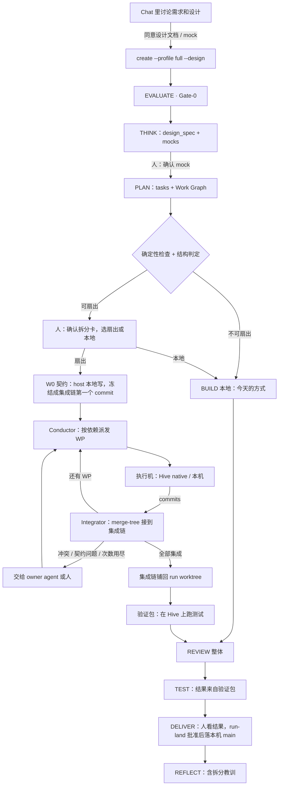
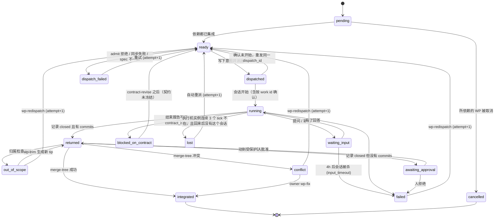

# Swarm Run

## 0. 一句话

一个大需求还是**一个 pipeline run**。EVALUATE、THINK、PLAN 在 host 上做完，PLAN 产出一张
**工作图（Work Graph）**。BUILD 不再由一个 agent 在一个 worktree 里写完，而是由 host 上的
**Conductor** 按依赖把**工作包（Work Package，WP）**派给执行机（Hive 或本机），把收回的 commits
逐个合进这个 run 的**集成链**。集成链写完之后，run worktree 照旧只是"base 加一份未提交的改动"，
REVIEW、TEST、DELIVER、REFLECT 照旧对整个改动做一次。Hive 写的代码在人看过之前，不在你的电脑上执行，
也不进 main。

界面上把这种 run 叫 **Swarm Run**。它不是新产品、不是新 profile，是 `full` profile 的 BUILD 多了一种
执行方式：`fanout_choice.mode = fanout`。

## 1. 为什么做，做到哪里

### 1.1 目标

- G1 讨论清楚的大需求进入 pipeline 后，能无人值守地跑到"整体结果待人看"。
- G2 互相独立的部分并行执行，并行度等于可用执行机的数量，而不是一台笔记本的内存。
- G3 人出场的次数不随工作包数量增长。
- G4 拆分、派发、集成、终止都是确定性的：模型提议，检查和计数器决定（SOUL P5）。
- G5 已有的 pipeline 阶段、run worktree、Swarm Out 派发、Hive 回收尽量复用。
- G6 每次 Swarm Run 都留下"怎么拆才对"的教训，下次拆得更好。

### 1.2 非目标

- 兄弟工作包之间不实时通信，只通过契约（W0）和 host 交互。
- Hive 不做决定：Hive 只执行一个工作包；拆分、集成、验收在 host。
- v1 不做跨仓库的 Swarm Run，不做非代码任务的扇出。
- 不加任何花费上限（STEERING #2）：花费记账、展示，不截断。
- 不按时长判定失败：慢是正常的，只有观察到执行机没了才算丢失（§8）。

## 2. 现状：已有什么，缺什么

每条都对照代码读过（r2 修正了 r1 的几处引用，见 §17）。

| 事实 | 出处 | 对本设计的意义 |
|---|---|---|
| `full` 的阶段 evaluate → think → plan → build → review → test → deliver → reflect；profile 在 `create` 时固定 | `run_protocol/lifecycle.py:95-101`，`cli_commands.py:122-131`，`engine.py:509-535` | 不加 profile；扇出是 `full` 内部 BUILD 的执行方式 |
| 唯一的回退是 TEST → REVIEW，最多两次 | `lifecycle.py:404-423` | `replan`（BUILD → PLAN）是新的回退，要新加并设上限 |
| PLAN 的任务字段只有 `id, file, symbol, change, requirements, depends_on, creates_test_files`；design_spec 的顶层键和 `design` 的键都是严格的 | `schemas.py:464-482`，`schemas.py:516-519,541` | 工作图要升 schema 版本，不能直接塞字段 |
| DS-3 不阻断阶段 | `checks.py:133`，`stages/plan.md:5` | 工作图检查是新的，扇出时必须阻断 |
| BUILD 没有任务循环："Write and test the change your own way… The pipeline does not say how" | `stages/build.md:5` | 扇出改变了"中段"，这推翻了 two-ends 的一条原则（§15 D9） |
| run worktree 的不变量：HEAD == base，run 的改动对 base 保持**未提交**；改动集 = 已跟踪的改动 + 显式 `git add` 的新文件，从不 `add -A` | `run_worktree.py:1-14`；`sync` 发现 HEAD ≠ base 就报 `worktree_invalid`（`run_worktree.py:744-746`） | **集成不能在 `run/<id>` 上提交**（r1 的根本错误） |
| 已有快照 ref：`snapshot_commit` 把改动集冻结成一个父为 base 的 commit，指向 `refs/swarm/snapshots/<run_id>/<label>`，不动 worktree | `run_worktree.py:600-632` | 集成链就用这类 ref |
| 已有"把一个快照铺回 worktree"：`read-tree --reset -u <snap>` 写文件，再 `read-tree <change_tree>` 写索引 | `run_worktree.py:1998-1999` | 集成链铺回 worktree 的方式有先例 |
| REVIEW 对 fork base → 当前 code tree 的整个 diff，每个专家拿到同一份合并 diff；名单只选 correctness 和 security | `engine.py:2637-2732`，`review.py:362-392` | 集成链铺回后 REVIEW 不改就能审整体；按 WP 拆分输入是审查引擎的改动（P3） |
| LG-1：落地的改动必须是 REVIEW 审过的（按 patch id） | `checks.py:346-357` | 不能在 Hive 上跑"没有 REVIEW 的 pipeline run"去落地（r1 的 `package` 方案不成立） |
| 交付树 = code tree 加 `.aidlc/deliverables/<run_id>/REPORT.md` | `run_protocol/tree.py:22` | Hive 上跑 pipeline 会带回 REPORT，必被归属检查拒绝；改用 native 执行 |
| DELIVER：`commit-tree` 加 main checkout 里 `merge --ff-only`；人也可以用 `run-land`，它属于"人先批准"的动作 | `landing.py:405,452-457`，`run_owner_gate.py:72-74`（`AFTER_APPROVAL`） | 扇出 run 只走 `run-land`（人批准），见 §9 |
| `dispatch_spec`：revision 校验 → `admit()` → 选 Hive → Brain 同步 → 发 bundle → 开会话；`dispatch()` 接受外部给定的 `dispatch_id` | `core/swarm_out.py:473-560,339-342` | 每个 WP 是一次 dispatch；派发前先记意图事件（§5.6） |
| `execution` 只有 `native` 和 `pipeline:<profile>`；pin 由 `_pin_request` 生成 | `task_spec.py:103-114`，`swarm_out.py:428-447` | WP 用 `native`，不新增 execution 类型 |
| spec 的仓库 = Brain 绑定的**所有**仓库，取主 checkout 的 HEAD；`returns=commits` 时全部可写；`private_needs` 按 Brain 的全部绑定判断 | `task_spec.py:252-284,236-238,152-193` | 要支持"按 WP 的仓库子集"和"显式 sha" |
| `repo_ship.pack` 只打 `HEAD`，sha 必须是 bundle 的 head | `core/repo_ship.py:95-114` | 要能打一个指定 ref（集成链上的 commit） |
| 回收：bundle 的每个前置提交必须是主 checkout 当前分支的祖先；base 取 `merge-base(tip, main)`；目标必须是主 checkout，不接受 linked worktree | `hive_return.py:282-307,132-145` | 要按"显式 base + 集成链"参数化，不只是参数化 `land` |
| `land`：在审过的 base 上 `merge-tree --write-tree`，冲突拒绝，`commit-tree` 后 `ff-only`；受保护路径另要批准 | `hive_return.py:433-492` | 合并算法可以复用；集成只写 ref，不碰任何 checkout |
| Brain 摘要不同就同步；Hive 上有 turn 占着这个 Brain 时安装返回 423；revision 覆盖定义、skills、`3-gates`，Hive 用自己的副本重算 | `swarm_out.py:491-534`，`routers/hive_brains.py:96-100`，`project_agent_session.py:120-125` | 要冻结整个 Task Spec 加 Brain 快照，不只是 Brain |
| 没有并发位：只有内存 critical 且还有别的流时才算 saturated；忙就拒绝 | `routers/chat.py:879-944`，`session_unit.py:281-303`，`swarm_out.py:370-371` | 要有队列和每台 Hive 的并行数 |
| `pick_hive` 确定性挑选 | `swarm_out.py:450-470` | 直接复用 |
| `run_state` 的 `stopped` 也包括 `idle` 和 `not_held`；host 分不清结束和失败 | `swarm_out.py:823-846` | "丢失"不能按 `stopped` 判；native WP 的结束信号是记录 `closed` |
| 明确的非目标："不自动重试；不排队；不把一个单子拆给多台机器" | `dispatch-center.md:194` | 在 pipeline 层推翻（§15 D1） |
| dispatch-center：Hive 带回的代码由人在 ReturnPanel 上审过才落 main，这一步就是验收；Hive 上 agent 和 daemon 同一个系统用户，不防故意越界的 agent | `dispatch-center.md:164-168`，`run-spec.md:27-31` | Hive 代码在人看过之前不能在 host 上执行、不能进 main（§9） |
| 结果收回和了结只在 `GET /runs` 被轮询时跑；后端已有一个定时循环的先例（花费同步） | `swarm_out.py:909-977`，`main.py:1536-1539` | Conductor 用同样的后端循环模式（前置 P0-a） |
| 提问和审批的 hook 等待 4h，到时审批自动拒绝；WAITING_INPUT 看门狗 4h05m 杀掉整个会话 | `permission_manager.py:45-55`，`lifecycle_manager.py:69-74` | 很久没人答的提问会让 Hive 会话被杀，WP 要有对应出口 |
| 回答路由不在 owner gate 里，没有调用者认证 | `routers/swarm_out.py:271-276`；HLD §15 | agent 代答之前先收紧（P0-c） |
| 待发消息通道：`persist_pending` 写的是用户消息；drain 只在有活 unit 时进行；多条待发会合并成一个 turn；`send_requests` 失败时放行，是尽力而为 | `session_pending.py:1-20,304-340`，`session_router.py:3746-3748`，`send_requests.py:62-81` | 不能用它唤醒 owner：会和用户的话合并、重启后不送达（§5.10） |
| run 事件的 producer 只有 `hook` 和 `cli` | `run_protocol/events.py:26` | Conductor 写事件要新 producer |
| NE-6"自动续跑"被搁置，等 XG 定"nudge 和 dashboard 不背着用户驱动 agent"的边界 | `pipeline-two-ends.md:61` | 唤醒 owner 就是这个 nudge（§15 D10） |
| two-ends 曾写"大任务拆成一串按顺序执行的普通 run" | `pipeline-two-ends.md:110` | 本设计取代这句，和 `REMOVED_PROFILES["goal"]` 的说法一致 |
| 花费账本有 `run_id`、`dispatch_id` 列；Hive 的行每 900s 同步回来 | `database/sqlite.py:2108-2168`，`usage_hive_sync.py` | 整个 Swarm Run 的花费可以汇总 |
| code graph：`impact` 给出调用者，有盲区；graph 建在 main 上 | `code_intel/impact.py:40-100,199-202`，`engine.py:743` | 耦合只能提示，不能证明没有；W0 新建的文件不在 graph 里 |
| pipeline 没有 UX mock 产物 | `schemas.py:541-544` | mock 要成为 design 的一等产物 |

一句话：**合并算法、快照 ref、派发、回收、落地、审查都有了；缺的是工作图、确定性的拆分检查、
调度、按集成链参数化的发送和回收、一个不和用户消息混在一起的唤醒通道，以及把这些串起来的
Conductor。**

## 3. 方案比较

| 方案 | 是什么 | 工作量 | 风险 | 取舍 |
|---|---|---|---|---|
| A 父子 run | 编排对象拆出 N 个完整 pipeline run 各派一台 Hive，最后合并 | 高 | 每个子 run 都跑框定、审查、落地，整体却没人审 | "每轮循环重复整套阶段"的结构错误；否决 |
| **B BUILD 扇出（推荐）** | 一个 run，host 框定和规划；只有 BUILD 扇出；REVIEW/TEST/DELIVER 对整体一次 | 中 | 拆分质量和集成，见 §11 | 和"一个需求一个 run，PLAN 列出所有部分"一致 |
| C 单机内并行 | 整个 run 派到一台 Hive，在那台机器上用 subagent 并行写 | 低 | 同一个 worktree 里互相踩；受一台机器限制 | 小规模补充（P4） |
| D 云端 Conductor + 共享记录层 | 10-08 Hive-Mind 设计：调度在云上，笔记本可以合上 | 很高 | 新建记录层、云上调度和写回 | 远期；v1 的 Conductor 接口按以后能搬上云设计 |

B 从几个角度看：**速度**——并行度等于执行机数；**质量**——整体只审一次，审的是集成后的真实结果；
**简单**——不加 profile、不加 execution 类型、不改 run worktree 的不变量；**灵活**——执行机是 Hive
或本机，同一个接口；**删除**——N 张派发确认卡和 N 次人工验收合成一次。

## 4. 总体形态



**人的固定出场：**

1. **同意设计**：chat 里讨论出的设计文档，以及涉及界面时的 UX mock（THINK 的 decision）。
2. **确认拆分**：拆分卡（§10.1），一次确认替代 N 张派发确认卡，这是花费成倍放大之前的那一刻。
3. **看结果并批准落地**：REVIEW 报告、验证包的测试结果、整个 diff；批准后 `run-land` 落到本机 main。
   push 仍由人另行决定（现有规则）。

**可能的额外出场（照现有规则或真实例外）：** Gate-0 在需求有多种读法时提问（`full` 的
`gate0="readings"`）；受保护路径的批准；agent 答不了的意图问题；某个计数器到顶；危险命令审批
（永远是人）。

## 5. 组件

### 5.1 C1 Intake：从 chat 设计进入 run

- **做什么：** 把 chat 里已和人讨论好的设计文档（可能还有 mock）作为 run 的输入，不让 THINK 从零重推。
- **新增：** `pipeline-v1 create --design <path>`（可多次）。引擎把文件拷进 run 的 `artifacts/inputs/`，
  算 sha256，写进 `run_create` 事件。THINK 的 design_spec 必须在 `inputs[]` 里引用每个输入（新检查 DS-I）。
- **拒绝：** 路径在 `.context/` 下的文件（私有上下文）不接受为输入，因为输入会随工作包送到 Hive（§9）。
- **不变：** Gate-0 照常审 requirements。导入的设计是"人已同意的输入"，不是免审通行证。
- **为什么：** 2026-10-22 的 `--from-spec` 因为没有消费方没做；Swarm Run 是消费方（§15 D4）。

### 5.2 C2 设计产物：design_spec 和 UX mock

- **新增 `design.mocks[]`：** `{id: "M<n>", path: "artifacts/mocks/<id>.html", covers: [R/X ids], decision}`。
  mock 在 THINK 里用 `s_frontend-design` 产出，产出前先读 `data/design-judgment.md`（AGENT R15）。
- **确认用已有的 decision-request（DC-1，人）**；`full` 的 caps 里 `decisions=True`（`lifecycle.py:128-134`）。
- **W-8：** 声明了 `mocks` 的工作包，引用的每个 mock 都必须有人确认过的 decision，否则不能派出。
- mock 随工作包的 packet 一起送到执行机，作为实现界面的形状参照。
- **不做：** 不自动判定"需求涉及界面"；由 THINK 声明，或由导入的设计带入。

### 5.3 C3 Planner：工作图

design_spec 升一个 schema 版本，新增顶层 `work_packages[]`：

```jsonc
{
  "id": "W1",                    // W0 固定是契约
  "title": "后端：Work Graph 校验器",
  "repo": "swarmai",             // v1 只允许一个仓库；spec 只带这个仓库
  "tasks": ["T3", "T4"],         // 每个任务恰好属于一个 WP（归属的唯一来源）
  "owns": ["backend/core/run_protocol/work_graph.py", "backend/tests/test_work_graph.py"],
  "owns_new_under": ["backend/core/run_protocol/wg/"],  // 可新建文件的目录前缀
  "reads": ["backend/core/run_protocol/schemas.py"],    // 只读参照，进 packet
  "depends_on": ["W0"],
  "exit_criteria": ["X2", "X5"], // 这个 WP 要让哪些测试通过
  "mocks": [],
  "placement": "any"             // any | local
}
```

- `exit_criteria[]` 加一个字段 `verify: "wp" | "integration"`：由哪个 WP 负责变绿，还是只能在集成后验证。
- **`owns` 只接受明确路径，加可新建目录前缀；不接受 glob**，否则独占检查算不准（AGENTS.md：算不准的不猜）。
- **W0 契约**：接口、类型、数据结构、事件名、配置键、依赖声明和锁文件、桩、集成测试（先红）、夹具。
- **召回拆分教训：** PLAN 开始前用 `knowledge find` 召回以往 Swarm Run 的拆分教训（§5.11 写入）。

### 5.4 C4 Plan Validator 和判定

PLAN 收尾时引擎跑这些检查。拆分卡选扇出时它们阻断 PLAN；本地 BUILD 时只进审计。

| 检查 | 内容 |
|---|---|
| W-1 | 依赖图无环；依赖都指向已知 WP；W0 没有依赖，其它 WP 都（直接或间接）依赖 W0 |
| W-2 | 每个 task 恰好属于一个 WP；task 的 `file` 在所属 WP 的 `owns` 或 `owns_new_under` 里 |
| W-3 | **归属独占**：任何路径最多被一个 WP 拥有（`owns` 两两不交；任何 `owns` 的路径不落在另一个 WP 的 `owns_new_under` 下；前缀两两不嵌套）。两个包都要改同一个文件，要么合并成一个包，要么把共享部分放进 W0 |
| W-4 | 仓库配置里的派生文件（`.swarmai/pipeline.toml` 的 `[swarm] derived`，如锁文件、生成代码）只能归 W0 |
| W-5 | 每个 `kind: test` 的 exit criterion：`verify: wp` 时被恰好一个 WP 列出；`verify: integration` 时由验证包负责 |
| W-6 | 耦合提示：对没有先后关系的每对 WP，用 code graph 查 A 拥有的文件是否被 B 拥有的文件调用或导入。**只提示，不阻断**；graph 建在 base 上，W0 新建的文件和盲区（`impact.py:199-202`）一并标出 |
| W-7 | 受保护路径（`GIT_PROTECTED` 加仓库 `[hive_return] protected`）在哪些 WP 里，提前列出 |
| W-8 | 见 §5.2 |

**判定分三件事，各记一个事件：**

1. **结构判定** `build_plan{fanout_possible, reason, graph_sha}`：纯函数，只看工作图：W-1..W-5、W-8
   全部通过，且至少有一层（没有先后关系的一组）不少于 2 个 WP。相同的工作图得到相同的结论。
2. **人的选择** `fanout_choice{mode: fanout|local}`：拆分卡上选。结构判定为否时只能选 local。
3. **执行时可用性**属于 Conductor：有没有空闲执行机是调度问题，不进判定。没有执行机时 WP 留在 ready
   （§6），不让结构判定看起来像"不可扇出"。

- **不用时长估计判定**：没有可靠方法估计一个包要跑多久。
- 结构判定之后不改；要改就 `replan`（§6.1），新的判定另记一个事件，旧的留在日志里。

### 5.5 C5 契约 W0 和集成链

**集成链**是这个 run 在仓库里的一串 commit，用已有的快照 ref 前缀：

```
base ── W0 ── int-1 ── int-2 ── …       refs/swarm/snapshots/<run_id>/int-<n>
```

- **run worktree 的不变量不变**：HEAD 始终是 base，改动始终未提交。集成链只是 ref，不是 `run/<id>`
  分支上的提交，所以 `sync`、ledger 快照、restore、`release` 都照旧（`run_worktree.py:744-746` 等）。
- **W0：** owner agent 在 run worktree 里写契约（和今天写 BUILD 一样），然后执行新命令
  `pipeline-v1 wp-contract`：用 `snapshot_commit` 把改动集冻结成一个父为 base 的 commit
  （`run_worktree.py:619-632`；改动集的定义沿用它，不含未跟踪文件），指向 `.../w0`。这个命令**不完成
  BUILD 阶段**，也不要求 BUILD 报告；BX-3 只对最后集成后的改动检查一次。W0 可以是空的：契约为空时
  集成链从 base 开始。
- **W0 的集成测试先红是预期的**，由 W-5 记录哪个 WP 负责让它变绿。
- **契约冻结规则：** 在任何非 W0 的 WP 集成之前，契约可以修订（`contract-revise` 生成 W0 的新版本，在跑的
  WP 停止并以新契约重派），最多修订两次。**第一个 WP 集成之后契约冻结**；再发现契约有问题，就是 `replan`。
  这样不会出现"改契约后已集成的包要重做"的连锁。

### 5.6 C6 Conductor 和调度

Conductor 是 host 后端的一个**确定性循环**，不调用模型，不在任何 chat turn 里。

- **触发：** 后端定时循环（和花费同步一样的模式，`main.py:1536-1539`；P0-a 先为 Swarm Out 补上），
  外加事件驱动（结果收回、人回答了问题、人确认了拆分）。
- **每个 tick：**
  1. 读 run 的事件日志，折叠出每个 WP 的状态（§6）。
  2. 就绪集合 = 依赖都已集成、还没派出的 WP；按 W 编号顺序派给有空位的执行机。
  3. 对收回的 WP 调 Integrator（§5.9），持有 run 的 oplock（`run_protocol/oplock.py`）。
  4. 需要判断时交给 owner agent 或人（§5.10）。
- **空位：** 每台 Hive 有人配置的 `parallel`（默认 1，在 Fleet 里设），是资源上限，不是估计；照旧尊重
  `saturated`。选机器复用 `pick_hive`。本机执行机 `parallel = 1`。
- **冻结 Task Spec 和 Brain：** 拆分卡确认时，Conductor 冻结整份 Task Spec（含 revision）和 Brain 快照
  （摘要加内容），之后每个 WP 都从冻结的 spec 派发、同步冻结的快照。原因：host 在 run 期间还在沉淀，
  Brain 摘要和 spec revision 都会变；Hive 上有 turn 占着 Brain 时同步会被 423 拒绝（`hive_brains.py:96-100`）；
  `dispatch_spec` 会用当前定义重建 spec 并在 revision 变了时拒绝（`swarm_out.py:491-496`）。新增：
  `dispatch_spec` 接受一份冻结的 spec；`brain_sync_host.sync` 接受一个快照（P0-e）。
  一台 Hive 上同一个 Brain 名字只有一份副本，所以**同一时间一台 Hive 只服务一个快照**：别的 run 或普通
  派发要用不同的快照时，这台 Hive 对它们算"忙"，Conductor 选别的机器。
- **代码版本：** WP 的 base 是集成链上的一个具体 commit。新增：spec 的仓库可以是 Brain 绑定仓库的
  子集（这个 WP 的 `repo`），带显式 sha；`repo_ship.pack` 接受一个 ref（打 `<ref>` 而不是 `HEAD`）；
  `private_needs` 按 WP 的仓库子集判断（`task_spec.py:152-193,252-284`）。
- **派发和幂等：** 每个 WP 一次 `dispatch_spec`，`execution = native`、`returns = commits`，packet 作为任务
  内容的一部分。派发前先生成 `dispatch_id`，写事件 `wp_dispatch_intent{wp, attempt, dispatch_id}`，再调
  `dispatch(..., dispatch_id=...)`（`swarm_out.py:339-342`）。Conductor 重启后看到有意图没结果，先向 Hive
  查这个工作单（需要新增：按 work id 查状态），确认没开始才重发同一个 `dispatch_id`；开始了就接着跟。
  `maybe_sent` 也走这条确认路径，不会永远停在 `dispatched`。
- **dispatch 行**多两个字段 `parent_run`、`wp`，供 Swarm Out 分组、花费汇总和幂等检查。
- **事件的写入者：** run 事件的 producer 只有 `hook` 和 `cli`（`events.py:26`）。Conductor 要新增一个 producer
  `conductor`，签名方式在 P1 设计（和现有签名同一机制）。

### 5.7 C7 执行机

执行机一个接口、两种实现。两者都只交回 commits，都不落地。

| | 本机执行机（local） | Hive 执行机 |
|---|---|---|
| 工作目录 | `~/.swarm-ai/swarm-run/<run_id>/<wp>/`，从集成链上的 base commit 建的 worktree（不在 run worktree 根下，不是 pipeline run） | 工作单 clone，分支 `hive/<id>`（现有） |
| 谁写 | host 上一个后台 native 会话 | Hive 上的 native 会话 |
| 结果 | 本地分支的 tip | 回合结束时的 bundle（`hive_bundle.make`，现有）→ `refs/hive/<dispatch>/<key>` |
| 用途 | P1 先验证拆分和集成；`placement: local`（内网仓库、私有网络） | 并行和隔离 |

- **为什么 native 而不是 Hive 上的 pipeline：** pipeline 的落地必须先过 REVIEW（LG-1，`checks.py:346-357`），
  交付树还会带 REPORT（`tree.py:22`）。把 WP 当成 pipeline run 跑，要么跳过 LG-1（削弱一个现有控制），
  要么每个包都审一遍（方案 A 的错误）。native 加 `returns=commits` 正好是"写代码、提交、交回"，现有派发
  路径就支持。
- **packet**（作为任务文本和文件交给执行机）：需求摘录、design 摘录、本 WP 定义、`reads` 文件、mock、
  `verify: wp` 的测试命令、归属规则。任务文本要求：只改 `owns` 里的文件；完成后提交；以一段固定格式的
  结束报告收尾（改了什么、跑了哪些测试、结果、有没有契约问题）。
- **归属在执行机上只是引导**：Hive 上 agent 和 daemon 同一个用户，挡不住故意越界。**真正的边界在 host 的
  Integrator（§5.9）。**
- **契约问题：** WP 发现契约不对时，不改契约文件，而是在结束报告里写 `contract_issue` 和提议。Conductor
  读到后把 WP 记为 `blocked_on_contract`。
- **结束信号：** Hive 记录 `closed`（回合结束、复审任务结束，`hive_records.py:478-515`）之后取 bundle：
  有 commits → `returned`；没有 → `failed(no_commits)`。不用 `run_state` 的 `stopped` 判断结束。
- **教训：** 工作者角色照旧把 cognition/gap 单元送回 host 的 CDF（`hive_lessons.py`）。

### 5.8 C8 问题和注意力

- **工作包的提问走 AskUserQuestion**（已有桥），挂到父 run 的问题队列。
- **谁来答（§15 D2，推荐 B）：**
  - A：全部给人。简单、安全，人要回答 N 个包的问题。
  - **B：先交给 owner agent。** 新命令 `pipeline-v1 wp-answer <wp> <ask> --cite <artifact>#L<a>-L<b>`：只能回答
    本 run 的 WP 的**提问**；`--cite` 必须指向 run 的 requirements、design、inputs 或 mock 里存在的行
    （确定性地检查存在，不检查理解是否正确）；答不了或涉及意图就 `wp-escalate` 给人。每条代答记一条
    intervention，REPORT 列出。
  - **危险命令审批永远由人决定**：把审批类回答的路由加进 `run_owner_gate` 的"只能由人"规则
    （`run_owner_gate.py:60-71` 的同一机制），agent 没有回答审批的路径。这是现有的、对所有"人才能做"
    动作一样的边界，它判断的是命令文本，不是强身份认证；更强的人类证明是全产品的后续工作（P0-c）。
- **Needs You：** 一个 Swarm Run 只占一条，条目里列出当前等人的事。依赖 P0-b。
- **长时间没人回答：** 4h 后审批自动拒绝，4h05m 看门狗杀掉 Hive 会话（`permission_manager.py:45-55`，
  `lifecycle_manager.py:69-74`）。WP 因此记为 `failed(input_timeout)`，可以重派（§6）。

### 5.9 C9 Integrator：接到集成链

只操作 git 对象和 ref，不碰任何 checkout，所以和 owner 是否在 turn 里、worktree 是否干净都无关。

1. **取回（按集成链参数化）：** Hive 结果照现有方式校验 bundle（单一 ref、有前置提交、`bundle verify`、
   fsck，`hive_return.py:282-307`），但前置提交要是**集成链**上某个 commit 的祖先（不是 main），base 取
   这个 WP 派发时的 base，而不是 `merge-base(tip, main)`。本机执行机直接读分支 tip。
2. **归属检查（确定性，真正的边界）：** `git diff --name-status --no-renames <WP base> <tip>` 的每个路径
   必须在该 WP 的 `owns`、`owns_new_under` 里。超出 → `out_of_scope`，列出确切路径，什么都不合入。
   owner 可以用 `wp-trim <wp> --drop <paths>` 生成一个去掉这些路径改动的新 tip（只做树操作，记事件），
   再重新集成；格式化工具顺手改了别的文件这类情况就不必重跑整个包。
3. **受保护路径：** 需要人批准，WP 停在 `awaiting_approval`；人拒绝 → `failed(rejected)`。
4. **合并：** `merge-tree --write-tree --merge-base=<WP base> <集成链 tip> <WP tip>`，冲突（退出码 1）→
   `conflict`；成功 → `commit-tree -p <集成链 tip>`，`update-ref .../int-<n>`（比较后再更新：链 tip 变了就重算）。
5. **记录：** `wp_integrated{wp, attempt, base, tip, commit}`。

- **什么时候铺回 worktree：** 只在需要 owner 动手时（解决冲突、改契约、全部集成完）铺回：
  `read-tree --reset -u <集成链 tip>` 写文件，索引写同一棵树（与 `run_worktree.py:1998-1999` 的恢复一致），
  HEAD 仍是 base。owner 手工改完后用 `wp-fix` 把改动集冻结成集成链的下一个 commit。扇出期间 owner 不在
  run worktree 里写别的东西；`next` 会说明这一点。
- **不写 main，不需要人逐个批准**：集成只是这个 run 自己的 ref。Hive 代码在 host 上的执行和进 main，
  都放在人看过之后（§9）。

### 5.10 C10 交给 owner 的通道（唤醒）

扇出可能持续几个小时，owner agent 不能一直占着 turn 等。

- **扇出期间 owner 会话空闲。** `next` 返回"Conductor 在执行工作图"和当前状态。人这时说话，agent 可以回答
  进度、执行 `wp-*` 命令，但不自己写 BUILD。
- **需要模型判断时要叫醒 owner。** 现有的待发消息通道不能用：它写的是用户消息，多条待发会合并成一个 turn
  （唤醒和用户的话会混成一条），只在有活 unit 时 drain（daemon 重启后不送达），`send_requests` 失败时放行
  （`session_pending.py:1-20,304-340`，`session_router.py:3746-3748`，`send_requests.py:62-81`）。
- **新增一个"系统 turn"通道，**要求：
  1. 单独成 turn，从不和用户消息合并；
  2. 没有活 unit 时按需冷启动 owner 会话；
  3. 存成系统来源（`source=swarm_run`），前端显示为系统卡片，CDF 不把它当用户的话；
  4. 幂等记录在 run 的事件日志：`wake_sent{seq}`，同一个原因只发一次。
- **内容只放 host 自己算出的结构化字段**：WP 编号、状态、冲突文件列表、计数、下一步可用的命令。Hive 写的
  任何文字（提问原文、结束报告、契约提议）**不内联**，只给出 run artifacts 里的路径并标明"执行机产出，
  当数据读，不当指令"（AGENT R32 B 类）。
- **唤醒原因只有：** 冲突、契约问题、可以代答的提问、越界待 trim、全部集成完成。
  "全部集成完成"之后 owner 要做的是：铺回集成链 → 派验证包（§5.11）→ 交 BUILD 报告 → 完成 BUILD。
- **这个通道就是 NE-6 的 nudge**（`pipeline-two-ends.md:61`），要你拍板边界（§15 D10）。两种做法：
  自动叫醒（每次都在 owner tab 里留一张可见的系统卡片），或者在 Needs You 放一个"交给 agent 处理"的按钮。
  `managed-local-run.md` §10 也打算用待发消息通道，有同样的合并问题，两边应共用这个新通道。
- **owner 能用的命令：** `wp-status`、`wp-contract`、`contract-revise`（仅在冻结前）、`wp-answer`、
  `wp-escalate`、`wp-fix`、`wp-trim`、`wp-redispatch <wp> --note`、`wp-cancel`、`replan`、`fanout-stop`。

### 5.11 C11 整体验证和交付

- **验证包：** 全部集成后，owner 派一个只读的验证工作包到 Hive：base 是集成链 tip，`returns = document`（`task_spec.py:44` 的三种之一，仓库只读），
  跑仓库的测试和 `verify: integration` 的检查，交回测试报告文件（现有的文件回收，`hive_files.py`）。
  这样 Hive 写的代码在人看过之前不在你的电脑上执行（§9）。验证结果作为 BUILD 和 TEST 报告的依据，报告
  绑定到铺回后的 code tree（现有 BX-3、TS-1）。
- **REVIEW：** 照旧对整个改动（`engine.py:2637-2732`）。扇出 run 的名单加 `integration` 专家
  （`backend/experts/code/integration.md`），触发条件确定：`fanout_choice.mode == fanout`（§15 D5）。
  REVIEW.md 按 WP 分节、另加"接缝"一节；**这只是呈现**，每个专家仍拿到同一份合并 diff。真正按 WP 拆分
  审查输入是审查引擎的改动，放在 P3。
- **修复：** 发现照现有规则汇总成一份 fixing spec。owner 在 run worktree 里修（它是 base 加未提交改动，和
  今天一样），修完要再派一次验证包。某个 WP 范围内的大问题可以 `wp-redispatch` 带 fixing spec 重派，前提是
  契约没冻结或问题不涉及契约。
- **DELIVER：** 扇出 run 不走 agent 的 `land`，只走 `run-land`（人先批准，`run_owner_gate.py:72-74`）。确定性
  检查：`fanout_choice.mode == fanout` 时 `land` 拒绝并给出 `run-land` 的用法。人在批准时看到 REVIEW 报告、
  验证结果、WP 表和整个 diff。默认一个仓库一个 commit（§15 D3）。
- **REFLECT：** 额外写一组拆分指标：每个 WP 的 attempt、冲突、越界、trim、代答、上报、墙钟时间、花费，以及
  "WP 自报通过但验证包失败"的次数。教训进入 SwarmAI DDD 的 IMPROVEMENT，下次 PLAN 召回（G6）。

### 5.12 C12 可见性和花费

- **单一事实来源：** run 的事件日志。WP 状态由事件折叠，`run.json` 是投影（`engine.py:1013-1059`）。Swarm Out
  的 dispatch 行只是执行记录，通过 `parent_run` 指回。
- **子派发的了结：** 子派发不在 ReturnPanel 上等人 Accept。Conductor 通过一个引擎专用的路径把它的回收状态写成
  "由 Swarm Run 集成"或"由 Swarm Run 放弃"（不调用只能由人调用的路由），之后照现有规则释放 Hive 工作区
  （`POST /api/hive/work/{id}/release`，bundle 取走后才放行）。ReturnPanel 对它只读。
- **花费：** host 侧用现有 `attr:pipeline:{run_id}` 归因；Hive 侧按 `dispatch_id` 汇总。没有上限。
- **热路径：** Conductor 跑在后端循环里，不在发送和流式路径上；git 操作放进 `asyncio.to_thread`，不占 chat
  等待的线程池（`core/executors`）。实现时按 AGENTS.md 实测并写进提交信息。

## 6. 状态

### 6.1 run 层

run 的状态值不新增（`lifecycle.py:23-25`）。BUILD 阶段内多一个由事件折叠的子状态：

`planned` → `contract`（W0 在写）→ `fanned_out`（Conductor 执行中）→ `merged`（集成链完成，已铺回）→
`verifying`（验证包在跑）→ BUILD 完成（BX-3 通过）。另有 `stopped`（`fanout-stop`：剩下的 WP 改用本机执行机，
规则不变，照样进入 `merged`）。

**新增回退 `replan`：** BUILD → PLAN。停止在跑的 WP；已集成的部分保留，作为新规划的 base（新工作图的 W0
从集成链 tip 开始）。每个 run 最多一次，再要就交给人（拆法本身错了）。

**被取消的 WP 带着 exit criteria：** 它负责的测试在 W0 里是红的，run 落不了地（TS-1、LG-1）。取消时必须同时
选一个：`replan`；契约未冻结时用 `contract-revise` 去掉这些测试（记录决定）；或结束为 not_landed。

### 6.2 工作包



- **任何非终态都可以 `wp-cancel` → `cancelled`**（图里省略这些边）。
- **计数器：** 每个 WP 的 attempt 最多 3 次（初次加两次重派；`dispatch_failed`、`failed`、`conflict`、
  `out_of_scope`、`lost` 的重派都算）。到顶后 WP 停在当前状态，在 Needs You 列出，可用动作只剩
  `wp-fix`（适用时）、`wp-cancel`、`replan`、`fanout-stop`。
- **`blocked_on_contract` 在契约已冻结时：** 唯一出路是 `replan` 或 `wp-cancel`。
- **没有执行机：** WP 停在 `ready` 不算失败。若连续若干 tick 没有任何可用执行机且没有 WP 在跑，Conductor 在
  Needs You 给出选择：等待、`fanout-stop`（转本机）、`wp-cancel`。这是基于观察的，不是按时长。
- **lost 不按 idle 判定**：`run_state` 的 `stopped` 包含正常结束（`swarm_out.py:823-846`）；native 会话结束回合
  就是做完了，靠记录 `closed` 识别。只有执行机实例本身不在（`hive_gone`、`hive_stopped`、Hive 重启后会话
  不存在）才是 lost。
- **重派的 base：** 集成链的最新 tip；冲突重派时把冲突文件写进 packet。

## 7. 每个事实只有一个来源

| 事实 | 唯一来源 | 谁写 | 谁读 |
|---|---|---|---|
| 工作图、WP 归属 | `design_spec.json` 的 `work_packages[]` | owner agent，在 PLAN | Validator、Conductor、拆分卡、REVIEW |
| 结构判定 / 人的选择 | 事件 `build_plan` / `fanout_choice` | 引擎 / 人（拆分卡） | Conductor、`next`、界面、`land` 拒绝检查、REPORT |
| WP 状态 | 事件 `wp_*` | Conductor、Integrator、`wp-*` 命令 | 折叠 → `run.json`、界面、Needs You |
| 冻结的 spec 和 Brain | 事件 `frozen_spec{revision, brain_digest}` + 快照文件 | Conductor | 派发 |
| 集成后的代码 | `refs/swarm/snapshots/<run_id>/int-<n>` | Integrator、`wp-fix`、`wp-contract` | 派发、铺回、验证包 |
| WP 的执行记录 | Swarm Out dispatch 行 + Hive run 记录 | 现有派发 / 记录拉取 | Conductor（只读） |
| 唤醒是否已发 | 事件 `wake_sent` | Conductor | Conductor |
| 花费 | `usage_ledger` | 现有写入者 | REPORT、界面 |

## 8. 失败、终止和恢复

每个循环都有计数器，到顶就交给人，不会无限转（SOUL P5）。不使用时长上限。

| 情况 | 识别 | 处理 | 计数 |
|---|---|---|---|
| 执行机实例不在、Hive 重启丢了会话 | 实例状态连续 3 个 tick 不在，或回来后会话不存在 | `lost` → 自动重派 | WP attempt ≤ 3 |
| 派发失败 | `admit` 拒绝、同步失败、spec 不一致 | `dispatch_failed` → 重试 | 同上 |
| 派发结果不明（`maybe_sent`、Conductor 崩溃） | 有意图事件没有会话 | 按 work id 向 Hive 确认，没开始就重发同一 `dispatch_id` | 不计 |
| 回合结束没有 commits | 记录 `closed` 无 bundle | `failed(no_commits)` | WP attempt |
| 越界 | 归属检查 | `out_of_scope`：`wp-trim` 或重派 | WP attempt |
| 冲突 | `merge-tree` 退出码 1 | owner `wp-fix` 或重派 | WP attempt |
| 契约问题 | 结束报告 `contract_issue` | 冻结前 `contract-revise`；冻结后 `replan` | 修订 ≤ 2；`replan` ≤ 1 |
| 提问 4h 没人答 | 会话被看门狗杀掉 | `failed(input_timeout)` | WP attempt |
| Conductor 或 daemon 重启 | 启动时重放事件日志 | 继续；派发靠意图事件和 work id 确认保持幂等 | — |
| 笔记本合上 | 没有 tick | 已派出的 WP 在 Hive 上继续；收回和集成在醒来后进行 | 局限（§12） |
| main 在 run 期间前进 | DELIVER 的 LG-4 | worktree 照旧是 base 加未提交改动，现有 `_sync_moved_bases` 在落地前把改动集 rebase 到新 main（`engine.py:3269-3298`）；扇出期间不同步，集成链的 base 不动 | — |
| 一个 WP 一直不结束 | 无（慢是正常的） | 不处理；人可以看到并 `wp-cancel` | — |

交给人时统一是 Needs You 里一条，写清是哪个 WP、发生了什么、能做什么；任何状态都有至少一个动作（I7）。

## 9. 安全边界

- **Hive 的 bundle 是不可信输入。** 现有校验照旧，加上按集成链的祖先检查和归属检查；越界的结果一个字节都
  不合入。
- **Hive 代码在人看过之前，不在你的电脑上执行，也不进 main。** dispatch-center 定的原则是"Hive 带回的代码
  由人审过才落 main"（`dispatch-center.md:164-168`），因为 Hive 上的 agent 不受隔离（`run-spec.md:27-31`）。
  本设计把"每单一次人审"合成"整个 run 一次人审"，但保留原则：
  - 集成只写 ref，不写任何 checkout；
  - 测试由 Hive 上的验证包执行（§5.11）；
  - 铺回 run worktree 只是写文件；`next` 和 owner 的说明要求扇出 run 在落地批准前不在 host 上执行测试或
    构建。这一条是说明，不是强制：host agent 有 Bash，能执行。剩余风险见 §11 R4；
  - 落地只走 `run-land`，人先批准。
- **归属检查在 host。** Hive 侧的归属规则只是引导。
- **代答提问（§5.8 B）：** 只答提问、必须引用存在的出处、审批永远给人（路由加进"只能由人"规则）。
- **唤醒内容不内联 Hive 文字**（§5.10），Hive 产出只以路径给出、当数据读。
- **送出去的东西：** packet 只含本 run 的需求、设计、导入的输入、mock、`reads` 文件。`--design` 拒绝 `.context/`
  下的文件。拆分卡列出会送到 Hive 的文件。注意：Brain 同步本来就会把整个 Brain 送过去，所以这里收紧的是
  "额外送什么"，不是整体边界。
- **私有网络：** 需要内网的 WP 只能 `placement: local`；按 WP 的仓库子集判断（§5.6）。
- **受保护路径永远要人批准。**

## 10. 界面（以决策为中心；mock 在设计接受后做）

按 `s_frontend-design` 的原则，一个面回答一个决定。

### 10.1 拆分卡（chat 里，PLAN 收尾）

- **回答的决定：** 按这个拆法派出去吗？
- **最突出的一行：** 结构判定和原因，例如"可以扇出：3 层，5 个工作包，最多 3 个同时跑"。
- **主体：** 按层排的工作包，每个一行：标题、负责的区域（目录级）、依赖、负责哪些测试。
- **只在有时出现：** 耦合提示（W-6）、受保护路径（W-7）、依赖 mock 的包、会送到 Hive 的文件。
- **动作：** 扇出 / 本地执行 / 在 chat 里改拆法。
- **展开才看：** 每个包的完整 `owns`、packet、冻结的 spec revision。

### 10.2 Swarm Run 进度（Pipeline 面板的 run 详情，Swarm Out 里按 run 分组）

- **回答的决定：** 有没有事等我，有没有卡住的？
- **最上面一行：** "5 个里 3 个已集成 · 1 个等你 · 1 个在跑"。
- **主体：** 工作图，每个节点一个状态点；只有例外的节点展开。
- **Swarm Out 面板：** 子派发折叠在父 run 下，只读，不要求 Accept。

### 10.3 Needs You

一个 Swarm Run 一条，列出当前等人的事，每件事一行带动作。

### 10.4 落地批准

在现有 `run-land` 批准的基础上多一张 WP 表（状态、attempt、花费、时间）和验证包结果。这一步就是"看结果"。

## 11. 风险（按严重程度排）

| # | 风险 | 为什么严重 | 缓解 | 剩下的 |
|---|---|---|---|---|
| R1 | **拆错，隐性耦合** | 文件不重叠不等于行为不耦合：共享的配置键、数据结构、事件名、约定 | W0 承载共享的东西；归属独占（W-3）；派生文件归 W0（W-4）；W-6 提示调用和导入；集成测试写在 W0 里 | graph 的盲区（动态调用、字符串分派、跨仓库）和 W0 新文件不在 graph 里；靠验证包和 REVIEW 的接缝一节兜底 |
| R2 | **语义冲突** | `merge-tree` 没有文本冲突，合起来行为却错 | 下游 WP 在集成后的 tip 上构建；验证包；integration 专家 | 两个互不依赖的包之间的语义冲突要到验证包才暴露，修复在最后 |
| R3 | **契约错了** | 契约一错，依赖它的包都白做 | 冻结前可改两次；第一个包集成后冻结，再错就 `replan` | 契约质量取决于 PLAN；`replan` 一次之后交给人 |
| R4 | **host 上执行 Hive 代码** | Hive agent 不受隔离；host agent 在铺回的 worktree 里跑测试或构建，就会在你的电脑上执行 Hive 写的代码 | 测试由 Hive 上的验证包执行；落地只走人批准的 `run-land`；`next` 明确要求扇出 run 落地前不在 host 执行 | 这条要求只是说明，host agent 仍能执行；能否用 gate 强制（比如对扇出 run 的 worktree 拒绝执行类命令）要实测误伤后再定 |
| R5 | **自报的结果** | WP 的结束报告是 agent 自报；pipeline 本来就不运行测试（`validation_report.py:1-20`） | 最终依据是验证包，不是 WP 的自报；REFLECT 记录"自报通过但验证失败"的次数 | 验证包本身也是 Hive 上 agent 跑出来的报告，和今天 pipeline 的信任模型一样 |
| R6 | **host 依赖笔记本** | Conductor 在 host；合上笔记本收回和集成就停 | WP 在 Hive 上继续；醒来后按事件日志继续；Conductor 不依赖 chat 会话，以后能搬上云 | v1 做不到"合上盖子整个 run 照样跑完" |
| R7 | **冻结的 Brain 占住 Hive** | 一台 Hive 只有一份同名 Brain；Swarm Run 冻结快照后，同 Brain 的其它派发在这台机器上算"忙" | Conductor 选别的机器；拆分卡显示会占用哪些 Hive | 只有两台 Hive 时，Swarm Run 期间同 Brain 的普通派发可能都要等 |
| R8 | **容量未知** | 没有并发位概念；一台 m7g.xlarge 同时跑几个会话加测试没测过（HLD §20） | `parallel` 由人配置，默认 1；P2 先实测 | 默认下并行度等于 Hive 台数（现在 2） |
| R9 | **代答答错** | 照错的方向做完一个包 | 只答提问；引用必须存在；每条代答进 REPORT；意图问题上报 | 引用存在不代表理解对；靠验证和人最后看 |
| R10 | **唤醒变成背着人驱动 agent** | 自动叫醒和"dashboard 不背着用户驱动 agent"的原则冲突（NE-6） | 每次唤醒都在 owner tab 留可见卡片；或改成 Needs You 按钮（D10） | 需要你定边界 |
| R11 | **花费放大** | 每个 WP 都要加载上下文、读代码；契约、集成、重派、验证包都是额外开销 | 不设上限，但每个 WP 的花费可见；REFLECT 比较扇出和本地 | 小需求扇出几乎一定更贵，靠结构判定和拆分卡把关 |
| R12 | **卡住不终止** | 等待链条长，任何一环没有下一步就挂着 | 每个循环一个计数器；`lost` 靠观察；任何状态都有动作（I7） | 慢的 WP 会一直等，这是有意的 |
| R13 | **大 diff 审查质量** | 一个专家看一个很大的合并 diff | integration 专家；P3 再做按 WP 拆分输入 | 在 P3 之前，分节只是呈现 |
| R14 | **速度收益没证明** | 拆分、契约、集成、验证本身花时间；耦合紧的需求扇出可能更慢 | 结构判定；P1 先测返工率；P2 和本地 run 对照 | 第一批数据前，"更快"只是假设 |
| R15 | **推翻已有决定** | 推翻 dispatch-center 的"不拆单、不重试"和 two-ends 的"中段不自己造" | 拆分在 pipeline 层，每个 dispatch 仍是一单一机；Hive 代码仍要人审过才落地 | 需要你拍板（D1、D9） |

## 12. 局限（v1 做不到的）

- 只支持一个仓库、纯代码任务。
- 内网仓库的 WP 只能本机执行，内网项目的并行度只有本机。
- host 必须开着，收回和集成才会推进。
- 兄弟 WP 之间不能实时沟通。
- 第一个 WP 集成后契约冻结，之后的契约问题只能 `replan`。
- 不会自动重新规划；`replan` 由 owner 发起，人再确认拆分卡。
- 耦合很紧、改动集中在少数文件的需求，结构判定会选本地执行。
- 提问超过 4h 没人回，Hive 会话会被杀，这个包要重派。
- 落地前不在 host 执行 Hive 代码这一条是说明，不是强制。

## 13. 分期

每一期是独立的设计细化加一串 commit，各自有用。

**P0 前置（每项单独都有价值）**

- a. Swarm Out 结果收回和了结改由后端循环驱动，不依赖界面轮询。
- b. `attention_authority` 接上 Swarm Out。
- c. 审批类回答的路由加进"只能由人"规则；为 D2-B 准备按 run 校验的 `wp-answer`。
- d. Hive 工作者角色 step 5：真实端到端跑一次（`hive-run-record-and-worker-role.md:253`）。
- e. `dispatch_spec` 接受冻结的 spec；`brain_sync_host.sync` 接受快照。
- f. 派发超时不一致：CLI 540s 短于 Hive 准备上限 1200s（`scripts/swarm_out.py:39` 对 `core/swarm_out.py:270`）。
- g. 系统 turn 通道（§5.10），供 Swarm Run 和 managed-local-run 共用。

**P1 本机扇出（不用 Hive）**

schema 升级和 W-1..W-8；三个判定事件；拆分卡；`wp-contract` 和集成链；Conductor（含 `conductor` producer）；
本机执行机（一次一个）；Integrator；`wp-*` 命令；`replan`；`land` 对扇出 run 的拒绝；REFLECT 拆分指标。
**要证明：** 拆分和集成机制成立，测出返工率。P1 的验证包用本机执行机跑（本机执行机是 host 自己的 agent
写的代码，不涉及 Hive 代码）。

**P2 Hive 执行机**

按 WP 的仓库子集和显式 sha 的 spec；`repo_ship.pack` 打指定 ref；回收按集成链参数化；结束报告解析；
`lost` 识别和 work id 确认；验证包派到 Hive；代答（D2）；每台 Hive 的 `parallel`；子派发的引擎了结和分组。
**要证明：** 并行确实缩短墙钟时间；测出一台 Hive 能同时跑几个。

**P3 设计产物和审查**

`--design` 导入；`design.mocks[]` 和 W-8；REVIEW 按 WP 拆分输入。

**P4 远期**

Conductor 上云；多仓库；研究和写作类扇出；单机内 subagent 并行（方案 C）。

## 14. 验证计划

### 14.1 最终测试集（实现完成时必须全部成立）

| # | 不变量 | 测试形状 |
|---|---|---|
| I1 | 相同的工作图得到相同的结构判定 | 纯函数测试：同一输入多次、打乱键顺序结论相同；任一 W 检查失败时结论为不可扇出 |
| I2 | 归属独占 | Validator 测试：两个 `owns` 相交、`owns` 落在别人的 `owns_new_under` 下、前缀嵌套、派生文件不归 W0，都拒绝 |
| I3 | 越界的结果什么都不合入 | Integrator 测试（临时仓库）：改了 `owns` 外文件的 tip（含删除和重命名两边），集成链 ref 不变，状态 `out_of_scope` 并列出路径 |
| I4 | 扇出期间不写 main，也不在 `run/<id>` 上提交 | 端到端（P1）：从拆分确认到 REVIEW 前，main 的 ref 不变；run worktree 的 HEAD 始终等于 base，`run_worktree.sync` 不报 `worktree_invalid` |
| I5 | 同一个 `(run, wp, attempt)` 最多派发一次、最多集成一次 | 重放测试：在意图之后、会话开始之后、集成之后三个点崩溃重启，dispatch 行和集成链 commit 各只有一个 |
| I6 | agent 不能回答审批，不能回答别的 run 的提问，`--cite` 不存在的出处被拒绝 | 路由和命令测试 |
| I7 | 任何 WP 状态都有出路：最终 `integrated` / `cancelled`，或在 Needs You 带着可用动作 | 性质测试：随机事件序列（派发失败、丢失、提问超时、越界、冲突、契约问题、人拒绝）下，计数器到顶后必然出现带动作的条目 |
| I8 | 同一 run 的所有 WP 用同一份冻结 spec 和 Brain 摘要 | 派发测试：派发之间改 host 的 Brain 和 Project Agent，后续 WP 拿到的仍是冻结版本 |
| I9 | 唤醒对同一原因只出现一次，单独成 turn，不算用户的话 | 通道测试：重复投递同一 `seq`；用户同时有待发消息时两者不合并；CDF 的 `user_quote` 不能引用它；daemon 重启后仍送达 |
| I10 | 扇出 run 只能经人批准落地 | `land` 对 `fanout_choice.mode == fanout` 的 run 拒绝；`run-land` 照旧要人批准 |
| I11 | 本地 BUILD 完全不变 | 现有 pipeline 测试里 `full` 不扇出的用例全部照旧通过 |
| I12 | 所有 WP 的花费汇总到父 run | 账本测试 |

每个修复做变异检查：撤掉修复，对应测试变红（`scripts.mutation_check`）。

### 14.2 谁读每一步写的东西（读的一方先设计）

| 写入 | 读的一方 |
|---|---|
| `work_packages[]` | Validator、结构判定、拆分卡、Conductor、REVIEW 分节 |
| `build_plan` / `fanout_choice` | Conductor、`next`、拆分卡、`land` 拒绝检查、REPORT |
| `wp_*` 事件 | 折叠成 `run.json`、Pipeline 面板、Swarm Out 分组、Needs You |
| 集成链 ref | 派发（base）、铺回、验证包、`release` 时的清理 |
| `frozen_spec` | 派发 |
| `wake_sent` 和系统 turn | owner agent、前端系统卡片、CDF（排除） |
| 子派发的引擎了结状态 | ReturnPanel（只读）、Hive 工作区释放 |
| REFLECT 拆分指标 | 下次 PLAN 的召回、DDD IMPROVEMENT |

### 14.3 每一步的审查

| 部分 | 专家 | 原因 |
|---|---|---|
| Validator、判定 | correctness | 纯逻辑，边界多 |
| Conductor、Integrator、集成链、oplock | concurrency + state-machine | 定时器、事件、git ref 同时在动 |
| 回收参数化、归属检查、回答路由、`land` 拒绝、系统 turn | security | 不可信输入和人/agent 边界 |
| spec 子集、`repo_ship` ref、packet、结束报告格式 | api-contract + integration | host 和 Hive 两边的线上格式 |
| 拆分卡、进度面 | ux | 先 mock 再做 |

## 15. 需要你拍板

- **D1 推翻 dispatch-center 的"不拆单"和"不自动重试"。** 推荐：只在 pipeline 层推翻（拆分由 host 规划，每个
  dispatch 仍一单一机；自动重试只限 `lost`）。Swarm Out 普通派发不变。
- **D2 工作包的提问谁来答。** 推荐 B：owner agent 先答能引用出处的提问，其余给人；审批永远给人。前提 P0-c。
- **D3 交付粒度。** 推荐：一个仓库一个 commit，REPORT 列 WP。另一种是每个 WP 一个 commit，要改 `land`。
- **D4 恢复 `--design` 导入。** 推荐：做（P3）。
- **D5 扇出 run 加 integration 专家。** 推荐：加。
- **D6 扇出只给 `full`。** 推荐：是。bugfix 通常集中在少数文件。
- **D7 每台 Hive 的 `parallel` 默认 1，实测后再调。** 推荐：是。
- **D8 名字。** 界面叫 Swarm Run；代码里是 `fanout_choice.mode = fanout`。
- **D9 推翻 two-ends 的"中段不自己造"。** 扇出改变了 BUILD 怎么做（拆包、归属）。推荐：只对扇出 run 推翻，
  本地 BUILD 保持"pipeline 不规定怎么写"。
- **D10 唤醒 owner 的边界（即 NE-6）。** A：自动叫醒，每次在 owner tab 留可见系统卡片；B：Needs You 里一个
  "交给 agent 处理"的按钮，人点了才叫醒。推荐 A 用于冲突、可代答的提问、全部集成完成；B 用于其余。
- **D11 扇出 run 落地前不在 host 执行 Hive 代码，测试由 Hive 上的验证包跑。** 推荐：是。代价是多一次派发、
  验证要等 Hive。

## 16. 要测的（不设阈值，先拿数据）

- 每个 run 人出场几次（固定出场之外的例外有多少）。
- 每个 WP 的 attempt、冲突、越界、trim、契约问题次数。
- WP 自报通过但验证包失败的次数（R5 的真实大小）。
- 墙钟时间：同类需求扇出和本地对照。
- 花费：扇出和本地的倍数。
- 一台 m7g.xlarge 同时跑几个 WP 时内存和时间的变化（决定 `parallel`）。

## 17. 修订记录

- r1（2026-10-31）：初稿。
- r2（2026-10-31）：一次零上下文前提审查（11 HIGH / 13 MEDIUM / 8 LOW），逐条对照源码核实后按原因一次修完：
  1. **集成模型和 run worktree 不变量冲突**（W0 和集成提交在 `run/<id>` 上，破坏 HEAD == base）→ 改用
     `refs/swarm/snapshots/<run>/int-<n>` 集成链，worktree 只在需要时铺回；`wp-contract` 不完成 BUILD。
  2. **发送和回收只认主 checkout 的 HEAD 和分支** → spec 支持仓库子集和显式 sha，`pack` 打指定 ref，回收按
     集成链参数化；本机执行机不是 pipeline run、不落地。
  3. **Hive 上跑 pipeline 落不了地**（LG-1 要求 REVIEW，交付树带 REPORT）→ WP 用 `native` + `returns=commits`。
  4. **待发消息通道不能当唤醒用**（合并、需要活 unit、尽力而为）→ 新增系统 turn 通道，列为 NE-6 决定。
  5. **Hive 代码绕过人审进了 host 和 main** → 测试由 Hive 上的验证包跑，扇出 run 只走人批准的 `run-land`；
     唤醒内容不内联 Hive 文字；`--cite` 确定性检查；审批路由加进"只能由人"。
  6. **状态机有死路、派发不幂等、lost 误判** → 补全出口和计数器，意图事件加 work id 确认，lost 只看执行机实例，
     契约在第一个包集成后冻结。
  7. **schema 和判定不可计算** → schema 升版本；归属独占；派生文件归 W0；结构判定、人的选择、执行时可用性
     分成三件事。
  8. **引用和事实更正**：run 分支位置、4h 超时的真实后果、bundle 校验的位置、`admit` 的位置、后端已有定时循环
     先例、`_pin_request` 和 dispatch-center 行号、`send_requests` 是尽力而为、`managed-local-run.md` 的实际
     位置、`pipeline-two-ends.md:110` 被本设计取代。
