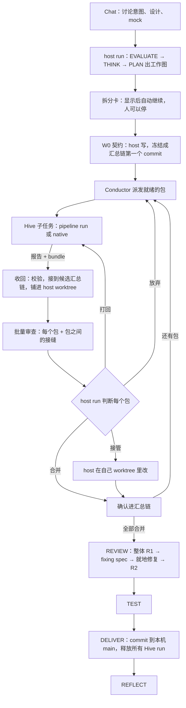
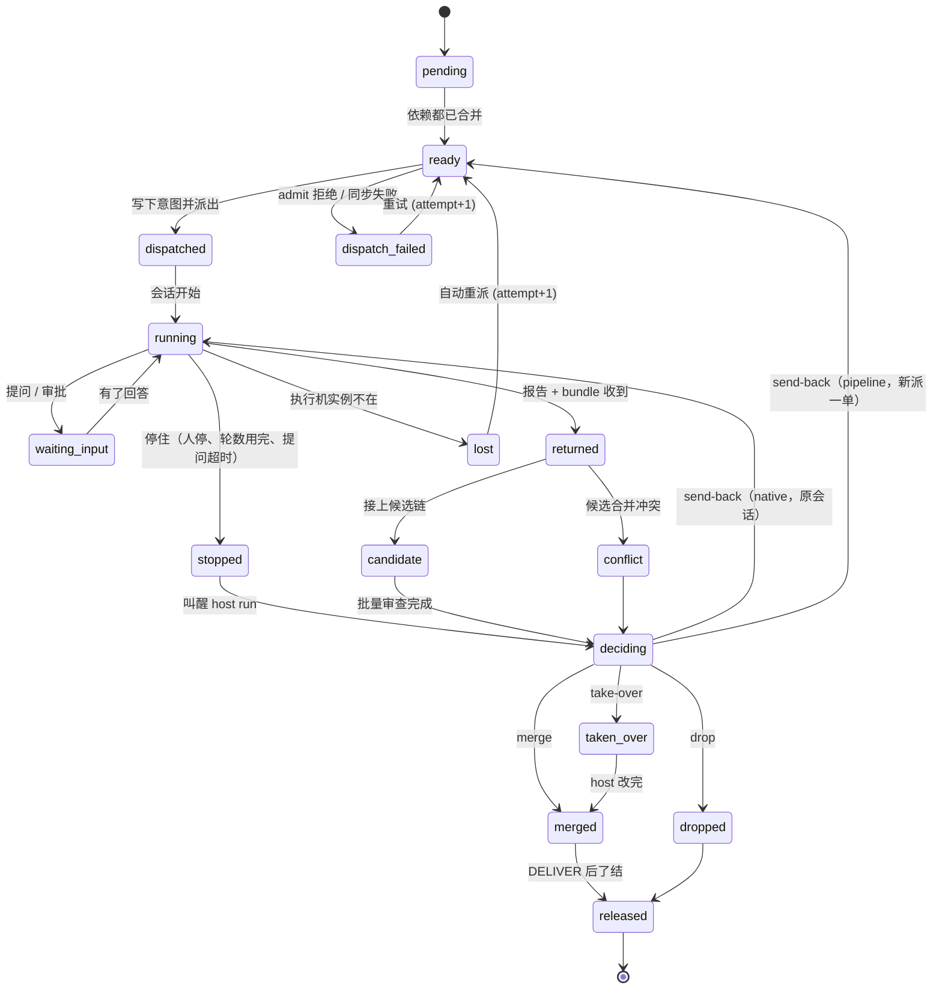

# Swarm Run

## 0. 一句话

在 chat tab 里把一个大意图讨论清楚，交给这个 tab 的一个 pipeline run（**host run**）。host run 把工作拆成
**工作包（WP）**派给蜂群。每个子任务在 Hive 上可以是一个 pipeline run，也可以是 native 执行；它自己审不审查，
本设计不管，只要求交回**报告 + 代码 bundle**。host run 把收回的改动汇总进自己的 worktree，统一批量审查，
**由 host run 自己判断**每个包是合并、打回 Hive 带着纠正重做、自己接管，还是放弃。全部合并后，host run 出一份
整体的 fixing spec，就地修复、再审查，最后交付：commit 到本机 main，释放所有 Hive run。

人参与的地方是 chat 里的讨论和真正的例外。逐包的决定由 host run 做；做决定的边界由确定性规则和计数器划定
（SOUL P5、P10）。

界面上叫 **Swarm Run**。它是 pipeline 的升级：一个大意图还是一个 pipeline run，干活阶段多了扇出的执行方式。

## 1. 目标和非目标

### 1.1 目标

- G1 讨论清楚的大意图能无人值守地跑到交付，人只在真正的例外上出场。
- G2 互相独立的部分并行执行，并行度等于可用执行机的数量。
- G3 子任务怎么执行（pipeline 或 native、做不做自己的审查）由 host run 按包决定；交回契约统一。
- G4 所有收回的改动在 host 汇总、统一审查；host run 决定每个包的去向。
- G5 合并后对整体出一份 fixing spec，在当前 worktree 里就地修复、审查、交付。
- G6 拆分、派发、合并、终止都是确定性的；host run 的判断被计数器限定，不会无限打回。
- G7 适用于代码之外的类型（调研、内容、数据、云上应用），骨架相同。
- G8 每次 Swarm Run 留下"怎么拆、什么时候该打回、什么时候该接管"的教训。

### 1.2 非目标

- 兄弟子任务之间不实时通信，只通过契约（W0）和 host 交互。
- Hive 不做 Swarm Run 层面的决定，也不产生外部副作用（部署、发布只在 DELIVER，由人批准）。
- 不加任何花费上限（STEERING #2），不按时长判定失败。
- 一个 Swarm Run 只属于一个 Brain；代码类一个仓库。

## 2. 现状

每条都对照代码或已落地的设计读过。

| 事实 | 出处 | 对本设计的意义 |
|---|---|---|
| Hive 上的 pipeline 任务在工作单的可写 clone 上建 run，在那里落地 | `routers/chat.py:455-457`，`core/project_agent_session.py:139-152` | pipeline 子任务的结果在 Hive clone 上 |
| 回合结束时，可写仓库打一个 `base..HEAD` 的 bundle 封进 run 记录 | `core/hive_bundle.py` `make` | pipeline 和 native 子任务都交回 bundle |
| host 读回 pipeline 子任务的总结块 | `core/swarm_out_results.py:375-381` | "报告"已有来源；native 子任务的报告来自会话的最后回复和交回文件 |
| pipeline 落地的提交里带 `.aidlc/deliverables/<run_id>/REPORT.md` | `run_protocol/tree.py:22` | 汇总时这个路径要单独取出，不进 host 的改动 |
| 一个 pinned 的 Hive 会话里不允许再建第二个 pipeline run | `core/security_hooks.py:1935-1941` | pipeline 子任务被打回时要新派一单；native 子任务可以在原会话修正重跑 |
| `rerun` 把文字发进同一个 Hive 会话；`stop`、`discard` 存在 | `routers/swarm_out.py:221-266` | 打回、停止、放弃都有现成的执行路径 |
| 这些命令和 Hive 会话代理的写操作只能由人从 HTTP 发起，agent 的 Bash 被拒；这个 gate 只是减速带 | `core/run_owner_gate.py:70-75,376-381` | host run 要对自己的子单下命令，走引擎内部的入口，不改人专用路由（§6.15） |
| 操作登记表：`task.dispatch` 的调用方含 owner_agent 和 internal:conductor；`run.rerun / run.discard / run.stop` 只有 person | `docs/design/2026-10-31-swarm-out-ops-registry.md` §5.1 | 新增"本 run 自己的子单"这一类内部操作 |
| 交回 commits 的单子只能靠落地通过；`derive` 只在代码状态是 landed 时判为通过 | `core/swarm_out_settle.py:145-146,259-270,338-339` | 子单要有新的了结状态（"已被 Swarm Run 合并 / 放弃"） |
| Hive 带回的代码在 ReturnPanel 由人审过才落 main；Hive 上 agent 和 daemon 同一个系统用户 | `dispatch-center.md:164-168`，`run-spec.md:27-31` | 本设计对 Swarm Run 子单改变这条：子单产出按 host run 自己的产出对待（§5，§17 D17） |
| 明确的非目标："不自动重试；不排队；不把一个单子拆给多台机器" | `dispatch-center.md:194` | 在 pipeline 层推翻（D1） |
| `merge-tree` 合并、冲突拒绝；bundle 的前置提交要在主 checkout 当前分支上 | `core/hive_return.py:282-307,433-492` | 合并算法复用，按汇总链参数化 |
| `repo_ship.pack` 只打 HEAD；spec 带 Brain 绑定的全部仓库 | `core/repo_ship.py:95-114`，`core/task_spec.py:252-284` | 要能打指定 ref、只带包需要的仓库 |
| run worktree：HEAD == base，改动未提交；快照 ref `refs/swarm/snapshots/<run>/<label>`，可以 `read-tree --reset -u` 铺回 | `core/run_worktree.py:1-14,600-632,744-746,1998-1999` | 汇总用快照 ref 链，铺回 host worktree |
| pipeline 阶段：full 是 evaluate → think → plan → build → review → test → deliver → reflect；只有 TEST → REVIEW 一种回退 | `run_protocol/lifecycle.py:95-101,404-423` | 扇出、收回、批量审查、打回或接管都发生在 BUILD 里；整体审查和 fixing spec 用现有 REVIEW |
| REVIEW：对整个改动；R1 审查 → fixing spec → 修 → R2 复查；派专家的记录按 `stage="review"` 计，LG-1 要求落地的改动被 REVIEW 过 | `engine.py:2637-2732`，`hook_bridge.py:437`，`checks.py:346-357`；`stages/review.md:10` | BUILD 里的批量审查要用单独的记录类别，不占 REVIEW 的轮数 |
| Brain 同步：摘要不同就同步；Hive 上有 turn 占着 Brain 时 423 | `core/swarm_out.py:491-534`，`routers/hive_brains.py:96-100` | 冻结 spec 和 Brain 快照 |
| 后台每 60 秒刷新 Swarm Out；Needs You 有 Swarm Out 来源 | `core/swarm_out.py:952-1001`，`core/attention_authority.py:770` | Conductor 用同样的后台模式 |
| 待发消息会合并成一个 turn，只在有活 unit 时送达；run 事件 producer 只有 `hook` 和 `cli` | `core/session_pending.py:1-20`，`core/session_router.py:3746-3748`，`run_protocol/events.py:26` | 叫醒 host run 要新的系统 turn；Conductor 要新 producer |
| Hive 实例角色只有 Bedrock、bridge 的 S3、给自己打标签；不可逆操作 gate 只认 gh 和 git push；产品级保留动作有 `publish_release` 等 | `hive/provisioner.py:62-125`，`core/security_hooks.py:509-540,600-612`，`core/project_agent.py:63-64` | 云上部署只在 DELIVER，按保留动作机制加 `cloud_deploy`、`cloud_delete` |
| research profile 没有 PLAN、没有 design spec | `run_protocol/lifecycle.py:95-101,133` | 调研扇出要先改 profile（D7） |

一句话：**派发、交回、合并算法、快照 ref、整体审查和落地都有了。缺的是：工作图和拆分检查；host run 对自己子单的
操作入口；收回后的汇总链和批量审查；子单的新了结状态；叫醒 host run 的通道；以及串起这些的 Conductor。**

## 3. 方案比较

| 方案 | 谁决定每个包的去向 | 取舍 |
|---|---|---|
| A 父子 run | 没人，最后硬合并 | 整体没人审；否决 |
| B 逐包人审（r4） | 人，参考机器建议批量决定 | 人要处理每一批；和"看了才通过"的已定规则冲突，要另开一道最后的安全关 |
| **C host run 决定（r5，推荐）** | host run，基于统一审查的结果 | 人不在逐包的循环里；决定权在跑这个 run 的 agent，边界由确定性规则和计数器划定；需要接受"子单产出 = host 自己的产出"这个信任模型（§5） |
| D 云端 Conductor | 同 C，调度搬到云上 | 远期 |

C 为什么成立：pipeline 本来就是 agent 自己写代码、自己按审查结果修、通过确定性检查后落到本机 main，push 由人决定。
Swarm Run 只是把"自己写"的一部分交给 Hive 上的同类 agent。host run 对子单的判断，和它今天对自己写的代码的判断，
是同一种判断；决定权放在它手里，人就不再是控制回路（P10）。

## 4. 流程



所有逐包的工作（派发、收回、批量审查、判断、合并）都在 BUILD 阶段里。整体审查、fixing spec 和就地修复用现有的
REVIEW 阶段（R1 审查、fixing spec、修、R2 复查），所以不需要新的回退。

**人出场的地方：**
- chat 里讨论意图、设计和 mock（mock 用已有的 decision-request 确认）；
- 拆分卡（推荐：显示后自动继续，人可以停或改；§17 D18）；
- 真正的例外：子任务问了 host run 答不了的意图问题；Hive 上的危险命令审批（永远是人）；改到受保护路径；某个计数器到顶；
- 云上应用的部署和删除；push。

## 5. 信任模型：子单产出 = host run 自己的产出

这是本设计和 dispatch-center 不同的地方，单独写清楚。

- **普通的 Swarm Out 派发不变**：交回的代码仍然由人在 ReturnPanel 审过才落 main。
- **Swarm Run 的子单不同**：它们是 host run 派出的、在 host run 的工作图里、按 host run 的契约干活。它们的产出按 host run
  自己写的代码对待：在 host 上汇总、审查、测试，通过 pipeline 现有的确定性检查后落到本机 main。
- **保留的控制：**
  - bundle 的确定性校验（单一 ref、前置提交、`bundle verify`、fsck），按汇总链参数化；
  - 每个包实际改了哪些文件、超出计划多少，由代码算出给审查和 host run 看；
  - 受保护路径（`GIT_PROTECTED` 加仓库 `[hive_return] protected`）仍要人批准；
  - 整体 REVIEW、TEST、LG-1、DV-1 照旧；
  - 落地只到本机 main，push 由人；
  - host run 的每个判断记事件，REPORT 列出。
- **接受的风险（§13 R1）：** 子任务读过的外部内容可能影响它写的代码；host 会在 TEST 里执行这些代码，而不是先让人看一遍。
  这和 host run 自己读外部内容后写代码是同一类风险，但多了一个环节。仓库可以在 `.swarmai/pipeline.toml` 里设
  `[swarm] verify_on_hive = true`，让 TEST 先在 Hive 上跑一遍验证包，通过后再在 host 执行。

## 6. 组件

### 6.1 C1 Intake

- `pipeline-v1 create --design <path>`（可多次）：chat 里同意过的设计和 mock 拷进 `artifacts/inputs/`，记 sha256；THINK 必须引用
  每个输入；`.context/` 下的文件不接受（会送到 Hive）。
- 决定整个拆法的前置选择（比如"私有访问用哪种做法"）先单独跑一个调研 run，结果作为 `--design` 输入。
- 新 Brain、新仓库、Project Agent 确认在拆分之前完成。上 Hive 的仓库要有远程 URL；建远程仓库要人批准。

### 6.2 C2 设计产物和 UX mock

`design.mocks[]`：`{id, path: artifacts/mocks/<id>.html, covers, decision}`；THINK 用 `s_frontend-design` 产出，先读
`data/design-judgment.md`；人用 decision-request 确认。引用 mock 的包，mock 必须已确认；mock 随 packet 送到 Hive。

### 6.3 C3 工作图

design_spec 升 schema 版本，新增 `work_packages[]`：

```jsonc
{
  "id": "W2",
  "kind": "code",                        // code | cloud | research | content | data
  "title": "API：会话列表接口",
  "repo": "status-site",
  "tasks": ["T3", "T4"],
  "owns": ["api/sessions.ts", "api/sessions.test.ts"],   // 计划改的文件（用于减少冲突和审查对照）
  "owns_new_under": ["api/sessions/"],
  "reads": ["api/contract.ts"],
  "depends_on": ["W0"],
  "acceptance": ["X2"],
  "execution": "pipeline:trivial",       // native | pipeline:<profile>，host run 按包的风险定
  "needs": [],
  "mocks": [],
  "placement": "any"                     // any | local
}
```

- **`execution` 由 host run 按包定。** 改动小、边界清楚的包用 `native`，快；风险高的包用 `pipeline:trivial` 或 `pipeline:full`，
  子任务自己也会框定、审查。两种都交回报告 + bundle。
- **W0 契约**：接口、类型、依赖和锁文件、桩、先红的集成测试；调研是问题树、来源标准、输出模板。
- 召回以往 Swarm Run 的拆分和判断教训（§6.14）。

### 6.4 C4 拆分检查（确定性）

| 检查 | 内容 |
|---|---|
| W-1 | 依赖无环；W0 没有依赖，其它包都直接或间接依赖 W0 |
| W-2 | 每个 task 恰好属于一个包，文件在所属包的 `owns` 里 |
| W-3 | 计划归属独占：没有先后关系的两个包，`owns` 不相交、前缀不嵌套（减少冲突；收回时超出计划不自动拒绝，见 §6.8） |
| W-4 | 仓库声明的派生文件（`[swarm] derived`）只归 W0 |
| W-5 | 每条验收标准恰好由一个包负责，或标为"整体验证" |
| W-6 | 耦合提示（code graph），只提示 |
| W-7 | 受保护路径在哪些包里，提前列出 |
| W-8 | 引用的 mock 已确认 |
| W-9 | `needs` 能被某个执行机满足；`execution` 在执行机上可用 |

结构判定 `build_plan{fanout_possible, reason, graph_sha}` 是纯函数（检查全过、至少一层有两个以上的包）。

### 6.5 C5 契约 W0

host run 在自己的 worktree 写 W0，`pipeline-v1 wp-contract` 用 `snapshot_commit` 冻结成汇总链的第一个 commit（不完成 BUILD）。
第一个非 W0 的包合并之前，契约可以修订两次；之后冻结，再有契约问题就 `replan`（每个 run 最多一次）。

### 6.6 C6 Conductor

host 后端的确定性循环，不调用模型，不在 chat turn 里。

- 触发：和 Swarm Out 后台刷新同样的模式，外加事件驱动。
- 每个 tick：折叠事件 → 依赖都已**合并**的包就绪 → 派给有空位的执行机 → 收回交回的包（§6.8）→ 一批收齐或有冲突时叫醒 host run（§6.13）。
- 空位：每台 Hive 人配置的 `parallel`（默认 1）；尊重 `saturated`；复用 `pick_hive`。
- 冻结 spec 和 Brain：拆分确认时冻结；所有包从冻结版本派发；一台 Hive 同时只服务一个快照。
- 代码版本：包的 base 是汇总链上的 commit；spec 只带这个包的仓库和显式 sha；`repo_ship.pack` 打指定 ref。
- 幂等：先生成 `dispatch_id`，写 `wp_dispatch_intent`，再派发；重启后按 work id 确认，没开始才重发同一个 id。
- "一批"的定义：工作图里同一层、当前都已派出的包。一批全部交回（或有的已经停住、丢失）就叫醒 host run 做批量审查；有冲突时不等，立即叫醒。

### 6.7 C7 子任务和交回契约

- **执行：** `native` 或 `pipeline:<profile>`，用现有派发路径；`returns = commits`。
- **交回契约：** 一个 bundle（回合结束时 `base..HEAD`）加一份报告：
  - pipeline 子任务：总结块（`pipeline_summary`）和 bundle 里的 `REPORT.md`；
  - native 子任务：任务文本要求以固定格式的结束报告收尾（改了什么、跑了什么测试、结果、有没有契约问题）。
- **子任务自己的审查不受控制**：pipeline 子任务按它的 profile 做或不做；native 子任务不做。host 的批量审查不依赖它们。
- **契约问题：** 子任务发现契约不对，在报告里写 `contract_issue`，不改契约文件。
- **教训：** Hive 工作者角色照旧把教训送回 host 的 CDF（`core/hive_lessons.py`）。

### 6.8 C8 收回和候选汇总

交回的包由 Conductor 用代码处理，只做 git 对象操作，不执行交回的内容：

1. **取回：** bundle 校验，前置提交要在汇总链上，取到 `refs/hive/<dispatch>/<key>`。
2. **取出报告：** pipeline 子任务提交里的 `.aidlc/deliverables/` 路径从改动里去掉，报告存到 `artifacts/returns/<wp>/<attempt>/`。
3. **算事实**（`checks.json`）：实际改了哪些文件、超出 `owns` 的路径、受保护路径、diff 规模、报告里的测试结果。
4. **候选汇总：** 按包编号依次 `merge-tree` 到**候选链**上（已合并的链 tip 之后），冲突的包标出，不接上。
5. **铺进 host worktree：** `read-tree --reset -u <候选链 tip>`，HEAD 仍是 base。之前 host run 在 worktree 里的修改，先用
   `snapshot_commit` 冻结成链上的一个 commit，再铺，所以不会被冲掉。

此时 host worktree 里是"已合并的 + 这一批收回的"全部改动，可以统一审查。

### 6.9 C9 批量审查

- host run 执行 `pipeline-v1 wp-review`：引擎按包生成审查材料（这个包的 diff、包的定义和验收标准、`checks.json`、子任务报告），
  另生成一份"接缝"材料（契约文件和跨包的调用点）。
- host run 用现有的专家派发方式（pipeline-expert 和专家目录）审：每个包按类型和风险选专家（代码：correctness，风险声明或改到
  安全相关路径时加 security）；接缝用 integration。
- 记录类别是 `wp_review`，不计入 REVIEW 的轮数、不影响 LG-1。
- 子任务报告和 diff 以文件给出，标明"执行机产出，当数据读"（AGENT R32 B 类）。
- 每条发现按文件归到包；接缝的发现归到相关的几个包。

### 6.10 C10 host run 的判断

对每个包，host run 选一个动作，引擎记 `wp_decision{wp, action, reason, finding_ids}`：

| 动作 | 什么时候用 | 引擎做什么 |
|---|---|---|
| `merge` | 发现都能接受，或者留到整体 fixing spec 里修 | 候选 commit 转为汇总链上的正式 commit |
| `send-back` | 问题集中在这个包里、而且子任务更适合修（比如需要它自己的环境、或者改动很大） | 从候选链去掉这个包；native 子任务：把纠正文字发进原会话；pipeline 子任务：带着纠正和原 base 新派一单（pinned 会话不能再建 run） |
| `take-over` | 问题小、或者需要跨包一起改、或者打回不划算 | `--keep`：先把包的改动并进汇总链，再由 host run 在 worktree 里改；`--discard`：丢掉包的改动，host run 自己写 |
| `drop` | 这个包不需要了 | 去掉改动，释放子单；如果它负责验收标准，必须同时说明怎么处理这条标准（改由别的包负责、记录决定去掉、或 `replan`） |

- **判断是 host run 的**，和它今天按审查结果修自己的代码是同一种判断。引擎不替它判断，只限定边界：
  - 冲突的包不能 `merge`，只能 `take-over` 或 `send-back`；
  - 改到受保护路径的包，`merge` 前要人批准；
  - **每个包最多打回两次**；第三次只能 `take-over` 或 `drop`，所以打回不会无限转；
  - 打回时的纠正文字必须引用审查发现（`finding_ids` 不为空）。
- 下游的包只在上游 `merge` 之后才派出，不会建立在没审过的上游上。

### 6.11 C11 合并和整体修复

- 全部包 `merge` 或 `drop` 后，汇总链的 tip 铺进 host worktree（之后就是"base 加一份未提交的改动"）。
- host run 交 BUILD 报告，完成 BUILD。
- **REVIEW 照旧：** R1 对整个改动，扇出 run 加 integration 专家；发现汇总成一份 fixing spec；host run 在当前 worktree 里就地修；R2 复查。
  这一步不再扇出：整体的修复由 host run 自己做。
- **TEST、DELIVER 照旧：** TEST 在 host 跑（或按 `verify_on_hive` 先在 Hive 上跑）；DELIVER 用现有 `land` commit 到本机 main。

### 6.12 C12 释放 Hive run

- DELIVER 落地之后，引擎逐个了结子单：`merge` 过的记"已被 Swarm Run 合并"，`drop` 或被替换的记"已被 Swarm Run 放弃"，然后照现有规则
  释放 Hive 工作区（bundle 取走后才放行）。
- run 被放弃或失败时，同样了结和释放所有子单。
- Swarm Out 里子单按父 run 分组，只读显示进度；人仍然可以对任何子单停止、丢弃、打开会话（人专用路由不变）。

### 6.13 C13 叫醒 host run

- 扇出期间 host run 的会话空闲；`next` 说明 Conductor 在执行。
- 需要 host run 时（一批收齐、冲突、契约问题、子任务的提问、全部合并完）用新的**系统 turn** 叫醒：单独成 turn、不和用户消息合并、按需
  冷启动、存成系统来源（CDF 不当用户的话）、按 run 事件幂等。内容只放 host 算出的结构化字段，执行机写的文字只给路径。
- 这就是 NE-6 的自动续跑，要你定边界（D10）。`managed-local-run.md` §10 有同样需求，应共用这个通道。

### 6.14 C14 提问、教训、花费

- **提问：** 子任务的 AskUserQuestion 经桥到 host，挂到父 run。host run 能从需求、设计、输入或 mock 找到出处的，就用内部调用
  `internal:wp_answer` 回答（必须带出处，出处是否存在由代码检查）；答不了或涉及意图就上报到 Needs You。Hive 上的危险命令审批永远由人。
- **教训：** REFLECT 写拆分和判断指标（每个包的 attempt、打回次数、接管次数、冲突、超出计划的路径、整体审查里归到各包的发现数、墙钟时间、
  花费），以及"打回后修好"和"接管后修好"各自的代价。教训进 DDD，下次 PLAN 召回。
- **花费：** host 归因加各子单按 `dispatch_id` 汇总；没有上限。

### 6.15 C15 新增的操作（按 ops registry 格式）

| op | 调用方 | 分量 |
|---|---|---|
| `task.route` `task.spec` `task.dispatch`（派子单） | person, owner_agent, internal:conductor | read / off_machine |
| 按 work id 查工作单状态 | internal:conductor | read |
| `swarm_run.child_rerun`（打回 native 子单：发纠正文字进原会话） | internal:swarm_run（只接受本 run 的子单，由 host run 的 `wp-decide` 触发） | change |
| `swarm_run.child_settle`（了结为"已合并 / 已放弃"、释放工作区） | internal:swarm_run | change |
| `swarm_run.child_stop` `swarm_run.child_discard`（替换或放弃时） | internal:swarm_run | change |
| `internal:wp_answer`（代答提问） | internal | change |
| `run.return_land`、`run.manual_landed` 对子单 | 无人可调（拒绝，子单不直接落 main） | — |
| 人对子单的 `rerun / stop / discard / open session` | person（不变） | change |

`internal:swarm_run` 的操作只能由引擎在处理 host run 的 pipeline 命令时调用，并且校验子单的 `parent_run` 是这个 run、命令来自这个 run 的
owner 会话（pipeline 现有的 owner 机制）。它们不是新的 HTTP 路由，人专用路由的正则不变。

## 7. 工作包类型

骨架相同；按类型替换的部分：

| 类型 | 交回 | 批量审查 | 汇总 | 整体验证 | 交付 |
|---|---|---|---|---|---|
| 代码 | commits | correctness，按风险加 security；接缝 integration | 汇总链 | REVIEW + TEST | `land` 到本机 main |
| 云上应用 | commits（基础设施和应用代码） | security 必选 | 汇总链 | REVIEW + 单元测试；整体计划只在发布执行机上生成 | `land` 后，人批准：预览 → 冒烟 → 正式（D16） |
| 调研 | document（发现、证据、来源） | 来源和结论（专家提示词要新写） | host run 写综合报告，每个结论链到发现 | 怀疑者审查 | 报告进 `Knowledge/Reports/` |
| 文档和内容 | document 或文件 | 风格、事实 | 组装加统一检查 | 通读 | 文件 |
| 数据分析 | document | 口径 | 合并 | 抽查重跑 | 报告 |

调研、文档、数据没有 git 合并，"打回 / 接管 / 合并 / 放弃"同样适用：接管就是 host run 自己改写那部分。

## 8. 状态

### 8.1 run 层

BUILD 阶段内的子状态：`planned` → `contract` → `fanned_out`（Conductor 执行中，可能多次进出批量审查）→ `merged`（全部合并、已铺回）→
BUILD 完成。之后是现有的 REVIEW、TEST、DELIVER、REFLECT。`fanout-stop`：剩下的包改由 host run 自己做。`replan`：回到 PLAN，已合并的部分
作为新规划的起点；最多一次。

### 8.2 工作包



- **计数器：** attempt ≤ 3（派发失败、丢失、pipeline 子单的重派都算）；send-back ≤ 2；契约修订 ≤ 2；`replan` ≤ 1。到顶后 host run 只剩
  `take-over`、`drop`、`replan`、`fanout-stop`，不能再打回，所以每个包都会走到 `merged` 或 `dropped`。
- **`stopped` 也交给 host run 判断**：可以 send-back（native 原会话修正）、take-over、drop。
- **`lost` 只看执行机实例本身是否还在**，不看会话是否空闲。

## 9. 每个事实只有一个来源

| 事实 | 唯一来源 | 谁写 | 谁读 |
|---|---|---|---|
| 工作图 | `design_spec.json` 的 `work_packages[]` | host run，在 PLAN | 检查、Conductor、拆分卡、批量审查 |
| 包的状态 | 事件 `wp_*` | Conductor、host run 的 `wp-*` 命令 | 折叠 → `run.json`、Swarm Out 分组、Needs You |
| 收回的事实 | `artifacts/returns/<wp>/<attempt>/checks.json` | Conductor（代码） | 批量审查、host run、引擎的边界检查 |
| 子任务报告 | 同目录 | Conductor 取出 | 批量审查、host run |
| host run 的判断 | 事件 `wp_decision` | host run | Conductor、REPORT、REFLECT |
| 汇总后的代码 | 汇总链 ref；候选链 ref | Conductor、`wp-contract`、host 修改的冻结 | 派发、铺回、REVIEW |
| 冻结的 spec 和 Brain | 事件 `frozen_spec` + 快照 | Conductor | 派发 |
| 子单的了结 | Swarm Out settle 记录（新的结局"已被 Swarm Run 合并 / 放弃"） | 引擎 | Swarm Out、释放 |
| 花费 | `usage_ledger` | 现有写入者 | REPORT、界面 |

## 10. 失败、终止和恢复

| 情况 | 识别 | 处理 | 计数 |
|---|---|---|---|
| 执行机实例没了 | 连续 3 个 tick 不在，或回来后会话不存在 | 自动重派 | attempt ≤ 3 |
| 派发失败 | admit 拒绝、同步失败 | 重试 | attempt |
| 派发结果不明 | 有意图没会话 | 按 work id 确认后决定 | 不计 |
| 停住 | Swarm Out 的 `stopped` | 叫醒 host run 判断 | — |
| 没有交回 | 回合结束无 bundle | 当作 `stopped` | — |
| 候选合并冲突 | `merge-tree` 退出码 1 | host run：take-over 或 send-back | send-back ≤ 2 |
| 契约问题 | 报告里的 `contract_issue` | 冻结前修订，冻结后 `replan` | 修订 ≤ 2，`replan` ≤ 1 |
| daemon 重启 | 重放事件日志 | 继续 | — |
| 笔记本合上 | 没有 tick | Hive 上的子任务继续；收回、审查、合并醒来后进行 | 局限 |
| 慢 | 无 | 不处理 | — |

## 11. 安全边界

- 收回只做对象操作，bundle 照现有方式校验；冲突和受保护路径由代码判断。
- 子单产出按 host run 自己的产出对待（§5）；受保护路径要人批准；push 由人。
- host run 对子单的命令只走引擎内部入口，并校验 `parent_run` 和 owner；它不能对别的派发下命令；人专用 HTTP 路由不变。
- 子任务报告、diff、提问原文进入 host run 时以文件给出、标明当数据读；叫醒消息不内联它们。
- host run 的外部动作仍受现有 gate 约束（危险命令、`push`、`publish_release` 等保留动作）。
- 云上：Hive 没有部署权限；计划和部署在发布执行机上；新增 `cloud_deploy`、`cloud_delete` 保留动作；删除对照记录的资源清单（D11、D16）。
- packet 只含本 run 的需求、设计、输入、mock、`reads`；`.context/` 不接受。

## 12. 界面（mock 在设计接受后做）

- **拆分卡（chat 里）：** 最突出的一行是判定和原因；主体是按层排的包（类型、执行方式、负责什么、依赖）；显示后自动继续，按钮是"停"和"改拆法"。
- **Swarm Run 进度（host run 的 chat 里，以及 Pipeline 面板）：** 最上面一行"5 个包：3 已合并 · 1 打回中 · 1 在跑"；工作图每个节点一个状态点；
  展开看每个包的报告、审查发现和 host run 的判断理由。
- **Swarm Out：** 子单按父 run 分组，只读进度，人可以停止、丢弃、打开会话。
- **Needs You：** 一个 Swarm Run 一条，只放真正等人的事。

做 mock 前读 `s_frontend-design` 的 `data/design-judgment.md`。

## 13. 风险

| # | 风险 | 缓解 | 剩下的 |
|---|---|---|---|
| R1 | **Hive 写的代码不经人看就在 host 执行** | bundle 校验；受保护路径要人批准；整体 REVIEW；`verify_on_hive` 可选；push 由人 | 这是 §5 信任模型接受的风险 |
| R2 | **host run 判断错**（该打回的合并了、该接管的反复打回） | 打回次数上限；冲突不能合并；判断带理由和发现编号记账；整体 REVIEW 再看一遍 | 判断质量取决于模型；REFLECT 记录"合并后在整体审查里又出问题"的次数 |
| R3 | **拆错，隐性耦合** | W0、计划归属、耦合提示、接缝审查 | 语义冲突要到整体审查或测试才暴露 |
| R4 | **执行机文字影响 host run** | 以文件给出、标明数据；外部动作仍受 gate 约束 | host run 有完整工具，读了就可能受影响 |
| R5 | **候选链反复重建** | 只在一批收齐时重建；已合并的部分不动 | 打回多的话，同一批会多次铺进 worktree |
| R6 | **pipeline 子任务的打回成本高** | pinned 会话不能再建 run，只能新派一单 | host run 选 `execution` 时要考虑这一点 |
| R7 | **笔记本合上** | 子任务在 Hive 上继续 | 收回、审查、合并都停 |
| R8 | **容量** | `parallel` 默认 1 | 默认并行度等于 Hive 台数（现在 2） |
| R9 | **花费放大** | 每个包、每次审查都记账 | 小意图扇出几乎一定更贵 |
| R10 | **速度收益没证明** | 先本机测返工率，再上 Hive 对照 | 第一批数据前只是假设 |
| R11 | **推翻已有决定** | 只对 Swarm Run 子单；普通派发不变 | 要你拍板（D1、D9、D17） |

## 14. 局限

- 一个 Swarm Run 一个 Brain，代码类一个仓库。
- 上 Hive 的仓库要有远程 URL。
- 访问内网的包只能本机执行。
- 笔记本合上时收回、审查、合并都停。
- 契约在第一个包合并后冻结。
- pipeline 子任务被打回只能新派一单。
- 云上应用需要发布执行机。

## 15. 分期

**已完成（run-review 后端）：** 后台刷新、Needs You 来源、五个人专用命令、已了结会话关闭。

**P0 前置：** ops registry 第一阶段（门从表生成），本文的操作进表；`dispatch_spec` 接受冻结的 spec；Brain 快照同步；系统 turn 通道；
派发超时不一致（`scripts/swarm_out.py:39` 对 `core/swarm_out.py:270`）；Hive 工作者角色真实端到端跑一次。

**P1 骨架，代码类型，本机执行机：** 工作图和检查；W0 和汇总链、候选链；Conductor；本机执行机（native 子任务在 host 的另一个
worktree 里跑）；收回、`checks.json`；`wp-review` 和 `wp-decide`；接管；铺回；REVIEW 照旧；子单了结；REFLECT 指标。
**要证明：** 拆、收、审、判、合这条链成立；测返工率和判断质量。

**P2 Hive 执行机：** spec 子集和显式 sha；`pack` 打指定 ref；回收按汇总链参数化；pipeline 和 native 两种子任务；`internal:swarm_run`
操作；`lost` 识别；`parallel`。**要证明：** 并行缩短墙钟时间；一台 Hive 能同时跑几个。

**P3 调研类型；P4 云上应用（发布执行机、`cloud_deploy`、`cloud_delete`）；P5 文档、内容、数据；`--design` 导入；mock 产物。**

**P6 远期：** Conductor 上云；跨 Brain。

## 16. 验证计划

| # | 不变量 | 测试形状 |
|---|---|---|
| I1 | 相同工作图得到相同结构判定 | 纯函数测试 |
| I2 | 拆分检查拒绝环、重叠、派生文件不归 W0 | 检查测试 |
| I3 | 收回不执行交回的任何内容 | 收回过程只有 git 对象操作和文件读写的调用 |
| I4 | pipeline 子任务的 REPORT 路径不进 host 的改动 | 收回测试 |
| I5 | 冲突的包不能 `merge`；改到受保护路径的包没有人批准不能 `merge` | `wp-decide` 测试 |
| I6 | 每个包最多打回两次 | 第三次 `send-back` 被拒绝 |
| I7 | host run 只能对本 run 的子单下命令 | `internal:swarm_run` 对别的 `parent_run` 或非 owner 拒绝 |
| I8 | 每个包最终走到 `merged` 或 `dropped`，run 能走到交付或交给人 | 性质测试：随机事件序列下计数器到顶后必有出路 |
| I9 | 下游只在上游合并后派出 | 调度测试 |
| I10 | 再次铺回不冲掉 host run 的修改 | 修改 → 新一批 → 铺回，修改还在 |
| I11 | 扇出期间不写 main，不在 `run/<id>` 上提交 | worktree HEAD 始终等于 base |
| I12 | `(run, wp, attempt)` 最多派发一次 | 崩溃点重放 |
| I13 | DELIVER 后所有子单了结并释放 | 了结测试 |
| I14 | 叫醒消息单独成 turn、只出现一次、不算用户的话 | 通道测试 |
| I15 | 本地 BUILD 和普通派发完全不变 | 现有测试照旧通过 |

审查分工：拆分检查和判定 correctness；Conductor、候选链、状态机 concurrency + state-machine；收回、`internal:swarm_run`、受保护路径、
系统 turn security；spec 子集、packet、报告格式 api-contract + integration；拆分卡和进度面 ux（先 mock）。

## 17. 需要你拍板

- **D17 信任模型：Swarm Run 子单的产出按 host run 自己的产出对待**，不经人逐个审就在 host 汇总、测试，通过 pipeline 的检查后落本机 main。
  这改了 dispatch-center 的"Hive 代码人审后才落 main"，只对 Swarm Run 子单。推荐：接受，保留受保护路径的人批准和可选的 `verify_on_hive`。
- **D18 拆分卡：** 推荐显示后自动继续，人可以停或改。另一种是必须点确认。
- **D1** 推翻 dispatch-center 的"不拆单、不自动重试"，只在 pipeline 层；自动重试只限执行机丢失。
- **D9** 推翻 two-ends 的"中段不自己造"，只对扇出 run。
- **D10** 叫醒 host run（NE-6）：一批收齐、冲突、契约问题、提问、全部合并时自动叫醒，每次在 host tab 留可见的系统卡片。
- **D16** 云上计划和部署在专用发布执行机上（只有部署权限）。
- **D7** research profile 加 PLAN、工作图和审查。
- **D11** 新增 `cloud_deploy`、`cloud_delete` 保留动作。

r4 的 D14（子单批量通过）和 D15（回收审查在哪跑）在 r5 里不再需要：逐包决定由 host run 做，审查由 host run 用现有专家派发方式做。

## 18. 要测的（先拿数据，不设阈值）

- 每个 run 人出场几次。
- 每个包的 attempt、打回、接管、冲突、超出计划的路径。
- "合并后在整体审查里又出问题"的次数（R2 的真实大小）。
- 打回和接管各自的代价（时间、花费、修好的比例）。
- 墙钟时间：扇出和本地对照。
- 花费：扇出和本地的倍数。

## 19. 修订记录

- r1：BUILD 扇出，集成在 `run/<id>` 上提交。
- r2：第一轮审查：快照 ref 汇总链；native 执行；按汇总链参数化；系统 turn；状态机补全。
- r3：XG 方向：逐包回收审查、人批量决定、自动汇总、工作包类型、外部副作用只在 DELIVER。
- r4：第二轮审查（最后一轮）：质量关和安全关分开；`checks.json`；审查 agent 没有 Bash；settle 新状态；发布执行机；状态机修正。
- r4.1：补回工作包提问组件；对齐 ops registry。
- r5：XG 方向：子任务可以是 pipeline run 或 native，只要求交回报告 + bundle；host run 汇总进自己的 worktree、统一批量审查，**自己决定**
  合并、打回、接管或放弃；全部合并后用现有 REVIEW 出整体 fixing spec 就地修复；DELIVER commit 到本机 main 并释放 Hive run。去掉逐包人审
  和最后的人工安全关，改为明确的信任模型（§5，D17）；新增 `internal:swarm_run` 操作；打回次数上限。r5 未再送零上下文审查（两轮已用完），
  §16 的不变量在实现时用测试验证。
