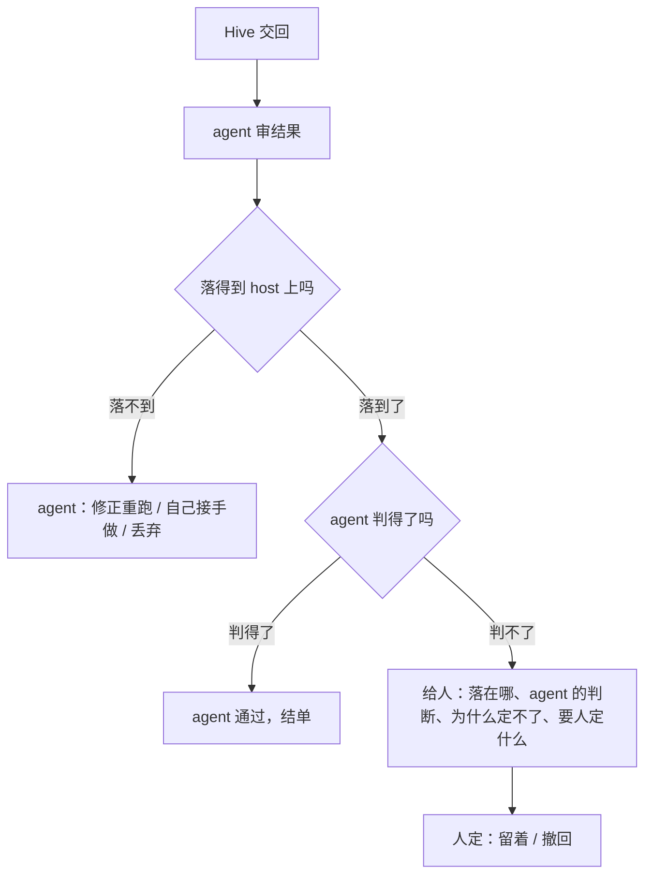

# Hive run 的决定：一个漏斗

## 0. 原则

**XG 2026-11-02：** "我要的是个漏斗决策。agent 先判；如果是代码的 Hive run，你得 review 它的结论，确保 land 到 main、合到 main 没问题；如果都没法 land 到
main，就应该丢弃或者重 run。不在 main 上的都不要给到 human 来判。落到 main 后判不了的，把 agent 的判断还有原因给人，人来判。不要只盯 coding run，
non-coding run 一样的道理：落不到 host 上的一律不要给到人。"

一句话：**人只看已经落到 host 上、agent 又判不了的东西，并且看到的是 agent 的判断和原因。**

## 1. 漏斗

| 关 | 代码 run（交回 commits） | 非代码 run（交回答案、文档、文件） |
|---|---|---|
| ① agent 审 | `return-prepare` 把提交取回本机 `refs/hive/...`，看改动；`read` 读报告和回复 | `read` 读回复和报告；交回的文件已经在 Brain 的 `deliverables/hive/`（自动放，已有） |
| ② 落到 host | `return-land` 合进本机 main | 文件已放进 Brain、答案由 agent 拿来用；agent 判断内容可用 |
| 落不到 | 合不进（冲突、改动不对、测试不过、碰到产品底线）→ 修正重跑，或自己接手做，然后丢弃这一单 | 内容不对、文件放不进 → 修正重跑或丢弃 |
| ③ agent 判 | 落地以后判断整件事是否达成验收 | 同左 |
| 判不了 → 人 | 给人看已经在 main 上的 commit | 给人看已经在 Brain 里的文件或答案 |

**不在 host 上的都不给人：** 没合进 main 的提交、没放进 Brain 的文件、还没交回的结果、合不进的冲突，统统是派单 agent 的事。它的出路只有三条：修正重跑、
自己接手做、丢弃。重发的次数照旧有上限（`MAX_AGENT_RERUNS = 2`），用完了就接手做或丢弃，不交给人。

**人判什么：** 东西已经落地了，人只回答"留着还是撤回"，以及 agent 写明的那个具体问题。撤回由 agent 执行（本机 `git revert` 那个 commit，或把文件移出 Brain），
同样记一条决定。push 照旧由人决定（STEERING #5），不在这个漏斗里。

## 2. 现状和要改的（对照 2026-11-02 的 main）

| 现状 | 出处 | 改成 |
|---|---|---|
| agent 落地时，只要提交碰到仓库的受保护路径就整单拒绝，只能让 Hive 重做或自己写；人可以批。E2E 里因此只能在本机 cherry-pick，单子卡在"等你"，要人点"已手动落地" | `core/hive_return.py:472-499`（路由对 agent 传 `approve_protected=False`）；DailyActivity 2026-11-02 10:22 | agent 审过就能落受保护路径，理由进决策记录。不再需要 cherry-pick 和 `manual_landed`（`manual_landed` 照旧只给人） |
| 会在本机执行代码的路径（`GIT_PROTECTED`：git 钩子、属性、子模块、pre-commit）agent 不能落 | `core/hive_return.py:313-316,490-493` | 不变，这是唯一保留的产品底线；碰到它就是"落不到"，agent 让 Hive 去掉这部分重做，或自己写 |
| Needs You 把所有 `awaiting`、`stopped` 的单子算成"N 个单子等你通过或决定"，"三天内会被清掉、提交落不了"的也给人 | `core/attention_authority.py:813-841` | 有派单 agent 的单子，这些都是"还没落到 host"，不进 Needs You，由 Conductor 叫醒派单会话处理（Swarm Run r7.11 §5.5）。没有派单会话记录的旧单照旧 |
| agent 丢弃时，只要有提交没落地就拒绝 | `core/swarm_out_actor.py:242-267` `discard_blocker` | 提交已经 `return-prepare` 取回本机 `refs/hive/...` 的，agent 可以丢弃（字节还在本机，什么都不丢），带理由；没取回的照旧拒绝 |
| agent 只能把 Hive 的**等待**交给人（`escalate`），不能把一个落地了但判不了的**结果**交给人 | `core/swarm_out_wait_card.py:395-425` | 新增 `swarm_out ask-person <dispatch> --why <agent 的判断和原因> --decide <要人定什么>`：只在结果已落到 host 上时可用（代码：已 `return-land`；非代码：结果是最终的、文件已放好），否则拒绝并说"先落地，或重跑 / 丢弃" |
| agent 的命令和理由记在 settle 记录 `commands`，只留 50 条；卡上只显示代答的等待 | `core/swarm_out_actor.py:56-57,136-171`；`RunOverlay.tsx:77-104` | 见 §3 |

"落到 host"由系统判断，不由 agent 说：代码看 `return-land` 是否成功（settle 记录里 `code == "landed"`），文件看 `hive_files.placed`，结果看是否最终（`_final`）。
`ask-person` 和 Needs You 都只认这几个事实。

## 3. 留痕

每一单一份决策记录，就是 settle 记录里的 `commands`（不另建存储，旧记录照读），每过一关记一条：

| 字段 | 内容 | 谁写 |
|---|---|---|
| `at` `by` `session` | 时间；`agent` / `person` / `product`；agent 的会话 | 后端 |
| `decision` | `dispatch` `answer_wait` `rerun` `stop` `land` `accept` `take_over` `discard` `ask_person` `revert` `keep` | 后端，按命令 |
| `observed` | 系统看到的事实：这一单的结果版本（`ended_at`）、检查格过没过、落地的 commit、放进 Brain 的文件、已重发几次 | 后端；请求里带了也忽略 |
| `why` | agent 的判断和理由（`--why`，必填，已有）；人的备注（可空） | agent / 人 |
| `for_person` | 只在 `ask_person` 时有：落在哪、agent 的判断、为什么定不了、要人定什么 | agent |

- 每条由执行这个决定的命令在同一个锁里写，不靠 agent 记得去写。人的命令（面板上的通过、撤回、留着）也写一条。
- 去掉 50 条上限（AGENT R23）。
### 3.1 卡上怎么看（mock：`Knowledge/Mockups/2026-11-02-hive-run-decision-funnel.html`，四个场景）

卡回答一个问题："这一单走到漏斗哪一关了，有没有要我做的？"不新做卡片，复用 RunList 和 RunOverlay，只加三样：

- **标题下一行就是漏斗：** 例如 `✓ 审 agent 09:52 → ✓ 落到 main e9c1b37 · 09:55 → ✓ 判 agent 通过 09:58 · 之前打回过 1 次`。只写已经过的关和当前这一关，
  每关写谁、什么时候；落地那关给出 commit 或 Brain 里的文件，点了看内容。不列还没到的关。只有"判不了，等你定"这一关用琥珀色。
- **"自主"页改名"决定"页：** 按关分组（派发和执行 / 审 / 落到 host / 判），一行一个决定："时间 · 谁（agent / 人 / 产品）· 定了什么 · 理由"；点一行展开
  `observed`。代答的等待是"派发和执行"组里的一行，不再单独列。pipeline 单的 Autonomy Judge 照旧放在这一页最上面。
- **给人的那张卡：** 放在今天"等待"卡的位置（标签页上方），琥珀色，内容就是 `for_person`：一个问题、已经落在哪、agent 的判断、为什么定不了、撤回会怎样。
  右侧命令面板只有"留着""撤回"两个动作，加一个可选的多行输入框给 agent 补一句。
- **列表行：** 字段不变，状态词说漏斗位置（Hive 在做 / agent 在审 / 在落地 / 已落到 main · agent 在判 / agent 已通过 / agent 已丢弃）。"等你"分区只剩一种：
  已落地、agent 判不了的，标签"定：留着还是撤回"。自主度标签照旧只数人的决定。
- 验收条去掉琥珀色底：琥珀色只留给要人做的事（`tone.ts` 的规矩）。

非代码 run 的文件在交回时由产品自动放进 Brain（`hive_files.place`），所以它的漏斗是 `✓ 落到 Brain（自动）→ ✓ 审 → ✓ 判`，"落到 host"在审之前就过了。
- Swarm Run 的 lead run 对子单的处理就是子单记录里的 `by: agent` 条目，不另记 `child_action`。

## 4. 不做

- 不对受保护路径分类、不要求 agent 重写指令文件、不做逐路径的去处标注（r2 的这些都撤掉）。
- 不给还没落到 host 的**结果**任何进 Needs You 的入口：派单会话还在的单子，review / land / judge 在结果落到 host 之前都归派单 agent，不进 Needs You
  （`core/attention_authority.py` `_collect_swarm_out`）。这一条说的是结果，不是 Hive 的**等待**：等待照 `_host_wait_items` 分，有三种照旧进 Needs You：
  agent `escalate` 的、类别不属于 `HOST_CLASSES` 的、派单会话已不存在的；其余的等待归派单 agent，不按时间交人。
- 不用模型评判 agent 的决定；不另建存储。

**已知风险：** agent 现在能把 Hive 对受保护路径的改动（包括 `AGENTS.md`、守护代码）落到本机 main。挡住它的是 agent 自己的审查和决策记录，事后人能在卡上看到；
东西出本机仍要人决定 push。这是按"agent 负责到底"有意接受的。人在面板上落地也一样：受保护路径只标出来，不再单独勾选批准，点落地就是判断（owner 2026-11-02）。
审查里提出过两次把钩子会调用的脚本、agent 自己的防护和上下文文件（`security_hooks.py`、`.swarmai/pipeline.toml`、`CLAUDE.md`、`backend/context/`）也列为 agent 不能落；不采纳（owner 2026-11-02）：这个流程判的是结果是不是要的，不在这里造拦住落地能力的机制；安全是单独的工作，不和交付流程揉在一起。

## 5. 验证计划

| # | 不变量 |
|---|---|
| F1 | 有派单会话记录的单子，只要结果没落到 host（代码没 `land`、文件没放好、结果不是最终的），就不进 Needs You |
| F2 | `ask-person` 只在结果已落到 host 时被接受；否则拒绝，什么都不写 |
| F3 | agent 能落地碰到仓库受保护路径的提交，落地的决策记录里有理由；碰到 `GIT_PROTECTED` 的照旧被拒 |
| F4 | agent 丢弃：提交已取回本机时允许，`refs/hive/...` 还在；没取回时拒绝 |
| F5 | 人对一个 `ask_person` 选"撤回"，agent 执行撤回，记录里先后有 `ask_person`、人的 `revert`、agent 执行的那个 commit |
| F6 | 每过一关在 `commands` 里各有一条；`observed` 只由后端写；超过 50 条最早的还在 |
| F7 | 非代码 run 同样：没放进 Brain 的文件、不是最终的结果，不进 Needs You，`ask-person` 拒绝 |
| F8 | 列表行的"介入 N 次"只数 `by: person`（不算派单本身；人自己派的 run 只数运行中说的话和回答，判自己的 run 不算介入） |

**审查：** security（agent 落受保护路径、`GIT_PROTECTED` 底线、丢弃条件）+ correctness（"落到 host"的判断、Needs You 的过滤）。最多两轮。

## 6. 分期

- **P0：** Needs You 不收"没落到 host"的单子（§2 第 3 行）；agent 能落受保护路径；agent 丢弃的条件；`ask-person`。
- **P1：** 决策记录的格式和写入点、去掉 50 条上限、修正 `swarm_out_actor` 文件头里失实的注释（"面板显示 accepted by the agent"，前端没有）。
- **P2：** "决定"页（先出 mock）；Swarm Run 读子单的记录。

## 7. 修订记录

- r1（2026-11-02）：一单一份决策记录，交给人的写明要人定什么。
- r2（2026-11-02）：和 E2E 会话的分工表合并；受保护路径分类、指令文件重写、结单前逐路径核对；依据由系统观察。
- r2.1（2026-11-02）：合并冲突的路径按 `reauthored` 处理。
- r3（2026-11-02）：XG："别搞复杂了，我要的是个漏斗决策。"改成三关：agent 审 → 落到 host（落不到就重跑、接手或丢弃，绝不给人）→ agent 判（判不了才给人，
  带上 agent 的判断和原因）。代码和非代码一个道理。撤掉 r2 的路径分类、重写、逐路径标注和结单核对；agent 能直接落受保护路径，只保留 `GIT_PROTECTED` 一条底线；
  Needs You 不再收没落到 host 的单子；新增 `ask-person`，只对已落地的结果可用。
- r3.1（2026-11-02）：XG："run card 上要有这个决策漏斗信息。"加 §3.1 卡上怎么看和 mock：标题下一行漏斗、"决定"页按关分组、给人的卡、列表行的状态词。
- r3.2（2026-11-03）：对照已实现的代码（commit 0959a2a6b）对齐文字：front matter 的 `status`；§4 第二条写清说的是"结果"不是"等待"，按 `_host_wait_items`
  写出照旧进 Needs You 的三种等待（`escalate` 的、不属于 `HOST_CLASSES` 的、派单会话已不存在的）。内容和实现一致，没有新决定。
