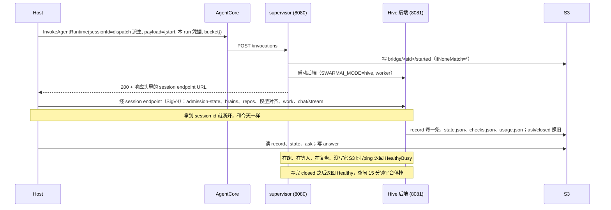

# Swarm Out 的第二种载体：AgentCore Runtime

## 0. 结论

在 Hive EC2 旁边加一种载体：每个 Swarm Out run 在 AgentCore Runtime 上起一个 session，
也就是一台专属 microVM，跑完就销毁。容器里跑的还是现在的 Hive 包（`SWARMAI_MODE=hive`，
worker 角色），所以 Hive 上的派发、工单、等人、run record 都不用重写。要改的是三件事：

1. **地址跟着 run 走，不跟着 Hive 走。** 现在一行 `hive_instances` 对应一个 CloudFront 域名和
   一组 Basic 密码；AgentCore 上每个 run 有自己的 session endpoint，鉴权是 SigV4。
2. **结果先写到 S3，再让 microVM 消失。** 现在 Host 在 run 结束后还要从活着的 Hive 上拉结果、
   拉代码 bundle、调 release。弹性 Hive 上，run record、lessons 和 `closed` 在封存时同步写到 S3，
   写完 microVM 就退出，不等 Host 结算；Host 只看 S3 判断 run 的状态，结束后的 run 不再被请求。
   这也是 10-08 hive-mind 设计 D2 早就定下的方向（"Record 落共享层即可销毁"）。
3. **bridge 的身份从 runtime session 来，不从 EC2 实例来。** 现在靠 IMDS 读角色名、IAM 靠
   `PrincipalTag/HiveName` 隔离；AgentCore 上换成 session context key
   `aws:AgentCoreRuntimeSourceSid`。

它只接一类 run：公开 git repo、预计 8 小时内跑完。结果要修正时重新派发，不在同一个 session 里续。内部 repo（要 Midway/brazil/内网）和长 run
继续走 EC2，或按 D1 走 cloud-desktop。

## 1. 要解决什么，不解决什么

**要解决的问题**（P9：先问它该不该存在）：

| 问题 | 现在的样子 | AgentCore 给的 |
|---|---|---|
| run 之间的隔离 | 同一台 Hive 上的 run 共用一个 OS 用户，代码自己写明这不是安全边界（`backend/core/hive_workspace.py:27-31`）。之前出过一次 worker 跨派发泄漏（MEMORY、recall、briefing 带到下一个 run），靠启动时搬走私有文件修掉（`backend/core/worker_reset.py:28-74`） | 每个 session 一台专属 microVM，结束后整台终止、内存清空。泄漏这一类问题从结构上不可能 |
| 并发（次要，没量过） | 最多 8 台 Hive（`backend/hive/accounts.py:52`），一台 Hive 满了就拒绝（`backend/core/swarm_out.py:627-628`）。还没有数据说明 8 台是瓶颈 | 账户级默认 5,000 个活跃 session（us-east-1/us-west-2），每秒最多新建 25 个 |
| 机群运维 | 起停（启动上限 270 秒，`swarm_out.py:209`）、空闲 120 分钟自动停（`backend/core/hive_idle.py:44-45`）、SSM 升级加回滚（`backend/hive/provisioner.py:1681-1885`） | 没有机群：镜像就是版本，没 run 就没机器 |

**不解决的：**

- **内部 repo。** microVM 和公开 EC2 一样没有 Midway、brazil、内网（hive-mind D1）。
- **超过 8 小时的 run。** 一个 microVM 最多活 8 小时，`maxLifetime` 最大也是 8 小时，不能更长。
- **替代 EC2。** EC2 Hive 保留：长 run、要 mirror 缓存和 code graph 的大 repo、要人隔天才答的等待。
- **对同一个 session 的修正（rerun，A5）。** 弹性 Hive 上的 run 一结束就封存、写 `closed`、
  microVM 退出（§5.4）。修正作为一次新的派发发出。代价是修正要重新冷启动、重新传 repo 和 Brain；
  好处是"结束"只有一种含义，Host 不用猜 microVM 还在不在。
- **AgentCore 的 Instances 计算类型。** 它在你的账号里起 EC2（最长 14 天），等于换一种方式管 Hive，
  和"用完即弃"无关；而且 session endpoint 不支持它。

## 2. 现状：Swarm Out 对 Hive 做了哪些假设

下面每条都按今天读过的代码写。换载体时每一条都要有答案。

**A1 一个 Hive 一个地址。** 所有到 Hive 的调用都经过 `_client(inst)`：base URL 是
`https://{cloudfront_domain}`，头里带 Basic 密码（`backend/core/swarm_out.py:415-427`）。
`_validate_instance` 要求 `cloudfront_domain`、`auth_user`、`auth_password` 都有
（`swarm_out.py:382-393`）。用到 `_client` 的不止派发：拉结果（`backend/core/swarm_out_results.py:714`）、
拿代码 bundle（`backend/core/hive_return.py:233`）、release（`backend/core/swarm_out_settle.py:803`）、
Brain 同步（`backend/core/brain_sync_host.py:118`）。Hive 这边，app 层中间件也校验同一个 Basic 密码
（`backend/middleware/hive_auth.py` 文件头）。

**A2 派发是一串 HTTP 调用。** 按顺序（`swarm_out.py:945-1009`、`:1130-1280`）：能力检查
`GET /api/chat/sessions/admission-state` → Brain 同步 `PUT /api/hive/brains/{brain}`（包上限 20 MB）
→ repo bundle `PUT /api/hive/repos`（上限 100 MiB，`backend/core/repo_ship.py:42`）→ 模型对齐
→ 准备工单 `POST /api/hive/work` → 开 session `POST /api/chat/stream`，拿到 session id 就断开。

**A3 结果在 Hive 上，Host 去拉。** run record 在 Hive 的 `SwarmWS/Hive/records/<session>/manifest.jsonl`，
保留 30 天（`backend/core/hive_records.py:1-20`、`:86`）。Host 的 `fetch` 全部走 HTTP：
`GET /api/hive/work/{id}/checks`、`GET /api/hive/records/{sid}` 和 `/{seq}`，再兜底读 messages 和
lessons（`swarm_out_results.py:690-781`）。代码以 git bundle 的形式封在 record 里，Hive 从不 push
（`backend/core/hive_bundle.py` 文件头）。用量也是 Host 每 15 分钟从 `GET /api/hive/usage` 拉
（`backend/core/usage_hive_sync.py:127`）。收尾时 Host 调 `POST /api/hive/work/{id}/release`，
失败会按 30 秒起翻倍重试到 3600 秒（`swarm_out_settle.py:773-811`）。

**A4 等人和答案走 S3。** Hive 每 20 秒把等着的问题镜像到 `bridge/<hive>/ask/...`，读
`bridge/<hive>/answer/...`（`backend/core/swarm_out_bridge.py:8-30`、`:64`）。Hive 的身份来自 IMDSv2
的角色名 `SwarmAI-Hive-<name>` 和 `.hive-bucket` 文件（`swarm_out_bridge.py:119-145`），IAM 按
`${aws:PrincipalTag/HiveName}` 限定前缀（`swarm_out_bridge.py:38`）。等一个回答最长 4 小时
（`backend/core/permission_manager.py:55`、`backend/core/ask_question_manager.py:50-57`）。

**A5 run 结束后 session 还要能续。** `rerun` 把修正作为新消息发进同一个 session、同一个工作区
（`swarm_out.py:2157-2200`）；session 已经从 Hive 上没了，就提示"丢掉重派"。

**A6 Hive 上有跨 run 的缓存。** 每个 repo 一个 bare mirror（`~/.swarm-ai/hive/mirrors/...`），每个 run
从它 `clone --reference`（`hive_workspace.py:8-20`）；code graph 也留在 Hive 上。

**A7 没有"载体"这个概念。** `hive_instances.hive_type` 只有 `replace` 复制它（`backend/hive/fleet.py:276`），
没有按它分支的读者。

**A8 很多调用和定时器是按 Hive 发的，不按 run。** `_instance(hive_ref)` 和 `_instance_up` 在
`core/`、`routers/` 里有 36 处调用（2026-11-19 grep），分在 12 个文件。除了 A1 列的，还有：
`hive_records.pull`（真正拉 record 的地方，`backend/core/hive_records.py:940`）、`hive_lessons.take`、
`swarm_out_live.check`、relay（`swarm_out_relay.py`，每 15 秒查状态）、远程 tab 代理
（`routers/swarm_out_remote.py`）、`stop_turn`、discard、`_order_state`、`_has_cap`、`_release_late`，
以及写答案时的前缀 `bridge/{inst['name']}/`（`swarm_out.py:2413-2415`）。定时器：用量同步每 15 分钟
（游标和去重键都按 `hive_id`，`backend/core/usage_hive_sync.py:100`、`:163`），空闲自动停每 300 秒，
每次刷 runs 时探测 streaming-state 和 admission-state。`run_state` 判断一个 run 在跑还是停了，靠的就是
对整台 Hive 的 streaming-state 探测（`swarm_out.py:1683-1700`）。

**A9 一个 run 的 lessons 和 `closed` 在空闲 1 小时后才封存。** `seal_end` 先写 lessons 再写 `closed`，
只在 session 的 S2/S7 复盘任务结束时运行（`hive_records.py:570-600`）。这个任务在 session 空闲 120 秒
之后再等 58 分钟（`backend/core/ingestion/s2_jobs.py:37-43`）。settle 要等到 `closed`，除非 Hive 已停或
已没了，或者过了 14 天的兜底期（`backend/core/swarm_out_settle.py:542-549`）。

## 3. AgentCore Runtime 的事实（2026-11-19 读的文档）

| 项 | 值 | 来源 |
|---|---|---|
| 隔离 | 每个 session 一台专属 microVM，结束后终止、内存清空 | [runtime-sessions](https://docs.aws.amazon.com/bedrock-agentcore/latest/devguide/runtime-sessions.html) |
| 生命 | 空闲默认 15 分钟停（可调，最多 8 小时）；一次最长 8 小时（`maxLifetime`，最多 8 小时） | [quotas](https://docs.aws.amazon.com/bedrock-agentcore/latest/devguide/bedrock-agentcore-limits.html) |
| 保活 | `/ping` 返回 `HealthyBusy` 时 session 算作活跃，不会因空闲被停；`time_of_last_update` 不能每次都刷新 | [HTTP 协议](https://docs.aws.amazon.com/bedrock-agentcore/latest/devguide/runtime-http-protocol-contract.html) |
| 容器 | ARM64；`0.0.0.0:8080` 提供 `POST /invocations` 和 `GET /ping`；镜像压缩后 V2 最大 10 GB | HTTP 协议、quotas |
| 算力 | 默认 2 vCPU/8 GB，V2 可配到 8 vCPU/32 GB | quotas |
| 进入容器里的服务 | session endpoint：每个 session 一个 HTTPS URL，按 `allowedPorts`（8000–12000，最多 5 项）转发任意 method/path，支持 SSE 和 WebSocket；SigV4 鉴权，需 `bedrock-agentcore:InvokeAgentRuntimeProxy`；URL 在 `InvokeAgentRuntime` 的响应头里；只支持 microVM，走公网 HTTPS | [session endpoints](https://docs.aws.amazon.com/bedrock-agentcore/latest/devguide/runtime-session-endpoints.html) |
| 持久存储 | session storage（Preview）：每 session 最大 1 GB，跨 stop/resume 保留；14 天不调用就清空；**runtime 版本更新时清空** | [filesystem](https://docs.aws.amazon.com/bedrock-agentcore/latest/devguide/runtime-filesystem-configurations.html) |
| 挂载时机 | 挂载路径只在调用时可用，初始化阶段不可用 | filesystem |
| 凭据 | session 用 runtime 的 execution role；V2 上凭据带 `aws:AgentCoreRuntimeSourceSid`（session id）和 `aws:AgentCoreRuntimeSourceArn`，可用来按 session 限定 S3 前缀。microVM 从 session 之前做的快照恢复：import 时建的 SDK client 拿到的是快照前的凭据，不带这两个 key | runtime-sessions |
| 限流 | 数据面合计 1,000 TPS；新建 session 25 TPS；session id 至少 33 个字符 | quotas |
| 计费（V2 按量） | $0.1276 / vCPU-小时，只算实际用掉的 CPU，等 I/O（等模型、等工具）不算；内存 $0.0169 / GB-小时，从 microVM 就绪算到 session 结束，空闲内存 120 秒后回收；session storage Preview 期间不收费 | [pricing](https://aws.amazon.com/bedrock/agentcore/pricing/) |

**文档没写、要 spike 测的：** microVM 在 session storage 以外的本地盘有多大；冷启动多久；
Claude CLI 子进程在快照恢复的 microVM 里是否一切正常。

## 4. 方案对比

三个方案共用一点：容器里跑现在的 Hive 包，Host 通过 session endpoint 调现在的 Hive API。
差别在结果怎么活过 microVM。

| | A：session storage + 按需恢复 | **B：record 封存时写 S3（推荐）** | C：不改结果路径，microVM 一直开到结算 |
|---|---|---|---|
| 做法 | 数据目录放在 session storage；Host 晚来时请求 session endpoint，平台起新 microVM、恢复存储，Host 照旧从 HTTP 拉 | Hive 封存 record 的每一条时同时写到 S3；Host 对这类 run 从 S3 读；写完 `closed` 后 microVM 退出 | 一直 `HealthyBusy` 到 Host 拉完并 release |
| 改动 | 最少：只改寻址和鉴权 | 多一条写 S3 的路，Host 多一种读法 | 最少 |
| 致命问题 | session storage 只有 1 GB，SwarmAI 自己的 `.git` 就有 548 MB（2026-11-19 量），工作区放不下；**每次 SwarmAI 发版都要更新 runtime 版本，版本一更新所有没拉走的结果清空**；还在 Preview | 无。代价是同一份 record 有两种取法（EC2 走 HTTP，AgentCore 走 S3） | Host 合盖超过 8 小时，microVM 到上限被终止，结果没了。违背 Swarm Out 的前提：双方都可以不在线（v0 HLD G3） |
| 评价 | 发版会清空结果，这一条就不能接受 | 符合 D2；microVM 真正可以随时消失 | 把"用完即弃"变成"用到人回来" |

**选 B。** 两种取法并存的代价可以以后消掉：EC2 Hive 也改成写 S3，Host 只认 S3，EC2 run 结束后
也不用等 Host。这一步本设计不做，记在 §9 Q6。

## 5. 推荐设计（方案 B）

### 5.1 一个 AgentCore Hive 在 Host 上是什么

在 `hive_instances` 里加一行，新增列 `carrier`（`ec2` 或 `agentcore`，旧行默认 `ec2`），
外加 `runtime_arn`。它在 Swarm Out 面板上显示为一个"弹性 Hive"：不起停、不升级，
没有 `cloudfront_domain` 和密码，不计入 `MAX_HIVES`（`hive/accounts.py:430` 的计数要排除它）。
`hive_type` 不复用（A7）。

**地址按 dispatch 存，并由一个函数守住。** 派发时拿到的 session endpoint URL 和 runtime session id
写进这次派发的记录（`state/swarm-out/dispatches.jsonl` 的那一行）。

- 新增 `_instance_for(dispatch_row)`：对 EC2 的 dispatch 返回今天 `_instance(hive_id)` 的结果；对
  AgentCore 的 dispatch 返回带 session endpoint 的地址。**这个 run 在 S3 上已有 `closed`，或者已过
  `maxLifetime`，就抛错，不返回地址。** 原因：对一个已停的 session 发请求，平台会新起一台空的
  microVM（runtime-sessions 文档："transitions back to Active on the next invocation and a new compute
  is provisioned"）。所以"run 结束后不再请求它"必须是结构上做不到，而不是每个调用方记得不做。
- `_instance(hive_ref)` 遇到 `carrier == "agentcore"` 的行直接抛错。这样 A8 里任何按 Hive 发请求的代码
  都碰不到弹性 Hive，漏改的调用方会在测试里报错，而不是在线上悄悄起 microVM。
- `_client` 的分叉：AgentCore 地址用 Host 的 AWS 凭据对每个请求做 SigV4 签名（服务名
  `bedrock-agentcore`），并带上本 run 凭据（§5.3）。

### 5.2 容器

- **镜像**：Amazon Linux 2023 ARM64 + `python3.12`、`nodejs20`、`git`（和 `backend/hive/user_data.py:36`
  的包一致）+ 现在的 Hive 发布包（`dist/swarmai-hive-v*-linux-arm64.tar.gz`，现在约 14 MB），解到
  `/opt/swarmai`，和 EC2 一样（种子路径 `/opt/swarmai/hive/seed` 写死在
  `backend/core/swarm_workspace_manager.py:1248`）。不要 Caddy：入口鉴权由平台做。
- **两个进程**：
  - **supervisor**，监听 8080，提供 `/ping` 和 `/invocations`。它在快照之前就在跑，自己不建 AWS client。
  - **SwarmAI 后端**，监听 8081（在 `allowedPorts` 里）。只在 start 之后由 supervisor 启动，这样它和
    它起的 Claude CLI 拿到的是带 session context key 的凭据（§3 凭据一行）。
- **数据目录在本地盘**，不用 session storage。
- **Bedrock**：execution role 允许 `bedrock:InvokeModel*`，和 EC2 Hive 的实例角色同一组动作
  （`backend/hive/provisioner.py:76-88`）。

### 5.3 派发时序

- **session id**：由 dispatch id 派生，补到至少 33 个字符。
- **只启动一次**：supervisor 收到 start 时先写 `bridge/<sid>/started`，用 `IfNoneMatch="*"`。写失败
  （已经有了）就拒绝 start，并写 `state.json` 为 `replaced`。这挡住两种情况：同一个 dispatch 的 start 被
  重发到一台新 microVM；平台因为不健康换了一台 microVM 后又收到请求。两种情况都不能把任务再跑一遍。
- **本 run 凭据**：Host 为每个 run 生成一组随机凭据，放在 start 的 payload 里（这一步本身走 SigV4）。
  supervisor 把它做成 `hive_auth` 要的 bcrypt 哈希（cost 14，约 1 秒，只做一次）交给后端。之后 Host 的
  每个请求把凭据放在 `X-Swarm-Hive-Auth` 头里。不能继续用 `Authorization`：那个头被 SigV4 占了，平台
  转发前会把鉴权头过滤掉。`hive_auth` 中间件在 AgentCore 模式下改读这个头，仍然 fail-closed。平台是外层、
  app 是内层，和今天 Caddy + 中间件两层一样。

### 5.4 什么时候算忙，什么时候结束

**忙**只看 Hive 自己还有没有东西要产出，不看 Host 有没有结算。任一为真，`/ping` 返回 `HealthyBusy`：

1. 有 session 在流，或在跑后台工作（sub-agent、后台命令）；
2. 有问题在等人回答；
3. 有 S2/S7 复盘任务在排队或在跑；
4. 有 record 条目或状态对象还没写到 S3。

打开着的工单**不算忙**：工单要等 Host 结算才 release（`swarm_out_settle.py:788-812`），把它算进来，
microVM 就会一直开到 8 小时上限（等人回来就是方案 C）。只在状态真的变化时更新 `time_of_last_update`。

**复盘不等 1 小时**：AgentCore 模式下，turn 结束且没有等待、没有后台工作时，立刻请求复盘任务，
不加 58 分钟的延迟（A9）。那个延迟是为了等一个可能还会继续的 session；弹性 Hive 不接修正（§1），
turn 结束就是任务结束。复盘结束时 `seal_end` 照旧写 lessons 和 `closed`，写到 S3 之后不再忙。

**结束的三种方式，Host 都只看 S3 判断**（替代 A8 里 `run_state` 对整台 Hive 的探测）：

| 情况 | Host 看到的 | `run_state` |
|---|---|---|
| 正常结束 | `records/` 里有 `closed` | stopped |
| 到 8 小时上限 | 没有 `closed`，且离 `started` 超过 `maxLifetime` | stopped，原因"载体到期" |
| microVM 被换掉又收到请求 | `state.json` 为 `replaced` | stopped，原因"载体被替换" |

在跑和在等人时，Hive 在状态变化时重写 `bridge/<sid>/state.json`（running / waiting / ended）。Host 的
runs 刷新读它，不发 HTTP。

结束后 Host 调一次 `StopRuntimeSession`，不等空闲超时。session 已经没了也算成功。

### 5.5 结果写到 S3

- **record**：Hive 侧 `hive_records` 每 append 一条（fsync、rename 之后），把该条目的文件和 manifest 行
  写到 `bridge/<sid>/records/`，`IfNoneMatch="*"`，和 answer 的写法一样（`swarm_out.py:2512-2523`）。
  条目种类不变（`KINDS`，`hive_records.py:81`），不新增种类：新种类会让 Host 的校验报
  `unknown_kind` 并停止拉取。
- **checks 和用量不是 record 条目**：checks 文件每跑一次检查就重写，用量是一张流水。它们写成两个单独
  的对象 `bridge/<sid>/checks.json` 和 `bridge/<sid>/usage.json`，每次整体重写，替代
  `GET /work/{id}/checks` 和 `GET /api/hive/usage`。
- **Host 侧**：`hive_records.pull` 对 AgentCore 的 dispatch 从 S3 读 manifest 和条目，经过和今天一样的
  校验，存成同样的本地副本。后面的 `hive_return`、`hive_files`、settle 不改。`hive_return` 本来就优先用
  本地副本（`hive_return.py:198-223`）；它的在线兜底下载对 AgentCore 关掉。
- **用量去重按 dispatch**：每台 microVM 的用量表都从 1 开始编号。按今天以 `hive_id` 为游标和去重键
  （A8），第二个 run 起的用量会被当成重复丢掉。AgentCore 的用量键改成 `hive:{dispatch_id}:{rid}`，
  没有游标，每次读整个 `usage.json`。
- **写 S3 失败**：重试，算忙（§5.4 第 4 条）。

### 5.6 bridge 身份

- Hive 侧的 `swarm_out_bridge` 不再读 IMDS：它的"hive 名"换成 runtime session id，桶名来自 start payload。
- IAM：execution role 的 bridge 语句限定前缀 `bridge/${aws:AgentCoreRuntimeSourceSid}/`：可写 `started`、
  `state.json`、`checks.json`、`usage.json`、`ask/`、`closed/`、`records/`、`decisions.json`，只读 `answer/`。
  效果和今天按 `PrincipalTag/HiveName` 限定一样（`backend/hive/provisioner.py:96-127`），粒度从一台 Hive
  变成一个 run。要求 V2 平台。
- Host 侧列问题和写答案（`swarm_out.py:2413-2415`）都按 dispatch 的 session id 取前缀。

### 5.7 选路

第一版不让系统自动选。派发时可以点名这个弹性 Hive，或者由派发的 agent 按一条规则选：

- 所有 repo 都能不带内部凭据 clone（公开 git）；
- 不是 pipeline 的 `full` profile（预计时间最长的那种），除非 spike 测出 full 也能稳定在 8 小时内；
- 没有正在运行且有空的 EC2 Hive。已经在跑的 EC2 已经付了钱，先用它。

`pick_hive`（`swarm_out.py:813-855`）里 AgentCore 行永远不 `saturated`，排在有空的 EC2 之后、
需要先启动的 EC2（`pick_stopped`）之前；spike 量出冷启动时间后再确认这个顺序。Brain 版本锁
（`held_hives`，`swarm_out.py:259-262`）不排除 AgentCore 行：每个 run 是独立的 microVM，不存在两个 run
在一台机器上看到不同版本的问题。

### 5.8 开通

左侧导航 System 区的 Hive 页（overlay `hive`，`desktop/src/components/layout/overlayIds.ts:48`）加一个
"弹性 Hive"选项，在用户自己的账户里：建 ECR repo 并推镜像、建 execution role、`CreateAgentRuntime`
（网络 PUBLIC，`allowedPorts` 包含 8080 和 8081，V2 平台）、建 S3 桶（或复用已有的 Hive 桶）。
一个账户一个 runtime。发版时更新 runtime 的镜像版本。方案 B 不用 session storage，版本更新不会丢
已写到 S3 的结果；正在跑的 session 会怎样，要在 spike 里测（Q4）。

### 5.9 按 Hive 运行的代码怎么对待弹性 Hive

A8 的每一类都要有去处。`_instance` 对 AgentCore 行抛错（§5.1），所以下面的"跳过"必须写在调用方，
否则测试会红：

| 代码 | 对弹性 Hive |
|---|---|
| 派发链（admission-state、Brain 同步、repo、模型对齐、work、chat/stream） | 经 `_instance_for`，走本 run 的 session endpoint |
| `hive_records.pull`、`hive_lessons.take`、`swarm_out_results.fetch` 的 checks | 读 S3（§5.5） |
| `swarm_out_live.check`、relay、远程 tab 代理、`stop_turn`、discard | 经 `_instance_for`；run 已结束时它抛错，这些操作显示"run 已结束" |
| `_order_state`、`_release_late`、settle 的 release | 换成 `StopRuntimeSession` 或直接跳过（工单随 microVM 消失） |
| `_has_cap`、`rerun` | `_has_cap` 经 `_instance_for`；`rerun` 拒绝并说明"弹性 Hive 上的修正请重新派发"（§1） |
| 写答案、列问题 | 按 dispatch 前缀（§5.6） |
| 用量同步定时器 | 跳过 AgentCore 行；用量从每个 dispatch 的 `usage.json` 读（§5.5） |
| 空闲自动停（`hive_idle`） | 跳过 AgentCore 行（它会对一行没有 EC2 的记录调 `claim_stop` 和 `provisioner.stop`） |
| runs 刷新里的 streaming-state、admission-state 探测（`swarm_out.py:1700`、`:2312`） | 跳过；状态读 `state.json`（§5.4） |
| Brain 同步状态和默认同步（`brain_sync_host.status`、`routers/hive.py:961`） | 跳过：弹性 Hive 没有常驻的 Brain，每个 run 派发时同步 |
| 诊断（`hive_diagnostics`，经 SSM 跑 `systemctl`/`journalctl`） | 跳过；弹性 Hive 的诊断读 CloudWatch 日志 |

## 6. 改什么，不改什么

| 模块 | 改动 |
|---|---|
| `database/sqlite.py` `hive_instances` | 加 `carrier`、`runtime_arn` 两列 |
| `core/swarm_out.py` | `_instance_for`；`_instance` 对 AgentCore 抛错；`_client` 的 SigV4 分叉；派发前 `InvokeAgentRuntime(start)`，地址写进 dispatch 行；`run_state` 读 `state.json`；`rerun` 拒绝 |
| §5.9 表里的每个调用方 | 按表处理 |
| `core/hive_records.py` | Host 侧 `pull` 从 S3 读；Hive 侧每条 append 后写 S3（只在 AgentCore 模式） |
| `core/usage_hive_sync.py` | AgentCore 的用量按 dispatch 读 S3，去重键按 dispatch |
| `core/ingestion/s2_jobs.py` 的调用处 | AgentCore 模式下 turn 结束立刻请求复盘 |
| `core/swarm_out_bridge.py`（Hive 侧） | 身份来自 start payload，不读 IMDS；写 `state.json`、`checks.json`、`usage.json` |
| `middleware/hive_auth.py` | AgentCore 模式读 `X-Swarm-Hive-Auth` |
| `hive/accounts.py` | 计数排除 AgentCore 行 |
| 新增 | supervisor（`/ping` 的忙判断、`started` 标记）、Dockerfile、开通代码 |
| **不改** | 工单（`hive_workspace`）、等人（permission/ask manager）、record 的格式和条目种类、`hive_return` 的校验和落地、Brain 同步协议、repo bundle 协议、Hive 上的 session 和 pipeline |

## 7. 失败模式

| 情况 | 结果 |
|---|---|
| run 跑过 8 小时 | microVM 终止；已写到 S3 的 record 还在；Host 显示"载体到期"，丢掉重派 |
| 平台判定 microVM 不健康、换了一台 | 在跑的 turn 没了。新 microVM 收到请求时发现 `started` 已存在，写 `replaced` 并拒绝，Host 显示"载体被替换"，丢掉重派 |
| Host 合盖几天 | 结果在 S3，等 Host 醒来读；microVM 在 `closed` 之后 15 分钟内就停了 |
| 人要修正结果 | 重新派发（§1）。旧 run 照常结算 |
| 写 S3 失败 | 算忙，一直重试；到 8 小时还没写完，那部分结果丢失。每次失败都记日志 |
| 新建 session 被限流（25 TPS） | 派发失败，返回给派发方，不排队（v0 决策 9） |
| 快照前建的 SDK client | 凭据不带 session key，写 S3 会被 IAM 拒。规则：Hive 侧所有 AWS client 都在 start 之后创建；supervisor 自己不建 client |
| 某处代码漏改、按 Hive 去请求弹性 Hive | `_instance` 抛错，不会发出请求（§5.1） |

## 8. 成本（估算，spike 要实测）

- **AgentCore**：一个 2 小时的 run，按 2 vCPU、平均 CPU 占用 20%（大部分时间在等模型）、内存 4 GB 算：
  CPU 2 × 0.2 × 2 × $0.1276 ≈ $0.10，内存 4 × 2 × $0.0169 ≈ $0.14，合计约 $0.24。复盘任务和 `closed` 之后
  的 15 分钟空闲另算，空闲内存 120 秒后回收。
- **每个 run 都要从 Host 传 Brain（最多 20 MB）和 repo bundle（最多 100 MiB）**，经公网到 session
  endpoint。EC2 Hive 上 Brain 只在变了时同步、repo 有 mirror。这部分时间算在冷启动里，spike 要量。
- **EC2**：m7g.xlarge 按需大约 $0.16/小时（凭印象，没核实），加上空闲到自动停之前的 120 分钟。
- 两者都比这个 run 的模型 token 费用小一个数量级以上（token 费在 run record 的 `cost_usd` 里）。
  成本不是选 AgentCore 的理由，也不是反对它的理由；理由是隔离和不用运维。

## 9. 开放问题

| # | 问题 | 谁定 |
|---|---|---|
| Q1 | TOOLS.md 记着"内部开发环境不允许在 AgentCore 上搭 agent team"。这条管不管 SwarmAI 产品在用户自己账户里起 run？如果管，本设计只对外部用户有意义 | XG |
| Q2 | 镜像怎么分发：每个用户在自己账户里构建并推 ECR（需要 Docker/Finch 或 CodeBuild），还是产品发布一个公共镜像、用户复制到自己的 ECR | 设计，spike 后定 |
| Q3 | microVM 本地盘多大？一个大 repo 的 clone 加构建放得下吗 | spike |
| Q4 | 更新 runtime 版本时，正在跑的 session 会怎样 | spike |
| Q5 | 冷启动多久（镜像拉取加后端启动） | spike |
| Q6 | 要不要让 EC2 Hive 也改成 record 写 S3，Host 只认一种取法 | 本设计落地后再定 |

## 10. 先做 spike，再动产品代码

目标是回答 Q3–Q5，量三个数，确认两条机制。不进产品代码，放在一个临时目录里：

1. 用现在的 Hive 包做一个 ARM64 镜像 + 最小 supervisor，在 XG 的个人账户建一个 runtime。
2. 手工按 §5.3 走一遍：start、经 session endpoint 调 `admission-state`、`work`、`chat/stream`，
   跑一个真实的小任务（公开 repo 上的一个 bugfix）。
3. 量：冷启动时间（含传 Brain 和 repo bundle）、端到端时间、账单里这个 session 的费用。
4. 确认：`HealthyBusy` 能让断开连接后的 turn 跑完；`aws:AgentCoreRuntimeSourceSid` 限定前缀的
   IAM 语句对别的 session 的前缀确实拒绝。
5. 测一次版本更新时正在跑的 session 会怎样（Q4），记录本地盘大小（Q3）。

spike 的结论写回本文档 §3 和 §9，再决定建不建。

## 11. 验证计划（建的时候用）

**谁读新写的东西**：S3 里的 `records/` 只有 Host 的 `fetch` 读，它要在 Hive 侧写之前先改好，而且
用今天 HTTP 路径读出的 record 做对照。

**最后必须成立的不变量（测试集在这里定，不在结尾加）：**

1. 同一个 run，经 S3 拉到的 record 和经 HTTP 拉到的 record，每个条目的 `(seq, kind, sha256, size, key)`
   一致（本地副本里 Host 自己记的时间不比）。
2. 一个 session 的凭据读不到、写不了另一个 session 的 `bridge/` 前缀；任何 session 都写不了 `answer/`。
3. `/ping` 的忙判断：§5.4 的四条任一为真时是 `HealthyBusy`，全都为假时是 `Healthy`；只有打开的工单时
   是 `Healthy`。
4. `_instance` 对 `carrier == "agentcore"` 的行抛错；`_instance_for` 对已有 `closed` 或已过
   `maxLifetime` 的 AgentCore dispatch 抛错。两者都不发出任何请求。
5. `carrier == "ec2"` 的所有路径行为不变：`swarm_out`、`swarm_out_results`、`swarm_out_settle`、
   `hive_return`、`hive_records`、`usage_hive_sync`、`hive_idle` 的现有测试全绿。
6. AgentCore 模式下，没有 `X-Swarm-Hive-Auth` 或值不对的请求一律 401。
7. `started` 已存在时，start 被拒绝且不启动后端。
8. 两个 AgentCore run 的用量行都进了本地用量表，没有被当成重复丢掉。

**评审**：设计先做一次零上下文的前提审查。实现分两步（Host 侧的读，Hive 侧的写），各自做
correctness + security 专家审查。security 重点看 §5.3 的凭据传递和 §5.6 的 IAM。
