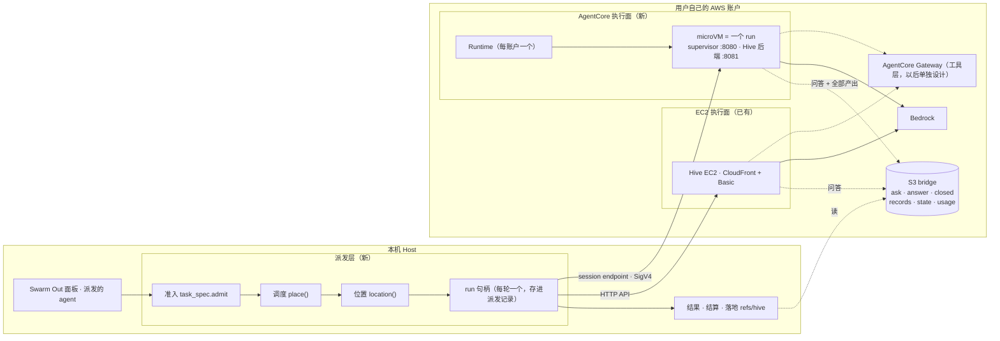
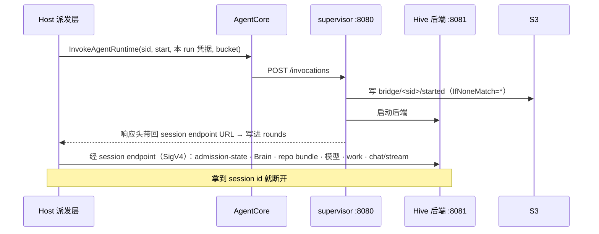
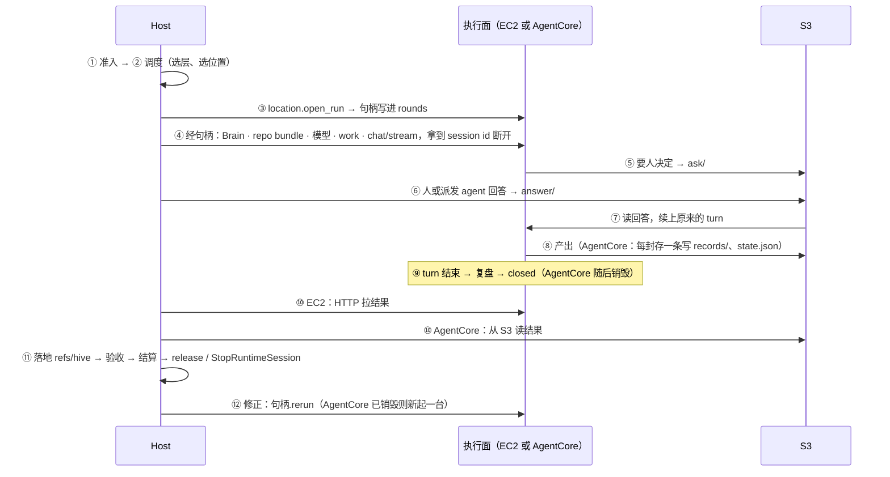

# Swarm Out 多执行面

## 0. 一页结论

Swarm Out 今天只有一种执行机：一台台常驻的 EC2 Hive。本设计做三件事：

1. **派发层**（§4）。在 Host 里加一层，把"选哪里跑"和"怎么连上它"收起来：执行面、位置、run 句柄、调度。
   今天这两件事是两个排序函数，加上散在 10 个文件、22 处调用里的 EC2 假设。
2. **AgentCore 弹性 Hive**（§6）。第二种执行面：每个 run 在 AgentCore Runtime 上一台专属 microVM，里面跑现在的
   Hive 包，run 的产出写进 S3 后 microVM 就销毁。它带来的是 run 之间结构上的隔离、不用运维机群、按用量付费。
3. **工具层的位置**（§7）。AgentCore Gateway 不用在执行面这一层，它的位置是"给 run 接外部工具"，对 EC2 和
   AgentCore 一样适用，单独设计。

**产品原则**（XG 2026-11-19）：这是产品功能，不按任务类型设场景限制，能在上面跑的任务都可以派。执行面之间只有
能力上的差别：AgentCore 拿不到内部权限，访问不到内部资源和工具，所以需要它们的任务由现有准入拒绝（对 EC2 也一样）；
一个 microVM 最多活 8 小时，到了就按"载体到期"结束。

### 评审定下的决定

| # | 决定 | 建议 | 在哪 | 状态 |
|---|---|---|---|---|
| D1 | 派发层放在 Host 进程里，还是做成云上控制面 | Host 进程里（A） | §3 | **已定**（XG 2026-11-20） |
| D2 | 第二种执行面用 AgentCore Runtime microVM，跑现在的 Hive 包 | 是 | §6.1 | **已定**（XG 2026-11-20） |
| D3 | AgentCore run 的结果怎么活过 microVM | run record 封存时写 S3（B），不用 session storage | §6.2 | **已定**（XG 2026-11-20） |
| D4 | 调度顺序 | 在跑有空的 EC2 → 弹性 → 停着的 EC2，层内按负载 | §4.4 | **已定**（XG 2026-11-20） |
| D5 | 在跑的 EC2 都满、**且这时用不了弹性 Hive**（没开通、到配额、被限流、镜像版本不对）时，启动停着的 EC2 | 是（改 `pick_stopped` 的旧规则）。有弹性 Hive 时，满了先走弹性（D4 第 2 层） | §4.4 | **已定**（XG 2026-11-20） |
| D6 | 开 run 前位置不可用时换一个 | 只在对那台机器还没写任何东西时换 | §4.4 | **已定**（XG 2026-11-20） |
| D7 | AgentCore 上的修正 | microVM 在就发进原 session；不在就新起一台，从上一轮带回的提交接着做 | §6.6 | **已定**（XG 2026-11-20） |
| D8 | Gateway | 不进执行面这一层；工具层单独设计 | §7 | **已定**（XG 2026-11-20） |
| D9 | 落地顺序 | 先抽 EC2 执行面（行为不变）→ 位置和句柄 → 调度三处变化 → spike → AgentCore | §12 | **已定**（XG 2026-11-20） |

## 1. 为什么做

### 1.1 要解决的问题

| 问题 | 今天 | 做完之后 |
|---|---|---|
| run 之间的隔离 | 同一台 Hive 上的 run 共用一个 OS 用户，代码自己写明这不是安全边界（`backend/core/hive_workspace.py:27-31`）。出过一次 worker 跨派发泄漏（MEMORY、recall、briefing 带到下一个 run），靠启动时搬走私有文件修掉（`backend/core/worker_reset.py:28-74`） | 弹性 Hive 上每个 run 一台专属 microVM，结束后整台终止、内存清空。泄漏这一类问题从结构上不可能 |
| 只能用一种执行机 | 选 Hive 的候选就是 `hive_instances` 的行；所有调用都默认 CloudFront + Basic | 加一种执行面只要实现一次接口 |
| 机群运维 | 起停（启动上限 270 秒，`backend/core/swarm_out.py:209`）、空闲 120 分钟自动停（`backend/core/hive_idle.py:44-45`）、SSM 升级加回滚（`backend/hive/provisioner.py:1681-1885`） | 弹性 Hive 没有机群：镜像就是版本，没 run 就没机器 |
| 负载和扩容 | 在跑的 Hive 都满了就拒绝；几个同时的派发挤到同一台 | 调度会启动停着的 Hive、把正在派发的算进负载 |
| 并发上限（次要，没量过） | 最多 8 台 Hive（`backend/hive/accounts.py:52`）；还没有数据说明 8 台是瓶颈 | 弹性 Hive 账户级默认 5,000 个活跃 session |

### 1.2 现状里的缺口

| # | 缺口 | 证据 |
|---|---|---|
| G1 | 第二种执行机没有地方接 | `pick_hive`（`swarm_out.py:813-855`）只看 `hive_instances`；`_client`（`:415-427`）只认 CloudFront + Basic |
| G2 | 在跑的都满了，不启动停着的 | `pick_stopped` 只要有一台在跑就返回 None（`:310-311`） |
| G3 | 选中的位置开 run 前就不可用，不换 | 选中后再查 `admission-state`（`:624-631`），满了直接报错。对 EC2 窗口很短；对 AgentCore，限流和到配额是常态的一类失败 |
| G4 | 同时的派发看到同一份负载 | 排序看已写入的派发记录和探测到的 streaming 数；正在派发的 `_IN_FLIGHT`（`:215`）只给空闲自动停看（`hive_idle.py:159`） |
| G5 | 按机器运行的后台任务都假设 EC2 | 用量同步、空闲自动停、Brain 同步、诊断各自遍历 `hive_instances` |

G2、G4 本身是小改动；需要一层的理由是 G1 和 G5：没有它，每多一种执行机，22 处调用和每个后台任务都要再改一遍。
现状的完整代码证据见附录 A。

## 2. 范围

**做：** 派发层（§4）、EC2 执行面的抽取（§5）、AgentCore 执行面（§6）、面板上的执行面分组（§4.6）。

**不做：**

- 云上控制面、排队、多台 Host 共用一个池（§3 方案 B）。仍然不排队（v0 决策 9）。
- 按任务类型、预计时长、repo 类型选执行面。
- 开 run 过程中、对位置已经写过东西之后的失败换位置。
- 把一个任务拆到多台机器（Swarm Run 已经在做拆分，每个子任务各自走调度）。
- 用模型来选执行面。
- AgentCore 的 Instances 计算类型：它在你的账号里起 EC2（最长 14 天），等于换一种方式管 Hive；session endpoint 也不支持它。
- 工具层（§7 只定它的位置）。

**不变：** 准入（`task_spec.admit`，`backend/core/task_spec.py:379`）仍在调度之前；Hive 上的工单、等人、run record、
pipeline 都不改；Host 是指挥中心、Hive 是执行方（派单中心 2026-10-30）。

## 3. 整体架构



- **派发层**在 Host 进程里。调度是纯函数，以后真要做云上控制面，可以搬过去。
- **两种执行面**跑同一个 Hive 包，Host 调的是同一套 Hive HTTP API，区别只在地址、鉴权和结果怎么回来。
- **S3** 对 EC2 是问答通道；对 AgentCore 还是全部产出的交接面：写进 S3 之后 microVM 就可以消失。
- **Gateway** 画成虚线：它是 run 调外部工具的地方，不在本设计的范围里（§7）。

### 方案对比（D1）

| | A：Host 里的派发层（推荐） | B：云上控制面 | C：在现有代码里按执行机分支 |
|---|---|---|---|
| 做法 | 执行面、位置、run 句柄、调度函数，都在 Host 进程里 | 用户账户里放常驻服务（API Gateway + Lambda/Step Functions + DynamoDB），Host 把任务交给它调度、排队 | `_instance`、`pick_hive` 和 22 处调用各加 `if carrier == ...` |
| 能做到 | G1–G5 | 另外能排队、Host 合盖时也能派、多 Host 共用一个池 | G1–G5 |
| 代价 | 一次重构，分步落地（§12） | 一个新的常驻系统要部署、升级、监控；Host 和它之间又是一层协议；和"Host 是指挥中心"冲突 | 每多一种执行机，22 处和每个后台任务再改一遍；漏改只在线上暴露（例如对已结束的 AgentCore run 发请求会新起一台空 microVM） |
| 判断 | 派发都从 Host 发起，Host 合盖时本来没有新派发；运行中的 run 不依赖 Host。**XG 2026-11-20 定：选 A** | 解决的是排队和多 Host，今天都没有真实需求 | 第二种能用；第三种（Cloud Desktop）进来时代价翻倍 |

## 4. 派发层

### 4.1 四个概念

- **执行面（carrier）**：一种执行机一个实现，在 `core/carriers/` 下。现在有 `ec2` 和 `agentcore`。
- **位置（location）**：执行面里能放 run 的地方。EC2 是每台 Hive；AgentCore 是账户里的那个 runtime。
  对机器的事经过它。
- **run 句柄（handle）**：一轮 run 的地址，开 run 时生成，存进派发记录。对 run 的事经过它。
- **调度（placement）**：确定性的函数，决定放在哪个位置。

### 4.2 执行面

| 字段 / 方法 | 作用 | EC2 | AgentCore |
|---|---|---|---|
| `kind` | 名字 | `ec2` | `agentcore` |
| `reaches_private` | 能不能访问私有网络 | 否 | 否（拿不到内部权限） |
| `max_run_s` | 一个 run 最长能活多久 | 无上限 | 28800 |
| `brain_lock_scope` | Brain 版本锁按什么算 | 按机器 | 按 run（不需要锁） |
| `offers()` | 现在能接 run 的位置，带负载和"多久能开始" | 见下 | 见下 |

三个能力字段每个都有读它的地方：`reaches_private` 由调度读（Cloud Desktop 进来时为是），`max_run_s` 由 run 状态判断读
（判"载体到期"，不用来挑执行面），`brain_lock_scope` 由调度读。派单中心 §7 不做的"机型能力表"仍然不做。

**`offers()` 只列真能用的位置：**

- **账户**：只列 Host 能以 `manage` 身份操作的账户（`hive/accounts.py`；另一个账户的 Hive 今天只读，它上面的问题也答不了，`swarm_out.py:430`）。
- **EC2 在跑的 Hive**：今天 `fleet()`（`:2334-2360`）探测的结果，版本够（`capable`）、没满。
- **EC2 停着的 Hive**：只列上次在跑时探测为 `capable` 的（停着的探测不到，`fleet()` 给它 `capable: None`）。位置要记下最近一次探测的结论和当时的版本。
- **AgentCore**：账户里有 runtime、runtime 的镜像版本是本 Host 的版本、活跃 session 没到配额时，给一个弹性 offer。

### 4.3 位置和 run 句柄

**位置**（`location(id)`）：

| 方法 | EC2 | AgentCore |
|---|---|---|
| `probe()` | `admission-state` | runtime 状态 + 活跃 session 数，不碰任何 run |
| `open_run(dispatch)` | 需要时启动（`_ensure_running`），返回句柄 | `InvokeAgentRuntime(start)`，返回句柄（§6.3） |
| `brain_sync()`、`brain_status()` | 同今天（`brain_sync_host`） | 没有常驻 Brain，每次派发时经句柄同步 |
| 后台任务（§4.5） | 用量同步、空闲自动停、诊断 | 只有诊断（CloudWatch） |
| Hive 页的操作 | 起停、升级、删除（`routers/hive.py`） | 开通、更新镜像版本（§6.8） |

**run 句柄**：

```
handle = {carrier, location_id, round, run_ref, address, auth_ref}
```

- `run_ref`：EC2 是 Hive 上的 session id；AgentCore 是 runtime session id。
- `address`：EC2 是 CloudFront 域名；AgentCore 是 session endpoint URL。
- `auth_ref`：指向凭据的引用，不是凭据本身。派发记录里不出现密码（v0 G4）。

派发记录存一串句柄 `rounds: [handle, ...]`，每一轮修正一个。旧记录没有这个字段时，由 `hive_id` 和 `session_id`
现算一个 EC2 句柄。

| 句柄方法 | 取代今天的 | EC2 | AgentCore |
|---|---|---|---|
| `client()` | `_client(_instance(hive_id))` | 同今天 | SigV4 + 本 run 凭据；run 已结束就抛错（§6.5） |
| `outputs()` | `hive_records.pull`、checks、lessons | HTTP | S3（§6.4） |
| `state()` | `run_state` 对整台 Hive 的探测（`:1683-1700`） | 同今天 | 读 `state.json` |
| `asks()`、`answer()` | `_read_hive`（`:1707`）、`answer`（`:2413`）的 `bridge/<hive>/` 前缀 | `bridge/<hive>/` | `bridge/<sid>/` |
| `stream()`、`proxy()` | relay、远程 tab（`routers/swarm_out_remote.py`） | 同今天 | 经 session endpoint（它转发任意路径和 SSE） |
| `stop_turn()`、`discard()` | `:2148`、`:2227` | 同今天 | 同样的 Hive API；已结束时直接算完成 |
| `release()` | `POST /api/hive/work/{id}/release` | 同今天 | `StopRuntimeSession` |
| `rerun(text)` | `rerun`（`:2157`） | 发进同一个 session，返回同一个句柄 | §6.6 |

`_instance` 只留给执行面自己的实现用。一个测试按词边界（`(^|[^a-zA-Z_])_instance(_up)?\(`）检查 `core/carriers/`
以外没有这类调用。

### 4.4 调度

`place(needs, offers) -> Placement` 是纯函数。

**1. 过滤（硬条件）**

- 能力：`needs.private` 非空而 `reaches_private` 为否，排除（准入已经拒了，这里是给以后有的执行面能、有的不能）。
- Brain 版本锁：按机器的执行面，排除被别的 Swarm Run 用另一个版本占着的机器（今天的 `held_hives`）。
- 点名：点了名就只剩那一个。

**2. 排序：先按"多久能开始"，再按负载（D4）**

| 层 | 候选 | 多久能开始 | 层内怎么排 |
|---|---|---|---|
| 1 | 在跑、有空的 EC2 | 马上 | (没结的 run 数 + 正在派发数, 在流数, 内存, 名字) |
| 2 | 弹性 offer | 冷启动 + 传 Brain 和 repo bundle（spike 实测） | 只有一个 |
| 3 | 停着的 EC2 | 启动时间（最多 270 秒） | (没结的 run 数 + 正在派发数, 名字) |

成本顺序和它一致：在跑的 EC2 已经在花钱，多一个 run 不多花；弹性按用量（一个 2 小时的 run 约 $0.24，§10）；
冷 EC2 按秒计费，但启动后一直开到空闲 120 分钟自动停，一个 2 小时的 run 实际开约 4 小时。

两处行为变化：

- **D5（G2）**：在跑的 EC2 都满时，先走第 2 层的弹性 Hive；**只有这时用不了弹性 Hive**（这个账户没开通、到配额、被限流、runtime 镜像不是本 Host 的版本），才轮到第 3 层停着的 EC2。版本不够不算满，不会因此启动一台更旧的。Hive 的台数是人定的
  （`hive_fleet.desired_count`，`backend/hive/fleet.py`），用上它们在人的同意之内；空闲 120 分钟后仍会自动停。
- **G4**：排序键加"正在派发数"。`_IN_FLIGHT` 改成只按 hive id 记，在调度选定时加一次（今天派发 spec 时套了两层
  `_Dispatching`，`:620`、`:1007`，同一个派发记了两次）。

**3. 换一个（D6）：只在对那台机器还没写任何东西时**

只有 `LocationUnavailable` 会换下一个候选，即在任何写操作之前就发现不可用：

- EC2：派发前的 `admission-state` 说满了、连不上、版本不够（`:624-631`）；
- AgentCore：`InvokeAgentRuntime` 被限流（429）或到配额。

一旦开始写（同步 Brain、传 bundle、改模型设置、准备工单、开 session），任何失败都直接报错，不换。这些失败大多是任务
自己的问题（打不了包、包太大、clone 不下来），换一台还会再失败；而且每一步都在第一个位置留下东西（Brain 被换掉、
全局模型被改、工单可能还在 clone），换走之后 Host 上没有记录知道这些。另外：启动一台停着的 Hive 失败或超时不换
（启动会在后台继续，270 秒已用掉 480 秒期限的一大半）；所有尝试共用一个 480 秒期限，剩下的不够下一个候选就不试。

这和"不自动重试"（派单中心 §7、v0 决策 9）不冲突：那条防同一个任务跑两遍；这里只在什么都还没跑时换位置。

**4. 结果**

```
Placement = {offer, layer, reason, tried: [{offer, error}], skipped: [{offer, why}]}
```

`reason` 沿用今天卡片认识的词（`named`、`only_free`、`idle`、`least_busy:<n>`、`started`），加上 `elastic`。成功时写进
派发记录，卡片默认不显示，展开才看；全部候选都不行时写进拒收记录（`_record_refusal`）并放在返回的错误里。

### 4.5 按执行面运行的后台任务

| 任务 | EC2 | AgentCore |
|---|---|---|
| 机群探测 | 探测每台在跑的 Hive，记下结论和版本 | 查 runtime 状态和活跃 session 数 |
| 空闲自动停 | 同今天 | 没有（microVM 自己结束） |
| 用量同步 | 同今天，按 Hive 游标 | 按派发记录读每个 run 的 `usage.json`，去重键按派发（§6.4） |
| Brain 同步默认值和状态 | 同今天 | 没有 |
| 诊断 | SSM + journalctl | CloudWatch 日志 |

### 4.6 面板

机群一节按执行面分组，每组一行回答"还能接多少"：

- **EC2 Hive**：在跑 a 台（有空 b 台）、停着 c 台。
- **弹性 Hive**：可用；活跃 run k 个，配额 m。没开通时显示开通入口（左侧导航 System 区的 Hive 页）。

派发卡片上已有的"派到哪"后面加放置理由的一个词；展开才看 `tried` 和 `skipped`。

## 5. EC2 执行面

就是今天的代码，包一层，行为不变：`_instance`、`_client`、`fleet()`、`_ensure_running`、release、HTTP 拉结果、
`hive_idle`、`usage_hive_sync`、`brain_sync_host`、`hive_diagnostics` 都搬到 `core/carriers/ec2.py` 后面。
它的问答和产出路径（附录 A 的 A3、A4）不变。

## 6. AgentCore 执行面

### 6.1 它是什么（D2）

每个 run 在 AgentCore Runtime 上一个 session，即一台专属 microVM。容器里跑现在的 Hive 包（`SWARMAI_MODE=hive`，
worker 角色）。Host 调的还是同一套 Hive HTTP API，只是经 session endpoint 走。

**平台事实**（2026-11-19 读的文档）：

| 项 | 值 | 来源 |
|---|---|---|
| 隔离 | 每个 session 一台专属 microVM，结束后终止、内存清空 | [runtime-sessions](https://docs.aws.amazon.com/bedrock-agentcore/latest/devguide/runtime-sessions.html) |
| 生命 | 空闲默认 15 分钟停（可调，最多 8 小时）；一次最长 8 小时（`maxLifetime` 最多 8 小时）。对已停的 session 再发请求会新起一台 microVM | [quotas](https://docs.aws.amazon.com/bedrock-agentcore/latest/devguide/bedrock-agentcore-limits.html)、runtime-sessions |
| 保活 | `/ping` 返回 `HealthyBusy` 时算活跃；`time_of_last_update` 不能每次都刷新 | [HTTP 协议](https://docs.aws.amazon.com/bedrock-agentcore/latest/devguide/runtime-http-protocol-contract.html) |
| 容器 | ARM64；`0.0.0.0:8080` 提供 `POST /invocations` 和 `GET /ping`；镜像 V2 最大 10 GB | HTTP 协议、quotas |
| 算力 | 默认 2 vCPU/8 GB，V2 可配到 8 vCPU/32 GB | quotas |
| session endpoint | 每个 session 一个 HTTPS URL，按 `allowedPorts`（8000–12000，最多 5 项）转发任意 method/path，支持 SSE、WebSocket；SigV4，需 `InvokeAgentRuntimeProxy`；URL 在 `InvokeAgentRuntime` 响应头里；只支持 microVM | [session endpoints](https://docs.aws.amazon.com/bedrock-agentcore/latest/devguide/runtime-session-endpoints.html) |
| session storage | Preview；每 session 最大 1 GB；14 天不调用就清空；**runtime 版本更新时清空**；挂载路径只在调用时可用 | [filesystem](https://docs.aws.amazon.com/bedrock-agentcore/latest/devguide/runtime-filesystem-configurations.html) |
| 凭据 | execution role；V2 上带 `aws:AgentCoreRuntimeSourceSid`（session id），可按 session 限定 S3 前缀。microVM 从快照恢复：快照前建的 SDK client 不带这个 key | runtime-sessions |
| 限流 | 数据面合计 1,000 TPS；新建 session 25 TPS；session id 至少 33 个字符 | quotas |
| 计费（V2 按量） | $0.1276/vCPU-小时，只算实际用掉的 CPU，等 I/O 不算；内存 $0.0169/GB-小时，算到 session 结束，空闲内存 120 秒后回收 | [pricing](https://aws.amazon.com/bedrock/agentcore/pricing/) |

**spike 实测**（2026-11-20，账户 533267412361，us-east-1；镜像 = Hive v2.5.5 发布包 + supervisor，压缩后 848 MB；测完已全部删除）：

| 项 | 结果 | 对设计的影响 |
|---|---|---|
| runtime 创建到 READY | 约 6 分钟；更新版本到 READY 约 3.5 分钟 | 发版要先推镜像、更新 runtime，等 READY 后新的派发才用上新版本 |
| 新 session 首次调用 | 17.1 秒 | 弹性 offer 的"多久能开始"= 这一段 + 后端启动 + 传 Brain 和 bundle |
| Hive 后端在 microVM 里启动 | 36.5 秒（本机容器 1.6 秒；2 vCPU 加首次初始化工作区） | 同上；镜像里预先初始化工作区可以缩短 |
| 规格 | 2 vCPU、8 GB（默认，未配 resource configuration） | 产品默认改用 8192：峰值 8 vCPU/32 GB、盘 32 GB（Q3） |
| 本地盘 | 共 9.8 GB，镜像占 3.4 GB，**可用约 5.9 GB**（EC2 是 50 GB） | 镜像越大，工作区越小；预装工具链要和这点一起权衡（Q3） |
| 凭据 | 容器里没有 AWS 凭据环境变量，SDK 走 `iam-role` 通道 | Hive 侧照常用默认凭据链 |
| 两层鉴权 | 签名但不带 `X-Swarm-Hive-Auth`：401（app 拒）；带凭据不签名：403（平台拒） | §6.3 的做法成立 |
| 按 session 限定 S3 前缀 | 自己的 `bridge/<sid>/` 可写；别的 session 前缀、桶里其他路径 AccessDenied。Access Analyzer 把 `aws:AgentCoreRuntimeSourceSid` 报成未知 key，但 IAM 接受并执行 | §6.7 的 IAM 成立 |
| 端到端 | 准备工单 1.1 秒；在公开 repo 上改一行、提交、封存 record，从准备到这一轮结束约 53 秒；bundle sha256 一致，本机 `git fetch` 得到 `Swarm <swarm@swarmai.dev>` 的提交 | 派发、run record、bundle 路径不用改 |
| 运行中更新 runtime 版本 | 已在跑的 session 留在原来的 microVM 和旧版本上，不受影响 | 发版不会打断在跑的 run（Q4 已答） |
| session 停掉后再请求 | 平台立刻用**新版本**新起一台空 microVM：只有 supervisor，没有后端和工作区，8081 返回 502 `PortNotReachable` | 证实 §6.5"结束后不再请求"和 §6.3"只启动一次"是必须的 |
| 容器里跑容器 | 没有 docker；user namespace 可以建 | 用 rootless 容器跑 testcontainers 一类测试是否可行，没测 |
| 费用 | CloudWatch 只有调用次数、时长、延迟，没有 CPU 和内存用量；这个 session 在 2 vCPU/8 GB 上活了约 13 分钟，估计不到 $0.05 | 实际数字要看 Cost Explorer（一天后） |

**8192 规格实测**（2026-11-20，同一账户，用 SwarmAI 自己的 repo；测完已删除）：

| 步骤 | 结果 |
|---|---|
| 规格 | 8 vCPU、32 GB 内存；盘 32 GB，镜像占 3.4 GB 后可用约 27 GB |
| 新 session 首次调用 / 后端启动 | 16.0 秒 / 34.9 秒（和默认规格几乎一样：这两段不吃核数） |
| 工单 clone SwarmAI（`xg-gh-25/SwarmAI` main，经 `POST /api/hive/work`） | 8.6 秒；mirror 255 MB，工作区 417 MB |
| backend 从零装依赖（`pip install -e ".[dev]"`） | 24 秒；`.venv` 654 MB |
| desktop `npm ci` | 16 秒；`node_modules` 493 MB |
| desktop `tsc --noEmit` | 23 秒，零错误 |
| backend `pytest tests/test_task_spec.py` | 27 个用例 6 秒全过 |
| 盘 | 以上全部做完用掉 5.2 GB，还剩约 25 GB |

结论：8192 规格下，一个 SwarmAI 量级的 repo 从派发到能写代码、跑检查，冷启动约 1 分钟加准备工作区约 1 分钟；盘和内存都够。弹性 Hive 慢在每个 run 从零开始的这一两分钟，不在算力。

**产品代码真机实测**（2026-11-20，main 上的实现，同一账户 us-east-1，不经 Host daemon；测完资源都已删除，共用的 Hive 桶只删了测试自己的 `bridge/` 前缀）：

| 步骤 | 结果 |
|---|---|
| 镜像 | `hive/release.sh` + `build_image.sh` 打的包，推到一个 public ECR 测试 repo |
| 开启 | provisioner 建角色、runtime（V2、8192、8080/8081），containerUri 为 `<repo>:2.5.5@sha256:…`，READY：AgentCore 接受并拉取 public ECR 的 digest 地址 |
| 开一轮 | `open_run` 28 秒；平台在 `/invocations` 上带了会话 header（supervisor 必须有它才启动） |
| 会话地址 | 实际是 `<id>.runtime.bedrock-agentcore.<region>.on.aws`，不是设计里假设的 amazonaws.com：carrier 原先的校验拒了它，已改 |
| 没有 body 的请求 | 不带 `Content-Length` 的 GET 到了容器里被 uvicorn 回 400（"Invalid HTTP request received"）：RunClient 现在给无 body 的请求加 `Content-Length: 0` |
| 对话一轮 | `POST /api/chat/stream` 37 秒，Bedrock 经执行角色调通，回复正确 |
| 结束 | 一轮结束后立刻复盘；S3 里有 turn 和 closed 记录、usage.json、state.json=ended；Host 端 `outputs` 取回记录、`usage` 存了 2 行；之后客户端在发送前就拒绝 |
| 关闭 | provisioner 删 runtime 和行 |


### 6.2 结果怎么活过 microVM（D3）

| | A：session storage + 按需恢复 | **B：record 封存时写 S3（推荐）** | C：microVM 一直开到结算 |
|---|---|---|---|
| 做法 | 数据目录放 session storage；Host 晚来时请求，平台起新 microVM、恢复存储，照旧 HTTP 拉 | 每封存一条 record 就写到 S3；Host 从 S3 读；写完 `closed` 后 microVM 退出 | 一直 `HealthyBusy` 到 Host 拉完并 release |
| 致命问题 | 只有 1 GB，SwarmAI 自己的 `.git` 就 548 MB；**每次发版都更新 runtime 版本，所有没拉走的结果清空**；还在 Preview | 无。代价是同一份 record 有两种取法（EC2 走 HTTP，AgentCore 走 S3） | Host 合盖超过 8 小时，microVM 到上限，结果没了；违背"双方都可以不在线"（v0 G3） |

选 B，这也是 10-08 hive-mind 设计 D2 定的方向（"Record 落共享层即可销毁"）。两种取法以后可以合成一种（Q6）。

### 6.3 容器和开 run

- **镜像**：Amazon Linux 2023 ARM64 + `python3.12`、`nodejs20`、`git`（同 `backend/hive/user_data.py:36`）+ Hive 发布包，
  解到 `/opt/swarmai`（种子路径写死在 `backend/core/swarm_workspace_manager.py:1248`）。不要 Caddy。
- **两个进程**：supervisor 监听 8080（`/ping`、`/invocations`），快照前就在跑，自己不建 AWS client；SwarmAI 后端监听 8081，
  start 之后才由 supervisor 启动，这样它和 Claude CLI 拿到带 session key 的凭据。数据目录在本地盘。
- **Bedrock**：execution role 允许 `bedrock:InvokeModel*`（同 `backend/hive/provisioner.py:76-88`）。



- **session id**：由派发 id 和轮次派生，补到至少 33 个字符。
- **只启动一次**：supervisor 先写 `bridge/<sid>/started`（`IfNoneMatch="*"`）。已存在就拒绝 start，并写 `state.json` 为
  `replaced`。挡住两种情况：start 被重发到新 microVM；平台换了一台 microVM 后又收到请求。都不会把任务再跑一遍。
- **本 run 凭据**：Host 每个 run 生成一组随机凭据，放在 start payload 里（这一步走 SigV4）。supervisor 做成 `hive_auth`
  要的 bcrypt 哈希（cost 14，约 1 秒，一次）。之后 Host 每个请求放在 `X-Swarm-Hive-Auth` 头里：`Authorization` 被 SigV4
  占了，平台转发前会过滤鉴权头。`hive_auth` 在 AgentCore 模式下读这个头，仍 fail-closed。平台是外层、app 是内层，
  和今天 Caddy + 中间件两层一样。

### 6.4 运行中和结束时写什么到 S3

- **record**：`hive_records` 每 append 一条（fsync、rename 之后），把文件和 manifest 行写到 `bridge/<sid>/records/`，
  `IfNoneMatch="*"`（同 answer 的写法，`swarm_out.py:2512-2523`）。条目种类不变（`KINDS`，`hive_records.py:81`）：新种类
  会让 Host 的校验报 `unknown_kind` 并停止拉取。
- **checks 和用量**：不是 record 条目（checks 每跑一次检查就重写，用量是流水），写成 `bridge/<sid>/checks.json` 和
  `usage.json`，每次整体重写。用量去重键改成 `hive:{dispatch_id}:{rid}`：每台 microVM 的用量表都从 1 开始编号，按
  今天的 `hive_id` 游标（`usage_hive_sync.py:100`、`:163`），第二个 run 起会被当成重复丢掉。
- **state.json**：在跑、在等、结束时重写（running / waiting / ended / replaced）。
- **Host 侧**：`hive_records.pull` 对 AgentCore 从 S3 读，经过同样的校验，存成同样的本地副本，后面的 `hive_return`、
  `hive_files`、settle 不改。
- **写 S3 失败**：重试，算忙。

### 6.5 什么时候算忙，什么时候结束

**忙**只看 Hive 自己还有没有东西要产出，不看 Host 有没有结算。任一为真，`/ping` 返回 `HealthyBusy`：

1. 有 session 在流，或在跑后台工作；
2. 有问题在等人回答（最长 4 小时，`permission_manager.py:55`）；
3. 有复盘任务在排队或在跑；
4. 有 record 条目或状态对象还没写到 S3。

打开着的工单**不算忙**：工单要等 Host 结算才 release（`swarm_out_settle.py:788-812`），算进来 microVM 就会开到 8 小时上限。

**复盘不等 1 小时**：今天 lessons 和 `closed` 在 session 空闲 120 秒再等 58 分钟后才封存（`backend/core/ingestion/s2_jobs.py:37-43`、
`hive_records.py:570-600`），而 microVM 空闲 15 分钟就停。AgentCore 模式下 turn 结束、没有等待和后台工作时，立刻请求复盘；
修正在新的 microVM 上做（§6.6），所以 turn 结束就是这个 session 的结束。

**结束的三种方式，Host 都只看 S3 判断：**

| 情况 | Host 看到的 | run 状态 |
|---|---|---|
| 正常结束 | `records/` 里有 `closed` | stopped |
| 到 8 小时上限 | 没有 `closed`，离 `started` 超过 `maxLifetime` | stopped，"载体到期" |
| microVM 被换掉又收到请求 | `state.json` 为 `replaced` | stopped，"载体被替换" |

结束后 Host 调一次 `StopRuntimeSession`（已没了也算成功）。**结束后句柄的 `client()` 一律抛错，不发任何请求**：对已停的
session 发请求会新起一台空 microVM，这必须在结构上做不到，而不是靠每个调用方记得。

### 6.6 修正（D7）

体验和 EC2 一样：同一个派发下多一轮。

- **microVM 还在**（这一轮还没写 `closed`）：把修正发进同一个 session，句柄不变。
- **microVM 已退出**：新起一台，作为下一轮，追加一个句柄到 `rounds`：
  - repo 从上一轮带回的提交开始：Host 拉结果时已放在 `refs/hive/<dispatch>/<key>`（`backend/core/hive_return.py:439`），
    用 `repo_ship.pack(..., pinned=True)` 打包（`backend/core/repo_ship.py:160-166` 支持给定任意提交）；
  - 消息是原任务、上一轮的结果报告和这次的修正；Brain 和 Project Agent 用这个派发当初的版本。
  - 上一轮没提交的文件带不过去，面板上这一轮会写明。

到 8 小时上限或被替换的 run 也可以这样接着跑，或者丢掉重派。

### 6.7 bridge 身份和 IAM

- Hive 侧的 `swarm_out_bridge` 不再读 IMDS（今天读 `SwarmAI-Hive-<name>` 角色名和 `.hive-bucket`，`swarm_out_bridge.py:119-145`）：
  "hive 名"换成 runtime session id，桶名来自 start payload。
- execution role 的 bridge 语句限定 `bridge/${aws:AgentCoreRuntimeSourceSid}/`：可写 `started`、`state.json`、`checks.json`、
  `usage.json`、`ask/`、`closed/`、`records/`、`decisions.json`，只读 `answer/`。效果同今天按 `PrincipalTag/HiveName` 限定
  （`provisioner.py:96-127`），粒度从一台 Hive 变成一个 run。要求 V2 平台。
- Hive 侧所有 AWS client 都在 start 之后创建。

### 6.8 开通

左侧导航 System 区的 Hive 页（overlay `hive`，`desktop/src/components/layout/overlayIds.ts:48`）加"弹性 Hive"：在用户自己的
账户里建 execution role、`CreateAgentRuntime`（网络 PUBLIC，`allowedPorts` 8080 和 8081，V2 平台，`resourceConfigurations` 为 `minimumMemoryInMiB: 8192`：基线 2 vCPU/8 GB、峰值 8 vCPU/32 GB、盘 32 GB，XG 2026-11-20 定；每次更新 runtime 都要带上同一个值，否则会退回默认规格）、
建或复用 S3 桶。一个账户一个 runtime。发版时更新镜像版本；不用 session storage，所以版本更新不丢已写进 S3 的结果。
`hive_instances` 加 `carrier`、`runtime_arn` 两列；弹性 Hive 不计入 `MAX_HIVES`。
镜像由发版推到产品的 public ECR repo `public.ecr.aws/q4o1o9d0/swarmai-hive`（`<版本号>` tag，release.yml 的 `agentcore-image` job），每个安装默认用它，runtime 按 digest 固定，用户不用构建也不用配置；配置键 `hive_agentcore_image` 只用来指向自己构建的镜像，在 config.json 里手写，改完重启生效；Settings 接口不接受它，免得 agent 换掉待命要部署的镜像。
弹性 Hive 默认待命（XG 2026-11-23：「应该default 都是待命状态 你自己操控 而不是交个人 pending 人」）：Host 每 5 分钟和启动时跑一次 `ElasticHive.reconcile()`。一台弹性 Hive 都没有、只有一个 Hive 账户、本版本镜像已发布时，它自己开启；已有的每台（不论几个账户）版本和 Host 不一致时自己更新；出错的，每次启动、每个版本各修一次。每次要动 AWS 之前都重新读一次待命设置，人在一轮中途点关闭也算数。没有 session 的 runtime 不计费，花钱的决定仍然是派发本身。人在 Hive 页关掉时写 `hive_elastic_standby: false`，之后待命不再自动开启，只有人再点开启才恢复；这个键 Settings 接口不接受。agent 从 `swarm_out hives` 读弹性 Hive 的行和待命上一次的结果，用 `swarm_out elastic-standby` 立刻跑一轮（开启、更新、修复，出错的修复可以再试一次），人关掉时这条命令被拒；`GET /api/hive/elastic` 和人的开启是同一路径，守卫只按路径判断，所以它仍然只给人。

## 7. 工具层：AgentCore Gateway 放在哪（D8）

**执行面这一层用不上 Gateway。** 它解决的是"agent 怎么调外部工具"，而执行面的三类数据流都不是工具调用：

| 数据流 | 本质 | 用的 | Gateway 为什么不合适 |
|---|---|---|---|
| Host 调 Hive API（start、准入、Brain、bundle、工单、`chat/stream`） | 客户端调 microVM 里的应用 | session endpoint | 方向反了；单次工具调用 payload 上限 6 MB，Brain 包最大 20 MB、bundle 最大 100 MiB；单次调用 15 分钟超时，准备工单最长等 20 分钟（`PREPARE_TIMEOUT_S=1200`） |
| 结果、问答 | 双方可能不同时在线的异步交接 | S3 | 不是工具调用 |
| 调模型 | 推理 | execution role 直调 Bedrock | 不需要中间层 |

**它的位置是给 run 接外部工具。** 今天 Hive 上的 run 没有 MCP：发布包带去的只有 `config-hive.json` 和 5 个公开 context 文件
（`hive/release.sh:18`），run 只能用 Claude CLI 自带的 shell、文件和 git。以后 run 要用 GitHub API、Slack、团队自己的 API
或 Lambda 时，Gateway 是合适的一层：

- 每个账户一个 MCP endpoint，所有 run 共用，不用装进镜像或每次派发时塞进去；
- 出站凭据交给 AgentCore Identity，run 拿到调用工具的权限，拿不到密钥；
- 可以用 Policy 按工具、按参数管住 run 能调什么，补上今天 Hive 内部 agent 和后端同一个 OS 用户、没有边界的缺口。

这一层和执行面无关，EC2 和 AgentCore 都能连同一个 Gateway，所以单独设计（Q7）。没验证的可能：Rocky 本身是一个
Federate 保护的 AgentCore Gateway，如果 Identity 的出站 OAuth 能拿到 Federate token，run 也许能用上它；这和"拿不到内部权限"
是同一个问题，没查过。

## 8. 端到端流程



带泳道的完整图：`Knowledge/Designs/2026-11-20-agentcore-carrier-e2e.html`。

## 9. 失败模式

| 情况 | 结果 |
|---|---|
| 选中的位置开 run 前不可用（满了、连不上、限流、配额） | 换下一个候选；`tried` 里有原因（§4.4） |
| 对位置写过东西后失败（打包、bundle、模型、工单、开 session） | 报错，不换；可能已派出时照今天显示"可能已派出" |
| 启动停着的 Hive 超时 | 报错，不换；它在后台继续启动，空闲 120 分钟后自动停 |
| 全部候选都不行 | 拒收，拒收记录和错误里有每个候选的原因 |
| AgentCore run 跑过 8 小时 | microVM 终止，已写进 S3 的还在；"载体到期"，可接着跑（§6.6）或丢掉重派 |
| AgentCore microVM 被平台换掉 | 在跑的 turn 没了；`replaced`，同上 |
| Host 合盖几天 | EC2：同今天。AgentCore：结果在 S3，microVM 在 `closed` 后 15 分钟内就停了 |
| 写 S3 失败 | 算忙，一直重试；到 8 小时还没写完，那部分结果丢失；每次失败记日志 |
| 快照前建的 SDK client | 凭据不带 session key，写 S3 被 IAM 拒；规则：所有 client 在 start 之后创建 |
| 某处代码漏改，按机器去请求一个 run | `_instance` 在 `core/carriers/` 外不存在，测试会红 |

## 10. 成本（估算，spike 实测）

- **AgentCore**：一个 2 小时的 run，2 vCPU、平均 CPU 20%、内存 4 GB：CPU ≈ $0.10，内存 ≈ $0.14，合计约 $0.24。复盘和
  `closed` 后 15 分钟空闲另算。每个 run 都要从 Host 传 Brain（≤20 MB）和 bundle（≤100 MiB），算在冷启动里。
- **EC2**：m7g.xlarge 按需约 $0.16/小时（凭印象，没核实）；冷启动的 Hive 一直开到空闲 120 分钟自动停，一个 2 小时的 run
  约 $0.64。在跑的 Hive 多接一个 run 不多花。
- 两者都比 run 的模型 token 费用小一个数量级以上（token 费在 run record 的 `cost_usd` 里）。成本不是选或不选 AgentCore 的
  理由，理由是隔离和不用运维。

## 11. 和已有决定的关系

| 已有决定 | 本设计 |
|---|---|
| v0 决策 9：满了就拒，不排队；拿 session id 超时不重试 | 不排队、可能已派出不重试，都保留。什么都还没写时换位置，新增（D6） |
| 派单中心 §7：不做执行机能力表，等第二种执行机来了连同传输一起设计 | 第二种来了，这就是那份设计；只加有读者的三个字段 |
| 派单中心：Host 是指挥中心 | 不变（D1） |
| `pick_stopped`：有在跑的就不启动停着的 | 改：在跑的都满了时，停着的也是候选（D5） |
| hive-mind D1：内部 repo 要带身份的执行基座 | 不变：两种执行面都 `reaches_private=否`；Cloud Desktop 进来时是第三种执行面 |
| hive-mind D2：Record 落共享层即可销毁 | AgentCore 执行面照此实现（D3） |

## 12. 分步落地（D9）

每一步单独提交、单独可用，先抽取再扩展（AGENT R4、R26）：

1. **抽出 EC2 执行面，行为不变。** 今天的代码搬进 `core/carriers/ec2.py`，`pick_hive` / `pick_stopped` 原样搬进 `place`。
   验收：现有测试全绿，断言不改。
2. **位置和句柄。** 对机器的调用改成经 `location()`，对 run 的改成经句柄；派发记录写 `rounds`。先改读的一侧（旧记录现算），
   再让派发写它。加"`core/carriers/` 外没有 `_instance(`"的测试。
3. **调度的行为变化**：D5（在跑的都满时启动停着的）、G4（正在派发数）。D6（换一个）主要为 AgentCore 的限流和配额，和第 5 步一起上。
4. **AgentCore spike**（不进产品代码）：用 Hive 包做 ARM64 镜像 + 最小 supervisor，在 XG 个人账户建 runtime，按 §6.3 跑一个
   公开 repo 上的小任务。量冷启动（含传输）、端到端时间、单次费用；确认 `HealthyBusy` 能让断开后的 turn 跑完、按 session
   限定前缀的 IAM 对别的 session 确实拒绝、版本更新时正在跑的 session 会怎样、本地盘多大。结论写回 §6.1 和 §14。
5. **AgentCore 执行面**：§6.3–§6.8，接到调度第 2 层，连同 D6。
6. **工具层**（单独设计，Q7）。

## 13. 验证计划

**谁读新写的东西：** 派发记录里的 `rounds` 由所有对 run 的调用读，先改读的一侧；S3 里的 `records/` 只有 Host 的
`hive_records.pull` 读，它在 Hive 侧写之前先改好，用今天 HTTP 路径读出的 record 做对照。

**最后必须成立的不变量：**

1. 第 1 步后，`swarm_out`、`swarm_out_results`、`swarm_out_settle`、`hive_return`、`hive_records`、`usage_hive_sync`、
   `hive_idle` 的现有测试全绿，断言不改。
2. `core/`、`routers/`、`jobs/` 里除 `core/carriers/` 外，没有匹配 `(^|[^a-zA-Z_])_instance(_up)?\(` 的调用。
3. `place` 确定：同样输入两次结果相同；层次顺序是在跑有空的 EC2 → 弹性 → 停着的 EC2。
4. 在跑的都满、有一台上次 capable 的停着、没有弹性 offer 时，选停着的；在跑的只是版本不够时不选（D5）。
5. 两个派发同时进行时，第二个看到的负载包含第一个，每个派发只记一次（G4）。
6. `LocationUnavailable` 时换下一个，`tried` 有原因；写操作开始后的任一步失败、启动失败、剩余时间不够时都不换（D6）。
7. 全部候选都不行时，拒收记录和错误里有每个候选的原因。
8. 旧的、没有 `rounds` 的派发记录照样能拉结果、问答、结算。
9. 另一个账户的 Hive 不出现在 offers 里。
10. 同一个 AgentCore run，经 S3 拉到的和经 HTTP 拉到的 record，每个条目的 `(seq, kind, sha256, size, key)` 一致。
11. 一个 session 的凭据读写不了另一个 session 的 `bridge/` 前缀；任何 session 都写不了 `answer/`。
12. `/ping`：§6.5 的四条任一为真时 `HealthyBusy`，全为假时 `Healthy`；只有打开的工单时是 `Healthy`。
13. AgentCore 句柄在 `closed` 或过 `maxLifetime` 后 `client()` 抛错，不发请求。
14. AgentCore 模式下没有 `X-Swarm-Hive-Auth` 或值不对的请求一律 401；`started` 已存在时 start 被拒且不启动后端。
15. 两个 AgentCore run 的用量行都进了本地用量表。
16. 对已 `closed` 的 AgentCore 派发发修正：新 session 的 repo HEAD 等于上一轮 `refs/hive/<dispatch>/<key>` 的提交，不向旧 session 发请求。

**评审：** 第 2 步做 correctness + integration 专家审查；第 3 步做 correctness + state-machine；第 5 步做 correctness + security，
security 重点看 §6.3 的凭据传递和 §6.7 的 IAM。

## 14. 开放问题

| # | 问题 | 怎么定 |
|---|---|---|
| Q1 | 弹性 offer 的"多久能开始"取多少 | spike：首次调用 17 秒 + 后端 37 秒 ≈ 1 分钟，再加传 Brain 和 bundle；比冷 EC2（≤270 秒）快，比在跑的 EC2 慢，D4 的顺序成立 |
| Q2 | 镜像怎么分发：用户在自己账户构建推 ECR（需要 Docker/Finch 或 CodeBuild），还是产品发公共镜像、用户复制 | 已定：产品发公共镜像，用户直接拉，不用复制（§6.8） |
| Q3 | ~~默认规格~~ 已定（XG 2026-11-20）：弹性 Hive 默认 `minimumMemoryInMiB: 8192`（基线 2 vCPU/8 GB、峰值 8 vCPU/32 GB、盘 32 GB）。默认规格（2 vCPU/8 GB、盘约 10 GB，扣掉镜像后约 5.9 GB）对编码偏小。设了规格就按基线计到 session 结束（较低单价），超出基线的部分按秒另算；一个 runtime 只有一种规格（[文档](https://docs.aws.amazon.com/bedrock-agentcore/latest/devguide/runtime-how-it-works.html#runtime-v2-resource-configurations)）。已实测（§6.1 的 8192 表）：SwarmAI repo 全套装好只用 5.2 GB，冷启动加准备约 2 分钟 | 已定，已实测 |
| Q4 | ~~更新 runtime 版本时正在跑的 session 会怎样~~ 已答：不受影响，留在原 microVM 和旧版本上 | spike |
| Q5 | 第 3 层要不要受"最多同时启动几台"的约束 | 第 3 步上线后看实际启动次数；先不加 |
| Q6 | EC2 也改成 record 写 S3，Host 只认一种取法 | AgentCore 落地后再定 |
| Q7 | 工具层：Gateway 怎么接进 Hive 的 run，凭据和 Policy 怎么定 | 单独设计 |
| Q8 | 派发会改 Hive 的全局模型设置（`swarm_out_model.align`，`swarm_out.py:637`），影响那台 Hive 上的其他 session | 和本设计无关的现有行为，单独看 |

## 附录 A：现状的代码证据

2026-11-19/20 读过的代码。

- **A1 一个 Hive 一个地址。** `_client(inst)`：`https://{cloudfront_domain}` + Basic（`swarm_out.py:415-427`）；`_validate_instance`
  要求 `cloudfront_domain`、`auth_user`、`auth_password`（`:382-393`）。Hive 侧 `hive_auth` 中间件校验同一个 Basic 密码。
- **A2 派发是一串 HTTP 调用**（`:945-1009`、`:1130-1280`）：`admission-state` → `PUT /api/hive/brains/{brain}`（≤20 MB）→
  `PUT /api/hive/repos`（≤100 MiB，`repo_ship.py:42`）→ 模型对齐（改 Hive 全局设置，`:637`）→ `POST /api/hive/work` →
  `POST /api/chat/stream`，拿到 session id 就断开。整次共用 480 秒期限（`:153`）；派发记录在拿到 session id 后才写（`:694-696`）。
- **A3 结果在 Hive 上，Host 去拉。** record 在 Hive 的 `SwarmWS/Hive/records/<session>/`，保留 30 天（`hive_records.py:1-20`、`:86`）；
  Host 经 HTTP 拉 checks、records、messages、lessons（`swarm_out_results.py:690-781`）；代码是 record 里的 git bundle，Hive 从不 push；
  用量每 15 分钟拉一次（`usage_hive_sync.py:127`）；收尾调 release，失败 30 秒起翻倍重试到 3600 秒（`swarm_out_settle.py:773-811`）。
- **A4 等人和答案走 S3。** `bridge/<hive>/ask|closed|answer/...`，Hive 每 20 秒轮询（`swarm_out_bridge.py:8-30`、`:64`）；身份来自
  IMDSv2 角色名和 `.hive-bucket`（`:119-145`）；IAM 按 `PrincipalTag/HiveName` 限定（`:38`）；等一个回答最长 4 小时。
- **A5 修正发进同一个 session、同一个工作区**（`swarm_out.py:2157-2200`）。
- **A6 Hive 上有跨 run 的缓存**：每个 repo 一个 bare mirror，run 从它 `clone --reference`（`hive_workspace.py:8-20`）；code graph 也在。
- **A7 没有执行机的概念**：`hive_instances.hive_type` 只有 `replace` 复制它（`hive/fleet.py:276`）。
- **A8 22 处 `_instance` / `_instance_up` 调用，10 个文件**（按词边界 grep）：一半对 run（拉结果、bundle、实时查看、远程 tab、结算、
  停止、修正），一半对机器（机群探测、问答前缀、Brain 同步、Hive 页、用量同步、空闲自动停）。
- **A9 lessons 和 `closed` 在空闲约 1 小时后封存**（`s2_jobs.py:37-43`、`hive_records.py:570-600`）；settle 要等 `closed`，除非 Hive
  已停或没了，或过 14 天兜底（`swarm_out_settle.py:542-549`）。
- **选 Hive**：`pick_hive`（`:813-855`）、`pick_stopped`（`:304-317`）、`fleet()`（`:2334-2360`，停着的 Hive `capable: None`）、
  `_IN_FLIGHT`（`:215`，只给 `hive_idle` 看）、`held_hives`（`:984`）。
