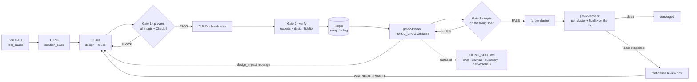
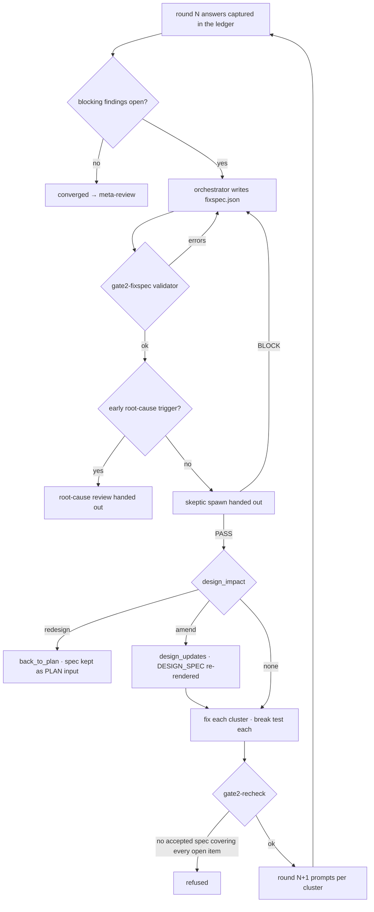

# Pipeline anti-whack-a-mole: Gate 1 prevents, Gate 2 verifies, FIXING_SPEC converges

Status: DESIGN r2 (2026-10-19), approved by XG incl. §16 decisions; r2 = one adversarial round of fixes. Not implemented. Owner: XG + Swarm.
Builds on: `backend/scripts/design_spec.py` (root cause, solution class, design spec, break
tests, fix by class), `backend/core/run_docs.py` (run documents),
`backend/core/gate2_convergence.py` (round cap, root-cause review, one redesign).

## 0. Problem (verified against source)

The intent end now refuses symptom fixes (EVALUATE `root_cause`, THINK `solution_class`, PLAN
`design`). The two places where patches actually enter the code are still open:

| Where | What happens today | Source |
|---|---|---|
| Gate 1, before BUILD | The plan skeptic never sees the design, the solution class, the change spec or the root cause: its prompt carries only `approach / acceptance_criteria / boundaries / success_criteria / exit_criteria`. It judges a paragraph, not the plan. | `artifact_cli._write_gate1_prompt` |
| Gate 1 SSA polarity | For bugfix / existing-feature a patch with a KNOWN root cause is only a WARN ("patch-tolerant default"); it blocks only when the root is unknown or the layer is wrong; `refactor` blocks every patch. | `data/gate-prompts/gate1-skeptic.md` Check 4 |
| Reuse | Half a line in the Simplicity check ("solvable with existing tools" → WARN); the plan owes no evidence of having searched. | Check 3 |
| Gate 2 | Experts hunt bugs. Nobody checks the diff against the declared plan (siblings covered, structural change real, reuse honoured, fix at the root's layer). `code-quality` smells are "never a BLOCK" and it runs at REVIEW only. | `backend/experts/code/*.md` |
| After the parallel review | Findings are deduplicated by `path:line:category`, fixed one by one, re-checked one by one (max 3 rounds). The root-cause review fires only after round 3 failed — after three rounds of patches. Nothing groups findings by cause, decides one solution per group, or asks whether the plan was wrong. | `gate2-findings.md`, `gate2_convergence.outcome` |

## 1. Goals and non-goals

Goals:
- G1 A plan that patches a symptom, misses an instance, or rebuilds an existing mechanism
  is stopped BEFORE BUILD (no rework).
- G2 The diff is verified against what the plan declared.
- G3 Between the parallel review and any fix there is one written, validated, attacked
  FIXING_SPEC: findings grouped by cause, explicit scope and solution per group, and an
  explicit decision on whether the design changes. No fix without it.
- G4 FIXING_SPEC is surfaced like the other run documents.
- G5 Convergence is by cause: a recurring class goes to root-cause review immediately.

Non-goals:
- Not a new reviewer per concern: the Gate-1 skeptic is reused for the fixing spec.
- No change to which bug-hunting experts Gate 2 dispatches.
- Not semantic proof: validators check shape and coverage; skeptics judge substance (P7).

## 2. User workflow

1. Today: the chat shows REVIEW.md with findings marked `fixed`; how each was fixed is
   invisible, and rounds 2-3 find new holes next to the old patches.
2. After:
   1. PLAN → Gate 1 judges the full design (with its `reuse` evidence) and blocks a patch,
      a missed instance, or a rebuilt mechanism. The verdict row shows in the chat.
   2. BUILD → Gate 2: bug-hunting experts plus `design-fidelity` in one parallel batch.
   3. With blocking findings: FIXING_SPEC.md appears in the chat and the Canvas — clusters,
      scope, one solution each, reuse, design impact — then the skeptic's verdict on it.
   4. Fixes land per cluster; the recheck asks whether each CLASS is closed; a class that
      reopens goes straight to root-cause review (and possibly back to PLAN).
   5. The final summary card lists FIXING_SPEC.md beside the other four documents.

## 3. Architecture



## 4. Flow of one Gate-2 round



## 5. M1 — Gate 1 prevents

### 5.1 New PLAN field `design.reuse` (validator: `design_spec.plan_errors`, both tiers)

```json
"reuse": {
  "searched": ["grep -rn 'is_blocking' backend/core backend/scripts", "TECH.md § Architecture"],
  "existing": [{"what": "core.gate2_findings.is_blocking", "where": "backend/core/gate2_findings.py",
                "decision": "reuse", "why": "the one blocking rule every Gate-2 reader shares"}],
  "new_mechanisms": [{"what": "design_spec.fixing_spec_errors",
                      "why_no_existing": "no validator reads a fixing spec today; finding_errors judges one finding"}]
}
```

Rules:
- `searched`: >= 2 entries, each >= 8 chars (a command or a named source actually read).
- `existing[]` and `new_mechanisms[]` may not both be empty.
- `existing[].decision` ∈ `reuse | extend | refactor | replace`; `replace` also needs
  `consumers` (every old consumer migrated, R27) and `retire` (how the old one goes).
- `new_mechanisms[].why_no_existing` >= 30 chars.
- Light tier (bugfix / direct) included: the reuse question is cheapest exactly there.

### 5.2 Gate-1 prompt inputs (`_write_gate1_prompt`)

Sections become:

| # | Input | Source |
|---|---|---|
| 1 | Plan | `approach`, ACs, boundaries, success / exit criteria (as today) |
| 2 | Design | `plan.design`: `root_invariant`, invariants, states, failure modes, `reuse` |
| 3 | Change spec + file discovery | `plan.design_doc.change_spec`, `file_discovery` |
| 4 | Root cause + solution class | `understanding.root_cause`, `think.solution_class` |
| 5 | Rejected alternatives | `think.alternatives` (as today) |
| 6 | TECH.md Blocking Constraints | as today |
| 7 | IMPROVEMENT.md What Failed | as today |
| 8 | EVALUATE verdict + work type | as today |

Each input fenced as DATA (as today); `GATE1_INPUT_MAX_CHARS` per input. The plan digest
covers the whole plan artifact (it already does), so editing the design re-arms the gate.

### 5.3 New Check 6 — Anti-patch and reuse (gate1-skeptic.md)

```
### Check 6: Anti-patch and reuse
1. Root layer: does the change spec change the code at root_invariant.enforced_at, or
   does it guard the symptom in callers (special case, flag, try/except, retry, extra
   check)? Symptom guard → BLOCK.
2. Class coverage: is every sibling C<n> of the root cause in the change spec (or
   excluded in solution_class.covers with a reason)? A missed sibling → BLOCK.
3. Declared structure: solution_class.structural_change = refactor / redesign — does
   the change spec restructure (one path, old one retired) or add a second path next
   to the old one? Second path → BLOCK.
4. Reuse: grep for ONE existing mechanism with the same responsibility that
   design.reuse did not list. Found → BLOCK "reuse <symbol> at <path>". A
   new_mechanisms entry whose why_no_existing is false → BLOCK.
5. Net complexity: does the plan delete what it makes obsolete? Only additions for a
   fix → WARN with what should be deleted.
```

Output format gains `6. Anti-patch/reuse: [PASS | WARN | BLOCK]`.

**A declared patch is judged as a patch, not as a failed refactor.** When
`solution_class.verdict == "patch"` (declared P0, `p0_reason` + `follow_up`), items 1-3
do not apply (a P0 stop-the-bleeding guards the symptom by definition, and `covers` is
not required for a patch). Check 6 then asks only: is the patch the smallest one that
stops the harm, is the `follow_up` a real root-fix run / ToDo, and does item 4 (reuse)
hold. Verdict WARN at most, restating the follow-up. The same exemption applies to
design-fidelity's Layer / Patch-shape / Sibling rows (§6.3).

### 5.4 Polarity: no patch-tolerant default

Check 4 SSA: a PATCH is a **BLOCK on every strict profile**, except when
`solution_class.verdict == "patch"` (declared P0 with follow-up) — then WARN restating the
follow-up. The `refactor` inversion paragraph collapses into this one rule. Reason: the
EVALUATE bugfix rule already limits bugfix to an isolated code-line root, so an honest
bugfix plan is structural by construction; a patch-shaped bugfix plan is a real finding.

### 5.5 Card / ref changes

- `stages/plan.md` step 2 names `reuse` (size-neutral edit; card is at 4,996 / 5,000).
- `stages/ref/plan/design-spec.md` §1 gets the `reuse` schema and rules.
- `stages/ref/build/gate1.md` gets Check 6 and the polarity note.

## 6. M2 — Gate 2 verifies: expert `design-fidelity`

### 6.1 Dispatch

- PLAN stage-complete (strict profile, run past `FIDELITY_CUTOVER`, `solution_class`
  recorded) appends `design-fidelity` to `run.json.required_experts` (append-only, the
  existing R1.5a path). `_dispatch_experts` already adds every required expert, and D7
  (`run-commit`) already refuses without its marker. No new dispatch rule.
- Applies below the 50-line threshold too: the smallest patches are the ones it exists for.

### 6.2 Prompt inputs

`_write_expert_prompts` writes the standard gate2-adversarial prompt; for
`design-fidelity` it appends one fenced section "Declared plan":
`solution_class`, `design.root_invariant` + invariants, `design.reuse`,
`root_cause.recurrence.siblings`, `design_doc.change_spec`. On a recheck round the
section adds the accepted FIXING_SPEC clusters of the previous round.

### 6.3 The expert (`backend/experts/code/design-fidelity.md`)

Scope: the CODE against the declared plan. Not bugs (other experts own them).

| Check | Finding (severity) |
|---|---|
| Sibling coverage | a `C<n>` the plan covers is untouched in the diff (HIGH) |
| Structural change | `refactor` / `redesign` declared; the diff only adds, the old path still has callers (HIGH) |
| Reuse honoured | `reuse.existing` says reuse / extend X; the diff re-implements X's job (HIGH) |
| Layer | the fix sits in callers, not at `root_invariant.enforced_at` (HIGH) |
| Patch shape | a new special case / flag / broad except / retry / sleep wrapping a symptom (HIGH if on the root path, else MED conf 7) |
| Duplication | a new function doing an existing one's job — one grep per new public symbol (MED conf 7) |
| Dead leftovers | an old path the plan retires still referenced (MED conf 7) |

Declared patch (`solution_class.verdict == "patch"`): the Sibling / Structural / Layer /
Patch-shape rows do not apply; the expert checks only that the diff is the declared
minimal patch, that it touches nothing beyond it, and Reuse / Duplication.

Rules: every finding names the plan clause it contradicts (`solution_class.covers[C1]`,
`reuse.existing[0]`, …); a finding without one is a code-quality opinion and is dropped
by the expert itself. `NO FINDINGS` must list the clauses checked. Findings enter the ledger
like any other and follow fix by class and FIXING_SPEC.

Recheck rounds: it reviews the FIX diff against the plan AND the accepted FIXING_SPEC
(did the fix do what its cluster said; is it a patch on a patch). Recheck prompts are
built by `cmd_gate2_recheck`, which cuts the round-1 prompt at `## The change` and writes
prompts only for specialists with fixed items. Two changes there: (a) `design-fidelity`
gets a recheck prompt on EVERY round that has fixes, whether or not it had items in
round 1; (b) its "Declared plan" + accepted-spec section is appended by the recheck
builder itself (after the cut point), not inherited from the round-1 prompt.

## 7. M3 — FIXING_SPEC converges

### 7.1 Command

```
artifact_cli.py gate2-fixspec --project P --run-id R --data @/tmp/R/fixspec.json
```

1. Computes the round's **open items** from the same source the convergence verdict uses
   (`gate2_convergence.open_items` on each reviewer's LATEST marker row): the blocking
   findings it reported in that row and the re-check items it answered NOT RESOLVED.
   Reported findings are mapped to ledger ids by `_gate2_finding_key`; re-check items to
   the cluster they belonged to. The ledger has no rounds today (one entry per specialist
   and finding key across the whole DELIVER cycle, `blocking` sticky), so it gains
   `first_round` (the index of the marker row that first reported the entry, rows oldest
   first) — a NEW finding of round N is an entry with `first_round == N`. Fails closed
   when the marker store is unreadable (same error as `gate2-ledger`).
2. Validates (`design_spec.fixing_spec_errors`, 7.3). Errors → `{"ok": false, errors}`.
3. Stores `evidence/fixing-spec-r<N>.json` (+ ledger record of its sha).
4. Renders `FIXING_SPEC.md` (run_docs, all rounds, newest first).
5. Decides the next step (7.5) and returns it: `skeptic` (with `spawn`, prompt
   `evidence/prompts/fixspec-skeptic-r<N>.md` = the Gate-1 skeptic prompt, mode "fixing
   spec", inputs = the spec + the ledger entries it covers + the design), `root_cause`
   (root-cause spawn), or `back_to_plan`.

### 7.2 Schema

```json
{
  "round": 1,
  "clusters": [{
    "id": "K1",
    "findings": ["correctness-1a2b3c", "security-9f8e7d", "design-fidelity-77aa01"],
    "cause": {"invariant": "I2", "why": "two writers build the args; nothing makes one own them"},
    "scope": {"sites": ["backend/cli.py::build", "backend/retry.py::rebuild", "backend/x.py:40"],
              "evidence": "grep -rn 'build_args\\|rebuild' backend → 3 sites, all listed"},
    "solution": "retry.py and x.py call cli.build; retry.rebuild is deleted",
    "reuse": {"mechanism": "backend/cli.py::build", "decision": "reuse"},
    "anti_patch": "no new guard: the second writer is removed, not checked",
    "design_impact": "none",
    "break_test": "backend/tests/test_args.py::test_one_writer_for_every_caller"
  }],
  "unrelated": [],
  "deferred": []
}
```

### 7.3 Validator rules (`design_spec.fixing_spec_errors`)

- Coverage: every open item of this round (§7.1) is in exactly one cluster: a NEW
  blocking finding by its ledger id in `clusters[].findings`; a NOT RESOLVED re-check item
  through a cluster that `revises` the earlier cluster it belonged to (`revises: "K1"`, a
  revised solution, scope re-grepped). None missing, none twice. Non-blocking entries may
  be listed. A refuted finding is not clustered: it gets its `refuted` disposition.
- Per cluster: `id` K<n>; `cause.invariant` is a design `I<n>` or appears in
  `design_updates` (new invariant + `why_missed`); `cause.why` >= 20; `scope.sites` >= 1
  with `scope.evidence` >= 20 (a grep / trace actually run); `solution` >= 20;
  `reuse.decision` ∈ reuse | extend | refactor | replace | none-exists (+ `why` >= 30 for
  none-exists); `anti_patch` >= 20; `design_impact` ∈ none | amend | redesign;
  `break_test` path::name.
- Degenerate split guard: N blocking findings in N single-finding clusters with N > 2, or
  > 2 single-finding clusters touching one file → each needs an `unrelated[]` entry
  `{a: K1, b: K2, why}` saying why they share no cause. Default reading: one cause.
- `amend` → `design_updates` non-empty; `redesign` → no fix expected this round.
- `deferred[]`: only a non-blocking finding, with reason (blocking ones cannot be deferred
  here; only the SOUND root-cause path defers them).

### 7.4 The skeptic on the fixing spec

The Gate-1 skeptic prompt with a mode line: "You receive a FIXING SPEC: findings grouped
by cause, with a solution per group." Checks run: 2 (failure pattern), 4 (SSA per cluster:
root vs symptom), 5 (API existence), 6 (anti-patch and reuse per cluster: layer, every
instance in `scope.sites`, grep for one site the scope missed, reuse), plus "Grouping: two
clusters that share a cause → BLOCK merge K1+K2; one cluster mixing causes → BLOCK split".
Bound like Gate 1 (3 files, 8 tool calls). Verdict marker binds to the spec's sha with the
existing hand-out mechanism (`gate1_handout`-style `fixspec_handout` in run.json + ledger).

### 7.5 Next-step decision (in `gate2-fixspec`)

| Condition | Next |
|---|---|
| any cluster `design_impact: redesign` | `back_to_plan` (uses the one-redesign budget of `gate2_convergence`) |
| >= 2 clusters whose invariant is NEW (from `design_updates`) | `root_cause` now |
| a cluster whose invariant is `root_invariant` | `root_cause` now (the root fix failed) |
| a NEW finding (`first_round == N`) whose site is in the `scope.sites` of a cluster accepted in an earlier round, or that names its invariant (reopen: the class fix failed) | `root_cause` now |
| a cluster `revises` an earlier one a second time (two fixes of one class did not close it) | `root_cause` now |
| otherwise | `skeptic` |

A root-cause verdict SOUND → `skeptic` (fix as specified); WRONG-APPROACH → `back_to_plan`.

### 7.6 Chokepoints (what makes it mandatory)

1. `gate2-recheck` refuses when the round's ledger has blocking open entries and no
   ACCEPTED spec (validator ok + skeptic PASS marker bound to its sha, not stale) covers
   every one of them.
2. DELIVER `stage-complete`: each fixed blocking finding's disposition carries
   `cluster: K<n>` of an accepted spec; fix-by-class fields default from the cluster
   (`invariant` = cause.invariant, `class_fix` = solution + scope, `break_test`).
3. Recheck prompts are per cluster: "is this class closed at every site in scope", plus
   the finding wording.
4. `gate2_convergence.outcome` changes so an early root-cause review works:
   - each root-cause hand-out gets an id (`root-cause-r<N>`, the round that requested it)
     and `outcome` reads only the verdict of the LATEST hand-out — an old SOUND never
     answers a new reopen, and a reopen never re-hands-out a review already pending;
   - the verdict is consumed BEFORE the cap test: WRONG-APPROACH → `redesign` (one-redesign
     budget) at any round; SOUND → `recheck` with the spec accepted as written;
   - `_gate2_convergence_errors` records an early `redesign` the same way as a capped one;
   - the root-cause prompt states the trigger it was handed out for (reopen / new
     invariants / root invariant / round cap) instead of the hard-coded "three Gate-2
     review rounds".
5. Completion: `run_docs.completion_check` requires FIXING_SPEC.md when the run has an
   accepted fixing spec on disk (§8).
6. Closing the side doors: (a) DELIVER `stage-complete` itself re-checks that every
   Gate-2 round with open items has an accepted spec (rounds counted from the marker rows),
   so the "late snapshot → re-spawn the round-1 prompts directly" path cannot skip
   `gate2-recheck` and the spec with it; (b) `gate2_recheck_unverified_reason` waives the
   re-check only, never the fixing spec; (c) the `cluster: K<n>` requirement applies to
   every fixed blocking finding in `adversarial_review.findings[]`, whether it came from
   the ledger (`findings_from: "ledger"`) or was written by hand.

## 8. M4 — Surfacing

- FIXING_SPEC.md is NOT a stage document: `DOCS` keys documents by source stage, and
  `required_docs` / `completion_check` / `write_all` only know stages, so a fake `"gate2"`
  stage would never be required or rendered. It gets its own path in run_docs:
  `render_fixing_spec(run_dir)` reads `evidence/fixing-spec-r*.json` (all rounds, newest
  first) and the matching skeptic / root-cause verdicts; `write_fixing_spec(run_dir)` is
  called by `gate2-fixspec` and by `write_all`; `doc_status` lists it as a fifth entry
  with `required = any spec file exists` (else reason "not needed: Gate 2 had no blocking
  findings"); `completion_check` errors when a spec file exists and the document cannot
  be written.
- Emitted when `gate2-fixspec` accepts: the orchestrator already watches every
  `artifact_cli … --run-id` call; on a successful `gate2-fixspec` result it emits a
  knowledge `file_changed` for FIXING_SPEC.md (Canvas opens it) — the stage-row path stays
  for stage transitions.
- Chat summary card + `_display_block`: a fifth row between REVIEW.md and REPORT.md
  (`N clusters · M findings · design impact`).
- Deliverable B: copied with the other run documents (home path → `~`).
- REVIEW.md: each Gate-2 finding row shows its cluster id.

## 9. States

| State | Created by | Removed by | Crosses |
|---|---|---|---|
| `evidence/fixing-spec-r<N>.json` | `gate2-fixspec` (validated) | never (audit) | same round resubmitted → replaced, sha changes, skeptic must re-judge; redesign → kept, handed to PLAN; abandon → stays |
| `run.json.fixspec_handout` (+ ledger) | `gate2-fixspec` when it hands out the skeptic | replaced by the next hand-out | spec edited after PASS → sha mismatch → recheck refuses |
| skeptic marker (`gate1-skeptic`, mode fixspec) | runtime hook at SubagentStop | never | bound by prompt sha (existing `_handout_unread`) |
| `FIXING_SPEC.md` | run_docs from all spec rounds | rewritten each round / completion | required at completion iff a spec exists |
| `design.reuse` | PLAN artifact | replan | Gate 1 judges; design-fidelity verifies |
| `required_experts += design-fidelity` | PLAN stage-complete | never (append-only) | D7 at run-commit |

## 10. Invariants

- **I1** No fix is recorded for a blocking Gate-2 finding unless an accepted fixing spec
  covers it — `gate2-recheck`, DELIVER `stage-complete`.
- **I2** Every blocking open finding of a round is in exactly one cluster bound to a design
  invariant — `design_spec.fixing_spec_errors`.
- **I3** A plan reaches BUILD only after a skeptic judged it with its design, solution
  class, change spec, root cause and reuse — `_write_gate1_prompt`.
- **I4** The diff is verified against the declared plan by a required expert —
  `required_experts` + D7.
- **I5** A recurring class goes to root-cause review in the round it recurs —
  `gate2-fixspec` next-step + `gate2_convergence.outcome` reopen rule.
- **I6** A patch is never undeclared: blocked at Gate 1 (Check 4/6), at Gate 2
  (design-fidelity patch shape) and in the fixing spec (skeptic Check 6).

## 11. Failure modes

- **F1** N one-finding clusters to dodge synthesis → degenerate-split guard + skeptic
  "merge" check.
- **F2** Spec edited after the skeptic's PASS → sha mismatch → recheck refuses.
- **F3** Ledger / marker store unreadable → `gate2-fixspec` fails closed with an explicit
  error (never treated as "no findings").
- **F4** Redesign loop → the existing one-redesign budget; a second redesign → SOUND path
  (open items to REPORT §10, push_ready false).
- **F5** In-flight runs → `FIDELITY_CUTOVER` / `FIXSPEC_CUTOVER` by ledger created_at;
  older runs warn.
- **F6** The skeptic is unavailable (spawn rejected) → retry once, then checkpoint
  `gate_spawn_blocked` (same as Gate 1); never self-review.
- **F7** design-fidelity floods on a tiny diff → every finding must cite a plan clause;
  uncited findings are dropped by the expert's own rules.
- **F8** Skeptic BLOCK → resubmit loop on the fixing spec (skeptic rounds are not Gate-2
  reviewer rounds: `gate1-skeptic` is in `NOT_REVIEWERS`) → at most 2 BLOCKs per round;
  the 3rd submission of the same round hands out the root-cause review instead (a spec
  that cannot be agreed means the approach is unclear).
- **F9** A legal declared P0 patch blocked by structural checks → §5.3 / §6.3 exemption.

## 12. Test plan (break tests)

| Target | Test |
|---|---|
| I2 / F1 | validator: missing finding, duplicated finding, N single clusters without `unrelated`, bad invariant |
| I1 | gate2-recheck refused without a spec; refused with a spec not covering an open id; refused with a stale skeptic marker (F2) |
| I3 | the Gate-1 prompt file contains the design, solution class, change spec, root cause, reuse |
| I4 | PLAN stage-complete appends design-fidelity; D7 refuses run-commit without its marker |
| I5 | reopen: a round-2 NEW finding on a site of an accepted K1 → next = root_cause; >= 2 new invariants → root_cause; a second `revises` of K1 → root_cause; an early WRONG verdict → redesign before the cap; an old SOUND does not answer a new reopen |
| F8 | third submission after two skeptic BLOCKs in one round → root_cause hand-out |
| F9 | declared P0 patch: Check 6 / fidelity structural rows skipped, WARN only |
| side doors | late-snapshot path: DELIVER stage-complete refuses a round with open items and no accepted spec; unverified reason does not waive the spec; a hand-written finding without `cluster` refused |
| I6 | gate1-skeptic prompt: Check 6 present; Check 4 says BLOCK for bugfix patches |
| F3 | unreadable marker store → gate2-fixspec ok:false |
| surfacing | FIXING_SPEC.md rendered; required at completion iff a spec exists; summary card 5th row; deliverable B copy; orchestrator emits file_changed on gate2-fixspec |
| templates | every published template passes its own gates (extends the existing template test) |

## 13. File changes

| File | Change |
|---|---|
| `backend/scripts/design_spec.py` | `reuse` rules in `plan_errors`; `fixing_spec_errors`; `FIXSPEC_TEMPLATE`; cutovers |
| `backend/scripts/artifact_cli.py` | `_write_gate1_prompt` inputs; `cmd_gate2_fixspec`; recheck chokepoint; per-cluster recheck prompts; PLAN stage-complete appends design-fidelity; design-fidelity "Declared plan" section in `_write_expert_prompts`; disposition `cluster` |
| `backend/core/gate2_convergence.py` | reopen rule input (accepted clusters) |
| `backend/core/run_docs.py` | FIXING_SPEC.md renderer, conditional requirement, cluster column in REVIEW.md |
| `backend/core/pipeline_stage_events.py` / `streaming_orchestrator.py` | surface FIXING_SPEC.md on a successful `gate2-fixspec` |
| `backend/core/run_delivery_summary.py`, frontend `TurnCards.tsx` | fifth row |
| `backend/experts/code/design-fidelity.md` | new expert (passes `scripts/lint_experts.py` D3) |
| `data/gate-prompts/gate1-skeptic.md` | Check 6, polarity, fixing-spec mode |
| `stages/plan.md`, `deliver.md`, `ref/plan/design-spec.md`, `ref/build/gate1.md`, `ref/deliver/gate2-findings.md` | size-neutral card edits; detail in refs |
| `backend/scripts/artifact_cli.py` (ledger) | `first_round` on ledger entries (after the ledger lands) |
| tests | per §12 |

## 14. Order and dependencies

1. **Run A (now, no shared files in flight):** M1 (reuse field, Gate-1 inputs, Check 6,
   polarity) + M2 (design-fidelity expert, required_experts at PLAN, prompt section).
2. **Run B (after the parallel session commits the Gate-2 ledger in `artifact_cli.py` and
   `gate2-findings.md` / `deliver.md`):** M3 + M4.
   `deliver.md` is currently over its 5,000-char limit in that session's uncommitted work;
   M3's card edit must be size-neutral against its committed version.

## 15. Cost

Per run: Gate 1 reads more input (same single skeptic); +1 required expert per Gate-2
round. Per round with blocking findings: one fixing spec (structured, code-rendered) and
one skeptic. Saved: the rounds spent re-patching, and the root-cause review moves from
"after 3 failed rounds" to "the round a class recurs".

## 16. Decisions (XG, 2026-10-19)

- **D1 — `design-fidelity` runs at Gate 2 only, not at REVIEW.** Gate 1 covers the plan,
  Gate 2 the code; a REVIEW spawn would review a diff BUILD's break tests already exercised.
- **D2 — the fixing-spec skeptic is never skipped**, not even for one blocking finding with
  `design_impact: none`: a single finding is the most common whack-a-mole case (one site
  fixed, siblings missed), and the skeptic's "missed site" grep is the point.
