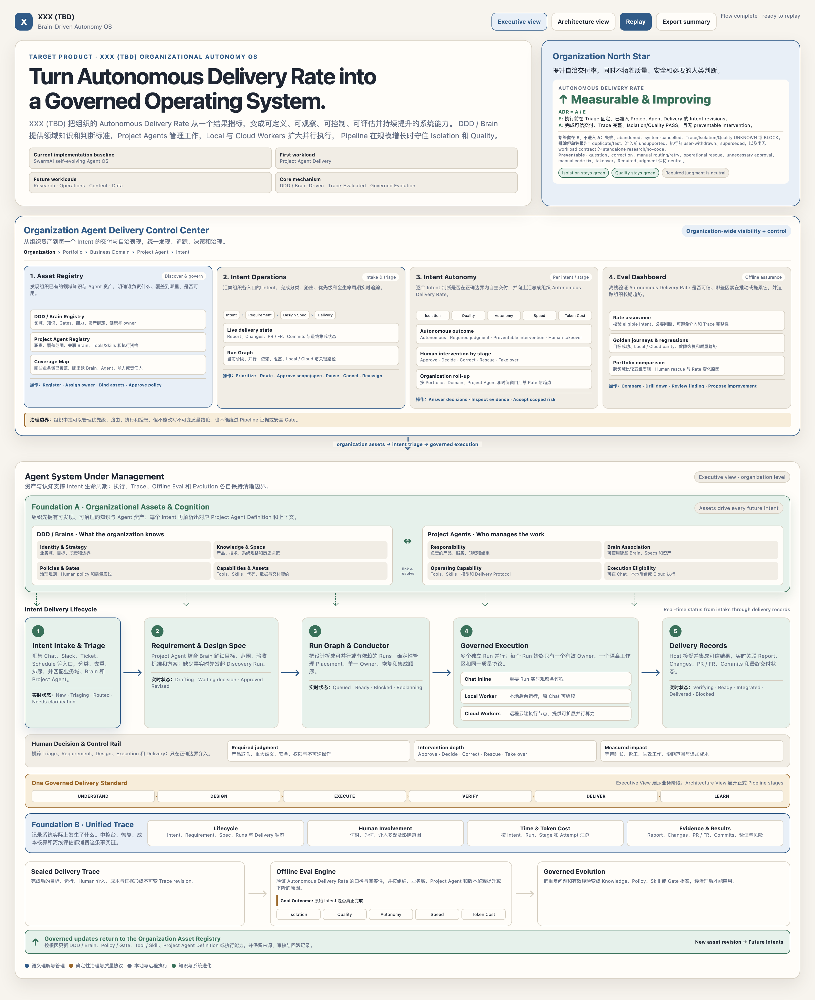
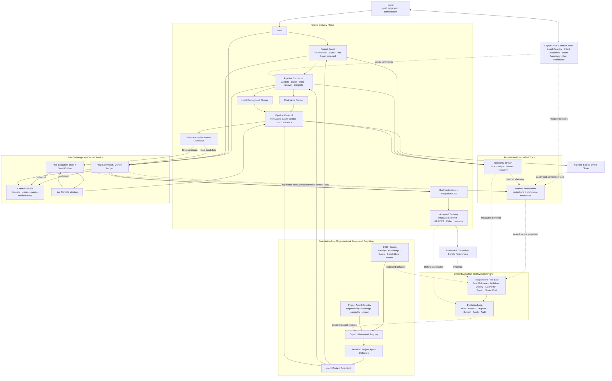
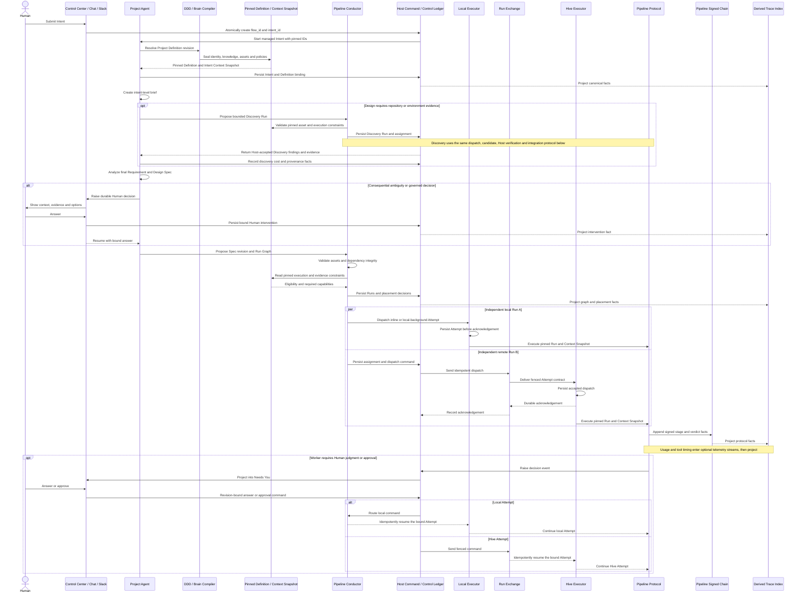

# High-Level Design: XXX (TBD) Organizational Autonomy OS

## 1. Executive summary

**XXX (TBD) is an Organizational Autonomy Operating System:** a DDD/Brain-driven
platform that helps an organization define, run, measure, govern, and continuously improve
autonomous work. **SwarmAI** is the current implementation baseline and codebase; it remains
the name used when this document refers to existing modules, runtime behavior, or source.

**Project Agent Delivery is the first complete workload on the OS, not the product boundary.**
It turns a human or organizational Intent into one or more governed Pipeline runs. A run can
execute visibly in a Chat Tab, in a local background worker, or on a remote cloud worker
(current implementation term: Hive executor). Multiple runs may execute in parallel, but
every run keeps one active owner, one pinned project-definition revision, one code tree, and
one Pipeline completion protocol.

The architecture has two foundations and two loops:

- **DDD / Brain** defines how the system should understand, judge, and act.
- **Unified Trace** records what actually happened, including human intervention and cost.
- **Delivery Loop** turns intent into verified delivery through Project Agent, Conductor,
  and Pipeline workers.
- **Evolution Loop** mines Trace, Reflect, and offline Eval findings and makes governed
  improvements to the Brain for future work.

The Project Agent does not certify its own work. The Conductor does not judge code quality.
Local and Hive workers do not accept their own results. Pipeline Protocol computes each
run's completion from evidence bound to its current code tree. Offline Flow Eval examines
sealed traces later and never blocks the online Delivery Loop.

### 1.1 Product positioning

**Category:** Organizational Autonomy Operating System.

**One-line positioning:**

> A DDD/Brain-driven operating system that helps organizations define, run, measure,
> govern, and continuously improve autonomous work.

**Chinese positioning:**

> 一套由 DDD/Brain 驱动，帮助组织定义、运行、度量、治理并持续提升自治工作的操作系统。

The product is not a multi-agent launcher, coding workflow, or personal task dashboard. It
is the organization-wide operating layer that connects knowledge and Agent assets, Intent
operations, local and cloud execution, quality governance, Human control, factual Trace,
offline assurance, and governed evolution.

### 1.2 Organizational north star

The business goal is to increase **Autonomous Delivery Rate (ADR)** without weakening
Isolation, Quality, or necessary Human judgment.

#### Eligibility denominator

Eligibility is fixed at triage for each immutable Intent revision, before execution and
before its outcome is known. The denominator `E` contains every Intent revision admitted to
the registered `project_agent_delivery` workload with explicit acceptance criteria and a
policy-backed automation-eligibility decision.

- **Included:** delivered, failed, abandoned, timed-out, and system-cancelled admitted
  revisions. Failure cannot remove work from the denominator.
- **Excluded, but reported:** duplicate/test/synthetic Intents; unsupported or out-of-scope
  Intents rejected before admission; a user withdrawal before execution; and superseded
  revisions.
- **Research/no-code:** a Discovery Run is a child of its parent Intent and contributes cost
  and intervention facts, but is not a second denominator item. A standalone research or
  no-code Intent is excluded from this delivery rate until its workload has a registered
  outcome and evidence contract.
- **Human rescope:** the superseded revision is excluded and its successor is counted. A
  rescope that corrects system misunderstanding carries a `human_correction` intervention
  into the successor's final classification.

The dashboard always reports **Eligibility Coverage** and exclusion reasons beside ADR, so
teams cannot raise the rate merely by declaring difficult work ineligible.

#### Numerator and intervention contract

The numerator `A` contains the eligible Intents that:

1. reached trustworthy delivery under their registered acceptance contract;
2. have complete required Trace and intervention classification;
3. have Run Isolation = PASS and Quality = PASS for every required Run; and
4. contain none of the canonical preventable interventions:
   `preventable_question`, `human_correction`, `manual_routing`, `manual_retry`,
   `operational_rescue`, `unnecessary_approval`, `manual_code_fix`, or `takeover`.

Required product judgment and scoped security, permission, production, and irreversible-
action approval are neutral. Avoiding a necessary question never increases autonomy.

```text
Autonomous Delivery Rate = A / E × 100
Evidence Coverage = eligible Intents with complete classification / E × 100
```

An eligible Intent with incomplete Trace, UNKNOWN intervention classification, or UNKNOWN
Isolation/Quality remains in `E` and never enters `A`. A BLOCK also remains in `E` and never
enters `A`. Organization, portfolio, domain, Project Agent, and time-window roll-ups sum the
same `A` and `E` counts; they never average child percentages. Workload and risk-class mix is
shown beside comparisons to prevent misleading cross-team ranking.

### 1.3 Project Agent Delivery is the first workload

The initial end-to-end workload is software and product delivery:

```text
Intent → Requirement → Design Spec → Run Graph
       → Chat / Local / Cloud execution
       → Report / Changes / PR or FR / Commits
       → governed integration and learning
```

The OS boundary is wider. The same Asset Registry, Intent Operations, Human control, Trace,
Eval, and Evolution foundations can later manage research, operations, content, data, and
other domain work. Pipeline is the first mature delivery runtime, not the only possible
runtime.

| Autonomy OS layer | Initial Project Agent Delivery implementation |
|---|---|
| Cognition kernel | DDD / Brains, Definition compiler, Context Snapshot |
| Agent registry | Project Agent discovery, responsibility, coverage, capabilities |
| Work runtime | Intent triage, Requirement, Design Spec, Run Graph |
| Scheduler | Deterministic Pipeline Conductor |
| Compute fabric | Chat inline, local background and cloud workers |
| Trust kernel | Pipeline Protocol, evidence binding, Host acceptance |
| Human control plane | Decision, approval, correction, rescue, takeover |
| Observability | Unified Trace and organization Control Center |
| Assurance | Offline Eval and Autonomous Delivery Rate analysis |
| Upgrade system | Governed Evolution into Brain, Agent, Policy, Gate and Skill assets |

### 1.4 Executive one-page architecture

The following figure is the VP-level operating model. It shows the organization Control
Center, Asset Registry, Intent lifecycle, five Pipeline dimensions, Human intervention,
Trace, Offline Eval, and the governed return into future organization assets.



*Figure 1 — Organizational Autonomy OS: one organization-wide control plane, Brain-driven
work, governed local/cloud execution, measurable autonomy, and a closed learning loop.*

## 2. Goals

1. Discover and govern organization assets: DDD / Brains, Project Agents, responsibilities,
   coverage, capabilities, owners, and delivery eligibility.
2. Manage every Intent through triage, Requirement, Design Spec, execution, and linked
   Delivery Records such as reports, changes, PR/FR, commits, and integration state.
3. Measure and improve Autonomous Delivery Rate without weakening Run Isolation, Quality,
   or necessary Human judgment.
4. Preserve visible Chat-inline Pipeline execution for important work.
5. Support local background and remote cloud Pipeline runs without occupying the origin Chat.
6. Run independent work in parallel without weakening Pipeline evidence or ownership.
7. Trace the complete flow, Human involvement, time, Token cost, evidence, and learning.
8. Evaluate Goal Outcome and the Pipeline five dimensions offline across Intent, Project
   Agent, business domain, portfolio, organization, and time.
9. Compound value by feeding trusted lessons through the existing Evolution and DDD systems.

## 3. Non-goals

- Do not split one Pipeline run across stage-specific agents.
- Do not introduce stage time-slicing to inflate the number of concurrent runs.
- Do not create a shared mutable database written by Host and Hive.
- Do not let a Project Agent, Conductor, or worker self-certify delivery quality.
- Do not put Flow Eval or an LLM judge on the online delivery critical path.
- Do not copy DDD knowledge, asset contracts, or Pipeline rules into a second authority.
- Do not stream every token or duplicate complete tool output into the Trace store.
- Do not push, deploy, or publish merely because remote execution completed.
- Do not promise lossless SDK-session migration between different machines.

## 4. Current state and target delta

Today, SwarmAI already has the six-section DDD brain, Pipeline v1 with signed events and
five-dimension Run Audit, Chat/Slack channels, scheduled jobs, and Hive as a full EC2-hosted
SwarmAI daemon. These are useful building blocks, but they are not yet one distributed
Project Agent system.

The target adds four missing capabilities:

1. a Project Agent management layer above individual Pipeline runs;
2. a deterministic Conductor for work graphs, placement, leases, and recovery;
3. a Host-to-Hive Run Exchange protocol and remote executor role;
4. an intent-level Trace and offline Flow Eval above per-run evidence.

A current Hive is an independent SwarmAI instance. A target Hive Executor is a registered,
capability-described node that accepts fenced Pipeline assignments from a Host Conductor.
That transition requires a new trust and communication boundary; it is not a new label for
the existing Hive API.

## 5. Core definitions

| Term | Definition | Owns | Explicitly does not own |
|---|---|---|---|
| **Autonomy OS** | The organization-wide operating layer for defining, running, measuring, governing and improving autonomous work. | Asset and Intent operating model, cross-cutting contracts and assurance boundaries. | One workflow, one Agent, or one software-delivery method. |
| **Autonomous Delivery Rate** | `A / E`: eligible Intent revisions delivered with complete classification, Isolation PASS, Quality PASS, and zero canonical preventable intervention. UNKNOWN/BLOCK remains denominator-only. | Organization north-star counts, Eligibility Coverage and exclusion breakdown. | A zero-human-touch target, outcome-dependent eligibility, or weighted quality score. |
| **Asset Registry** | The discoverable organizational catalog of DDD / Brains and Project Agents. | Responsibility, coverage, associations, health, capability, ownership and revision references. | The authored Brain content or mutable execution state. |
| **DDD / Brain** | The project's long-lived cognition and governed knowledge substrate. | Identity, knowledge, gates, capabilities, asset delivery contracts, refresher. | Runs, worker leases, current stage, queues, live telemetry. |
| **Project Agent Definition** | A versioned, resolved operating view compiled from existing DDD sources. | References, digests, policies and eligibility constraints for one revision. | A copied Brain, task history, executor health, mutable runtime state. |
| **Intent** | The human goal being managed end to end. | Original request, scope evolution, acceptance intent, human decisions. | Pipeline implementation details. |
| **Project Agent** | The semantic manager bound to one Project Agent Definition. | Requirement analysis, Spec proposal, Run Graph proposal, result aggregation. | Coding, placement authority, worker lease, Pipeline quality verdict. |
| **Pipeline Conductor** | Deterministic control-plane runtime for many runs. | Graph validation, dependencies, placement, ownership, leases, commands, recovery, landing order. | Product judgment, stage implementation, code-quality certification. |
| **Pipeline Run** | One independently verifiable Agent Delivery Unit. | One requirement, pinned context, attempts, final tree, evidence, REPORT. | Other runs or the parent Intent's overall success. |
| **Run Attempt** | One continuous execution attempt on one executor and one agent session. | Attempt-local session, worktree, events and result candidate. | Permanent Run ownership after its lease is superseded. |
| **Executor** | A local or Hive runtime that performs a Run Attempt. | Compute and observed execution facts. | Desired state, final result acceptance, parent Intent decisions. |
| **Run Exchange** | The protocol between Host control plane and Hive execution plane. | Idempotent commands, replayable events, immutable bundles, fencing metadata. | Shared mutable state or cross-Hive coordination. |
| **Unified Trace** | The provenance spine from Intent to model/tool activity and delivery. | Small facts, identities, timing, human involvement, usage and evidence references. | Long-term cognition or duplicate transcript bodies. |
| **Control Center** | The human-facing projection and command surface for the full system. | Views, drill-down, revision-bound commands. | Canonical state, live filesystem inference, ad-hoc Eval. |
| **Offline Flow Eval** | Independent assessment over sealed Flow traces. | Goal Outcome plus Run Isolation, Quality, Autonomy, Speed and Token Cost findings. | Online blocking, Pipeline completion, direct Brain mutation. |
| **Evolution Loop** | Existing governed mechanisms that convert trustworthy experience into future capability. | Mining, assessment, proposals, governed application and audit. | Immediate self-modification by the agent that performed the work. |

## 6. Architecture



### 6.1 Foundation A: Organizational Assets and Cognition

The organization foundation contains two discoverable, governed registries:

- **DDD / Brain Registry** — what the organization knows and how it judges;
- **Project Agent Registry** — who manages each domain, responsibility, and outcome.

The Asset Registry exposes ownership, coverage, health, relationships, capability,
eligibility and revisions. It does not copy the authored Brain or become a runtime state
store. A coverage view can therefore show which business domains have a responsible Agent
and trustworthy Brain, and which are missing knowledge, capability, delivery contracts, or
an accountable owner.

The Brain is the system's long-lived source of project judgment. SwarmAI's existing
six-section DDD remains authoritative:

1. **Identity** — what the project is and where its scope ends;
2. **Knowledge** — PRODUCT, TECH, IMPROVEMENT, PROJECT, domain material and decisions;
3. **Gates** — matured failure classes that must become structurally impossible;
4. **Capabilities** — portable Skills, tools, and AIM execution capability;
5. **Delivery Contract** — governed assets, repositories, branches, build and review paths;
6. **Refresher** — regeneration of derived projections from governed assets.

The Brain supports the whole flow, but online execution must not repeatedly scan all live
DDD files. A Definition Compiler produces a content-addressed Project Agent Definition when
its owned sources change. Intent preparation then creates a smaller, immutable Context
Snapshot with relevant source references and digests. Every Run pins both revisions.

This gives Brain-driven judgment without allowing mid-run Brain edits to silently change a
Run's scope, evidence requirements, or completion criteria. Local and Hive execution receive
the same pinned snapshot, which is required for parity.

### 6.2 Project Agent Definition

The Definition is a derived projection, not a second authority. Its authored inputs live in
the runtime DDD root `${SWARM_WORKSPACE}/Projects/<project>/`; they are not source files in
the SwarmAI product repository. It resolves:

- project identity and scope;
- DDD source references and freshness;
- governed asset and repository contracts;
- available project capabilities;
- Intent-to-Spec and Human Loop policy references;
- local and remote execution constraints;
- additional evidence and reflection destinations.

Existing owners remain unchanged: `aim.json` owns AIM/export declarations,
`bindings.yaml` owns governed assets and delivery contracts, section ② owns knowledge,
section ③ owns project gates, and section ④ owns domain capabilities. Only policy that no
existing section can express may add a new authored source.

### 6.3 Project Agent

The Project Agent is the semantic manager. It may read the pinned Definition, create an
intent-level brief, clarify real ambiguity, produce Requirement and Design Spec revisions,
propose a dependency-aware Run Graph, and aggregate child results. It does not perform
substantive repository or environment investigation inline.

When a trustworthy Design Spec requires evidence not already present in the pinned Brain and
Context Snapshot, the Project Agent proposes one or more **Discovery Runs** first. A Discovery
Run is a normal traced Pipeline research Run with a bounded question, read-only or explicitly
scoped assets, cost, evidence and result. Its accepted findings feed the next Requirement or
Spec revision. The initial brief may describe only the goal, known scope and discovery
questions; final implementation Runs are not admitted until the resulting Spec is sufficient.

The Project Agent cannot stamp a worker binding, hold a lease, declare a run complete,
accept remote evidence, or change a Pipeline verdict. Its Discovery or implementation Run
Graph is a proposal until the Conductor validates asset scope, dependency integrity, and
execution eligibility.

### 6.4 Pipeline Conductor

The Conductor is deterministic code, not a continuously running LLM. It owns:

- Run identity creation after a proposed graph is accepted;
- Run Graph validation and dependency release;
- placement across inline local, background local, and Hive remote execution;
- executor capability matching;
- one active lease and monotonic lease epoch per Run;
- command routing, event ingestion, recovery, and cancellation;
- per-repository integration and landing serialization;
- projections consumed by the Control Center.

A semantic re-plan is routed back to the Project Agent only when facts invalidate the
Requirement, Spec, or Run Graph. Mechanical queueing, deduplication, timeout, lease, and
recovery decisions never require a model pass.

### 6.5 Pipeline Run and Run Attempt

A Pipeline Run is the delivery unit. It pins one Requirement, Definition revision, Context
Snapshot, repository base, Pipeline protocol revision, and evidence contract. Current
profile sequences remain owned by the Pipeline protocol registry; the HLD never maintains a
second stage list.

Distributed execution requires one deliberate Pipeline-protocol cutover. The current v1
`land` event combines integration landing, DELIVER completion, and transition to REFLECT;
it cannot coexist with a separate Host-acceptance step. The target protocol therefore
separates four immutable facts, with one writer for each:

1. **`pipeline_verdict`** — Pipeline Protocol records immutable quality/check results bound
   to the final candidate tree;
2. **`result_candidate`** — the active executor seals that tree, evidence, REPORT candidate,
   Attempt checkpoint, and protocol facts into an immutable bundle;
3. **`result_acceptance`** — Host verification records whether that exact candidate is
   eligible for integration; this is conditional until the integration transaction succeeds;
4. **`integration_landing`** — the Host's per-repository compare-and-swap transaction records
   the actual integrated commit, after which the Run enters REFLECT.

This split replaces the current combined landing transition in one cutover for every
placement, including Chat-inline and local-background execution. Local standalone execution
uses the same Host acceptance and integration path; it does not retain a hidden legacy
landing path. There is one protocol state machine, not a remote wrapper around different
local semantics.

`quality_verdict` and failed checks never change. `delivery_disposition` is separate and may
be `accepted`, `revalidation_required`, `rejected`, or `human_override_landed`. A scoped
human override may authorize integration, but it retains the original immutable quality
verdict, failure reason, evidence, actor, bindings and expiry. Parent Intent aggregation
never converts an overridden quality BLOCK into PASS.

A Run may have more than one sequential Attempt after failure, but only one active owner at
a time. Each Attempt has one executor, one agent session, one lease epoch, and one continuous
execution context. A transfer to another machine creates a new Attempt. It does not pretend
to preserve an SDK session that may not be portable across hosts.

Evidence from an abandoned Attempt is not final evidence for a later tree. The final quality
and delivery checks run against the accepted Attempt's current code tree and recorded base.

### 6.5.1 Attempt checkpoint contract

An Attempt may publish an immutable checkpoint before terminal completion. Its manifest
contains:

```text
run_id · attempt_id · producer_executor · lease_epoch
pinned_definition_revision · context_snapshot_digest · protocol_revision
base_commit · candidate_tree_digest · owned_paths
artifact_refs + digests · signed_event_cursor
completeness = complete | partial | interrupted
created_at · manifest_digest · producer_signature
```

A new Attempt may use verified source changes and complete artifacts from a checkpoint as
starting material. It may not reuse the previous Attempt's model-session state, test verdict,
review closure, authorization, completion verdict, or final evidence as proof. Every
execution-derived check is recomputed against the new Attempt's final tree. An absent or
unverifiable checkpoint falls back to the Run's original pinned base and contracts; the
system never invents recoverable state from a dead worker's memory.

### 6.5.2 Target delivery transition

```text
stage execution
  → pipeline_verdict + result_candidate
  → candidate_ready
      ├─ verification rejected → paused / failed with immutable reason
      ├─ integration head changed → revalidation_required → new Attempt
      ├─ Host CAS integration succeeds → integration_landed → reflecting → completed
      └─ scoped Human override integration succeeds
           → human_override_landed → reflecting → completed
              (original quality verdict remains WARN/BLOCK)
```

The protocol cutover updates lifecycle, event schema, Run Audit and landing together. There
is no period where a new Host acceptance layer and the old combined `land` semantics both
claim authority.

### 6.6 Execution modes

| Mode | Owner | User experience | Lifecycle boundary |
|---|---|---|---|
| **Chat inline local** | Current Chat Session | Full thought, tool, stage, and gate flow remains visible; the Tab is occupied. | Closing/stopping the active Tab stops that Attempt. |
| **Background local** | Dedicated local Pipeline Worker | Origin Chat returns to idle and may continue other work. | Daemon owns the worker and recovery. |
| **Background Hive** | Dedicated Hive Pipeline Worker | Host shows milestones, Human Loop, Trace, and result status. | Hive owns execution facts; Host owns desired state and acceptance. |

All three execute the same Pipeline Protocol. Display location and executor placement must
not create separate Pipeline implementations or weaker remote gates.

### 6.7 Organization Control Center

The Control Center is a projection and command surface with four primary organization-level
blocks:

1. **Asset Registry** — DDD / Brain and Project Agent discovery, coverage, ownership,
   capability, health and eligibility;
2. **Intent Operations** — organization intake and triage, Requirement/Spec lifecycle, Run
   Graph, execution and linked Delivery Records;
3. **Intent Autonomy** — Pipeline five dimensions, Human intervention by stage, and roll-up
   into Autonomous Delivery Rate;
4. **Eval Dashboard** — offline rate assurance, golden journeys, regressions, local/cloud
   parity and governed improvement findings.

Fleet health, detailed Trace, individual Run/Stage/Attempt evidence, and raw delivery records
are secondary drill-down capabilities inside those blocks, not competing top-level
information architectures. The UI never scans worktrees, infers state from chat text, or
computes Eval on open. Every mutation is a revision-bound command that the Conductor
validates and records.

## 7. Host-to-Hive Run Exchange

> Realised in `docs/design/pipeline-run-conductor-v1.md` §4.3 and §7.1 through a Central
> Service that Host and Hives both call outbound; Host and Hive never connect directly, and
> lease epoch authority for remote Runs sits with the Central Service.

Host and Hive must not update the same mutable row. The protocol separates desired state
from observed execution state.

| Store | Writer | Canonical facts |
|---|---|---|
| **Host Command / Control Ledger** | Host Conductor | Intent, Run Graph, Host-local Run assignment and lease, Human answers, result acceptance, landing, latest Eval report reference. For remote Runs only a cursor-backed projection of the Central record. |
| **Central Coordination Store** | Central Service | Remote Run requests, assignment, Attempt, lease epoch and worker incarnation, decisions, node registry, published DDD and Project Agent revisions, event mirror. The only owner of remote fencing. |
| **Hive Execution Store** | Assigned Hive | Accepted dispatch, worker session, Pipeline events, pending decision, sealed result manifest. |
| **Transfer Blob Store** | Central-verified uploads (S3) | DDD snapshots, every Run's Run record and result bundle. The source of the learning pipeline that reviews, distills and reflects results into DDDs through per-DDD storage adapters (`pipeline-run-conductor-v1.md` §4.4). |

Transport uses at-least-once delivery with idempotent effects:

- HTTPS commands for dispatch, answer, cancel and acknowledgement;
- append-only event outbox with sequence and cursor replay;
- immutable digest-addressed blobs for large data;
- message ID deduplication;
- Run ID, Attempt ID, lease epoch, sender identity and payload digest on every envelope.

A Hive persists a dispatch before acknowledging it. A disconnected Hive continues locally,
stores events in its outbox, and pauses rather than guessing when a Human decision is
required. The Host resumes from its last acknowledged cursor.

A remote `result_ready` event means execution finished and a sealed result exists. It does
not mean SwarmAI accepted the delivery. The Host first verifies sender, epoch, Definition and
Context revisions, source base, final tree, event integrity, Pipeline revision, and evidence
bundle. Final acceptance is not recorded before landing. Under the per-repository integration
lock, the Host rereads the integration head, compares it with the candidate's expected base,
applies the candidate with compare-and-swap semantics, records `result_acceptance` and
`integration_landing` together, and releases the lock. A head mismatch records
`revalidation_required`, never unconditional acceptance.

## 8. Unified Trace

Unified Trace is a derived, rebuildable index over canonical streams. It is not another
control ledger and no producer writes an independent copy of a state-changing fact into it.
The authorities are:

- Host Command / Control Ledger for desired state, Intent/Spec/graph revisions, Host-local
  assignments, Human answers, result acceptance and integration;
- Central Coordination Store for remote Run assignment, Attempt, lease and fencing;
- Pipeline signed event chain for Run checks, quality verdict, candidate completion and
  protocol transitions;
- Hive Execution Store and outbox for executor-observed Attempt facts;
- provider usage and tool telemetry streams for optional measurements.

The Trace projector consumes those streams idempotently and stores materialized views plus
immutable references. A projection can always be rebuilt from its source cursors.

Trace identity is hierarchical:

```text
flow_id → intent_id → spec_revision → run_id → attempt_id
        → stage → span_id → model_call_id / tool_call_id
```

The Trace index has three classes of projected data:

1. **Control projection** — rebuilt from required Host and Pipeline facts used for ownership,
   recovery and correct UI state;
2. **Telemetry projection** — rebuilt from asynchronous batched timing, usage, tool metadata
   and operational observations;
3. **Referenced content** — transcripts, logs, evidence and bundles remain in their owning
   stores and are opened by immutable reference.

Human intervention is a first-class Trace object. It records when and where intervention
occurred, the question or action, actor, answer, wait time, affected scope, invalidated work,
and downstream cost. Control depth is recorded as observe, approve, decide, correct, rescue,
or take over. Offline Eval later decides whether the intervention was required, appropriate,
preventable, missing, or harmful.

Each provider model call produces one usage record. Flow, Project Agent, Run, Stage, Attempt,
Reviewer, retry, and recovery cost are projections over those unique records. Missing usage
or event ranges produce `unknown`, never a fabricated zero.

### 8.1 Trace revisions and sealing

A Flow reaching terminal delivery creates a versioned Trace seal, not a claim that every
optional telemetry item has arrived. The seal records:

```text
trace_revision · flow_id · sealed_at
required Host-ledger cursor
required Pipeline-chain cursor for every Run
required Hive-outbox cursor for every remote Attempt
telemetry cutoff and per-source completeness flags
missing event ranges · unknown usage ranges
projection digest · immutable source references
```

Required control and Pipeline cursors must be complete before the terminal factual projection
is sealed, and that includes every required Run's terminal REFLECT outcome. A Flow may expose
an earlier **provisional** projection for live status, but the immutable, Eval-eligible seal
is created only after protocol completion. Optional telemetry may be incomplete without
blocking delivery; its measures are `unknown`. Data arriving after the cutoff never mutates a
sealed revision. It creates a superseding Trace revision with its own digest. An existing Eval
report remains bound to its original Trace revision, and a new revision may trigger a
replacement offline Eval report.

## 9. End-to-end flow



### 9.1 Completion, acceptance, and learning

```mermaid
sequenceDiagram
  participant L as Local Executor
  participant X as Hive Executor
  participant RX as Run Exchange
  participant P as Pipeline Protocol
  participant C as Pipeline Conductor
  participant Host as Host Command / Control Ledger
  participant CC as Control Center
  participant PS as Pipeline Signed Chain
  participant Trace as Derived Trace Index
  participant Eval as Offline Flow Eval
  participant Evo as Evolution Loop
  participant Brain as DDD / Brain

  P->>PS: Record immutable pipeline_verdict from bound facts
  alt Local result candidate
    P->>L: Seal tree, evidence, REPORT candidate and checkpoint
    L->>Host: Publish result_candidate reference
  else Hive result candidate
    P->>X: Seal tree, evidence, REPORT candidate and checkpoint
    X->>RX: Publish result_ready + immutable reference
    RX->>Host: Replay and persist result candidate fact
  end
  Host->>Host: Verify owner, epoch, digests, base, tree and evidence

  alt Candidate valid
    C->>Host: Begin per-repository integration transaction
    Host->>Host: Lock, reread head, compare expected base, integrate by CAS
    alt Head and candidate still valid
      Host->>Host: Atomically record result_acceptance + integration_landing
      Host->>PS: Append Host landing fact; transition Run to REFLECT
    else Integration head changed
      Host->>Host: Record revalidation_required, no acceptance
      Host->>C: Schedule a new fenced Attempt on current base
    end
  else Candidate invalid or stale owner
    Host->>Host: Record result_rejected with immutable quality facts retained
  end

  C->>CC: Project provisional Run and parent Intent status
  C->>C: Release dependent Runs after accepted prerequisites
  P->>PS: Record terminal REFLECT outcome for every required Run
  C->>Host: Mark parent Intent terminal when criteria met and all REFLECT done
  Host-->>Trace: Project a versioned immutable Flow seal from complete cursors
  C->>CC: Publish aggregate Delivery Report from the sealed projection

  Note over Eval: Scheduled or on-demand; never blocks Delivery
  Eval->>Trace: Read one immutable sealed Trace revision
  Eval->>Brain: Read its pinned expected goals and policies
  Eval->>Eval: Judge Goal Outcome + Isolation, Quality, Autonomy, Speed, Token Cost
  Eval->>Evo: Publish findings and trends
  Trace->>Evo: Supply repeated outcomes and corrections
  Evo->>Evo: Mine, assess, propose, govern, apply, audit
  Evo->>Brain: Update the correct owned source
  Brain->>Brain: Produce a new Definition revision for future Flows
```

## 10. Human Loop boundary

Human involvement is necessary when the system reaches a decision it should not make alone.
It is a defect when the system asks a person to perform work that existing facts or recovery
logic could determine.

| Intervention | Online behavior | Autonomy interpretation |
|---|---|---|
| Security, production, permission or external-send approval | Persist and wait for authenticated approval. | Required boundary; does not reduce autonomy. |
| Consequential requirement or product ambiguity | Project Agent raises evidence-backed options. | Required judgment when genuinely ambiguous. |
| User-initiated scope change | Revise Intent/Spec and invalidate affected work explicitly. | New human intent, not system failure. |
| Preventable question | Record the missing lookup or reasoning path. | Offline Eval warning. |
| Manual retry, routing or worker recovery | Record operator action, failed automation and affected Attempt. | Operational rescue; reduces autonomy. |
| Human code fix or delivery takeover | End or supersede the current Attempt with explicit provenance. | Severe autonomy failure; never hide inside a normal completion. |
| Gate/finding override | Preserve immutable quality verdict, failed checks, reason, evidence, actor, tree/action bindings and expiry; authorize only the exact integration action. | Delivery disposition records `human_override_landed`; Quality remains its original WARN or BLOCK and parent aggregation cannot promote it. |

## 11. Offline Flow Eval

Flow Eval is an independent observer over a sealed Intent-level trace. It is not another
Pipeline gate and does not run when the Control Center opens. It runs on a schedule, on
demand, or against a deployed-system golden journey after relevant releases.

**Goal Outcome is reported separately:** did the combined Runs satisfy the original Intent
and acceptance criteria? It is PASS, BLOCK, or UNKNOWN; green child Runs are not sufficient.

The operating dimensions remain the Pipeline's canonical five:

| Pipeline dimension | Flow-level question | Verdict rule |
|---|---|---|
| **Run Isolation** | Are Definition, owner, lease, code tree, evidence and result bindings trustworthy across all Runs and executors? | Any split ownership, stale evidence or contamination is BLOCK. |
| **Quality** | Did per-run and aggregate delivery remain verified after integration? | Quality cannot be offset by speed or Token cost. |
| **Autonomy** | Did the system complete mechanical work without avoidable Human correction, rescue or takeover while preserving required judgment? | Required judgment is neutral; preventable intervention reduces autonomy. |
| **Speed** | Where did critical-path time go across active work, queue, transfer, Human wait, recovery and landing? | Unknown spans remain unknown; parallel durations are not summed. |
| **Token Cost** | What did Project Agent, workers, reviewers, retries and recovery consume? | Unique provider-call records prevent double counting; missing usage is UNKNOWN. |

There is no weighted overall score. Isolation and Quality are hard constraints; Autonomy is
the primary product objective; Speed and Token Cost describe efficiency. Monetary and
infrastructure cost may be shown as supporting measures, not a sixth operating dimension.
Eval findings identify the responsible layer: Definition, context resolution, Spec,
decomposition, Conductor, executor, Pipeline, Human Loop, projection, Report, or Reflect.

### 11.1 Canonical aggregation

| Reported result | Run Audit input | Flow-level addition | Aggregation |
|---|---|---|---|
| **Goal Outcome** | None | Original Intent and aggregate acceptance criteria. | Flow-only semantic verdict; green child Runs never imply PASS. |
| **Run Isolation** | Run Isolation | Definition/Context binding, graph ownership, lease epochs, exchange integrity and integration transaction. | Any BLOCK is BLOCK; missing required evidence is UNKNOWN. |
| **Quality** | Run Quality | Cross-Run integration and aggregate evidence. | Any non-overridden BLOCK remains BLOCK; override never promotes quality. |
| **Autonomy** | Run Human-decision and approval facts | Preventable questions, manual routing/retry, rescue, correction and takeover. | Required boundaries are neutral; missing intervention capture is UNKNOWN. |
| **Speed** | Run wall, active and wait spans | Requirement, queue, transfer, recovery, dependency and landing critical path. | Interval union and critical path; unknown required spans propagate UNKNOWN. |
| **Token Cost** | Run Token Cost facts | Project Agent, retries, reviewers and recovery usage. | Unique provider-call records aggregate once; monetary/compute cost stays a separate measure. |

The current Pipeline protocol registry and Run Audit schema are the sole authorities for Run
stages and five-dimension facts. This HLD's diagrams are explanatory views generated from
that registry, not a second stage definition.

## 12. Evolution Loop

The design extends the existing SwarmAI Evolution Pipeline and DDD Cultivation mechanisms;
it does not create a second learning system.

Inputs include:

- Pipeline Reflect candidates;
- repeated Flow Trace patterns;
- explicit human corrections;
- offline Flow Eval findings;
- Local/Hive parity and recovery failures.

The governed path is:

```text
MINE → ASSESS ROOT CAUSE → PROPOSE → GOVERN → APPLY → AUDIT
```

A one-off event may become a finding. Repeated knowledge gaps may update section ②. A missing
capability may produce a Skill proposal. A repeated error class may mature into a section ③
Gate. Product judgment remains human-owned where policy requires it. The worker that produced
a lesson cannot directly rewrite the rules that certify its own work.

Every proposed Brain change carries its source Flow/Eval findings, root-cause hypothesis,
owner, affected policies, expected effect, affected Eval suites, and reversible prior revision.
After application, those suites and a bounded observation window test the hypothesis. A
security, integrity or quality regression triggers rollback to the prior revision; lack of
expected improvement marks the proposal ineffective and prevents silent promotion. The
outcome and rollback, when any, are auditable Evolution facts.

Every accepted change updates the correct existing source of truth and produces a new
Project Agent Definition revision. Existing in-flight Runs retain their pinned revisions;
future Flows consume the new Brain.

## 13. State and authority model

| Fact | Sole authority |
|---|---|
| Project identity and long-lived knowledge | DDD authored sources |
| Governed repositories and delivery contract | `bindings.yaml` |
| Project capabilities | `aim.json` plus section ④ capability packages |
| Resolved Project Agent Definition | Rebuildable Definition projection |
| Flow and Intent identifiers | Atomic Host intake transaction in the Host Command / Control Ledger |
| Intent content, Spec revision and Run Graph | Host Command / Control Ledger |
| Run desired state, assignment and lease | Host Conductor for Host-local Runs; Central Service for remote Runs (`pipeline-run-conductor-v1.md` §4.3) |
| Attempt observed execution state | Assigned executor's Execution Store |
| Immutable Pipeline quality verdict and result candidate | Pipeline Protocol signed event chain |
| Delivery disposition, result acceptance and integration landing | Host per-repository integration transaction |
| Remote executor observations | Hive Execution Store/outbox, replicated to Host |
| Unified Trace views | Rebuildable index over the canonical streams above |
| Human answer and authorization | Authenticated Host decision record |
| UI status | Rebuildable Control Center projection |
| Offline evaluation result | Eval subsystem and suite revision |

## 14. Five-dimension design test

### 14.1 Run Isolation

- Every Run pins Definition, Context, base, protocol and evidence-contract digests.
- Every Run has one active owner lease; a higher epoch fences stale executors.
- Every Attempt has an isolated worktree.
- Parallel Runs never share a writer or writable worktree.
- Same-repository landing is serialized and stale-base results require revalidation.
- Host and Hive do not share a mutable database.

### 14.2 Quality

- Local and Hive execute the same Pipeline Protocol and required checks.
- Project Agent and Conductor cannot manufacture a completion verdict.
- Remote completion is only `result_ready`; Host acceptance is a separate fact.
- Evidence binds to the final tree and recorded base, not merely to a Run ID.
- Aggregate Intent completion checks integration, not only green child Runs.

### 14.3 Autonomy

- Mechanical scheduling, capability matching, replay, deduplication and recovery are code.
- Project Agent handles semantic work and raises only consequential decisions.
- Human intervention carries type, depth, impact and provenance.
- Necessary approvals remain; preventable questions and rescues are visible.
- Offline Eval measures autonomy without slowing current work.

### 14.4 Speed

- Independent Runs may execute concurrently across local and Hive resources.
- A Run stays continuous inside an Attempt; there is no stage time-slicing.
- Brain content is compiled and snapshotted outside the chat hot path.
- Control Center reads materialized projections rather than scanning repositories or events.
- Telemetry writes are asynchronous and use a dedicated bounded writer.
- Interactive Chat/Channel work retains protected local capacity.

### 14.5 Token Cost

- Project Agent resolves and snapshots relevant context once per Intent revision.
- Workers receive task-specific context rather than the complete live Brain.
- Conductor remains deterministic; routine scheduling consumes no model call.
- One provider-call usage record prevents double counting across Run and Flow summaries.
- Retries, abandoned Attempts and recovery are shown separately instead of hidden in totals.

## 15. Performance and concurrency requirements

The implementation must preserve Chat responsiveness. No Control Center request may scan
files, walk Run directories, query every Hive synchronously, run Git without
`GIT_OPTIONAL_LOCKS=0`, or share the thread pool used by the chat critical path.

Required implementation posture:

- event-driven incremental projections;
- dedicated bounded Control/Trace writers and read connections;
- bounded event envelopes and batched telemetry;
- no event per streamed token;
- one usage record per model call and compact metadata per tool call;
- on-demand retrieval of large transcript or evidence bodies;
- detailed Trace retained for a bounded recent window, with long-term aggregates separate;
- backpressure that drops or delays non-critical telemetry before it harms delivery.

Phase 3 has a measurement entry gate. Before implementation, measure the current deployed
Chat send/first-token path, Pipeline event volume, model/tool call distribution, and SQLite
write behavior under representative local and parallel workloads. The detailed design must
then record numeric acceptance limits for:

- p95 and p99 added Chat-send and stream-processing latency;
- p95 required control-write/fsync latency before an effect;
- maximum control and telemetry envelope bytes;
- telemetry queue bytes and record count;
- batch interval and maximum flush work;
- projection query latency for Overview and Flow detail;
- overload behavior and the point at which telemetry degrades to `unknown`.

No implementation starts with guessed numbers. The measured baseline and accepted regression
budget become test fixtures and load-test assertions; missing measurements block Phase 3
design approval, not normal Pipeline delivery.

## 16. Security and trust boundaries

Remote execution introduces a new security boundary. The final design must include scoped
Host identity, executor identity, transport authentication, encrypted blobs, message and
bundle integrity, replay protection, least-privilege executor credentials, source-data
classification, and explicit remote eligibility per governed asset.

A Hive receives only the credentials and data required for its assigned Attempt. Host
credentials are never copied wholesale. High-risk authorization remains Host-owned and is
bound to one action, Run, Attempt, tree and expiry. A normal Slack or Hive message cannot
become an approval. Unknown data classification or missing executor capability makes remote
placement ineligible rather than guessed safe.

## 17. Failure modes

| Failure | Required behavior | Forbidden behavior |
|---|---|---|
| Hive loses network | Continue current safe work, persist events locally, pause at Human Loop, replay later. | Infer failure from one broken SSE connection. |
| Hive process restarts | Resume the same Attempt only if its session and lease are valid. | Start a second worker before ownership is resolved. |
| Hive is lost past lease policy | Fence the old epoch; create a new Attempt from sealed state. | Claim lossless cross-host SDK resume without proof. |
| Old Hive returns | Reject stale-epoch events and result bundles. | Merge whichever result arrives last. |
| Duplicate command/event | Return already-applied or deduplicate by message ID. | Execute the effect twice. |
| Event sequence gap | Mark Trace incomplete and replay from cursor. | Continue projecting a precise cost or state from incomplete facts. |
| Definition changes mid-Run | Keep the pinned revision; new work uses the new revision. | Silently update the current Run's policy. |
| Parallel Run moves integration base | Require an integration/revalidation Attempt against current base. | Treat old-base tests as proof for the new integrated tree. |
| Remote capability missing | Reject placement or choose another eligible executor. | Silently omit a tool, Gate or validation. |
| Human decision duplicated | Apply once to its bound question digest and Attempt. | Inject the answer into multiple sessions. |
| Telemetry writer overloaded | Preserve Control Ledger, degrade telemetry, expose `unknown`. | Delay Chat, Pipeline events, or delivery for optional metrics. |
| Offline Eval unavailable | Keep Delivery complete and mark Eval stale/unavailable. | Block a Run or reopen its verdict. |

## 18. High-level interfaces

Names are conceptual until the detailed design fixes schemas.

```text
HostIntake.create_intent(origin, request) -> flow_id + intent_id
ProjectDefinition.resolve(project_id) -> revision + manifest
ProjectAgent.prepare(flow_id, intent_id, definition_revision) -> intent brief + optional Discovery Runs + proposed spec/run graph
Conductor.accept_graph(flow_id, expected_revision) -> run_ids
Conductor.dispatch(run_id, placement) -> attempt_id + lease_epoch
Executor.accept(dispatch_contract) -> durable acknowledgement
Executor.events(run_id, cursor) -> replayable event page/stream
Conductor.command(target, expected_revision, action) -> command outcome
Executor.publish_result(attempt_id) -> immutable result reference
Host.verify_result(run_id, result_ref) -> accept | reject | revalidate
Trace.query(flow_id, view) -> materialized projection + references
FlowEval.run(suite, sealed_flow_ids) -> versioned offline report
```

Commands and events are distinct. A command expresses desired action; an event records an
observed fact. Every mutating command is idempotent and revision-bound. Every remote event is
sender-authenticated, sequence-addressed, epoch-fenced and append-only.

## 19. Organization Control Center information architecture

The Control Center is scoped from Organization → Portfolio → Business Domain → Project
Agent → Intent. It is not a personal Today page. Access and actions are filtered by the
actor's organizational role, asset ownership, and authorization.

### 19.1 Asset Registry

- discover DDD / Brains, their domain, health, governed assets, policies and owners;
- discover Project Agents, responsibilities, coverage, linked Brains, capabilities and
  execution eligibility;
- expose coverage gaps: missing Brain, Agent, capability, delivery contract or accountable
  owner;
- allow governed registration, owner assignment, asset binding and policy approval.

### 19.2 Intent Operations

- provide organization-wide intake and triage across Chat, Slack, tickets, schedules and
  other channels;
- show real-time Intent → Requirement → Design Spec → Delivery status;
- link reports, changes, PR/FR records, commits and final integration state;
- show Run Graph, parallelism, dependencies, blockers, critical path, and local/cloud
  placement;
- allow priority, routing, scope/spec approval, pause, cancel and reassignment commands.

### 19.3 Intent Autonomy

Every eligible Intent reports the Pipeline five dimensions: Run Isolation, Quality,
Autonomy, Speed and Token Cost. The dashboard shows Human intervention by stage and depth:
approve, decide, correct, rescue and take over. It records wait, rework, invalidated work,
affected Runs and added cost.

Intent outcomes roll up using the exact §1.2 `A / E` counts by Project Agent, domain,
portfolio, organization and time window. Required judgment remains neutral. Any canonical
preventable intervention excludes the Intent from `A`; incomplete Trace or UNKNOWN/BLOCK
Isolation/Quality remains in `E` but not `A`. The dashboard always pairs ADR with Eligibility
Coverage, Evidence Coverage, exclusion reasons, and workload/risk mix.

### 19.4 Eval Dashboard

Offline assurance validates the Autonomous Delivery Rate definition and evidence, Goal
Outcome, Pipeline five dimensions, golden journeys, regressions, local/cloud parity,
recovery, and long-term trends. It explains why a rate changed and routes findings into
governed improvement proposals. Opening the dashboard never runs Eval on the request path.

### 19.5 Control boundary

The Control Center can change priority, routing, scope, placement, pause/cancel state, and
properly authorized decisions. It cannot rewrite immutable quality verdicts, manufacture
Trace facts, or bypass Pipeline evidence and safety Gates.

## 20. Implementation sequence

### Phase 1 — Definition and Flow facts

- Resolve the existing DDD sources into a rebuildable Project Agent Definition.
- Add Host-owned Intent, Flow, Spec revision and Run Graph identities.
- Introduce the Host Command / Control Ledger and materialized Flow projection.
- Register existing inline Pipeline runs without changing their execution behavior.

### Phase 1b — Pipeline protocol cutover (lands together with the Hive executor, Phase 4)

Execution-plane phasing is specified in `docs/design/pipeline-run-conductor-v1.md` §12,
which supersedes the order below where they differ.

- Atomically replace the combined `land` transition with the four distinct facts
  (`pipeline_verdict`, `result_candidate`, `result_acceptance`, `integration_landing`).
- Update lifecycle, event schema, Run Audit, landing, inline execution and migrations together.
- Route Chat-inline and local background runs through Host verification and the CAS
  integration transaction at the same time.
- Ship conformance tests proving the old combined landing path is gone and quality verdict is
  immutable under override.
- The cutover is required before any Hive Run, not before local background execution: the
  Local Worker runs in the same daemon with the same hooks, signing and landing as an inline
  run, so it adds no second completion path.

### Phase 2 — Local background execution (before the cutover, on the current v1 landing)

- Add a first-class Pipeline session kind and dedicated background worker lifecycle on the
  current v1 state machine; it moves to the post-cutover state machine with every other
  placement in Phase 1b.
- Submit scheduled and Slack Pipeline work through the same Conductor and Host path.
- Preserve the origin Chat while the worker runs independently.
- Add Human command routing, cancellation, recovery, and Control Center read views.

### Phase 3 — Trace and cost

- Connect Flow, Run, Stage, Attempt, model usage, tool metadata and Human intervention.
- Build incremental projections and Trace completeness checks.
- Reuse existing transcripts and Pipeline evidence by reference rather than duplication.
- Measure event volume, write overhead, query latency and Chat-path impact.

### Phase 4 — Hive executor protocol (ships with the Phase 1b cutover)

- Define executor registration and capability attestations.
- Implement Host/Hive Stores, Run Exchange, source and result bundles, event replay,
  lease fencing and Host result verification.
- Prove Local/Hive Pipeline parity and stale-result rejection before enabling parallel use.

### Phase 5 — Project Agent management and Control Center actions

- Enable Requirement, Spec and Run Graph proposals.
- Add revision-bound approve, answer, pause, cancel, retry and reassign commands.
- Add Intent-level aggregation and explicit re-planning boundaries.

### Phase 6 — Offline Flow Eval and Evolution inputs

- Add golden journeys, fault scenarios, Local/Hive parity and autonomy analysis to the
  existing OS Eval rails.
- Feed versioned findings into the existing Evolution and DDD governance paths.
- Keep Eval and Evolution outside online delivery latency.

## 21. Acceptance criteria

### Definition and Brain

- Every Flow and Run names an immutable Project Agent Definition revision and Context digest.
- No authored fact is duplicated into a second authoritative definition file.
- A Brain update affects future Flows only unless a human explicitly revises active work.

### Execution and isolation

- Inline, local background and Hive remote use one post-cutover Pipeline state machine and evidence semantics.
- The protocol cutover (Phase 1b) lands as one transition for every placement, no later than the first Hive Run; no completion path other than today's v1 landing exists before it.
- The old combined `land` transition is absent; verdict, candidate, acceptance and integration are distinct facts.
- Every result candidate, including inline and local, passes Host verification and CAS integration.
- A Run has at most one active lease and one active Attempt owner.
- Stale-epoch commands, events and results are rejected.
- A failover Attempt starts only from a verified checkpoint or the original pinned base.
- Parallel Runs never share writable worktrees; same-repository landing is serialized.

### Human and autonomy

- Every Human intervention is attributable to Flow, Run, Stage and affected scope.
- Required approvals are distinguishable from correction, rescue, takeover and override.
- A Human override can authorize only its bound integration action and cannot alter the immutable quality verdict.
- A user can answer from an authorized surface without creating a second worker.

### Trace and cost

- The Control Center can trace Intent → Spec → Run → Stage → Attempt → model/tool activity.
- Trace is rebuildable from canonical Host, Pipeline, Hive and telemetry streams; it does not author control facts.
- Every offline Eval binds one immutable Trace revision with explicit source cursors and completeness.
- Late telemetry creates a superseding revision rather than mutating an evaluated trace.
- Token and cost totals are derived from unique model-call records and never double counted.
- Missing event or usage ranges produce visible `unknown` values.
- Trace collection adds no repository scan or model call to the Chat hot path.

### Remote and delivery

- A Hive persists dispatch before acknowledgement and can replay events after disconnection.
- A remote result cannot become accepted without Host verification of all pinned identities.
- A changed integration base forces revalidation; old evidence cannot certify the new tree.

### Eval and evolution

- The immutable Eval-eligible Flow seal is created only after every required Run reaches a terminal REFLECT outcome.
- Flow completion never waits for offline Eval.
- Eval compares sealed actual Trace with pinned goals and policies.
- Eval findings cannot directly modify Brain, Gates, Skills, or active Runs.
- Governed evolution produces a new auditable Definition revision.

## 22. Architecture decisions

1. **Brain and Trace are separate foundations.** Brain stores governed cognition; Trace
   stores observed facts. Neither substitutes for the other.
2. **Definition is a projection.** Existing DDD sources remain authoritative.
3. **One active owner per Run.** Failover creates a new sequential Attempt and lease epoch.
4. **Conductor is deterministic.** Model reasoning belongs to Project Agent re-planning,
   not routine scheduling or recovery.
5. **One Pipeline implementation.** Execution placement cannot change quality semantics.
6. **Host accepts every result candidate.** Inline, local-background and Hive executors seal
   a candidate; no executor or placement certifies its own acceptance or integration.
7. **Control Center is not a store.** It reads projections and issues validated commands.
8. **Flow Eval is offline.** It observes sealed work and never sits on the critical path.
9. **Evolution is governed and asynchronous.** It extends existing SwarmAI mechanisms.
10. **Unknown is honest.** Missing Trace, usage, freshness or eligibility is never inferred.

## 23. Open questions for detailed design

These questions do not change the HLD boundaries, but they must be resolved before coding
the corresponding phase:

1. Which existing DDD section should own project-specific Intent, Human, execution and
   evidence policy references when no current source can express them?
2. Which remote identity and signing mechanism replaces the current Hive user-facing basic
   authentication for machine-to-machine Run Exchange?
3. Which immutable transfer backend is available in every supported Hive deployment, and
   what source-data classes may enter it?
4. What exact evidence is invalidated when a new Attempt resumes from a prior Attempt or
   when the integration base moves?
5. Which state is retained on a Hive after Host acceptance, and for how long?
6. How does a scheduled Hive occurrence obtain a pinned Definition and source snapshot when
   the Host is offline at fire time?
7. What measured event volume and latency budgets keep Control/Trace writing invisible to
   Chat and Pipeline execution?
8. Which current OS Eval suite abstractions can represent Intent-level golden journeys and
   fault injection without creating a parallel Eval framework?

## 24. Final system definition

**XXX (TBD) is a DDD/Brain-driven Organizational Autonomy OS.** It gives an organization a
single operating layer to discover its knowledge and Agent assets, manage every Intent,
coordinate local and cloud execution, preserve Human control, prove delivery, trace cost and
intervention, measure Autonomous Delivery Rate, and improve the system over time.

Project Agent Delivery is its first complete workload:

- **DDD / Brain** owns long-lived organizational cognition and governance.
- **Project Agent Registry** makes responsibility, coverage, associations and capability
  discoverable.
- **Project Agent Definition** resolves Brain and capability assets into a pinned contract.
- **Project Agent** turns Intent into Requirement, Spec, and a proposed Run Graph.
- **Pipeline Conductor** deterministically coordinates local and cloud execution.
- **Pipeline Protocol** produces and proves one Delivery Unit per Run.
- **Local and Cloud Executors** provide isolated execution capacity.
- **Unified Trace** records lifecycle, Human involvement, time, Token cost and evidence.
- **Organization Control Center** exposes Asset Registry, Intent Operations, Intent Autonomy,
  and Eval Dashboard views with governed controls.
- **Offline Eval** verifies Goal Outcome, the Pipeline five dimensions, and the validity of
  the organization's Autonomous Delivery Rate.
- **Evolution Loop** turns trusted evidence into governed revisions of Brain, Project Agent,
  Policy, Gate, Skill and execution-capability assets.

**SwarmAI remains the current implementation baseline.** This design preserves its existing
Pipeline thesis—one requirement, one accountable run, evidence bound to the current code
tree—while adding the organization-wide management, remote execution, observability,
assurance, and learning planes required by an Autonomy OS.
