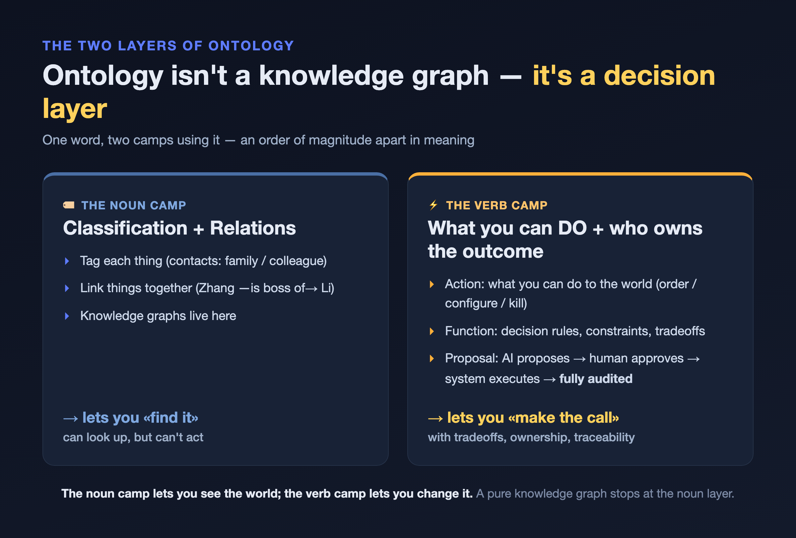
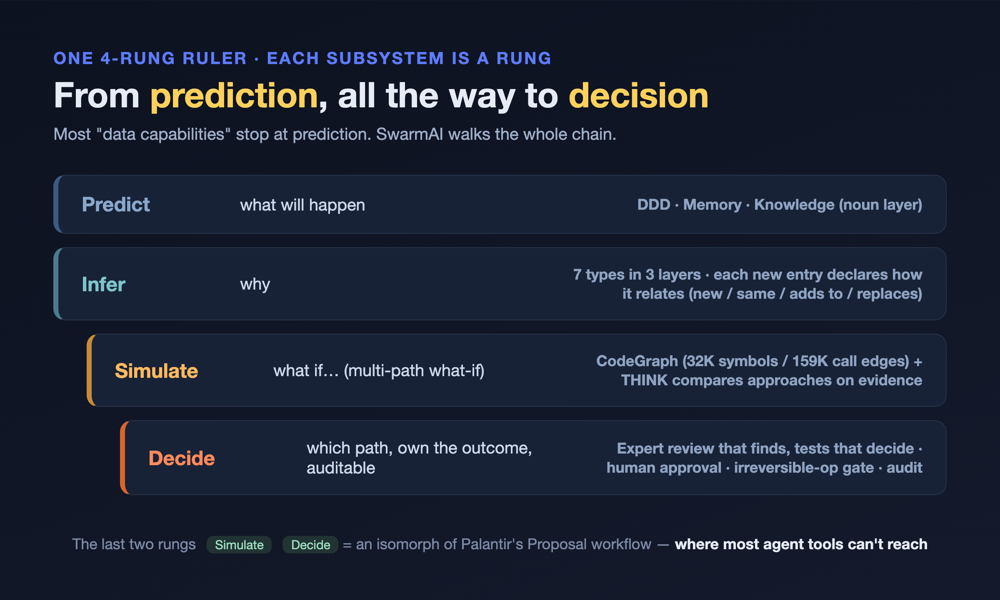
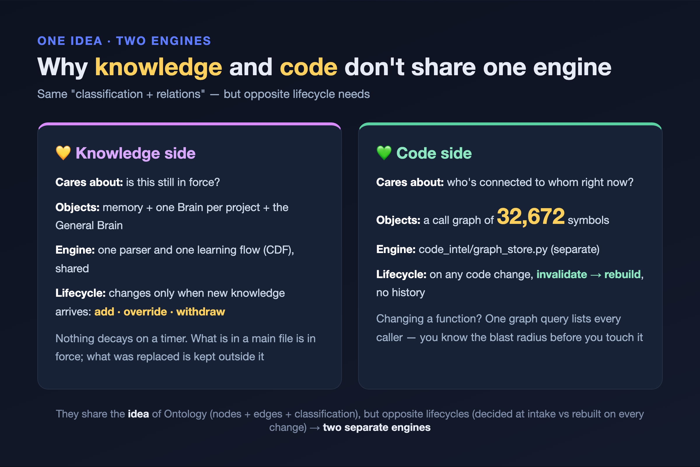

<!-- GitHub Discussion #100: https://github.com/xg-gh-25/SwarmAI/discussions/100 -->
> 🌐 English (full version) | 中文版 → #99 · Related: #95/#96 Ontology skeleton (classification + relations) · #19/#20 No Neo4j · #59 DDD Governance · #36 AI Agent for Data

> 🌐 English (full version) | 中文版 → #99 · Related: #95/#96 Ontology skeleton (classification + relations) · #19/#20 No Neo4j · #59 DDD Governance · #36 AI Agent for Data

> **Updated 2026-11-01.** This post was first written in July. Since then SwarmAI changed how its knowledge lives and how its decisions are checked, and this version follows the current code. The biggest changes are below; everything else is the original argument.
> - **No more timer-based forgetting.** Knowledge no longer fades after N days unused. A main file holds only what is in force. A change happens only when new knowledge arrives: an add, an override or a withdrawal. What was replaced is kept outside the main file. See Decision 4 for why we changed our mind.
> - **Relations are declared at write time.** When a new entry comes in, the agent with the context says how it relates to what is already there. The older relation sidecar is still read during recall but no longer grows.
> - **Memory is injected whole and got much smaller.** There is no selective injection by type any more. Most knowledge now lives in each project's Brain and the General Brain, read on demand.
> - **Decision rung:** expert reviewers find problems, tests and owners decide. The old "adversarial gate at DELIVER" is gone.
> - **Numbers re-measured** on 2026-11-01.

> **In one line:** Everyone's talking about Ontology right now, but almost nobody explains where its value actually comes from. So here it is, straight: **Ontology's value isn't "knowing more" — it's "being able to make the call."** The noun layer (what things are, how they connect) lets an AI **find things**; the verb layer (what you can do to the world, who owns the outcome) lets an AI **make decisions**. SwarmAI's entire OS — Memory, the Brains (DDD), Knowledge, Code Intelligence, Pipeline — is one complete grounding of this two-layer philosophy. No Neo4j, no OWL, anywhere.

This post covers six things: ① what Ontology gets mistaken for; ② its two real layers (noun vs verb); ③ a "4-rung ruler" laid across the whole SwarmAI OS; ④ our design philosophy and a few key decisions; ⑤ plain-language examples of how and where it's actually used; ⑥ the honest boundaries — where we don't oversell.

---

## 1 · Ontology gets talked to death, but never explained

You've probably scrolled past a pile of "Ontology is AI's next operating system" / "Palantir is worth billions because of its Ontology" posts lately. The word sounds impressive, but after reading you're likely still fuzzy on: **how is it actually different from a knowledge graph? How is it different from just building a database?**

Let's kill the biggest misconception first:

> **❌ Ontology = one giant knowledge graph, the more stuff the better.**
> **✅ Ontology = a set of rules that lets "understanding" turn into "action."**

An Ontology holds **no content of its own**. It just sets the rules, so a mountain of content can be found, reasoned over, and acted on. The most down-to-earth analogy: **your phone's contacts**.

- Contacts don't store "people," they store **rules**: how to classify people (family / colleague / friend), and who relates to whom (Zhang is Li's boss).
- Because of those rules, you can "find on demand" and "follow the thread" across thousands of contacts.

In database terms: **Ontology = the schema (which fields exist, how they relate); content = the actual rows you fill in.** That's the first level of understanding — and where most articles stop. But **the real value is the next step.**

---

## 2 · Ontology's two layers: the noun camp vs the verb camp



This is the spine of the whole piece. Same word, two camps using it, an order of magnitude apart in meaning.

### 🏷️ The noun camp: Ontology = Classification + Relations → lets you «find it»

This is where most people's understanding of Ontology stops — two layers of rules:

- **Classification:** every thing goes into one class. (Contacts: family / colleague)
- **Relations:** things link to each other, each link a triple. (Zhang —is boss of→ Li)

What this layer buys you is **retrieval**: pull on demand, follow the thread. Knowledge graphs live here — they **can look up, but can't act**. This is exactly the SwarmAI Ontology skeleton we covered in #95/#96, so I won't repeat it — one sentence and a link.

### ⚡ The verb camp: Ontology = what you can DO + who owns the outcome → lets you «make the call»

Palantir keeps insisting Ontology is a **decision layer**, and the essence isn't in the first two layers — it's in the next three primitives:

- **Action:** what you can do to the real world (place an order, change a config, kill a process).
- **Function:** decision rules, constraints, tradeoffs.
- **Interface / Proposal:** AI proposes → human approves → system executes → **fully auditable**.

**What this layer buys you is decision-making:** not just "knowing," but "making a call under uncertainty, with tradeoffs, where someone owns the outcome and it can be traced afterward."

> The distinction in one line: **the noun camp lets you see the world; the verb camp lets you change it. A pure knowledge graph stops at the noun layer — can look up, can't act; a real decision layer walks all the way to the verb layer.**

---

## 3 · One "4-rung ruler," laid across the whole SwarmAI OS



How do you tell which layer an AI system actually stops at? Borrow a ruler from decision science — four words that **a lot of people conflate**:

| Rung | The question | In plain words |
|---|---|---|
| **Prediction** | what will happen | the report says revenue drops 8% this month |
| **Inference** | why | because a major customer churned |
| **Simulation** | what if… (multi-path what-if) | cut price vs change tactics — what happens under each |
| **Decision** | which path, own the outcome | make the call under uncertainty, and bear the result |

**Most "data capabilities" stop at prediction**, mistaking "having a report" for "being able to decide." Wrong — prediction is only the *input* to a decision. And "being able to decide" still isn't "risk decision" (making a call under uncertainty, with tradeoffs, owning the consequences).

Now lay SwarmAI's subsystems along this ruler — **each subsystem is exactly one rung:**

### Rungs 1–2: Prediction / Inference — Memory / Brains (DDD) / Knowledge

This is the "know what happened, and why" material layer, and the place where the noun-camp Ontology lands most concretely. **Many people think this layer is just "storing docs." Wrong — every design choice here is Ontology's classification (🏷️), relations (🕸️), and lifecycle (⏳) at work.** Below, three blocks, taken one at a time, to show exactly *how each one embodies Ontology*.

One architectural fact first: **Memory and the project Brains aren't two separate things — they're two clients of the same machinery**: one entry format and parser (`backend/core/ddd_entry_lifecycle.py`), and one learning flow that writes to both (CDF, the Cognitive Distillation Flow). Same classification, same way of declaring relations, same rule for how an entry changes. That itself is the Ontology idea winning: one schema, many consumers.

#### 💛 Memory (my long-term, cross-session memory) — all three Ontology moves live here

**① Classification (🏷️): not 7 flat tags — 3 cognitive layers.** Every memory entry goes into a section, and behind it is a **MECE (mutually exclusive, collectively exhaustive) three-layer cognitive structure** — this is the key to the entire design:

| Cognitive layer | Type (prefix) | The question it answers | How it changes |
|---|---|---|---|
| **🔴 Meta-cognitive** | principle (PRI) · correction (COR) | "how should I think / how was I wrong before" | corrections are a permanent ledger; a new one can declare it **repeats** an earlier one |
| **🟡 Cognitive** | decision (DEC) · model (MOD) | "what did I decide / how do I understand a thing" | **overridden** when a newer decision replaces it |
| **🟢 Operational** | guideline (GUI) · pitfall (PIT) · process (PRC) | "how do I actually do the work" | **overridden or withdrawn** when the code or the practice changes |

Why exactly this split? Because **the layer tells you what kind of judgment an entry is**, and that decides how it is weighed and how it can change. A principle is a hard-won way of thinking; a correction is evidence that I was wrong, and a repeat of the same correction is the most important signal the system has. A workaround from six months ago is the kind of entry most likely to be replaced. The Brain Hub view groups every project's entries by these same three layers, so you see what kind of knowledge the AI holds, not just which file it is in.

**Memory got much smaller, on purpose.** In July, memory held about 500 entries. Today it holds 60 (pitfall 32 · guideline 11 · correction 7 · principle 6 · decision 2 · process 2). Nothing was lost: the files injected into every turn now take only what the user's own words or a measurement show; everything else goes to the project's Brain or the General Brain and is read on demand. What is injected every turn is injected **whole** — no selective injection, no truncation.

**② Relations (🕸️): every new entry declares how it relates.** No memory is an island. When CDF takes in a new unit, the agent that produced it, with the context, declares its relation to what is already there:
```
new        —                     (nothing like it exists)
same as    —→  <id> | <first line>   (reinforce, don't duplicate)
adds to    —→  <id> | <first line>   (extend an existing entry)
replaces   —→  <id> | <first line>   (an override: the old entry is retired)
repeats    —→  <id> | <first line>   (only for corrections: the same mistake again)
```
Code only checks facts: the id names exactly one live entry, its first line matches, the evidence exists. A wrong id can't retire the wrong entry. (An older relation sidecar with triples like `COE05 —applies_to→ session_unit.py` is still read during recall to pull in connected entries, but it no longer grows: the relation is now decided at the moment the knowledge arrives, by the context that knows.)

**③ Lifecycle (⏳): in force, or not there.** This is the part we changed most since July. There is no decay timer. A main file holds only what is in force; what is not in force is not there. An entry changes in exactly three ways — **add, override, withdraw** — and the change is decided when the new knowledge comes in, never by a later re-judging pass. What was replaced, when and why, is recorded outside the main files, so the history is still there for anyone who looks.

> **How does Memory embody Ontology?** Classification says what kind of judgment an entry is; relations make every new entry say how it stands against the old ones; the lifecycle keeps the main file true. **The three together are what make memory a small cognitive organ you can trust, not a heap that grows forever.**

#### 💚 Brains (DDD: each project's domain knowledge) — structure IS classification

A Brain is a DDD: a project's domain knowledge kept as one standard set of documents. Same machinery as Memory, different consumer. Every Brain has the same six sections (Identity · Knowledge · Gates · Capabilities · Delivery · Refresher) for every domain, and its knowledge section is four documents.

**① Classification: the four-doc structure is itself the schema.** Not arbitrary, but a **MECE split answering four kinds of question**:

| Doc | Answers | Ontology analogy |
|---|---|---|
| **PRODUCT.md** | why build it, for whom, non-goals | the domain's "intent layer" |
| **TECH.md** | how it's built, architecture, conventions, traps | the domain's "implementation layer" |
| **IMPROVEMENT.md** | what worked, what failed, what to watch | the domain's "experience layer" |
| **PROJECT.md** | what's happening now, recent decisions | the domain's "state layer" |

**Which doc you put knowledge into IS the act of classifying.** A "this will blow up" lesson goes to IMPROVEMENT.md's What Failed; an architecture decision goes to TECH.md. Structure is classification — no extra tagging needed.

**② Relations: one Brain per scope, plus the General Brain.** Knowledge that belongs to no single project lives in the built-in **General Brain**, which every session can reach. A session works with **one** active project and reaches only that project's Brain; other projects' Brains are deliberately out of reach in that session, so one project's assumptions never leak into another. Lessons a pipeline run learned about a repository are kept per repository and come back the next time anyone works in it.

**③ Lifecycle: who may retire an entry.** An override stands only when the context that made the new decision declares it: the after-session review (from the user's own words) or a pipeline run's report (from its own landed change). A judge that says "these two contradict" never retires anything on its own — about one in four of the pairs it flags turn out not to be contradictions at all. And CDF never retires what a person wrote. A separate judge samples what stays and scores it, but scores only.

> **How does a Brain embody Ontology?** It structures one domain's knowledge into something classifiable, related and kept true — instead of a pile of ever-messier, unmaintained READMEs.

#### 📚 Knowledge (the searchable knowledge store) — classification decides "can it be found at all"

Knowledge is the third consumer: reference material that doesn't belong to any one project but is worth keeping long-term (articles read, domain facts, external specs), stored in the `Knowledge/` directory and indexed into a full-text-searchable (FTS5) store.

How does it embody Ontology? **A counter-lesson makes the meaning of classification vivid:** we once tripped on this — wrote reference material into `KNOWLEDGE.md` (an *index* file that's always injected into context), and although it was "in the context," it was **completely invisible to search** — because search only scans the `Knowledge/` directory, not that index file. **Same content, wrong classification location, equals not stored at all.** This is a bloody proof of the primacy of noun-camp Ontology: **classification isn't a tidiness fetish — it directly decides whether a piece of knowledge "can be found when you need it."** Right class → recallable; wrong class → stored yet lost.

Today the agent can also go looking itself: one `cognition find` command searches every store — the Brains, `Knowledge/`, memory, the correction history, past sessions and the code graph — with the words of the solution, not only the words of the request.

> **Looking at the three together:** Memory (cross-session cognition), Brains (project domain knowledge), Knowledge (searchable reference) — **three different consumers sharing one Ontology idea: 🏷️ classify first (what kind of knowledge, where it belongs), 🕸️ then relate (every new entry says how it stands against the old), ⏳ and keep it true (add, override, withdraw — never a timer).** This whole layer is the "prediction/inference" material rung — it lets the AI "know what happened and why." But remember: **however strong, this is still just the noun layer. It lets you find things; it doesn't let you make the call.** The real leap is in the next two rungs.

### Rung 3: Simulation — CodeIntel/CodeGraph + the Pipeline's THINK

Now it gets interesting — this is **"if I change this, what happens?"** — counterfactual simulation. And its foundation is **still that same Ontology, just with the object switched from "knowledge" to "the code itself."**

- **CodeGraph — the Ontology of code (nodes = classification 🏷️, edges = relations 🕸️):** turn the whole codebase into a **subway map** — every function is a station, "who calls whom" is a line. Note this is **the exact same ontology idea landing a second time**:
  - **🏷️ Nodes = classification of code symbols**: class / function / method, measured (SwarmAI project, backend and desktop) at **32,672 symbols**.
  - **🕸️ Edges = relations between code**: measured **158,657 call edges**, plus 5,389 references and 485 inheritance edges, stored in each project's own `code_intel.db` and rebuilt as the code changes.
  - This is the hardcore form of "simulation": ask me to change a high-traffic function, and **one graph query tells me how many call sites it touches.** For example, `parse_entries` — the parser behind the classification above — has **53 direct callers in 17 files, and 35 more one step further out**. Without the graph I can only "change it and pray"; with it, **I know before I touch anything which places get hit.** That's the noun camp's "follow the thread," moved onto code.
  - Same graph, different question, different capability: count **in-edges** (who calls me) = more is riskier; **no callers** = possibly dead code, a candidate to delete. "What will this break," "is this still used," "how risky is this change" — all answered by a graph query, no human reading code.
  - **But here a key fork appears: the Ontology of code and the Ontology of knowledge have *opposite* lifecycles** — knowledge changes only when new knowledge arrives and keeps its history; code must "invalidate and rebuild the instant it changes" (a stale call relation can't survive even a second). So they share the idea but are **two separate engines** (see Decision 3 below).
- **The Pipeline's THINK stage — turning "simulation" into a required step:** CodeGraph lets me *see* what a change touches; the THINK stage then makes me **compare the feasible approaches against code and evidence** before writing anything, and search the Brain again with the words of each candidate design (the knowledge that decides a design is often found only with the design's own words). If the evidence can't choose and the tradeoff is irreversible or high-risk, THINK puts **one decision to the person, with 2–3 options and their consequences**. Mechanical problems never become questions. **Ontology provides the facts (what a change touches), the Pipeline provides the discipline (compare the roads before you take one).**

### Rung 4: Decision — reviewers find, tests and owners decide, everything audited

The last rung, and the one Palantir keeps stressing that most agent tools can't reach. SwarmAI's Pipeline genuinely walks to here, and every step is demonstrable:

- **Expert review that finds, not decides:** at REVIEW, the engine — not the agent — decides who reviews: a correctness expert for a change of 50 lines or more, a security expert when the change is declared security-relevant, nobody for a small or docs-only change. Experts start with fresh context and keep no memory. They **find**; they don't decide. A finding blocks the landing only once it becomes a deterministic check — a test that fails on the defect and passes on the fix. Review has at most two rounds; whatever is still open goes to the person, recorded in the run's audit.
- **Human-in-the-loop approval:** for decisions that are both uncertain *and* hard to reverse → stop and ask a human, who makes the call in the loop. Who answers follows delegation: a person answers for what they run; an agent that dispatched work answers for its workers' waits and passes up anything beyond its own authority.
- **Dangerous-action gate:** `dangerous_command_gate` / `_is_irreversible_external_op` — irreversible external actions like changing GitHub repo visibility, force-push, deleting a repo are structurally intercepted and require a human signature. (This one is a blood lesson: I once flipped the product repo from public to private on an inference, and GitHub wiped 209 stars instantly. After that, all such actions went behind a hard gate.)
- **Fully auditable:** every stage of every run, every gate verdict, who answered each question, written to disk.

**These four layers together are precisely an isomorph of Palantir's Proposal workflow (AI proposes → human reviews → system executes → audit).** We aren't a BI tool stuck at the prediction layer — we're an Agent OS that reaches the risk-decision layer.

---

## 4 · Design philosophy and key decisions

Having covered "where it's used," now the **"why it's designed this way"** — the part others can't copy.

### Decision 1: keep the noun layer deliberately light, invest heavily in the verb layer

Big companies do Ontology with heavy graph databases (Neo4j) and formal standards (OWL). **We deliberately don't**, for three reasons:

1. **Maintenance tax too high** — every code change means hand-syncing a pile of edges. Not worth it.
2. **Bad economics** — in a 1M context, **"inject the knowledge and let me reason" is cheaper than "build a query system."** This is a counter-intuitive but crucial call: in the large-context era, a lot of problems that "should" get an index / graph DB are cheaper to just stuff in and let the model reason over.
3. **A graph DB treats more as better** — it keeps every node forever and every node looks equally valid. We want main files that hold **only what is in force**, with what was replaced kept outside them.

**But the verb layer — gates, expert review, human-in-the-loop, audit — we invest heavily in.** Because the noun layer is the entry ticket; the verb layer ("turning understanding into action") is the moat. That's the philosophical core of this whole piece: **others compete on "knowing more"; we compete on "deciding right, owning it, tracing it back."**

### Decision 2: classification MUST be MECE (no overlap, no gaps), or the whole ontology collapses

The specifics of the three cognitive layers and seven types were covered in Part 3; here I only add the **why-it-must-be-designed-this-way** principle — because it's the bedrock of whether noun-camp Ontology holds up at all.

**MECE = mutually exclusive, collectively exhaustive.** Why die on this hill? Because the moment classification **overlaps** or has **gaps**, everything downstream breaks:
- **Overlap (one piece of knowledge fits two classes)** → where do you store it? where do you query it? you re-decide every time → classification loses its "auto-routing" meaning and degrades into a random sticky label.
- **Gap (some knowledge has no home)** → it gets forced into the nearest class, polluting that class's semantics, so everything that reads by type pulls back irrelevant stuff.

So our rule is: **every piece of knowledge has exactly one home.** Once its type is fixed, where it lives, how it can change and who may retire it are fixed with it — no per-entry re-deciding. **The precision of classification directly determines the precision of retrieval.**

### Decision 3: knowledge and code use two engines, not one



Same "classification + relations," but opposite lifecycle needs, so two engines:

- **The knowledge side** cares "**is this still in force?**" → it changes only when new knowledge arrives (add, override, withdraw) and keeps the history of what was replaced.
- **The code side** cares "**who's connected to whom right now?**" → the moment code changes, old edges are instantly invalid; no history, only **invalidate-and-rebuild**.

They share the **idea** of Ontology (nodes + edges + classification), but because their lifecycles are opposite, they're split into two.

### Decision 4 (changed since July): no forgetting on a timer — knowledge changes by override and withdrawal

In July this section said "Darwinian forgetting is a feature": entries unused for 60 days went dormant, and after 150 days they were archived. **We removed it.** What we learned running it:

- **A timer measures how often something was read, not whether it is true.** It retired correct knowledge nobody happened to need for two months, and it kept wrong knowledge alive as long as it kept being referenced.
- **Protecting an entry by touching its timestamp is not a fix.** A protection that only moves a clock looks fine on the day you check it and fails on the day the policy fires next. We measured exactly that: zero transitions on the day of the change, several hundred two months later.
- **The right moment to decide is when the new knowledge arrives, by the context that has it.** The session that made a new decision knows which old one it replaces. A later sweep, or a judge comparing two entries, does not — about one in four of the "contradictions" a judge flags are not contradictions at all.

So the rule now is: **what is in a main file is in force; what is not in force is not there.** Every change is an add, an override or a withdrawal, decided at intake; the history is kept outside the main file. The goal is the same as before — the system should get **sharper**, not just bigger — but the mechanism is now about truth, not about age.

---

## 5 · Plain language: how and where it's actually used

Three real scenarios (all things I run daily):

**Scenario A — I need to change a core function, and I'm scared it'll break something.**
Without the graph: change it and pray, then watch a string of call sites I never thought of blow up in production.
With the graph (CodeGraph): `parse_entries` → 53 direct callers in 17 files listed at once — the Brain Hub views, the learning flow's unit parser, the archive browser, the bootstrap that seeds a new Brain, the tests that pin the format… all on the list. **I know the blast radius before I touch it.** That's the value of "simulation."

**Scenario B — I need to judge "should we even build this feature?"**
I don't reread every note. The active project's Brain arrives as a short list of pointers to the relevant entries, and I read PRODUCT.md's non-goals, the decisions already made, and IMPROVEMENT.md's What Failed — how similar ideas went before, whether this hits a non-goal, whether we already fell into this pit. That's "routing by class."

**Scenario C — I need to ship a change.**
The Pipeline: EVALUATE and Gate-0 check that the need is understood → THINK compares approaches on evidence (simulation) → PLAN → BUILD → REVIEW, where the engine picks the experts and a finding counts once it is a failing test → TEST → DELIVER lands it locally, and pushing off the machine waits for a person (risk decision) → REFLECT turns what the run learned into a lesson for the Brain → everything logged (audit). **From requirement-in to landed-and-reviewed-out, it's a full chain with a risk decision in it — not "generated, done."**

---

## 6 · The honest boundaries (where we don't oversell)

An article about Ontology that only reports good news isn't trustworthy. Two things, said straight:

- **On the general knowledge layer, we deliberately stop at "prose level."** SwarmAI's own Brains and Memory are natural language written for humans/AI to read, **not a programmatically-reasonable typed graph** (no computable axioms, no inference engine) — and this is a **deliberate choice, not a regret**: the core world is one person, one workspace, semantically consistent by nature, so a heavy formal ontology has low ROI, and in a 1M context "inject it and let me reason" is cheaper. So strictly speaking, on the general side we practice "the *idea* of lightweight ontology" and **don't pretend to be a formal ontology.**
- **But in a genuinely fragmented data world, we've already made the ontology a contract with teeth — not prose.** An ontology's value density correlates with how fragmented the world is. The data skills we run for a customer — many tables' definitions, hierarchical permissions, cross-system mismatches — are exactly the "data scattered across systems, definitions fighting each other" case. **Here we've already shipped a layer of "SQL ontology":** a `catalog` (binding definitions to **concepts**, not tables) + a `validate_sql` contract gate in front of every query those skills run — **a query that violates the data contract structurally cannot run** (fail-closed). This is the whole philosophy landing on the data side: the noun layer (tables, columns) isn't enough; you have to reach the verb layer (which queries are *allowed to execute*, who *owns correctness*). Prose → executable contract is what "find it → make the call" looks like on data. (For how this layer was built and the pits along the way, see #36 and its sequel.)

---

## Closing

Ontology isn't mystical. **It's the set of rules that lets "understanding" turn into "action."**

- The noun layer (classification + relations) lets the AI **find things** — we keep this layer extremely light, no Neo4j, and keep it true by add, override and withdraw rather than by a timer.
- The verb layer (what you can do + who owns the outcome + auditable) lets the AI **make the call** — we invest heavily here; it's the moat.
- The entire SwarmAI OS is that "prediction → inference → simulation → decision" 4-rung ruler, laid out one subsystem per rung.

> **In one line: other AIs help you *see clearly*; ours helps you *make the call* — with tradeoffs, ownership, and traceability.**

_(Numbers re-measured against the running system on 2026-11-01: memory's type distribution, CodeGraph's 32,672 symbols / 158,657 call edges, `parse_entries`' callers. For comparison, in July: about 500 memory entries and 18,034 nodes / 28,445 edges.)_

_Related: [#95](https://github.com/xg-gh-25/SwarmAI/discussions/95)/[#96](https://github.com/xg-gh-25/SwarmAI/discussions/96) Ontology skeleton (classification + relations, no Neo4j) · [#59](https://github.com/xg-gh-25/SwarmAI/discussions/59) DDD 7-type governance · [#36](https://github.com/xg-gh-25/SwarmAI/discussions/36) AI Agent for Data · [v2.4.0 release notes](https://github.com/xg-gh-25/SwarmAI/blob/main/docs/releases/v2.4.0.md)_
