<!-- GitHub Discussion #110: https://github.com/xg-gh-25/SwarmAI/discussions/110 -->

> **AI-Native 是一次范式转移,不是工具采纳。** Agent 吃掉了中间的 coding,瓶颈转移到两头 —— **定义**(做什么)和**质量 / 安全**(守底线)。所以转型要系统性地走五步:**定义对错 → 系统化管理 → 造得又快又对 → 守得住底线 → 技术 × 组织双复利**。第 300 天,从 2x 走到 10x。
>
> **Human Directs, AI Delivers.**

这是 [《AI-Native Transformation 打造你的复利组织》](https://github.com/xg-gh-25/SwarmAI/discussions/106) 的 **V13 凝练版** —— 23 页,一条主线、五个 Theme。上一版讲"为什么要换范式",这一版把重心放在**怎么系统性地走过去**。

---

## 📖 一条主线,五个 Theme

| 幕 | Theme | 回答的问题 | 页 |
|---|---|---|---|
| 开场 | — | 我们在谈什么 | 01–02 |
| ① **Define** | 问题在哪 | 瓶颈转移了,错配在哪 | 03–04 |
| ② **Management** | 怎么管理 | 系统性转型:五支柱 + 度量 | 05–08 |
| ③ **Build Fast** | 怎么造得快 | SDD → DDD → Autonomous | 09–13 |
| ④ **Stay Safe** | 怎么守得住 | Builder EE/OE,守住质量与安全底线 | 14–20 |
| ⑤ **Compound** | 怎么复利 | 技术复利 × 组织复利 | 21–22 |
| 收尾 | — | 持续探索 AI for X | 23 |

---

## 开场

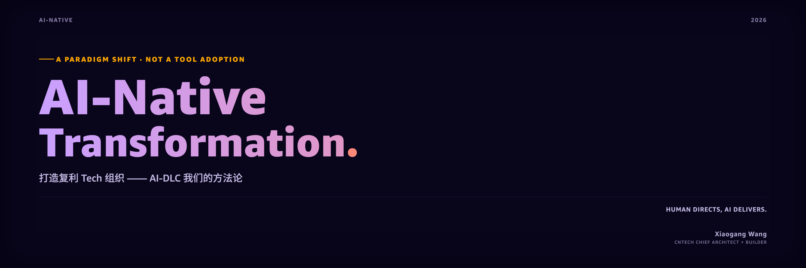

**01 · Cover** —— AI-Native 2026:一次范式转移,不是工具采纳。打造复利 Tech 组织,方法论是 AI-DLC。

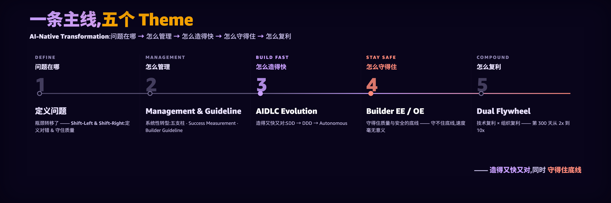

**02 · Agenda** —— 一条主线,五个 Theme:Define → Management → Build Fast → Stay Safe → Compound。先把全场地图交给听众。

---

## ① Define · 问题在哪

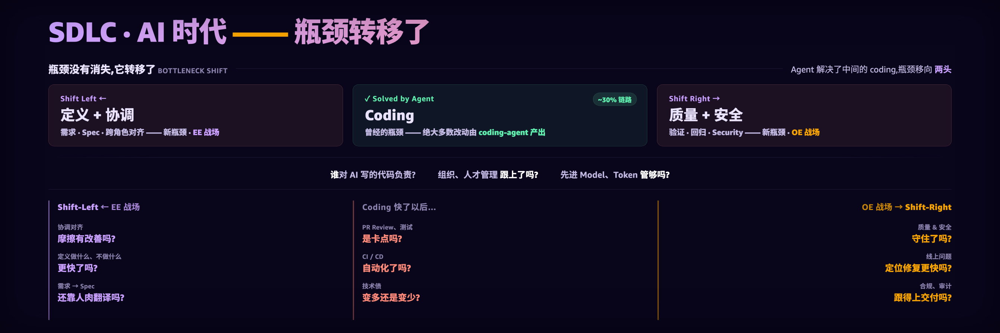

**03 · Bottleneck Shift** —— 瓶颈没消失,它**转移**了:Agent 吃掉中间 ~30% 的 coding,瓶颈移向 Shift-Left(定义 + 协调,EE 战场)和 Shift-Right(质量 + 安全,OE 战场)。

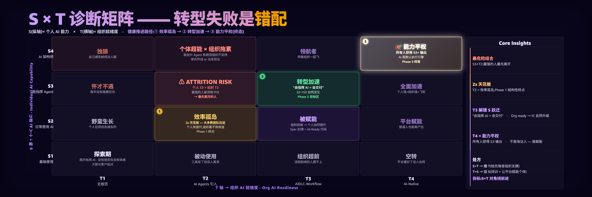

**04 · S×T Matrix** —— 转型失败是**错配**:个人 AI 能力(S)× 组织就绪度(T)。健康路径 效率孤岛 → 转型加速 → 能力平权;最危险的是 S 高 T 低 —— 最强的人被流程卡住,最先离开。

---

## ② Management · 怎么管理

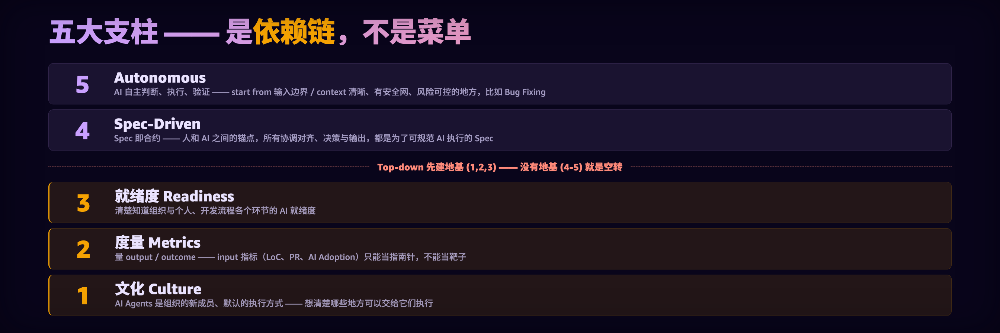

**05 · Five Pillars** —— 五大支柱是**依赖链不是菜单**:文化 → 度量 → 就绪度 → Spec-Driven → Autonomous。先建地基(1–3),没地基上自主就是空转。

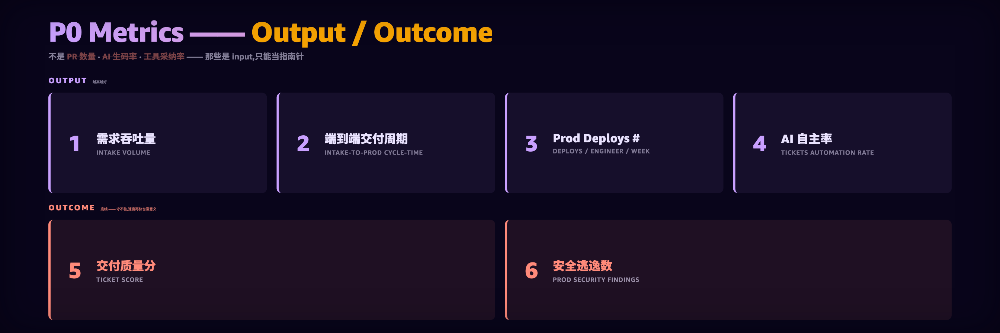

**06 · Pipeline Metrics** —— P0 指标盯 **Output / Outcome**,不是 PR 数 / 生码率 / 采纳率(那些只是指南针)。Output 越高越好,Outcome 是底线 —— 守不住,再快也没意义。

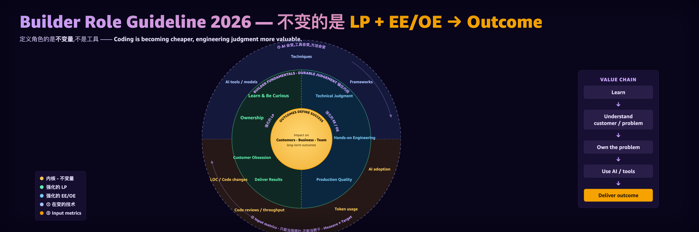

**07 · SDE Role** —— 进 AI-DLC 之前先立住一条暗线:每一阶段真正改变的是**人的角色**。定义一个 builder 的是**不变量,不是工具** —— LP + EE/OE → Outcome 这个内核不变,而且在 AI 时代要求更高。

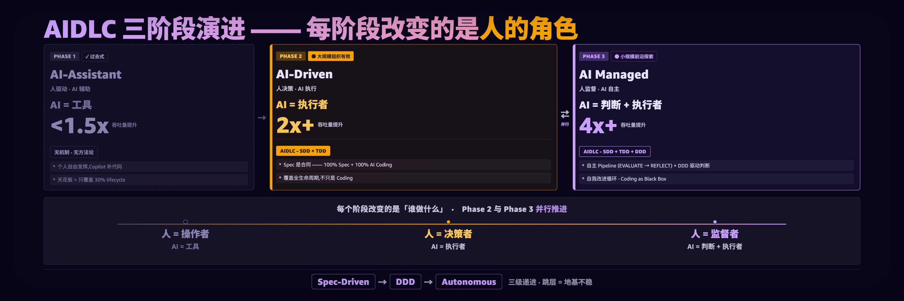

**08 · Three Phases** —— AI-DLC 三阶段:AI-Assistant(人驱动,1.5x)→ AI-Driven(人决策·AI 执行,2x+,全链路 SDD)→ AI-Managed(人监督·AI 自主,4x+,DDD 驱动判断)。跳层 = 地基不稳。

---

## ③ Build Fast · 怎么造得快

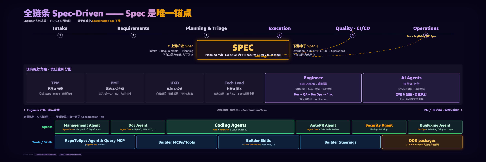

**09 · Phase 2 Model** —— 全链条 Spec-Driven:**Spec 是唯一锚点**,上游产出它、下游忠于它;角色责任重分配,消灭角色间 coordination tax。

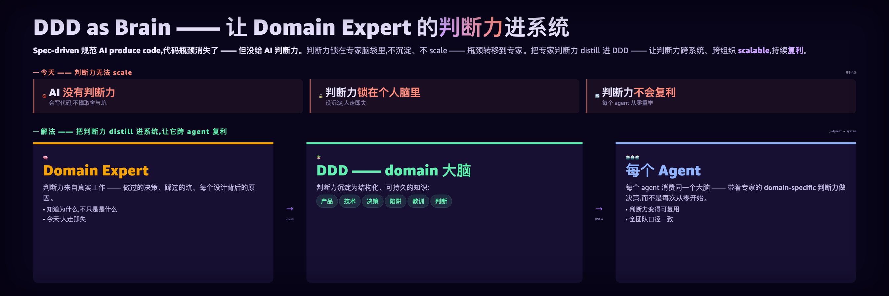

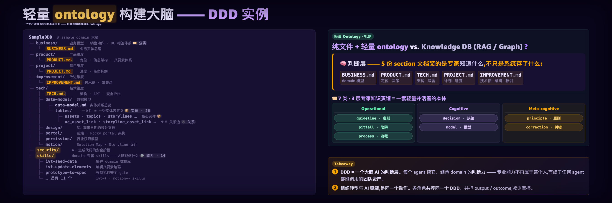

**10–11 · Ontology** —— 支撑 AI-DLC 的知识本体:数据 / 语义怎么被组织成 Agent 真正能用的结构。

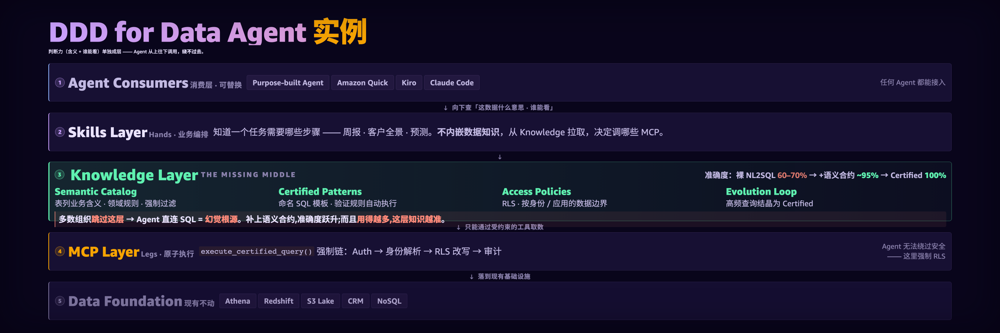

**12 · DDD for Data Agent** —— 一个落地实例:把「判断力(含义 + 谁能看)」单独成层,Agent 从上往下绕不过去。裸 NL2SQL 60–70% → +语义合约 ~95% → Certified 100%,用得越多越准。

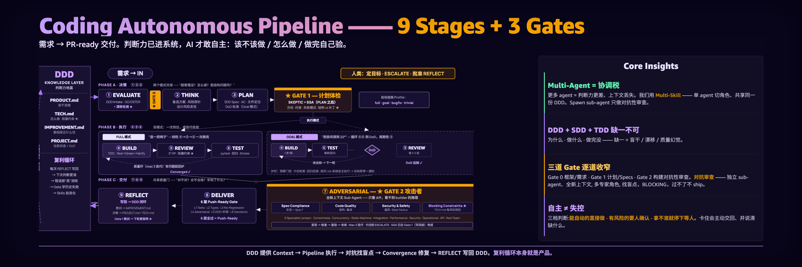

**13 · Phase 3 Pipeline** —— Coding Autonomous Pipeline:9 Stages + 3 Gates,需求 → PR-ready。判断力进了系统(DDD)AI 才敢自主;每次 REFLECT 写回,知识复利。

---

## ④ Stay Safe · 怎么守得住

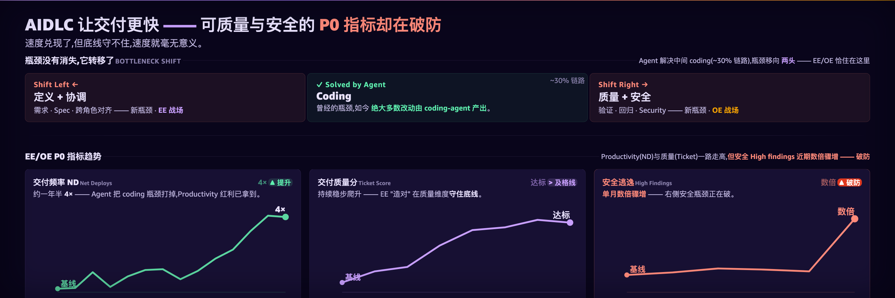

**14 · EE/OE Background** —— 为什么要专门讲守底线:Agent 进场后,质量与安全成了新瓶颈。

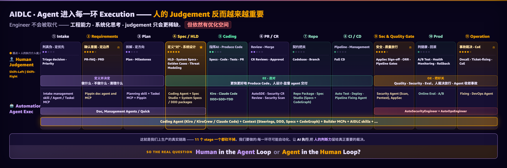

**15 · EE/OE Chain** —— Agent 进入每一环 Execution,人的 **Judgement 反而更稀缺**。EE·造对(人设计·监督 agent 交付)/ OE·把好关(人裁决放行·agent 收敛事故)。

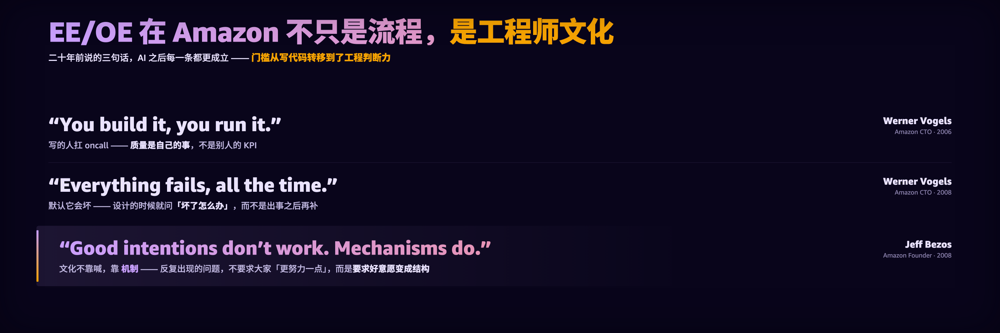

**16 · EE/OE Framework** —— EE/OE 不只是流程,是 Amazon 工程师**文化**:You build it, you run it · Everything fails, all the time · Good intentions don't work, mechanisms do。门槛从写代码转到工程判断力。

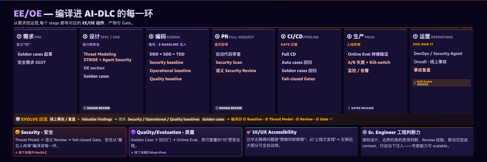

**17 · The How** —— 从文化落到机制:怎么把 EE/OE 变成可执行的结构。

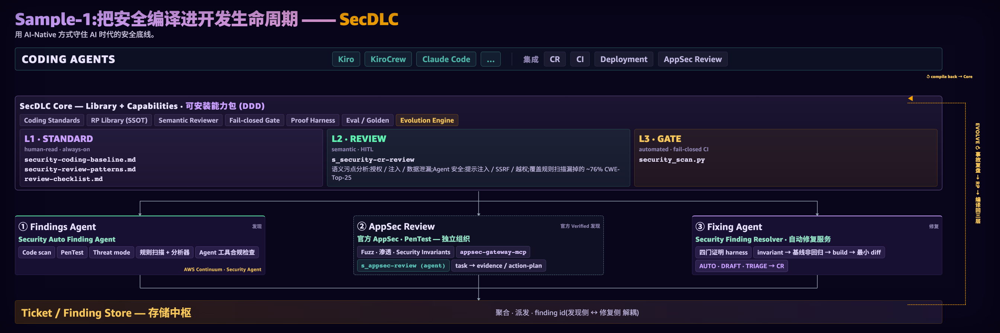

**18 · SecDLC(Sample-1)** —— 把安全**编译进**开发生命周期:L1 Standard(always-on 基线)→ L2 Semantic Reviewer(HITL,覆盖规则扫描漏掉的 CWE)→ L3 Fail-closed Gate(CI 自动)。

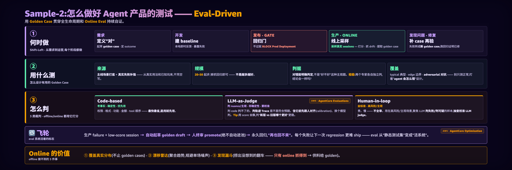

**19 · Eval-Driven(Sample-2)** —— 怎么测好 Agent 产品:Golden Case 贯穿 需求 → 开发 → Gate → 线上,失败转成新 case 跑回归自证。20–50 起步,判据能明确对错,三类裁判打分。

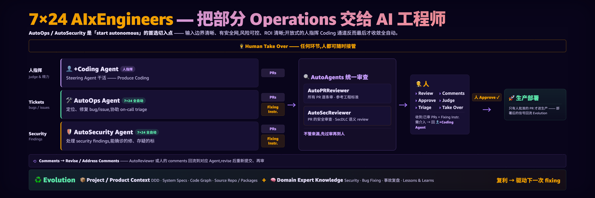

**20 · 7×24 AIxEngineers** —— 把部分 Operations 交给 AI:AutoOps / AutoSecurity 是「start autonomous」的首选切入点(边界清晰、有安全网、ROI 清晰);人可随时接管。

---

## ⑤ Compound · 怎么复利

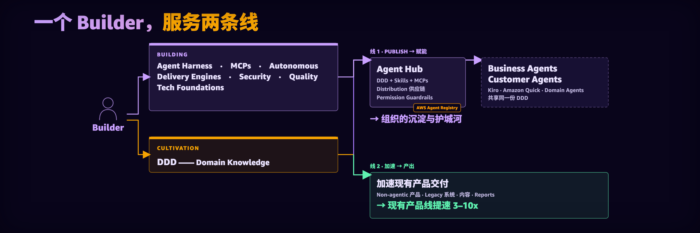

**21 · Where We Are** —— 一个 Builder,服务两条线:① Publish(DDD + Skills + MCP 赋能 Agent Hub,组织护城河)② 加速现有产品 3–10x。Grow as an Engineer, don't build as a tool。

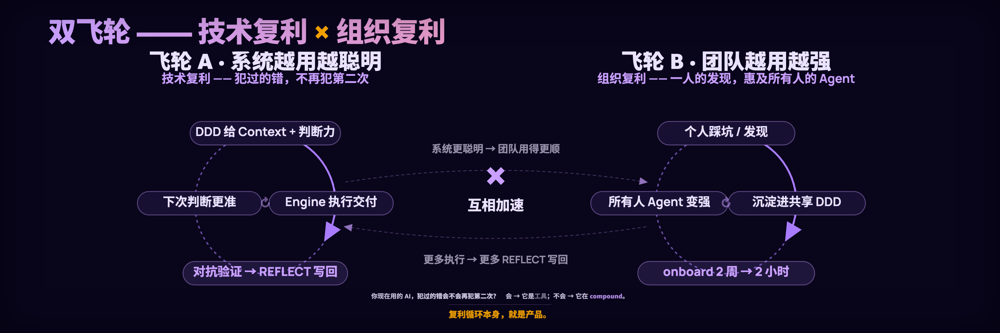

**22 · Dual Flywheel** —— 双飞轮:飞轮 A 系统越用越聪明(技术复利,犯过的错不再犯)× 飞轮 B 团队越用越强(组织复利,一人的发现惠及所有人,onboard 2 周 → 2 小时)。**复利循环本身,就是产品。**

---

## 收尾

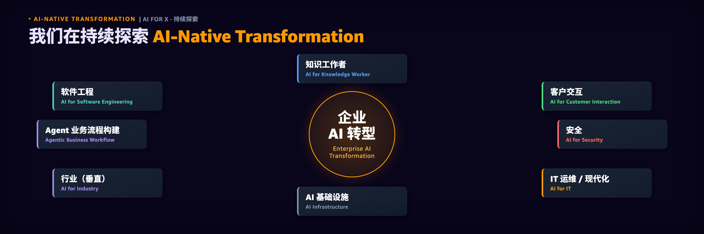

**23 · Explore** —— 这套方法在持续外延:AI for Knowledge Worker / Software Engineering / Security / Industry / IT / Infra…… AI-Native Transformation 是一条还在走的路。

---

*这是 [SwarmAI](https://github.com/xg-gh-25/SwarmAI) 的实践沉淀 —— 一个 self-evolving Agent OS,把以上方法论跑在自己身上。欢迎讨论、拍砖、分享你的转型实践。*
