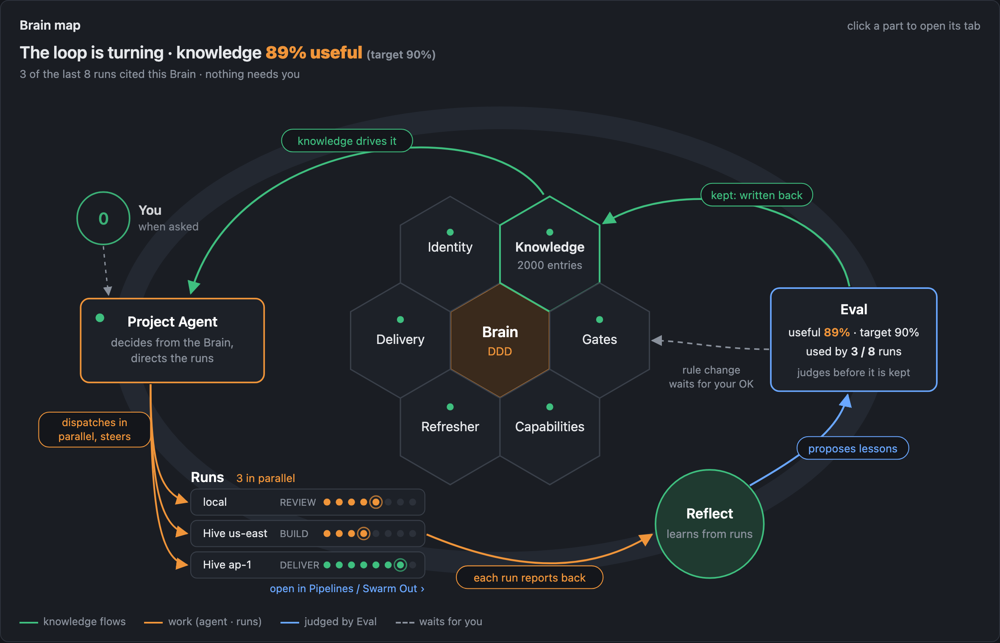
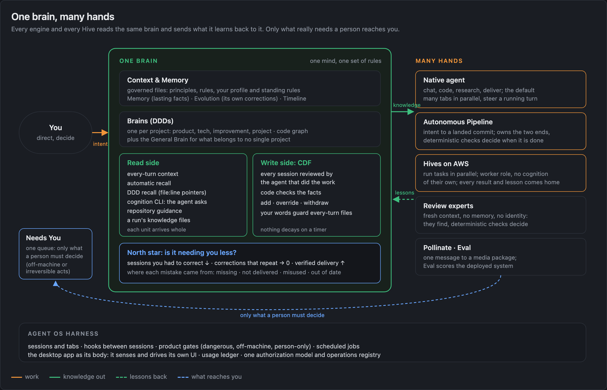
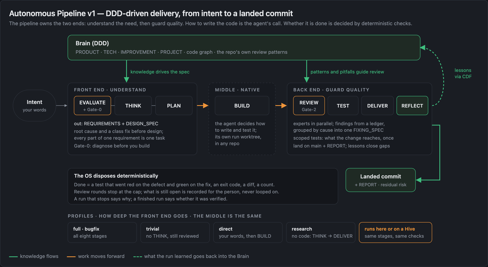
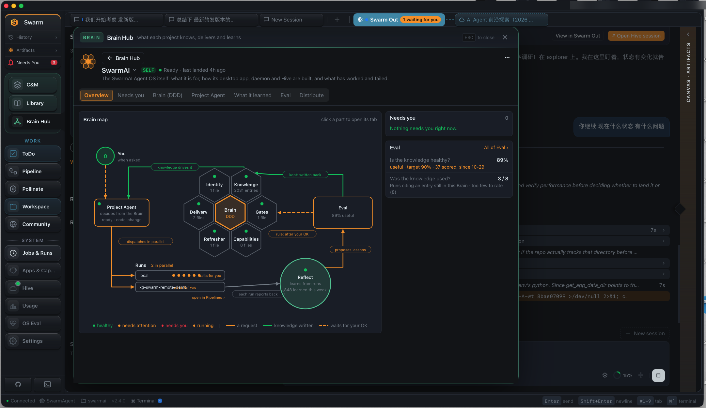
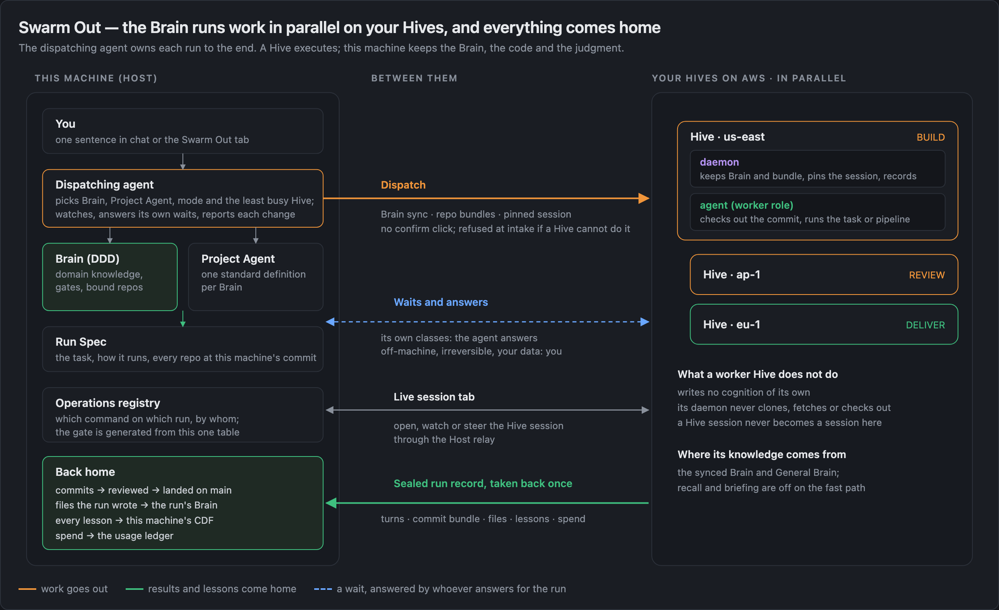
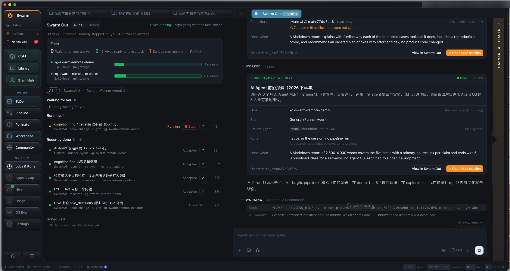
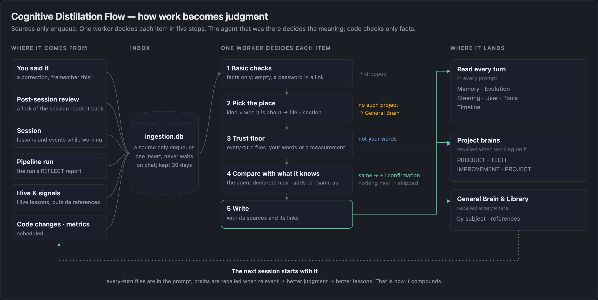
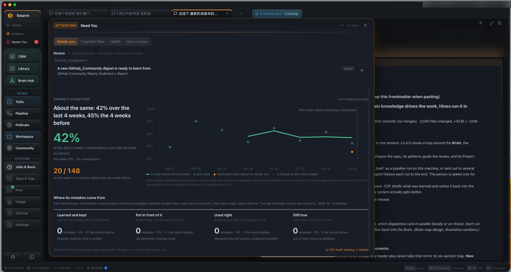
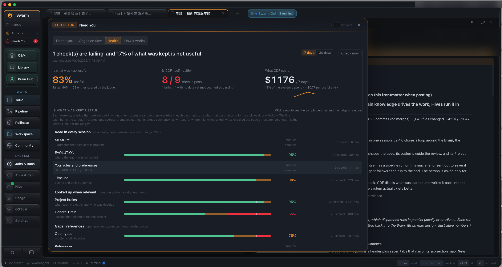

<!-- GitHub Discussion #116: https://github.com/xg-gh-25/SwarmAI/discussions/116 -->

# SwarmAI v2.4 — One brain, many hands: autonomy that compounds, so it needs less of your attention

> **In one sentence:** SwarmAI now does the work by itself, in parallel on your own cloud machines, driven by one brain of domain knowledge that pulls the judgment out of every session automatically, so each task compounds into the next and needs less of your attention than the last.

v2.4 is the release where SwarmAI starts working beyond one machine and beyond one session. This post is the short story of it, with the pictures. Full release notes: [docs/releases/v2.4.0.md](https://github.com/xg-gh-25/SwarmAI/blob/main/docs/releases/v2.4.0.md) (also in #115).

## The problem: your attention, not the agent's ability

Agents can now write code, research and work for hours on their own. What breaks is the person around them: one more chat tab to watch, one more approval to click, one more result to check, one more agent that forgot what the last one learned. A team of agents often makes this worse, because you become its dispatcher, reviewer and memory.

So v2.4 is built for one purpose: **compounding.** Every task should leave the system sharper than it found it, so the next task needs less of you. **SwarmAI turns every task into lasting cognition, and lasting cognition into increasingly autonomous delivery.**

## The idea: one brain, many hands

We chose **one brain** on purpose, against the common "many brains" design where every agent in a team keeps its own memory and role.

- **One cognitive system, many scoped Brains.** Each project has a **Brain** (its domain knowledge, kept as one standard set of documents), plus a built-in **General Brain**. They share one set of rules for how knowledge is written, checked and used. Chat, the pipeline, content, Eval and every remote run read the same Brain.
- **The brain learns from every session by itself.** When a session ends, the agent that did the work reads back its own record and declares what changed its judgment: a correction, a decision, a lesson, a pitfall. CDF (the Cognitive Distillation Flow, our learning pipeline) checks the facts and files each one. Nobody has to say "remember this".
- **Hives and reviewers are hands, not brains.** A worker Hive (your SwarmAI on AWS) gets a copy of the Brain, does the work, writes no cognition of its own and sends every lesson home. Review experts start fresh and keep no memory, which keeps them honest.
- **Why one brain:** compounding needs one place where value adds up. With many brains, knowledge splits and drifts and you become the integrator. With one brain, a lesson learned on any Hive improves the next task everywhere.

## Three moves, one loop

### 1 · Brain-driven: domain knowledge decides the work

The Brain decides what to build, how to review it and how a task should run. The **Autonomous Pipeline** owns the two ends: the front end understands the need, the back end guards quality. How the code is written is the agent's call; whether it is done is decided by deterministic checks.

*A Brain's page: the loop drawn with live data, with runs under way in parallel.*

### 2 · Autonomous, in parallel, in the cloud: Swarm Out

One sentence in chat becomes a run on a Hive. The task runs on your machine's commit of every repository in its Brain; commits come back as a bundle that is reviewed, then landed; every lesson goes into your CDF. **The agent that dispatched a run owns it to the end**: it watches, answers the waits it is allowed to answer, and leaves anything off-machine, irreversible or touching your data to you.

*The pinned Swarm Out tab: the fleet, what is running and what came back, and the dispatching chat.*

### 3 · Cognitive self-evolution: write side and read side

**Write side.** Every source enqueues into one inbox and one worker decides each item. The agent with the context decides the meaning; code checks only facts. A Brain's main files hold only what is in force (add, override, withdraw), and nothing decays on a timer, while validity is still checked: new commits are scanned, a separate judge scores samples, and every real mistake is traced to its cause.

**Read side.** Writing knowledge down is half of it; the other half is putting the right piece in front of the agent when it decides: every-turn context, automatic recall, DDD recall with `file:line` pointers, the `cognition` CLI the agent uses to search the whole brain itself, each repository's own guidance, and the knowledge files a pipeline run writes for its stages. Every unit arrives whole.

## How we measure it: less correction, less repetition, more verified delivery

Not by how much is stored or how many agents run, but by your attention: the share of sessions you had to correct should fall, corrections that repeat an earlier one should reach zero, and work delivered and verified without you should rise.

*Swarm's cognition: is it needing you less, and where its mistakes come from.*

*CDF Health: is what the brain keeps worth keeping, and what it costs.*

## Where it goes next

- **Brain versions for parallel Hives.** Every Hive run should know which version of the Brain it worked from, so its lessons are judged against that version and parallel runs add to the brain instead of overwriting each other.
- **Verified delivery as a first-class number** next to corrections and repeats.
- **Fewer places that wait on you**, until the only things left are the ones only a person can decide.

## We would like to hear from you

1. If you run several agents today, where does your attention actually go?
2. One brain or many brains: where would you draw the line in your own work?
3. What would you need to see before you let an agent land code without you watching?

---

**Read more:** [README](https://github.com/xg-gh-25/SwarmAI) · [v2.4.0 release notes](https://github.com/xg-gh-25/SwarmAI/blob/main/docs/releases/v2.4.0.md) · [design docs](https://github.com/xg-gh-25/SwarmAI/tree/main/docs/design)

<b>中文摘要</b>

**一句话：** SwarmAI 自己把活干完，在你自己的云端机器上并行地跑；驱动它的是一个装着领域知识的大脑，这个大脑会自动从每个 session 里提取判断力。于是每个任务都为下一个任务积累复利，一个比一个更少占用你的注意力。

- **问题：** 稀缺的已经不是 agent 能做什么，而是人的注意力。
- **目的：** 复利。SwarmAI 把每一个任务变成长期的认知，再把长期的认知变成越来越自主的交付。
- **设计哲学：** 一个大脑，多双手。多个按领域划分的 Brain 是同一个认知系统；大脑自己从每个 session 里学；Hive 和审查专家是手，不是脑。
- **三个动作：** Brain 驱动；自主执行、云端 Hive 并行；认知自进化（写入侧 CDF + 读取侧 recall / cognition）。
- **度量：** 纠正更少，重复更少，通过验证的交付更多。

🐝 Generated with SwarmAI
